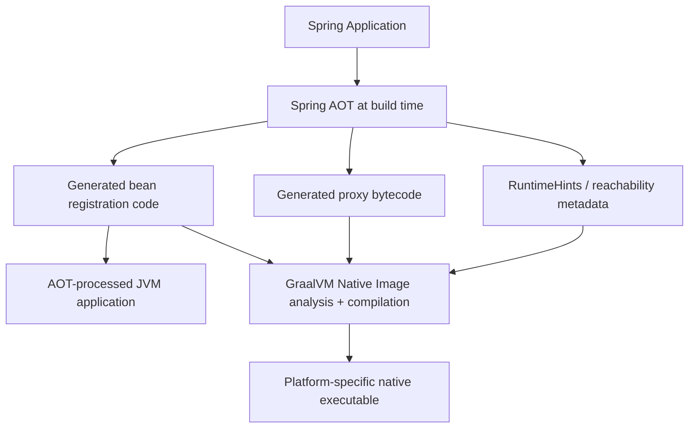

# Đánh giá Spring AOT, RuntimeHints và GraalVM Native Image

Spring Cloud Function cho phép đóng gói nghiệp vụ dưới dạng `Supplier<T>`, `Function<I, O>` và `Consumer<T>`, tra cứu bằng `FunctionCatalog`, composition các function và triển khai qua HTTP, sự kiện hoặc môi trường serverless. Khi triển khai các function này, thời gian khởi động, bộ nhớ lúc idle và độ trễ invocation đầu tiên có thể quan trọng ngang với throughput khi chạy ổn định.

**Spring Ahead-of-Time (AOT)** và **GraalVM Native Image** là hai công nghệ liên quan nhưng không đồng nghĩa:

- **Spring AOT** phân tích cấu hình Spring tại build time, sinh mã khởi tạo bean và metadata cần thiết để ứng dụng chạy với cấu hình đã được phân tích.
- **RuntimeHints** mô tả các thao tác động mà phân tích tĩnh không thể tự biết, chẳng hạn reflection, truy cập resource, serialization hoặc JDK proxy.
- **GraalVM Native Image** dùng phân tích tĩnh và metadata để biên dịch ứng dụng thành executable native dành cho một nền tảng cụ thể.

Native Image thường đáng thử với dịch vụ cần cold start nhanh, scale-to-zero hoặc footprint nhỏ. Tuy nhiên, nó có chi phí build lớn, giới hạn dynamic features và không bảo đảm throughput steady-state cao hơn JVM đã warm-up. Vì vậy, bài học này tập trung vào **đánh giá bằng số liệu và kiểm tra khả năng tương thích**, không mặc định native là lựa chọn tối ưu.

Sau bài học, bạn có thể:

1. Phân biệt Spring AOT, RuntimeHints và GraalVM Native Image.
2. Hiểu closed-world assumption và những cấu hình Spring phải được quyết định ở build time.
3. Nhận biết reflection, resource, serialization, proxy và class initialization cần metadata.
4. Đăng ký custom hints bằng `RuntimeHintsRegistrar`, `@ImportRuntimeHints` và `@RegisterReflectionForBinding`.
5. Giữ function beans và generic metadata rõ ràng để AOT xử lý được.
6. Xây dựng, chạy và kiểm thử ứng dụng Spring Cloud Function trên JVM AOT và native executable.
7. So sánh startup, first request, p50/p95/p99, throughput, RSS, binary size và build duration.

> **Phạm vi phiên bản:** Các API ví dụ dùng Spring Framework/Spring Boot có hỗ trợ AOT và Native Image, cùng Java 17+; phiên bản GraalVM Native Image và Native Build Tools phải tương thích với JDK/Spring Boot của dự án. Tên task, plugin và package API có thể thay đổi giữa các major versions. Hãy dùng version matrix được Spring Boot và GraalVM hỗ trợ, không sao chép số version cố định từ ví dụ.

## 1. Phân biệt ba khái niệm



### Spring AOT

Ứng dụng Spring thông thường khám phá cấu hình và tạo bean definitions khi khởi động. Spring AOT chuyển một phần công việc phân tích đó sang build time. AOT engine chuẩn bị một `ApplicationContext` đến giai đoạn có bean definitions, sau đó sinh mã và metadata cần để dựng context theo cấu hình đã phân tích.

Các output thường gồm:

- Java source code tái tạo bean definitions và các callback cần thiết.
- Bytecode cho một số proxy được sinh ở build time.
- Runtime hints cho reflection, resource, serialization và JDK proxies.

Mục tiêu là giảm công việc dynamic discovery lúc khởi động và cung cấp thông tin cho native compiler. AOT-generated code cũng có thể được kiểm tra trên JVM bằng cấu hình phù hợp, không bắt buộc phải biên dịch native ngay từ bước đầu.

### RuntimeHints

Native Image phân tích reachable code từ entry point, nhưng không thể luôn suy ra các thao tác được quyết định bằng dữ liệu runtime. Ví dụ:

- Gọi method bằng reflection dựa trên tên đọc từ cấu hình.
- Nạp file dictionary bằng tên resource được ghép động.
- Serialize một DTO chỉ được tìm thấy qua generic hoặc reflection.
- Tạo JDK dynamic proxy cho một danh sách interfaces.

Runtime hints cung cấp metadata để những thành phần đó vẫn hoạt động trong executable.

### GraalVM Native Image

Native Image phân tích code và metadata ở build time rồi tạo executable native. Binary chứa phần code và runtime cần thiết; không cần ship một HotSpot JVM riêng để chạy ứng dụng đó.

| Khái niệm | Thời điểm chính | Kết quả |
| --- | --- | --- |
| Spring AOT | Build time | Bean registration code, proxy bytecode, hints |
| RuntimeHints | Được đóng góp trong AOT/build process | Metadata cho dynamic access |
| GraalVM Native Image | Build time | Executable native theo OS/architecture/ABI |
| JVM runtime | Application startup/runtime | Class loading, JIT compilation và dynamic behavior |

**Spring AOT không phải native compiler. RuntimeHints không phải một bộ tối ưu tốc độ.** Chúng hỗ trợ quá trình build và tính đúng đắn của ứng dụng trong môi trường native.

## 2. Native Image thay đổi cách ứng dụng Java được phân tích

Native Image dùng **closed-world assumption**: các class và code có thể được sử dụng phải được biết khi build. Phân tích tĩnh xác định phần nào reachable từ entry point; code không reachable có thể bị loại khỏi binary.

Điều này khác JVM thông thường:

| Khía cạnh | JVM thông thường | Native Image |
| --- | --- | --- |
| Classpath | Có thể nạp class trong runtime theo cơ chế JVM | Tập class được cố định khi build |
| Class loading | Có thể lazy-load class | Không có lazy class loading theo kiểu JVM |
| Reflection | Nhiều trường hợp hoạt động nhờ class metadata có sẵn | Cần reachability metadata khi static analysis không suy ra được |
| Resource | Có thể đọc từ classpath/JAR | Resource cần được đưa vào image |
| Proxy | Có thể tạo dynamic proxy lúc chạy | Phải cung cấp metadata hoặc proxy code phù hợp |
| Bytecode generation | Một số thư viện sinh class runtime | Dynamic class definition bị giới hạn |
| Cấu hình Spring | Có thể thay đổi theo environment lúc startup | Những quyết định AOT đã ghi nhận được chốt ở build time |
| JIT | JIT tối ưu code theo profile runtime | Native code được biên dịch trước, không có HotSpot JIT warm-up |

### Hệ quả với cấu hình Spring

Spring AOT phải biết cấu hình bean sẽ được tạo như thế nào. Những điều kiện ảnh hưởng đến bean presence, như `@Profile` hoặc `@ConditionalOnProperty`, cần được đánh giá trong môi trường build AOT. Không thể mặc định thay profile hoặc bật/tắt bean theo một property bất kỳ sau khi binary đã được tạo mà vẫn nhận được cùng cấu hình bean như JVM dynamic startup.

Ví dụ:

```java
@Configuration(proxyBeanMethods = false)
@Profile("production")
class ProductionPricingConfiguration {

    @Bean
    PricingClient pricingClient() {
        return new ProductionPricingClient();
    }
}
```

Nếu profile `production` quyết định bean được tạo trong AOT build, cần build với environment tương ứng. Chạy binary sau đó với profile khác không tái tạo lại toàn bộ quá trình condition evaluation như JVM thường.

**Không đưa secret vào build environment để “giúp AOT”.** Build environment nên quyết định cấu trúc ứng dụng, không ghi password, token hoặc key môi trường vào generated code hay native image heap.

### Những pattern cần xem xét

- Bean definitions tạo động sau khi context đã khởi động.
- Đăng ký singleton bằng `registerSingleton(...)` thay vì bean definition.
- Custom `BeanDefinition` dùng instance supplier lambda/method reference mà AOT không thể chuyển đổi.
- Runtime classpath scanning hoặc plugin loading theo tên class lấy từ database.
- Circular dependencies được giải quyết bằng setter/field injection.
- Bean factory method khai báo kiểu trả về quá chung chung.
- Tạo bean với custom constructor arguments chỉ có ở runtime.

Không phải mọi lambda trong ứng dụng đều không tương thích AOT. Cảnh báo ở đây đặc biệt liên quan đến **bean definitions được đăng ký programmatically bằng instance suppliers** mà AOT không thể phân tích/chuyển đổi. Một function bean khai báo tĩnh bằng `@Bean` là pattern thông thường của Spring; vẫn cần xác minh bằng AOT processing của phiên bản đang dùng.

## 3. Spring Cloud Function: giữ function registration rõ ràng

Với Spring Cloud Function, nên khai báo function beans bằng cấu hình tĩnh, type đầy đủ và tên rõ ràng:

```java
package demo.nativeapp;

public record QuoteRequest(String sku, int quantity) {}
```

```java
package demo.nativeapp;

public record QuoteResult(
    String sku,
    int quantity,
    long totalVnd
) {}
```

```java
package demo.nativeapp;

import java.util.function.Function;

import org.springframework.context.annotation.Bean;
import org.springframework.context.annotation.Configuration;

@Configuration(proxyBeanMethods = false)
public class QuoteFunctions {

    @Bean("quote")
    public Function<QuoteRequest, QuoteResult> quote() {
        return request -> {
            if (request == null ||
                request.sku() == null ||
                request.sku().isBlank() ||
                request.quantity() <= 0) {
                throw new IllegalArgumentException("Invalid quote");
            }

            return new QuoteResult(
                request.sku(),
                request.quantity(),
                request.quantity() * 50_000L
            );
        };
    }
}
```

Các record ở ví dụ là DTO minh họa. Trong ứng dụng thực, function có thể inject repository/client và trả về DTO hoặc `Message<?>` theo contract.

### Vì sao generic và bean type quan trọng?

Function catalog và message conversion cần biết input/output type. Raw function:

```java
Function quote() { ... }
```

hoặc:

```java
Function<Object, Object> quote() { ... }
```

có thể làm mất thông tin kiểu cần cho conversion và AOT inference. Dùng chữ ký cụ thể:

```java
Function<QuoteRequest, QuoteResult>
```

Nếu sử dụng API functional registration như `FunctionRegistration` với lambda, cung cấp metadata kiểu bằng cơ chế `FunctionType` tương ứng của phiên bản Spring Cloud Function. Không trông chờ native compiler suy ra generic đã bị xóa ở runtime.

### Tránh đăng ký function động bằng singleton runtime

Một số ứng dụng tạo function từ cấu hình bên ngoài rồi gọi `GenericApplicationContext.registerSingleton(...)` hoặc thay đổi catalog khi app đang chạy. Những đăng ký đến sau AOT build không nằm trong tập bean definitions mà AOT đã phân tích.

Nếu function set cố định, ưu tiên bean definitions được đăng ký ở build time. Nếu thật sự cần plugin/function động, phải đánh giá lại yêu cầu đó với closed-world model; native image không phải môi trường để nạp tùy ý class mới từ filesystem sau khi executable đã build.

### FunctionCatalog vẫn cần được kiểm tra

Một smoke test có thể lookup function theo tên:

```java
import java.util.function.Function;

import org.springframework.cloud.function.context.FunctionCatalog;
import org.springframework.stereotype.Component;

@Component
public class QuoteCatalogSmokeCheck {

    public QuoteCatalogSmokeCheck(FunctionCatalog catalog) {
        Function<QuoteRequest, QuoteResult> quote =
            catalog.lookup("quote");

        if (quote == null) {
            throw new IllegalStateException(
                "Function 'quote' was not registered"
            );
        }
    }
}
```

Đây là ví dụ kiểm tra registration khi context khởi tạo. Trong test thực tế, nên dùng test assertion thay vì ném lỗi từ component chỉ để kiểm tra. Ngoài lookup, cần test invocation và conversion qua adapter thật.

## 4. Các loại RuntimeHints cần biết

Spring Framework cung cấp RuntimeHints API cho một số dạng dynamic access:

| Nhóm hint | Khi nào cần? | Ví dụ |
| --- | --- | --- |
| Reflection | Gọi constructor/method/field bằng reflection mà static analysis không thấy | JSON binding hoặc framework gọi method theo tên |
| Resources | Đọc file trong classpath theo tên/pattern | Template, dictionary, schema, properties |
| Serialization | Java serialization cần type metadata | Đọc/ghi Java objects qua streams |
| JDK proxies | Tạo proxy implement một hoặc nhiều interfaces | Dynamic gateway/client interface |

GraalVM reachability metadata còn có các loại khác như JNI, resource bundles và predefined classes. Không phải mọi metadata category đều có một API Spring RuntimeHints tương ứng; trường hợp đặc thù có thể cần native-image metadata theo hướng dẫn GraalVM.

### Reflection không phải lúc nào cũng cần hint

Nếu code gọi trực tiếp:

```java
QuoteResult result = new QuoteResult("BOOK-1", 2, 100_000L);
```

thì compiler nhìn thấy constructor call. Nhưng nếu framework tìm constructor, field hoặc setter dựa trên reflection và type chỉ xuất hiện qua dữ liệu runtime, static analysis có thể không đủ thông tin.

### Resource phải được đóng gói vào image

Trên JVM, classpath resource có thể được đọc từ JAR. Trong native image, resource không tự động được đưa vào executable chỉ vì file nằm trong project. Cần khai báo pattern hoặc metadata tương ứng.

### Proxy có hai tình huống

- Spring có thể sinh một số proxy class ở build time trong AOT processing.
- JDK dynamic proxies tạo từ danh sách interfaces lúc runtime cần metadata để Native Image biết các proxy interfaces có thể xuất hiện.

Không thêm proxy hints cho mọi interface theo cảm tính; chỉ đăng ký những interface mà code thực sự tạo proxy động.

## 5. Đăng ký RuntimeHints gần component sử dụng

Ví dụ ứng dụng có một pricing adapter đọc dictionary và dùng JDK proxy cho gateway interface:

```java
package demo.nativeapp;

public interface PricingGateway {
    QuoteResult quote(QuoteRequest request);
}
```

```java
package demo.nativeapp;

import org.springframework.aot.hint.MemberCategory;
import org.springframework.aot.hint.RuntimeHints;
import org.springframework.aot.hint.RuntimeHintsRegistrar;

public class PricingRuntimeHints implements RuntimeHintsRegistrar {

    @Override
    public void registerHints(
        RuntimeHints hints,
        ClassLoader classLoader
    ) {
        hints.resources().registerPattern("pricing/*.json");

        hints.reflection().registerType(
            QuoteRequest.class,
            MemberCategory.INVOKE_PUBLIC_CONSTRUCTORS,
            MemberCategory.INVOKE_PUBLIC_METHODS,
            MemberCategory.DECLARED_FIELDS
        );

        hints.proxies().registerJdkProxy(PricingGateway.class);
    }
}
```

Đăng ký registrar:

```java
package demo.nativeapp;

import org.springframework.context.annotation.Configuration;
import org.springframework.context.annotation.ImportRuntimeHints;

@Configuration(proxyBeanMethods = false)
@ImportRuntimeHints(PricingRuntimeHints.class)
public class NativeHintsConfiguration {}
```

Ví dụ chỉ minh họa các API Spring AOT; chỉ giữ reflection/proxy hints nếu code thực sự cần. `registerPattern("pricing/*.json")` phải khớp đường dẫn resource trong classpath. Không đăng ký `**/*` một cách tùy tiện vì có thể đưa thêm dữ liệu không cần thiết vào binary.

### DTO dùng cho JSON binding

Với DTO được serialize/deserialize qua client API mà AOT không thể suy luận từ controller signature, có thể dùng annotation:

```java
import org.springframework.aot.hint.annotation.RegisterReflectionForBinding;
import org.springframework.context.annotation.Configuration;

@Configuration(proxyBeanMethods = false)
@RegisterReflectionForBinding({
    QuoteRequest.class,
    QuoteResult.class
})
public class QuoteBindingConfiguration {}
```

Đây là cách khai báo gọn cho binding types. Nếu Spring Boot/Spring Framework phiên bản hiện tại đã suy ra hints cho một đường serialization cụ thể, không cần đăng ký trùng lặp vô ích. Kiểm tra generated hints và native tests trước khi thêm custom metadata.

### Khi nào cần hints serialization?

Nếu ứng dụng dùng Java serialization (`ObjectInputStream`/`ObjectOutputStream`) thì có thể cần đăng ký Java serialization metadata. JSON binding thông thường không đồng nghĩa với Java native serialization; hãy dùng reflection/binding hints đúng với converter đang chạy.

## 6. Kiểm thử RuntimeHints

Không nên chỉ build native rồi chờ runtime báo lỗi. Có thể kiểm tra từng registrar bằng `RuntimeHintsPredicates`.

```java
package demo.nativeapp;

import static org.assertj.core.api.Assertions.assertThat;

import org.junit.jupiter.api.Test;
import org.springframework.aot.hint.RuntimeHints;
import org.springframework.aot.hint.predicate.RuntimeHintsPredicates;

class PricingRuntimeHintsTests {

    @Test
    void registersDictionaryResources() {
        RuntimeHints hints = new RuntimeHints();

        new PricingRuntimeHints().registerHints(
            hints,
            getClass().getClassLoader()
        );

        assertThat(
            RuntimeHintsPredicates.resource()
                .forResource("pricing/en.json")
        ).accepts(hints);
    }
}
```

Test này xác minh resource pattern đã được đăng ký. Có thể viết các predicate tests tương ứng cho reflection, serialization hoặc proxy theo API của Spring Framework đang dùng. Test hint **không thay thế integration test chạy native executable**.

### RuntimeHints Agent

Spring Core có RuntimeHints recording agent ở module test chuyên dụng để ghi lại một số thao tác dynamic cần metadata trong phạm vi được instrument. Cách tiếp cận:

1. Chạy đoạn code/test đại diện qua recording agent.
2. Ghi nhận reflection/resource/proxy operations.
3. So sánh các invocation ghi nhận với RuntimeHints do component đóng góp.
4. Bổ sung hint còn thiếu.
5. Chạy lại test với các nhánh nghiệp vụ khác.

Agent có phạm vi instrument và không thể quan sát code path chưa được chạy. Vì vậy, một lần chạy happy path không chứng minh toàn bộ ứng dụng có metadata đầy đủ.

## 7. RuntimeHints và GraalVM reachability metadata khác nhau thế nào?

Spring AOT tạo hints từ framework và ứng dụng. GraalVM Native Image tiêu thụ reachability metadata ở nhiều dạng, bao gồm JSON configuration trong `META-INF/native-image` hoặc metadata được đóng góp bởi thư viện.

Ví dụ một dependency có thể ship metadata riêng trong JAR; ứng dụng không cần tự copy từng file nếu metadata đó được Native Image nhận diện theo cơ chế tương thích. Khi thiếu hỗ trợ, có thể cần custom RuntimeHints hoặc native metadata.

| Nguồn metadata | Vai trò |
| --- | --- |
| Spring AOT contributions | Hints từ Spring framework, auto-configuration và component |
| Custom `RuntimeHintsRegistrar` | Hints riêng của ứng dụng/library |
| `@RegisterReflectionForBinding` | Khai báo binding types |
| Reachability metadata của dependency | Hỗ trợ dynamic features của third-party library |
| JSON trong `META-INF/native-image` | Metadata native được đóng gói trong application/dependency |
| Native Image Agent output | Gợi ý metadata từ code paths đã chạy |

Không chỉnh trực tiếp file generated mỗi lần build như một cách sửa bền vững; file generated có thể bị ghi đè. Đặt custom hints trong source code hoặc thư mục metadata riêng theo convention của build tool.

## 8. AOT restrictions ảnh hưởng đến function configuration

Spring AOT cần một bean model có thể xác định trước. Với Spring Cloud Function, nên:

- Khai báo function beans bằng `@Bean` và return type generic cụ thể.
- Giữ danh sách function ổn định ở build time.
- Tránh `registerSingleton(...)` sau khi context đã được dựng.
- Dùng bean definitions/registrars đúng lifecycle nếu phải đăng ký programmatically.
- Hạn chế runtime classpath scanning và dynamic class loading.
- Tránh phụ thuộc vào environment property thay đổi bean presence sau native build.
- Tránh circular dependencies; dùng `ObjectProvider` hoặc `@Lazy` khi phù hợp.

### Ví dụ composition được cấu hình rõ

Giả sử có hai functions:

```java
@Bean
Function<QuoteRequest, QuoteResult> calculateQuote() {
    return request -> calculate(request);
}

@Bean
Function<QuoteResult, String> renderQuote() {
    return result -> result.sku() + ":" + result.totalVnd();
}
```

Có thể cấu hình composition bằng function definition:

```yaml
spring:
  cloud:
    function:
      definition: calculateQuote|renderQuote
```

Composition vẫn là function pipeline trong Spring Cloud Function. Nếu function beans được khai báo tĩnh, AOT có thể phân tích bean model tốt hơn so với việc tạo và đăng ký tùy ý các functions từ class names lấy ở runtime.

Tuy nhiên, cần kiểm tra phiên bản Spring Cloud Function và adapter cụ thể với native build; không suy ra mọi combination binder/composition đều đã được hỗ trợ chỉ vì một function bean đơn giản chạy được.

## 9. Xây dựng native image với Gradle

Ví dụ plugin block (thay placeholders bằng các version tương thích):

```groovy
plugins {
    id 'java'
    id 'org.springframework.boot' version '<spring-boot-version>'
    id 'org.graalvm.buildtools.native' version '<native-build-tools-version>'
}
```

Khi Native Build Tools plugin được áp dụng cùng Spring Boot Gradle plugin tương thích, Spring Boot cấu hình AOT tasks và native build integration.

Các lệnh thường dùng:

```bash
./gradlew processAot
./gradlew bootJar
```

`processAot` tạo AOT application contributions. Sau đó có thể chạy JAR có chứa generated AOT code trên JVM:

```bash
java -Dspring.aot.enabled=true -jar build/libs/application.jar
```

JAR phải được build với AOT generated output. Nếu chạy JAR không có AOT assets, bật property không tự sinh chúng tại runtime.

Biên dịch native:

```bash
./gradlew nativeCompile
```

Với cấu hình plugin phổ biến, executable được tạo dưới:

```text
build/native/nativeCompile/
```

Tên binary phụ thuộc tên project/application. Kiểm tra output của build task thay vì hard-code tên.

### Chạy container native

Spring Boot cũng tích hợp buildpacks để tạo container image native khi build environment có Docker daemon và native build support phù hợp. Native image là binary theo platform; build image trên Linux/architecture khác với runtime cần được kiểm tra kỹ, vì không thể giả định một executable native chạy được trên mọi OS.

## 10. Xây dựng native image với Maven

Nếu project dùng Spring Boot starter parent, profile `native` có thể cung cấp cấu hình build thuận tiện. Ví dụ:

```bash
./mvnw -Pnative spring-boot:build-image
```

Profile này thường phối hợp `process-aot`, native build tools và build-image. Nếu không dùng starter parent, cần khai báo execution `process-aot` và cấu hình Native Build Tools phù hợp theo tài liệu Maven plugin của phiên bản.

Không trộn plugin versions tùy ý. JDK, Spring Boot, GraalVM distribution và Native Build Tools cần nằm trong compatibility matrix tương ứng. Native compilation cũng cần toolchain/platform dependencies phù hợp với OS target.

## 11. Kiểm tra AOT trên JVM trước khi build native

Một bước kiểm tra nhanh là chạy ứng dụng trên JVM với generated AOT code:

```bash
java -Dspring.aot.enabled=true -jar target/application.jar
```

Điều này giúp phát hiện một số lỗi do generated bean definitions, profile/conditions và AOT initialization trước khi chờ native compilation lâu.

Lưu ý:

- JAR phải chứa AOT-generated classes/resources.
- Build phải dùng cùng profile/environment ảnh hưởng bean conditions như native target.
- AOT-on-JVM vẫn là JVM process; nó không kiểm tra mọi khác biệt của Native Image.
- Reflection/resource/proxy compatibility vẫn cần native executable tests.

## 12. Kiểm thử native image có trọng tâm

Không nhất thiết chạy toàn bộ test suite bằng native image ngay từ đầu. Spring Boot khuyến nghị tiếp tục dùng JVM cho phần lớn unit/integration tests để feedback nhanh; tập trung native testing vào các đường có khác biệt.

### Ma trận test

| Test layer | Mục tiêu |
| --- | --- |
| Unit tests trên JVM | Logic nghiệp vụ, validation và error cases |
| Spring integration tests | Bean wiring, FunctionCatalog, adapter configuration |
| RuntimeHints predicate tests | Metadata cần thiết đã được đóng góp |
| AOT-on-JVM smoke test | Generated AOT context khởi động đúng |
| Native executable smoke test | Native binary start và readiness |
| Native HTTP test | JSON binding, request/response conversion |
| Native event test | Binder serialization, headers, ack/retry nếu dùng |
| Native reflection/resource test | Dynamic code paths thực sự hoạt động |
| Native load test | Startup, RSS, latency và throughput |

### Các luồng quan trọng với Spring Cloud Function

1. Lookup function bằng `FunctionCatalog`.
2. Invoke function trực tiếp với DTO.
3. Gọi qua HTTP adapter với JSON input và output.
4. Kiểm tra `Message<?>` headers và payload conversion.
5. Test composition nhiều function.
6. Test `Supplier`/`Consumer` nếu có dùng.
7. Test event binder và retry/ack khi deploy event-driven.
8. Test resource/config file mà function sử dụng.
9. Test profile/environment được dùng để build.
10. Test các DTO được tạo/serialize qua reflection-based mapper.

### Smoke test native executable

```bash
./build/native/nativeCompile/application
```

Sau khi process sẵn sàng, gọi endpoint function như một client thực và xác nhận response. Không chỉ kiểm tra exit code bằng không; một binary có thể khởi động nhưng lỗi khi lần đầu thực hiện reflection, serialize DTO hoặc đọc resource.

## 13. Native Image Agent: thu thập metadata từ đường chạy thực

GraalVM cung cấp Native Image tracing agent để ghi nhận một số dynamic accesses trong lúc ứng dụng chạy trên JVM. Ví dụ lệnh khái niệm:

```bash
java -agentlib:native-image-agent=config-output-dir=build/native-agent-config \
  -jar build/libs/application.jar
```

Sau khi khởi động ứng dụng, chạy các kịch bản cần kiểm tra:

- HTTP request cho từng DTO và response shape.
- Các nhánh composition.
- Các resource được load theo locale/config.
- Các code paths sử dụng reflection/proxy.
- Event consumer và error handling.

Agent sinh metadata từ những thao tác **đã quan sát được**. Nó không chứng minh code paths chưa chạy sẽ có đủ hints. Không nên bật agent trong một lần startup ngắn rồi coi output là cấu hình hoàn chỉnh cho production.

Quy trình:

1. Chạy unit/integration scenario trên JVM với agent.
2. Thu metadata vào thư mục riêng.
3. Review file generated, loại bỏ entry không còn cần và kiểm tra đường dẫn.
4. Đặt metadata bền vững trong project/dependency theo convention GraalVM.
5. Build native lại và chạy native tests.
6. Thêm regression tests cho các dynamic paths dễ bị quên.

Ưu tiên hints tường minh từ thư viện và Spring AOT khi có sẵn; agent là công cụ hỗ trợ tìm missing metadata.

## 14. Class initialization: đừng chuyển mọi thứ sang build time

Native Image có thể thực hiện một số class initialization trong lúc build và lưu static state vào image heap. Việc này có thể giảm công việc lúc startup, nhưng thay đổi thời điểm static initializer chạy.

Ví dụ rủi ro:

```java
public final class PricingConfiguration {

    static final String API_TOKEN =
        System.getenv("PRICING_API_TOKEN");

    static final long STARTED_AT =
        System.currentTimeMillis();
}
```

Nếu class này bị initialize tại build time, token và timestamp có thể phản ánh môi trường build, không phải môi trường runtime. Việc đưa secret vào image heap còn tạo rủi ro bảo mật.

### Những trạng thái không nên vô tình đóng băng

- Environment variables, system properties và secrets.
- File descriptors, sockets hoặc threads.
- Current working directory và file paths phụ thuộc deployment.
- Random seeds/state và timestamp khởi tạo.
- Credentials, certificate hoặc key được rotate lúc runtime.
- Client connections hoặc object giữ native handles.

Native Image có `--initialize-at-build-time` và `--initialize-at-run-time` để điều chỉnh class initialization, nhưng **không thêm flags theo kiểu thử-và-sai trên cả package lớn**. Chỉ thay đổi khi hiểu static initializer và test đúng semantics. Ưu tiên để runtime initialization mặc định nếu chưa có bằng chứng cần tối ưu.

## 15. Các giới hạn dynamic features cần kiểm tra

| Feature | Nguy cơ trong native | Hướng xử lý |
| --- | --- | --- |
| Reflection | Constructor/method/field bị loại khỏi image | RuntimeHints hoặc reachability metadata |
| Resource loading | File không có trong executable | Resource hints |
| JSON binding | DTO cần reflection không có metadata | `@RegisterReflectionForBinding` hoặc hints phù hợp |
| JDK dynamic proxy | Interface combination chưa được đăng ký | Proxy hints |
| Runtime bytecode/class loading | Class mới không có khi build | Chuyển sang build-time generation hoặc thiết kế khác |
| JNI/native library | Native symbols/metadata không tương thích | Kiểm tra GraalVM compatibility và JNI config |
| Classpath scanning runtime | Không còn classpath động như JVM | Scan/đăng ký ở build time |
| Script engine/plugin system | Nạp code tùy ý từ runtime | Xem xét lại kiến trúc hoặc dùng JVM |
| Runtime bean registration | Bean không có trong AOT model | Khai báo bean definitions ở build time |
| Locale/resource bundles | Bundle thiếu trong image | Resource bundle metadata |

Native Image hỗ trợ nhiều Java features nhưng không giống HotSpot JVM ở mọi khía cạnh. Với thư viện bên thứ ba, kiểm tra reachability metadata và compatibility guide của GraalVM/Spring Boot thay vì tự thêm hàng loạt reflection hints.

## 16. Đánh giá hiệu năng: đo cả build và runtime

Native Image có trade-off ở hai giai đoạn:

| Chỉ số | JVM | Spring AOT trên JVM | GraalVM Native Image |
| --- | --- | --- | --- |
| Build duration | Thường thấp hơn | Tăng do AOT processing | Có thể tăng đáng kể do native compilation |
| Startup | Có JVM/bootstrap và class loading | Có thể giảm một phần Spring setup | Thường nhanh hơn, nhưng phụ thuộc app/environment |
| First request | Có thể chịu class loading/JIT warm-up | Tùy JVM và code path | Không có JIT warm-up như HotSpot, nhưng vẫn có lazy app work |
| Steady-state throughput | JIT có thể tối ưu mạnh sau warm-up | Gần JVM với khác biệt AOT context | Có thể thấp hơn, tương đương hoặc cao hơn tùy workload |
| Memory footprint | JVM heap + native overhead | Vẫn là JVM | Có thể thấp hơn, cần đo RSS/native memory |
| Binary/artifact size | JAR + runtime image | JAR/AOT output | Native executable/container |
| Portability | Tương đối cao với compatible JVM | Tương tự JVM | Gắn với OS/architecture/ABI target |
| Debug/development | Tooling JVM trưởng thành | Tương tự JVM | Một số chẩn đoán/agent workflows khác biệt |

### Startup không phải một con số duy nhất

Đo riêng:

1. Process start → Spring context ready.
2. Container start → readiness probe thành công.
3. First request sau readiness.
4. First request sau khi scale-from-zero.
5. Warm request sau một khoảng tải ổn định.

Một native binary có thể start nhanh nhưng first request vẫn chậm do mở connection, đọc resource, DNS, TLS hoặc khởi tạo client lần đầu.

### Throughput steady-state

HotSpot JIT có thời gian quan sát profile và tối ưu code nóng. Native Image biên dịch ahead-of-time, không có cùng cơ chế JIT warm-up. Do đó, native image có thể rất tốt cho workload ngắn/cold-start nhưng không nhất thiết tốt nhất cho service chạy lâu với CPU-bound hot loops.

Không dùng kết quả startup nhanh để kết luận throughput cao hơn.

### Memory

Native Image thường được chọn vì có thể giảm footprint, nhưng cần đo:

- Container RSS.
- Heap/managed memory theo runtime native.
- Direct buffers và native libraries.
- Memory ở steady-state và peak load.
- Memory theo số concurrent invocations.

So sánh `-Xmx` của JVM với một số đo RSS của native image là không công bằng. Phải dùng **cùng ranh giới container/process** và cùng tải.

## 17. Thiết kế benchmark công bằng

Tạo hai artifacts từ cùng source revision:

- JVM executable JAR (và có thể thêm JVM AOT variant).
- Native executable/container.

Giữ giống nhau:

- Business logic, function definition và input/output DTO.
- Adapter (HTTP/event) và protocol.
- JDK/Spring dependency versions tương thích.
- CPU, memory limit, network, downstream services.
- Connection pool, timeout, retry và concurrency.
- Payload size, arrival rate, warm-up/test duration.

### Ma trận số liệu cần ghi

| Nhóm | Metric |
| --- | --- |
| Build | Build duration, CPU hours, cache hit, artifact size |
| Startup | Process-to-ready, container-to-ready |
| First request | First request latency, connection setup |
| Runtime | p50/p95/p99, throughput, error/timeout rate |
| CPU | Average/peak CPU, throttling |
| Memory | RSS, peak memory, per-invocation retained memory |
| Scaling | Cold starts, scale-up duration, concurrent instances |
| Operations | Image size, deploy/pull time, crash/restart behavior |

### Kịch bản test

1. Cold start: tạo process/container mới và đo đến readiness.
2. First invocation: gọi function một lần sau readiness.
3. Warm-up: chạy tải vừa đủ để ổn định.
4. Steady-state: giữ arrival rate mục tiêu và đo percentiles.
5. Burst: tăng tải nhanh để quan sát queue, rejection và memory.
6. Soak: chạy lâu để phát hiện leak, resource exhaustion và drift.
7. Scale-from-zero: đo thời gian platform cấp environment mới nếu use case cần.

Chạy nhiều lần, đổi thứ tự JVM/native khi phù hợp và ghi rõ môi trường. Không benchmark native ở máy khác CPU/OS với JVM rồi quy mọi khác biệt cho compiler.

## 18. Ví dụ bảng kết quả giả định và cách ra quyết định

Bảng dưới đây chỉ là **số liệu giả định để luyện cách đọc**, không phải kết quả benchmark của Spring Cloud Function:

| Metric | JVM | JVM + AOT | Native |
| --- | ---: | ---: | ---: |
| Container-to-ready | 1.250 ms | 980 ms | 180 ms |
| First request p95 | 90 ms | 78 ms | 55 ms |
| Warm p95 | 22 ms | 21 ms | 24 ms |
| Throughput | 4.800 req/s | 4.900 req/s | 4.300 req/s |
| RSS steady | 390 MiB | 370 MiB | 170 MiB |
| Build duration | 35 s | 55 s | 8 min |
| Artifact size | 85 MiB | 88 MiB | 105 MiB |

Diễn giải:

- Native có lợi thế lớn về startup/RSS trong kịch bản giả định.
- Warm p95 và throughput native thấp hơn JVM; nếu service chạy liên tục và CPU-bound, cần cân nhắc chi phí này.
- Build duration native dài hơn, làm CI và release cycle tốn tài nguyên.
- Với workload scale-to-zero hoặc serverless, cold start và RSS có thể đáng giá hơn throughput tối đa.
- Với service chạy lâu, JVM có thể là lựa chọn tốt hơn nếu JIT throughput và operational simplicity quan trọng.

Không chọn chỉ từ một metric. Quyết định phải gắn với SLO, chi phí hạ tầng, thời gian build và đặc điểm triển khai.

## 19. Spring Cloud Function qua HTTP, event và serverless

Một function bean có thể được expose qua nhiều adapter, nhưng **native compatibility của toàn bộ application phụ thuộc cả adapter và dependency**:

| Deployment | Thành phần cần kiểm tra |
| --- | --- |
| HTTP | Web MVC/WebFlux, JSON codecs, reflection DTO binding, embedded server |
| Spring Cloud Stream | Binder, serializers/deserializers, broker client, ack/retry |
| Serverless | Function adapter, cloud SDK, event DTO, platform runtime/bootstrap |
| Function composition | Bean discovery, function generic metadata, conversion |
| Messaging | Message headers, converters, proxy/reflective invocation |

Không suy ra rằng native HTTP function chạy được thì Kafka/Rabbit binder hoặc mọi serverless adapter cũng chạy được. Mỗi integration có dependency và dynamic features riêng.

### HTTP JSON binding

Một function:

```java
@Bean
Function<QuoteRequest, QuoteResult> quote() {
    return request -> new QuoteResult(
        request.sku(),
        request.quantity(),
        request.quantity() * 50_000L
    );
}
```

có thể hoạt động khi gọi trực tiếp với DTO, nhưng vẫn thất bại ở native HTTP path nếu JSON binding cần reflection metadata chưa được đăng ký. Hãy test cả catalog lookup lẫn HTTP request thực.

### Event binder

Với event-driven function, test serialization, deserialization, message headers, content type, retry và ack trong native executable. Nếu binder dependency chưa có reachability metadata tương thích, native build có thể fail hoặc lỗi khi chạy.

### Serverless

Native image có thể hấp dẫn với function-as-a-service vì cold start và memory, nhưng phải kiểm tra:

- Runtime/bootstrap contract của provider.
- OS/architecture và ABI của native executable.
- Cách platform inject environment/configuration/secrets.
- Request concurrency trong một execution environment.
- Native image startup và first invocation latency.
- SDK/cloud client compatibility.

Không mặc định mọi provider chạy một native binary theo cùng cách; deployment adapter phải hỗ trợ đúng artifact/runtime.

## 20. Troubleshooting native build và runtime

| Triệu chứng | Nguyên nhân có thể | Hướng kiểm tra |
| --- | --- | --- |
| Native build báo missing reflection metadata | Reflection path chưa được mô tả | Tìm call site, dùng RuntimeHints/metadata và test |
| Native chạy nhưng JSON DTO fail | Binding DTO chưa có hints | `@RegisterReflectionForBinding`, test endpoint |
| Không đọc được file config/dictionary | Resource không được đóng gói | `resources().registerPattern(...)` |
| JDK proxy không tạo được | Proxy interface list thiếu metadata | `proxies().registerJdkProxy(...)` |
| FunctionCatalog không tìm thấy function | Bean registration/type metadata không đúng hoặc registration động | Kiểm tra bean definitions, generic, AOT mode |
| Profile khác JVM behavior | Profile/condition đã được đánh giá ở build time | Build với đúng environment |
| Runtime plugin không load | Closed-world, class không nằm trong image | Đổi thiết kế hoặc giữ JVM deployment |
| Build fail khi class init | Static initializer có side effect/state không an toàn | Xem build-time vs runtime initialization |
| Native binary chạy ở máy build nhưng không ở production | OS/architecture/libc khác | Build cho target platform |
| Build native quá lâu | Static analysis/linking lớn, dependency nhiều | Cache, giảm dependency/reachability, CI capacity |
| RSS cao hơn kỳ vọng | Buffers/native libraries/heap retained | Profile process/container memory |
| Startup nhanh nhưng first request chậm | Lazy resource/connection/DNS setup | Đo readiness và first request riêng |
| Throughput thấp hơn JVM | Không có JIT profile optimization hoặc bottleneck khác | So cùng workload, CPU profile và p99 |
| Secret sai sau deploy | Static state bị đóng băng khi build | Không bake environment secrets vào image |

### Quy trình xử lý một missing hint

1. Ghi lại chính xác lỗi và call path trong native executable.
2. Xác định dynamic access là reflection, resource, serialization, proxy hay JNI.
3. Kiểm tra dependency có reachability metadata sẵn không.
4. Nếu là application code, thêm hint tối thiểu gần component cần nó.
5. Viết predicate test cho hint nếu API hỗ trợ.
6. Rebuild native và chạy đúng scenario.
7. Thêm regression test để tránh mất hint ở lần refactor sau.

Không dùng một cấu hình reflection rộng cho toàn package chỉ để làm build pass mà không hiểu thành phần nào thực sự cần.

## 21. Khi nào nên chọn JVM, JVM AOT hoặc Native Image?

| Tình huống | Hướng nên đánh giá |
| --- | --- |
| Service chạy lâu, throughput CPU-bound quan trọng | JVM trước; benchmark native nếu có lý do |
| Scale-to-zero, cold start là SLO chính | Native Image đáng thử |
| Memory budget/container density rất chặt | So RSS native và JVM dưới cùng tải |
| Dùng runtime plugin/class loading động | JVM thường phù hợp hơn |
| Dùng thư viện chưa có native metadata | JVM hoặc thay dependency trước |
| Build pipeline có thời gian/tài nguyên hạn chế | JVM/AOT-on-JVM có thể đơn giản hơn |
| Spring startup chiếm phần lớn cold start | Thử Spring AOT trên JVM trước |
| Function serverless ngắn, ít request mỗi instance | Native có thể giảm cold start |
| Throughput steady-state và JIT warm-up quan trọng | Đo JVM vs native theo workload thực |

### Một thứ tự đánh giá ít rủi ro

1. Tối ưu bean graph và dependency startup trên JVM.
2. Đo baseline startup/RSS/first/warm latency.
3. Bật Spring AOT và chạy AOT-on-JVM.
4. Sửa các hạn chế AOT và giữ regression tests.
5. Build native prototype cho một deployment adapter thực.
6. Bổ sung hints tối thiểu, test native.
7. Benchmark native/JVM cùng tải và cùng môi trường.
8. Quyết định theo SLO, build cost, compatibility và vận hành.

Không cần chuyển toàn bộ hệ thống sang native nếu chỉ một vài function workloads có cold-start requirement. Có thể tách deployment units theo nhu cầu nếu kiến trúc và chi phí vận hành cho phép.

## 22. Bài tập thực hành

**Bài 1 — Phân biệt.** Spring AOT và GraalVM Native Image có phải cùng một bước không?

*Đáp án:* Không. Spring AOT phân tích context và sinh code/hints; Native Image dùng static analysis và metadata để biên dịch executable native.

**Bài 2 — Closed world.** Vì sao một plugin class chỉ có trên filesystem production nhưng không có khi build native không thể được load như JVM thông thường?

*Đáp án:* Native Image cố định tập class reachable lúc build. Class mới không nằm trong image không thể được load tùy ý theo classpath runtime.

**Bài 3 — RuntimeHints.** Một function đọc `pricing/en.json` từ classpath theo tên runtime. Nhóm hint nào cần xem xét?

*Đáp án:* Resource hints, ví dụ `hints.resources().registerPattern("pricing/*.json")`, nếu resource không được tự suy ra.

**Bài 4 — DTO binding.** Một WebClient deserialize `QuoteResult` qua JSON trong method body; AOT không suy ra DTO. Cách khai báo nào có thể phù hợp?

*Đáp án:* `@RegisterReflectionForBinding(QuoteResult.class)` hoặc registrar tương ứng, sau khi xác nhận converter và version cần reflection metadata.

**Bài 5 — Function registration.** Vì sao raw `Function` hoặc đăng ký singleton động có thể gây khó khăn cho AOT?

*Đáp án:* Raw type làm mất generic metadata; singleton được đăng ký sau quá trình AOT không thuộc bean model đã phân tích.

**Bài 6 — Build-time conditions.** Một bean chỉ tồn tại khi `@Profile("production")`. Cần chú ý gì?

*Đáp án:* Profile ảnh hưởng bean presence phải được chọn trong môi trường AOT build; không giả định thay profile lúc chạy sẽ tạo bean khác như JVM dynamic configuration.

**Bài 7 — Hint testing.** RuntimeHints predicate test pass có chứng minh native executable chạy đúng mọi flow không?

*Đáp án:* Không. Nó kiểm tra metadata đã khai báo; cần native smoke/integration tests cho code paths thực.

**Bài 8 — Native Image Agent.** Chạy tracing agent một lần trên happy path đã đủ metadata chưa?

*Đáp án:* Chưa. Agent chỉ ghi nhận các dynamic access đã chạy; phải exercise nhiều branches, event types, locales và error paths.

**Bài 9 — Class initialization.** Có nên thêm `--initialize-at-build-time` cho toàn bộ package để startup nhanh?

*Đáp án:* Không. Static initializers có thể capture environment, secrets, timestamps, file descriptors hoặc threads; chỉ thay đổi từng class sau khi kiểm tra semantics.

**Bài 10 — Performance.** Native startup nhanh hơn nhưng warm throughput thấp hơn JVM. Nên chọn cái nào?

*Đáp án:* Phụ thuộc SLO và workload. Serverless/scale-to-zero có thể ưu tiên startup; service chạy lâu có thể ưu tiên JVM throughput. So cả cost/build/operations.

**Bài 11 — Platform.** Một native binary build trên Windows có thể được giả định chạy trên Linux production không?

*Đáp án:* Không. Native executable gắn với OS/architecture/ABI; build hoặc cung cấp artifact phù hợp target platform.

**Bài 12 — Function adapter.** Native HTTP function pass thì Kafka binder chắc chắn pass không?

*Đáp án:* Không. Binder và broker client có dependency, serializers, proxies và metadata riêng; cần native tests trên adapter thực tế.

## 23. Ghi nhớ

- **Spring AOT, RuntimeHints và GraalVM Native Image là ba phần liên quan nhưng khác nhiệm vụ.**
- **AOT chốt một phần bean model ở build time**; profile/conditions ảnh hưởng bean presence phải khớp môi trường build.
- **Native Image dùng closed-world analysis**; runtime class loading và plugin động không giống JVM.
- **RuntimeHints mô tả dynamic access** như reflection, resources, serialization và JDK proxies; đăng ký tối thiểu theo nhu cầu thực.
- **Giữ function beans tĩnh và generic rõ ràng**, tránh raw types và singleton registration muộn.
- **Test hints riêng, chạy AOT trên JVM, sau đó kiểm thử native executable** qua adapter thật.
- **Native Image Agent chỉ quan sát code paths đã chạy**, không chứng minh metadata đầy đủ.
- **Không ép class initialization sang build time nếu static state phụ thuộc runtime hoặc secret.**
- **Đánh giá native và JVM trên cùng workload**: startup, first request, warm p50/p95/p99, throughput, RSS, build time và artifact size.
- **Native có thể phù hợp cold-start/memory goals; JVM có thể phù hợp long-running throughput và dynamic libraries.** Quyết định theo SLO và chi phí vận hành.

**Tài liệu tham khảo chính thức:**

- [Spring Framework — Ahead of Time Optimizations](https://docs.spring.io/spring-framework/reference/core/aot.html)
- [Spring Boot — Introducing GraalVM Native Images](https://docs.spring.io/spring-boot/reference/packaging/native-image/introducing-graalvm-native-images.html)
- [Spring Boot — Advanced Native Image Topics](https://docs.spring.io/spring-boot/reference/packaging/native-image/advanced-topics.html)
- [Spring Boot — Testing GraalVM Native Images](https://docs.spring.io/spring-boot/how-to/native-image/testing-native-applications.html)
- [Spring Boot — Gradle AOT Processing](https://docs.spring.io/spring-boot/gradle-plugin/aot.html)
- [GraalVM — Reachability Metadata](https://www.graalvm.org/latest/reference-manual/native-image/metadata/)
- [GraalVM — Native Image Compatibility Guide](https://www.graalvm.org/dev/reference-manual/native-image/metadata/Compatibility/)
- [Spring Boot with GraalVM — Known Limitations](https://github.com/spring-projects/spring-boot/wiki/Spring-Boot-with-GraalVM)

Các con số trong phần benchmark là giả định để hướng dẫn cách phân tích, không phải kết quả đo thực tế. Trước khi triển khai, xác nhận version compatibility, test đúng function adapter và thay toàn bộ giả định bằng số liệu từ môi trường target.
