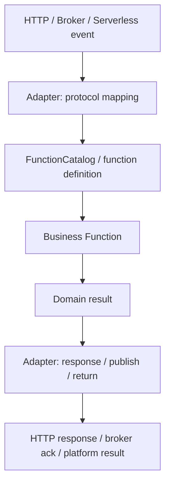
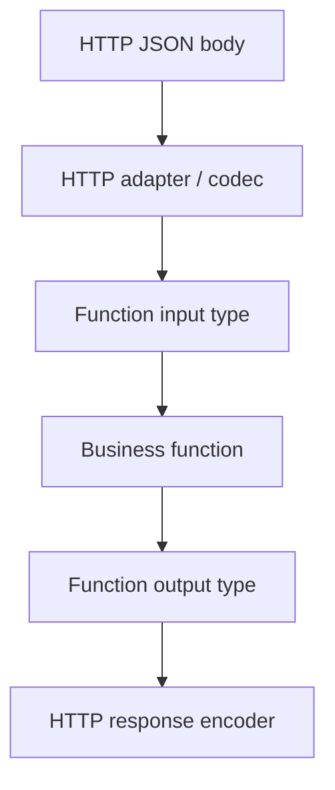
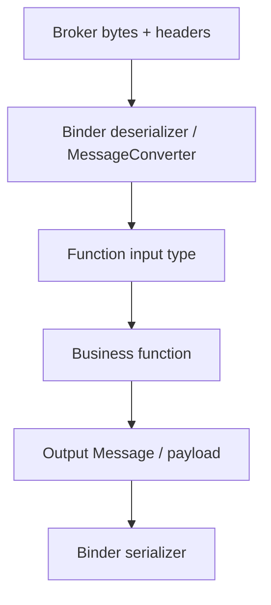

# Kiểm tra tương thích adapter trước khi chọn kiểu triển khai tối ưu

Spring Cloud Function cho phép phát triển logic nghiệp vụ tái sử dụng bằng `Supplier<T>`, `Function<I, O>` và `Consumer<T>`, tra cứu qua `FunctionCatalog`, composition nhiều function và triển khai cùng logic qua HTTP, sự kiện hoặc môi trường serverless. Tuy nhiên, một function chạy tốt khi gọi trực tiếp trong JVM chưa chứng minh nó phù hợp với mọi adapter.

**Adapter là lớp nối function với giao thức hoặc nền tảng thực thi.** HTTP adapter, Spring Cloud Stream binder và serverless adapter có cách nhận payload, ánh xạ kiểu, truyền headers, xử lý lỗi, quản lý concurrency và xác nhận kết quả khác nhau. Một chữ ký function hợp lệ ở adapter này có thể không có semantics tương đương ở adapter khác.

Trước khi chọn kiểu triển khai tối ưu, cần kiểm tra **contract của function và khả năng thực tế của adapter**. Không nên chọn WebFlux chỉ vì function trả về `Flux<T>`, chọn broker chỉ vì cần async, hoặc chọn serverless chỉ vì muốn cold start thấp mà chưa kiểm tra request model, retry, payload limits và lifecycle.

Sau bài học, bạn có thể:

1. Phân biệt function programming model với adapter/protocol/runtime.
2. So sánh HTTP, event binder và serverless theo request model, response, headers, streaming và error semantics.
3. Kiểm tra khả năng chuyển đổi payload, generic types, `Message<?>` và `contentType`.
4. Xác định nơi xử lý ack, retry, dead-letter, timeout, cancellation và idempotency.
5. Kiểm tra concurrency, backpressure, batch, payload size, cold start và resource limits.
6. Viết contract tests và integration tests trên adapter đích.
7. Chọn adapter dựa trên SLO, vận hành và năng lực downstream thay vì dựa vào một benchmark riêng lẻ.

> **Phạm vi:** Ví dụ dùng Java 17+ và Spring Cloud Function theo functional programming model. Spring Cloud Stream binder, Spring Cloud Function Web và serverless adapters có khả năng khác nhau theo phiên bản và provider. Property/binding names trong ví dụ cần đối chiếu dependency thực tế; không giả định mọi adapter hỗ trợ cùng một tập chữ ký.

## 1. Tách function, adapter và runtime

Một ứng dụng thường có ba lớp:



- **Function:** logic nghiệp vụ, ví dụ tính giá đơn hàng.
- **Adapter:** chuyển request/event thành input mà function nhận được, sau đó ánh xạ kết quả thành HTTP response, message publish hoặc kết quả platform.
- **Runtime/platform:** quản lý process, threads, event delivery, scaling, timeout, environment và resource.

Spring Cloud Function cung cấp abstraction function và catalog. Adapter có thể đến từ Spring Cloud Function Web, Spring Cloud Stream binder hoặc integration dành cho serverless platform. Runtime có thể là embedded server, broker consumer hoặc execution environment của cloud provider.

**Một function thuần chạy được không đồng nghĩa toàn bộ adapter path chạy được.** Adapter còn có thể thêm serialization, message conversion, routing, security, acknowledgement và retry.

## 2. Bắt đầu bằng contract nghiệp vụ ổn định

Ví dụ function xử lý order:

```java
package demo.adapter;

public record OrderCreated(
    String eventId,
    String orderId,
    String customerId,
    long totalVnd
) {}
```

```java
package demo.adapter;

public record OrderAccepted(
    String orderId,
    String status,
    long acceptedAtEpochMillis
) {}
```

Function tập trung vào contract:

```java
package demo.adapter;

import java.util.function.Function;

import org.springframework.context.annotation.Bean;
import org.springframework.context.annotation.Configuration;

@Configuration(proxyBeanMethods = false)
public class OrderFunctions {

    @Bean("acceptOrder")
    public Function<OrderCreated, OrderAccepted> acceptOrder(
        OrderService service
    ) {
        return event -> service.accept(event);
    }
}
```

OrderService là service nghiệp vụ được inject; function không cần biết input đến từ HTTP, broker hay serverless event. Nhưng mỗi adapter phải chứng minh nó có thể tạo OrderCreated và xử lý OrderAccepted theo đúng contract.

### Định nghĩa contract trước khi chọn adapter

| Thuộc tính | Câu hỏi |
| --- | --- |
| Input | Một request, một event, batch hay stream? |
| Output | Một response, nhiều messages, không có output hay stream? |
| Cardinality | Một input tạo đúng một output hay có thể tạo nhiều? |
| Ordering | Có cần giữ thứ tự giữa các events không? |
| Delivery | Có thể giao lại cùng event không? |
| Durability | Event phải được lưu bền trước khi xác nhận không? |
| Latency | Cần phản hồi ngay hay chấp nhận xử lý eventual? |
| Failure | Lỗi trả về caller, retry, dead-letter hay ghi nhận riêng? |
| Security | Identity/tenant/authorization đến từ đâu? |
| Payload | Kích thước tối đa, schema version và content type? |

Khi contract chưa rõ, benchmark adapter sẽ khó so sánh vì mỗi adapter có thể đang thực hiện một loại công việc khác nhau.

## 3. Các kiểu function và adapter phải tương thích

Spring Cloud Function hỗ trợ các functional interfaces:

| Kiểu | Ý nghĩa nghiệp vụ | Cần kiểm tra ở adapter |
| --- | --- | --- |
| `Supplier<T>` | Tạo dữ liệu | Trigger/poller, tần suất và lifecycle |
| `Function<I, O>` | Nhận input, trả output | Request-response hoặc event transformation |
| `Consumer<T>` | Nhận và xử lý, không trả output | Ack, retry và lỗi |
| `Supplier<Flux<T>>` | Tạo stream | Adapter có tiêu thụ stream và quản lý subscription không? |
| `Function<Flux<I>, Flux<O>>` | Biến đổi stream | Backpressure, cancellation, streaming transport |
| `Consumer<Flux<T>>` | Tiêu thụ stream | Completion, error và acknowledgement semantics |

Không suy ra rằng mọi adapter hỗ trợ mọi combination. Một adapter có thể gọi function theo từng message, trong khi adapter khác có thể cung cấp một event object hữu hạn. Một HTTP response có thể là body đơn, stream hoặc publisher tùy server stack và version.

### Phân biệt Message<T> và payload T

Function có thể nhận payload thuần:

```java
Function<OrderCreated, OrderAccepted>
```

hoặc message có metadata:

```java
Function<Message<OrderCreated>, Message<OrderAccepted>>
```

Message<T> gồm payload và headers. Adapter có thể ánh xạ một số metadata từ transport vào headers, nhưng không phải mọi protocol header đều tự động được chuyển thành Spring Message header. Phải kiểm tra mapping và các header được phép truyền qua.

## 4. HTTP adapter: request-response và giới hạn của HTTP contract

HTTP phù hợp khi caller cần gửi request và nhận response trong cùng một interaction, chẳng hạn:

- Tính báo giá.
- Validate dữ liệu.
- Tra cứu trạng thái.
- Thực hiện command cần trả kết quả ngay.

Với Spring Cloud Function Web, một function được expose theo tên qua HTTP mapping của adapter. Ví dụ function tên acceptOrder có thể được gọi bằng HTTP POST tới endpoint tương ứng theo cấu hình/version của web adapter.

```bash
curl -X POST http://localhost:8080/acceptOrder \
  -H 'Content-Type: application/json' \
  -H 'Accept: application/json' \
  -d '{
    "eventId": "evt-1",
    "orderId": "ORD-101",
    "customerId": "CUS-7",
    "totalVnd": 130000
  }'
```

Ví dụ endpoint là minh họa cho Spring Cloud Function Web; xác nhận path, HTTP method và response behavior với version đang dùng. Trong ứng dụng thực, bật authentication/authorization và TLS ở lớp phù hợp.

### HTTP phù hợp khi

- Caller cần kết quả đồng bộ hoặc một HTTP response rõ ràng.
- Có thể định nghĩa status code, request schema và response schema.
- Payload và thời gian xử lý nằm trong giới hạn gateway/client.
- Có cơ chế timeout, cancellation và rate limit.
- Idempotency được thiết kế cho các command có thể retry.

### HTTP không tự giải quyết các nhu cầu sau

- Durable event delivery và consumer acknowledgement.
- Retry sau khi client đã ngắt kết nối mà không có workflow riêng.
- Fan-out/broadcast tới nhiều consumers.
- Xử lý stream vô hạn qua request-response đơn giản.
- Workload dài hơn timeout của gateway/platform.

Nếu HTTP function gọi downstream rồi timeout trước khi trả response, caller có thể không biết command đã được thực hiện hay chưa. Với thao tác tạo order/thanh toán, cần idempotency key và cơ chế tra cứu trạng thái.

## 5. Event adapter và Spring Cloud Stream binder

Event-driven function phù hợp khi producer và consumer không cần cùng tồn tại trong một request-response interaction. Broker có thể lưu message, giữ backlog và giao message cho consumer theo semantics của hệ thống.

Ví dụ:

```java
@Bean
public Function<OrderCreated, OrderAccepted> acceptOrder(
    OrderService service
) {
    return service::accept;
}
```

Cấu hình minh họa:

```yaml
spring:
  cloud:
    function:
      definition: acceptOrder
    stream:
      bindings:
        acceptOrder-in-0:
          destination: orders.created
        acceptOrder-out-0:
          destination: orders.accepted
```

Với functional binding convention, input/output binding names thường có dạng functionName-in-0 và functionName-out-0. Cần kiểm tra đúng function signature, binder và version. Nếu function chỉ là Consumer<T>, sẽ không có output binding tương ứng trừ khi ứng dụng khai báo một luồng output khác.

### Event semantics khác HTTP response

| Thuộc tính | HTTP | Event/broker |
| --- | --- | --- |
| Caller chờ kết quả | Thường có | Producer thường không chờ consumer xử lý xong |
| Delivery | Request do client gửi | Broker giao theo subscription/consumer model |
| Acknowledgement | HTTP response status | Broker/binder ack/nack hoặc commit |
| Retry | Client/gateway/application policy | Binder/broker retry/redelivery policy |
| Ordering | Theo request/connection semantics | Theo partition/queue và consumer configuration |
| Durability | Phụ thuộc app/database | Broker có thể lưu bền theo cấu hình |
| Consumer scale | HTTP server scale | Consumer group/partition/queue concurrency |
| Duplicate | Client retry có thể gửi lại | Redelivery là tình huống cần xử lý |

**Event delivery thường phải thiết kế theo khả năng xử lý duplicate.** Không giả định broker và binder cung cấp exactly-once semantics cho toàn bộ side effects của function. Với thao tác ghi database hoặc gọi API ngoài, dùng idempotency key, unique constraint, inbox/outbox hoặc cơ chế deduplication phù hợp.

### Consumer không có output không có nghĩa là không có kết quả xử lý

Consumer<OrderCreated> không trả domain result qua output binding. Consumer vẫn có thể ghi dữ liệu, gọi downstream, ghi audit, phát metric hoặc ném lỗi để binder áp dụng retry/error handling.

Phải xác định rõ lúc nào message được acknowledge. Nếu function bắt exception rồi bỏ qua, binder có thể xem invocation là thành công và commit message; đây là quyết định nghiệp vụ, không chỉ là code style.

## 6. Serverless adapter: event contract và platform lifecycle

Serverless adapter chuyển event/request của provider thành input cho function và ánh xạ output/lỗi theo contract platform. Những khác biệt cần xác minh:

- Event envelope (HTTP, queue, object storage, scheduler, cloud event).
- Handler signature và function selection.
- Cách provider inject request context, identity và trace metadata.
- Cold start, warm reuse và execution environment lifecycle.
- Timeout, memory/CPU allocation và concurrency per environment.
- Retry/redelivery, dead-letter và acknowledgement semantics.
- Artifact type, architecture và runtime support.

Một số integration Spring Cloud Function cung cấp adapter chuyên biệt cho cloud provider. Tuy nhiên, adapter, function invocation model và version compatibility phải được xác nhận theo provider đang chọn; không dùng tên chung serverless để giả định một contract duy nhất.

### Cold start không phải toàn bộ latency

\[
T_{\mathrm{total}} =
T_{\mathrm{provision}} +
T_{\mathrm{bootstrap}} +
T_{\mathrm{function}} +
T_{\mathrm{downstream}}
\]

Native image hoặc AOT có thể giảm một phần bootstrap, nhưng không loại bỏ thời gian provider provision, network, DNS, TLS, database connection hoặc downstream work.

### Warm reuse và state

Execution environment có thể được tái sử dụng giữa nhiều invocations. Do đó:

- Không lưu user/tenant/request state trong field mutable của singleton.
- Không giả định invocation tiếp theo luôn chạy trên cùng environment.
- Không giả định mọi invocation đều nhận một instance mới.
- Tạo client/pool theo lifecycle được hỗ trợ và giới hạn tổng connections theo số environments.
- Không giữ credential hoặc dữ liệu nhạy cảm lâu hơn cần thiết.

## 7. Message conversion: cùng JSON nhưng adapter path có thể khác

JSON payload chỉ mô tả định dạng dữ liệu; converter còn cần biết target type. Với Spring Cloud Function, generic function signature và contentType có thể tham gia quyết định conversion.





Hai đường đều có thể dùng JSON, nhưng converter, default content type, header mapping và error behavior phụ thuộc adapter. Không nên giả định HTTP codec và broker binder luôn dùng cùng một converter configuration.

### Kiểu input cụ thể giúp conversion rõ hơn

```java
Function<OrderCreated, OrderAccepted>
```

thường cung cấp thông tin target type rõ hơn:

```java
Function<Object, Object>
```

hoặc raw Function. Nếu function nhận Message<OrderCreated>, kiểm tra cả payload generic lẫn headers mà adapter cung cấp.

### contentType phải khớp payload

Ví dụ message JSON:

```java
import org.springframework.messaging.Message;
import org.springframework.messaging.MessageHeaders;
import org.springframework.messaging.support.MessageBuilder;
import org.springframework.util.MimeTypeUtils;

Message<OrderCreated> message = MessageBuilder
    .withPayload(event)
    .setHeader(
        MessageHeaders.CONTENT_TYPE,
        MimeTypeUtils.APPLICATION_JSON
    )
    .build();
```

Nếu payload đã là OrderCreated, không có nghĩa function cần JSON deserialize thêm một lần. contentType mô tả định dạng của payload ở boundary; adapter/converter phải quyết định có cần conversion hay không.

Khi biến đổi payload, hãy cập nhật metadata tương ứng. Không copy nguyên contentType=text/plain sang message chứa DTO JSON nếu contract mới yêu cầu application/json.

## 8. Header mapping và metadata không đồng nhất giữa transports

Một HTTP request có headers như Authorization, Content-Type, Accept, X-Correlation-Id. Một broker message có thể có key, partition, offset, delivery tag, timestamp, routing key và custom headers. Serverless event có envelope và context riêng.

Không nên đưa tất cả transport metadata vào business function như thể chúng là cùng một schema.

| Metadata | HTTP | Broker | Serverless | Cách xử lý |
| --- | --- | --- | --- | --- |
| Correlation/trace ID | Request header | Message header | Event/context metadata | Chuẩn hóa vào application tracing context |
| Content type | HTTP header | Message header | Event contract | Dùng để chọn converter |
| Auth principal | Security context/header | Có thể từ trusted producer | Provider identity/context | Xác minh trust boundary |
| Tenant ID | Claim/header đã xác thực | Trusted event metadata | Provider/request context | Kiểm tra authorization |
| Delivery attempt | Thường không có chuẩn chung | Binder/broker metadata | Provider retry metadata | Dùng cho retry observability |
| Partition/offset | Không áp dụng | Broker-specific | Không đồng nhất | Giữ ở adapter/observability |
| HTTP status | Response | Không áp dụng trực tiếp | Tùy trigger | Adapter mapping |

### Tránh tin header do caller tự gửi

Không dùng X-Tenant-Id hoặc X-User-Id do client tự gửi làm căn cứ authorization nếu chưa xác thực. Broker headers cũng có thể đến từ producer không đáng tin. Adapter nên xác thực nguồn và chỉ đưa thông tin đã xác minh vào application context.

### Whitelist header propagation

Khi tạo message mới:

```java
Message<OrderAccepted> output = MessageBuilder
    .withPayload(accepted)
    .setHeader("correlationId", trustedCorrelationId)
    .setHeader(
        MessageHeaders.CONTENT_TYPE,
        MimeTypeUtils.APPLICATION_JSON
    )
    .build();
```

Ví dụ giữ correlation ID đã được xác minh và công bố content type phù hợp. Không sao chép tùy tiện routing key, authorization token, reply channel hoặc delivery metadata sang destination khác.

## 9. Error mapping: exception có ý nghĩa khác nhau ở mỗi adapter

Một lỗi trong function có thể trở thành:

- HTTP 4xx/5xx response.
- Broker retry/redelivery.
- Dead-letter message.
- Serverless invocation failure khiến provider retry.
- Error signal trong reactive pipeline.

Không giả định một exception sẽ được xử lý giống nhau trên mọi adapter.

| Loại lỗi | HTTP | Event binder | Serverless |
| --- | --- | --- | --- |
| Input không hợp lệ | Thường 4xx nếu adapter map phù hợp | Reject/DLQ hoặc skip theo policy | Invocation failure hoặc response error tùy trigger |
| Downstream timeout | 5xx/504 theo mapping | Retry/redelivery theo policy | Provider/application retry tùy trigger |
| Lỗi tạm thời | Client có thể retry | Binder retry/backoff | Platform retry nếu event source hỗ trợ |
| Lỗi không thể phục hồi | 4xx/5xx tùy contract | DLQ/error channel | DLQ hoặc failure destination nếu có |
| Bug lập trình | 5xx | Retry có thể lặp vô ích | Retry có thể làm tăng invocation count |

### Đừng retry mọi exception

Phân loại:

- Validation/schema errors: thường không retry cùng payload.
- Authentication/authorization: xử lý theo security policy, không retry vô hạn.
- Timeout/connection reset: retry giới hạn nếu operation idempotent.
- Rate limit: tôn trọng retry-after/quota.
- Bug/serialization errors: alert và đưa vào error handling có thể quan sát.

### Retry ở nhiều tầng có thể nhân số attempts

Nếu HTTP client retry 3 lần, function retry 2 lần và broker redelivery 5 lần, tổng số downstream attempts có thể lớn hơn nhiều so với dự kiến. Thiết kế retry budget toàn flow, có backoff/jitter và deadline tổng.

## 10. Ack, retry, dead-letter và idempotency

Event adapter phải xác định thời điểm message được xác nhận. Với consumer:

1. Adapter nhận message.
2. Binder chuyển message thành function input.
3. Function xử lý và hoàn tất hoặc lỗi.
4. Binder áp dụng ack/nack/commit theo configuration và semantics của broker.

Đây là mô hình khái niệm; thứ tự/chi tiết chính xác phụ thuộc binder và acknowledgement mode.

### Idempotency là trách nhiệm của nghiệp vụ

Ví dụ event có ID:

```java
public record OrderCreated(
    String eventId,
    String orderId,
    String customerId,
    long totalVnd
) {}
```

Service có thể ghi nhận event ID với unique constraint trong cùng transaction với business update:

```java
@Transactional
public OrderAccepted accept(OrderCreated event) {
    if (processedEventRepository.existsById(event.eventId())) {
        return loadExistingResult(event.orderId());
    }

    processedEventRepository.insert(event.eventId());
    Order order = orderRepository.accept(event.orderId());
    return toAccepted(order);
}
```

Đây là pseudo-implementation để minh họa; cần bảo đảm unique constraint và business update nằm trong transaction phù hợp, xử lý race khi hai deliveries đến đồng thời và trả kết quả ổn định cho duplicate.

Với HTTP command, idempotency key cũng hữu ích khi client timeout rồi gửi lại. Với serverless event, cần hiểu provider retry policy để tránh tạo side effects lặp.

## 11. Streaming và backpressure phụ thuộc adapter

Một reactive function:

```java
Function<Flux<OrderCreated>, Flux<OrderAccepted>>
```

có thể xử lý stream theo Reactive Streams. Nhưng adapter có thể:

- Gửi từng item thành một invocation riêng.
- Đưa một stream vào function.
- Đọc body theo streaming mode.
- Buffer toàn bộ payload rồi mới invoke.
- Không hỗ trợ streaming response ở version đang dùng.

Chỉ nhìn chữ ký Flux không đủ để kết luận transport là streaming end-to-end.

### Kiểm tra streaming theo từng boundary

| Boundary | Câu hỏi |
| --- | --- |
| Client → adapter | Client gửi chunk/stream hay body đã buffer? |
| Adapter → function | Function nhận một object hay publisher nhiều objects? |
| Function → downstream | flatMap concurrency/prefetch có giới hạn không? |
| Function → adapter | Adapter có subscribe và stream output không? |
| Adapter → client/broker | Transport có hỗ trợ incremental delivery/backpressure không? |
| Cancellation | Client disconnect có cancel upstream work không? |

### Reactive không đồng nghĩa non-blocking toàn đường

Nếu function trả Flux nhưng gọi JDBC blocking trên event loop, hệ thống vẫn có thể bị block. Nếu broker binder chỉ cung cấp event hữu hạn từng message, Flux không tự biến broker thành streaming HTTP response.

Kiểm tra mọi blocking calls, adapter subscription model, queue/prefetch và downstream capacity.

## 12. Batch và payload limits

HTTP gateway, broker và serverless provider có giới hạn payload khác nhau. Một request JSON 20 MiB có thể chạy trong unit test nhưng bị gateway từ chối hoặc serverless event source không giao được.

| Giới hạn | HTTP | Broker | Serverless |
| --- | --- | --- | --- |
| Payload size | Gateway/server/client body limit | Broker/message limit | Provider/event source limit |
| Batch size | Có thể là JSON array | Binder batch mode | Event source batch configuration |
| Timeout | Client, proxy, server | Processing/ack/rebalance window | Platform invocation timeout |
| Header/metadata | HTTP header limits | Broker header constraints | Event envelope/context limits |
| Ordering | Theo request | Partition/queue semantics | Provider/event source dependent |

Giới hạn thực tế phải lấy từ platform đang dùng, không đặt một giá trị chung cho mọi adapter.

### Batch có thể đổi semantics

Một function nhận:

```java
Function<List<OrderCreated>, List<OrderAccepted>>
```

khác với:

```java
Function<OrderCreated, OrderAccepted>
```

Batch function phải định nghĩa:

- Một item lỗi thì fail toàn batch hay trả kết quả từng item?
- Ack có áp dụng cho toàn batch không?
- Retry có gửi lại toàn batch hay chỉ item lỗi?
- Thứ tự output có tương ứng input không?
- Payload/batch size tối đa là bao nhiêu?

Không chuyển từ item-level sang batch-level chỉ để tăng throughput mà chưa kiểm tra partial failure và duplicate handling.

## 13. Timeout và deadline xuyên suốt

Mỗi adapter có timeout riêng:

- HTTP client timeout, reverse proxy timeout và server request timeout.
- Broker processing/ack timeout, session timeout hoặc visibility timeout theo broker.
- Serverless platform invocation timeout.
- Downstream HTTP/database timeout.

Một function có thể hoàn tất nội bộ sau khi caller đã timeout. Điều này tạo trạng thái không rõ kết quả đối với caller.

### Thiết kế deadline tổng

Ví dụ HTTP request có deadline 3 giây:

| Bước | Budget minh họa |
| --- | ---: |
| Adapter/request overhead | 200 ms |
| Pricing API | 900 ms |
| Inventory API | 900 ms |
| Business processing/serialization | 300 ms |
| Safety margin | 700 ms |
| Tổng | 3.000 ms |

Các calls song song không nhất thiết cộng thời gian đơn giản; bảng là một ngân sách thiết kế để không vượt tổng deadline. Trong thực tế, truyền deadline/cancellation context phù hợp tới downstream và tránh để từng call tự dùng timeout lớn hơn deadline còn lại.

### Event processing

Với broker, timeout phải đủ cho xử lý, commit/ack và các retry policy liên quan. Nếu xử lý vượt giới hạn delivery/visibility/session, broker có thể giao lại message hoặc consumer bị rebalance. Đối chiếu broker-specific behavior.

### Serverless

Function execution timeout phải bao gồm cold start, application bootstrap và function processing theo semantics provider. Nếu platform timeout trước khi side effect hoàn tất, retry có thể tạo duplicate; idempotency vẫn cần.

## 14. Security và trust boundary của adapter

Adapter là nơi protocol-specific identity được xác thực và ánh xạ sang application security context. Không để business function tự tin mọi metadata đầu vào.

### HTTP

- Xác thực token/session tại gateway hoặc security filter.
- Kiểm tra authorization theo resource/tenant.
- Không log toàn bộ Authorization header hoặc body nhạy cảm.
- Giới hạn body size, request rate và header size.
- Chống SSRF nếu function có gọi URL động.

### Event broker

- Xác thực producer/consumer bằng cơ chế broker.
- Giới hạn quyền publish/subscribe theo topic/queue.
- Không tin tenant/user headers nếu producer chưa được xác minh.
- Bảo vệ message payload và metadata khi lưu bền.
- Xử lý poison messages và dead-letter theo policy.

### Serverless

- Dùng IAM/service identity và least privilege.
- Phân biệt provider context với dữ liệu do event producer gửi.
- Quản lý secrets ở runtime secret store/environment phù hợp.
- Giới hạn quyền truy cập network, database và cloud resources.

**Cùng một DTO không có nghĩa là cùng một trust level.** HTTP client, broker producer và cloud event source có thể có danh tính và quyền khác nhau.

## 15. Concurrency và scaling semantics

Adapter quyết định hoặc ảnh hưởng cách invocation được chạy:

| Adapter | Nơi scale | Rủi ro cần kiểm tra |
| --- | --- | --- |
| HTTP servlet | Server instances/threads | Thread pool saturation, blocking calls |
| HTTP reactive | Event loops/subscriptions | Blocking trên event loop, pending work |
| Stream binder | Consumer instances/partitions/concurrency | Partition limit, prefetch, rebalance |
| Serverless | Platform execution environments | Cold starts, concurrency quotas, per-environment pools |

### Connection pools nhân theo instance

Nếu mỗi instance có HTTP pool 20 connections và platform scale lên 15 instances, tổng ceiling có thể lên đến 300 connections cho destination đó. Với serverless, warm environments có thể được giữ lại và số instance đồng thời có thể thay đổi theo quota.

Tính cả rolling deployment, autoscaling surge và background clients. Không tăng per-instance pool mà quên nhân theo max instance count.

### Singleton function phải an toàn khi concurrent

Function bean thường được quản lý như singleton. Không lưu request-specific mutable fields:

```java
// Không an toàn: nhiều invocations cùng ghi vào field này.
private String currentTenantId;
```

Truyền context theo invocation, dùng immutable data và resource/thread-safe clients. Với reactive pipelines, không dựa vào ThreadLocal để giữ context qua scheduler boundaries; dùng context propagation phù hợp.

## 16. Observability và correlation xuyên adapter

Mỗi adapter cung cấp metadata riêng, nhưng tracing/metrics nên cho phép nhìn một business operation xuyên các boundaries.

Nên đo:

| Metric | HTTP | Event | Serverless |
| --- | --- | --- | --- |
| Invocation count | Request count | Messages consumed | Platform invocations |
| Latency | Request/response | Processing duration + queue age | Cold/warm + duration |
| Error | HTTP status | Retry/DLQ/ack failure | Invocation error/retry |
| Queue | Server/ingress pending | Consumer lag/backlog | Event source backlog nếu có |
| Concurrency | Active requests | Active consumers/messages | Concurrent environments |
| Conversion | Codec duration | Deserializer/converter duration | Event mapping duration |

Không đưa order ID, customer ID, raw URL hoặc event ID vào metric tags có cardinality cao. Dùng trace/log fields có kiểm soát và giữ dữ liệu nhạy cảm ngoài logs.

### Correlation ID không thay trace context

Correlation ID có thể là khóa nghiệp vụ để tìm một order. Trace context là metadata tracing theo chuẩn propagation. Một request có thể có nhiều spans và downstream calls; không tự tạo một metric time series cho mỗi correlation ID.

## 17. Compatibility matrix trước khi chọn adapter

Điền ma trận sau cho phiên bản và dependency thực tế:

| Khả năng | HTTP Web adapter | Spring Cloud Stream binder | Serverless adapter |
| --- | --- | --- | --- |
| Function signature được hỗ trợ | Xác minh Supplier/Function/Consumer | Xác minh theo binder/functional binding | Xác minh handler mapping |
| Message<T> và headers | Kiểm tra HTTP-to-message mapping | Kiểm tra binder headers | Kiểm tra event context mapping |
| JSON/content type | Kiểm tra codec và generic | Kiểm tra deserializer/converter | Kiểm tra event serializer |
| Reactive Mono/Flux | Kiểm tra server stack/version | Kiểm tra binder support | Kiểm tra adapter/provider support |
| Streaming end-to-end | Kiểm tra request/response streaming | Kiểm tra batch/stream semantics | Kiểm tra event model |
| Retry/ack | HTTP/client policy | Binder/broker policy | Provider/event source policy |
| Dead-letter | Cần app/workflow riêng | Binder/broker feature | Provider-specific destination |
| Timeout | Gateway/server/client | Processing/ack/session | Platform invocation |
| Concurrency | Server/executor | Consumer/partition/prefetch | Platform quota |
| Payload size | Gateway/server | Broker limit | Provider limit |
| Security identity | HTTP security context | Broker identity/producer trust | IAM/provider context |
| Native/AOT compatibility | Test web stack/codecs | Test binder/client | Test provider adapter/SDK |

Ma trận không phải bảng cam kết rằng mọi ô đều hỗ trợ. Đây là checklist để nhóm điền bằng kết quả đọc tài liệu phiên bản, build và integration tests.

## 18. Contract tests và integration tests phải chạy qua adapter thật

Test lookup và invoke function qua FunctionCatalog trong Spring context:

```java
import static org.junit.jupiter.api.Assertions.assertEquals;
import static org.junit.jupiter.api.Assertions.assertNotNull;

import java.util.function.Function;

import org.springframework.beans.factory.annotation.Autowired;
import org.springframework.boot.test.context.SpringBootTest;
import org.junit.jupiter.api.Test;
import org.springframework.cloud.function.context.FunctionCatalog;

@SpringBootTest
class OrderFunctionTests {

    @Autowired
    FunctionCatalog catalog;

    @Test
    void acceptsValidOrder() {
        Function<OrderCreated, OrderAccepted> function =
            catalog.lookup("acceptOrder");
        assertNotNull(function);

        OrderCreated input =
            new OrderCreated("evt-1", "ORD-101", "CUS-7", 130_000);

        OrderAccepted result = function.apply(input);

        assertEquals("ORD-101", result.orderId());
        assertEquals("ACCEPTED", result.status());
    }
}
```

Test này xác minh catalog lookup và invocation trong Spring context. Nó vẫn không xác minh HTTP codec, broker binder hoặc serverless event mapping; cần integration test riêng cho adapter.

### HTTP integration test

```bash
curl -i -X POST http://localhost:8080/acceptOrder \
  -H 'Content-Type: application/json' \
  -H 'Accept: application/json' \
  -H 'X-Correlation-Id: test-001' \
  -d '{"eventId":"evt-1","orderId":"ORD-101","customerId":"CUS-7","totalVnd":130000}'
```

Kiểm tra:

- Endpoint và method đúng.
- JSON được chuyển thành đúng DTO.
- Content type/headers được xử lý theo contract.
- Output/status code đúng.
- Validation errors và downstream failures được map đúng.
- Authentication/authorization hoạt động.
- Request timeout và cancellation không gây side effects không kiểm soát.

### Event integration test

Với broker test environment, publish message đúng schema vào destination và kiểm tra:

- Consumer nhận đúng payload/header.
- Function được gọi đúng tên/definition.
- Output binding publish đúng destination nếu có.
- Ack/commit chỉ xảy ra theo policy.
- Lỗi tạm thời retry có giới hạn.
- Poison message được đưa đến error/DLQ policy.
- Duplicate event không tạo duplicate side effects.

### Serverless adapter test

Sử dụng test harness hoặc local emulator chính thức của provider nếu có. Gửi event envelope thật, bao gồm metadata/context mà runtime inject. Kiểm tra response/ack, timeout, retry và cold/warm behavior trên deployment artifact tương thích.

### Contract test không thay integration test

Contract test có thể kiểm tra schema producer/consumer. Integration test xác minh wiring, conversion, broker/HTTP/serverless semantics. Cần cả hai khi adapter là một phần của production behavior.

## 19. Quy trình chọn adapter theo yêu cầu

1. Xác định caller cần response ngay, event delivery hay platform-triggered execution.
2. Xác định durability, ordering, duplicate và acknowledgement requirements.
3. Chốt payload schema, versioning, content type, headers và maximum size.
4. Chọn function signature có generic cụ thể và cardinality phù hợp.
5. Kiểm tra adapter hỗ trợ signature, conversion, streaming và error semantics.
6. Đặt timeout, concurrency, retry, queue/prefetch và connection budgets.
7. Xác định security identity và trust boundary.
8. Chạy contract/integration tests trên adapter thật.
9. Benchmark cùng business workload và đo p95/p99, throughput, errors, RSS và cold start nếu cần.
10. Chọn adapter đáp ứng SLO và vận hành đơn giản nhất; ghi rõ capability gaps.

### Decision matrix ngắn

| Nhu cầu chính | Adapter nên đánh giá trước | Lý do |
| --- | --- | --- |
| Request-response nhanh, caller cần kết quả | HTTP | Contract trực tiếp, status/response rõ |
| Durable asynchronous processing | Event broker | Backlog, delivery và consumer scaling |
| Fan-out tới nhiều independent consumers | Event broker/pub-sub | Tách producer khỏi consumers |
| Trigger từ cloud event hoặc scheduled event | Serverless adapter | Tích hợp platform event model |
| Stream dữ liệu liên tục | Reactive HTTP/broker streaming nếu được hỗ trợ | Streaming/backpressure có thể phù hợp |
| Workload dài vượt request timeout | Event workflow hoặc async job | Không giữ caller chờ |
| Dynamic plugin loading | JVM deployment thường dễ hơn native | Runtime class loading linh hoạt |

Đây là điểm khởi đầu để đánh giá, không phải lựa chọn tự động. Một broker không luôn phù hợp nếu cần trả kết quả ngay; serverless không tự bảo đảm durable workflow; HTTP không phù hợp để giả lập một event bus.

## 20. Các lỗi tương thích thường gặp

| Triệu chứng | Nguyên nhân có thể | Hướng kiểm tra |
| --- | --- | --- |
| Function chạy unit test nhưng HTTP 400 | JSON schema/content type/generic mismatch | Kiểm tra codec, body và function signature |
| HTTP trả 200 nhưng nghiệp vụ lỗi bị nuốt | Function catch exception rồi trả default | Xem error mapping và contract |
| Event không có output | Function là Consumer hoặc output binding sai | Kiểm tra function type và binding |
| Event bị xử lý lặp | Redelivery/retry sau side effect | Idempotency key và transaction |
| Broker không ack | Function error/async completion chưa kết thúc | Kiểm tra binder ack semantics |
| Broker lag dù function nhanh | Partitions, prefetch hoặc downstream capacity | Consumer metrics và partition assignment |
| Flux chỉ phát sau khi buffer đủ | Adapter/buffer mode hoặc operator | Kiểm tra streaming boundary |
| Client disconnect nhưng work tiếp tục | Cancellation không propagate tới downstream | Kiểm tra adapter và client cancellation |
| Serverless retry tạo duplicate | Invocation timeout sau side effect | Idempotency và provider retry policy |
| Header bị mất | Adapter mapping/whitelist | Test header propagation |
| Tenant context sai | Tin header không xác thực hoặc shared mutable state | Security context và isolation tests |
| Native HTTP pass nhưng event fail | Binder/client metadata thiếu | Native integration test riêng |
| Payload bị từ chối khi deploy | Gateway/broker/provider limit | So sánh max payload trên mọi boundary |
| p99 cao dù function CPU thấp | Queue/pool wait/downstream timeout | Đo từng boundary |

## 21. Checklist trước khi đưa function lên production

### Contract

- [ ] Input/output schema có version và generic type rõ.
- [ ] Cardinality, ordering và batch semantics được định nghĩa.
- [ ] Content type và header mapping đã được kiểm tra.
- [ ] Payload size và maximum header size được giới hạn.

### Adapter/runtime

- [ ] Đúng adapter dependency và version đã được xác minh.
- [ ] Function definition/catalog lookup đúng.
- [ ] Reactive/streaming behavior được test end-to-end nếu dùng.
- [ ] Timeout, cancellation và acknowledgement semantics rõ.
- [ ] Concurrency/prefetch/queue có giới hạn.

### Failure and security

- [ ] Error mapping và retry budget không mâu thuẫn.
- [ ] Duplicate delivery/HTTP retry có idempotency.
- [ ] Poison messages có error/DLQ policy.
- [ ] Identity/tenant metadata được xác thực.
- [ ] Secrets và sensitive payload không bị log.

### Performance and operations

- [ ] Đo throughput và p50/p95/p99 qua adapter thật.
- [ ] Theo dõi queue depth/age, pool pending và downstream errors.
- [ ] Connection budget tính theo peak replicas/environments.
- [ ] Memory budget tính payload, buffers, queues và batch.
- [ ] Native/AOT compatibility được test riêng nếu dùng.
- [ ] Có rollback và dashboard sau deploy.

## 22. Bài tập thực hành

**Bài 1 — Chọn HTTP hay event.** Một checkout endpoint cần trả về ngay kết quả xác nhận đơn cho người dùng. Nên đánh giá adapter nào trước?

*Đáp án:* HTTP cho request-response. Nếu xử lý nghiệp vụ dài, có thể nhận command qua HTTP, lưu trạng thái và xử lý async bằng event; API trả trạng thái accepted/job ID theo contract.

**Bài 2 — Consumer semantics.** Một Consumer<OrderCreated> hoàn tất không lỗi. Có thể suy ra broker đã lưu output event không?

*Đáp án:* Không. Consumer không có output return; ack/commit do binder/broker policy quản lý. Muốn publish output, dùng function trả output hoặc cơ chế producer riêng.

**Bài 3 — Duplicate.** Broker giao lại cùng eventId sau timeout. Làm sao tránh tạo order accepted hai lần?

*Đáp án:* Idempotency/deduplication dựa trên event ID, unique constraint và transaction bao business side effect phù hợp.

**Bài 4 — Content type.** JSON bytes được gửi tới function Function<OrderCreated, OrderAccepted>. Những thông tin nào cần kiểm tra?

*Đáp án:* Runtime payload type, content type, converter/deserializer được adapter chọn và target generic type.

**Bài 5 — Header trust.** Client gửi X-Tenant-Id: tenant-admin. Có thể dùng thẳng header này để query dữ liệu tenant không?

*Đáp án:* Không. Xác thực identity/claim và authorization trước; header do caller gửi không phải trust source.

**Bài 6 — Reactive adapter.** Function trả Flux<OrderAccepted>. Có thể khẳng định broker sẽ stream output từng item và backpressure producer không?

*Đáp án:* Không. Cần kiểm tra binder/version, output binding, batch/stream semantics và backpressure qua từng boundary.

**Bài 7 — Retry storm.** HTTP client retry 3 lần, function retry 2 lần và broker redelivery 4 lần. Vì sao phải xem tổng retry budget?

*Đáp án:* Retry nhiều tầng có thể nhân số attempts và làm downstream quá tải; cần một deadline, backoff/jitter và retry policy thống nhất.

**Bài 8 — Serverless timeout.** Platform timeout sau khi database transaction đã commit nhưng trước khi function trả response. Điều gì có thể xảy ra?

*Đáp án:* Platform có thể retry invocation trong khi side effect đã xảy ra; idempotency key/deduplication và trạng thái có thể tra cứu là cần thiết.

**Bài 9 — Payload limits.** Unit test xử lý JSON 10 MiB thành công nhưng production HTTP 413. Cần kiểm tra ở đâu?

*Đáp án:* Gateway, reverse proxy, web server và adapter body-size limits; unit test không đi qua các giới hạn transport.

**Bài 10 — AOT compatibility.** Native HTTP endpoint chạy được nhưng event binder fail lúc deserialize. Có thể bỏ qua vì function logic đã pass không?

*Đáp án:* Không. Binder/serializer là một phần production path; phải thêm metadata/hints phù hợp và test native event adapter.

**Bài 11 — Streaming.** Client disconnect nhưng downstream computation vẫn chạy. Cần kiểm tra điều gì?

*Đáp án:* Cancellation propagation của HTTP adapter, reactive pipeline, client và downstream API; không giả định Flux tự hủy mọi side effects.

**Bài 12 — Chọn adapter.** Một function được gọi bởi nhiều consumers độc lập, cần backlog bền vững và retry sau lỗi tạm thời. Nên đánh giá gì?

*Đáp án:* Event broker/Spring Cloud Stream binder với durability, consumer groups, ack/retry/DLQ, ordering, idempotency và capacity limits phù hợp.

## 23. Ghi nhớ

- **Function là logic nghiệp vụ; adapter quyết định cách protocol/runtime gọi function và ánh xạ kết quả.**
- **Unit test function không chứng minh HTTP, binder hoặc serverless adapter tương thích.**
- **HTTP thiên về request-response; event adapter thiên về delivery/ack/retry; serverless phụ thuộc event contract và platform lifecycle.**
- **Generic type, payload runtime type, content type và header mapping phải khớp.**
- **Không giả định Flux bảo đảm streaming/backpressure end-to-end qua mọi adapter.**
- **Ack, retry, dead-letter và duplicate delivery phải được thiết kế cùng idempotency.**
- **Timeout/cancellation ở caller không bảo đảm side effect downstream đã dừng.**
- **Security identity và tenant metadata phải được xác thực tại trust boundary.**
- **Tính concurrency, connection pools và payload limits theo adapter và peak instances.**
- **Chạy contract/integration tests và benchmark trên adapter thật trước khi chọn phương án triển khai.**

**Tài liệu tham khảo chính thức:**

- [Spring Cloud Function — Reference](https://docs.spring.io/spring-cloud-function/reference/)
- [Spring Cloud Function — Programming Model](https://docs.spring.io/spring-cloud-function/reference/spring-cloud-function/programming-model.html)
- [Spring Cloud Function — Web](https://docs.spring.io/spring-cloud-function/reference/spring-cloud-function/web.html)
- [Spring Cloud Stream — Functional Binding Names](https://docs.spring.io/spring-cloud-stream/reference/spring-cloud-stream/functional-binding-names.html)
- [Spring Cloud Stream — Consumer Groups](https://docs.spring.io/spring-cloud-stream/reference/spring-cloud-stream/consumer-groups.html)
- [Spring Cloud Stream — Error Handling](https://docs.spring.io/spring-cloud-stream/reference/spring-cloud-stream/overview-error-handling.html)
- [Spring Framework — Integration](https://docs.spring.io/spring-framework/reference/integration.html)
- [Project Reactor — Reference Guide](https://projectreactor.io/docs/core/release/reference/)

Các adapter và binder có behavior khác nhau theo version và deployment. Trước khi phát hành, xác minh tài liệu đúng dependency, test protocol path thực tế và ghi lại capability gaps thay vì suy ra từ function signature.
