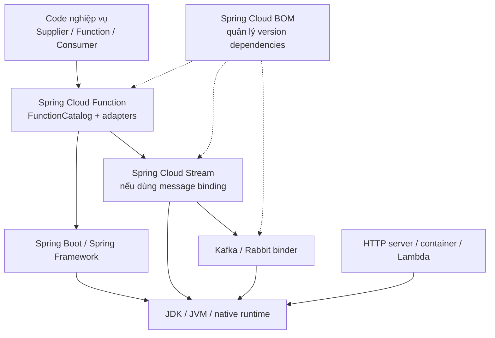
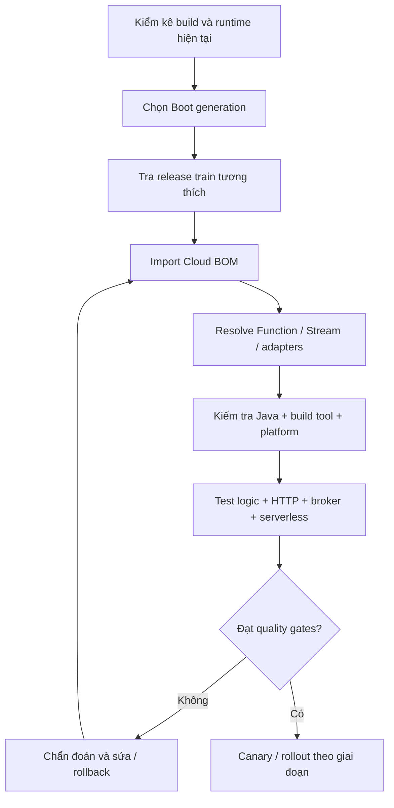

# Phân biệt phiên bản Spring Cloud Function, Boot, BOM và runtime

## 1. Bài toán nâng cấp: vì sao một ứng dụng có nhiều “version”?

Một nhóm phát triển đang vận hành ứng dụng xử lý đơn hàng bằng Spring Cloud Function. Logic nghiệp vụ rất đơn giản:

```java
@Bean
Function<OrderCreated, OrderClassified> classifyOrder() {
    return order -> new OrderClassified(
            order.orderId(),
            order.totalInCents() >= 100_000L
                    ? "PRIORITY" : "STANDARD");
}
```

Ứng dụng có thể công bố hàm này qua HTTP, xử lý sự kiện bằng Spring Cloud Stream hoặc chạy bằng adapter trên nền tảng serverless. Khi nâng cấp, nhóm thường gặp những thông tin tưởng như mâu thuẫn:

- Spring Boot có phiên bản `4.2.0`.
- Spring Cloud có phiên bản **release train** `2026.0.0`.
- Spring Cloud Function có phiên bản module `5.1.0`.
- Maven hoặc Gradle import một **BOM** `spring-cloud-dependencies:2026.0.0`.
- Máy build dùng JDK 21, còn container hoặc nền tảng serverless cũng có lựa chọn **runtime Java**.
- Adapter HTTP, Kafka/RabbitMQ, AWS Lambda và các thư viện bên thứ ba có vòng đời tương thích riêng.

Không có mâu thuẫn: đây là **những trục phiên bản khác nhau**. Việc ép chúng có cùng số hoặc nâng cấp riêng lẻ theo bản mới nhất có thể tạo classpath không tương thích.

Bài học này giúp bạn xác định chính xác vai trò của từng phiên bản, đọc cấu hình Maven/Gradle, chọn bộ phiên bản tương thích, nhận diện yêu cầu Java runtime và thực hiện nâng cấp có thể kiểm chứng, rollback.

**Ngữ cảnh:** Tài liệu nằm trong chương **Nâng cấp** của module **SPRING_CLOUD_FUNCTION**. Mục tiêu vẫn là giữ logic `Supplier`, `Function`, `Consumer` và `FunctionCatalog` tái sử dụng được, độc lập giao thức, đồng thời nâng cấp đúng các adapter HTTP, sự kiện hoặc serverless.

## 2. Bảy thứ cần phân biệt trong một bản triển khai

| Thành phần | Ví dụ phiên bản/giá trị | Trách nhiệm | Ai quyết định? |
| --- | --- | --- | --- |
| **Java language / bytecode target** | Java 17 hoặc 21 | Cú pháp, API Java và định dạng class file khi compile | Toolchain, compiler settings |
| **JDK/JRE thực thi** | Java 21 trong container | Chạy bytecode và ứng dụng khi triển khai | Image/runtime platform |
| **Spring Boot** | `4.2.0` | Nền tảng ứng dụng, auto-configuration, lifecycle, starters, build plugin | Parent/plugin và dependency management |
| **Spring Cloud release train** | `2026.0.0` | Tập hợp các nhánh Spring Cloud đã được phối hợp về tương thích | BOM `spring-cloud-dependencies` |
| **Spring Cloud Function** | `5.1.0` | `FunctionCatalog`, functional programming model, composition, adapters | Artifact version được BOM quản lý |
| **Spring Cloud Stream / binder** | `5.1.0` và bản binder được quản lý | Message binding, Kafka/RabbitMQ integration | Spring Cloud BOM và dependency |
| **Runtime adapter/platform** | HTTP server, Kafka, AWS Lambda Java runtime | Cách kích hoạt hàm và môi trường triển khai | Dependency adapter, cấu hình platform |

Một ứng dụng còn có **Spring Framework**, Spring Security, Jackson, Reactor, Gradle/Maven, container OS và thư viện riêng. Chúng cũng có version, nhưng không được coi là các cách viết khác của phiên bản Spring Cloud Function.

**Kết luận ngắn:** Spring Cloud Function `5.1.0` **không** đòi hỏi Boot cũng là `5.1.0`; Cloud release train `2026.0.0` **không** đồng nghĩa Java `2026`. Những con số thuộc các hệ đánh phiên bản khác nhau.

### Sơ đồ các lớp



BOM chỉ cung cấp thông tin **quản lý dependency versions**; nó không phải một executable runtime. JDK là môi trường chạy; nó không tự chọn phiên bản Spring Cloud Function.

## 3. Spring Boot version là gì?

Spring Boot giúp tạo ứng dụng Java có cấu hình tự động, lifecycle, Actuator, logging, starter dependencies và khả năng đóng gói chạy độc lập. Spring Boot không tự đồng nghĩa với Spring Cloud Function: một ứng dụng Boot có thể không khai báo bean `Function`, và một logic functional có thể được kiểm thử như Java thuần.

Trong Maven, phiên bản Boot thường được khai báo bằng parent:

```xml
<parent>
    <groupId>org.springframework.boot</groupId>
    <artifactId>spring-boot-starter-parent</artifactId>
    <version>4.2.0</version>
    <relativePath/>
</parent>
```

Trong Gradle, phiên bản Boot thường nằm ở plugin:

```kotlin
plugins {
    id("org.springframework.boot") version "4.2.0"
}
```

Phiên bản Spring Boot ảnh hưởng đến:

- Phiên bản Spring Framework và các Spring Boot starters mà nó phối hợp.
- Yêu cầu Java và phiên bản Gradle/Maven hỗ trợ.
- Auto-configuration, module/starter structure và property migration.
- Tích hợp test, packaging, AOT/native image, servlet/web stack và dependency management của Boot.

**Không nâng Boot chỉ bằng cách đổi base image Java.** Đổi JDK có thể ảnh hưởng việc chạy bytecode, nhưng artifact Boot trong dependency graph vẫn là phiên bản cũ.

### Spring Framework cũng có version riêng

Spring Framework là nền tảng DI, Web, Messaging, Reactor integration và nhiều API khác. Boot quản lý phiên bản Framework tương thích. Trong một dự án Boot thông thường, không nên tự ép một số phiên bản `spring-context` hoặc `spring-core` không theo BOM mà chưa chứng minh tương thích.

Ví dụ, thế hệ Spring Boot 4 gắn với Spring Framework 7. Đây là thay đổi thế hệ có thể yêu cầu sửa code và các integration libraries; nó không chỉ là thay tên số phiên bản.

## 4. Spring Cloud release train khác Spring Cloud Function version

**Spring Cloud** là hệ sinh thái có nhiều dự án con: Config, Gateway, Function, Stream, Commons, v.v. Các dự án có release lifecycle riêng. Một **release train** là tập hợp phiên bản được phối hợp, công bố dưới một tên chung.

Ví dụ:

```text
Spring Cloud release train: 2026.0.0
    Spring Cloud Function: 5.1.0
    Spring Cloud Stream:   5.1.0
    Spring Cloud Commons:  5.1.0
    ... các module khác trong train
```

Ở đây, `2026.0.0` là phiên bản **train**, còn `5.1.0` là phiên bản **module**. Những số này khác nhau và **không cần** khớp nhau.

Các release train trước cũng có tên mã, chẳng hạn **Oakwood** cho dòng `2025.1.x` và **Paddington** cho `2026.0.x`. Tên mã giúp tìm release notes; không được dùng như version của Maven artifact `spring-cloud-function-context`.

### Bảng ví dụ tương thích tại ngày 24/11/2026

| Spring Boot generation | Spring Cloud release train | Nhánh Spring Cloud Function trong train | Ghi chú |
| --- | --- | --- | --- |
| **Boot 4.2.x** | **2026.0.x (Paddington)** | **Function 5.1.x** | `2026.0.0` GA ngày 20/11/2026, dựa trên Boot `4.2.0` |
| **Boot 4.0.x / 4.1.x** | **2025.1.x (Oakwood)** | **Function 5.0.x** | Release `2025.1.5` ngày 20/11/2026 xác nhận hai nhánh Boot này |
| **Boot 3.5.x** | **2025.0.x (Northfields)** | **Function 4.3.x** | Cặp thế hệ để tham chiếu khi lập kế hoạch di chuyển từ Boot 3 |

**Cảnh báo tính thời điểm:** Bảng này là ví dụ thực tế tại **24/11/2026**, **không** phải lời hứa rằng mọi patch release của Boot/Cloud Function sẽ được hỗ trợ mãi mãi. Ngày viết tài liệu và ngày triển khai có thể khác nhau; luôn tra bảng chính thức tại [Spring Cloud project](https://spring.io/projects/spring-cloud/) và [release notes](https://spring.io/blog/category/releases), đồng thời xem thông tin support/EOL. “Có artifact trên Maven Central” không đồng nghĩa “còn được hỗ trợ bảo mật”.

Nguồn xác minh: [Thông báo Spring Cloud 2026.0.0](https://spring.io/blog/2026/11/20/spring-cloud-2026-0-0-has-been-released/), [thông báo Spring Cloud 2025.1.5](https://spring.io/blog/2026/11/20/spring-cloud-2025-1-5-has-been-released/) và [ma trận Spring Cloud–Boot](https://spring.io/projects/spring-cloud/).

### Vì sao không dùng “Function mới nhất” với “Boot bất kỳ”?

Dù Maven resolve được artifact, các module có thể dựa trên:

- API/ABI của Spring Framework thế hệ khác.
- Auto-configuration, property binder hoặc starter layouts khác.
- Các thư viện Reactor, Spring Integration, Spring Kafka, Spring AMQP hoặc Jackson khác.
- Phiên bản Java tối thiểu, AOT/runtime hints và cấu hình plugin khác.

Lỗi có thể chỉ xuất hiện khi startup hoặc chạy integration test. Quy tắc an toàn là chọn **Boot generation → Cloud release train tương thích → các Spring Cloud modules do BOM quản lý**, thay vì chọn mỗi module độc lập theo số cao nhất.

## 5. BOM thực chất làm gì, và không làm gì?

**BOM (Bill of Materials)** trong hệ sinh thái Maven là một POM có `dependencyManagement`: nó công bố phiên bản được quản lý của các artifact liên quan. Spring Cloud cung cấp BOM:

```text
org.springframework.cloud:spring-cloud-dependencies:<release-train-version>
```

Ví dụ:

```text
org.springframework.cloud:spring-cloud-dependencies:2026.0.0
```

Maven hoặc Gradle import BOM để biết phiên bản phù hợp khi bạn khai báo dependency không ghi version:

```xml
<dependency>
    <groupId>org.springframework.cloud</groupId>
    <artifactId>spring-cloud-function-context</artifactId>
</dependency>
```

Version thực tế của `spring-cloud-function-context` được dependency management resolve từ tập BOM và cấu hình dự án. Đây là **sự lựa chọn tại build time**, không phải một dịch vụ tìm phiên bản lúc ứng dụng khởi động.

### Bốn điều BOM không làm

1. **Không tải tất cả module vào ứng dụng.** Import `spring-cloud-dependencies` chỉ quản lý version; bạn vẫn phải khai báo dependency cụ thể nếu muốn Function Web, Stream, Kafka binder hoặc AWS adapter.
2. **Không tự nâng Spring Boot parent/plugin.** Boot version vẫn phải được chọn độc lập và tương thích với release train.
3. **Không chọn JDK/JVM triển khai.** Java toolchain, compiler target và runtime image có cấu hình riêng.
4. **Không bảo đảm mọi dependency bên ngoài và mọi deployment đều tương thích.** Thư viện bên thứ ba, broker, nền tảng cloud và code nghiệp vụ cần được kiểm thử.

### BOM Boot và BOM Cloud có trách nhiệm khác nhau

| BOM / cơ chế | Phạm vi chính | Ví dụ dependency |
| --- | --- | --- |
| `spring-boot-dependencies`, thường qua `spring-boot-starter-parent` hoặc Boot plugin + dependency management | Bộ dependency do Spring Boot quản lý | Spring Framework, logging, starters, nhiều thư viện dùng chung |
| `spring-cloud-dependencies` | Các dự án Spring Cloud trong release train | Function, Stream, Commons, Config, Gateway, binder liên quan |
| BOM của hệ sinh thái khác | Một stack riêng như test, cloud SDK, schema/codec | Cần xét xung đột và quy tắc ưu tiên nếu import thêm |

Nếu import nhiều BOM, thứ tự ưu tiên và cơ chế resolve có thể khác giữa Maven dependencyManagement, Gradle dependency-management plugin và Gradle native platforms. Không dựa vào trực giác; **xem dependency graph thực tế**.

## 6. Maven: một cấu hình đầy đủ để quản lý version đúng

Ví dụ tối giản dưới đây minh họa **Spring Boot 4.2.0 + Spring Cloud 2026.0.0**, sử dụng Java 21 làm target và Spring Cloud Function context. Đây là cặp được công bố tương thích vào thời điểm viết; cần điều chỉnh patch và plugin khi áp dụng sau này.

```xml
<project xmlns="http://maven.apache.org/POM/4.0.0"
         xmlns:xsi="http://www.w3.org/2001/XMLSchema-instance"
         xsi:schemaLocation="http://maven.apache.org/POM/4.0.0
             https://maven.apache.org/xsd/maven-4.0.0.xsd">
    <modelVersion>4.0.0</modelVersion>

    <groupId>com.example</groupId>
    <artifactId>order-functions</artifactId>
    <version>1.0.0</version>

    <parent>
        <groupId>org.springframework.boot</groupId>
        <artifactId>spring-boot-starter-parent</artifactId>
        <version>4.2.0</version>
        <relativePath/>
    </parent>

    <properties>
        <java.version>21</java.version>
        <spring-cloud.version>2026.0.0</spring-cloud.version>
    </properties>

    <dependencyManagement>
        <dependencies>
            <dependency>
                <groupId>org.springframework.cloud</groupId>
                <artifactId>spring-cloud-dependencies</artifactId>
                <version>${spring-cloud.version}</version>
                <type>pom</type>
                <scope>import</scope>
            </dependency>
        </dependencies>
    </dependencyManagement>

    <dependencies>
        <dependency>
            <groupId>org.springframework.boot</groupId>
            <artifactId>spring-boot-starter</artifactId>
        </dependency>
        <dependency>
            <groupId>org.springframework.cloud</groupId>
            <artifactId>spring-cloud-function-context</artifactId>
        </dependency>
        <dependency>
            <groupId>org.springframework.boot</groupId>
            <artifactId>spring-boot-starter-test</artifactId>
            <scope>test</scope>
        </dependency>
    </dependencies>

    <build>
        <plugins>
            <plugin>
                <groupId>org.springframework.boot</groupId>
                <artifactId>spring-boot-maven-plugin</artifactId>
            </plugin>
        </plugins>
    </build>
</project>
```

**Tại sao đây là cấu hình tốt cho việc học?**

- Boot parent chọn Boot generation, plugin và nhiều dependency versions liên quan.
- Spring Cloud BOM chọn module versions trong train mà không cần gắn `<version>` vào từng Spring Cloud dependency.
- Java version là compiler target của ứng dụng, **không** phải Cloud train.
- `spring-cloud-function-context` cung cấp phần lõi; chưa tự mở HTTP endpoint hoặc tạo Kafka consumer.
- Chỉ khi cần HTTP, Stream hoặc Lambda mới bổ sung **adapter tương ứng** và đóng gói đúng môi trường.

### Vì sao không gắn version vào từng dependency?

Một cấu hình dễ gây drift:

```xml
<!-- CẤU HÌNH KHÔNG NÊN SAO CHÉP MÙ QUÁNG -->
<dependency>
    <groupId>org.springframework.cloud</groupId>
    <artifactId>spring-cloud-function-context</artifactId>
    <version>5.0.0</version>
</dependency>
```

Nếu dự án đang dùng Cloud `2026.0.0` và Function 5.1.x, một override cố định `5.0.0` có thể tạo một module lệch nhánh. Maven vẫn có thể build được nhưng runtime lỗi vì phụ thuộc không tương thích. Chỉ override có kiểm soát khi đã có xác nhận tương thích, test đầy đủ và lý do được ghi lại.

### Khi ứng dụng không dùng Boot parent

Có dự án dùng một parent nội bộ. Khi đó có thể import `spring-boot-dependencies` và `spring-cloud-dependencies` trong `dependencyManagement`. Tuy nhiên, **import BOM không kế thừa plugin configuration** mà `spring-boot-starter-parent` thường cung cấp. Maven compiler, surefire, Spring Boot plugin, resource processing và đóng gói phải được cấu hình riêng.

## 7. Gradle: Boot plugin, dependency-management và BOM

Tương đương với Maven, một cấu hình `build.gradle.kts` có thể dùng Kotlin DSL:

```kotlin
plugins {
    java
    id("org.springframework.boot") version "4.2.0"
    id("io.spring.dependency-management") version "1.1.7"
}

group = "com.example"
version = "1.0.0"

repositories {
    mavenCentral()
}

java {
    toolchain {
        languageVersion.set(JavaLanguageVersion.of(21))
    }
}

dependencyManagement {
    imports {
        mavenBom("org.springframework.cloud:spring-cloud-dependencies:2026.0.0")
    }
}

dependencies {
    implementation("org.springframework.boot:spring-boot-starter")
    implementation("org.springframework.cloud:spring-cloud-function-context")
    testImplementation("org.springframework.boot:spring-boot-starter-test")
}

tasks.withType<Test> {
    useJUnitPlatform()
}
```

Ý nghĩa:

- `org.springframework.boot` là **build plugin**, chọn nhiệm vụ và cấu hình build cho thế hệ Boot.
- `io.spring.dependency-management` hỗ trợ import BOM theo mô hình plugin; khi kết hợp Boot plugin, có tích hợp với BOM Boot.
- `spring-cloud-dependencies:2026.0.0` quản lý các Spring Cloud artifacts.
- Java toolchain chọn JDK để compile/test theo quy tắc của Gradle, **không tự thay đổi JVM mà production container chạy**.

Ngoài dependency-management plugin, Gradle còn có cơ chế **native platform**:

```kotlin
dependencies {
    implementation(platform(
        "org.springframework.boot:spring-boot-dependencies:4.2.0"))
    implementation(platform(
        "org.springframework.cloud:spring-cloud-dependencies:2026.0.0"))

    implementation("org.springframework.cloud:spring-cloud-function-context")
}
```

Đây là **một phương án quản lý dependency thay thế**; không nên dán thêm nguyên khối này vào ví dụ dùng `io.spring.dependency-management` mà chưa xác định rõ cách giải quyết xung đột và ưu tiên version. Với Gradle native platform, version constraints và cơ chế version conflict resolution khác với Maven dependencyManagement.

### Gradle wrapper cũng là một phiên bản cần xét

Dự án có `gradlew`/`gradlew.bat` thường cố định phiên bản Gradle. Khi nâng Boot, hãy kiểm tra **phiên bản Gradle được Boot hỗ trợ**, không chỉ đổi phiên bản Boot plugin. Theo tài liệu Spring Boot 4.2.0, Gradle cần phiên bản thuộc nhánh được hỗ trợ (chẳng hạn Gradle 8.14+ trong nhánh 8.x hoặc nhánh 9.x được liệt kê). Đây là một giới hạn build tool, không liên quan trực tiếp đến FunctionCatalog.

## 8. Làm sao biết version thực sự được dùng?

Nhìn `pom.xml` hoặc `build.gradle.kts` chưa đủ. Dependency management, transitive dependencies, BOM override và dependency resolution có thể tạo kết quả khác với ý định.

### 8.1. Kiểm tra bằng Maven

```bash
# Xem Java/Maven mà shell hiện tại đang chạy:
java -version
mvn -version

# Xem dependency management hiệu lực:
mvn help:effective-pom

# Xem dependency graph thực tế:
mvn dependency:tree

# Lọc các artifact liên quan Spring Cloud Function:
mvn dependency:tree -Dincludes=org.springframework.cloud:spring-cloud-function-context
```

`effective-pom` giúp thấy version được kế thừa/quản lý; `dependency:tree` cho biết version được resolve và đường kéo dependency. Lệnh này là **hướng dẫn thực hành**, không được chạy trong quá trình biên soạn bài học.

### 8.2. Kiểm tra bằng Gradle

```bash
# Kiểm tra Gradle wrapper và JDK thực sự dùng:
./gradlew --version

# Xem tất cả runtime dependencies:
./gradlew dependencies --configuration runtimeClasspath

# Truy nguyên artifact và nguyên nhân chọn version:
./gradlew dependencyInsight \
    --configuration runtimeClasspath \
    --dependency spring-cloud-function-context
```

Trên Windows, dùng `gradlew.bat` thay cho `./gradlew`. Khi kiểm tra tình trạng runtime, nên xem cả dependency graph của artifact **được đóng gói/deploy**, không chỉ classpath IDE.

### 8.3. Những câu hỏi cần trả lời từ kết quả

1. Boot version thực tế là bao nhiêu?
2. Cloud BOM release train đang import là bao nhiêu?
3. Function context, web/adapter, Stream/binder được resolve thành phiên bản nào?
4. Có nhiều module cùng hệ Spring Cloud nhưng **khác major/minor** không?
5. Có `version` bị ép tường minh trên một dependency khiến BOM mất hiệu lực không?
6. Java compiler target và JDK chạy test có đúng như dự kiến không?
7. Artifact trong image/container có thật sự là bản build vừa kiểm tra không?

**Lỗi điển hình:** build file đổi BOM nhưng deployment vẫn dùng image tag cũ; dependency graph trong CI đã đúng, còn pod production vẫn chạy JAR cũ. Đây là vấn đề release artifact/runtime, không phải lỗi BOM.

## 9. Java target và JDK runtime: hai thứ không nên đánh đồng

Ba khái niệm:

- **Source/toolchain Java:** JDK dùng để biên dịch code.
- **Target bytecode:** định dạng class file mà compiler tạo ra (`--release`/`java.version`).
- **Runtime JVM:** JDK/JRE thực tế khởi chạy ứng dụng trong local machine, container, VM hoặc serverless platform.

Ví dụ:

```text
Build: JDK 21
Compiler target: Java 21
Artifact: class file tương thích Java 21
Production: JRE 17
Kết quả: không chạy được class file yêu cầu Java 21
```

Một JDK mới hơn **thường** có thể chạy bytecode cũ nếu thư viện và API còn tương thích, nhưng muốn bảo đảm thì phải kiểm tra phạm vi JDK mà Boot, Framework, Function, adapter và platform hỗ trợ. Ngược lại, JRE cũ không thể chạy bytecode có major version cao hơn nó hiểu.

### 9.1. Ví dụ container

```dockerfile
# Ví dụ minh họa: base image phải được pin bản vá/digest và kiểm tra hỗ trợ.
FROM eclipse-temurin:21-jre
WORKDIR /app
COPY target/order-functions-1.0.0.jar app.jar
ENTRYPOINT ["java", "-jar", "/app/app.jar"]
```

Dockerfile trên chọn **Java runtime 21**. Nó **không tự lựa chọn** Spring Boot hoặc Spring Cloud Function version; những dependency đó nằm trong JAR được copy vào image.

Trong production, nên pin image tag cụ thể hoặc digest, quét lỗ hổng và kiểm tra kiến trúc CPU/OS. Một tag chung như `21-jre` có thể dịch chuyển sang patch image mới, làm giảm khả năng tái lập triển khai; để demo thì chấp nhận được nhưng không phải chiến lược release hoàn chỉnh.

### 9.2. Yêu cầu Java của Boot 4.2

Theo [Spring Boot 4.2.0 System Requirements](https://docs.spring.io/spring-boot/system-requirements.html), Boot 4.2.0 yêu cầu **ít nhất Java 17**, và tài liệu công bố dải JVM được kiểm thử/hỗ trợ cho phiên bản đó. Việc tối thiểu Java 17 **không** có nghĩa mọi adapter serverless đều cung cấp đúng runtime ấy hoặc mọi dependency bên thứ ba đều tương thích với tất cả các JDK trong dải.

Với một ứng dụng dùng Java 21 để build, triển khai trên runtime Java 21 là lựa chọn dễ kiểm chứng. Nếu dùng Java 17 để build nhưng runtime Java 21, cần kiểm tra phù hợp với deployment target và dependency, không suy ra chỉ từ số `17 < 21`.

## 10. “Runtime” có nhiều nghĩa trong Spring Cloud Function

Tùy ngữ cảnh, từ **runtime** có thể chỉ ít nhất ba lớp:

1. **Java runtime**: JVM/JRE chạy bytecode hoặc GraalVM native executable.
2. **Application runtime**: ứng dụng Spring Boot, HTTP server, message listener, các bean do `ApplicationContext` quản lý.
3. **Hosting platform runtime**: AWS Lambda managed runtime, container image, Kubernetes, Cloud Foundry hoặc serverless custom runtime.

Mọi lớp đều cần được kiểm tra khi nâng cấp, nhưng chúng không phải một version duy nhất.

| Hình thức triển khai | Thành phần kích hoạt hàm | Phiên bản nào cần kiểm tra? |
| --- | --- | --- |
| **Standalone Boot** | Main class, `ApplicationContext` | Boot, Function context, JDK, packaging |
| **HTTP adapter** | Web adapter nhận HTTP request | Boot web stack, Function Web, servlet/reactive support, HTTP contract |
| **Event-driven** | Spring Cloud Stream + binder Kafka/RabbitMQ | Function, Stream, binder, broker protocol, headers/serializer, JDK |
| **AWS Lambda** | Spring Cloud Function AWS adapter / handler | Adapter, packaged artifact, Java managed runtime, handler config, cold start |
| **Native image** | Native executable + OS/architecture | GraalVM/native build tool, AOT hints, reflection/resources, target OS |
| **Container/Kubernetes** | JVM hoặc native binary trong image | Base image, CPU arch, JDK, container memory limits và probe |

**Không có quy tắc:** “đã nâng Spring Cloud Function lên 5.1 thì tự động dùng Java 21 AWS Lambda”. Function 5.1 là dependency Java; Java 21 Lambda là lựa chọn platform/runtime. Một số platform có tập runtime hỗ trợ và ngày ngừng hỗ trợ riêng, phải theo dõi độc lập với Maven BOM.

## 11. Cùng logic nghiệp vụ, ba adapter có yêu cầu nâng cấp khác nhau

Hãy định nghĩa một DTO và function dùng Spring Cloud Function:

```java
import java.util.function.Function;

import org.springframework.boot.SpringApplication;
import org.springframework.boot.autoconfigure.SpringBootApplication;
import org.springframework.context.annotation.Bean;

@SpringBootApplication
public class OrderFunctionsApplication {

    public static void main(String[] args) {
        SpringApplication.run(OrderFunctionsApplication.class, args);
    }

    public record OrderCreated(String orderId, long totalInCents) {}
    public record OrderClassified(String orderId, String priority) {}

    @Bean
    Function<OrderCreated, OrderClassified> classifyOrder() {
        return order -> new OrderClassified(
                order.orderId(),
                order.totalInCents() >= 100_000L
                        ? "PRIORITY" : "STANDARD");
    }
}
```

Logic này không import HTTP, Kafka hay AWS classes. Nhưng mỗi adapter có thể có thay đổi version và runtime khác nhau.

### 11.1. Công bố qua HTTP

Để công bố Function qua HTTP, cần dependency của Spring Cloud Function Web, ví dụ artifact `spring-cloud-function-web`, và web stack phù hợp với Boot generation. Cần kiểm tra lại starter, module web, servlet/reactive stack và cách URL/method được map trong version đang nâng.

Các regression tests nên xác minh:

- Request JSON được chuyển thành `OrderCreated`.
- Header/content type và response status chính xác.
- Đường dẫn hàm, routing và error response không đổi ngoài ý định.
- Truy cập bảo mật, timeout và observability vẫn hoạt động.

Nâng version `FunctionCatalog` không tự chứng minh HTTP adapter vẫn tương thích.

### 11.2. Xử lý sự kiện qua Spring Cloud Stream

Thêm binder phù hợp, chẳng hạn `spring-cloud-stream-binder-kafka` hoặc `spring-cloud-stream-binder-rabbit`, cùng definition/bindings:

```yaml
spring:
  cloud:
    function:
      definition: classifyOrder
    stream:
      bindings:
        classifyOrder-in-0:
          destination: orders.created
          group: order-classifiers
          content-type: application/json
        classifyOrder-out-0:
          destination: orders.classified
          content-type: application/json
```

Khi nâng train, cần kiểm tra **cả** Function và Stream/binder. Không tự thêm một Kafka binder ở phiên bản thấp hơn nhánh Cloud BOM nếu chưa xác minh. Các kiểm thử đặc biệt quan trọng:

- Tên binding `<function>-in-0` và `<function>-out-0`.
- Conversion `Message<T>`/POJO, `content-type`, native serialization.
- Group, partition, offset/ack, retry, DLQ/DLT và semantics redelivery.
- Nhiều function definitions, composition, Supplier polling và reactive pipelines nếu dự án dùng chúng.

### 11.3. Triển khai AWS Lambda

Spring Cloud Function có adapter `spring-cloud-function-adapter-aws`, có thể dùng handler chung `org.springframework.cloud.function.adapter.aws.FunctionInvoker`. Khi nâng cấp, ngoài dependency, cần kiểm tra:

- Java runtime được AWS cung cấp, ví dụ `java21` nếu target và account hỗ trợ.
- Handler entry point và cấu hình `spring_cloud_function_definition` hoặc cơ chế lựa chọn hàm tương đương.
- Cách đóng gói artifact tương thích Lambda; một Spring Boot executable JAR thông thường **không mặc định** đúng layout của mọi serverless adapter.
- Memory, timeout, cold start, environment variables, resource/secret injection và event source mapping.
- Nội dung event thực tế (SQS, Kinesis, HTTP proxy...) và cách xử lý lỗi/batch/partial failures.

Ví dụ phần runtime trong template AWS SAM (minh họa, cần bổ sung permission, event source, artifact):

```yaml
Resources:
  ClassifyOrderFunction:
    Type: AWS::Serverless::Function
    Properties:
      Runtime: java21
      Handler: org.springframework.cloud.function.adapter.aws.FunctionInvoker
      CodeUri: build/distributions/classify-order-lambda.zip
      Environment:
        Variables:
          spring_cloud_function_definition: classifyOrder
```

Đường `CodeUri` là **giả định** của ví dụ: file thực tế phải được build bằng quy trình đóng gói Lambda phù hợp, không tự xuất hiện chỉ vì import Cloud BOM. Tham khảo [Spring Cloud Function AWS adapter](https://docs.spring.io/spring-cloud-function/reference/adapters/aws-intro.html) để chọn layout build và entry point đúng.

**Điểm quan trọng:** Spring Cloud Function giữ code nghiệp vụ tái sử dụng; nó **không** làm biến mất nghĩa vụ tương thích platform/runtime của từng adapter.

## 12. Chọn bộ phiên bản tương thích trước khi đổi mã nguồn

Một quy trình lựa chọn có thể lặp lại:

1. **Kiểm kê hiện tại:** ghi Boot, Spring Cloud BOM, Function, Stream, adapter, Java target, JDK runtime và broker/platform versions.
2. **Xác định Boot generation muốn đến:** cân nhắc API, support policy và những thư viện bắt buộc của ứng dụng.
3. **Tra ma trận Spring Cloud release train:** chọn Cloud BOM được công bố hỗ trợ Boot generation đó.
4. **Giữ module versions được BOM quản lý:** tránh hard-code Function/Stream nếu không có lý do kiểm chứng.
5. **Kiểm tra yêu cầu Java/build tool:** JDK tối thiểu, Gradle wrapper/Maven, GraalVM và adapter requirements.
6. **Đọc release notes từng module có sử dụng:** Function, Stream, binder, AWS adapter, Boot migration guide và release train notes.
7. **Chạy dependency graph và kiểm thử integration:** trước khi công bố cặp version đạt yêu cầu dự án.



Đừng chọn `2026.0.0` chỉ vì có số năm mới hơn `2025.1.5` nếu ứng dụng vẫn phải chạy Boot 4.0/4.1 và chưa có kế hoạch nâng Boot. Ngược lại, nếu đã chọn Boot 4.2.0, cần release train tương thích chứ không giữ BOM của một thế hệ Boot khác theo thói quen.

## 13. Nâng cấp từ Boot 3.5 sang Boot 4: không chỉ là đổi POM

Một chuyển đổi thế hệ ví dụ:

```text
Trước:
  Spring Boot 3.5.x
  Spring Cloud 2025.0.x
  Spring Cloud Function 4.3.x
  Spring Cloud Stream và binder cùng train

Sau (mục tiêu ví dụ tại 24/11/2026):
  Spring Boot 4.2.0
  Spring Cloud 2026.0.0
  Spring Cloud Function 5.1.0
  Spring Cloud Stream và binder cùng train
```

Đây là **một lần nâng major generation**, không nên làm bằng thao tác “replace all version strings”. Các phần có thể cần review:

| Mảng | Vì sao cần kiểm tra? |
| --- | --- |
| Spring Framework/API | Boot 4 dùng thế hệ Framework mới; API, cấu trúc module hoặc deprecated methods có thể thay đổi |
| Auto-configuration và starters | Một số module đã được tách/đổi cách tích hợp |
| Jackson, serialization | JSON mapping và dependency stack có thể khác; cần test schema/header, đặc biệt với event và Lambda |
| Spring Cloud Function | FunctionCatalog, routing, message conversion, composition, wrapper invocation |
| Spring Cloud Stream | Binder connectivity, retry, DLQ, producer/consumer configs |
| Security | Security filter, authentication, authorization, OAuth config, transitive CVEs |
| Servlet/reactive stack | Controller, WebFlux, HTTP handler, actuator và test integration |
| Test tooling | JUnit, Testcontainers, mocking, CI Java version, Gradle/Maven plugin |
| AOT/native image | Reflection hints, resources, proxies, build container image |
| Deployment | JDK runtime, image base, Kubernetes probes, Lambda packaging/timeout |

**Không cần sửa `javax.*` thành `jakarta.*` chỉ vì vừa chuyển Boot 3.5 sang 4.2 nếu dự án đã hoàn tất việc đó khi lên Boot 3**. Ngược lại, các API Java/Spring riêng bị đổi mới cần xác định bằng compiler errors, release notes và tests cụ thể; không suy đoán toàn bộ từ tên major.

### Trình tự nâng cấp hợp lý

Với một hệ thống lớn, có thể:

- Nâng các patch release đang ở nhánh hiện tại trước, sửa test và giảm nợ kỹ thuật.
- Đưa code nghiệp vụ về các `Supplier`/`Function`/`Consumer` thuần Java để giảm phụ thuộc framework.
- Di chuyển thế hệ Boot/Cloud theo **một cặp chính thức**, không kết hợp tạm các module lệch nhánh.
- Nâng build/runtime requirements; chạy lại integration tests cho từng adapter.
- Phát hành canary có theo dõi và phương án quay lại image/version cũ.

Một lộ trình nhiều giai đoạn có thể tốt hơn một lần nâng cấp tất cả adapter, broker, Java runtime và business schema trong cùng release.

## 14. Chứng minh FunctionCatalog và composition còn hoạt động

Chỉ compile thành công không đủ để khẳng định Spring Cloud Function vẫn vận hành đúng. Kiểm thử chức năng trọng tâm bằng `FunctionCatalog`:

```java
import static org.junit.jupiter.api.Assertions.assertEquals;

import java.util.function.Function;

import org.junit.jupiter.api.Test;
import org.springframework.beans.factory.annotation.Autowired;
import org.springframework.boot.test.context.SpringBootTest;
import org.springframework.cloud.function.context.FunctionCatalog;

@SpringBootTest
class FunctionCatalogUpgradeTest {

    @Autowired
    FunctionCatalog catalog;

    @Test
    void findsAndInvokesFunction() {
        @SuppressWarnings("unchecked")
        Function<OrderFunctionsApplication.OrderCreated,
                 OrderFunctionsApplication.OrderClassified> function =
                catalog.lookup(Function.class, "classifyOrder");

        var result = function.apply(
                new OrderFunctionsApplication.OrderCreated(
                        "ORD-101", 150_000L));

        assertEquals("PRIORITY", result.priority());
    }
}
```

Đây là ví dụ kiểm thử **function lookup** bằng kiểu POJO do ứng dụng khai báo. Khi chạy với một version cụ thể, `FunctionCatalog` có thể trả wrapper có conversion semantics theo kiểu generic; dùng method signatures và payload tương ứng với app thực tế. Nếu test chuyển đổi type không như mong đợi, cần đánh giá wrapper/cast và API invocation trong version đang nâng thay vì ép runtime bằng cast nguy hiểm.

### Composition cũng là một compatibility contract

Nếu ứng dụng có:

```java
@Bean
Function<String, String> normalize() {
    return String::trim;
}

@Bean
Function<String, String> uppercase() {
    return String::toUpperCase;
}
```

thì cần test:

```java
@SuppressWarnings("unchecked")
Function<String, String> pipeline =
        catalog.lookup(Function.class, "normalize|uppercase");

assertEquals("HELLO", pipeline.apply(" hello "));
```

Bài học từ hai test trên là **module Function được nâng cấp có thể ảnh hưởng cách tra cứu/composition**, ngay cả khi bean Java nghiệp vụ không thay đổi. Nếu có nhiều function bean, hãy cấu hình `spring.cloud.function.definition` rõ ràng trong mỗi adapter.

## 15. Kiểm thử contract và message conversion khi nâng cấp

Với một function:

```java
Function<OrderCreated, OrderClassified>
```

hãy kiểm tra ít nhất:

1. Đưa một `OrderCreated` Java hợp lệ vào hàm và nhận kết quả đúng.
2. Đưa JSON thực tế qua HTTP adapter và xác nhận conversion thành `OrderCreated`.
3. Đưa JSON thực tế qua input binding Kafka/RabbitMQ; kiểm tra content type và headers.
4. Xác minh output DTO được serialize đúng schema và downstream consumer hiểu được.
5. Gửi message sai schema và xem lỗi xảy ra ở deserializer, converter hay handler.
6. Gửi lại cùng event ID để xác minh idempotency và cách broker redeliver.
7. Với reactive function, xác minh lifecycle `Flux`, error termination, backpressure và retry policy theo đúng binder.

**Đừng biến test chỉ thành số lần gọi hàm.** Một lần nâng thư viện serialization có thể làm field/headers được biểu diễn khác mà business rule vẫn đúng.

### Ví dụ về message header cần kiểm thử

```text
Input event:
  Content-Type: application/json
  correlationId: req-789

Function:
  Function<Message<OrderCreated>, Message<OrderClassified>>

Output contract:
  payload = OrderClassified
  correlationId vẫn được chuyển tiếp theo chính sách
  content type phù hợp output
```

Trong Kafka, RabbitMQ và HTTP, header mapping không giống nhau. Kể cả khi dùng chung `Message<T>`, cần integration test theo từng transport thực tế.

## 16. Runtime serverless có version và lifecycle riêng

Trong môi trường serverless, một lần nâng cấp có thể tác động đến nhiều chiều độc lập:

| Chiều | Ví dụ | Rủi ro nếu bỏ qua |
| --- | --- | --- |
| Function library | `spring-cloud-function-adapter-aws` | Handler API, packaging hoặc conversion không tương thích |
| Java runtime | AWS managed `java21` | Runtime không phù hợp bytecode hoặc bị platform ngừng hỗ trợ |
| Artifact | ZIP/JAR layout, entry handler | Deploy thành công nhưng không load được handler |
| Event source | SQS, Kinesis, API Gateway | Event schema và batch/error semantics khác |
| Cold start/performance | Boot context init, memory, snapshot/AOT | Tăng latency, hết timeout hoặc OOM |
| Cloud permissions | IAM, networking, secrets | Hàm không truy cập dependency dù code đúng |

Một API HTTP thành công trên máy local **không** chứng minh Lambda handler hoạt động: Lambda không nhất thiết dùng web server đang nghe port như ứng dụng Boot truyền thống.

### 16.1. Khi nào cần build lại artifact?

Nếu đổi một trong các yếu tố sau, nên tạo artifact mới và kiểm tra packaging:

- Boot/Function/adapter major version.
- Java bytecode target hoặc JVM runtime image.
- Spring AOT/native-image configuration.
- Thay HTTP adapter bằng Lambda handler hoặc ngược lại.
- Thay dependency serialization có ảnh hưởng event conversion.

Đổi mỗi environment variable chọn function thường không cần rebuild nếu artifact đã chứa đầy đủ bean và adapter hỗ trợ cách lựa chọn đó. Tuy nhiên, việc thay quyền, handler hoặc runtime setting vẫn cần rollout và smoke test.

## 17. Kế hoạch nâng cấp và rollback có thể kiểm toán

Một kế hoạch đáng tin cậy nên có **baseline trước**, **quality gates** và **rollback không phá dữ liệu**.

### Giai đoạn A — Baseline

Ghi lại:

```text
APP_VERSION=1.8.0
BOOT_VERSION=<resolved>
CLOUD_TRAIN=<imported BOM>
FUNCTION_VERSION=<resolved>
STREAM_VERSION=<resolved>
JAVA_TARGET=<compiler release>
BUILD_JDK=<CI JDK>
RUNTIME_JDK=<container / serverless runtime>
ADAPTERS=<web / kafka / rabbit / aws>
ARTIFACT_DIGEST=<sha256>
```

Các giá trị trong dấu `<...>` là chỗ điền thực tế, không phải version cố định của bài học.

### Giai đoạn B — Chọn mục tiêu và kiểm tra dependency

- Chọn Boot generation và release train tương thích từ nguồn chính thức.
- Xem release notes và support policy của Function/Stream/adapter.
- Import BOM mới; bỏ override version không cần thiết.
- Kiểm tra effective POM hoặc Gradle resolution.
- Chạy test compile, unit, adapter integration, security và startup.

### Giai đoạn C — Thử ở môi trường gần production

- Sử dụng broker/serializer/schema tương ứng.
- Đo startup time, heap, throughput, error rate, consumer lag hoặc queue depth.
- Thử event cũ, event mới, payload lỗi, retry và DLQ.
- Thử mất broker, restart, scale và rollback khi còn message trong hệ thống.
- Với Lambda, đo cold start, memory, timeout và kiểm tra đúng event source mapping.

### Giai đoạn D — Rollout và rollback

1. Lưu image digest/artifact digest và cấu hình phiên bản cũ.
2. Rollout từng nhóm instance hoặc canary.
3. Theo dõi metrics/logs/traces và hợp đồng downstream.
4. Nếu rollback, giữ schema dữ liệu/event **backward compatible** hoặc có kế hoạch khôi phục.
5. Không rollback code một cách mù quáng nếu đã áp dụng migration DB không tương thích ngược.
6. Ghi rõ ai phê duyệt, chỉ số nào cho phép tiếp tục và ngưỡng nào kích hoạt rollback.

**Điểm quan trọng:** rollback một JAR không tự khôi phục dữ liệu DB hay event đã phát. Với hệ thống event-driven, phiên bản mới và cũ có thể chạy đồng thời trong một khoảng thời gian; schema và routing cần được thiết kế để chịu được tình huống đó.

## 18. Dấu hiệu sai version và cách chẩn đoán

| Triệu chứng | Nguyên nhân thường gặp | Cách kiểm tra |
| --- | --- | --- |
| Startup báo Boot–Cloud không tương thích | Chọn sai release train hoặc thư viện Cloud bị override | Xem ma trận Spring Cloud, effective dependency graph |
| `NoSuchMethodError` hoặc `NoClassDefFoundError` | Artifact/ABI lệch thế hệ, transitive conflict | `dependency:tree` / `dependencyInsight`, cùng classpath lúc runtime |
| Build thành công nhưng deploy báo `UnsupportedClassVersionError` | Target bytecode cao hơn runtime JVM | Compiler target, `java -version` trong image |
| Không tìm thấy `FunctionCatalog`/bean function | Thiếu dependency/autoconfiguration hoặc scan | Kiểm tra Function context và application startup logs |
| HTTP function trả 404 sau upgrade | Adapter web, endpoint mapping, function definition đổi | Test endpoint thực, dependencies web |
| JSON conversion sai kiểu | Jackson/schema/content type/native codec khác | Test payload/headers, converter và serializer |
| Kafka/Rabbit input mất message | Binding/destination/group/binder properties lệch | Integration test broker, offset/ack và DLQ |
| Lambda deploy nhưng handler lỗi | Artifact layout, handler name, runtime hoặc env | Kiểm tra FunctionInvoker, log platform và packaging |
| AOT/native build lỗi reflection | Thiếu runtime hints hoặc thư viện chưa hỗ trợ | Native build report, AOT hints, integration test |
| Gradle plugin không chạy | Wrapper Gradle quá cũ với Boot plugin | `./gradlew --version`, Boot system requirements |
| Maven vẫn dùng Function version cũ | Direct version override hoặc BOM ưu tiên khác | Effective POM, dependency graph |
| Local đúng nhưng container sai | Artifact/image cache cũ, JDK khác, config khác | Digest, image JDK, environment và startup classpath |
| Patch mới vẫn có CVE | Chọn nhánh không còn support hoặc chưa có fix | Security advisories, support policy, dependency inventory |
| Rollback xong consumer lỗi schema mới | Event hoặc DB migration không backward compatible | Contract compatibility test và replay plan |

### Trường hợp ứng dụng báo không tương thích Boot/Cloud

Spring Cloud Commons có cơ chế **compatibility verifier** trong các cấu hình/phiên bản nhất định. Tài liệu mô tả các thuộc tính như:

```properties
spring.cloud.compatibility-verifier.enabled=true
spring.cloud.compatibility-verifier.compatible-boot-versions=4.2.x
```

Đây là **ví dụ cú pháp**, không phải khuyến nghị dùng thuộc tính override để bắt hệ thống chấp nhận một cặp vốn không tương thích. Cơ chế verifier và giá trị mặc định có thể thay đổi giữa các thế hệ; một số phiên bản không bật mặc định. Khi thấy lỗi, **sửa ma trận dependency trước**; đừng tắt verifier chỉ để vượt startup check.

## 19. Bài tập thực hành

### Bài tập 1: Nhận diện từng con số

Một ứng dụng ghi:

```text
Spring Boot 4.2.0
Spring Cloud BOM 2026.0.0
Spring Cloud Function 5.1.0
Java target 21
Runtime JVM 21
```

Hãy giải thích vì sao năm giá trị có thể cùng tồn tại hợp lệ. Giá trị nào quản lý phiên bản `spring-cloud-function-context`? Giá trị nào là runtime? Giá trị nào là release train?

**Gợi ý:** Boot là platform ứng dụng; Cloud BOM quản lý module Spring Cloud; Function là module dependency; Java target là bytecode; runtime JVM là môi trường thực thi.

### Bài tập 2: Phát hiện một BOM sai

Dự án dùng Spring Boot `4.2.0` nhưng vẫn import Spring Cloud `2025.0.x`. Hãy nêu rủi ro và quy trình sửa. Vì sao không nên chỉ gắn version `5.1.0` trực tiếp cho Function mà giữ nguyên các module Stream/binder cũ?

### Bài tập 3: Maven so với Gradle

Từ ví dụ mục 6 và mục 7, chỉ rõ:
- Boot version nằm ở đâu?
- Cloud BOM được import ở đâu?
- Function context khai báo version tường minh hay không?
- Java target được cấu hình bằng cách nào?
- Những lệnh nào chứng minh version **resolved**?

### Bài tập 4: Target Java và deployment

CI dùng JDK 21 và tạo bytecode Java 21; container production còn dùng JRE 17. Dự đoán lỗi có thể xảy ra. Đề xuất hai cách sửa và các bước kiểm thử. Vì sao không thể chỉ đổi Cloud BOM để giải quyết?

### Bài tập 5: Một function, ba adapter

Bạn có `Function<OrderCreated,OrderClassified>` và muốn chạy qua HTTP, Kafka rồi AWS Lambda. Hãy xác định cho từng adapter:
- Dependency bổ sung cần nghiên cứu.
- Runtime/platform và cấu hình kích hoạt.
- Integration test quan trọng.
- Rủi ro conversion, retry và đóng gói.

### Bài tập 6: Lập kế hoạch nâng major

Một ứng dụng Boot 3.5/Cloud 2025.0 muốn lên Boot 4.2/Cloud 2026.0. Hãy đề xuất checklist trước nâng, thử trên staging, canary, điều kiện rollback và cách kiểm soát schema của event đang lưu trong Kafka.

### Bài tập 7: Phân biệt BOM và artifact

Giả sử bạn import BOM `spring-cloud-dependencies` nhưng quên khai báo `spring-cloud-function-context`. FunctionCatalog có tự xuất hiện chỉ vì BOM được import không? Vì sao? Nếu transitive dependency tình cờ mang Function context vào classpath, điều đó có thay thế khai báo dependency rõ ràng không?

### Câu hỏi tự đánh giá

1. Spring Cloud release train và Spring Cloud Function module có bắt buộc cùng số version không?
2. Spring Boot parent/plugin làm công việc gì khác với Spring Cloud BOM?
3. Vì sao import BOM không tự tải mọi Spring Cloud project?
4. Java target và JVM runtime khác nhau như thế nào?
5. Một Lambda runtime có được xác định bằng phiên bản `spring-cloud-function-adapter-aws` không?
6. Vì sao một direct dependency version có thể làm lệch module khỏi release train?
7. Khi nào cần test binder Kafka/Rabbit thay vì chỉ unit test Function?
8. Cần đọc nguồn chính thức nào khi chọn cặp Boot–Cloud?
9. Tại sao rollback artifact chưa đủ nếu event schema đã đổi không tương thích?
10. Với `UnsupportedClassVersionError`, nên kiểm tra BOM trước hay JDK target/runtime trước?
11. Làm sao xem version resolved thay vì chỉ version dự định trong build file?
12. Tại sao giữ logic thuần `Function<T,R>` giúp nâng adapter dễ hơn?

## 20. Tổng kết

Để nâng cấp Spring Cloud Function an toàn, hãy giữ bốn trục riêng biệt:

- **Spring Boot version:** nền tảng ứng dụng, auto-configuration, build plugin và hệ dependency nền.
- **Spring Cloud release train + BOM:** chọn bộ module Spring Cloud tương thích với Boot; `2026.0.0` là train version, **không phải** version của mọi module.
- **Spring Cloud Function module version:** phiên bản thực tế của `FunctionCatalog`, composition và adapters được dependency management resolve, chẳng hạn `5.1.0` trong train `2026.0.0`.
- **Runtime:** Java bytecode target, JDK/JRE, container/native/serverless platform và handler/integration thực tế — không thể thay thế bằng một dòng BOM.

Quy trình khuyến nghị là: **chọn cặp Boot–Cloud tương thích → import BOM → để BOM quản lý Function/Stream/adapter → xác minh dependency graph → chọn đúng JDK/runtime → kiểm thử từng adapter → rollout có rollback plan**.

Nhờ giữ `Supplier`, `Function` và `Consumer` độc lập transport, nhóm có thể tái sử dụng logic qua HTTP, sự kiện hoặc serverless. Nhưng mỗi adapter và platform vẫn cần được xác minh riêng về packaging, conversion, security, retry, performance và vòng đời hỗ trợ.

### Tài liệu tham khảo

- [Spring Cloud — Project, compatibility matrix và hướng dẫn BOM](https://spring.io/projects/spring-cloud/)
- [Spring Cloud 2026.0.0 (Paddington) release notes — 20/11/2026](https://spring.io/blog/2026/11/20/spring-cloud-2026-0-0-has-been-released/)
- [Spring Cloud 2025.1.5 (Oakwood) release notes — 20/11/2026](https://spring.io/blog/2026/11/20/spring-cloud-2025-1-5-has-been-released/)
- [Spring Cloud Release Train Reference](https://docs.spring.io/spring-cloud-release/reference/)
- [Spring Cloud Function Reference](https://docs.spring.io/spring-cloud-function/reference/)
- [Spring Cloud Function — Functional Bean Definitions](https://docs.spring.io/spring-cloud-function/reference/functional.html)
- [Spring Cloud Function — AWS Lambda Adapter](https://docs.spring.io/spring-cloud-function/reference/adapters/aws-intro.html)
- [Spring Cloud Stream Reference](https://docs.spring.io/spring-cloud-stream/reference/)
- [Spring Boot — System Requirements](https://docs.spring.io/spring-boot/system-requirements.html)
- [Spring Boot — Reference Documentation](https://docs.spring.io/spring-boot/reference/)
- [Spring Cloud — Supported Versions và support policy](https://github.com/spring-cloud/spring-cloud-release/wiki/Supported-Versions)
- [Apache Maven — Introduction to the Dependency Mechanism](https://maven.apache.org/guides/introduction/introduction-to-dependency-mechanism.html)
- [Gradle — Platforms and Dependency Constraints](https://docs.gradle.org/current/userguide/platforms.html)
