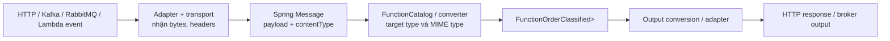
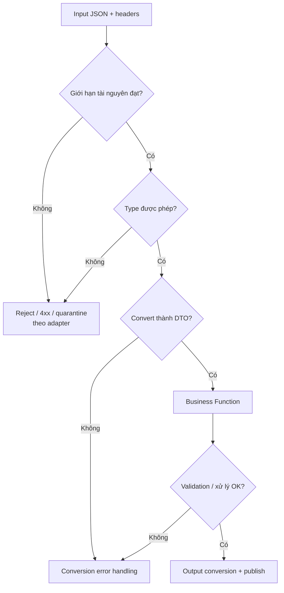

# Kiểm tra chuyển đổi JSON và chính sách loại dữ liệu được phép

## 1. Bài toán: nâng thư viện nhưng cùng JSON lại được hiểu khác

Một dịch vụ xử lý đơn hàng đang sử dụng **Spring Cloud Function** với bean `Function<OrderCreated, OrderClassified>`. Cùng logic Java đó được dùng qua HTTP, Spring Cloud Stream (Kafka/RabbitMQ) hoặc một adapter serverless. Việc đổi release train, Spring Boot, Spring Cloud Function hay thư viện JSON có thể làm thay đổi **đường chuyển đổi dữ liệu**, ngay cả khi hàm nghiệp vụ không thay đổi.

Giả sử producer gửi:

```json
{
  "eventId": "evt-101",
  "orderId": "ORD-101",
  "totalInCents": 150000
}
```

Sau nâng cấp, ứng dụng phải trả lời được các câu hỏi:

- Chuỗi JSON hoặc `byte[]` được chuyển thành `OrderCreated` bằng cơ chế nào?
- `contentType=application/json` và chữ ký `Function<T,R>` kết hợp ra sao?
- Khi client tự chỉ định `application/json;type=...`, framework có cho phép tải lớp tùy ý không?
- Có giới hạn kích thước body, số phần tử JSON array và mức sử dụng bộ nhớ không?
- Nếu dùng Kafka native deserializer, các hạn chế của Spring Cloud Function có còn đi qua đường xử lý đó không?
- Jackson 2, Jackson 3 hoặc Gson nào thực sự đang xử lý JSON?
- Một payload bị từ chối vì thay đổi bảo mật là regression cần sửa ở producer hay là lỗi cần nới lỏng chính sách?

Bài học thuộc chương **Nâng cấp** của module **SPRING_CLOUD_FUNCTION**. Mục tiêu xuyên suốt của Spring Cloud Function là phát triển logic `Supplier`, `Function` và `Consumer` tái sử dụng được bằng `FunctionCatalog`, composition và message conversion, độc lập với giao thức gọi. Tuy nhiên, **mỗi adapter vẫn có ranh giới dữ liệu và bảo mật phải kiểm thử riêng**.

Sau bài này, bạn sẽ biết cách thiết lập chính sách **kiểu dữ liệu được phép**, phân biệt các dạng allowlist ở từng tầng, xây dựng bộ regression tests cho JSON và class-loading, đồng thời nâng cấp/rollback mà không âm thầm mở rộng khả năng deserialization.

## 2. Tách năm lớp trước khi tìm lỗi chuyển đổi



Sơ đồ là **mô hình khái niệm**, không cam kết mọi adapter đều đi đúng từng bước nội bộ. Nếu dùng Kafka native deserialization, việc tạo Java object có thể xảy ra trước conversion thông thường của Function. Nếu gọi trực tiếp bean Java bằng unit test, không có transport hay JSON converter nào được thực thi.

| Lớp | Biết gì? | Trách nhiệm | Những lỗi điển hình |
| --- | --- | --- | --- |
| Adapter HTTP/Stream/serverless | Protocol, body, metadata | Chuyển dữ liệu ngoài thành input để gọi function | Payload quá lớn, header sai, body không hợp lệ |
| Binder/codec transport | Kafka serializer/deserializer, AMQP properties | Tạo/đọc biểu diễn broker | Lỗi codec, type headers, trusted packages |
| `FunctionCatalog`/invocation | Tên hàm, chữ ký Java, composition | Lookup, wrapper và phối hợp chuyển đổi kiểu | Không có converter, kiểu tham số không tương thích |
| JSON converter/mapper | MIME type, DTO, cấu trúc JSON | Parse/generate JSON theo thư viện và chính sách | Số sai kiểu, mảng quá lớn, kiểu động không được phép |
| Business function | `OrderCreated`, nghiệp vụ | Validation và phân loại đơn hàng | ID rỗng, tiền âm, rule bị thay |

**Nguyên tắc:** lỗi JSON thường xảy ra **trước** khi code `Function.apply(...)` chạy. Một `try/catch` bên trong hàm không thể xử lý hết các lỗi deserialization trước invocation. Ngược lại, lỗi `orderId` rỗng sau khi DTO đã được tạo là lỗi **validation nghiệp vụ**, không phải vấn đề trust class.

## 3. Chữ ký Java typed là tuyến chuyển đổi ưu tiên

Một cách giữ ranh giới rõ ràng là khai báo DTO cụ thể:

```java
import java.util.function.Function;

import org.springframework.boot.SpringApplication;
import org.springframework.boot.autoconfigure.SpringBootApplication;
import org.springframework.context.annotation.Bean;

@SpringBootApplication
public class OrdersApplication {

    public static void main(String[] args) {
        SpringApplication.run(OrdersApplication.class, args);
    }

    public record OrderCreated(
            String eventId,
            String orderId,
            long totalInCents) {}

    public record OrderClassified(
            String eventId,
            String orderId,
            String priority) {}

    @Bean
    Function<OrderCreated, OrderClassified> classifyOrder() {
        return order -> {
            if (order.eventId() == null ||
                    order.eventId().isBlank() ||
                    order.orderId() == null ||
                    order.orderId().isBlank() ||
                    order.totalInCents() < 0) {
                throw new IllegalArgumentException(
                        "OrderCreated không hợp lệ");
            }

            return new OrderClassified(
                    order.eventId(),
                    order.orderId(),
                    order.totalInCents() >= 100_000L
                            ? "PRIORITY" : "STANDARD");
        };
    }
}
```

Đây là ví dụ Java 17+ sử dụng `record`. `Function<OrderCreated,OrderClassified>` cung cấp thông tin đích `OrderCreated` cho cơ chế conversion của framework. Khi input là một `Message<byte[]>` có content type JSON, Spring Cloud Function có thể dùng converter tương thích để tạo DTO trước khi gọi hàm.

**Không cần để caller cung cấp tên Java class trong header** cho chức năng này. Chữ ký hàm đã mô tả kiểu input. Thiết kế typed contract thường an toàn và dễ duy trì hơn `Function<Object,Object>` kết hợp tham số `type` tùy ý từ client.

### Đừng nhầm chuyển đổi và validation

Ngay cả khi JSON đã chuyển thành `OrderCreated`, chương trình vẫn cần kiểm tra:

- `eventId` và `orderId` có mặt và hợp lệ.
- `totalInCents` không âm và không vượt giới hạn được nghiệp vụ hỗ trợ.
- Event type, schema version và quyền truy cập có phù hợp không.
- Có đang nhận một event trùng `eventId` đã xử lý không.

Converter quyết định có tạo được Java object hay không; nó không chứng minh event đáng tin hoặc nghiệp vụ hợp lệ.

## 4. Content type, target type và converter phối hợp ra sao?

Spring Cloud Function dùng hai cơ chế Spring tùy loại input:

1. **`MessageConverter`** với dữ liệu đầu vào là `Message<?>`; cần kiểu Java đích và có thể cần `contentType`.
2. **`ConversionService`** với dữ liệu không phải `Message` khi cần đổi kiểu.

Đối với HTTP/Stream adapters, input thường được biểu diễn thành `Message`, nên cần quan sát đường message conversion.

Theo tài liệu Spring Cloud Function, các converter thông dụng gồm:

| Converter | Trường hợp sử dụng | Không tự bảo đảm |
| --- | --- | --- |
| JSON message converter | `application/json` cùng type phù hợp | Schema đúng, validation và giới hạn bảo mật bên ngoài |
| String message converter | `text/plain` cho dữ liệu văn bản | Biến một JSON bất kỳ thành DTO đúng nghiệp vụ |
| Byte-array message converter | `application/octet-stream` và `byte[]` | Hiểu một định dạng binary tùy ý |
| Custom converter | MIME type riêng, kiểu riêng | Tự an toàn nếu không có allowlist/giới hạn |

Ví dụ:

```text
payload: byte[] chứa JSON
contentType: application/json
target type: OrdersApplication.OrderCreated
          |
          v
    OrderCreated(...)

payload: byte[] chứa JSON
contentType: text/plain
target type: OrderCreated
          |
          v
    có thể conversion lỗi hoặc cho kết quả khác
```

`contentType` là **gợi ý định dạng**, còn target type đến từ signature, metadata được phép hoặc một hợp đồng adapter. Không nên tin rằng chỉ đặt `content-type: application/json` thì mọi payload và mọi class sẽ tự được chấp nhận.

### Cấu hình Spring Cloud Stream minh họa

```yaml
spring:
  cloud:
    function:
      definition: classifyOrder
    stream:
      bindings:
        classifyOrder-in-0:
          destination: orders.created
          group: order-classifiers
          content-type: application/json
        classifyOrder-out-0:
          destination: orders.classified
          content-type: application/json
```

Ở đây `classifyOrder-in-0` là input binding, `orders.created` là destination và `order-classifiers` là consumer group. Chữ ký Java quyết định kiểu đích; content type giúp chọn converter. Nếu input message có header `contentType` khác với cấu hình binding, cần kiểm tra thứ tự ưu tiên thực tế tại đúng adapter/phiên bản.

## 5. MIME parameter type: tính năng linh hoạt nhưng cần kiểm soát

Spring Cloud Function hỗ trợ **`type` parameter trong MIME content type**, ví dụ:

```http
Content-Type: application/json;type=com.example.orders.api.OrderCreated
```

Tính năng này hữu ích cho trường hợp **kiểu đích chưa biết khi viết function**, ví dụ `Function<?,?>` hoặc `Function<Object,Object>`. Converter có thể dùng tham số `type` để chọn một Java class đích thay vì chỉ dựa vào generic signature.

Tuy nhiên, tên class đến từ request/header là **đầu vào có thể không đáng tin**. Không được suy ra rằng vì client gửi tên lớp hợp lệ về mặt cú pháp thì ứng dụng nên tải lớp đó.

Theo tài liệu Spring Cloud Function ở nhánh hiện hành, để dùng **dynamic type parameter**, phải khai báo rõ những lớp được phép trong một file classpath:

```text
META-INF/deserializable.types
```

Đây là một **allowlist class cụ thể** phục vụ cơ chế dynamic type của Spring Cloud Function; nó không giống một danh sách các function name được phép gọi và không phải cấu hình `trusted.packages` của Kafka deserializer.

## 6. Khai báo danh sách kiểu được phép: META-INF/deserializable.types

Giả sử mã nguồn có hai DTO tại package:

```java
package com.example.orders.api;

public record OrderCreated(
        String eventId, String orderId, long totalInCents) {}

public record OrderClassified(
        String eventId, String orderId, String priority) {}
```

Nếu ứng dụng **thực sự** cần client chỉ định một trong hai type qua MIME header, tạo file trong dự án:

```text
src/main/resources/META-INF/deserializable.types
```

với nội dung:

```text
com.example.orders.api.OrderCreated
com.example.orders.api.OrderClassified
```

Các bước trên là **minh họa nội dung resource trong bài học**, không yêu cầu thêm file ngoài Markdown được giao. Tài liệu Spring Cloud Function cho phép một fully qualified class name trên mỗi dòng; cũng mô tả khả năng dùng nhiều tên phân cách bằng dấu phẩy trên cùng dòng. Để dễ review và audit, **một lớp mỗi dòng** thường rõ ràng hơn.

Khi application build, file phải nằm trong **classpath** của artifact chạy thật, thường được đóng vào JAR dưới `META-INF/deserializable.types`.

### 6.1. Cách hoạt động theo contract

```text
Input:
  Content-Type: application/json;type=com.example.orders.api.OrderCreated
  Body: {"eventId":"evt-101","orderId":"ORD-101","totalInCents":150000}

Nếu type được allowlist và converter tương thích:
  Framework có thể chọn OrderCreated để deserialize.

Nếu type không được allowlist:
  Không được chấp nhận chỉ vì lớp nằm trên classpath.
```

**Lưu ý quan trọng:** với bean typed `Function<OrderCreated, OrderClassified>` ở mục 3, không nên thêm `type` vào header khi không cần. Allowlist chủ yếu phục vụ **dynamic type resolution**, không phải lệnh yêu cầu mọi DTO được ký tên trong Java signature đều phải có mặt trong file này.

### 6.2. Chính sách nên áp dụng

- Chỉ thêm DTO dùng cho giao thức công khai, có chủ sở hữu và version rõ ràng.
- Không thêm lớp JDK/framework/system chỉ để một payload “hết lỗi”.
- Không sử dụng wildcard package nếu cơ chế không có tài liệu chính thức cho phép.
- Không cho phép client tùy ý chọn class bằng tên do họ tạo ra.
- Review thay đổi file allowlist như thay đổi **hợp đồng API và bề mặt bảo mật**.
- Kiểm tra cả file trong artifact sau khi build; thiếu resource có thể khiến luồng dynamic type bị từ chối.
- Không dùng `Class.forName(...)` tùy ý theo tên từ header để “tự sửa” giới hạn framework.

### 6.3. Allowlist đúng không có nghĩa payload hợp lệ

Một request có type `OrderCreated` được cho phép vẫn có thể có:

```json
{"eventId":"evt-101","orderId":"","totalInCents":-1}
```

Converter có thể tạo DTO, nhưng nghiệp vụ vẫn phải từ chối event sai. Class allowlist chỉ giới hạn **chọn kiểu Java**, không thay thế validation, authentication, authorization, tenant isolation, kích thước payload hay idempotency.

## 7. Phân biệt bốn kiểu “allowed types” hay bị gộp thành một

| Cơ chế | Nơi áp dụng | Mục tiêu | Không áp dụng thay cho |
| --- | --- | --- | --- |
| `META-INF/deserializable.types` | Spring Cloud Function, tham số MIME `type` | Cho phép chọn **một số class** khi dynamic JSON conversion | Schema validation, Kafka JSON trusted packages |
| Jackson polymorphic type restrictions | Jackson mapper và `@JsonTypeInfo` nếu có | Quy định subtype hợp lệ khi JSON có discriminator | Spring Cloud Function MIME class allowlist |
| Kafka JSON deserializer `trusted.packages` | Spring Kafka native deserialization | Giới hạn class/package được chấp nhận từ type headers của codec | HTTP header `type`, quy tắc business |
| Event type/schema allowlist của ứng dụng | Domain layer/API contract | Chỉ nhận loại sự kiện, schema version và producer hợp lệ | Classloader/codec trust boundaries |

**Các chính sách độc lập.** Một ứng dụng chỉ sử dụng `Function<OrderCreated,OrderClassified>` với JSON typed thông thường có thể không cần dynamic `type` parameter. Ngược lại, nếu bật Kafka native `JsonDeserializer`, cần kiểm tra cơ chế trusted packages của **Spring Kafka**, ngay cả khi đã có file `META-INF/deserializable.types`.

### 7.1. Discriminator nghiệp vụ không phải tên Java class

Thiết kế event contract nên ưu tiên:

```json
{
  "eventType": "ORDER_CREATED",
  "schemaVersion": 1,
  "eventId": "evt-101",
  "data": {
    "orderId": "ORD-101",
    "totalInCents": 150000
  }
}
```

Trong ứng dụng, có thể kiểm tra `eventType` thuộc tập tên được phê duyệt và chuyển `data` sang DTO cụ thể do **server quyết định**. Cách này tách hợp đồng công khai khỏi tên class Java, giúp producer Python/Go/Java và adapter HTTP/serverless tương tác dễ hơn.

Không sử dụng `eventType` như đầu vào tùy ý cho `Class.forName(eventType)`. Một chuỗi nghiệp vụ như `ORDER_CREATED` nên được ánh xạ tới handler/DTO bằng bảng tường minh do server kiểm soát.

### 7.2. Khi bắt buộc dùng polymorphism

Nếu schema có nhiều subtype, dùng một tập subtype **khép kín** và decoder/configuration được kiểm thử. Không bật default typing tổng quát cho JSON không đáng tin để “đỡ phải viết mapping”. Kiểm tra những DTO subtype thực sự cần, schema version và lỗi khi client gửi discriminator lạ.

## 8. Những bản sửa bảo mật có ảnh hưởng tới conversion năm 2026

Tại **24/11/2026**, hai security advisories của Spring công bố ngày **19/11/2026** liên quan trực tiếp chủ đề này:

| Advisory | Vấn đề | Điều cần kiểm tra khi nâng |
| --- | --- | --- |
| **CVE-2026-59439** | JSON array đi vào Spring Cloud Function không có giới hạn đủ phù hợp, có thể gây hết bộ nhớ | Patch version, giới hạn kích thước đầu vào, test JSON array lớn có kiểm soát |
| **CVE-2026-59440** | Dynamic MIME `type` có thể khiến framework cố nạp class hệ thống/nền tảng không được giới hạn phù hợp | Patch version, class allowlist, test từ chối class ngoài hợp đồng |

Theo **advisories đã chỉnh sửa ngày 20/11/2026**, các phiên bản Spring Cloud Function bị ảnh hưởng và bản sửa gồm:

| Nhánh | Các phiên bản bị ảnh hưởng đã được advisory công bố | Bản sửa công bố |
| --- | --- | --- |
| 5.0 | `5.0.0–5.0.5` | **`5.0.6`** OSS; `5.0.5.1` Enterprise |
| 4.3 | `4.3.0–4.3.5` | **`4.3.6`** Enterprise |
| 4.2 | `4.0.0–4.2.8` | **`4.2.9`** Enterprise |
| 3.2 (đối với CVE-2026-59439) | `3.2.17` và trước đó | **`3.2.18`** Enterprise |

**Quan trọng:** dùng số phiên bản trong thông báo bảo mật **đã hiệu chỉnh**, không trích một bản tin tóm tắt cũ có danh sách bị ảnh hưởng trước khi sửa. Cần kiểm tra resolved version của `spring-cloud-function-context` và thư viện liên quan trong artifact đã triển khai. Thông báo Spring Cloud **2026.0.0** xác nhận đưa bản sửa hai CVE này vào Spring Cloud Function **5.1.0**.

Nguồn:
- [Spring CVE-2026-59439 — Unbounded JSON Collection](https://spring.io/security/cve-2026-59439/)
- [Spring CVE-2026-59440 — Arbitrary Class Loading](https://spring.io/security/cve-2026-59440/)
- [Spring Cloud 2026.0.0 release notes](https://spring.io/blog/2026/11/20/spring-cloud-2026-0-0-has-been-released/)

### 8.1. Không đánh đổi patch bảo mật lấy một test cũ

Nếu input trước nâng cấp được nhận nhưng sau nâng bị từ chối vì `type` không có trong allowlist hoặc JSON array quá lớn, không nên lập tức tắt kiểm soát. Hãy:

1. Xác định request thuộc **hợp đồng đã phê duyệt** hay một cách sử dụng ngoài contract.
2. Nếu type hợp lệ và dynamic typing thật sự cần, thêm **đúng class DTO** vào allowlist.
3. Nếu payload vượt giới hạn, thay producer contract: phân trang, chia batch hoặc gửi event riêng.
4. Với type không hợp lệ, giữ hành vi từ chối và ghi nhận metric phù hợp.
5. Không đưa nguyên payload nhạy cảm hoặc thông tin hệ thống vào log khi reject.

## 9. Giới hạn JSON array: lỗi tài nguyên khác lỗi schema

Một JSON array là một payload JSON hợp lệ:

```json
[
  {"eventId":"evt-1","orderId":"ORD-1","totalInCents":1000},
  {"eventId":"evt-2","orderId":"ORD-2","totalInCents":2000}
]
```

Nhưng điều đó không có nghĩa caller được gửi **hàng triệu phần tử** trong một request. Khi converter tạo collection và đưa từng phần tử qua function, nó có thể cần nhiều bộ nhớ và thời gian hơn đáng kể so với một POJO. Nếu không giới hạn, có nguy cơ cạn heap hoặc làm quá tải downstream.

### 9.1. Ba giới hạn cần xét riêng

| Giới hạn | Ví dụ kiểm soát | Vì sao riêng biệt? |
| --- | --- | --- |
| **Tổng bytes** | HTTP request body limit, gateway limit, message broker max size | Một phần tử đơn cũng có thể rất lớn |
| **Số phần tử** | Giới hạn tối đa số event trong batch | Nhiều phần tử nhỏ vẫn tiêu tốn tài nguyên |
| **Độ phức tạp/nesting** | Độ sâu JSON, số field, độ dài chuỗi | Một object đơn có thể quá sâu hoặc quá phức tạp |

Các giới hạn này nên được quyết định bởi yêu cầu nghiệp vụ và sức chịu tải thực tế. **Không bịa một property `spring.cloud.function.max-json-array-size`** nếu tài liệu của phiên bản ứng dụng không xác nhận tồn tại. Security advisory công bố bản vá; nó không có nghĩa mọi phiên bản cung cấp cùng một tên property cho giới hạn.

### 9.2. Giải pháp ở contract: giới hạn batch rõ ràng

Ví dụ một service quyết định nhận tối đa 100 đơn hàng trong một batch. Có thể định nghĩa DTO:

```java
import java.util.List;

public record OrderBatch(
        String batchId,
        List<OrderCreated> orders) {}
```

Rồi kiểm tra:

```java
static final int MAX_BATCH_ORDERS = 100;

static void validateBatch(OrderBatch batch) {
    if (batch == null ||
            batch.orders() == null ||
            batch.orders().isEmpty() ||
            batch.orders().size() > MAX_BATCH_ORDERS) {
        throw new IllegalArgumentException("Batch size không hợp lệ");
    }
}
```

**Giới hạn nghiệp vụ sau parse chỉ là một lớp bảo vệ.** Nếu input đủ lớn để gây OOM **trước khi tạo được `OrderBatch`**, validation Java này chưa kịp chạy. Vì thế cần giới hạn bytes và khả năng cấp phát ở HTTP gateway, event source, parser hoặc adapter trước/đồng thời với bước conversion.

### 9.3. Đừng nhầm JSON array với Flux

```java
Function<Flux<OrderCreated>, Flux<OrderClassified>>
```

là pipeline reactive trên nhiều phần tử theo thời gian. Nó không có nghĩa mọi input từ Kafka là một JSON array. Ngược lại, một payload JSON array được nhận qua HTTP không tự thành nhiều Kafka messages nếu không có thiết kế splitting/producer phù hợp.

Khi nâng cấp, test hai trường hợp khác nhau:

- **Một message chứa JSON array**: cách framework xử lý collection, giới hạn và lỗi.
- **Nhiều message độc lập**: qua Stream input binding, từng event và error handling theo binder.

## 10. Jackson 2, Jackson 3 và Gson: đừng suy mapper theo tên Spring Boot

Khi chuyển từ Boot 3 sang Boot 4, đường JSON có thể thay đổi. Tài liệu Spring Boot 4 ưu tiên **Jackson 3**; Jackson 2 được hỗ trợ theo đường chuyển tiếp và được đánh dấu deprecated trong Boot 4. Các auto-configuration property/bean types giữa Jackson 2 và Jackson 3 không hoàn toàn giống nhau.

Spring Cloud Function cũng có **JSON abstraction riêng**:

```text
org.springframework.cloud.function.json.JsonMapper
```

Tài liệu Spring Cloud Function mô tả hỗ trợ Jackson và Gson, cùng property:

```yaml
spring:
  cloud:
    function:
      preferred-json-mapper: jackson
```

Giá trị khả dụng theo tài liệu là `jackson` hoặc `gson`, cần xác minh trên **phiên bản Function đã resolve**. Đây là property của Spring Cloud Function, **khác** các thuộc tính chọn mapper của Spring Boot Web.

Ví dụ một property của Boot 4 dành cho HTTP converter:

```yaml
spring:
  http:
    converters:
      preferred-json-mapper: jackson
```

Không nên coi việc thay property HTTP của Boot là đồng nghĩa chắc chắn đã thay mapper do Spring Cloud Function sử dụng cho message conversion. Có thể hai adapter/tầng có **cơ chế mapper khác nhau**, đặc biệt nếu ứng dụng thêm Gson/Jackson customizer hoặc custom converter.

### 10.1. Những thay đổi cần test

| Chủ đề | Test cần làm |
| --- | --- |
| Jackson 2 → Jackson 3 | Kiểu module, annotation và serializer custom có còn hoạt động? |
| Gson ↔ Jackson | Quy tắc `null`, unknown field, numeric coercion, date/time |
| Chọn preferred mapper | Converter thực sự được gọi, không chỉ YAML chứa property |
| Enum và case | `"priority"` so với `"PRIORITY"` |
| Large integer | Kiểm tra overflow/truncation/số vượt `long` |
| Nested/collection payload | Parser behavior, memory/time và giới hạn đầu vào |
| Error reporting | Exception được đưa vào HTTP response/DLQ thế nào, có lộ dữ liệu không? |
| Output formatting | JSON field names, date format, Unicode, null omission |

Không nên mặc định rằng tất cả serializer settings trong Jackson 2 sẽ tự hoạt động trong Jackson 3 sau khi nâng. Đọc migration notes và kiểm thử bằng output JSON thực tế là cách đáng tin hơn.

## 11. Golden JSON contract: những trường hợp rất dễ trượt khi nâng

Một golden fixture là một request cố định với expected response/hành vi được duyệt. Không cần lưu binary dump của cả ứng dụng; chỉ cần những contract quan trọng.

### 11.1. Một event hợp lệ

Input:

```json
{"eventId":"evt-101","orderId":"ORD-101","totalInCents":150000}
```

Expected output:

```json
{"eventId":"evt-101","orderId":"ORD-101","priority":"PRIORITY"}
```

### 11.2. Trường thiếu và null

```json
{"eventId":"evt-102","orderId":null,"totalInCents":1000}
```

```json
{"eventId":"evt-103","totalInCents":1000}
```

Trong một Java record, `null` và trường thiếu có thể đều tạo ra một field null tùy mapper và cấu hình. Vì vậy không đủ để khẳng định “JSON parse thành công”. Ứng dụng phải có validation của `orderId` hoặc Bean Validation phù hợp và kiểm tra response/error route.

### 11.3. Kiểu số không hợp lệ

```json
{"eventId":"evt-104","orderId":"ORD-104","totalInCents":"invalid"}
```

```json
{"eventId":"evt-105","orderId":"ORD-105","totalInCents":9223372036854775808}
```

Trường `long` không thể biểu diễn số lớn hơn `Long.MAX_VALUE`. Tùy mapper và settings, lỗi/ép kiểu sẽ khác. Test cần chứng minh **không có silent overflow/truncation**, không suy luận chỉ từ input hợp lệ.

### 11.4. Unknown field và version

```json
{
  "eventId": "evt-106",
  "orderId": "ORD-106",
  "totalInCents": 5000,
  "promotionCode": "NEW"
}
```

Ứng dụng cần quyết định rõ **unknown fields được bỏ qua hay bị từ chối**, gắn với chính sách schema evolution. Sau nâng Jackson/Gson, test contract đó thay vì mặc định mọi mapper đều có cùng behavior.

### 11.5. Unicode, escape và định dạng

```json
{"eventId":"evt-107","orderId":"ĐƠN-107","totalInCents":12345}
```

Kiểm tra UTF-8, escaped Unicode, nội dung text dài và round-trip serialization. Cần quyết định nếu ID không cho phép Unicode thì validation từ chối rõ; không để khác biệt codec âm thầm thay quy tắc nghiệp vụ.

## 12. Message<T> và headers: kiểm tra output conversion, không copy mù

Nếu function cần `correlationId` từ metadata, có thể dùng:

```java
import java.util.function.Function;

import org.springframework.context.annotation.Bean;
import org.springframework.messaging.Message;
import org.springframework.messaging.support.MessageBuilder;

@Bean
Function<Message<OrderCreated>, Message<OrderClassified>>
classifyWithHeaders() {

    return message -> {
        OrderCreated order = message.getPayload();
        OrderClassified result = classify(order);

        var builder = MessageBuilder.withPayload(result)
                .setHeader("processedBy", "order-classifier");

        Object correlationId =
                message.getHeaders().get("correlationId");

        if (correlationId != null) {
            builder.setHeader("correlationId", correlationId);
        }

        return builder.build();
    };
}
```

Trong đoạn minh họa, `OrderCreated`, `OrderClassified` và phương thức `classify(...)` thuộc miền nghiệp vụ đã định nghĩa trong lớp cấu hình. Đó không phải source file hoàn chỉnh; mẫu runnable chính là `OrdersApplication` ở mục 3.

Lưu ý:

- `Message<T>` có **payload và headers**, không tạo thêm binding.
- Headers có thể chứa `contentType`, correlation ID và metadata riêng của transport.
- Nếu output đổi từ `String` sang DTO, copy nguyên `contentType: text/plain` có thể làm converter chọn sai.
- Kafka headers, RabbitMQ properties, HTTP headers và AWS Lambda event metadata không giống nhau 1:1.
- Nên chỉ chuyển tiếp headers nghiệp vụ cần thiết và để output binding/adaptor tạo metadata phù hợp.

**Test cần có:** payload JSON đúng, `correlationId` đúng kiểu dữ liệu, unknown headers không bị phát tán và MIME parameter `type` không bị chuyển tiếp ngoài ý muốn.

## 13. Kafka native JSON deserializer: chính sách trust hoàn toàn khác

Spring Cloud Stream cho phép chọn **framework conversion** hoặc **native decoding** của binder. Ví dụ:

```yaml
spring:
  cloud:
    stream:
      bindings:
        classifyOrder-in-0:
          destination: orders.created
          group: classify-workers
          content-type: application/json
          consumer:
            useNativeDecoding: false
```

Với `useNativeDecoding: false`, framework có thể diễn giải message theo `contentType` và target type. Trong native mode:

```yaml
spring:
  cloud:
    stream:
      bindings:
        classifyOrder-in-0:
          destination: orders.created
          group: classify-workers
          consumer:
            useNativeDecoding: true
```

Kafka client/binder cần một deserializer được cấu hình đúng để tạo value Java phù hợp. Khi deserializer trả String/bytes hoặc DTO khác với type hàm, conversion path và lỗi sẽ khác. Không coi `content-type: application/json` là một “cách sửa” cho native deserializer không tương thích.

### 13.1. Trusted packages của Kafka JsonDeserializer

Spring Kafka có cơ chế `trusted.packages` cho JSON type headers trong những kịch bản sử dụng `JsonDeserializer`. **Không đặt thành `*` cho dữ liệu không tin cậy** chỉ để loại bỏ exception. Nên:

- Chọn một DTO target type rõ trong cấu hình deserializer khi có thể.
- Hạn chế package/class được tin cậy.
- Kiểm tra `use.type.headers` và cơ chế type mapping nếu producer dùng type headers.
- Tránh phụ thuộc vào tên Java class của producer ngoài tổ chức.
- Test Kafka native decoding với record trên broker thật hoặc Testcontainers.

**Tách chính sách:**

```text
MIME type parameter trên Message/HTTP:
  -> Spring Cloud Function META-INF/deserializable.types

Kafka JsonDeserializer type headers:
  -> Spring Kafka trusted.packages, type mapping,
     target type và native serde configuration

Domain eventType:
  -> allowlist nghiệp vụ của ứng dụng
```

Dù cả ba đều nói tới “type”, chúng **không thay thế nhau**. Nếu dữ liệu đi qua native Kafka decoder, test cho MIME `type` của Function có thể không kiểm tra đường type header của Kafka.

## 14. Boot 4 và converter custom: tránh nối sai lớp extension

Một dự án có thể đăng ký custom `MessageConverter` để hỗ trợ MIME riêng. Spring Cloud Function cho phép đăng ký converter dưới dạng bean; tài liệu hiện hành cho biết custom converters được ưu tiên trong stack chuyển đổi của framework.

Ví dụ một contract bytes riêng:

```java
import org.springframework.context.annotation.Bean;
import org.springframework.messaging.converter.MessageConverter;

@Bean
MessageConverter orderWireConverter() {
    return new OrderWireMessageConverter();
}
```

`OrderWireMessageConverter` là một class do ứng dụng tự triển khai bằng Spring Messaging converter API; ở đây chỉ minh họa điểm đăng ký, không giả định class ấy đã tồn tại. Một converter tùy chỉnh có thể thay đổi hành vi của các message **trước khi business function chạy**.

Khi nâng cấp phải xem:

1. Converter có thực sự được đăng ký trong ApplicationContext?
2. Nó hỗ trợ MIME nào và target class nào?
3. Nó có ưu tiên so với JSON mặc định trong tổ hợp converter đang dùng không?
4. Nó có giới hạn size/type và xử lý input không đáng tin an toàn không?
5. Nó có test không nhận dữ liệu sai/kiểu không được phép không?

Nếu custom converter bỏ qua `META-INF/deserializable.types` hoặc dùng reflection vô giới hạn theo tên class trong header, allowlist do Spring Cloud Function cung cấp **không tự bảo vệ** đường custom đó. Chính implementer phải đặt guardrails phù hợp.

## 15. JSON ở HTTP, Spring Cloud Stream và Lambda: ba đường test khác nhau

Cùng `Function<OrderCreated,OrderClassified>` có thể dùng qua nhiều adapter, nhưng cần test riêng:

| Adapter | Input test | Cần xác minh |
| --- | --- | --- |
| HTTP | Request `Content-Type: application/json` và body JSON | Status, body, headers, payload size, MIME `type` từ chối |
| Stream Kafka | Record/bytes và Kafka headers | Destination, group, framework vs native decoding, error route |
| Stream RabbitMQ | Message body và AMQP properties | Conversion, DLQ, queue/routing, header mapping |
| AWS Lambda | Event JSON theo trigger thực tế | Handler, wrapper event, payload mapping, timeout/memory |
| Direct FunctionCatalog | Java value hoặc `Message<?>` | Lookup, type conversion và contract wrapper |

### 15.1. HTTP test mẫu

Giả sử Spring Cloud Function Web adapter cung cấp endpoint `/classifyOrder` trong cấu hình được chọn:

```bash
curl -i -X POST "http://localhost:8080/classifyOrder" \
  -H "Content-Type: application/json" \
  --data '{"eventId":"evt-101","orderId":"ORD-101","totalInCents":150000}'
```

Expected behavior: output có `priority: PRIORITY`, status/header phù hợp contract đã công bố. Đường dẫn và phương thức HTTP phải được xác minh trên adapter version thực tế; ví dụ này không có nghĩa chỉ thêm `spring-cloud-function-context` là endpoint tự có.

### 15.2. Dynamic type rejection test

Trong một ứng dụng **có dùng dynamic type parameter**, hãy kiểm tra:

```text
Request 1:
  Content-Type: application/json;type=com.example.orders.api.OrderCreated
  Body: DTO hợp lệ
  Expect: accepted theo hợp đồng, khi class nằm trong allowlist

Request 2:
  Content-Type: application/json;type=java.lang.Thread
  Body: {}
  Expect: rejected, không nạp class hệ thống từ request

Request 3:
  Content-Type: application/json;type=com.example.orders.api.Unknown
  Body: {}
  Expect: rejected, không tự chấp nhận kiểu chưa được phê duyệt
```

`java.lang.Thread` ở đây chỉ là **tên lớp dùng để kiểm tra từ chối**, không yêu cầu thực hiện hay tạo bất kỳ đối tượng hệ thống nguy hiểm nào. Hành vi HTTP status/error shape cụ thể phụ thuộc adapter; quan trọng là request bị từ chối và không tải/khởi tạo kiểu không được phép.

### 15.3. Spring Cloud Stream test binder

Có thể gửi message test ở mức input binding `classifyOrder-in-0` và nhận output từ `classifyOrder-out-0` để kiểm tra wiring và JSON conversion. Nhưng test binder **không thay thế** test Kafka `JsonDeserializer`, RabbitMQ properties hoặc producer schema trên môi trường thật.

### 15.4. Lambda event source có thể bọc payload

Một event từ API Gateway/SQS/Kinesis không nhất thiết có body là JSON `OrderCreated` thuần. Nó có thể chứa wrapper, metadata hoặc một **batch records**. Adapter Lambda phải map event source phù hợp và xác định semantics retry/partial failure theo platform. Không lấy kết quả test HTTP thành công làm bằng chứng Lambda sẽ deserialize như vậy.

## 16. Thiết kế bộ kiểm thử theo ma trận dương/âm

| Test ID | Đầu vào | Điều phải chứng minh |
| --- | --- | --- |
| JSON-01 | Một `OrderCreated` đúng schema | Chuyển thành DTO và trả kết quả đúng |
| JSON-02 | JSON sai cú pháp | Reject có kiểm soát, không side effect |
| JSON-03 | Field bắt buộc thiếu/`null` | Validation hợp đồng hoạt động |
| JSON-04 | Sai kiểu số, overflow | Không silent coercion nguy hiểm |
| JSON-05 | Unknown field | Tuân theo chính sách schema evolution |
| JSON-06 | Unicode/escape hợp lệ | Bảo toàn dữ liệu |
| JSON-07 | Content type `text/plain` với JSON body | Không âm thầm route sai converter |
| JSON-08 | Header `application/json;type=DTO cho phép` | Chỉ có tác dụng khi đường dynamic typing được thiết kế |
| JSON-09 | Header `type=class ngoài allowlist` | Từ chối, không nạp class không được duyệt |
| JSON-10 | Header `type` là tên class hệ thống | Từ chối |
| JSON-11 | Array dưới giới hạn | Xử lý batch đúng contract |
| JSON-12 | Array vượt giới hạn | Từ chối/quarantine, không OOM |
| JSON-13 | Object/array lồng quá sâu | Giới hạn nguồn lực và error route |
| JSON-14 | Duplicate event ID | Không chạy side effect trùng |
| JSON-15 | Kafka native `JsonDeserializer` | Type header/trusted packages được kiểm soát |
| JSON-16 | Output Message headers | Không leak metadata từ input |
| JSON-17 | Cùng fixture trên HTTP/Stream/Lambda | Contract logic giữ nguyên ở các adapter |

### 16.1. Test chạy hai phiên bản

Nếu đang nâng từ Function 5.0.x lên 5.1.x:

1. Lưu baseline artifact digest, BOM và Java runtime.
2. Chạy cùng bộ test trên baseline.
3. Chạy lại trên phiên bản mục tiêu.
4. Ghi khác biệt: **security hardening expected**, **intended business change** hay **regression bất ngờ**.
5. Không sửa expected results cho input bị từ chối bảo mật chỉ để “đạt tỷ lệ 100%”.
6. Ghi lại cả response, metrics, lỗi conversion và memory/CPU trong các bài test giới hạn.

**Bộ test phải dùng đúng data fixtures nhưng được phép có expected policy khác** nếu chính sách đã thay đổi được phê duyệt, ví dụ “một kiểu không được phép nay bắt buộc bị reject”.

## 17. Unit test nghiệp vụ và DTO không cần broker

Với `OrdersApplication` ở mục 3, test rule:

```java
import static org.junit.jupiter.api.Assertions.assertEquals;
import static org.junit.jupiter.api.Assertions.assertThrows;

import org.junit.jupiter.api.Test;

class OrderBusinessTest {

    @Test
    void classifiesPriority() {
        var app = new OrdersApplication();
        var function = app.classifyOrder();

        var result = function.apply(
                new OrdersApplication.OrderCreated(
                        "evt-101", "ORD-101", 150_000L));

        assertEquals("PRIORITY", result.priority());
        assertEquals("evt-101", result.eventId());
    }

    @Test
    void rejectsInvalidOrder() {
        var app = new OrdersApplication();
        var function = app.classifyOrder();

        assertThrows(IllegalArgumentException.class,
                () -> function.apply(
                        new OrdersApplication.OrderCreated(
                                "evt-102", "", 100L)));
    }
}
```

Hai test này giúp chứng minh **logic nghiệp vụ không đổi**. Chúng không parse JSON, không kiểm tra allowlist, không kiểm tra framework converter. Vì vậy một hệ thống cần **ít nhất ba tầng test**:

1. Unit test Java business function.
2. Integration test FunctionCatalog/Message conversion với payload bytes, header và target type.
3. Integration test adapter thực: HTTP, Kafka/RabbitMQ hoặc AWS Lambda.

### Cần test riêng FunctionCatalog

Khi nâng cấp, kiểm tra `catalog.lookup("classifyOrder")` tìm được đúng bean và wrapper invocation xử lý payload theo type contract. Đừng giả định wrapper được trả là cùng object/class với bean gốc. Khi test conversion, gửi `Message<byte[]>` có `contentType` phù hợp thay vì chỉ gọi hàm với Java record.

## 18. Kiểm thử giới hạn tài nguyên mà không làm hỏng môi trường

Một kiểm thử an toàn phải có **ngưỡng nhỏ, môi trường cô lập và giới hạn bộ nhớ/thời gian**. Không nên tạo payload nhiều gigabyte hoặc thử ép OOM trên môi trường dùng chung.

Ví dụ test giới hạn nghiệp vụ `MAX_BATCH_ORDERS=100`:

```java
import static org.junit.jupiter.api.Assertions.assertThrows;

import java.util.List;
import java.util.stream.IntStream;
import org.junit.jupiter.api.Test;

class OrderBatchValidationTest {

    @Test
    void rejectsBatchOf101Orders() {
        var orders = IntStream.range(0, 101)
                .mapToObj(i -> new OrderCreated(
                        "evt-" + i, "ORD-" + i, 100L))
                .toList();

        var batch = new OrderBatch("batch-1", orders);

        assertThrows(IllegalArgumentException.class,
                () -> validateBatch(batch));
    }
}
```

Đây là **test minh họa** khi các lớp `OrderCreated`, `OrderBatch` và `validateBatch` được đặt đúng package/static imports. Nó chỉ xác minh một business cap. Để chứng minh fix chống JSON collection vô hạn, cần test ở **đường conversion thực tế** với body có kích thước giới hạn và xác minh request bị từ chối trước khi vượt ngân sách tài nguyên.

### Những guardrails nên có

- Giới hạn HTTP request bytes ở reverse proxy, gateway hoặc server.
- Giới hạn broker message size/max batch phù hợp hạ tầng.
- Rate limit và concurrency limit cho endpoint không tin cậy.
- Giới hạn heap/container memory và timeout, circuit breaker khi hợp lý.
- DTO và schema có giới hạn field/count/depth theo chính sách.
- Security patches cho Function/Boot/mapper/adapter.
- Metrics số input bị reject, tần suất lớn bất thường và conversion latency.

Không một guardrail đơn lẻ nào thay thế việc nâng bản vá của framework bị ảnh hưởng.

## 19. Dữ liệu lỗi phải vào đúng error path



Sơ đồ chỉ là **trình tự kiểm soát mong muốn**. Parser có thể xử lý một phần body trước khi xác định được số phần tử, và error route khác nhau giữa các adapter. Không kết luận tất cả lỗi đều dẫn tới cùng HTTP status hoặc cùng DLQ.

| Lỗi | Nơi xử lý ưu tiên | Lưu ý |
| --- | --- | --- |
| Body quá lớn | Gateway/HTTP server/event adapter | Tránh hết tài nguyên trước function |
| Type MIME không nằm allowlist | JSON conversion boundary | Reject trước khi nạp lớp |
| Native Kafka deserializer lỗi | Kafka client/binder error handler | Function có thể chưa được gọi |
| JSON sai schema | Converter/validation | Không retry vô hạn poison message |
| Business validation fail | Function/application | Phản hồi từ chối hoặc quarantine có chủ đích |
| Output JSON encode fail | Producer/adapter | Function đã chạy; side effect có thể đã xảy ra |
| DLQ/DLT publish fail | Binder/recovery pipeline | Phải cảnh báo và có phương án phục hồi |

### Không nuốt lỗi ở sai tầng

Nếu `try/catch` trong function trả một đối tượng thành công giả khi JSON đã sai contract, downstream có thể coi message hỏng là hợp lệ. Nếu binder tự động retry một lỗi schema vĩnh viễn, một partition/queue có thể bị chặn hoặc tạo retry storm. Cần phân loại lỗi **transient** và **permanent** rõ ràng.

## 20. Điểm khó khi nâng: Jackson/Function settings có thể khác trên mỗi adapter

Tạo bảng inventory thực tế:

| Trục | Baseline | Target | Evidence cần có |
| --- | --- | --- | --- |
| Boot + Cloud train | Phiên bản hiện tại | Cặp tương thích | Effective dependency graph |
| Function module | `spring-cloud-function-context` resolved | Bản đã có security fix | Advisory + dependency tree |
| JSON engine của Function | Jackson/Gson thực dùng | Engine được chọn | Startup/config + conversion test |
| HTTP JSON engine | MVC/WebFlux mapper | Mapper mới | HTTP golden test |
| Kafka native mode | Có/không | Giữ hoặc thay có chủ đích | Kafka deserializer test |
| MIME `type` sử dụng | Client nào gửi và để làm gì | Allowlist tối thiểu | Negative type tests |
| JSON array semantics | Batch hay từng phần tử | Giới hạn rõ | Batch fixtures |
| Headers | Content type, correlation, type | Header policy | Adapter tests |
| Error route | HTTP error, DLT/DLQ | Đường recovery | Integration tests |
| Runtime | JDK/container/Lambda | Runtime đủ hỗ trợ | Smoke test production-like |

**Quan trọng:** dependency graph cho biết version code; nó không cho biết chắc chắn mapper nào đang thắng khi có custom converter hoặc multiple JSON libraries. Cần kiểm tra **hành vi runtime**.

### Những lệnh kiểm tra dành cho học viên

```bash
# Maven
mvn help:effective-pom
mvn dependency:tree

# Gradle
./gradlew dependencies --configuration runtimeClasspath
./gradlew dependencyInsight \
  --configuration runtimeClasspath \
  --dependency spring-cloud-function-context

# Java runtime
java -version
```

Không dùng một version ghi trong `pom.xml` làm bằng chứng tuyệt đối nếu BOM, direct override hoặc transitive dependencies đang resolve phiên bản khác. Với Docker/Lambda, xác minh artifact digest và runtime image/runtime configuration đã triển khai.

## 21. Kế hoạch nâng cấp và rollback an toàn

### Giai đoạn A — Khảo sát

- Ghi function signatures, dynamic MIME `type` clients và custom converters.
- Xác định tất cả DTO được công khai; loại bỏ lựa chọn class động nếu không cần.
- Thu thập JSON fixtures hợp lệ, không hợp lệ, mảng, Unicode, null, overflow và headers.
- Ghi baseline error status, DLQ/DLT, retry và số message xử lý.
- Xác định có đang dùng Kafka `JsonDeserializer` native và `trusted.packages` không.
- Kiểm tra Spring Cloud Function/Boot/Stream versions bằng dependency graph.

### Giai đoạn B — Cập nhật

- Chọn Spring Boot và Spring Cloud release train **tương thích**.
- Đảm bảo Function module ở bản chứa **security fix** phù hợp advisory.
- Chỉ thêm vào `META-INF/deserializable.types` những DTO thật sự cần dynamic MIME typing.
- Xóa cấu hình trust quá rộng trong custom/native deserializer.
- Ghi rõ batch/request size budget và schema version policy.
- Không vô hiệu hóa guardrails chỉ vì một test baseline trước đây chấp nhận dữ liệu rủi ro.

### Giai đoạn C — Kiểm thử

1. Unit tests cho business functions.
2. FunctionCatalog lookup/composition tests.
3. Message conversion tests trên typed POJO và dynamic `type`.
4. Negative tests reject class ngoài allowlist.
5. Controlled size-limit tests (không tạo OOM).
6. HTTP, Kafka/RabbitMQ, Lambda tests đúng adapter dùng trong production.
7. Retry/quarantine và replay tests có idempotency.
8. So sánh throughput, memory, error rates, số message xử lý trước và sau.

### Giai đoạn D — Canary và rollback

- Deploy canary theo image digest có thể tái lập.
- Theo dõi conversion failures, error statuses, rejected type count và DLT/DLQ.
- Phân loại khách hàng hợp lệ bị từ chối do schema/allowlist mới.
- Nếu cần rollback, đảm bảo producer không tạo dữ liệu mà consumer cũ không hiểu.
- Không rollback về bản có CVE còn ảnh hưởng mà không có đánh giá, biện pháp giảm thiểu và phê duyệt bảo mật.
- Chú ý event đã phát không biến mất khi rollback JAR; giữ schema tương thích ngược trong giai đoạn chạy hai phiên bản.

**Một rollback không thể “hoàn tác” message đã được xử lý hoặc đã xuất hiện trên broker.** Nếu code mới ghi schema event mới, rollback producer/consumer có thể làm nhóm cũ lỗi. Thiết kế tiến hóa schema và kế hoạch replay trước khi rollout.

## 22. Bảng chẩn đoán lỗi thường gặp

| Hiện tượng | Nguyên nhân có thể | Hướng kiểm tra |
| --- | --- | --- |
| Sau patch, `application/json;type=...` không còn hoạt động | Kiểu chưa nằm trong allowlist | Kiểm tra `META-INF/deserializable.types` trong artifact và contract client |
| Function nhận `Map` thay vì POJO | Generic type quá rộng, converter hoặc native mode | Chữ ký, content type, target type, codec |
| `ClassNotFoundException` từ một header | Tên type không phù hợp, thiếu class hoặc bị từ chối | Loại bỏ dynamic class loading; không mở trust tùy ý |
| Payload JSON array lớn bị reject sau nâng | Giới hạn bảo mật mới hoặc gateway/binder cap | Điều chỉnh batch contract/chia sự kiện, không tắt patch |
| Unit test function qua nhưng HTTP lỗi | Test bỏ qua body conversion/header | HTTP golden test với content type thật |
| Kafka native trả `String` thay vì `OrderCreated` | Deserializer đang là String | Cấu hình native serde, target type |
| JSON Header trust error | Kafka `trusted.packages`/type mapping | Test native deserializer; không dùng `*` |
| Jackson customizer không hiệu lực | Boot 4 Jackson 3 vs 2 hoặc mapper khác | Resolved libraries, bean types, settings |
| Có Gson và Jackson nên output đổi | JSON mapper được chọn khác | Property `preferred-json-mapper` và runtime test |
| `contentType` là text/plain khi trả DTO | Copy header đầu vào sai | Chọn lọc headers, đặt output content type đúng |
| Exception phát sinh trước Function | Converter/deserializer lỗi | Kiểm tra error handler của tầng đó |
| DLQ không ghi được payload lỗi | Serializer, ACL, topology | Binder-specific integration test |
| JSON field thiếu tạo giá trị mặc định nguy hiểm | Mapper và DTO primitive có behavior khác | Business validation, nullable field, tests |
| Đổi schema version làm consumer cũ lỗi | Không backward compatible | Contract evolution và canary rollback plan |
| Parser có thời gian xử lý quá lớn | Payload sâu/batch lớn hoặc parser config | Limit bytes/count/depth, profiling và patch |
| Allowlist quá rộng | Thêm class tùy tiện hoặc default typing không an toàn | Review class list và negative tests |

Trình tự debug hữu ích:

**Artifact/dependency version → adapter → bytes/headers → contentType → target type → allowlist/native trusted classes → JSON mapper → business validation → output codec → error route.**

## 23. Bài tập thực hành

### Bài tập 1: Typed Function có cần MIME type động?

Cho `Function<OrderCreated,OrderClassified>` và request `Content-Type: application/json`. Hãy xác định kiểu Java đích từ đâu mà có, vì sao không cần client gửi tên class, và bài kiểm thử nào chứng minh JSON được chuyển thành DTO đúng.

### Bài tập 2: Tạo allowlist tối thiểu

Ứng dụng thực sự dùng `application/json;type=...` và chỉ hỗ trợ hai DTO `com.example.orders.api.OrderCreated`, `com.example.orders.api.OrderCancelled`. Hãy viết nội dung file `META-INF/deserializable.types`. Nêu ít nhất ba class không nên thêm chỉ để hết lỗi, và cách kiểm tra file nằm trong JAR.

### Bài tập 3: Từ chối dynamic type ngoài hợp đồng

Thiết kế hai negative tests:

1. Header `type` chỉ một class không thuộc package/domain được phê duyệt.
2. Header `type` chỉ một class hệ thống/nền tảng.

Định nghĩa expected rejection và metrics, nhưng **không** viết code thực thi class từ header.

### Bài tập 4: JSON array và giới hạn tài nguyên

Một producer định gửi một JSON array gồm 50.000 đơn hàng. Hãy thiết kế phương án chia message, giới hạn batch, giới hạn bytes và cơ chế retry/idempotency. Giải thích tại sao validation Java sau parse chưa đủ để ngăn OOM trước conversion.

### Bài tập 5: Phân biệt ba chính sách trust

Cho ba thành phần:

- Spring Cloud Function MIME `type`.
- Kafka native `JsonDeserializer`.
- Domain event `eventType`.

Hãy xác định allowlist/configuration và test tương ứng của mỗi thành phần. Vì sao `META-INF/deserializable.types` không tự thay thế `trusted.packages`?

### Bài tập 6: Nâng Spring Boot 3 → Boot 4

Một ứng dụng có custom Jackson 2 `ObjectMapper`, Spring Cloud Function JSON converter và HTTP WebFlux endpoint. Hãy chỉ ra ít nhất ba khả năng khác nhau về mapper/configuration khi chuyển sang Boot 4, rồi đề xuất bộ golden tests thay vì chỉ so sánh dependency versions.

### Bài tập 7: Điều tra lỗi trước khi Function chạy

JSON có `totalInCents: "not-a-number"` và bean chỉ nhận `OrderCreated`. Vì sao `try/catch` trong lambda có thể không bắt lỗi? Lỗi nên được phân loại/transient retry hay đưa tới quarantine theo contract nào?

### Bài tập 8: Kiểm thử bảo mật sau patch

Lập kế hoạch thử nghiệm cho CVE-2026-59439 và CVE-2026-59440 bằng payload giới hạn, môi trường thử nghiệm cô lập và lớp allowlist tối thiểu. Liệt kê những điều không nên thực hiện (ví dụ gửi payload cỡ gigabyte trên production).

### Bài tập 9: Cùng function, nhiều adapter

Đưa một `Function<OrderCreated,OrderClassified>` qua HTTP, Kafka và AWS Lambda. Hãy lập bảng input wire format, headers, converter, giới hạn request/event và đường lỗi. Cần những test nào để chứng minh logic chung nhưng adapter vẫn an toàn?

### Câu hỏi tự đánh giá

1. `contentType` và Java target type khác nhau thế nào?
2. Khi nào Spring Cloud Function dùng `MessageConverter` và khi nào có thể dùng `ConversionService`?
3. Vì sao `Function<Object,Object>` + dynamic `type` rủi ro hơn typed `Function<OrderCreated,OrderClassified>`?
4. Tên và vị trí classpath của allowlist cho MIME `type` là gì?
5. Dynamic `type` cho phép có nghĩa payload tự hợp lệ nghiệp vụ chưa?
6. `META-INF/deserializable.types` có thay thế Kafka `trusted.packages` không?
7. Tại sao Jackson `@JsonTypeInfo` là cơ chế khác tham số MIME `type`?
8. Một JSON array hợp lệ có thể gây rủi ro tài nguyên thế nào?
9. Lỗi nào có thể xuất hiện trước khi business function được gọi?
10. Vì sao phải kiểm tra cả mapper của Boot Web và mapper của Spring Cloud Function?
11. Nâng security fix làm từ chối một request cũ có nhất thiết là regression cần gỡ bỏ không?
12. Vì sao unit test business function không đủ để chứng minh JSON conversion?
13. Một consumer Kafka native decode cần kiểm tra những gì ngoài `content-type`?
14. Tại sao không dùng reflection với class name do client chỉ định để “bù” allowlist?
15. Khi rollback phiên bản cũ, event schema đã được phát có tự biến mất không?

## 24. Tổng kết

**Kiểm tra chuyển đổi JSON và chính sách loại dữ liệu được phép** là một phần không thể bỏ qua khi nâng cấp Spring Cloud Function:

- **Typed functional signature** (`Function<OrderCreated,OrderClassified>`) là hợp đồng đáng tin để chuyển dữ liệu ở ranh giới adapter; business validation vẫn phải thực hiện riêng.
- **`contentType` và target type** kết hợp để tìm converter; `application/json` không tự cho phép mọi class hay mọi schema.
- **Dynamic MIME `type`** là một tính năng đặc biệt và phải được kiểm soát bằng allowlist **`META-INF/deserializable.types`** theo tài liệu Spring Cloud Function hiện hành.
- **Kafka native `JsonDeserializer`, Jackson polymorphism và domain event types** có cơ chế trust khác; không dùng một allowlist để thay tất cả.
- **JSON collection size** và class-loading đã có các cảnh báo bảo mật năm 2026; chọn bản vá theo advisory, giữ giới hạn tài nguyên và kiểm thử input bị từ chối.
- **Boot 4/Jackson 3, Gson và custom converters** có thể đổi cách dữ liệu được parse; cần xác định mapper thực sự trong mỗi adapter.
- **HTTP, Kafka/RabbitMQ và Lambda** cần integration tests riêng dù cùng gọi một `Function` qua `FunctionCatalog`.

Quy trình nâng cấp nên là: **kiểm kê contract và codec → chọn bản vá tương thích → khóa kiểu động bằng allowlist tối thiểu → đặt giới hạn tài nguyên → chạy golden/negative tests trên từng adapter → rollout theo giai đoạn và theo dõi lỗi conversion**. Không nới quyền deserialization chỉ để một bản build cũ tiếp tục chạy; mục tiêu là giữ **logic nghiệp vụ tái sử dụng** đồng thời **giảm bề mặt dữ liệu được chấp nhận ngoài chủ đích**.

### Tài liệu tham khảo

- [Spring Cloud Function — Programming model: Type conversion, MessageConverters, dynamic MIME type và deserializable.types](https://docs.spring.io/spring-cloud-function/reference/spring-cloud-function/programming-model.html)
- [Spring Cloud Function — Reference documentation](https://docs.spring.io/spring-cloud-function/reference/)
- [Spring Cloud — 2026.0.0 release announcement, 20/11/2026](https://spring.io/blog/2026/11/20/spring-cloud-2026-0-0-has-been-released/)
- [Spring Security Advisory CVE-2026-59439: JSON Collection](https://spring.io/security/cve-2026-59439/)
- [Spring Security Advisory CVE-2026-59440: Arbitrary Class Loading](https://spring.io/security/cve-2026-59440/)
- [Spring Cloud Stream — Binding Properties](https://docs.spring.io/spring-cloud-stream/reference/spring-cloud-stream/binding-properties.html)
- [Spring Cloud Stream — Kafka Binder Configuration](https://docs.spring.io/spring-cloud-stream/reference/kafka/kafka-binder/config-options.html)
- [Spring for Apache Kafka — Serialization and Deserialization](https://docs.spring.io/spring-kafka/reference/kafka/serdes.html)
- [Spring Boot — JSON Mapping](https://docs.spring.io/spring-boot/reference/features/json.html)
- [Spring Boot — Externalized Configuration](https://docs.spring.io/spring-boot/reference/features/external-config.html)
