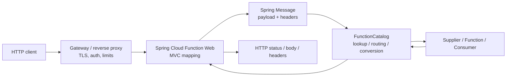
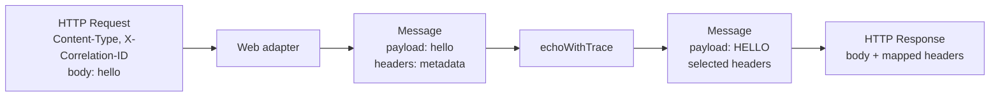
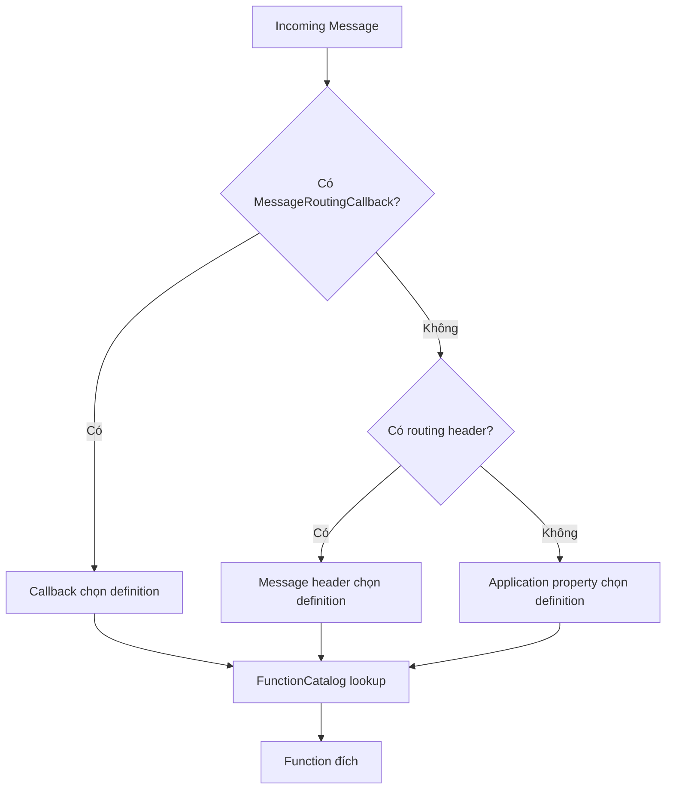

# Kiểm tra web adapter, định tuyến và header sau nâng cấp

## 1. Bối cảnh: ứng dụng khởi động thành công nhưng HTTP contract thay đổi

Một ứng dụng dùng Spring Cloud Function để triển khai nghiệp vụ đơn hàng qua HTTP. Trước nâng cấp, client gọi `POST /classifyOrder` với JSON, nhận về kết quả phân loại và một header tương quan để theo dõi request. Sau khi nâng Spring Boot, Spring Cloud Function hoặc adapter, có thể xảy ra:

- `POST /classifyOrder` không còn đi đến hàm mong đợi.
- `POST /` bắt đầu gọi một hàm khác hoặc không còn hoạt động vì ứng dụng có thêm functional bean.
- Request có header chỉ định function hoặc routing expression làm thay đổi đích xử lý.
- Header nghiệp vụ bị mất, header nhạy cảm lại vô tình xuất hiện ở response.
- `Content-Type` và `Accept` dẫn đến response JSON, text hoặc streaming khác với baseline.
- Một `Consumer` trước đây chỉ được dùng nội bộ có thể trở thành endpoint HTTP nếu ứng dụng xuất bản quá nhiều functional beans.
- Unit test Java vẫn đạt nhưng hành vi trên reverse proxy hoặc HTTP adapter thực tế lại khác.

Đây là những vấn đề cần **kiểm tra** khi nâng cấp, không phải lời khẳng định rằng tất cả thay đổi này đều đã xảy ra trong một phiên bản Spring Cloud Function cụ thể.

Mục tiêu của chương **Nâng cấp** thuộc module **SPRING_CLOUD_FUNCTION** là duy trì tính tái sử dụng của `Supplier`, `Function`, `Consumer` và `FunctionCatalog` qua HTTP, sự kiện hoặc môi trường serverless. Bài này tập trung vào **Spring Cloud Function Web adapter**, quy tắc ánh xạ endpoint, routing và cách xử lý HTTP/`Message` headers.

Sau bài học, bạn có thể thiết kế một checklist nâng cấp độc lập phiên bản, xác định rõ source của từng header, khóa danh sách function được xuất bản, thử nghiệm routing có kiểm soát, viết kiểm thử hồi quy cho status/body/headers và đưa ứng dụng lên canary mà không làm mất khả năng rollback.

## 2. Sơ đồ trách nhiệm: nghiệp vụ không phải HTTP adapter



Một `Function<OrderCreated,OrderClassified>` chỉ định nghĩa phép biến đổi Java. Khi được xuất bản qua HTTP, Spring Cloud Function Web adapter kết nối yêu cầu HTTP tới function trong catalog. Adapter cần biết **đường dẫn**, **HTTP method**, **content type**, **routing instruction** và cách chuyển đổi headers.

| Thành phần | Trách nhiệm | Không nên gánh |
| --- | --- | --- |
| `Function<T,R>` | Quy tắc nghiệp vụ, typed DTO | Mã xử lý servlet, lọc hop-by-hop HTTP headers |
| `FunctionCatalog` | Tìm hàm, composition, wrapper và chuyển đổi kiểu phù hợp | Quản trị TLS, chứng thực và reverse proxy |
| Web adapter | Xuất functional beans thành endpoint và đổi HTTP request/response sang message/function invocation | Tự cấp quyền cho mọi function được công bố |
| Spring Boot Web/MVC | Web server, filter chain, request mapping, converter và lifecycle | Quy tắc nghiệp vụ phân loại đơn hàng |
| Gateway/WAF/Ingress | TLS, authentication trước ứng dụng, giới hạn request, proxy headers | Chứng minh function route đích được phép |
| Serverless adapter | Nhận event và kích hoạt function theo platform | Giữ nguyên mọi HTTP header hoặc retry semantics của Web adapter |

**Điểm quan trọng:** Web adapter **không thay thế đầy đủ Spring MVC hoặc WebFlux**. Tài liệu Spring Cloud Function mô tả web export như phương tiện nhẹ để đưa functional bean ra HTTP, đặc biệt hữu ích cho mẫu stateless/serverless. Một API có authorization theo tài nguyên, multipart, validation/phân quyền phức tạp hoặc CRUD contract chi tiết có thể cần controller/filter/security riêng, không nên cố ép mọi yêu cầu vào routing header.

## 3. Chốt bộ phiên bản trước khi so sánh hành vi

Mọi kết luận “sau nâng cấp behavior đã đổi” cần có **baseline, target, artifact digest và environment**.

Tại thời điểm **24/11/2026**, Spring Cloud release train `2026.0.0` được công bố ngày **20/11/2026**, dựa trên Spring Boot `4.2.0` và gồm Spring Cloud Function `5.1.0`. Đây là một bộ phiên bản minh họa phù hợp để xây dựng test, không phải yêu cầu bắt buộc cho mọi dự án.

| Trục cần ghi | Baseline minh họa | Target minh họa |
| --- | --- | --- |
| Spring Boot | 3.5.x hoặc 4.0.x/4.1.x theo dự án | 4.2.0 |
| Spring Cloud BOM | Release train tương ứng baseline | 2026.0.0 |
| Spring Cloud Function | Phiên bản được baseline BOM resolve | 5.1.0 |
| Spring Framework/Web MVC | Phiên bản do Boot baseline quản lý | Phiên bản do Boot target quản lý |
| Java build/runtime | JDK target hiện dùng | JDK và runtime được kiểm chứng |
| Web adapter | Artifact và dependency thực tế | Artifact do BOM target quản lý |
| Security/proxy config | Filter, policy, header forwarding | Cấu hình đã được phê duyệt |
| Contract fixtures | Request/response chuẩn đã lưu | Cùng fixture, expected changes có ghi lý do |

**Không suy ra một HTTP mapping đã bị đổi trong 2026.0.0 chỉ vì một test của ứng dụng thất bại.** Nguyên nhân có thể là đổi bean name, Spring profile, filter, gateway rewrite, selected definition, dependency bị override hoặc code handler custom.

Nguồn để tra đúng theo version: [Spring Cloud Function Web reference](https://docs.spring.io/spring-cloud-function/reference/spring-cloud-function/standalone-web-applications.html), [Programming model](https://docs.spring.io/spring-cloud-function/reference/spring-cloud-function/programming-model.html) và [Spring Cloud 2026.0.0 release announcement](https://spring.io/blog/2026/11/20/spring-cloud-2026-0-0-has-been-released/).

## 4. Web adapter được kích hoạt bằng dependency nào?

Theo tài liệu Spring Cloud Function, module `spring-cloud-function-web` có auto-configuration cho ứng dụng Spring Boot Web hỗ trợ MVC. Dự án cũng có starter `spring-cloud-starter-function-web` để tập hợp các dependency cần thiết cho trường hợp bắt đầu đơn giản.

Ví dụ **Maven dependency** khi đã có Boot parent và import một Spring Cloud BOM tương thích:

```xml
<dependency>
    <groupId>org.springframework.cloud</groupId>
    <artifactId>spring-cloud-starter-function-web</artifactId>
</dependency>
```

Hoặc **Gradle** khi đã import BOM phù hợp:

```kotlin
dependencies {
    implementation("org.springframework.cloud:spring-cloud-starter-function-web")
}
```

Không tự gắn `5.1.0` vào từng dependency nếu đang dùng BOM `2026.0.0`. BOM chọn bộ artifact đồng bộ; việc đưa phiên bản tường minh tùy ý có thể làm lệch Function context, Web adapter hoặc các module khác.

**BOM không tạo endpoint.** Chỉ import `spring-cloud-dependencies` để quản lý version **không** tự thêm web adapter vào classpath. Nếu ứng dụng chỉ có `spring-cloud-function-context`, một bean `Function` có thể nằm trong `FunctionCatalog` nhưng không được xuất bản ra HTTP.

### 4.1. Kiểm tra classpath khi gặp 404

Hãy xác minh:

1. Dependency `spring-cloud-function-web` hoặc starter tương ứng có mặt trong artifact được deploy.
2. Web application thực sự khởi tạo **MVC server** theo cấu hình target.
3. Spring Cloud Function auto-configuration và bean của ứng dụng có được tạo.
4. Web mapping đã được đăng ký; kiểm tra startup log hoặc endpoint mappings ở môi trường kiểm thử.
5. Gateway/Ingress có đang thêm hoặc bỏ prefix của URL không.
6. Profile và application configuration đang chọn đúng `spring.cloud.function.definition`.

Không chỉ nhìn `pom.xml` rồi kết luận deployment đã đổi: container có thể vẫn chạy image cũ hoặc classpath sau dependency resolution khác dự tính.

## 5. Ví dụ ứng dụng: nhiều function và một hàm xử lý header

Dùng Java 17+ với `record`. Mã sau tạo ba function độc lập: chuyển chữ hoa, đảo chuỗi và phân loại đơn hàng, cùng một function đọc/ghi header tương quan.

```java
import java.util.Locale;
import java.util.function.Function;

import org.springframework.boot.SpringApplication;
import org.springframework.boot.autoconfigure.SpringBootApplication;
import org.springframework.context.annotation.Bean;
import org.springframework.messaging.Message;
import org.springframework.messaging.support.MessageBuilder;

@SpringBootApplication
public class WebUpgradeApplication {

    public static void main(String[] args) {
        SpringApplication.run(WebUpgradeApplication.class, args);
    }

    public record OrderCreated(
            String eventId,
            String orderId,
            long totalInCents) {}

    public record OrderClassified(
            String eventId,
            String orderId,
            String priority) {}

    @Bean
    Function<String, String> uppercase() {
        return value -> value.toUpperCase(Locale.ROOT);
    }

    @Bean
    Function<String, String> reverse() {
        return value -> new StringBuilder(value)
                .reverse().toString();
    }

    @Bean
    Function<OrderCreated, OrderClassified> classifyOrder() {
        return order -> {
            if (order.eventId() == null ||
                    order.eventId().isBlank() ||
                    order.orderId() == null ||
                    order.orderId().isBlank() ||
                    order.totalInCents() < 0) {
                throw new IllegalArgumentException(
                        "OrderCreated không hợp lệ");
            }

            return new OrderClassified(
                    order.eventId(),
                    order.orderId(),
                    order.totalInCents() >= 100_000L
                            ? "PRIORITY" : "STANDARD");
        };
    }

    @Bean
    Function<Message<String>, Message<String>> echoWithTrace() {
        return input -> {
            String result = input.getPayload()
                    .toUpperCase(Locale.ROOT);

            var builder = MessageBuilder.withPayload(result)
                    .setHeader("x-processed-by", "web-upgrade-app");

            Object correlation =
                    input.getHeaders().get("x-correlation-id");

            if (correlation instanceof String trace &&
                    trace.length() <= 128 &&
                    trace.matches("[A-Za-z0-9_-]+")) {
                builder.setHeader("x-correlation-id", trace);
            }

            return builder.build();
        };
    }
}
```

Hàm `echoWithTrace` minh họa **chuyển tiếp header có chủ đích**; nó không sao chép mọi header của request sang response. Tên header được viết chữ thường để thuận tiện trình bày. Trong thực tế, HTTP header không phân biệt hoa/thường, nhưng cách adapter biểu diễn header trong Spring `MessageHeaders` phải được kiểm tra bằng integration test.

Vì có **nhiều functional beans**, không được dựa vào việc Spring Cloud Function “đoán một hàm duy nhất”. Khi muốn giới hạn các endpoint công khai hoặc chọn composition, cấu hình `spring.cloud.function.definition` rõ ràng theo tình huống.

## 6. Endpoint HTTP mặc định: tên hàm nằm trong URL

Tài liệu **Standalone Web Applications** của Spring Cloud Function 5.1.0 mô tả các kiểu mapping tiêu biểu khi Web adapter hoạt động:

| HTTP method | URL | Loại functional bean | Kết quả tài liệu mô tả |
| --- | --- | --- | --- |
| `GET` | `/{supplier}` | `Supplier<T>` | Các phần tử từ supplier; `200 OK` |
| `POST` | `/{function}` | `Function<I,O>` | Kết quả áp dụng hàm; `200 OK` |
| `PUT` | `/{function}` | `Function<I,O>` | Kết quả áp dụng hàm; `200 OK` |
| `GET` | `/{function}/{item}` | Function nhận tham số qua path | Đưa item vào hàm; `200 OK` |
| `POST` | `/{consumer}` | `Consumer<T>` | Chuyển input cho consumer; `202 Accepted` |
| `PUT` | `/{consumer}` | `Consumer<T>` | Chuyển input cho consumer; `202 Accepted` |
| `DELETE` | `/{consumer}` | `Consumer<T>` | Không trả body; `204 No Content` |

Bảng này là **hành vi được tài liệu mô tả**, không thay thế việc chạy thử trong target application: filter/security, exception handler, custom MVC mappings, trạng thái function và content negotiation có thể ảnh hưởng kết quả thật.

Ví dụ gọi function văn bản:

```bash
curl -i -X POST "http://localhost:8080/uppercase" \
  -H "Content-Type: text/plain" \
  -H "Accept: text/plain" \
  --data "hello"
```

Kỳ vọng nghiệp vụ: body chứa `HELLO`. Tình huống này dùng String-to-String function; không cần gửi JSON object hoặc sử dụng tên Java class trong HTTP header.

Ví dụ gọi typed POJO function:

```bash
curl -i -X POST "http://localhost:8080/classifyOrder" \
  -H "Content-Type: application/json" \
  -H "Accept: application/json" \
  --data '{"eventId":"evt-101","orderId":"ORD-101","totalInCents":150000}'
```

Kỳ vọng business output:

```json
{
  "eventId": "evt-101",
  "orderId": "ORD-101",
  "priority": "PRIORITY"
}
```

Không nên kiểm thử chỉ bằng `new WebUpgradeApplication().classifyOrder().apply(...)` rồi kết luận Web adapter vẫn đúng. Unit test không thể chứng minh status code, request mapping, header propagation hoặc JSON conversion.

## 7. Kiểm tra URL prefix và context path sau nâng

Web adapter hỗ trợ thuộc tính:

```properties
spring.cloud.function.web.path=/api/functions
```

Thuộc tính này cấu hình **đường gốc của Web Function adapter**. Với cấu hình trên, URL thực tế còn chịu ảnh hưởng của servlet context path, reverse proxy và gateway rewrite. Một cuộc gọi có thể có dạng:

```text
Client
  /public/functions/classifyOrder
       |
       | Gateway rewrite
       v
Web application
  /api/functions/classifyOrder
       |
       v
FunctionCatalog: classifyOrder
```

Đây là **sơ đồ triển khai minh họa**, không nói rằng gateway bắt buộc rewrite như vậy.

### 7.1. Phân biệt ba loại path

| Path | Ai quản lý | Ví dụ |
| --- | --- | --- |
| Public URL | Load balancer / API gateway | `/public/functions/classifyOrder` |
| Servlet context path | Spring Boot web server | `/app` |
| Function adapter path | `spring.cloud.function.web.path` | `/api/functions` |

Nếu cả context path và function path được bật, cần quan sát đường URL kết hợp thực tế; không áp một công thức nối chuỗi khi dự án có proxy rewrite hoặc custom routing.

### 7.2. Các câu hỏi cần test

- Trên HTTP server trực tiếp, endpoint có được map đúng prefix không?
- Qua gateway, header `Host`/`Forwarded`/`X-Forwarded-*` được xử lý theo chính sách trust nào?
- Có endpoint cũ vẫn đang được expose ngoài ý định không?
- Có hai handler cùng map một URL/method dẫn đến xung đột không?
- Sau khi bật `spring.cloud.function.web.path`, health/Actuator/controller endpoints có vô tình bị xem là function endpoints không?

Một error status `404` không đủ để chứng minh function không tồn tại. Có thể handler không được map, proxy sửa URL, security filter từ chối theo cách được custom, hoặc function bị lọc khỏi tập được xuất bản.

## 8. Root path, single-function fallback và function definition

Nếu catalog chỉ có **một functional bean**, tài liệu cho phép URL không cần tên hàm. Ví dụ với chỉ `uppercase`, cả `POST /uppercase` và `POST /` có thể cùng đi tới function.

Nhưng khi thêm `reverse`, `classifyOrder` hoặc bean do dependency khác đóng góp, giả định “chỉ có một function” không còn đúng. Kết quả root mapping có thể khác dù các hàm đều compile.

### 8.1. Explicit definition

Khi muốn map một function hoặc composition tới root, sử dụng:

```yaml
spring:
  cloud:
    function:
      definition: uppercase
```

Ở Web adapter, một selected function/composition có thể được map tới root theo quy tắc được tài liệu mô tả. Phải test URL dự kiến và **không để root mapping thành con đường vô tình gọi một bean khác**.

### 8.2. Ngăn lookup sai tên bị fallback

Spring Cloud Function hỗ trợ:

```yaml
spring:
  cloud:
    function:
      single-function-fallback-enabled: false
```

Nó ngăn hành vi lookup tên rỗng/tên bất kỳ tự trả về hàm duy nhất trong catalog. Đây là **điều chỉnh policy lookup**, không phải một API authorization; vẫn cần cấu hình function definition và filter endpoint công khai.

### 8.3. Rủi ro trong một lần nâng cấp

```text
Baseline:
  1 bean uppercase
  POST /           -> uppercase (theo single function rule)

Target:
  2 beans uppercase, reverse
  POST /           -> không còn giả định được
  POST /uppercase  -> cần xác minh được xuất bản
```

Nếu một application test chỉ gọi `/`, có thể phát hiện thay đổi mà không biết nguyên nhân. Cần ghi **danh sách functional beans** trong baseline và target, đồng thời thiết lập definition như một phần contract.

## 9. Composition và nhiều function được xuất bản qua Web adapter

Spring Cloud Function hỗ trợ composition bằng `|` hoặc `,`. Trong URL, dấu phẩy thường dễ dùng hơn dấu pipe.

Ví dụ hai String functions:

```text
uppercase: " hi " -> " HI "
reverse:   " HI " -> " IH "
```

Cấu hình composition:

```yaml
spring:
  cloud:
    function:
      definition: uppercase|reverse
```

Trong trường hợp này, Web adapter có thể công bố pipeline `uppercase|reverse` và mapping root theo tài liệu. Cần test việc gọi `POST /` với input String và output có thứ tự biến đổi như mong đợi.

### 9.1. Dùng dấu chấm phẩy để chọn nhiều endpoint độc lập

```yaml
spring:
  cloud:
    function:
      definition: uppercase;reverse
```

Với Web adapter, `;` có ý nghĩa **chỉ xuất bản các function được liệt kê**, ví dụ `/uppercase` và `/reverse`, thay vì toàn bộ functional beans trong catalog. Tài liệu lưu ý **không map root path** trong trường hợp danh sách `;` này.

Nếu ứng dụng còn có `classifyOrder` và `echoWithTrace` nhưng chưa được phê duyệt công khai, cấu hình trên giúp giới hạn danh sách function export ở tầng adapter. Tuy vậy, **không coi đây là tường lửa**: security filters và network access control vẫn bắt buộc.

### 9.2. Một composition và một function độc lập

```yaml
spring:
  cloud:
    function:
      definition: uppercase|reverse;classifyOrder
```

Theo quy tắc Web adapter, đây là hai endpoint/definition có thể được công bố: composition `uppercase|reverse` và function `classifyOrder`. Để gọi composition qua URL, tài liệu cho phép cách diễn đạt với dấu phẩy như `/uppercase,reverse`.

**Phân biệt HTTP với Stream:** trong Spring Cloud Stream, mỗi definition được chọn còn có input/output bindings nối broker; trên Web adapter, definition ảnh hưởng tập function và path HTTP. Không thể suy luận một pipeline HTTP đã kết nối Kafka topic chỉ vì hai adapter dùng chung `spring.cloud.function.definition`.

### 9.3. Test không công bố function ngoài ý định

Khi định nghĩa `uppercase;reverse`, hãy kiểm tra:

- `POST /uppercase` thành công.
- `POST /reverse` thành công.
- `POST /classifyOrder` **không chạy nghiệp vụ**.
- `POST /echoWithTrace` **không chạy nghiệp vụ**.
- `POST /` không được tự ánh xạ thành function ngoài policy.
- Các URL composition ngoài danh sách không bị mở chỉ vì caller tự viết `foo,bar`.

Status code cụ thể cho đường không hợp lệ cần lấy từ adapter/filter version thực tế; trọng tâm là **không có side effect hoặc function invocation không được cho phép**.

## 10. Ánh xạ HTTP method theo từng function

Tài liệu Spring Cloud Function Web còn hỗ trợ property kiểu:

```properties
spring.cloud.function.http.GET=uppercase
spring.cloud.function.http.POST=uppercase;reverse
spring.cloud.function.http.DELETE=deleteById
```

Đây là cách kiểm soát **HTTP method mapping** thay vì dựa hoàn toàn vào bảng method mặc định.

Ví dụ YAML khi muốn chỉ cho phép các function văn bản trên hai method:

```yaml
spring:
  cloud:
    function:
      definition: uppercase;reverse
      http:
        GET: uppercase
        POST: uppercase;reverse
```

**Lưu ý khi triển khai:** cần kiểm tra key/casing và Spring Boot property binding trên target version; các ví dụ tài liệu sử dụng tên method viết hoa. Đây là một **hợp đồng HTTP adapter**, khác với `spring.cloud.stream.bindings.*`.

### 10.1. Không dùng GET cho side effect chỉ vì framework hỗ trợ

Một bean `Function<String,String>` có thể được gọi qua GET nếu adapter map như vậy. Nhưng HTTP GET theo semantics web nên là **safe** (không tạo side effect nghiệp vụ). Đừng biến `GET /chargeCreditCard/123` thành lệnh thanh toán chỉ vì cơ chế Function Web có thể ánh xạ method đó.

Khi nâng cấp cần kiểm tra:

- Có method được phép mới ngoài mong đợi không?
- Method `POST`/`PUT`/`DELETE` có tạo hành vi bất ngờ khi trỏ tới Consumer?
- API gateway có đang cho qua một method khác với policy backend?
- CORS preflight và authentication có áp dụng đúng mapping không?
- HTTP status đúng với contract đã phê duyệt?

**Spring Cloud Function Web không nhằm thay thế đầy đủ tài nguyên REST và annotation mapping phức tạp** của Spring MVC. Với nghiệp vụ có yêu cầu HTTP method, authorization, validation và transactional behavior chặt chẽ, dùng controller/service phù hợp có thể rõ ràng hơn.

## 11. HTTP request headers đi vào Message như thế nào?

Một hàm thuần payload:

```java
Function<String, String> uppercase()
```

không truy cập request headers trực tiếp. Nếu cần header, khai báo:

```java
Function<Message<String>, Message<String>> echoWithTrace()
```

Khi Web adapter nhận request HTTP và tạo Spring `Message`, nó có thể chuyển các request headers thành `MessageHeaders`. Tài liệu cũng nêu rằng output `Message<?>` có headers được map trở lại HTTP response headers.



### 11.1. Ví dụ gửi header tương quan

```bash
curl -i -X POST "http://localhost:8080/echoWithTrace" \
  -H "Content-Type: text/plain" \
  -H "Accept: text/plain" \
  -H "X-Correlation-ID: req_789" \
  --data "hello"
```

Kỳ vọng nghiệp vụ khi function được xuất bản:

- Body: `HELLO`.
- Header nghiệp vụ `x-processed-by` có giá trị `web-upgrade-app` nếu adapter/HTTP stack cho phép map header.
- Header `x-correlation-id` được giữ khi input tồn tại và qua validation trong code.

**Không tự gắn chính xác status/header output vào API contract nếu chưa chạy test trên đúng adapter version**. HTTP headers có quy tắc case-insensitive, các reverse proxies có thể lọc/đổi header, và Java `MessageHeaders` có cơ chế lưu metadata khác với raw HTTP headers.

### 11.2. Request header không tự trở thành field DTO

`X-Correlation-ID` không tự thêm `correlationId` vào `OrderCreated`. Chỉ khi DTO/JSON payload có field đó hoặc logic chủ động đọc metadata thì ứng dụng mới có dữ liệu cần dùng.

Nếu client gửi một header `eventId` chưa được chứng thực, function cũng không được mặc định tin rằng nó là identity hợp lệ. Headers có thể bị giả mạo nếu không được gateway xác thực và chính sách trust boundary rõ ràng.

## 12. HTTP header propagation mặc định: điểm phải kiểm tra bảo mật

Tài liệu Web adapter ghi nhận **mặc định phần lớn HTTP request headers được sao chép sang HTTP response headers**. Vì vậy cần kiểm tra đặc biệt những header không nên xuất hiện ở response, ví dụ:

- `Authorization` và credentials trong một số deployment.
- `Cookie`, session/tracking values không được phép phản chiếu.
- `X-Internal-Token`, identity/debug headers nội bộ.
- Các header chỉ dùng cho request routing, như `spring.cloud.function.definition` hoặc routing expression.
- Header có chứa dữ liệu cá nhân hoặc trace metadata không muốn lộ cho caller.

Spring Cloud Function Web cung cấp property:

```properties
spring.cloud.function.http.ignored-headers=authorization,cookie,x-internal-token
```

Nó dùng **danh sách tên header phân tách bằng dấu phẩy** để loại các header được chỉ định khỏi cơ chế propagation của adapter.

### 12.1. Cấu hình YAML minh họa

```yaml
spring:
  cloud:
    function:
      http:
        ignored-headers: authorization,cookie,x-internal-token
```

Đây là **một lớp bảo vệ**, không phải giải pháp duy nhất. Một custom function vẫn có thể tạo response header nhạy cảm nếu code tự đưa vào `MessageBuilder`. Gateway cũng có thể tự thêm headers hoặc bật CORS theo quy tắc riêng. Vì vậy cần test **response cuối cùng qua public endpoint**, không chỉ assert configuration property.

### 12.2. Header nào không được sao chép tùy tiện?

Ngay cả khi có `copyHeaders`, tránh chuyển các giá trị sau giữa ngữ cảnh request và response:

- Security credentials/authorization tokens.
- Routing instruction từ client vào các lần gọi downstream.
- Các transport-specific headers như Kafka offset, Rabbit delivery tag.
- `contentType` cũ khi output payload đổi định dạng.
- Values chưa được sanitize hoặc vượt giới hạn độ dài.

Trong Web adapter, response `Content-Type` nên phản ánh **body thực trả**, không chỉ phản chiếu `Content-Type` mà request client gửi lên. Ví dụ input JSON DTO và output String có thể cần content negotiation riêng; test phải kiểm tra header cùng với bytes thực tế.

## 13. HTTP query parameters, URI và Message headers

Ngoài request headers, Spring Cloud Function Web còn ánh xạ query parameters vào message header:

```text
http_request_param
```

Tài liệu có constant `HeaderUtils.HTTP_REQUEST_PARAM` và cho biết giá trị là map các tham số request. Điều này hữu ích cho function cần query metadata ngoài body.

Ví dụ một endpoint:

```text
POST /describeText?source=mobile&lang=vi
Content-Type: text/plain

hello
```

Function có thể đọc:

```java
@Bean
Function<Message<String>, String> describeText() {
    return input -> {
        Object queryParams =
                input.getHeaders().get("http_request_param");

        // Chỉ minh họa đọc metadata; production phải validate
        // key/value và không ghi raw request params vào log nhạy cảm.
        return input.getPayload();
    };
}
```

Trong trường hợp chỉ cần ký tự đầu vào từ path, tài liệu còn cho phép `GET /{function}/{item}`, ví dụ `GET /uppercase/hello`. Khi đó adapter đưa path item vào function theo cơ chế conversion.

### 13.1. Không đặt business identity vào URI/header một cách mơ hồ

Khi một function được gọi từ nhiều adapter, nên tách rõ:

- **Payload** chứa dữ liệu nghiệp vụ cần xử lý.
- **HTTP query/path** chứa tham số truy cập API.
- **Headers** chứa metadata/request context.
- **Security context** chứa identity đã được xác thực.

Đừng chuyển `X-User-Id` do client tự đặt thành user ID được tin cậy nếu không có bước xác thực; và đừng cho header `uri` tự quyết định quyền gọi một function nhạy cảm.

### 13.2. Kiểm thử query parameters sau nâng cấp

- Key có được giữ nguyên hoa/thường không?
- Repeated parameters có thành nhiều giá trị không?
- URL encoding và Unicode có được parse đúng không?
- Missing/empty parameter có bị xử lý đúng validation không?
- Có giới hạn tổng độ dài URL/query không?
- Proxy có rewrite path nhưng còn giữ query không?

Không dùng `http_request_param` thay cho một DTO typed nếu giao thức nghiệp vụ cần schema/version rõ ràng.

## 14. RoutingFunction: chọn hàm đích tại thời điểm invocation

Spring Cloud Function cung cấp routing function mặc định dưới tên:

```text
functionRouter
```

RoutingFunction có thể chọn một function thực sự dựa trên:

1. `MessageRoutingCallback` được đăng ký.
2. Routing instructions trong `Message` headers.
3. Application properties như `spring.cloud.function.routing-expression`.

**Thứ tự ưu tiên trong imperative model:** **callback → message header → application property**. Điều này được tài liệu Spring Cloud Function mô tả; cần test hành vi thực tế nếu nhiều cơ chế cùng xuất hiện.



**Một ứng dụng có functionRouter không đồng nghĩa nó tự an toàn khi công khai cho Internet.** Routing header hoặc expression có thể là một cách điều khiển function được gọi. Cần restrict danh sách đích và kiểm tra authorization, thay vì cho client chọn một bean name tùy ý.

## 15. Định tuyến tĩnh bằng configuration

Giả sử ứng dụng có:

```java
@Bean
Function<String, String> uppercase() {
    return String::toUpperCase;
}

@Bean
Function<String, String> reverse() {
    return value -> new StringBuilder(value)
            .reverse().toString();
}
```

Một cách đặt routing đích tĩnh là:

```yaml
spring:
  cloud:
    function:
      definition: functionRouter
      routing-expression: "'uppercase'"
```

`routing-expression` ở đây là biểu thức SpEL trả về chuỗi tên function. Dùng dấu nháy đơn bên trong giá trị chuỗi để biểu thị literal theo cú pháp expression.

Khi router hoạt động, payload text được chuyển đến `uppercase`. **Tại sao không luôn dùng `definition: uppercase`?** Nếu chỉ cần một function cố định, chọn `uppercase` trực tiếp thường đơn giản, dễ bảo mật và dễ test hơn. `functionRouter` hữu ích khi ứng dụng thật sự cần định tuyến các sự kiện khác nhau qua một entrypoint.

### 15.1. Không nhầm hai property

| Property | Mục đích |
| --- | --- |
| `spring.cloud.function.definition` | Chọn functional definition được dùng/xuất bản, có thể là `functionRouter` |
| `spring.cloud.function.routing-expression` | Quy tắc tính function đích khi RoutingFunction được dùng |

Một cấu hình `definition: classifyOrder` kết hợp một routing expression nhưng không dùng router có thể không đạt mục tiêu định tuyến. Hãy xác nhận cả **router entrypoint** lẫn **target definition** qua test.

### 15.2. Header-based routing qua HTTP

Trong trường hợp Web adapter và imperative function, tài liệu mô tả có thể truyền routing instruction từ HTTP header vào Spring `MessageHeaders`:

```bash
curl -i -X POST "http://localhost:8080/functionRouter" \
  -H "Content-Type: text/plain" \
  -H "spring.cloud.function.definition: reverse" \
  --data "abc"
```

Khi được phép, router có thể chọn `reverse` và tạo output `cba`. **Đây là ví dụ chức năng trong môi trường thử nghiệm; không khuyến nghị cho phép client không tin cậy cung cấp trực tiếp tên function.**

Một số API gateways/proxies có quy tắc riêng cho header names chứa dấu chấm. Cần test **qua chính public proxy** vì request có thể bị lọc hoặc header không đến adapter như kỳ vọng.

## 16. Routing callback: giới hạn tên function được chọn

Định tuyến dựa trên callback là cách để server chủ động đặt một **allowlist nghiệp vụ** cho các route. Ví dụ chỉ cho hai thao tác văn bản:

```java
import java.util.function.Function;

import org.springframework.cloud.function.context.MessageRoutingCallback;
import org.springframework.context.annotation.Bean;
import org.springframework.messaging.Message;

@Bean
MessageRoutingCallback approvedRouter() {
    return message -> {
        Object operation =
                message.getHeaders().get("x-operation");

        if ("UPPER".equals(operation)) {
            return "uppercase";
        }

        if ("REVERSE".equals(operation)) {
            return "reverse";
        }

        // Không cho header tùy ý quyết định tên bean.
        throw new IllegalArgumentException(
                "Unsupported operation");
    };
}
```

Đây là một phương thức `@Bean` minh họa, đặt trong một `@Configuration` hoặc class Spring Boot được quản lý. Theo Spring Cloud Function 5.1.0, `MessageRoutingCallback.routingResult(Message<?>)` trả về một `String` chứa function definition đích.

**Khác biệt với ví dụ không an toàn:**

```java
// KHÔNG NÊN dùng với HTTP input từ bên ngoài không tin cậy.
return message -> String.valueOf(
        message.getHeaders().get("spring.cloud.function.definition"));
```

Cách này trao quyền chọn bean name cho client. Nếu catalog chứa function nội bộ có side effect, một header có thể làm lộ đường gọi không mong muốn.

### 16.1. Cần xác định ranh giới trust của header x-operation

Tốt nhất, operation được chọn bởi một layer đã xác thực request, hoặc body đã được validation. Nếu client bên ngoài có quyền gửi `x-operation`, callback vẫn chỉ cho hai route, nhưng **không thay thế authorization**: caller có được phép gọi cả hai route hay không phải được quyết định bởi security policy.

### 16.2. Test độ ưu tiên callback

Tạo request có:

```text
x-operation: UPPER
spring.cloud.function.definition: reverse

Application routing-expression: 'reverse'
```

Với callback bên trên và imperative router, kết quả dự kiến là `uppercase`, vì callback được ưu tiên trước header và application property. Đây là **behavior cần kiểm chứng bằng test** mỗi khi nâng major version hoặc thay adapter.

Nếu callback không được scan/đăng ký sau upgrade, lựa chọn có thể đột ngột rơi sang header hoặc property; đó là sự thay đổi vận hành nguy hiểm ngay cả khi không có lỗi compile.

## 17. Routing expression và SpEL: bảo mật theo nguồn cấu hình

Spring Cloud Function hỗ trợ routing expression. Tài liệu nêu khác biệt quan trọng:

- Expression từ **Message headers** được đánh giá trong `SimpleEvaluationContext` với quyền hạn hạn chế.
- Expression từ **application/system properties** dùng `StandardEvaluationContext`, linh hoạt hơn.
- Điều này **không có nghĩa** mọi routing expression từ input client an toàn hoặc ứng dụng có thể bỏ qua authentication/authorization.

### 17.1. Tại sao hai evaluation contexts khác nhau?

Message header có thể xuất phát từ HTTP caller hoặc producer ngoài tổ chức. Một expression không tin cậy cần bị hạn chế, tránh cho phép các thao tác hoặc truy cập không được phê duyệt.

Application properties thường do người vận hành kiểm soát, nhưng có thể bị lộ/ghi đè nếu Actuator, config server, environment injection hoặc admin endpoints có quyền quá rộng. Vì vậy, chính quyền cập nhật configuration cũng là một phần attack surface.

### 17.2. Các chính sách nên có khi nâng

- Không mở `functionRouter` cho mọi client nếu chức năng định tuyến không thật sự cần.
- Dùng callback/map cố định thay vì cho client chỉ định bất kỳ function bean.
- Giới hạn tập definitions được xuất bản trên Web adapter.
- Bảo vệ Actuator `env`, `configprops` và config mutation surfaces.
- Không log expression từ nguồn không tin cậy nguyên văn khi chứa dữ liệu nhạy cảm.
- Kiểm thử header lạ, route không tồn tại, expression lỗi và input kích thước lớn.
- Theo dõi Spring Cloud Function security advisories và vá dependencies.

**Không giải quyết lỗi routing sau nâng bằng cách chuyển từ `SimpleEvaluationContext` sang `StandardEvaluationContext` cho header client.** Điều đó có thể nới rộng bề mặt tấn công; cách sửa đúng là thiết kế route contract và data validation phù hợp.

## 18. Reactive routing khác imperative routing

Với imperative function:

```java
Function<OrderCreated, OrderClassified>
```

mỗi message có thể là một đơn vị xử lý. RoutingFunction có thể đọc routing header và chọn đích **theo message**.

Với reactive function:

```java
Function<Flux<OrderCreated>, Flux<OrderClassified>>
```

function có thể được gọi một lần để thiết lập pipeline, rồi nhiều phần tử đi qua `Flux`. Tài liệu Spring Cloud Function nói rõ **routing theo header của từng message không được hỗ trợ theo cùng cách** trong mô hình reactive. Router sử dụng **application properties** để định tuyến toàn stream.

| Tiêu chí | Imperative | Reactive |
| --- | --- | --- |
| Đơn vị invocation | Một message/payload | Một Publisher/stream |
| Header-based route per message | Có thể theo RoutingFunction | Không mặc định theo từng phần tử |
| `MessageRoutingCallback` | Có thể áp dụng theo message | Không dựa vào callback per-element như imperative |
| Application routing expression | Có | Có, cho toàn stream |
| Rủi ro sau nâng | Thứ tự callback/header/property | Nhầm config route với per-event routing |

### Ví dụ sai kỳ vọng

```text
Flux input:
  event A -> header route=uppercase
  event B -> header route=reverse

Sai giả định:
  Router đổi function cho từng event của Flux chỉ nhờ hai header.
```

Nếu nghiệp vụ cần phân loại từng sự kiện trong một reactive stream, hãy dùng toán tử Reactor (`groupBy`, `filter`, `flatMap`) cùng chính sách error handling, hoặc thiết kế event routing tại ranh giới message của Stream/binder theo đúng tính năng được hỗ trợ. Đừng mang quy tắc header-based HTTP imperative sang reactive pipeline mà chưa kiểm thử.

## 19. Unroutable messages: không được nuốt lỗi ngoài ý định

Khi router không tìm thấy function đích, framework có thể ném exception. Spring Cloud Function cũng cung cấp `DefaultMessageRoutingHandler` để xử lý trường hợp không định tuyến được.

Tài liệu cho biết một implementation mặc định của strategy này có thể **ghi log và để message đi tiếp mà không ném exception**, dẫn tới **bỏ qua message**. Đây có thể là hành vi phù hợp cho một số bộ lọc nhưng nguy hiểm trong nghiệp vụ đơn hàng/thanh toán nếu không có quarantine và giám sát.

### Bảng quyết định

| Trường hợp | Hành vi nên thiết kế | Lý do |
| --- | --- | --- |
| Route hợp lệ, caller đủ quyền | Chuyển đúng function | Xử lý bình thường |
| Route hợp lệ, caller thiếu quyền | Từ chối trước function invocation | Authorization |
| Route không tồn tại | Fail closed hoặc xử lý lỗi có kiểm soát | Không silently drop |
| Route sai do cấu hình mới | Báo lỗi triển khai, không fallback sang hàm khác | Tránh xử lý nhầm dữ liệu |
| Event không thuộc loại được hệ thống hỗ trợ | Reject/quarantine theo contract | Tránh mất message |
| Message không cần xử lý theo chính sách lọc đã công bố | Có thể discard sau audit/metric | Đây phải là quyết định nghiệp vụ |

Với HTTP, phản hồi HTTP status cụ thể phải do adapter và error handler quyết định. Không khẳng định mọi unknown route sẽ thành `404`; test cần xác minh **không chạy function ngoài ý định** và lỗi được trả theo contract.

## 20. Content-Type, Accept và JSON conversion sau nâng

Một HTTP request có ít nhất hai metadata quan trọng:

- `Content-Type`: định dạng của **request body**.
- `Accept`: những định dạng **response body** mà client chấp nhận.

Spring Cloud Function có cơ chế message conversion dựa vào kiểu Java và `contentType`. Ví dụ function typed:

```java
Function<OrderCreated, OrderClassified>
```

và request:

```http
POST /classifyOrder HTTP/1.1
Content-Type: application/json
Accept: application/json

{"eventId":"evt-101","orderId":"ORD-101","totalInCents":150000}
```

Nếu converter hỗ trợ JSON, dữ liệu có thể được chuyển thành `OrderCreated` trước khi gọi function. Output `OrderClassified` được chuyển sang biểu diễn response phù hợp.

### 20.1. Những lỗi conversion rất dễ bị coi là routing lỗi

| Triệu chứng | Nguyên nhân có thể |
| --- | --- |
| Endpoint tồn tại nhưng trả lỗi trước khi function chạy | JSON parse/type conversion lỗi |
| Input là `String` nhưng client gửi JSON string/object khác mong đợi | Content type hoặc body contract lệch |
| Output `text/plain` thay vì JSON | `Accept`, output type, message header hoặc mapper khác |
| Header `Content-Type` response bị sai sau function trả `Message<T>` | Copy header request không phù hợp output |
| Body nhiều phần tử được gửi thành JSON array thay vì streaming | Response content negotiation hoặc model khác |
| Kết quả Java đúng nhưng JSON field khác | Jackson/Gson/custom serializer và version |

### 20.2. Test sai schema

```json
{
  "eventId": "evt-102",
  "orderId": "ORD-102",
  "totalInCents": "not-a-number"
}
```

Vì `totalInCents` là `long`, lỗi có thể xuất hiện trong converter trước khi `classifyOrder` được gọi. Test yêu cầu endpoint **không thực hiện side effect**, có thông báo lỗi đã làm sạch, và không lộ class names/stack traces cho caller.

### 20.3. Header type do client chỉ định

Spring Cloud Function có hỗ trợ MIME parameter `application/json;type=...` trong trường hợp dynamic type resolution. Với input HTTP không tin cậy, phải tuân thủ chính sách class allowlist `META-INF/deserializable.types` trong các phiên bản tương ứng. Một function typed `OrderCreated` thường **không cần** client gửi Java class name.

Đừng nới class-loading permission chỉ vì một test từ phiên bản cũ trước khi vá bảo mật không còn chạy. Đây là phạm vi security/serialization, không phải một lỗi đơn thuần của URL router.

## 21. Streaming response và Accept: text/event-stream

Theo tài liệu Web adapter, khi function trả **nhiều phần tử** (ví dụ một collection hoặc `Flux`), client có thể yêu cầu server-sent events (SSE) bằng:

```http
Accept: text/event-stream
```

Ví dụ về reactive function:

```java
import java.util.function.Function;
import org.springframework.context.annotation.Bean;
import reactor.core.publisher.Flux;

@Bean
Function<Flux<String>, Flux<String>> uppercaseStream() {
    return values -> values.map(String::toUpperCase);
}
```

Khi test HTTP response streaming, cần quan sát:

1. Response là JSON batch hay event stream, theo contract và `Accept`.
2. Event đầu tiên xuất hiện trước hay sau khi toàn nguồn hoàn tất.
3. Nếu client hủy kết nối, subscription có được giải phóng không.
4. Một phần tử lỗi có chấm dứt toàn stream không.
5. Proxy timeout và buffer có làm mất lợi ích streaming không.
6. Trạng thái `Content-Type`/cache-control và các headers được trả đúng policy không.

**Không suy từ việc function nhận `Flux` rằng mọi Web adapter tự xử lý backpressure/connection cancellation như một WebFlux server.** Tài liệu standalone Web adapter nêu rõ nền tảng MVC. Kịch bản SSE cần kiểm thử end-to-end trên chính server, gateway và runtime mục tiêu.

## 22. HTTP routing khác Spring Cloud Stream routing

Một ứng dụng có thể dùng cùng `Function<T,R>` qua HTTP và Spring Cloud Stream. Tuy nhiên, hai adapter có ranh giới giao nhận khác nhau.

| Tiêu chí | Spring Cloud Function Web | Spring Cloud Stream |
| --- | --- | --- |
| Input | HTTP request body, path, query và headers | Message từ Kafka/RabbitMQ/binder |
| Function selection | URL mapping, definition, RoutingFunction | Definition/binding, event routing khi có cấu hình |
| Output | HTTP status/body/headers | Output binding tới destination |
| Correlation | HTTP/Message headers theo contract | Broker headers + application metadata |
| Retry | Client/gateway/server policy | Consumer retry, binder error handling |
| Acknowledgement | HTTP response không đồng nghĩa xử lý downstream | Kafka offset, RabbitMQ ack, v.v. |
| Streaming | HTTP/SSE khi được hỗ trợ | Flux/messages qua binder |
| Security | Auth, CORS, CSRF policy, route exposure | Broker credentials/ACL, trust headers và deserialization |

**HTTP `200 OK` chỉ xác nhận lời gọi HTTP theo contract**, không chứng minh một downstream Kafka consumer đã commit offset. Ngược lại, message từ Kafka có `spring.cloud.function.definition` header không có nghĩa function Web path tương ứng đã được công bố.

Khi thay adapter trong nâng cấp, phải xác định lại **policy về retry, headers, error status và routing**. Code nghiệp vụ có thể giữ nguyên, nhưng contract vận hành không tự tương đương.

## 23. Bảo mật HTTP adapter và route headers

Một checklist an toàn không thể chỉ xét đúng payload/output.

### 23.1. Bảo vệ route entrypoint

- Chỉ công bố những functional beans được duyệt.
- Với side effect, yêu cầu authentication/authorization phù hợp.
- Không cho client tự chọn function nội bộ bằng header tùy ý.
- Tách quyền gọi `uppercase` với quyền gọi một `Consumer` thực hiện ghi dữ liệu.
- Dùng route callback allowlist hoặc controller riêng khi logic phân quyền phức tạp.

### 23.2. Bảo vệ response headers

- Cấu hình `spring.cloud.function.http.ignored-headers` để lọc request metadata nhạy cảm.
- Không copy tất cả `MessageHeaders` vào response.
- Lọc `Authorization`, cookie và các headers nội bộ ở gateway/adapter theo chính sách.
- Kiểm tra headers có giá trị không hợp lệ, quá dài hoặc chứa ký tự nguy hiểm.
- Có chính sách chuẩn cho correlation ID, trace ID và request ID.

### 23.3. Bảo vệ SpEL/configuration

- Hạn chế quyền sửa application properties và Config Server.
- Bảo vệ Actuator configuration endpoints.
- Không biến một header client thành Java class name hoặc expression được thực thi tùy ý.
- Theo dõi các bản vá Spring Cloud Function liên quan JSON collection và class loading.
- Kiểm tra giới hạn request size, JSON array size và thời gian xử lý.

### 23.4. Không dựa vào CORS để làm authorization

CORS là cơ chế browser kiểm soát việc đọc response cross-origin, **không phải** hệ thống phân quyền đáng tin cho API. Một client không phải trình duyệt vẫn có thể gửi HTTP trực tiếp. Cần Spring Security/gateway policy phù hợp với nghiệp vụ.

## 24. Regression test: chụp hành vi trước và sau nâng cấp

Bộ kiểm thử nên dùng **cùng các request fixtures**, chạy trên cả baseline và target. Kết quả cần lưu là **status + body + headers + function đích thực sự được gọi**, không chỉ “curl không trả 500”.

### 24.1. Ma trận golden contract

| ID | Request | Kỳ vọng cần khóa |
| --- | --- | --- |
| WEB-01 | `POST /uppercase`, text/plain `hello` | Body `HELLO`, status thành công |
| WEB-02 | `POST /reverse`, text/plain `abc` | Body `cba` |
| WEB-03 | `POST /classifyOrder`, JSON hợp lệ | Schema đúng, priority đúng |
| WEB-04 | JSON sai trường/kiểu | Từ chối có kiểm soát; không side effect |
| WEB-05 | `POST /` với một function | Root mapping theo baseline hoặc policy mới |
| WEB-06 | `POST /` với nhiều function | Không fallback sang bean ngoài ý định |
| WEB-07 | Definition `uppercase;reverse` | Chỉ xuất bản hai function được chọn |
| WEB-08 | `POST /uppercase,reverse` | Composition đúng thứ tự nếu được chọn |
| WEB-09 | Function method chỉ cho GET | POST bị từ chối/không chạy nghiệp vụ |
| WEB-10 | `X-Correlation-ID` hợp lệ | Header được giữ theo contract |
| WEB-11 | `Authorization`/Cookie ở request | Không xuất hiện trái phép trong response |
| WEB-12 | Header `spring.cloud.function.definition` | Không vượt policy function exposure |
| WEB-13 | Callback xung đột header/property | Callback thắng trong imperative routing |
| WEB-14 | Unknown route | Không gọi function ngoài ý định |
| WEB-15 | Query params | `http_request_param` được đọc đúng nếu dùng |
| WEB-16 | `Accept: text/event-stream` | Streaming response đáp ứng contract |
| WEB-17 | Public URL qua gateway | Path rewrite/auth/header filters đúng |
| WEB-18 | Header/batch lớn | Có giới hạn tài nguyên và reject phù hợp |
| WEB-19 | Ứng dụng nhiều profile | Active profile và definition đúng |
| WEB-20 | Web + Stream cùng ứng dụng | Không tự mở endpoint ngoài danh sách |

Một khác biệt chỉ được coi là **expected** nếu product/security owner chấp thuận. Ví dụ bắt đầu từ chối một class name không nằm allowlist có thể là **sửa lỗi bảo mật**, không phải regression cần tắt đi.

### 24.2. Lưu fixture thế nào?

Ví dụ fixture:

```json
{
  "request": {
    "method": "POST",
    "path": "/classifyOrder",
    "headers": {
      "Content-Type": "application/json",
      "Accept": "application/json",
      "X-Correlation-ID": "req_789"
    },
    "body": {
      "eventId": "evt-101",
      "orderId": "ORD-101",
      "totalInCents": 150000
    }
  },
  "expected": {
    "status": 200,
    "body": {
      "eventId": "evt-101",
      "orderId": "ORD-101",
      "priority": "PRIORITY"
    }
  }
}
```

Đây là **test fixture minh họa**, không phải schema của một công cụ kiểm thử cụ thể. Bộ test thật cần so sánh JSON về mặt semantic thay vì phụ thuộc thứ tự field, và chỉ assert headers có trong hợp đồng.

## 25. Unit test tách khỏi Web adapter test

Unit test nghiệp vụ:

```java
import static org.junit.jupiter.api.Assertions.assertEquals;

import org.junit.jupiter.api.Test;

class WebUpgradeBusinessTest {

    @Test
    void classifiesOrderWithoutHttp() {
        var fn = new WebUpgradeApplication().classifyOrder();

        var result = fn.apply(
                new WebUpgradeApplication.OrderCreated(
                        "evt-101", "ORD-101", 150_000L));

        assertEquals("PRIORITY", result.priority());
        assertEquals("ORD-101", result.orderId());
    }
}
```

Test header function ở mức Java:

```java
import static org.junit.jupiter.api.Assertions.assertEquals;

import org.junit.jupiter.api.Test;
import org.springframework.messaging.support.MessageBuilder;

class WebUpgradeHeaderTest {

    @Test
    void copiesOnlyApprovedBusinessHeader() {
        var fn = new WebUpgradeApplication().echoWithTrace();

        var incoming = MessageBuilder.withPayload("hello")
                .setHeader("x-correlation-id", "req_789")
                .setHeader("authorization", "sensitive")
                .build();

        var outgoing = fn.apply(incoming);

        assertEquals("HELLO", outgoing.getPayload());
        assertEquals("req_789",
                outgoing.getHeaders().get("x-correlation-id"));
        assertEquals("web-upgrade-app",
                outgoing.getHeaders().get("x-processed-by"));
        assertEquals(null,
                outgoing.getHeaders().get("authorization"));
    }
}
```

Test header này **chỉ chứng minh function tự tạo message mới** không copy authorization. Nó **không chứng minh Web adapter không tự echo `Authorization`** — behavior của adapter phải được kiểm tra ở tầng HTTP với `ignored-headers` và proxy.

## 26. Kiểm thử HTTP adapter bằng request thật

Sử dụng các lệnh `curl` là cách kiểm tra trực tiếp route, method, header và serialization của adapter đang chạy.

### 26.1. Kiểm thử text function

```bash
curl -i "http://localhost:8080/uppercase" \
  -X POST \
  -H "Content-Type: text/plain" \
  -H "Accept: text/plain" \
  --data "hello"
```

Đọc cả status line và headers, không chỉ body. Nếu qua proxy public URL, chạy **cùng request** vào public URL để phát hiện header/path rewrite khác với localhost.

### 26.2. Kiểm thử JSON function

```bash
curl -i "http://localhost:8080/classifyOrder" \
  -X POST \
  -H "Content-Type: application/json" \
  -H "Accept: application/json" \
  --data '{"eventId":"evt-101","orderId":"ORD-101","totalInCents":150000}'
```

Kiểm tra field names, số, JSON mime type và status. Đừng chỉ so sánh text raw nếu JSON serializer đổi thứ tự field nhưng contract không phụ thuộc thứ tự.

### 26.3. Kiểm thử header nhạy cảm không bị echo

```bash
curl -i "http://localhost:8080/echoWithTrace" \
  -X POST \
  -H "Content-Type: text/plain" \
  -H "X-Correlation-ID: req_789" \
  -H "Authorization: Bearer demo-only-token" \
  -H "Cookie: demo_cookie=not-a-real-secret" \
  --data "hello"
```

Token trong ví dụ là **giả lập**, không chứa credential thật. Kỳ vọng: response không trả lại `Authorization` hay `Cookie` trái policy, và correlation header được kiểm tra theo hợp đồng.

### 26.4. Kiểm thử prefix mới

```bash
curl -i "http://localhost:8080/api/functions/uppercase" \
  -X POST \
  -H "Content-Type: text/plain" \
  --data "hello"
```

Chỉ áp dụng khi `spring.cloud.function.web.path` được cấu hình thành `/api/functions` và URL thực tế không có context/proxy prefix khác.

### 26.5. Kiểm thử routing security

Tạo request có routing header chỉ một function **không được phê duyệt**. Kiểm tra function đó **không được gọi** và response có kiểm soát; không viết test đưa trực tiếp các bean nguy hiểm vào public catalog. Nếu có callback allowlist, thử cả function name được phép và không được phép.

## 27. Một test end-to-end bằng Java HttpClient

Java `HttpClient` có thể kiểm thử adapter chạy thật mà không phụ thuộc riêng vào `MockMvc` hoặc starter test package của một phiên bản Boot cụ thể.

Ví dụ JUnit khi ứng dụng test đã chạy trên URL được cấu hình:

```java
import static org.junit.jupiter.api.Assertions.assertEquals;
import static org.junit.jupiter.api.Assertions.assertTrue;

import java.net.URI;
import java.net.http.HttpClient;
import java.net.http.HttpRequest;
import java.net.http.HttpResponse;

import org.junit.jupiter.api.Test;

class FunctionHttpSmokeTest {

    @Test
    void classifiesOrderOverHttp() throws Exception {
        String endpoint = System.getProperty(
                "function.test.base-url",
                "http://localhost:8080");

        var request = HttpRequest.newBuilder()
                .uri(URI.create(endpoint + "/classifyOrder"))
                .header("Content-Type", "application/json")
                .header("Accept", "application/json")
                .POST(HttpRequest.BodyPublishers.ofString(
                        "{\"eventId\":\"evt-101\","
                      + "\"orderId\":\"ORD-101\","
                      + "\"totalInCents\":150000}"))
                .build();

        var response = HttpClient.newHttpClient().send(
                request, HttpResponse.BodyHandlers.ofString());

        assertEquals(200, response.statusCode());
        assertTrue(response.body().contains(
                "\"priority\":\"PRIORITY\""));
    }
}
```

**Giới hạn của ví dụ:** test mặc định gọi server local đang chạy và so sánh chuỗi JSON đơn giản. Trong CI nên chủ động start/stop application với random port, truyền base URL, giới hạn timeout, parse JSON về đối tượng để so sánh semantic, và đảm bảo test không chạy ngẫu nhiên vào production.

### 27.1. Test header ngoài chức năng nghiệp vụ

Một test riêng cần:

- Gửi `Authorization` và `Cookie` giả lập.
- Xác minh response **không** chứa các header nhạy cảm.
- Gửi correlation ID hợp lệ; kiểm tra response có theo contract.
- Gửi correlation ID có ký tự không hợp lệ; kiểm tra không bị phản chiếu.
- Gửi HTTP `spring.cloud.function.definition` do client chọn, xác minh routing policy.
- Kiểm tra response `Content-Type` đúng với payload thực.

**Không in request/response chứa token thật** vào CI logs hoặc test snapshot.

## 28. Logging, metrics và quan sát khi canary

Khi nâng cấp Web adapter, cần biết **function nào được chọn**, **HTTP status**, **thời gian xử lý** và **header policy** mà không ghi dữ liệu nhạy cảm.

| Chỉ số/tín hiệu | Ý nghĩa |
| --- | --- |
| HTTP request rate theo method/path | Endpoint mới/cũ có được gọi đúng không? |
| 4xx/5xx theo function | Sai client contract hay lỗi server? |
| Routing callback result | Có route nào ngoài allowlist không? |
| FunctionCatalog lookup failures | Definition bị sai hoặc bean không tồn tại |
| JSON conversion failures | Content type/DTO/mapper thay đổi |
| Latency p95/p99 | Adapter/gateway/serialization có làm chậm không? |
| Response headers audit | Có leak header ngoài policy không? |
| SSE disconnections/timeouts | Streaming lifecycle có vấn đề không? |
| Heap/CPU và body size | Bất thường tài nguyên sau nâng |
| Security denial count | Các request bị từ chối đúng policy |

Đừng đưa `Authorization`, `Cookie`, `spring.cloud.function.routing-expression` chứa dữ liệu nhạy cảm hoặc toàn bộ request body vào log. Nếu cần truy vết, dùng correlation ID đã validate và trace context được phê duyệt.

Khi `/actuator/mappings` hoặc `/actuator/configprops` được bật để kiểm tra runtime, phải bảo vệ quyền truy cập, tránh lộ endpoint inventory hoặc configuration nhạy cảm. Không dùng một endpoint management công khai như cách hỗ trợ debug Web adapter trên production.

## 29. Bảng chẩn đoán lỗi thường gặp

| Triệu chứng | Nguyên nhân có thể | Cách kiểm tra |
| --- | --- | --- |
| `POST /classifyOrder` trả 404 | Chưa có Web starter, sai path, bean không được export, proxy rewrite | Classpath, startup mapping, definition, public/direct URL |
| `POST /` chuyển sang function khác | Single-function fallback hoặc definition khác baseline | Catalog beans, definition, root mapping |
| Nhiều bean nhưng API chỉ còn một endpoint | `spring.cloud.function.definition` chọn một definition | Kiểm tra config hiệu lực và mapping |
| Composition có tên URL khác | Dấu `|`/`,` hoặc URL encoding | Test `/uppercase,reverse` theo docs |
| Method không mong muốn được phép | Chưa khóa `spring.cloud.function.http.GET/POST/...` | Test method matrix |
| Consumer nội bộ bị gọi qua HTTP | Auto-export nhiều functions | `definition` tường minh, authz và audit |
| Routing header điều khiển bean nhạy cảm | Không giới hạn function choices | Server-owned callback/allowlist, auth |
| Callback không hoạt động sau nâng | Bean không scan/không đăng ký | ApplicationContext và priority tests |
| Header route không hoạt động với reactive | Per-message routing không tương đương | Dùng application property cho stream |
| Header `x-correlation-id` mất | Proxy lọc, case mapping, output Message không copy | Test direct vs public HTTP |
| Response chứa `Authorization` hoặc cookie | Header propagation không được lọc | `ignored-headers`, proxy filters, output Message |
| Response JSON sai `Content-Type` | Copy header cũ hoặc converter khác | `Accept`, output type, mapper |
| Query parameter không đọc được | Function chỉ nhận `String`, không đọc Message metadata | `http_request_param`, type signature |
| HTTP 200 nhưng downstream Kafka không có event | Nhầm Web adapter với Stream publish | Kiểm tra thực tế output binding và broker |
| Routing expression chạy khác sau nâng | Header/callback/property priority đổi vì config | Golden tests cho ba nguồn route |
| JSON body sai nhưng function không log lỗi | Conversion thất bại trước `apply` | Converter, content type, error handler |
| SSE response bị buffer hoặc timeout | Proxy/server runtime khác | End-to-end streaming test |
| Java unit test đạt nhưng URL lỗi | Unit test không dùng adapter | HTTP integration test |
| Property đặt đúng nhưng không có hiệu lực | Sai profile, Boot config source hoặc version | Effective config và runtime mappings |
| Rollback code nhưng client còn dùng path mới | API migration không tương thích ngược | Dual-route/redirect window và release contract |

Debug theo thứ tự:

**Resolved dependencies → Web MVC auto-configuration → active profile → function catalog → definition/route → URL/method → request headers/query/body → conversion → function invocation → response headers/status → gateway/security**.

## 30. Kế hoạch nâng cấp: baseline, staging, canary, rollback

### 30.1. Thu thập baseline

Lưu một danh sách rõ ràng:

```text
BOOT_VERSION=<resolved>
CLOUD_BOM=<resolved>
FUNCTION_VERSION=<resolved>
WEB_ADAPTER_ARTIFACT=<resolved>
JAVA_RUNTIME=<runtime>
IMAGE_DIGEST=<sha256>
FUNCTION_NAMES=<approved names>
EXPORTED_PATHS=<method + path>
ROUTING_RULES=<callback / header / property>
HEADER_POLICY=<allowed and ignored>
CONTRACT_TEST_RUN=<report id>
```

Các giá trị trong dấu `<...>` là chỗ điền, không phải thông tin tự lấy được từ ứng dụng.

### 30.2. Trên staging

- Chạy unit tests cho function thuần.
- Chạy `FunctionCatalog` lookup/composition tests.
- Chạy HTTP method/path matrix cả direct và qua gateway.
- Kiểm tra chỉ các function được phê duyệt được xuất bản.
- Kiểm thử routing callback/header/property precedence.
- Kiểm thử response header propagation và ignored headers.
- Kiểm thử JSON/content negotiation, query params và SSE nếu có.
- Kiểm thử 4xx/5xx với input invalid/unauthorized.
- Kiểm thử các bên tiêu thụ downstream nếu HTTP function có side effect hoặc phát event.

### 30.3. Canary

- Deploy theo image digest, giữ baseline artifact để rollback.
- Theo dõi 4xx/5xx, latency, routing failures, leaked header tests và application metrics.
- Chọn tỷ lệ lưu lượng có giới hạn, ưu tiên request contract ổn định.
- Đảm bảo có cảnh báo khi function ngoài allowlist được invoke.
- Giữ API gateway rules tương thích với hai phiên bản trong giai đoạn chuyển tiếp.

### 30.4. Rollback

Rollback code không tự hoàn tác request đã gây side effect hoặc event đã phát. Nếu version mới đổi response schema, path hoặc behavior routing, client cũng có thể đã được triển khai theo contract mới. Cần:

1. Giữ compatibility window hoặc dual-route plan nếu cần.
2. Không thay đổi public path và authentication policy không cần thiết trong cùng đợt nâng.
3. Chuẩn bị chuyển traffic về image cũ cùng config/secret tương thích.
4. Xác minh rollback không mở lại function nhạy cảm hay header leak đã được vá.
5. Ghi lại requests đã xử lý trong giai đoạn canary để đối soát side effect.

Nếu thay đổi có liên quan security fix, không quay lại bản dễ bị tấn công chỉ để một client cũ tiếp tục gửi header/routing expression không an toàn. Cần đánh giá biện pháp giảm thiểu và phê duyệt rõ.

## 31. Bài tập thực hành

### Bài tập 1: Bốn function, chỉ hai endpoint

Một ứng dụng có `uppercase`, `reverse`, `classifyOrder` và `echoWithTrace`. Chỉ `uppercase` và `reverse` được phép công bố ra Internet.

**Yêu cầu:** viết `spring.cloud.function.definition` phù hợp, liệt kê URL được phép theo Web adapter và thiết kế negative test chứng minh hai function còn lại không được gọi. Vì sao vẫn cần authentication/authorization?

### Bài tập 2: Root mapping thay đổi

Baseline chỉ có một `Function<String,String>`, client dùng `POST /`. Target thêm một function bean do module mới tạo ra. Hãy nêu nguyên nhân root có thể đổi behavior, đề xuất explicit definition và các test để tránh lookup fallback sai tên.

### Bài tập 3: Bảo vệ response headers

Client gửi:

```text
Authorization: Bearer demo
Cookie: session=example
X-Correlation-ID: req_789
```

Hãy cấu hình `spring.cloud.function.http.ignored-headers` để tránh phản chiếu metadata nhạy cảm, đồng thời viết test bảo toàn correlation ID hợp lệ. Vì sao chỉ kiểm tra `MessageBuilder` trong unit test là chưa đủ?

### Bài tập 4: Cạnh tranh routing instructions

Một request có:

```text
x-operation: UPPER
spring.cloud.function.definition: reverse
```

Application property đặt `routing-expression: "'reverse'"` và có `MessageRoutingCallback` ở mục 16. Hàm nào phải được chọn trong imperative model? Hãy thiết kế kiểm thử và giải thích tính bảo mật của thứ tự ưu tiên.

### Bài tập 5: HTTP method mapping

Một endpoint chỉ được phép dùng POST để xử lý nghiệp vụ. Hãy viết cấu hình `spring.cloud.function.http.POST` và đề xuất kiểm thử GET/PUT/DELETE. Khi nào một `Function` không phù hợp để biểu diễn tác vụ side effect qua GET?

### Bài tập 6: Query parameter và HTTP Message

`GET /uppercase/hello?source=mobile` được gọi vào Web adapter. Hãy xác định path item, query parameter và header metadata được gửi vào function thế nào. Khi cần đọc query param, chữ ký Java nên nhận `Message<String>` hay `String`?

### Bài tập 7: HTTP và Stream dùng cùng function

Một `Function<OrderCreated,OrderClassified>` chạy qua HTTP và Kafka. Hãy liệt kê ít nhất năm điểm mà behavior có thể khác dù logic Java không đổi: input transport, header propagation, ack/retry, error response và output mapping.

### Bài tập 8: Reactive route per-message

Một `Function<Flux<OrderCreated>,Flux<OrderClassified>>` cần chọn function khác nhau theo header của mỗi phần tử. Hãy giải thích vì sao RoutingFunction header-based model không nên được dùng theo giả định imperative, rồi thiết kế phương án Reactor hoặc event routing phù hợp.

### Bài tập 9: Kiểm thử header leak qua gateway

Viết bộ test gửi request có `Authorization` giả lập và `X-Internal-Token` tới public URL và direct application URL, sau đó so sánh response headers. Vì sao phải test cả hai đường? Những thông tin nào không được lưu trong CI logs?

### Bài tập 10: Rollback với đường dẫn mới

Trong canary, URL mới `/api/functions/classifyOrder` đã được một client sử dụng. Khi rollback, image cũ chỉ nhận `/classifyOrder`. Hãy đề xuất gateway compatibility window, contract tests và cơ chế phát hiện client còn gọi path mới.

### Câu hỏi tự đánh giá

1. Spring Cloud Function Web adapter có tự xuất hiện chỉ vì import Cloud BOM không?
2. Khi có một functional bean, root `/` và `/{function}` có thể có quan hệ gì?
3. Khi có nhiều function, vì sao nên thiết lập `spring.cloud.function.definition` tường minh?
4. `uppercase|reverse` khác `uppercase;reverse` thế nào trong Web adapter?
5. Thuộc tính nào dùng để đổi base path của Web Function endpoint?
6. Một `Consumer<T>` qua POST thường được tài liệu mô tả trả status nào?
7. `Content-Type` của request và `Accept` khác nhau thế nào?
8. Với `Message<T>`, HTTP request headers có được đưa vào Spring message metadata không?
9. Vì sao cần cấu hình `spring.cloud.function.http.ignored-headers`?
10. Routing callback/header/application property có thứ tự ưu tiên nào?
11. Vì sao không nên cho untrusted caller tự đặt `spring.cloud.function.definition` để gọi mọi bean?
12. Expression từ message header và application property có cùng evaluation context không?
13. Routing per-message có hoạt động với reactive `Flux` giống imperative không?
14. `http_request_param` được dùng để làm gì?
15. Vì sao unit test của `echoWithTrace` không đủ chứng minh `Authorization` không bị echo?
16. Khi nào nên yêu cầu `Accept: text/event-stream`?
17. Test nào chứng minh một function nội bộ không còn được export qua HTTP?
18. Một HTTP `200 OK` có chứng minh Kafka consumer đã ack/commit không?
19. Canary phải giám sát những chỉ số nào ngoài số request thành công?
20. Vì sao rollback JAR không thể đảo ngược side effect đã được xử lý?

## 32. Tổng kết

Trong quá trình **nâng cấp Spring Cloud Function**, cần giữ tách biệt:

- **Functional bean và FunctionCatalog:** logic `Supplier`, `Function`, `Consumer`, lookup, composition và wrapper invocation.
- **Spring Cloud Function Web adapter:** method/path mapping, root fallback, danh sách function được công bố, content conversion, request/response headers và streaming.
- **RoutingFunction:** function đích có thể đến từ callback, message header hoặc application property; trong imperative model ưu tiên **callback → header → property** và phải kiểm soát chức năng được phép gọi.
- **Header policy:** HTTP request headers có thể đi vào `Message<T>` và một số được phản chiếu ra response; cần `ignored-headers`, code chuyển tiếp metadata có chọn lọc, gateway filtering và HTTP integration test.
- **Reactive và transport boundary:** routing theo header của từng message không tương đương reactive routing; HTTP status, broker ack và serverless event retry là những hợp đồng riêng.
- **Regression tests:** cùng bộ fixture phải kiểm tra **status + body + headers + function đích + side effect**, trên cả application trực tiếp và public gateway.

Một quy trình tốt là **xác nhận cặp phiên bản tương thích → kiểm kê endpoints và headers → khóa function definition và method/path policy → kiểm thử routing/security → chạy golden tests trước–sau → canary có rollback rõ ràng**. Nhờ đó cùng một hàm nghiệp vụ có thể tiếp tục tái sử dụng qua HTTP, sự kiện hoặc serverless mà không phải đánh đổi tính an toàn và sự ổn định của contract.

### Tài liệu tham khảo

- [Spring Cloud Function 5.1.0 — Standalone Web Applications: HTTP methods, paths, headers, filter và mapping](https://docs.spring.io/spring-cloud-function/reference/spring-cloud-function/standalone-web-applications.html)
- [Spring Cloud Function 5.1.0 — Programming Model: FunctionCatalog, RoutingFunction, SpEL và priority](https://docs.spring.io/spring-cloud-function/reference/spring-cloud-function/programming-model.html)
- [Spring Cloud Function — Reference Documentation](https://docs.spring.io/spring-cloud-function/reference/)
- [Spring Cloud 2026.0.0 — Release announcement, 20/11/2026](https://spring.io/blog/2026/11/20/spring-cloud-2026-0-0-has-been-released/)
- [Spring Cloud Stream — Event Routing](https://docs.spring.io/spring-cloud-stream/reference/spring-cloud-stream/event-routing.html)
- [Spring Cloud Stream — Functional Binding Names](https://docs.spring.io/spring-cloud-stream/reference/spring-cloud-stream/functional-binding-names.html)
- [Spring Boot — Externalized Configuration](https://docs.spring.io/spring-boot/reference/features/external-config.html)
- [Spring Boot — Actuator Endpoints](https://docs.spring.io/spring-boot/reference/actuator/endpoints.html)
- [Spring Security — Servlet Authentication and Authorization](https://docs.spring.io/spring-security/reference/servlet/authorization/index.html)
- [MDN — HTTP Content Negotiation](https://developer.mozilla.org/en-US/docs/Web/HTTP/Guides/Content_negotiation)
- [MDN — Server-sent events](https://developer.mozilla.org/en-US/docs/Web/API/Server-sent_events)
