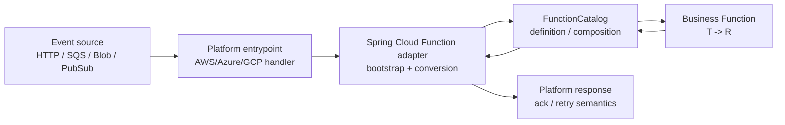
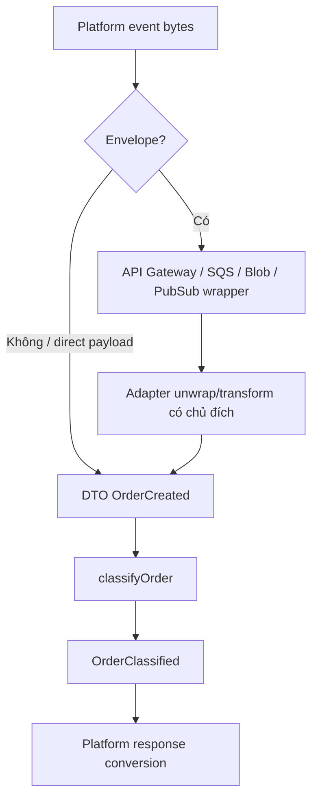

# Chuyển đổi handler serverless đã ngừng khuyến nghị

## 1. Bài toán: cùng một tên FunctionInvoker nhưng hướng nâng cấp lại trái ngược

Một nhóm có logic nghiệp vụ thuần Java bằng Spring Cloud Function:

```java
@Bean
Function<String, String> uppercase() {
    return text -> text.toUpperCase(Locale.ROOT);
}
```

Nhóm từng triển khai hàm này lên AWS Lambda và Azure Functions. Sau vài lần nâng cấp thư viện, hệ thống vẫn có thể chạy nhờ handler cũ nhưng gặp deprecation, phụ thuộc khó bảo trì hoặc hạn chế ở khâu đóng gói và khởi tạo context.

Điểm đặc biệt là **không thể tìm–thay mọi chuỗi `FunctionInvoker` bằng cùng một cách**:

- **AWS Lambda:** Spring Cloud Function khuyến nghị handler tích hợp `org.springframework.cloud.function.adapter.aws.FunctionInvoker`. Những handler AWS cũ kiểu `SpringBootRequestHandler`, `SpringBootApiGatewayRequestHandler` hoặc `SpringBootKinesisEventHandler` đã bị đánh dấu deprecated ở các bản API cũ; ứng dụng mới nên chọn `FunctionInvoker` nếu contract phù hợp.
- **Azure Functions:** chính mẫu **kế thừa** `org.springframework.cloud.function.adapter.azure.FunctionInvoker` và gọi `handleRequest(...)` là mô hình **legacy đã deprecated**. Hướng tích hợp hiện hành là viết các method có Azure trigger annotations trên lớp được Spring quản lý (ví dụ `@Component`), inject Spring beans hoặc `FunctionCatalog`.
- **Google Cloud Functions:** tài liệu hiện hành vẫn mô tả entry point `org.springframework.cloud.function.adapter.gcp.GcfJarLauncher`. Không suy luận entry point này đã deprecated chỉ vì AWS và Azure cũng có migration handler.

Các tên giống nhau nhưng nằm ở **package/platform khác nhau**. Cần xác định đúng vendor, adapter artifact, handler FQN và cơ chế invocation trước khi sửa.

Bài thuộc chương **Nâng cấp** trong module **SPRING_CLOUD_FUNCTION**. Mục tiêu dài hạn là giữ `Supplier`, `Function` và `Consumer` được tra cứu bằng `FunctionCatalog`, composition và message conversion để có thể tái sử dụng qua HTTP, sự kiện hoặc serverless, đồng thời tách phần triển khai đặc thù nền tảng.

Sau bài này, bạn có thể lập inventory handler, chọn hướng thay thế đúng theo AWS/Azure/GCP, giữ nguyên contract event/response, cấu hình function selection, đóng gói và runtime, viết regression tests trước–sau và rollout có rollback an toàn.

## 2. Trước hết: deprecated không có nghĩa removed, và nên ghi rõ nguồn

Bốn trạng thái cần phân biệt:

| Trạng thái | Ý nghĩa | Việc cần làm |
| --- | --- | --- |
| **Recommended** | Hướng được tài liệu hiện hành ưu tiên | Dùng cho triển khai mới và cân nhắc migration |
| **Deprecated** | API/mô hình vẫn có thể tồn tại nhưng không nên tiếp tục mở rộng | Kiểm kê, đọc hướng thay thế và lập kế hoạch |
| **Removed/unsupported** | API không có hoặc không được bảo trì trong phạm vi phiên bản mới | Chuyển đổi trước khi nâng |
| **Unknown** | Không có bằng chứng về deprecation trên platform/phiên bản đang dùng | Xác minh, không tự gán trạng thái |

Bằng chứng đáng tin nên gồm **API reference/Javadoc đúng version**, thông báo phát hành, tài liệu adapter chính thức và hành vi đã được test.

### Bảng định hướng tại ngày 24/11/2026

| Platform | Handler/mô hình cũ cần kiểm tra | Hướng được tài liệu mô tả | Phạm vi kết luận |
| --- | --- | --- | --- |
| AWS Lambda | `SpringBootRequestHandler` và các subclass chuyên API Gateway/Kinesis cũ | `org.springframework.cloud.function.adapter.aws.FunctionInvoker` | Các handler chuyên cũ được ghi deprecated trong API AWS 3.x; handler mới được docs hiện hành khuyến nghị |
| AWS Lambda | `SpringBootStreamHandler` xuất hiện trong ví dụ rất cũ | Cân nhắc `FunctionInvoker` khi thay/chuẩn hóa triển khai | Không khẳng định mọi phiên bản đã xóa `SpringBootStreamHandler` |
| Azure Functions | `org.springframework.cloud.function.adapter.azure.FunctionInvoker` dạng `extends`/`handleRequest` | `@Component` + Azure `@FunctionName`/trigger method + inject bean hoặc `FunctionCatalog` | Azure docs ghi rõ **legacy FunctionInvoker deprecated** |
| Azure HTTP toàn bộ Spring Web app | Custom Azure annotation handler cho từng Web endpoint | Cân nhắc `spring-cloud-function-adapter-azure-web` nếu phù hợp | Đây là phương án khác, không bắt buộc cho functional app |
| Google Cloud Functions | `GcfJarLauncher` trong hướng dẫn triển khai | `GcfJarLauncher` vẫn được docs Function 5.1.0 mô tả | Không có cơ sở gán deprecated dựa trên các đổi thay AWS/Azure |

**Nguồn:** [AWS adapter](https://docs.spring.io/spring-cloud-function/reference/adapters/aws-intro.html), [AWS adapter deprecated API 3.2.2](https://javadoc.io/static/org.springframework.cloud/spring-cloud-function-adapter-aws/3.2.2/deprecated-list.html), [Azure adapter](https://docs.spring.io/spring-cloud-function/reference/adapters/azure-intro.html), [Azure legacy sample](https://github.com/spring-cloud/spring-cloud-function/blob/main/spring-cloud-function-samples/function-sample-azure/README.adoc), [GCP adapter](https://docs.spring.io/spring-cloud-function/reference/adapters/gcp-intro.html).

**Lưu ý version:** tài liệu AWS và GCP hiện truy cập cho Function 5.1.0; trang Azure adapter công khai được truy cập trong quá trình biên soạn vẫn mang nhãn phiên bản 5.0.5. Vì vậy cần đối chiếu artifact và Javadoc của **nhánh đang nâng** trước khi khẳng định mọi chữ ký API vẫn giữ nguyên.

## 3. Bốn lớp cần tách khi di chuyển serverless handler



**Lớp 1 — Business function:** `Function<OrderCreated,OrderClassified>` hoặc `Consumer<OrderCreated>` chỉ hiểu nghiệp vụ; không nên kéo trực tiếp toàn bộ Lambda/Azure SDK vào chức năng xử lý đơn hàng.

**Lớp 2 — Catalog và conversion:** Spring Cloud Function quản lý function definitions, lookup và chuyển đổi giữa message/POJO khi adapter hỗ trợ.

**Lớp 3 — Platform adapter:** `FunctionInvoker` AWS, Azure Java Worker integration hoặc `GcfJarLauncher` của GCP nhận sự kiện từ nền tảng và khởi tạo context/call hàm.

**Lớp 4 — Platform runtime:** Java managed runtime, host.json/function.json, event source mapping, IAM/RBAC, timeout, memory, deployment artifact và retry semantics.

Thay handler chỉ làm thay đổi **một phần** của chuỗi. Đổi handler mà không kiểm tra type conversion, headers, batch failures hoặc packaging có thể khiến deployment khởi động nhưng trả sai dữ liệu.

### Chốt ranh giới tại thời điểm lỗi

| Lỗi | Tầng nên kiểm tra |
| --- | --- |
| Class handler không tồn tại | Handler FQN, dependency, JAR/ZIP layout |
| Không tìm thấy `Function` | FunctionCatalog, Spring context, definition |
| Event JSON thành `Map` thay vì DTO | Adapter conversion, generic type |
| Azure trigger không được đăng ký | Annotation, Azure build plugin, function.json |
| SQS record xử lý xong rồi xuất hiện lại | Event source retry, visibility timeout, idempotency |
| Kết quả business đúng nhưng HTTP 502 | Envelope/status/header adapter, API Gateway integration |
| Cold start chậm/OOM | Spring context, Java runtime, memory, dependencies |
| Function chạy local nhưng không deploy được | Runtime packaging/manifest/config/permissions |

## 4. Chụp baseline trước khi thay handler

Trước khi sửa Java hoặc IaC, ghi lại:

```text
PLATFORM=<aws-lambda | azure-functions | gcp-functions>
BOOT_VERSION=<resolved version>
CLOUD_BOM=<release train>
FUNCTION_VERSION=<resolved artifact>
ADAPTER_ARTIFACT=<group:artifact:version>
HANDLER_FQN=<configured entrypoint>
FUNCTION_DEFINITION=<actual selected bean>
JAVA_BYTECODE_TARGET=<release>
DEPLOY_RUNTIME=<runtime id>
ARTIFACT_DIGEST=<sha256>
EVENT_SOURCE=<api-gateway | sqs | blob | http | pubsub ...>
INPUT_EVENT_SCHEMA=<schema name/version>
OUTPUT_CONTRACT=<status/body/headers/batch result>
RETRY_POLICY=<source and attempts>
PERMISSIONS=<IAM/RBAC scoped to function>
```

Các đoạn trong dấu `<...>` là **placeholder**, không phải giá trị đã có. Nên bổ sung cold-start p95/p99, memory usage, throughput, exception rate, tính tương thích của producer/consumer và sơ đồ call downstream.

### Ma trận quyết định

1. **Đang chạy trên AWS?** Xem có dùng handler `SpringBoot...` cũ hoặc một class `extends RequestHandler` tự viết chỉ để forward đến FunctionCatalog không. Nếu có, đánh giá thay entrypoint bằng AWS `FunctionInvoker`.
2. **Đang chạy trên Azure?** Nếu class `extends ...azure.FunctionInvoker` rồi gọi `handleRequest(...)`, chuyển sang annotation handler do Spring quản lý; không thay bằng AWS `FunctionInvoker`.
3. **Đang chạy trên GCP?** Xem platform đang yêu cầu entrypoint nào, phiên bản GCF và Google Functions Framework. Không đổi `GcfJarLauncher` vì nhầm với Azure.
4. **App vốn là Spring MVC nhiều controller?** Có thể cần serverless Java container/Azure Web Adapter thay vì ép toàn app thành một `Function<String,String>`.
5. **Có trigger batch/event envelope đặc biệt?** Bảo toàn loại event SDK và hợp đồng partial failure, không rút gọn vô điều kiện thành một DTO.

## 5. Mẫu code nghiệp vụ tái sử dụng trên mọi platform

Đặt logic nghiệp vụ trong Spring Boot application, không viết một class handler riêng cho từng cloud để lặp lại cùng business rule:

```java
package com.example.orders;

import java.util.Locale;
import java.util.function.Function;

import org.springframework.boot.SpringApplication;
import org.springframework.boot.autoconfigure.SpringBootApplication;
import org.springframework.context.annotation.Bean;

@SpringBootApplication
public class OrdersFunctionApplication {

    public static void main(String[] args) {
        SpringApplication.run(OrdersFunctionApplication.class, args);
    }

    public record OrderCreated(
            String eventId,
            String orderId,
            long totalInCents) {}

    public record OrderClassified(
            String eventId,
            String orderId,
            String priority) {}

    @Bean
    Function<OrderCreated, OrderClassified> classifyOrder() {
        return order -> {
            if (order.eventId() == null ||
                    order.eventId().isBlank() ||
                    order.orderId() == null ||
                    order.orderId().isBlank() ||
                    order.totalInCents() < 0) {
                throw new IllegalArgumentException(
                        "Invalid OrderCreated");
            }

            return new OrderClassified(
                    order.eventId(),
                    order.orderId(),
                    order.totalInCents() >= 100_000L
                            ? "PRIORITY" : "STANDARD");
        };
    }

    @Bean
    Function<String, String> uppercase() {
        return text -> text.toUpperCase(Locale.ROOT);
    }
}
```

Hàm `classifyOrder` chỉ phụ thuộc vào kiểu miền; có thể được test bằng Java thuần. Handler AWS/Azure/GCP nhận input, chọn bean qua `FunctionCatalog` rồi gọi hàm. Khi có **hai function beans**, nên chọn definition **tường minh**, không dựa vào fallback tự chọn một hàm theo thứ tự `Function`/`Consumer`/`Supplier`.

### Contract fixtures

Input:

```json
{"eventId":"evt-101","orderId":"ORD-101","totalInCents":150000}
```

Kết quả nghiệp vụ:

```json
{"eventId":"evt-101","orderId":"ORD-101","priority":"PRIORITY"}
```

Hãy lưu fixture như **hợp đồng business**. Tùy event source, JSON thực đến Lambda/Azure có thể nằm trong một **envelope** (ví dụ `Records` từ SQS hoặc `body` của API Gateway). Không test sai bằng cách giả định toàn bộ event luôn là `OrderCreated` thuần.

## 6. AWS — từ các SpringBoot handler cũ tới FunctionInvoker

### 6.1. Dấu hiệu dùng kiểu handler legacy

Một dự án AWS Lambda lâu năm có thể cấu hình:

```text
org.springframework.cloud.function.adapter.aws.SpringBootStreamHandler
org.springframework.cloud.function.adapter.aws.SpringBootRequestHandler
org.springframework.cloud.function.adapter.aws.SpringBootApiGatewayRequestHandler
org.springframework.cloud.function.adapter.aws.SpringBootKinesisEventHandler
```

Trong đó API AWS 3.x đánh dấu `SpringBootRequestHandler` và các handler chuyên API Gateway/Kinesis là deprecated, đồng thời hướng người dùng tới `FunctionInvoker`. `SpringBootStreamHandler` là ví dụ handler cũ thường gặp; cần kiểm tra trạng thái thật của class ở bản đang chạy chứ không tự kết luận bị xóa.

Một pattern legacy:

```java
// MINH HỌA MẪU DI CHUYỂN, KHÔNG DÙNG CHO DỰ ÁN MỚI.
public class OldOrdersHandler
        extends org.springframework.cloud.function.adapter.aws
                .SpringBootRequestHandler<
                    OrdersFunctionApplication.OrderCreated,
                    OrdersFunctionApplication.OrderClassified> {
}
```

Một số dự án còn override `handleRequest(...)` và tự tạo Spring context, Json mapper, hoặc gắn business rule trực tiếp trong handler. Khi chuyển đổi, hãy tách business rule ra bean và loại bỏ wrapper chỉ phục vụ platform khi không cần.

### 6.2. Hướng hiện hành: AWS FunctionInvoker

Trong `spring-cloud-function-adapter-aws`, AWS `FunctionInvoker` là handler tích hợp và hiện được tài liệu **khuyến nghị**:

```text
org.springframework.cloud.function.adapter.aws.FunctionInvoker
```

Trong AWS Console/CLI, tài liệu cũng có ví dụ method reference:

```text
org.springframework.cloud.function.adapter.aws.FunctionInvoker::handleRequest
```

Tùy loại cấu hình/packaging được AWS chấp nhận, hãy dùng **chính xác biểu thức handler được kiểm thử**; trong AWS SAM, tài liệu chính thức dùng class FQN `org.springframework.cloud.function.adapter.aws.FunctionInvoker`.

Ưu điểm của hướng này:

- Không cần tự viết Java class `RequestHandler` chỉ để forward JSON.
- FunctionCatalog có thể tìm `Supplier`, `Function` hoặc `Consumer` được chọn.
- Hỗ trợ composition, routing và conversion dựa trên chữ ký chức năng.
- Business function không cần import AWS Lambda `Context` nếu không có yêu cầu SDK đặc thù.
- Có thể đặt nhiều AWS Lambda resources trỏ tới cùng artifact nhưng chọn **definition và IAM permissions riêng**.

**Không khẳng định** `FunctionInvoker` tự khôi phục mọi event contract cũ. API Gateway response envelope, S3 event, SQS batch acknowledgement hoặc native `InputStream` cần test riêng.

## 7. AWS — dependency và IaC trước–sau

Khi ứng dụng có Boot parent/Cloud BOM tương thích, khai báo adapter AWS **không gắn version thủ công**:

```xml
<dependency>
    <groupId>org.springframework.cloud</groupId>
    <artifactId>spring-cloud-function-adapter-aws</artifactId>
</dependency>
```

Một template AWS SAM sau chuyển đổi:

```yaml
AWSTemplateFormatVersion: '2010-09-09'
Transform: AWS::Serverless-2016-10-31

Resources:
  ClassifyOrderLambda:
    Type: AWS::Serverless::Function
    Properties:
      Handler: org.springframework.cloud.function.adapter.aws.FunctionInvoker
      Runtime: java21
      MemorySize: 512
      Timeout: 30
      CodeUri: target/orders-function-aws.jar
      Environment:
        Variables:
          spring_cloud_function_definition: classifyOrder
```

**Phân tích từng trường:**

- `Handler` chỉ ra **entrypoint AWS**, không phải tên `@Bean`.
- `spring_cloud_function_definition` là environment variable Spring Cloud Function dùng để chọn bean `classifyOrder`.
- `Runtime: java21` chỉ Java managed runtime AWS; nó không phải version Spring Cloud Function hoặc Boot.
- `CodeUri` là **đường dẫn artifact minh họa**. Phải tạo ra file tương ứng bằng quy trình packaging đúng; nó không tự có chỉ vì thêm dependency.
- `MemorySize` và `Timeout` cần tuning theo tải/cold start thật, không suy ra từ handler cũ.

### 7.1. Hai Lambda resources, một artifact, hai business functions

```yaml
Resources:
  ClassifyOrderLambda:
    Type: AWS::Serverless::Function
    Properties:
      Handler: org.springframework.cloud.function.adapter.aws.FunctionInvoker
      Runtime: java21
      CodeUri: target/orders-function-aws.jar
      Environment:
        Variables:
          spring_cloud_function_definition: classifyOrder

  UppercaseLambda:
    Type: AWS::Serverless::Function
    Properties:
      Handler: org.springframework.cloud.function.adapter.aws.FunctionInvoker
      Runtime: java21
      CodeUri: target/orders-function-aws.jar
      Environment:
        Variables:
          spring_cloud_function_definition: uppercase
```

Ví dụ này lược bỏ IAM role, events, network và nhiều cấu hình bắt buộc/ứng dụng riêng để tập trung vào **handler và definition**; trong SAM thực tế còn phải khai báo các quyền và trigger phù hợp.

Việc cùng dùng artifact không buộc hai Lambda chia sẻ concurrency, memory hoặc IAM role: mỗi resource có thể được cấu hình riêng. Khi function truy cập S3/DynamoDB, áp dụng nguyên tắc least privilege, không cấp một role quá rộng chỉ vì nhiều bean nằm cùng JAR.

## 8. AWS — packaging: đổi handler mà chưa đổi JAR sẽ lỗi

Đây là rủi ro rất thực tế: một JAR chạy bằng `java -jar` không mặc nhiên là JAR phù hợp cho AWS Lambda class loading.

Tài liệu AWS adapter mô tả mẫu **shaded JAR** và đôi khi sinh thêm một JAR dành riêng cho AWS có classifier `aws`. Cấu trúc Spring Boot executable JAR với các thư viện lồng nhau (`BOOT-INF/lib`) không luôn phù hợp với cơ chế classpath của Lambda handler.

```text
source code
   |
   +--> Boot executable JAR (local/server)
   |
   +--> AWS deployable shaded JAR / ZIP
          |
          +--> Lambda FunctionInvoker trên classpath
          +--> Spring context / bean configuration
          +--> META-INF services + auto-configuration metadata
          +--> dependencies phù hợp deployment
```

### 8.1. Những chỗ cần kiểm tra trong build

- Phiên bản Spring Boot, Spring Cloud BOM, Function và AWS adapter đã resolve.
- Maven Shade Plugin hoặc Gradle Shadow Plugin tạo artifact theo layout của sample **đúng phiên bản**.
- Manifest `Start-Class` hoặc `MAIN_CLASS` để adapter tìm entrypoint Spring Boot.
- Metadata `META-INF/spring.factories` và `META-INF/spring/org.springframework.boot.autoconfigure.AutoConfiguration.imports` được xử lý đúng khi shade.
- Các service provider resources không bị ghi đè khi hợp nhất JAR.
- Không mang theo một HTTP/Web/Stream starter không dùng tới mà vô tình bật server hoặc tạo nhiều function beans.
- Artifact digest trong IaC khớp artifact thực sự được upload.

### 8.2. Vì sao không đưa một POM shade cố định cho mọi Boot version?

Boot 3 và Boot 4 có thay đổi về dependency, classpath, auto-configuration và plugin. Một ví dụ Shade Plugin cũ có thể thiếu transformer hoặc chứa plugin version không còn tương thích. Hãy lấy **sample của nhánh Function/Boot mục tiêu**, rồi kiểm tra dependency graph và chạy invocation test từ **JAR thực tế**. Không chỉ copy `<shadedClassifierName>aws</shadedClassifierName>` là đủ.

### 8.3. Main class được chọn từ đâu?

Theo tài liệu AWS adapter, Function runtime có thể tìm entry class qua manifest `Start-Class` do Spring Boot tooling ghi; nếu không có, có thể cung cấp `MAIN_CLASS` qua environment/system property khi adapter hỗ trợ.

Đừng nhầm:

```text
MAIN_CLASS = com.example.orders.OrdersFunctionApplication
spring_cloud_function_definition = classifyOrder
Handler = org.springframework.cloud.function.adapter.aws.FunctionInvoker
```

Ba giá trị thuộc **ba phạm vi riêng**: Spring configuration class, business bean definition và Lambda entrypoint.

## 9. AWS — event shapes và headers sau khi thay handler

Một event từ AWS Lambda console nhập chuỗi đơn giản khác event thực do API Gateway, SQS, S3 hay Kinesis gửi.

### 9.1. Function nhận POJO trực tiếp

Nếu trigger thực sự chuyển body kiểu `OrderCreated`, `FunctionInvoker` có thể convert raw event về DTO nhờ chữ ký:

```java
Function<OrderCreated, OrderClassified>
```

Nhưng API Gateway proxy event thường có những field như `headers`, `requestContext`, `body` và `isBase64Encoded`. Không tự giả định body proxy được adapter unwrap giống một raw JSON test. Một số contract nên dùng AWS event SDK type hoặc một lớp adapter riêng.

### 9.2. Giữ các object AWS khi cần

Tài liệu AWS `FunctionInvoker` cho phép function dùng những AWS-specific types như:

```java
@Bean
Function<S3Event, String> processS3Event() { /* ... */ }

@Bean
Function<SQSEvent, SQSBatchResponse> processSQSEvent() { /* ... */ }
```

Đây là **chữ ký minh họa**, cần dependencies `aws-lambda-java-events` phù hợp và body logic thực tế. Khi cần xử lý SQS **partial batch failure**, không thể chỉ đổi handler rồi giữ `Consumer<String>` một cách mù quáng.

### 9.3. Bảng contract theo trigger

| Trigger | Dữ liệu thường nhận | Điểm cần test |
| --- | --- | --- |
| Lambda direct invocation | JSON value hoặc event object | POJO type conversion, error output |
| API Gateway proxy | Proxy event với body, headers và status semantics | Envelope, base64, status, CORS, headers |
| SQS event source mapping | Batch records | Idempotency per record, partial failure, visibility timeout |
| S3 notification | Bucket/key/event metadata | Event type, decode key, permissions |
| Kinesis | Records/partition/shard sequence | Checkpoint/retry, ordering, batch processing |
| SNS/EventBridge | Envelope và event detail | Type/schema validation và metadata |

**Không gộp retry của HTTP client với retry SQS/Kinesis.** Mỗi event source có chính sách riêng; handler mới không thay thế việc thiết kế error/recovery.

## 10. AWS — static routing và dynamic routing

### 10.1. Static routing cho nhiều Lambda độc lập

AWS docs khuyến nghị dùng env var:

```text
spring_cloud_function_definition=classifyOrder
```

để mỗi Lambda resource chọn function đích riêng. Với function composition:

```text
spring_cloud_function_definition=normalizeOrder|classifyOrder
```

chỉ hợp lệ khi có hai bean tương thích kiểu; dấu `|` là composition, không tạo hai invocation độc lập hay tự tạo queue/topic ở giữa.

Khi không cấu hình rõ definition và có nhiều function beans, framework có thể áp dụng logic tìm hàm mặc định hoặc `RoutingFunction` theo phiên bản. Đó là **fallback**, không nên là contract production có side effect.

### 10.2. Dynamic routing trong một Lambda

Khi một Lambda resource phải phục vụ nhiều thao tác, có thể dùng RoutingFunction/`MessageRoutingCallback` hoặc headers theo tài liệu Spring Cloud Function.

Tuy nhiên, **không giao quyền chọn bean name trực tiếp cho client không tin cậy**. Một header `spring.cloud.function.definition` được caller điều khiển có thể biến thành chức năng gọi một bean nội bộ có side effect.

Mẫu triển khai được khuyến nghị là:

```text
External operation = ORDER_CLASSIFY
        |
        v
Server-owned allowlist:
  ORDER_CLASSIFY -> classifyOrder
  UPPERCASE     -> uppercase
        |
        v
FunctionCatalog lookup (approved name)
```

Phải kiểm tra authorization cho từng operation. Với một Lambda nhiều loại nghiệp vụ có yêu cầu IAM khác nhau, **nhiều Lambda resources cùng JAR nhưng role riêng** có thể an toàn và dễ scale hơn một router dùng role cấp mọi quyền.

## 11. Azure — hiểu rõ FunctionInvoker legacy là thành phần khác AWS

Trong Azure adapter, tài liệu hiện hành có mục **`FunctionInvoker (deprecated)`** và ghi rõ mô hình legacy sẽ không còn được hỗ trợ về sau.

Mẫu cũ thường có dạng:

```java
// LEGACY AZURE: minh họa mẫu để nhận diện trong code cũ.
public class UppercaseHandler
        extends org.springframework.cloud.function.adapter.azure
                .FunctionInvoker<Message<String>, String> {

    @FunctionName("uppercase")
    public String execute(
            @HttpTrigger(
                name = "req",
                methods = { HttpMethod.POST },
                authLevel = AuthorizationLevel.FUNCTION)
                    HttpRequestMessage<Optional<String>> request,
            ExecutionContext context) {

        Message<String> message = MessageBuilder
                .withPayload(request.getBody().orElse(""))
                .build();

        return handleRequest(message, context);
    }
}
```

Đoạn này cố tình ghi **legacy** để giúp bạn nhận diện pattern `extends FunctionInvoker` + `handleRequest(...)`. Nó không phải code nên đưa vào project mới.

**Điểm cực kỳ quan trọng:**

```text
AWS  -> org.springframework.cloud.function.adapter.aws.FunctionInvoker
        => handler được khuyến nghị.

Azure -> org.springframework.cloud.function.adapter.azure.FunctionInvoker
        => legacy programming model đã deprecated.
```

Không thể áp dụng một lệnh tìm–thay `FunctionInvoker` trên toàn repository mà không phân biệt FQN. Cũng không được đổi Azure handler sang class AWS rồi kỳ vọng Azure Java Worker hiểu được entrypoint của AWS.

## 12. Azure — hướng mới: annotation handler là Spring Component

Azure Java Functions có mô hình trigger/binding được xác định bằng Java annotations; Azure Maven/Gradle plugin xử lý chúng để tạo metadata (chẳng hạn `function.json`). Spring Cloud Function Azure adapter **4.0.0+** tích hợp với Azure Java Worker để cho phép handler class là Spring component và inject dependency.

Pattern mới:

```java
package com.example.orders.azure;

import java.util.Optional;
import java.util.function.Function;

import com.microsoft.azure.functions.ExecutionContext;
import com.microsoft.azure.functions.HttpMethod;
import com.microsoft.azure.functions.HttpRequestMessage;
import com.microsoft.azure.functions.annotation.AuthorizationLevel;
import com.microsoft.azure.functions.annotation.FunctionName;
import com.microsoft.azure.functions.annotation.HttpTrigger;

import org.springframework.cloud.function.context.FunctionCatalog;
import org.springframework.stereotype.Component;

@Component
public class UppercaseAzureHandler {

    private final FunctionCatalog functionCatalog;

    public UppercaseAzureHandler(FunctionCatalog functionCatalog) {
        this.functionCatalog = functionCatalog;
    }

    @FunctionName("uppercase")
    public String execute(
            @HttpTrigger(
                name = "req",
                methods = { HttpMethod.POST },
                authLevel = AuthorizationLevel.FUNCTION)
                    HttpRequestMessage<Optional<String>> request,
            ExecutionContext context) {

        @SuppressWarnings("unchecked")
        Function<String, String> uppercase =
                functionCatalog.lookup(
                        Function.class, "uppercase");

        if (uppercase == null) {
            throw new IllegalStateException(
                    "Missing function: uppercase");
        }

        String input = request.getBody().orElse("");
        String output = uppercase.apply(input);

        context.getLogger().info("Azure function invoked");
        return output;
    }
}
```

Đây là pattern được Azure adapter docs minh họa: `@Component`, method `@FunctionName`, `@HttpTrigger` và `FunctionCatalog` được inject. Authentication level `FUNCTION` được dùng ở ví dụ thay vì `ANONYMOUS` để không mặc định mở endpoint công khai; trong production vẫn cần Entra ID/API gateway hoặc chính sách auth phù hợp.

### 12.1. Vì sao vẫn dùng FunctionCatalog?

Có thể inject trực tiếp:

```java
@Autowired
Function<String, String> uppercase;
```

và gọi `uppercase.apply(...)`. Tuy nhiên, tài liệu phân biệt **plain Spring bean** với hàm được chuẩn hóa trong **FunctionCatalog**. Khi cần composition, conversion/wrapper hoặc lookup theo tên, nên dùng `FunctionCatalog`; hãy test kiểu thực tế khi wrapper nhận `Message<?>`.

### 12.2. Không còn bắt buộc extends class adapter

Trong pattern mới, handler không `extends ...azure.FunctionInvoker` và không gọi `handleRequest(...)` của legacy adapter. Azure annotation method là cửa vào platform; Spring DI cung cấp business function hoặc FunctionCatalog.

Đây **không** phải thay annotation bằng một AWS handler. Những annotation như `@FunctionName`, `@HttpTrigger` vẫn là thành phần quan trọng để Azure plugin tạo binding metadata.

## 13. Azure — đóng gói, metadata và runtime khác AWS

Sự chuyển đổi Azure không thể hoàn thành nếu chỉ sửa Java class. Azure Functions cần:

- `spring-cloud-function-adapter-azure` version phù hợp, trong docs mô tả 4.0.0+ cho DI integration.
- Azure Maven/Gradle plugin để xử lý `@FunctionName`/trigger binding, tạo package đúng cấu trúc.
- `function.json` theo mỗi Azure function, `host.json` cho host settings khi cần.
- Main/Start class của Spring Boot được xác định đúng.
- Java runtime và Azure Functions host version tương thích.
- Application settings, secrets, storage và triggers/outputs được cấu hình đúng.

### Dependency trong Maven

```xml
<dependency>
    <groupId>org.springframework.cloud</groupId>
    <artifactId>spring-cloud-function-adapter-azure</artifactId>
</dependency>
```

Phiên bản do Spring Cloud BOM quản lý. Nếu sử dụng Azure plugin, plugin version và khả năng hỗ trợ Java runtime cần được chọn theo hướng dẫn Azure. Đừng copy một plugin bản rất cũ chỉ vì POM của mẫu legacy còn dùng nó.

### Lệnh đóng gói và chạy thử từ Azure adapter docs

```bash
# Chỉ là lệnh học viên chạy trong project Azure của mình.
./mvnw clean package
./mvnw azure-functions:run

# Với Gradle plugin Azure Functions:
./gradlew azureFunctionsPackage
./gradlew azureFunctionsRun
```

Những lệnh này **không được chạy trong bước biên soạn bài**. Khi kiểm thử, cần Azure Functions Core Tools, JDK phù hợp và local settings cần thiết; không ghi key thật vào file commit.

### 13.1. Vì sao không deploy nguyên Boot executable JAR?

Azure Functions Java Worker chờ một **package layout** do Azure build tool sinh, không chỉ một Spring Boot fat JAR kiểu `BOOT-INF/lib`. Tài liệu Azure adapter nói rõ cần cấu hình khác với packaging mặc định của Boot, có thể tắt/reconfigure Spring Boot plugin tùy dự án.

Nếu xây thành công JAR nhưng Azure không tìm thấy function, hãy kiểm tra:

1. `function.json` được sinh theo `@FunctionName`.
2. Main class được đóng gói/được chỉ định.
3. Dependency của Spring Cloud Function Azure adapter có mặt trong deployment artifact.
4. Azure plugin và Functions Worker runtime đúng Java version.
5. Host có quyền đọc event source/triggers.
6. Logs có classloader/DI errors hay không.

### 13.2. Main class khác handler class

```text
Spring main class:
  com.example.orders.OrdersFunctionApplication

Azure annotation handler:
  com.example.orders.azure.UppercaseAzureHandler

Business bean:
  uppercase

Generated Azure function name:
  uppercase
```

Ba lớp/class/function có trách nhiệm khác nhau; không tự viết `MAIN_CLASS=uppercase` hoặc handler FQN là `OrdersFunctionApplication` nếu chưa có adapter/path tương ứng.

## 14. Azure — HTTP Trigger, Blob, Timer, Kafka: giữ binding contract

Một hàm Azure có thể đọc dữ liệu từ `@HttpTrigger`, `@BlobTrigger`, `@TimerTrigger`, Kafka trigger hoặc các output bindings. Khi chuyển từ legacy FunctionInvoker sang DI handler, cần giữ nguyên **trigger/binding annotations và thông số vận hành**, không chỉ tên method Java.

Ví dụ một HTTP Trigger:

```java
@FunctionName("uppercase")
public String execute(
    @HttpTrigger(name = "req",
                 methods = {HttpMethod.POST},
                 authLevel = AuthorizationLevel.FUNCTION)
        HttpRequestMessage<Optional<String>> request,
    ExecutionContext context) {
    // Spring-managed handler gọi FunctionCatalog ở đây.
}
```

Những nội dung cần so sánh trước/sau:

| Contract | Ví dụ cần chụp baseline |
| --- | --- |
| Azure function name | `uppercase` trong `@FunctionName` |
| Route + method | HTTP POST path, route prefix và status |
| Auth level | `FUNCTION`, `ANONYMOUS` hoặc chính sách khác |
| Input binding | Queue, blob, timer schedule, Kafka config |
| Output binding | Destination, output type, transaction/error policy |
| Metadata | `ExecutionContext`, invocation ID và message headers |
| Retry behavior | Azure host settings và trigger-specific policies |
| Package | `function.json`/`host.json`, dependency layout |

### 14.1. Azure ExecutionContext khi cần truy vết

Tài liệu mô tả `AzureFunctionUtil.enhanceInputIfNecessary(...)` để đưa `ExecutionContext` vào `Message` qua header khi muốn business function biết context. **Không bắt buộc** đưa context vendor-specific vào tất cả beans; tốt hơn thường là handler đọc invocation ID và chuyển một correlation ID có contract rõ.

Ví dụ ở lớp adapter:

```java
String invocationId = context.getInvocationId();
// Chỉ chuyển ID hợp lệ, không chuyển toàn bộ Azure context
// vào payload nghiệp vụ nếu không thật sự cần.
```

Để tái sử dụng qua HTTP/Kafka/AWS, business layer nên nhận DTO hoặc metadata kiểu ứng dụng, không phụ thuộc mạnh vào `ExecutionContext`.

### 14.2. Azure Web Adapter là một lựa chọn riêng

Nếu ứng dụng chủ yếu có Spring MVC/HTTP endpoints, tài liệu Azure còn cung cấp `spring-cloud-function-adapter-azure-web`. Adapter này hướng tới đưa một Spring Web application vào Azure HttpTrigger, không đồng nghĩa một function kiểu `Function<String,String>` phải chuyển sang Azure Web Adapter.

Chọn theo kiến trúc: function bean đơn trách nhiệm và platform triggers → Azure adapter DI; ứng dụng Spring Web cần giữ controller/routes → đánh giá Azure Web Adapter.

## 15. Google Cloud Functions — không có migration tương đương bắt buộc

GCP hiện vẫn có tài liệu Spring Cloud Function adapter `spring-cloud-function-adapter-gcp` và entrypoint:

```text
org.springframework.cloud.function.adapter.gcp.GcfJarLauncher
```

Một phần mẫu Maven:

```xml
<dependency>
    <groupId>org.springframework.cloud</groupId>
    <artifactId>spring-cloud-function-adapter-gcp</artifactId>
</dependency>
```

Google Functions Framework plugin có thể cấu hình:

```xml
<configuration>
    <functionTarget>
        org.springframework.cloud.function.adapter.gcp.GcfJarLauncher
    </functionTarget>
</configuration>
```

### Tách rõ ba trường hợp

1. **Đang dùng GcfJarLauncher theo tài liệu hiện hành:** không đổi do áp dụng lời khuyên AWS/Azure.
2. **Đang chuyển GCF generation/runtime hoặc Cloud Run functions:** kiểm tra event format (HTTP/CloudEvents), Java runtime, deploy CLI và adapter compatibility theo nền tảng.
3. **Đang có custom Google handler cũ:** xem đúng source/Javadoc của nó để xác định deprecated hay không; không tự suy từ tên chức năng.

Tài liệu GCP có các lệnh ví dụ dùng Java runtime cũ theo thời điểm viết; không coi `--runtime java11` trong một sample là runtime nên chọn cho tất cả deployment mới tại năm 2026. Hãy tra danh sách runtime được cloud provider hỗ trợ và JDK yêu cầu của Spring Boot target.

## 16. Lỗi khi chỉ thay entrypoint mà quên đổi function selection

### 16.1. Ba kiểu tên thường bị nhầm

```text
Lambda handler:
    org.springframework.cloud.function.adapter.aws.FunctionInvoker

Azure function name:
    uppercase  (từ @FunctionName)

Spring functional definition:
    uppercase  (tên @Bean Function)
```

Trên AWS, AWS runtime gọi handler; Spring Cloud Function chọn function bean theo `spring.cloud.function.definition`. Trên Azure, Java Worker gọi annotated method `@FunctionName`, còn handler sử dụng DI/`FunctionCatalog` để gọi bean.

**Không thể** thay `Handler: OldOrdersHandler` thành `Handler: uppercase` trong AWS Lambda managed Java runtime và kỳ vọng AWS tự gọi `@Bean uppercase`. Đó là hai tầng runtime khác nhau.

### 16.2. Chọn function rõ ràng khi có nhiều bean

```yaml
spring:
  cloud:
    function:
      definition: classifyOrder
```

hoặc AWS environment:

```text
spring_cloud_function_definition=classifyOrder
```

Nếu cùng Spring app chứa `classifyOrder` và `uppercase`, fallback chọn một function có thể thay đổi khi thêm bean/dependency. Cấu hình explicit definition giúp giảm nhầm function trong production.

### 16.3. Composition phải tương thích kiểu

```java
@Bean
Function<String, String> normalize() {
    return String::trim;
}

@Bean
Function<String, String> uppercase() {
    return String::toUpperCase;
}
```

Có thể chọn:

```properties
spring.cloud.function.definition=normalize|uppercase
```

Một composition không làm AWS/Azure runtime tự có nhiều entrypoint; nó là một **pipeline logic**. Nếu input/output generic types không tương thích, cần sửa contract, không cưỡng ép conversion bằng cách đổi handler.

## 17. Message conversion: plain JSON khác envelope của serverless event

Tương tự HTTP và Spring Cloud Stream, một runtime serverless có hai lớp dữ liệu:

- **Platform event**: schema do AWS/Azure/GCP phát, có metadata và wrapper.
- **Business payload**: DTO nghiệp vụ (`OrderCreated`) nằm trong một phần của event hoặc là toàn bộ event tùy trigger.



Một lần migrate handler có thể thay **nơi** JSON được giải mã hoặc **metadata nào** còn được giữ. Không được coi deserialization thành `Map` là tương đương deserialization thành `OrderCreated` chỉ vì code không throw exception.

### 17.1. Ví dụ một event envelope

```json
{
  "Records": [
    {
      "messageId": "msg-101",
      "body": "{\"eventId\":\"evt-101\",\"orderId\":\"ORD-101\",\"totalInCents\":150000}"
    }
  ]
}
```

Đây là **mẫu rút gọn** để minh họa SQS event envelope. Một event AWS thật có thể còn nhiều trường. Business function `Function<OrderCreated,OrderClassified>` không tự đồng nghĩa với batch function xử lý `Records`. Phải giữ pipeline chuyển đổi có chủ đích và thực thi idempotency.

### 17.2. Header/metadata không tự giữ nguyên

- `AWS Context` cung cấp request ID và môi trường invocation.
- `Azure ExecutionContext` cung cấp invocation metadata.
- `GCP HTTP/CloudEvent` có metadata riêng.
- `Spring Message<T>` có payload + headers nhưng không buộc mọi adapter map metadata y hệt.

Khi cần correlation, tạo **một hợp đồng chung** như `eventId`/`correlationId`, rồi để lớp adapter trích xuất và validate. Không copy nguyên credential, routing header hay execution context object vào output.

## 18. Phân biệt success response, retry và ack theo từng event source

| Trigger | “Thành công” thường có nghĩa gì? | Khi lỗi phải kiểm tra |
| --- | --- | --- |
| AWS API Gateway → Lambda | Lambda trả response/integration format phù hợp | HTTP status, body/envelope, gateway retry/client policy |
| AWS SQS → Lambda | Batch/records được runtime đánh giá theo event source policy | Visibility timeout, retry, DLQ, partial batch response |
| AWS Kinesis → Lambda | Tiến độ batch/checkpoint theo event source mapping | Shard ordering, batch failure, retry window |
| Azure HTTP Trigger | HTTP response từ Azure function | Auth level, status, headers, gateway |
| Azure Blob/Queue/Kafka trigger | Azure host xử lý trigger và retry theo extension | Checkpoint/poison handling, host.json, retry policy |
| GCP HTTP function | HTTP response theo Functions Framework/platform | Response status/body, client retry |
| GCP Pub/Sub/CloudEvent | Platform event delivery semantics | Ack/retry/redelivery và duplicate side effects |

**Không chuyển retry/DLQ settings của Spring Cloud Stream vào AWS/Azure/GCP và mặc định chúng có tác dụng.** Dù cùng `Function<OrderCreated,OrderClassified>`, platform adapter xử lý acknowledgement và retry theo **sự kiện nguồn**.

### Idempotency bảo vệ khi chuyển handler

Một lỗi rất dễ gặp:

```text
1. Lambda xử lý evt-101 và ghi database thành công.
2. Handler/runtime crash trước khi xác nhận invocation.
3. Event source giao lại evt-101.
4. Database bị ghi lần thứ hai nếu không có dedupe.
```

Do đó, khi chuyển handler phải giữ event ID ổn định và có cơ chế idempotency trong transaction nghiệp vụ. Một handler mới không tự đảm bảo exactly-once cho database, email hoặc API ngoài.

## 19. Kiểm thử: cùng business fixture, đúng adapter thật

### 19.1. Unit test function thuần

```java
import static org.junit.jupiter.api.Assertions.assertEquals;
import org.junit.jupiter.api.Test;

class OrdersFunctionTest {

    @Test
    void classifiesPriority() {
        var application = new OrdersFunctionApplication();
        var function = application.classifyOrder();

        var output = function.apply(
                new OrdersFunctionApplication.OrderCreated(
                        "evt-101", "ORD-101", 150_000L));

        assertEquals("PRIORITY", output.priority());
        assertEquals("ORD-101", output.orderId());
    }
}
```

Đây là test **business rule**, không chứng minh handler AWS hoặc Azure được tìm thấy và JSON đi qua đúng conversion.

### 19.2. FunctionCatalog lookup/composition test

Trong Spring context target:

```java
import static org.junit.jupiter.api.Assertions.assertNotNull;

import java.util.function.Function;
import org.junit.jupiter.api.Test;
import org.springframework.beans.factory.annotation.Autowired;
import org.springframework.boot.test.context.SpringBootTest;
import org.springframework.cloud.function.context.FunctionCatalog;

@SpringBootTest
class CatalogLookupTest {

    @Autowired
    FunctionCatalog catalog;

    @Test
    void resolvesApprovedFunction() {
        Function<?, ?> function =
                catalog.lookup(Function.class, "classifyOrder");

        assertNotNull(function);
    }
}
```

Test này cần dependency Spring Cloud Function trong target. Nó không nên cố khẳng định wrapper class bằng class của bean gốc; catalog có thể trả wrapper có conversion semantics riêng.

### 19.3. Adapter integration test

**AWS:** dùng AWS Lambda runtime environment hoặc công cụ local đủ tương thích, invoke **chính artifact AWS**, handler `FunctionInvoker` và event JSON mẫu. Kiểm tra output, cold start, handler selection, event envelope và lỗi.

**Azure:** chạy Azure Functions Core Tools với package tạo từ Azure plugin; kiểm tra function.json, trigger annotations, Spring DI, function name, HTTP status/body, event source và error route.

**GCP:** kiểm thử `GcfJarLauncher` bằng Functions Framework và artifact đúng layout; kiểm tra HTTP/CloudEvent contract và runtime.

Một unit test Java xanh không thay thế được **platform invocation**. Hãy test đúng artifact mà pipeline CI sẽ đưa lên cloud.

## 20. Ma trận regression tests khi di chuyển handler

| Test ID | Kịch bản | Kỳ vọng |
| --- | --- | --- |
| SRV-01 | Artifact target khởi tạo | Handler class load, Spring context và bean có mặt |
| SRV-02 | Một functional bean | Definition được chọn đúng |
| SRV-03 | Nhiều beans | Không gọi function ngoài ý định |
| SRV-04 | Composition hợp lệ | Đúng thứ tự và typed output |
| SRV-05 | JSON POJO hợp lệ | Converter tạo đúng DTO |
| SRV-06 | JSON thiếu field/sai kiểu | Reject không side effect |
| SRV-07 | Header/context metadata | Correlation ID được map theo contract |
| SRV-08 | API Gateway envelope | Status/body/headers đúng format |
| SRV-09 | SQS batch một record lỗi | Partial batch semantics đúng |
| SRV-10 | SQS/queue redelivery | Duplicate event bị chặn |
| SRV-11 | Azure @FunctionName registration | function.json và trigger đúng |
| SRV-12 | Azure DI bootstrap | @Component có bean injection |
| SRV-13 | GCP GcfJarLauncher | Launcher tìm đúng bean |
| SRV-14 | IAM/RBAC least privilege | Không có quyền ngoài nhu cầu |
| SRV-15 | Secret/config injection | Không log hoặc phản chiếu secret |
| SRV-16 | Cold-start/timeouts | p95/p99 và memory trong ngưỡng |
| SRV-17 | Concurrency/batch load | Không tạo side effect trùng/ordering sai |
| SRV-18 | Invalid route | Không chạy bean nội bộ |
| SRV-19 | Deployment rollback | Artifact cũ vẫn hiểu event schema |
| SRV-20 | Canary production-like | Metrics/logs và alert đã cấu hình |

### So sánh đúng cái gì?

- **Đúng tuyệt đối:** event schema, function đích, IAM/auth policy, trạng thái side effect, queue/topic/trigger.
- **Có ngưỡng:** cold-start latency, throughput, memory, cost.
- **Có thể thay đổi được phê duyệt:** metadata bên trong logs/stack traces, serialization policy thắt chặt bảo mật, runtime metrics.

Không so sánh raw stack traces như golden contract; chúng có thể đổi giữa JVM/version mà không làm thay đổi nghiệp vụ. Cũng không dùng test thành công khi một event được gửi trực tiếp để kết luận SQS batch handler đã đúng.

## 21. Quy trình chuyển đổi theo từng giai đoạn

### Giai đoạn A — Inventory và phân loại handler

- Ghi chính xác handler FQN và adapter artifact.
- Xác minh deprecated bằng nguồn version cụ thể.
- Tách business rule khỏi handler legacy nếu đang bị nhúng trong wrapper.
- Ghi business event/response schemas, headers và routing.
- Ghi entrypoint và deploy runtime Java.
- Ghi event source mapping, batch size, retry/ack, DLQ và permissions.
- Lưu artifact digest + cấu hình baseline để có thể quay lại.

### Giai đoạn B — Build artifact mục tiêu

- Chọn Boot và Spring Cloud BOM tương thích.
- Dùng adapter theo platform: AWS, Azure hoặc GCP; không lẫn packages.
- AWS: chuyển entrypoint tới `aws.FunctionInvoker` và chọn business function tường minh.
- Azure: viết `@Component` + annotated trigger methods; inject `FunctionCatalog` hoặc business bean, bỏ `extends azure.FunctionInvoker`.
- GCP: giữ `GcfJarLauncher` nếu đó là entrypoint chính thức cho target.
- Chọn packaging theo platform, không mang Spring Boot executable JAR tùy ý sang Azure/AWS.
- Cập nhật JDK target và runtime cloud theo danh sách provider hỗ trợ.

### Giai đoạn C — Test trên staging

1. Unit test business function.
2. Test FunctionCatalog lookup và composition.
3. Test adapter/bootstrap bằng artifact deploy thật.
4. Test schema/body/headers/context và event envelopes.
5. Test lỗi parse, timeout, downstream unavailable, batch partial failure.
6. Test idempotency khi cùng event được giao lại.
7. Test IAM/RBAC, auth, secrets và routing allowlist.
8. Đo memory, cold start, latency và concurrency.

### Giai đoạn D — Canary/rollback

- Triển khai alias/version mới (AWS) hoặc deployment slot/traffic control thích hợp cho Azure/GCP theo capability thực tế.
- Dùng một tỷ lệ traffic có giới hạn và event fixtures được phê duyệt.
- Giữ artifact cũ và config liên quan để rollback.
- Theo dõi lỗi handler initialization, conversion, event source backlog, redelivery, partial failures, DLQ và business metrics.
- Nếu rollback, tính đến **event đã phát và side effect đã commit**; giữ schema backward compatible.
- Không rollback về artifact có lỗ hổng bảo mật nghiêm trọng nếu chưa có đánh giá/biện pháp giảm thiểu được phê duyệt.

## 22. Những lỗi migration thường gặp

| Hiện tượng | Nguyên nhân khả dĩ | Cách xử lý |
| --- | --- | --- |
| AWS báo class handler not found | FQN cũ, thiếu adapter hoặc JAR không shaded | Kiểm tra AWS handler và artifact layout |
| AWS dùng `FunctionInvoker` nhưng gọi sai function | Không chọn definition khi nhiều bean | Đặt `spring_cloud_function_definition` |
| AWS JSON thành `Map` thay vì POJO | Chữ ký quá rộng, event envelope hoặc converter | Typed contract + invocation integration test |
| AWS SQS processing báo success dù record lỗi | Nuốt exception hoặc sai partial batch response | Thiết kế per-record failure và test event mapping |
| AWS timeout sau nâng | Cold start/packaging/dependency tăng | Đo và tối ưu Boot context, runtime, memory |
| Azure compile được nhưng không có function | Không còn `@FunctionName` hoặc Azure plugin không xử lý | Kiểm tra annotations và function.json |
| Azure `@Autowired` bị null | Adapter version/DI bootstrap hoặc component scan sai | Dùng Azure adapter hỗ trợ DI, test Core Tools |
| Azure handler vẫn extends legacy FunctionInvoker | Chưa đổi programming model | Chuyển sang `@Component` + annotated method |
| Azure function name trùng hoặc sai | `@FunctionName` khác metadata/mapping | Kiểm tra generated bindings |
| GCP bị chuyển nhầm sang AWS handler | Nhầm vai trò `FunctionInvoker` giữa vendor | Giữ `GcfJarLauncher` theo tài liệu GCP |
| Runtime báo `UnsupportedClassVersionError` | Compile target mới hơn runtime JVM | Đồng bộ JDK build và managed runtime |
| Exception JSON trước business function | Converter/SDK event type không phù hợp | Kiểm tra event schema và function generic |
| Auth không giống baseline | Azure authLevel hoặc AWS IAM/API Gateway khác | Contract security test |
| Retry nhiều và DB duplicate | Thay handler nhưng không có idempotency | Event ID ổn định + transactional dedupe |
| Rollback gây consumer lỗi event mới | Event schema không backward compatible | Version event contract và compatibility window |
| Java app local đúng, deployment lỗi | Test không dùng artifact/package cloud | Platform integration test trên artifact thật |

Trình tự debug nhất quán:

**Platform → adapter artifact/version → handler FQN → packaging/classpath → Spring main class → FunctionCatalog bean/definition → event envelope & conversion → invocation → result/headers → platform retry/ack → deployment permissions.**

## 23. Bài tập thực hành

### Bài tập 1: Phân biệt hai FunctionInvoker

Đánh giá hai import:

```java
org.springframework.cloud.function.adapter.aws.FunctionInvoker
org.springframework.cloud.function.adapter.azure.FunctionInvoker
```

Cái nào hiện được AWS docs khuyến nghị? Cái nào là legacy model đã deprecated trong Azure docs? Vì sao một lệnh tìm–thay không phân biệt FQN có thể gây lỗi nghiêm trọng?

### Bài tập 2: Từ AWS SpringBootRequestHandler sang FunctionInvoker

Một Lambda cũ dùng `OldOrdersHandler extends SpringBootRequestHandler<OrderCreated,OrderClassified>`. Hãy viết lại kiến trúc bean `Function<OrderCreated,OrderClassified>`, Maven dependency của adapter, AWS SAM `Handler` và `spring_cloud_function_definition`. Liệt kê các contract tests trước khi rollback được xem là an toàn.

### Bài tập 3: FunctionCatalog trong Azure annotation handler

Một class Azure cũ `extends azure.FunctionInvoker` và gọi `handleRequest`. Hãy chuyển nó thành `@Component`, inject `FunctionCatalog` và gọi `catalog.lookup(Function.class, "uppercase")` trong method `@FunctionName("uppercase")`. Azure plugin còn cần tạo những metadata nào?

### Bài tập 4: Tại sao package không thể dùng chung vô điều kiện?

Vì sao một Spring Boot executable JAR có thể chạy local nhưng AWS Lambda không load được handler? Vì sao Azure Functions cần package layout riêng? `Start-Class`, `MAIN_CLASS` và `@FunctionName` có cùng nhiệm vụ không?

### Bài tập 5: Trigger batch của AWS SQS

Một `SQSEvent` chứa ba records, record thứ hai lỗi. Hãy thiết kế policy partial batch failure, retry và idempotency để tránh ghi database lần hai cho record một. Vì sao việc thay handler không tự giải quyết những điều này?

### Bài tập 6: GCP không được đổi vì suy đoán

Một ứng dụng dùng `GcfJarLauncher`. Hãy tra docs target version và xác định entry point/runtime đúng. Giải thích tại sao việc Azure legacy FunctionInvoker deprecated không tạo căn cứ đổi GCP launcher.

### Bài tập 7: Hai Lambda cùng artifact

Bạn có hai beans `classifyOrder` và `uppercase`. Hãy viết hai resources AWS SAM cùng dùng `aws.FunctionInvoker` nhưng chọn hai definition tách biệt. Tại sao quyền IAM, memory và concurrency có thể nên được cấu hình riêng?

### Bài tập 8: Golden tests trước–sau nâng

Thiết kế fixtures cho HTTP direct, API Gateway envelope, SQS event và Azure HTTP trigger. Với mỗi fixture, ghi rõ payload đầu vào, handler, functional bean, output contract, error route và idempotency key.

### Bài tập 9: Rollback sau deployment mới

Một canary đã tạo event schema mới được gửi vào queue. Nếu rollback function về bản cũ không biết schema đó, điều gì xảy ra? Đề xuất compatibility window, versioned events và kiểm soát replay.

### Câu hỏi tự đánh giá

1. Spring Cloud Function AWS `FunctionInvoker` và Azure `FunctionInvoker` có cùng trạng thái khuyến nghị không?
2. Deprecated có đồng nghĩa class đã bị xóa không?
3. Khi AWS handler chuyển sang `FunctionInvoker`, function name thực sự được chọn bằng gì?
4. Vì sao ứng dụng có nhiều `@Bean Function` cần cấu hình definition rõ?
5. AWS managed runtime Java version có được xác định bởi Cloud BOM không?
6. Vì sao shaded JAR và Spring Boot executable JAR có thể khác nhau?
7. Azure `@FunctionName`/`@HttpTrigger` có còn cần trong programming model dựa trên DI không?
8. Azure `@Component` giúp giải quyết điều gì khi bỏ extends FunctionInvoker?
9. Khi nào nên inject bean trực tiếp, khi nào nên inject FunctionCatalog?
10. `GcfJarLauncher` có thể thay bằng AWS handler chỉ vì cùng dùng Spring Cloud Function không?
11. Vì sao business function typed POJO không tự nhận được SQS batch event?
12. Lambda response thành công có đảm bảo database side effect exactly-once không?
13. Vì sao một test Java không đủ chứng minh Azure package đã đăng ký trigger?
14. Những dữ liệu nào phải được giữ khi chuyển handler HTTP/API Gateway?
15. Khi rollback, event đã phát và side effect đã xảy ra có tự biến mất không?

## 24. Tổng kết

**Chuyển đổi handler serverless đã ngừng khuyến nghị** là một cuộc di chuyển **platform adapter**, không phải yêu cầu viết lại toàn bộ business logic:

- **AWS Lambda:** hướng hiện hành là `org.springframework.cloud.function.adapter.aws.FunctionInvoker`, thay các handler SpringBoot legacy đã deprecated ở những nhánh cũ khi phù hợp. Kiểm tra handler FQN, selected definition, JSON event contract, packaging và runtime.
- **Azure Functions:** mô hình `extends org.springframework.cloud.function.adapter.azure.FunctionInvoker` đã deprecated; chuyển sang lớp Spring `@Component` có Azure trigger annotations và sử dụng dependency injection hoặc `FunctionCatalog`.
- **Google Cloud Functions:** tài liệu hiện hành vẫn mô tả `org.springframework.cloud.function.adapter.gcp.GcfJarLauncher`; không gán deprecated hoặc chuyển sang một handler khác theo suy đoán.
- **FunctionCatalog và typed business beans:** giữ `Supplier`, `Function`, `Consumer` độc lập platform để cùng nghiệp vụ có thể tái sử dụng trên HTTP, sự kiện hoặc serverless.
- **Không bỏ qua ranh giới vận hành:** event envelopes, content conversion, partial batch failure, retry/ack, idempotency, IAM, JDK runtime, cold start và artifact layout đều cần được kiểm chứng riêng.

Lộ trình hiệu quả là **kiểm kê handler/adapter/version → chọn migration đúng platform → giữ business function → cập nhật entrypoint và packaging → chạy golden/negative tests trên platform thật → canary và rollback có kiểm soát**.

### Tài liệu tham khảo

- [Spring Cloud Function — AWS Lambda adapter, FunctionInvoker, routing và JAR layout](https://docs.spring.io/spring-cloud-function/reference/adapters/aws-intro.html)
- [Spring Cloud Function AWS 3.2.2 Javadoc — Deprecated API](https://javadoc.io/static/org.springframework.cloud/spring-cloud-function-adapter-aws/3.2.2/deprecated-list.html)
- [Spring Cloud Function — Microsoft Azure adapter, DI integration và legacy FunctionInvoker](https://docs.spring.io/spring-cloud-function/reference/adapters/azure-intro.html)
- [Spring Cloud Function — Azure legacy sample và migration note](https://github.com/spring-cloud/spring-cloud-function/blob/main/spring-cloud-function-samples/function-sample-azure/README.adoc)
- [Spring Cloud Function — Google Cloud Functions adapter](https://docs.spring.io/spring-cloud-function/reference/adapters/gcp-intro.html)
- [Spring Cloud Function — Programming model và FunctionCatalog](https://docs.spring.io/spring-cloud-function/reference/spring-cloud-function/programming-model.html)
- [Spring Cloud Function — Reference Documentation](https://docs.spring.io/spring-cloud-function/reference/)
- [AWS Lambda — Define Lambda function handler in Java](https://docs.aws.amazon.com/lambda/latest/dg/java-handler.html)
- [AWS Lambda — SQS event source mapping](https://docs.aws.amazon.com/lambda/latest/dg/with-sqs.html)
- [AWS Lambda — Java runtimes](https://docs.aws.amazon.com/lambda/latest/dg/lambda-runtimes.html)
- [Azure Functions — Java developer guide](https://learn.microsoft.com/en-us/azure/azure-functions/functions-reference-java)
- [Azure Functions — Java Functions Triggers and Bindings](https://learn.microsoft.com/en-us/azure/azure-functions/functions-triggers-bindings)
- [Google Cloud Functions — Functions Framework for Java](https://github.com/GoogleCloudPlatform/functions-framework-java)
