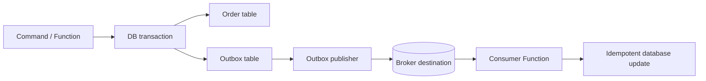
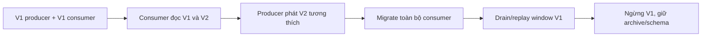

# Giữ ổn định tên hàm, định nghĩa ghép và hợp đồng sự kiện

## 1. Vì sao đổi tên một method Java có thể làm hỏng cả luồng sự kiện?

Một dịch vụ đang nhận sự kiện `OrderCreated`, chuẩn hóa dữ liệu rồi phân loại đơn hàng. Logic nghiệp vụ được viết bằng Spring Cloud Function:

```java
@Bean
Function<OrderCreated, OrderClassified> classifyOrder() {
    return order -> new OrderClassified(
            order.orderId(),
            order.totalInCents() >= 100_000L
                    ? "PRIORITY" : "STANDARD");
}
```

Hàm được Spring Cloud Stream bind vào topic `orders.created`; kết quả được phát tới `orders.classified`. Ứng dụng có thể được nâng cấp, đổi cấu trúc package, tách class, đổi tên method hoặc bổ sung bước `normalizeOrder`. Nếu nhóm chỉ nhìn code Java, những thay đổi này có vẻ nội bộ. Nhưng tên function có thể được dùng trong:

- `FunctionCatalog.lookup("classifyOrder")`.
- `spring.cloud.function.definition`.
- Tên binding ngầm định như `classifyOrder-in-0` và `classifyOrder-out-0`.
- Cấu hình destination, consumer group, retry và binder-specific properties.
- URL của Web adapter, function definition trong Lambda hoặc cấu hình routing.
- Dashboard, alert, log queries, deployment manifest và tài liệu vận hành.

Trong khi đó, **event contract** có một vòng đời riêng: tên event, schema, event ID, headers, destination/topic và quy tắc tương thích giữa producer/consumer. Đổi tên function không có nghĩa event type phải đổi; đổi Java record không có nghĩa wire schema được phép đổi theo.

Bài thuộc chương **Nâng cấp** của module **SPRING_CLOUD_FUNCTION**. Mục tiêu của module là phát triển logic tái sử dụng bằng `Supplier`, `Function`, `Consumer`, `FunctionCatalog`, composition và message conversion, độc lập với giao thức gọi. Bài này tập trung giữ ổn định **tên function, định nghĩa ghép và hợp đồng sự kiện** trong quá trình nâng cấp.

Sau bài học, bạn sẽ biết cách phân biệt tên bean, function definition, binding name, destination và event type; khóa tên công khai; thay đổi composition có kiểm soát; tiến hóa schema; triển khai producer/consumer theo thứ tự tương thích; và kiểm thử khả năng đọc sự kiện cũ trước khi rollout.

## 2. Năm lớp định danh cần giữ tách biệt

Một luồng Spring Cloud Function + Spring Cloud Stream có nhiều tên cùng xuất hiện trong cấu hình, nhưng chúng không phải một định danh duy nhất.

| Lớp | Ví dụ | Ai sử dụng? | Có phải event contract không? |
| --- | --- | --- | --- |
| **Tên bean/function** | `classifyOrder` | Spring, `FunctionCatalog`, routing | Không |
| **Function definition** | `normalizeOrder|classifyOrder` | Spring Cloud Function/Stream, adapter | Không; là cấu hình pipeline |
| **Binding name** | `classifyOrder-in-0` | Spring Cloud Stream cấu hình từng cổng | Không |
| **Destination** | `orders.created.v1` | Kafka topic, Rabbit exchange/queue hoặc broker | Là một phần topology vận hành, có ảnh hưởng consumer |
| **Event type/schema** | `com.acme.orders.order-created.v1` | Producer, consumer, registry và các dịch vụ độc lập | **Có** |
| **Event identity** | `source + id` | Deduplication, tracing, audit | **Có** |

Một ví dụ dễ nhầm:

```text
@Bean name:          classifyOrder
Function definition: normalizeOrder|classifyOrder
Input binding:       normalizeOrder|classifyOrder-in-0
Destination:         orders.created.v1
Event type:          com.acme.orders.order-created.v1
Event identity:      source=urn:acme:orders, id=evt-101
```

Có thể đổi tên method Java nhưng giữ nguyên tên bean. Có thể đổi composition nội bộ nhưng giữ nguyên binding alias và destination. Có thể đổi class DTO nhưng vẫn phát cùng event schema. Cũng có thể tạo event schema v2 mà không cần đổi function name.

**Quy tắc thiết kế:** coi tên function và binding là API cấu hình nội bộ; coi destination, event type, schema và event identity là hợp đồng tích hợp cần quản lý cùng các producer/consumer.

## 3. Tên function là một phần của cấu hình ứng dụng

Spring Cloud Function đăng ký các bean `Supplier`, `Function`, `Consumer` đủ điều kiện vào `FunctionCatalog`. Khi lookup qua catalog, ứng dụng nhận được function đã được framework bọc để hỗ trợ các tính năng như conversion và composition. Việc lấy bean gốc trực tiếp từ `ApplicationContext` không nhất thiết đi qua cùng wrapper đó.

Ví dụ:

```java
@Bean
Function<String, String> uppercase() {
    return String::toUpperCase;
}
```

Tên function thông thường được suy ra từ tên bean (`uppercase`). Những nơi khác có thể tham chiếu tên này:

```java
FunctionCatalog catalog =
        applicationContext.getBean(FunctionCatalog.class);
Function<?, ?> function = catalog.lookup("uppercase");
```

```yaml
spring:
  cloud:
    function:
      definition: uppercase
```

Vì thế, đổi tên method:

```java
@Bean
Function<String, String> toUpperCaseText() {
    return String::toUpperCase;
}
```

có thể làm mất function `uppercase` khỏi catalog và khiến definition, routing hoặc binding cũ không còn tìm được.

### 3.1. Giữ tên bean khi đổi tên method Java

Nếu muốn đổi tên method để code rõ nghĩa hơn nhưng vẫn giữ contract cấu hình, có thể khai báo bean name tường minh:

```java
@Bean("classifyOrder")
Function<OrderCreated, OrderClassified> classifyOrderV2() {
    return order -> new OrderClassified(
            order.orderId(),
            order.totalInCents() >= 100_000L
                    ? "PRIORITY" : "STANDARD");
}
```

Tên method nội bộ là `classifyOrderV2`, nhưng tên bean được công bố là `classifyOrder`. Đây là cách giữ ổn định tên lookup mà không cần giữ nguyên tên method.

**Lưu ý:** bean name phải duy nhất trong Spring context. Không tạo thêm một bean thứ hai cùng tên để “giữ compatibility”; cần kiểm tra alias, bean overriding policy và danh sách function thực tế được đăng ký.

### 3.2. Quy ước đặt tên nên áp dụng

- Dùng tên ổn định, có ý nghĩa nghiệp vụ: `classifyOrder`, `normalizeAddress`, `publishInvoice`.
- Tránh đặt tên theo số phiên bản thư viện hoặc release train: `function5`, `boot42Handler`.
- Không đổi tên chỉ để đồng bộ tên class với tên method.
- Tránh nhiều function cùng làm một việc nhưng tên không thể phân biệt.
- Không dựa vào thứ tự component scan hoặc auto-discovery để chọn function.
- Không dùng tên class Java làm event type công khai nếu producer/consumer khác ngôn ngữ.

Một tên function tốt nói rõ **hành động xử lý**; event type nói rõ **sự kiện đã xảy ra**. Hai khái niệm này có thể liên quan nhưng không cần trùng nhau.

## 4. Khai báo function definition tường minh

Spring Cloud Function có thể tự phát hiện function khi ứng dụng chỉ có một functional bean. Trong trường hợp đó, một số đường lookup có thể tìm được bean dù tên truyền vào rỗng hoặc không đúng. Đây là tiện ích cho ứng dụng nhỏ, nhưng không nên dùng làm hợp đồng triển khai dài hạn.

Tài liệu Spring Cloud Function khuyến nghị đặt `spring.cloud.function.definition` khi tích hợp với framework khác, ví dụ Spring Cloud Stream.

```yaml
spring:
  cloud:
    function:
      definition: classifyOrder
```

Khi có nhiều function, khai báo tường minh giúp xác định bean nào được adapter sử dụng. Nếu muốn lookup chỉ đúng tên, có thể tắt fallback một function:

```yaml
spring:
  cloud:
    function:
      definition: classifyOrder
      single-function-fallback-enabled: false
```

Cấu hình này không thay thế authorization hay routing policy. Nó chỉ làm rõ hành vi tìm function trong catalog.

### 4.1. Lọc function không dành cho catalog

Application context có thể chứa bean kiểu Java functional nhưng không phải API nghiệp vụ muốn công bố. Có thể bổ sung tên bean vào:

```yaml
spring:
  cloud:
    function:
      ineligible-definitions: internalFunction,debugFunction
```

Chỉ dùng khi thật sự cần. Tốt nhất là thiết kế rõ bean nào là function công khai, function nào là helper/service thông thường. Không dùng `ineligible-definitions` như giải pháp duy nhất để bảo vệ một endpoint nhạy cảm.

### 4.2. Kiểm tra tên function khi nâng cấp

Một regression test cho catalog:

```java
import static org.junit.jupiter.api.Assertions.assertNotNull;

import java.util.function.Function;
import org.junit.jupiter.api.Test;
import org.springframework.beans.factory.annotation.Autowired;
import org.springframework.boot.test.context.SpringBootTest;
import org.springframework.cloud.function.context.FunctionCatalog;

@SpringBootTest
class FunctionNameContractTest {

    @Autowired
    FunctionCatalog catalog;

    @Test
    void publicFunctionNameRemainsAvailable() {
        Function<?, ?> function =
                catalog.lookup(Function.class, "classifyOrder");

        assertNotNull(function);
    }
}
```

Test này xác minh tên function được lookup. Cần có thêm test invocation để xác nhận kiểu input/output và nghiệp vụ vẫn đúng; chỉ kiểm tra `assertNotNull` chưa đủ.

## 5. Composition là định nghĩa pipeline, không phải tên event

Spring Cloud Function cho phép khai báo composition bằng dấu `|` hoặc dấu phẩy trong `spring.cloud.function.definition`.

Ví dụ:

```java
@Bean
Function<OrderCreated, OrderCreated> normalizeOrder() {
    return order -> new OrderCreated(
            order.orderId().trim(),
            order.totalInCents(),
            order.currency());
}

@Bean
Function<OrderCreated, OrderClassified> classifyOrder() {
    return order -> new OrderClassified(
            order.orderId(),
            order.totalInCents(),
            order.totalInCents() >= 100_000L
                    ? "PRIORITY" : "STANDARD");
}
```

Khai báo:

```yaml
spring:
  cloud:
    function:
      definition: normalizeOrder|classifyOrder
```

Function đầu ra của `normalizeOrder` phải tương thích với kiểu đầu vào của `classifyOrder`. FunctionCatalog hỗ trợ composition và conversion theo cơ chế của framework; không nên dựa vào conversion để che một contract kiểu dữ liệu không rõ ràng.

### 5.1. Phân biệt dấu phân cách

| Cú pháp | Ý nghĩa trong ngữ cảnh tương ứng |
| --- | --- |
| `normalizeOrder|classifyOrder` | Một pipeline: output của hàm trước đi vào hàm sau |
| `normalizeOrder,classifyOrder` | Cách viết composition khác được Spring Cloud Function hỗ trợ |
| `normalizeOrder;classifyOrder` | Chọn hai function độc lập để Spring Cloud Stream bind riêng |

Ví dụ dùng dấu chấm phẩy:

```yaml
spring:
  cloud:
    function:
      definition: normalizeOrder;classifyOrder
```

Hai function độc lập sẽ có binding riêng. `classifyOrder` **không tự nhận** output của `normalizeOrder` chỉ vì cả hai cùng xuất hiện trong definition. Chúng cần được nối qua destination/broker hoặc một composition có chủ đích.

### 5.2. Composition thay đổi có thể đổi tên binding

Khi definition là `normalizeOrder|classifyOrder`, binding logic thường được sinh theo definition, ví dụ:

- `normalizeOrder|classifyOrder-in-0`
- `normalizeOrder|classifyOrder-out-0`

Nếu đổi thành `validateOrder|normalizeOrder|classifyOrder`, tên binding logic có thể thay đổi theo definition mới. Các cấu hình đang tham chiếu tên cũ sẽ không tự biết composition mới.

**Không dùng chuỗi composition làm event type.** Event type cần mô tả sự kiện nghiệp vụ, ví dụ `com.acme.orders.order-classified.v1`, không nên là `normalizeOrder|classifyOrder`.

### 5.3. Composition không tạo ranh giới broker

Composition là pipeline trong cùng application invocation. Nó không tự tạo:

- Kafka topic trung gian.
- RabbitMQ exchange hoặc queue.
- Transaction độc lập giữa từng function.
- Retry policy riêng cho từng bước.
- Checkpoint hoặc durable state giữa hai function.
- Một event contract công khai mới.

Nếu bước đầu ghi database rồi bước sau ném exception, composition không tự rollback database. Nếu cần durable boundary, hãy thiết kế destination/outbox/workflow riêng và kiểm soát retry/idempotency.

## 6. Tên binding ngầm định trong Spring Cloud Stream

Spring Cloud Stream tạo tên binding theo function bean name và vị trí input/output.

Quy tắc cơ bản:

```text
Input:  <functionName>-in-<index>
Output: <functionName>-out-<index>
```

Ví dụ với:

```java
@Bean
Function<String, String> uppercase() {
    return String::toUpperCase;
}
```

các binding mặc định là:

| Binding | Vai trò |
| --- | --- |
| `uppercase-in-0` | Input |
| `uppercase-out-0` | Output |

Cấu hình:

```yaml
spring:
  cloud:
    function:
      definition: uppercase
    stream:
      bindings:
        uppercase-in-0:
          destination: text.raw
          group: text-workers
        uppercase-out-0:
          destination: text.uppercase
```

Tên binding là **khóa cấu hình** trong ứng dụng. `destination` mới là tên tài nguyên trên broker. Đổi function bean name có thể làm binding name đổi, nhưng không nhất thiết phải đổi topic/exchange nếu destination vẫn giữ nguyên và cấu hình được cập nhật đúng.

### 6.1. Function nhiều input/output

Với function có nhiều input hoặc output, index là một phần của contract binding:

```java
@Bean
Function<Tuple2<Flux<Order>, Flux<Customer>>,
         Tuple2<Flux<EnrichedOrder>, Flux<RejectedOrder>>> enrich() {
    return input -> {
        // Ví dụ minh họa; logic join được lược bỏ.
        return Tuples.of(
                input.getT1().map(order ->
                        new EnrichedOrder(order.id())),
                input.getT1().filter(order ->
                        order.id() == null)
                        .map(order -> new RejectedOrder("MISSING_ID")));
    };
}
```

Ví dụ chỉ minh họa cardinality: function có hai input và hai output sẽ có các binding index tương ứng. Khi thay chữ ký hoặc thứ tự tuple, `-in-0`, `-in-1`, `-out-0`, `-out-1` có thể đổi ý nghĩa hoặc số lượng.

Không thay thứ tự input/output trong một lần nâng cấp mà không có migration plan. Hai binding cùng kiểu Java vẫn có thể đại diện cho hai luồng nghiệp vụ khác nhau.

### 6.2. Binding name và destination không phải một

```yaml
spring:
  cloud:
    stream:
      bindings:
        classifyOrder-in-0:
          destination: orders.created.v1
          group: order-classifiers
```

- `classifyOrder-in-0`: tên binding trong cấu hình ứng dụng.
- `orders.created.v1`: destination trên broker.
- `order-classifiers`: consumer group/queue group theo binder.

Đổi `classifyOrder-in-0` không tự đổi tên topic. Đổi destination có thể chuyển consumer sang một tài nguyên khác, ảnh hưởng backlog, offset, retention, queue và consumer groups.

## 7. Alias binding để giảm tác động khi đổi function hoặc composition

Spring Cloud Stream hỗ trợ ánh xạ tên binding ngầm định sang tên binding tường minh:

`spring.cloud.stream.function.bindings.<implicit-name>=<explicit-name>`

Ví dụ:

```yaml
spring:
  cloud:
    function:
      definition: normalizeOrder|classifyOrder
    stream:
      function:
        bindings:
          "normalizeOrder|classifyOrder-in-0": ordersInput
          "normalizeOrder|classifyOrder-out-0": ordersOutput
      bindings:
        ordersInput:
          destination: orders.created.v1
          group: order-classifiers
          content-type: application/json
        ordersOutput:
          destination: orders.classified.v1
          content-type: application/json
```

Sau khi ánh xạ:

- Binding ngầm định: `normalizeOrder|classifyOrder-in-0`.
- Binding tường minh: `ordersInput`.
- Các thuộc tính binding tiếp theo phải tham chiếu `ordersInput`.

### 7.1. Alias là lớp ánh xạ, không phải tên function mới

Alias không đổi tên bean trong FunctionCatalog, không đổi event type và không đổi destination. Nó chỉ ánh xạ binding logic sang một tên cấu hình dễ đọc hơn.

Tài liệu Spring Cloud Stream cảnh báo alias tạo thêm một lớp gián tiếp: khi xem `spring.cloud.stream.bindings.ordersInput.*`, người vận hành cần tra ngược alias để biết nó gắn với function nào. Vì vậy, không nên tạo alias cho mọi binding nếu không có nhu cầu.

### 7.2. Khi nào alias hữu ích?

- Composition dài, tên implicit binding chứa nhiều function.
- Cần giữ một bộ tên cấu hình rõ ràng trong nhiều profile.
- Có migration từ binding naming cũ sang functional model.
- Muốn tách tên function nội bộ khỏi cách đặt tên cấu hình binder.

### 7.3. Khi nào không nên lạm dụng?

- Alias chỉ để tránh ghi thêm một đoạn tên ngắn.
- Alias khiến nhóm vận hành không biết destination thuộc function nào.
- Một binding alias được dùng chung cho nhiều function mà không rõ owner.
- Đổi alias và destination trong cùng một release nhưng không có test topology.

**Khuyến nghị:** ưu tiên implicit binding names khi chúng ngắn, rõ và ổn định. Dùng alias có chủ đích cho composition hoặc migration, và quản lý mapping như một phần của configuration contract.

## 8. Đổi tên function an toàn theo từng bước

Giả sử baseline:

```java
@Bean
Function<OrderCreated, OrderClassified> classifyOrder() {
    return this::classify;
}
```

Target muốn đổi method thành `classifyOrderV2`, nhưng cần giữ các binding và consumer config.

### Phương án A — Giữ bean name cũ

```java
@Bean("classifyOrder")
Function<OrderCreated, OrderClassified> classifyOrderV2() {
    return this::classify;
}
```

Ưu điểm: FunctionCatalog lookup và binding name vẫn dùng `classifyOrder`. Đây thường là lựa chọn đơn giản khi chỉ đổi tên method hoặc tổ chức lại code.

### Phương án B — Đổi function name và cập nhật binding có kiểm soát

Nếu muốn bean name mới là `classifyOrderV2`, hãy cập nhật đồng bộ:

- `spring.cloud.function.definition`.
- Binding implicit names `classifyOrderV2-in-0`/`classifyOrderV2-out-0`.
- Alias mapping nếu có.
- Các test catalog lookup.
- Dashboard, log queries, alert và deployment configuration.
- Tài liệu runbook và các ứng dụng nội bộ gọi theo tên.

Destination và event type có thể giữ nguyên nếu business contract không đổi. Không đổi topic chỉ vì method Java đổi tên.

### 8.1. Không chạy hai function cùng ghi một destination mà không có chủ đích

Một cách migration có thể tạo `classifyOrder` và `classifyOrderV2` cùng bind vào `orders.created.v1`. Nếu cả hai consumer group khác nhau, **cả hai có thể xử lý cùng một event** và thực hiện side effect hai lần.

Nếu muốn shadow traffic:

- Dùng consumer group riêng.
- Tắt side effect thật hoặc ghi vào nơi so sánh riêng.
- Đảm bảo idempotency ở các downstream.
- Định nghĩa rõ ai là consumer có quyền phát output chính thức.
- Có cơ chế dừng shadow processing.

Không dùng một deployment song song làm migration an toàn nếu nó vô tình nhân đôi việc gửi email, tạo hóa đơn hoặc trừ tiền.

## 9. Event contract độc lập với function và Java class

Một event contract cần xác định ít nhất:

- **Event type/name:** sự kiện nghiệp vụ nào đã xảy ra.
- **Schema:** các trường, kiểu dữ liệu, nullability, default và semantics.
- **Event identity:** cách phân biệt event mới và event được giao lại.
- **Source/producer:** dịch vụ nào tạo sự kiện.
- **Destination/routing:** nơi event được phát tới.
- **Headers/metadata:** content type, correlation, partition key và schema reference.
- **Compatibility policy:** consumer phiên bản cũ/mới có thể đọc event nào.

Ví dụ event nghiệp vụ:

```json
{
  "eventType": "ORDER_CREATED",
  "schemaVersion": 1,
  "eventId": "evt-101",
  "occurredAt": "2026-11-24T09:30:00Z",
  "data": {
    "orderId": "ORD-101",
    "totalInCents": 150000,
    "currency": "VND"
  }
}
```

Event này có thể được serialize bằng Java record, Kotlin data class, JSON Schema, Avro hoặc Protobuf. **Tên class Java không phải schema contract**. Nếu đổi `OrderCreated` thành `NewOrderEvent`, producer và consumer ở ngôn ngữ khác vẫn phải hiểu cùng event type và payload schema đã công bố.

### 9.1. Không đồng nhất version của application và version của event

| Version | Ví dụ | Ý nghĩa |
| --- | --- | --- |
| Application version | `orders-service 2.4.0` | Phiên bản triển khai code |
| Spring Cloud Function version | `5.1.0` | Phiên bản dependency |
| Function definition | `normalizeOrder|classifyOrder` | Pipeline được cấu hình |
| Event schema version | `1` hoặc schema registry version `7` | Cấu trúc wire payload |
| Event type version | `com.acme.orders.order-created.v1` | Hợp đồng sự kiện được phát |

Một bản nâng Boot hoặc Function không buộc tăng event schema version. Ngược lại, một thay đổi event schema có thể cần version mới dù application vẫn dùng cùng Spring Cloud Function dependency.

## 10. Chuẩn hóa metadata sự kiện với CloudEvents

CloudEvents là đặc tả của CNCF để mô tả event metadata theo cách thống nhất. Các thuộc tính cốt lõi gồm:

| Attribute | Ý nghĩa |
| --- | --- |
| `specversion` | Version của CloudEvents specification |
| `id` | Định danh event trong phạm vi source |
| `source` | Nguồn tạo event |
| `type` | Loại sự kiện |
| `subject` | Chủ thể mà event liên quan, nếu có |
| `time` | Thời điểm xảy ra |
| `datacontenttype` | Content type của phần data |
| `dataschema` | URI schema mô tả data, nếu có |
| `data` | Payload nghiệp vụ |

Ví dụ JSON CloudEvent:

```json
{
  "specversion": "1.0",
  "id": "evt-101",
  "source": "urn:acme:orders",
  "type": "com.acme.orders.order-created.v1",
  "subject": "orders/ORD-101",
  "time": "2026-11-24T09:30:00Z",
  "datacontenttype": "application/json",
  "dataschema": "https://schemas.acme.example/orders/order-created/1",
  "data": {
    "orderId": "ORD-101",
    "totalInCents": 150000,
    "currency": "VND"
  }
}
```

**Đừng nhầm `specversion` với schema version.** `specversion: 1.0` nói rằng envelope tuân theo CloudEvents 1.0; nó không nói payload `OrderCreated` đang là schema v1 hay v2. Thông tin schema có thể được thể hiện bằng `dataschema` hoặc quy ước version của event type.

### 10.1. Event ID phải ổn định khi redelivery

CloudEvents định nghĩa event identity thông qua `source` và `id`; consumer có thể dùng cặp này để deduplicate. Nếu cùng một event được retry/redeliver, producer không tạo một `id` mới cho lần giao lại.

Không dùng timestamp hiện tại hoặc random UUID tạo **mỗi lần gửi lại** làm idempotency key. Nếu producer retry publish, nó phải giữ identity của event gốc.

### 10.2. Không dùng tên function làm CloudEvents type

Sai thiết kế:

```json
{
  "type": "normalizeOrder|classifyOrder",
  "data": { "orderId": "ORD-101" }
}
```

Đúng hơn:

```json
{
  "type": "com.acme.orders.order-classified.v1",
  "data": {
    "orderId": "ORD-101",
    "priority": "PRIORITY"
  }
}
```

Pipeline có thể đổi từ hai function sang ba function, nhưng event vẫn là `order-classified` nếu ý nghĩa nghiệp vụ không thay đổi. Event type nên diễn đạt **điều đã xảy ra**, không mô tả chi tiết triển khai xử lý.

## 11. Tiến hóa schema: thêm trường dễ hơn đổi nghĩa trường

Một event schema cần được xem là hợp đồng giữa producer và consumer có thể được deploy độc lập. Những thay đổi thường gặp:

| Thay đổi | Rủi ro | Hướng xử lý |
| --- | --- | --- |
| Thêm field optional có default/null rõ | Thường dễ tương thích hơn | Test reader cũ và mới theo format |
| Thêm field bắt buộc không có default | Consumer cũ hoặc dữ liệu cũ có thể không đọc được | Thêm optional trước, migrate rồi mới bắt buộc |
| Xóa field đang dùng | Consumer cũ có thể lỗi | Deprecate, đo usage, chuyển consumer |
| Đổi tên field | Có thể tương đương xóa + thêm | Giữ field cũ trong giai đoạn chuyển |
| Đổi kiểu số sang chuỗi | Breaking | Event/schema version mới hoặc field mới |
| Đổi đơn vị tiền từ đồng sang xu | Breaking về semantics dù type vẫn là số | Field mới có tên/đơn vị rõ và migration |
| Thêm enum value | Consumer dùng enum strict có thể lỗi | Thiết kế unknown/default case |
| Thay ý nghĩa event type | Consumer nhận cùng type nhưng hiểu khác | Tạo event type mới |
| Thay timestamp/local time | Lệch múi giờ và thứ tự sự kiện | Dùng format và timezone rõ, thường UTC |
| Đổi key/partition strategy | Ảnh hưởng ordering và phân phối | Test topology và consumer state |

### 11.1. Thêm trường optional

Schema JSON minh họa v1:

```json
{
  "type": "object",
  "required": ["orderId", "totalInCents", "currency"],
  "properties": {
    "orderId": { "type": "string" },
    "totalInCents": { "type": "integer" },
    "currency": { "type": "string" }
  },
  "additionalProperties": false
}
```

V2 có thêm `salesChannel` nhưng chưa bắt buộc:

```json
{
  "type": "object",
  "required": ["orderId", "totalInCents", "currency"],
  "properties": {
    "orderId": { "type": "string" },
    "totalInCents": { "type": "integer" },
    "currency": { "type": "string" },
    "salesChannel": {
      "type": ["string", "null"],
      "default": null
    }
  },
  "additionalProperties": false
}
```

Đây là ví dụ JSON Schema minh họa. Tính tương thích thực tế còn phụ thuộc dialect, registry compatibility policy và cách serializer/deserializer diễn giải default, optional, unknown fields. Không suy luận mọi JSON Schema registry đều coi hai schema này tương thích theo cùng một quy tắc.

### 11.2. Đổi semantics nguy hiểm hơn đổi kiểu

Giả sử `totalInCents` trước đây luôn biểu diễn **đơn vị tiền nhỏ nhất (minor unit)** nhưng producer mới bắt đầu gửi số tiền theo đơn vị đồng. Cả hai đều là integer; JSON parser vẫn chạy. Consumer sẽ tính sai 100 lần mà không có exception.

Vì vậy schema contract cần mô tả **ý nghĩa, đơn vị, range, timezone và quy tắc nullability**, không chỉ kiểu dữ liệu. Một thay đổi semantics có thể cần event type/schema mới dù field name và type vẫn giữ nguyên.

## 12. Backward, forward, full và transitive compatibility

Các Schema Registry như Confluent hỗ trợ chính sách tương thích để kiểm tra schema mới so với schema đã đăng ký. Các tên phổ biến:

| Mode | Ý nghĩa khái quát | Thứ tự nâng cấp thường phù hợp |
| --- | --- | --- |
| `BACKWARD` | Consumer mới đọc được dữ liệu theo schema cũ gần nhất | Nâng consumer trước, rồi producer |
| `BACKWARD_TRANSITIVE` | Consumer mới đọc được các schema cũ trong toàn lịch sử đã đăng ký | Nâng consumer trước; bảo vệ dữ liệu lưu lâu dài |
| `FORWARD` | Consumer cũ đọc được dữ liệu theo schema mới | Nâng producer trước; chỉ nâng consumer sau khi dữ liệu cũ được xử lý/drain |
| `FORWARD_TRANSITIVE` | Consumer cũ có thể đọc dữ liệu từ các schema mới theo phạm vi lịch sử được kiểm tra | Phải giữ tương thích với mọi phiên bản liên quan |
| `FULL` | Tương thích cả backward và forward với phiên bản gần nhất | Có thể triển khai producer/consumer độc lập hơn |
| `FULL_TRANSITIVE` | Tương thích hai chiều với toàn bộ schema đã đăng ký | Phù hợp khi cần giữ tương thích qua nhiều thế hệ |

Đây là định nghĩa khái quát. Quy tắc cụ thể khác nhau theo **Avro, Protobuf, JSON Schema**, registry và compatibility policy. Ví dụ JSON Schema còn có cách đánh giá `additionalProperties`, `required`, strict/lenient policy. Hãy chạy compatibility check của registry thực tế thay vì chỉ nhìn bảng.

### 12.1. Ví dụ về BACKWARD

Giả sử v1 có `orderId`, `totalInCents`. V2 thêm `salesChannel` optional. Consumer v2 phải đọc được message v1 không có `salesChannel`.

Trình tự thường dùng:

1. Deploy consumer hiểu cả message v1 và v2.
2. Chờ consumer mới sẵn sàng trên tất cả nhóm cần nhận event.
3. Bắt đầu phát v2 có field mới.
4. Theo dõi conversion/validation và lỗi consumer.
5. Chỉ bỏ hỗ trợ v1 khi retention/replay window đã hết và mọi consumer đã được nâng.

### 12.2. Ví dụ về FORWARD

Nếu schema mới bỏ một field mà consumer cũ vẫn bắt buộc, consumer cũ có thể không đọc được event mới. Trong một chính sách forward-compatible, producer có thể phát schema mới mà consumer cũ vẫn đọc được; sau đó mới nâng consumer, khi các dữ liệu cũ không còn gây vấn đề theo chính sách của hệ thống.

Không có một thứ tự nâng cấp chung cho mọi mode. Hãy đọc chính sách tương thích và **dữ liệu đang tồn tại trong broker**, không chỉ schema mới nhất.

### 12.3. Transitive rất quan trọng với topic lưu lâu

Một schema mới có thể tương thích với schema ngay trước đó nhưng không còn đọc được dữ liệu từ một schema cũ hơn. `BACKWARD` thường chỉ so với phiên bản gần nhất; `BACKWARD_TRANSITIVE` kiểm tra toàn bộ lịch sử.

Nếu topic có retention dài, replay từ đầu, archive hoặc consumer mới phải đọc dữ liệu nhiều năm, compatibility transitive có thể là yêu cầu quan trọng. Không mặc định registry đang dùng bật transitive chỉ vì tên mode có chữ backward.

## 13. Event type, schema version và destination version

Có ba cách thường gặp để quản lý event evolution:

### Cách A — Giữ event type, thêm schema reference/version

Ví dụ:

```json
{
  "type": "com.acme.orders.order-created",
  "dataschema": "https://schemas.acme.example/orders/order-created/2",
  "data": {
    "orderId": "ORD-101",
    "totalInCents": 150000,
    "salesChannel": "WEB"
  }
}
```

Cách này phù hợp khi semantics event vẫn giữ nguyên và schema change tương thích theo policy. Consumer dùng schema version để đọc đúng.

### Cách B — Tạo event type v2 cho breaking semantics

```json
{
  "type": "com.acme.orders.order-created.v2",
  "data": {
    "orderId": "ORD-101",
    "amount": {
      "value": "1500.00",
      "currency": "VND"
    }
  }
}
```

Dùng khi thay đổi semantics hoặc payload không thể tương thích an toàn với consumer v1. Consumer có thể subscribe cả v1/v2 trong thời gian chuyển.

### Cách C — Destination/topic mới

Ví dụ:

```text
orders.created.v1
orders.created.v2
```

Topic mới giúp cô lập consumer và retention/replay, nhưng cần kế hoạch dual-publish hoặc bridge. Đổi topic không tự giải quyết event compatibility; payload vẫn cần schema và semantics rõ ràng.

### 13.1. Chọn phương án theo mức độ thay đổi

| Thay đổi | Event type | Schema | Destination |
| --- | --- | --- | --- |
| Thêm optional field, semantics giữ nguyên | Có thể giữ | V2 | Có thể giữ |
| Thêm metadata không đổi nghĩa event | Thường giữ | Có thể giữ hoặc tăng version theo registry | Thường giữ |
| Đổi tên field có thể map | Có thể giữ trong migration | V2/compatibility strategy | Có thể giữ |
| Đổi đơn vị/ý nghĩa payload | Nên có type v2 | Breaking v2 | Cân nhắc topic v2 |
| Đổi routing/retention/ownership | Có thể giữ event type | Có thể giữ | Cần xem destination mới |
| Đổi function implementation nội bộ | Giữ | Giữ | Giữ nếu contract không đổi |

Không tăng event version chỉ vì đổi tên function; cũng không giữ event version nếu ý nghĩa payload đã thay đổi không tương thích.

## 14. CloudEvents `source` và `id`: xây dựng idempotency đúng

Với CloudEvents, cặp `(source, id)` nhận diện một event. Consumer có thể lưu cặp này trong bảng deduplication:

```sql
CREATE TABLE processed_event (
    consumer_name VARCHAR(120) NOT NULL,
    event_source VARCHAR(300) NOT NULL,
    event_id VARCHAR(200) NOT NULL,
    processed_at TIMESTAMP NOT NULL,
    PRIMARY KEY (consumer_name, event_source, event_id)
);
```

Trong cùng transaction database với side effect nghiệp vụ:

```text
BEGIN

  Thử INSERT processed_event(consumer_name, source, id)

  Nếu khóa đã tồn tại:
      đây là event đã xử lý -> bỏ qua side effect trùng

  Nếu là event mới:
      cập nhật trạng thái nghiệp vụ

COMMIT

Sau khi transaction thành công:
  để binder/platform xác nhận message theo cơ chế của nó
```

Thiết kế này cần xử lý unique-key conflict đúng cách. Nếu ghi marker dedupe và side effect trong hai transaction riêng, crash giữa hai bước vẫn có thể tạo lỗi. Nếu side effect là gọi API/email bên ngoài, cần idempotency key hoặc outbox/downstream deduplication.

**Không dùng event ID mới mỗi lần retry.** Redelivery của cùng event phải giữ identity để consumer nhận ra duplicate.

## 15. Outbox giúp giữ nhất quán giữa database và event

Một luồng dễ lỗi:

```text
1. Ghi order vào database.
2. Publish OrderCreated lên broker.
3. Process crash giữa hai bước.
```

Nếu DB commit nhưng publish chưa thành công, trạng thái nghiệp vụ có mà event không có. Nếu publish thành công nhưng DB transaction rollback, consumer nhận một event mô tả trạng thái chưa tồn tại.

**Transactional outbox** giải quyết bằng cách ghi thay đổi nghiệp vụ và event cần phát vào cùng database transaction; một publisher riêng đọc bảng outbox rồi gửi event tới broker.



Outbox publisher có thể phát lại nếu không biết broker đã nhận hay chưa; vì vậy consumer vẫn cần idempotency. Outbox không tự tạo exactly-once end-to-end, nhưng giúp giảm khoảng trống giữa commit dữ liệu và publish event.

### 15.1. Đừng gắn outbox vào từng function tùy tiện

Một composition `normalizeOrder|classifyOrder` trong cùng process không phải ranh giới transaction độc lập. Nếu cần phát event `OrderClassified`, hãy xác định nơi ghi kết quả và outbox trong cùng transaction nghiệp vụ phù hợp. Không đặt một publisher sau mỗi bước rồi coi pipeline đã đảm bảo nhất quán.

## 16. Cấu hình mẫu giữ tên function và binding ổn định

Giả sử có hai function:

```java
@Bean("normalizeOrder")
Function<OrderCreated, OrderCreated> normalizeOrder() {
    return order -> new OrderCreated(
            order.orderId().trim(),
            order.totalInCents(),
            order.currency());
}

@Bean("classifyOrder")
Function<OrderCreated, OrderClassified> classifyOrder() {
    return order -> new OrderClassified(
            order.orderId(),
            order.totalInCents(),
            order.totalInCents() >= 100_000L
                    ? "PRIORITY" : "STANDARD");
}
```

Cấu hình composition:

```yaml
spring:
  cloud:
    function:
      definition: normalizeOrder|classifyOrder
    stream:
      function:
        bindings:
          "normalizeOrder|classifyOrder-in-0": ordersInput
          "normalizeOrder|classifyOrder-out-0": ordersOutput
      bindings:
        ordersInput:
          destination: orders.created.v1
          group: order-classifiers
          content-type: application/json
        ordersOutput:
          destination: orders.classified.v1
          content-type: application/json
```

Khi đổi logic bên trong `normalizeOrder`, nếu input/output type và semantics vẫn tương thích, các tên và destination có thể giữ nguyên. Khi thêm function `validateOrder` vào composition:

```yaml
spring:
  cloud:
    function:
      definition: validateOrder|normalizeOrder|classifyOrder
```

cần cập nhật alias implicit binding mới:

```yaml
spring:
  cloud:
    stream:
      function:
        bindings:
          "validateOrder|normalizeOrder|classifyOrder-in-0": ordersInput
          "validateOrder|normalizeOrder|classifyOrder-out-0": ordersOutput
```

Các property dưới `ordersInput`/`ordersOutput` vẫn giữ được tên tường minh. Cần test startup binding và topology để xác nhận mapping mới.

**Chú ý:** YAML key có ký tự `|` phải được đặt trong dấu nháy như ví dụ. Nếu tên binding chứa dấu chấm hoặc ký tự đặc biệt khác, tuân theo quy tắc quoting/bracket của Spring Boot property binding.

## 17. Đặt destination theo domain, không theo function method

Một thiết kế dễ coupling:

```yaml
spring:
  cloud:
    stream:
      bindings:
        classifyOrder-out-0:
          destination: classifyOrderV2Output
```

Destination lấy từ tên method Java. Khi đổi function, topic/exchange cũng có thể bị đổi theo.

Một thiết kế domain-oriented:

```yaml
spring:
  cloud:
    stream:
      bindings:
        classifyOrder-out-0:
          destination: orders.classified.v1
```

Destination thể hiện luồng dữ liệu nghiệp vụ. Function `classifyOrder`, `classifyOrderV2` hoặc một composition có thể publish vào destination đó nếu contract không đổi.

### 17.1. Khi nào destination nên đổi?

- Event semantics hoặc ownership thay đổi.
- Cần cô lập version breaking trong một giai đoạn.
- Retention, partitioning, access policy hoặc data classification cần khác.
- Consumer migration cần một đường đọc riêng.
- Cần dual-publish để so sánh v1/v2.

Không đổi topic chỉ vì đổi package/class/method. Nhưng cũng không giữ topic cũ nếu payload mới phá vỡ consumer đang đọc.

## 18. Content type và headers là một phần wire contract

Spring Cloud Stream chọn `MessageConverter` theo thông tin content type. Theo tài liệu, `contentType` có thể đến từ:

1. Message header.
2. Binding property `spring.cloud.stream.bindings.<binding>.content-type`.
3. Default `application/json` nếu không có hai nguồn trên.

Ví dụ:

```yaml
spring:
  cloud:
    stream:
      bindings:
        ordersInput:
          content-type: application/json
        ordersOutput:
          content-type: application/json
```

Một payload có thể parse thành Java object nhưng vẫn sai contract nếu header nói `text/plain`, schema version khác hoặc native serializer/deserializer được dùng thay framework conversion.

### 18.1. Chọn metadata ổn định

| Metadata | Khuyến nghị |
| --- | --- |
| `contentType` | Khai báo rõ JSON/Avro/Protobuf hoặc media type phù hợp |
| `eventType` | Tên event nghiệp vụ ổn định |
| `schemaVersion`/`dataschema` | Version/schema reference được quản lý |
| `eventId` | ID ổn định xuyên suốt retry/replay |
| `correlationId` | Theo dõi workflow/request; không thay event identity |
| Partition key | Chọn theo ordering/scale requirement, không theo tên function |
| Timestamp | Quy ước UTC/format nhất quán |

Đừng dùng `spring.cloud.function.definition` header như event type. Header này là instruction điều khiển invocation; event type là mô tả nghiệp vụ. Nếu message đến từ bên ngoài, không cho producer không tin cậy tự chỉ định function đích tùy ý.

## 19. Producer/consumer migration theo mô hình expand–migrate–contract

Một thay đổi event contract an toàn thường có ba giai đoạn:

### Giai đoạn 1 — Expand

- Consumer mới có thể đọc payload cũ và payload mở rộng.
- Producer vẫn phát schema cũ hoặc bắt đầu thêm field optional tương thích.
- Không xóa field cũ.
- Không đổi ý nghĩa field đang dùng.
- Ghi metric để biết consumer nào còn phụ thuộc field cũ.

### Giai đoạn 2 — Migrate

- Deploy consumer có khả năng hiểu cả hai dạng.
- Kiểm thử replay dữ liệu lịch sử.
- Chuyển producer sang field/event schema mới khi tất cả consumer cần thiết đã sẵn sàng.
- Nếu có topic/type v2, dual-publish hoặc bridge theo thời gian có giới hạn.
- Theo dõi tỷ lệ lỗi, backlog, DLQ và số consumer còn dùng contract cũ.

### Giai đoạn 3 — Contract

- Chỉ bỏ field/event v1 khi mọi consumer đã chuyển và retention/replay window không còn yêu cầu đọc.
- Gỡ dual-publish/bridge sau khi đối soát.
- Giữ schema archive và tài liệu version để phục vụ replay/audit.
- Xóa alias/config cũ sau khi xác nhận không còn deployment tham chiếu.



Sơ đồ minh họa một hướng nâng cấp backward-compatible. Nếu compatibility policy là `FORWARD`, thứ tự có thể khác. Hãy xác định policy trước khi quyết định ai nâng trước.

## 20. Khi breaking change không thể tránh: tạo contract v2 rõ ràng

Giả sử v1:

```json
{
  "orderId": "ORD-101",
  "totalInCents": 150000,
  "currency": "VND"
}
```

V2 thay `totalInCents` bằng object amount có decimal string và currency:

```json
{
  "orderId": "ORD-101",
  "amount": {
    "value": "1500.00",
    "currency": "VND"
  }
}
```

Đây không phải một thay đổi additive. Consumer v1 không thể mặc định hiểu `amount`. Có thể chọn:

- Event type mới: `com.acme.orders.order-created.v2`.
- Schema mới và reference mới.
- Destination mới `orders.created.v2` nếu cần cô lập.
- Consumer adapter đọc v1/v2 và chuyển về model nội bộ thống nhất.
- Dual-publish trong thời gian migration nếu producer có thể bảo đảm không tạo hai side effects ở consumer.
- Sunset v1 theo lịch, có telemetry và owner chịu trách nhiệm.

### 20.1. Adapter giúp giữ domain function ổn định

Một adapter có thể chuyển `OrderCreatedV1` hoặc `OrderCreatedV2` sang model nội bộ:

```java
record OrderCommand(
        String orderId,
        long amountInMinorUnits,
        String currency) {}

OrderCommand fromV1(OrderCreatedV1 event) {
    return new OrderCommand(
            event.orderId(),
            event.totalInCents(),
            event.currency());
}

OrderCommand fromV2(OrderCreatedV2 event) {
    return new OrderCommand(
            event.orderId(),
            toMinorUnits(event.amount()),
            event.amount().currency());
}
```

Business function nhận `OrderCommand` thống nhất. Việc chuyển đổi event schema nằm ở adapter/application boundary, giúp không phải nhân đôi toàn bộ nghiệp vụ theo từng version event.

**Lưu ý:** `toMinorUnits` phải xử lý chính xác scale, rounding và currency exponent. Không ép kiểu `double` sang `long` cho tiền tệ mà không có quy tắc chính xác.

## 21. Function composition và event contract cần được test độc lập

Có hai loại test khác nhau:

- **Composition test:** các function ghép đúng thứ tự, input/output type tương thích và nghiệp vụ kết quả đúng.
- **Event contract test:** producer phát schema/headers đúng, consumer đọc được các version đã cam kết.

Composition test không chứng minh event JSON có tương thích với consumer cũ. Contract test không chứng minh function pipeline gọi đúng thứ tự.

### 21.1. Test composition bằng FunctionCatalog

```java
import static org.junit.jupiter.api.Assertions.assertNotNull;

import java.util.function.Function;
import org.junit.jupiter.api.Test;
import org.springframework.beans.factory.annotation.Autowired;
import org.springframework.boot.test.context.SpringBootTest;
import org.springframework.cloud.function.context.FunctionCatalog;

@SpringBootTest
class OrderCompositionTest {

    @Autowired
    FunctionCatalog catalog;

    @Test
    void composedDefinitionIsAvailable() {
        Function<?, ?> function = catalog.lookup(
                Function.class,
                "normalizeOrder|classifyOrder");

        assertNotNull(function);
    }
}
```

Có thể bổ sung invocation test với payload thật. `FunctionCatalog` trả wrapper có thể thực hiện conversion; không nên yêu cầu class của wrapper giống bean gốc.

### 21.2. Test binding name và destination

Với Spring Cloud Stream test binder hoặc integration test broker:

- Kiểm tra binding `normalizeOrder|classifyOrder-in-0` được tạo.
- Kiểm tra alias `ordersInput` trỏ tới đúng input binding.
- Kiểm tra destination là `orders.created.v1`.
- Kiểm tra output đi tới `orders.classified.v1`.
- Kiểm tra group vẫn là `order-classifiers`.
- Kiểm tra không có binding cũ/ngoài ý định được tạo.
- Khi đổi composition, chạy lại tất cả binding tests.

Test binder phù hợp cho wiring/framework logic; Kafka/Rabbit integration test cần thiết khi kiểm tra partition, offset, queue topology, native codec và broker-specific semantics.

## 22. Contract tests cho schema và consumer

Một bộ test event contract nên có:

| Test | Mục đích |
| --- | --- |
| Producer emits v1 | Xác minh field, type, headers, event type và event ID |
| Producer emits v2 | Xác minh schema mới đúng và không thay semantics cũ |
| Consumer reads v1 | Consumer mới vẫn đọc event cũ |
| Consumer reads v2 | Consumer mới đọc event mới |
| Old consumer reads v2 | Chỉ yêu cầu nếu policy forward/full bảo đảm |
| Unknown field | Xác minh chính sách bỏ qua/từ chối |
| Missing optional field | Default/null semantics đúng |
| Unknown enum value | Không làm crash ngoài dự tính |
| Duplicate event | Idempotency hoạt động |
| Replay historical events | Schema archive/decoder vẫn dùng được |
| Registry compatibility | Schema mới đạt policy đã cấu hình |
| Event ordering | Key/partition và consumer concurrency giữ yêu cầu |

### 22.1. Schema compatibility check trong CI

Nếu dùng Confluent Schema Registry, có thể cấu hình compatibility mode ở cấp subject hoặc global. CI nên gửi schema mới vào endpoint kiểm tra compatibility phù hợp trước khi publish. Không mặc định registry luôn dùng `BACKWARD`; hãy đọc cấu hình subject thực tế.

Các mode có thể gồm:

- `BACKWARD`, `BACKWARD_TRANSITIVE`.
- `FORWARD`, `FORWARD_TRANSITIVE`.
- `FULL`, `FULL_TRANSITIVE`.
- `NONE` — không kiểm tra tương thích, cần kiểm soát rất chặt nếu dùng.

Schema Registry kiểm tra cấu trúc theo format; nó không chứng minh semantics nghiệp vụ không đổi. Một trường integer vẫn có thể bị đổi từ đồng sang xu mà qua schema compatibility.

### 22.2. Consumer-driven contract

Các consumer quan trọng nên có test fixtures hoặc contract expectations được producer chạy trong CI. Điều này đặc biệt hữu ích khi producer và consumer được deploy ở hai nhóm/nhịp khác nhau.

Không chỉ lưu JSON mới nhất. Cần giữ fixtures của các schema version còn nằm trong retention/replay window, kèm test đọc lịch sử.

## 23. Những thay đổi tên và schema không nên gộp vào một release

Một lần nâng cấp có thể bao gồm:

- Đổi method Java.
- Đổi bean name.
- Thêm một function vào composition.
- Đổi alias binding.
- Chuyển topic.
- Thêm field JSON.
- Đổi event type.
- Đổi consumer group.
- Đổi partition key.

Nếu làm tất cả cùng lúc, khi consumer không nhận message sẽ khó biết nguyên nhân là catalog lookup, binding, broker topology hay schema conversion.

### Ma trận tách thay đổi

| Thay đổi | Có thể làm riêng? | Test bắt buộc |
| --- | --- | --- |
| Đổi tên method, giữ bean name | Có | FunctionCatalog lookup |
| Đổi bean name | Có nhưng cần migration | Definition, binding names, routing |
| Đổi composition | Nên tách | Function invocation và binding alias |
| Đổi binding alias | Có | Effective binding config |
| Đổi destination | Nên có migration riêng | Broker topology, backlog, offsets |
| Thêm optional field | Thường có thể | Schema compatibility và old consumer |
| Đổi field type/semantics | Breaking, tách version | Consumer/producer migration |
| Đổi event type | Tách contract release | Routing, subscriptions, replay |
| Đổi consumer group | Tách vận hành | Offset/queue identity, duplicate side effects |
| Đổi partition key | Tách vận hành | Ordering, distribution, stateful consumers |

### 23.1. Mỗi thay đổi cần owner và bằng chứng

Ghi rõ:
- Ai sở hữu tên function?
- Ai sở hữu destination?
- Ai phê duyệt event schema?
- Consumer nào đang sử dụng contract?
- Thời gian giữ v1 là bao lâu?
- Ai theo dõi backlog/DLQ và replay?
- Rollback có còn đọc được event mới không?

Tên và schema không tự ổn định bằng cách “đặt convention”; phải có owner và quy trình review.

## 24. Quan sát runtime để phát hiện drift

Một deployment có thể compile thành công nhưng không tạo binding như mong đợi. Theo dõi:

| Tín hiệu | Điều cần biết |
| --- | --- |
| FunctionCatalog lookup failure | Function name hoặc definition sai |
| Binding creation/startup logs | Implicit/alias binding có được tạo đúng? |
| Destination/group metrics | Consumer có nối đúng topic/queue/group? |
| Schema registry rejection | Schema mới vi phạm compatibility policy? |
| Conversion failures | Content type hoặc payload schema lệch? |
| Unknown event type count | Consumer nhận event chưa hỗ trợ? |
| Duplicate event count | Redelivery/deduplication có bất thường? |
| DLQ/DLT growth | Producer/consumer contract lỗi kéo dài? |
| Consumer lag/queue depth | Migration có làm chậm hoặc tắc consumer? |
| Event age | Có dữ liệu v1 còn nằm trong retention? |
| Outbox pending count | Event publish có bị chậm? |

Không log toàn bộ payload có dữ liệu nhạy cảm chỉ để điều tra schema. Dùng event ID, source, type, schema reference, correlation ID đã được kiểm soát và error category.

## 25. Các lỗi thường gặp khi nâng cấp

| Hiện tượng | Nguyên nhân có thể | Cách xử lý |
| --- | --- | --- |
| `FunctionCatalog.lookup` không tìm thấy function | Đổi bean name hoặc function không còn eligible | Giữ bean name/explicit definition, test catalog |
| Stream không tạo binding cũ | Function name/composition đã đổi | Kiểm tra implicit binding name và alias |
| Properties nằm đúng YAML nhưng không hiệu lực | Alias mới làm thay binding key | Tra mapping `spring.cloud.stream.function.bindings.*` |
| Function mới chạy nhưng topic trống | Destination/group khác hoặc binding không được tạo | Xác minh runtime destination và broker |
| Hai function cùng xử lý một event | Hai definition/consumer groups cùng bind destination | Kiểm tra topology và side effects |
| Composition không chạy | Type output/input không tương thích | Sửa signature hoặc adapter conversion rõ ràng |
| `|` bị hiểu sai trong YAML | Key không được quote hoặc shell parsing | Quote key/property và test binding |
| Đổi tên function làm dashboard mất metrics | Metric/tag theo bean name | Giữ alias/điều chỉnh dashboards |
| Consumer mới lỗi event cũ | Schema không backward compatible | Consumer dual-read hoặc migration v2 |
| Consumer cũ lỗi event mới | Schema không forward compatible | Nâng consumer trước hoặc giữ v1 |
| Event bị xử lý hai lần sau deploy | Retry/redelivery và không có idempotency | Dùng stable `(source,id)`/event ID |
| Replay lịch sử không đọc được | Đã xóa schema/decoder v1 | Lưu schema archive và test historical fixtures |
| Topic mới nhưng không có dữ liệu | Producer vẫn publish topic cũ | Dual-publish/bridge và theo dõi producer |
| Outbox bị phát lại nhiều lần | Publisher crash sau publish trước khi đánh dấu sent | Consumer idempotency và outbox state machine |
| Thêm field nhưng consumer strict bị lỗi | Unknown fields bị từ chối | Chuyển consumer trước hoặc version contract |
| Event type dùng tên class Java | Đổi package/class phá consumer khác ngôn ngữ | Dùng event type độc lập implementation |
| Đổi consumer group làm đọc lại dữ liệu | Group mới có offset/queue state mới | Kế hoạch offset/queue migration và dedupe |

Thứ tự debug hữu ích:

**Function bean name → FunctionCatalog → definition/composition → binding name/alias → destination/group → serializer/content type → event type/schema → consumer compatibility → idempotency/replay.**

## 26. Checklist nâng cấp an toàn

### Trước khi sửa code

- [ ] Liệt kê tất cả bean `Supplier`, `Function`, `Consumer` được công bố.
- [ ] Lưu function names và các lệnh `FunctionCatalog.lookup`.
- [ ] Lưu `spring.cloud.function.definition` của từng profile/runtime.
- [ ] Ghi composition order và chữ ký input/output từng bước.
- [ ] Lưu implicit binding names và alias mapping.
- [ ] Lưu destination, group, partition key, retention và binder type.
- [ ] Lưu event type, schema version, content type và header contract.
- [ ] Liệt kê producer/consumer đang sử dụng từng event.
- [ ] Ghi event retention/replay window và schema registry compatibility mode.

### Khi thực hiện thay đổi

- [ ] Nếu chỉ đổi method Java, giữ bean name tường minh khi cần.
- [ ] Nếu đổi function name, cập nhật definition, binding, routing và tests.
- [ ] Nếu đổi composition, kiểm tra type compatibility và binding aliases.
- [ ] Không đổi destination chỉ vì đổi tên function.
- [ ] Không dùng function name làm event type.
- [ ] Chỉ thêm optional fields khi compatibility policy cho phép.
- [ ] Breaking schema tạo event/schema version mới hoặc topic mới có migration.
- [ ] Event ID/source giữ ổn định xuyên suốt retry và replay.
- [ ] Consumer có idempotency; producer có outbox nếu cần nhất quán DB–broker.

### Trước khi rollout

- [ ] FunctionCatalog lookup/composition tests đạt.
- [ ] Binding creation và destination tests đạt.
- [ ] Schema registry compatibility check đạt.
- [ ] Consumer đọc được các event version còn trong retention.
- [ ] Producer/consumer rollout order phù hợp mode backward/forward/full.
- [ ] Broker integration tests và replay tests đạt.
- [ ] Dashboards/alerts đã cập nhật nếu tên function/binding thay đổi.
- [ ] Có canary, rollback artifact và schema compatibility window.
- [ ] Có owner và thời hạn kết thúc dual-publish/bridge.

## 27. Bài tập thực hành

### Bài tập 1: Đổi tên method nhưng giữ function name

Một bean `classifyOrder()` cần được đổi tên method thành `classifyOrderV2()` để phản ánh cấu trúc code mới. Các môi trường vẫn đang cấu hình `spring.cloud.function.definition=classifyOrder`.

**Yêu cầu:** viết annotation `@Bean` phù hợp để giữ bean name cũ, viết một test `FunctionCatalog.lookup`, giải thích vì sao đổi tên method không nhất thiết phải đổi binding hoặc destination.

### Bài tập 2: Composition mới làm đổi binding name

Baseline:

```yaml
spring:
  cloud:
    function:
      definition: normalizeOrder|classifyOrder
```

Target thêm `validateOrder` trước pipeline. Hãy liệt kê binding implicit cũ và mới, sau đó viết alias mapping để vẫn dùng `ordersInput` và `ordersOutput`. Nêu các test cần chạy để xác minh mapping.

### Bài tập 3: Phân biệt `|` và `;`

Một ứng dụng có hai function `uppercase` và `reverse`. Hãy giải thích khác biệt giữa:

```yaml
spring.cloud.function.definition: uppercase|reverse
```

và:

```yaml
spring.cloud.function.definition: uppercase;reverse
```

Vì sao trường hợp thứ hai không tự nối output của `uppercase` vào `reverse`?

### Bài tập 4: Function name và event type

Một nhóm phát event có `type=com.acme.orders.classifyOrder`. Sau đó nhóm đổi function thành `classifyOrderV2`, nhưng event semantics vẫn là “đơn hàng được phân loại”.

Hãy đề xuất event type ổn định hơn. Giải thích vì sao tên function không phải tên event.

### Bài tập 5: Thêm field optional

Schema v1 có `orderId`, `totalInCents`, `currency`. Schema v2 thêm `salesChannel` optional.

Hãy:
- Viết payload v1/v2.
- Xác định consumer mới phải xử lý thế nào khi không có field `salesChannel`.
- Chọn compatibility policy phù hợp với thứ tự rollout.
- Thiết kế test đọc lại message v1.

### Bài tập 6: Thay đổi breaking về đơn vị tiền

Producer đổi `totalInCents` thành `amount.value` theo decimal string. Hãy giải thích vì sao schema không còn tương thích, đề xuất event v2 và cách để consumer đọc cả v1/v2 trong thời gian chuyển.

### Bài tập 7: CloudEvents identity

Một event `evt-101` từ `urn:acme:orders` được broker giao lại ba lần. Hãy xác định event identity, viết khóa dedupe và giải thích vì sao không tạo UUID mới ở mỗi lần retry.

### Bài tập 8: Chọn thứ tự nâng cấp

Giả sử registry dùng `BACKWARD`, consumer mới có thể đọc schema cũ nhưng consumer cũ không chắc đọc schema mới. Hãy đề xuất thứ tự deploy consumer/producer và các điều kiện trước khi producer bắt đầu phát v2.

### Bài tập 9: Đổi consumer group

Một nhóm đổi `order-classifiers` thành `order-classifiers-v2` trong khi vẫn đọc cùng destination. Hãy dự đoán nguy cơ đọc lại dữ liệu và chạy song song side effects. Đề xuất cách test và deduplication.

### Bài tập 10: Composition không phải transaction boundary

`normalizeOrder|classifyOrder|publishOrder` chạy trong cùng một application. `classifyOrder` ghi DB, `publishOrder` lỗi. Vì sao composition không tự rollback DB? Hãy đề xuất outbox và idempotency phù hợp.

### Câu hỏi tự đánh giá

1. Tên bean/function khác function definition thế nào?
2. `FunctionCatalog` lookup có wrapper hay chỉ trả bean gốc?
3. Vì sao nên khai báo `spring.cloud.function.definition` ngay cả khi chỉ có một function?
4. `|` và `,` biểu thị điều gì? `;` có vai trò khác thế nào?
5. Tên binding implicit được tạo theo quy tắc nào?
6. Alias binding thay đổi bean name hoặc destination không?
7. Đổi function name có bắt buộc đổi Kafka topic không?
8. Vì sao không dùng tên class Java làm event type?
9. CloudEvents `specversion` khác event schema version thế nào?
10. `(source,id)` được dùng để làm gì?
11. Backward compatibility có ảnh hưởng thứ tự nâng consumer/producer ra sao?
12. Transitive compatibility giải quyết vấn đề gì với dữ liệu lịch sử?
13. Vì sao một thay đổi integer vẫn có thể breaking về semantics?
14. Khi nào cần event type v2 hoặc topic v2?
15. Vì sao composition không tạo transaction/retry boundary giữa các bước?
16. Outbox giúp giải quyết khoảng trống nào giữa DB và broker?
17. Tại sao consumer vẫn cần idempotency khi producer có outbox?
18. Những test nào chứng minh binding và event contract không bị phá sau nâng cấp?

## 28. Tổng kết

Giữ ổn định tên function, composition và event contract đòi hỏi phân biệt các lớp định danh:

- **Tên bean/function** được dùng trong `FunctionCatalog` và có thể trở thành cấu hình công khai của ứng dụng.
- **Function definition** chọn một function hoặc composition; `|`/`,` tạo pipeline, còn `;` chọn nhiều function độc lập trong ngữ cảnh hỗ trợ.
- **Binding name** là tên cổng cấu hình Spring Cloud Stream, thường theo `<function>-in|out-<index>`; alias giúp giảm coupling nhưng tạo thêm lớp mapping.
- **Destination** là topic/queue/exchange trên broker, nên được đặt theo domain và có kế hoạch migration riêng.
- **Event type/schema/identity** là hợp đồng giữa producer và consumer, không nên phụ thuộc tên method hoặc class Java.
- **Schema evolution** cần compatibility policy và thứ tự rollout rõ; backward, forward, full và transitive không thể dùng thay nhau.
- **Idempotency và outbox** bảo vệ side effects và ranh giới DB–broker khi có retry, redelivery hoặc rollback.

Quy trình an toàn là **chốt baseline → khóa function names và definition → kiểm tra binding aliases/destination → xác định event contract/schema → chạy compatibility và historical tests → nâng consumer/producer theo policy → canary, quan sát và kết thúc migration có kiểm soát**.

Nhờ giữ logic `Supplier`, `Function`, `Consumer` độc lập giao thức, cùng một nghiệp vụ có thể tiếp tục được gọi qua HTTP, sự kiện hoặc serverless. Nhưng sự tái sử dụng chỉ bền vững khi **cấu hình, destination và event contract có owner, version và regression tests riêng**.

### Tài liệu tham khảo

- [Spring Cloud Function 5.1.0 — Programming Model, FunctionCatalog và Composition](https://docs.spring.io/spring-cloud-function/reference/spring-cloud-function/programming-model.html)
- [Spring Cloud Stream 5.1 — Producing and Consuming Messages, Multiple Functions và Composition](https://docs.spring.io/spring-cloud-stream/reference/spring-cloud-stream/producing-and-consuming-messages.html)
- [Spring Cloud Stream 5.0 — Functional Binding Names](https://docs.spring.io/spring-cloud-stream/reference/spring-cloud-stream/functional-binding-names.html)
- [Spring Cloud Stream — Binding and Binding Names](https://docs.spring.io/spring-cloud-stream/reference/spring-cloud-stream/binding-names.html)
- [Spring Cloud Stream — Binding Properties](https://docs.spring.io/spring-cloud-stream/reference/spring-cloud-stream/binding-properties.html)
- [Spring Cloud Stream — Mechanics và Content-Type](https://docs.spring.io/spring-cloud-stream/reference/spring-cloud-stream/mechanics.html)
- [CloudEvents Specification 1.0.2](https://github.com/cloudevents/spec/blob/v1.0.2/cloudevents/spec.md)
- [CloudEvents — CNCF project](https://cloudevents.io/)
- [Confluent Schema Registry — Schema Evolution and Compatibility](https://docs.confluent.io/platform/current/schema-registry/fundamentals/schema-evolution.html)
- [Confluent Schema Registry — Manage Schemas and Compatibility](https://docs.confluent.io/platform/current/schema-registry/schema.html)
- [Confluent Schema Registry — Compatibility Configuration](https://docs.confluent.io/platform/8.4/schema-registry/installation/config.html)
- [Spring for Apache Kafka — Transactions](https://docs.spring.io/spring-kafka/reference/kafka/transactions.html)
- [Transactional Outbox Pattern — Microservices.io](https://microservices.io/patterns/data/transactional-outbox.html)
