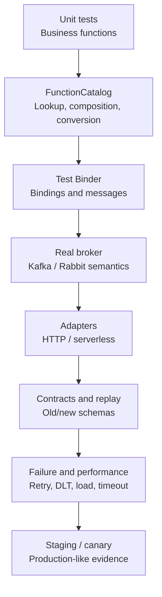
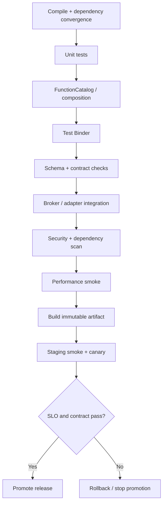

# Kiểm thử hồi quy và kế hoạch khôi phục phiên bản

## 1. Nâng cấp chỉ an toàn khi biết cách phát hiện lỗi và quay lại

Một dịch vụ Spring Cloud Function đang xử lý sự kiện tạo đơn hàng. Hàm `classifyOrder` đọc JSON, phân loại đơn hàng rồi phát kết quả tới broker. Nhóm nâng Spring Boot, Spring Cloud Function và Spring Cloud Stream, build thành công, deploy được và thấy health endpoint trả `UP`. Tuy nhiên, sau khi nhận traffic thật, một số event JSON cũ không còn chuyển đổi được; binding output trỏ nhầm destination; message lỗi bị drop thay vì đưa vào dead-letter queue (DLQ); consumer xử lý trùng khi broker redeliver; và độ trễ p99 tăng mạnh.

Nghiêm trọng hơn, version mới đã commit Kafka offset và ghi database trước khi phát hiện lỗi. Rollback JAR không đưa dữ liệu về trạng thái trước đó.

**Kiểm thử hồi quy** chứng minh hành vi đã cam kết vẫn đúng trên version mới. **Kế hoạch khôi phục phiên bản (rollback)** xác định cách đưa traffic về artifact ổn định khi tiêu chí vận hành không đạt, đồng thời bảo toàn dữ liệu, message và side effects đã xảy ra.

Bài thuộc chương **Nâng cấp** của module **SPRING_CLOUD_FUNCTION**. Module phát triển logic nghiệp vụ tái sử dụng bằng `Supplier`, `Function` và `Consumer`, sử dụng `FunctionCatalog`, composition và message conversion để triển khai cùng một hàm qua HTTP, sự kiện hoặc serverless. Vì vậy, bộ kiểm thử cần bao phủ function thuần, adapter, broker, schema và runtime.

Sau bài này, bạn có thể thiết kế tầng kiểm thử phù hợp, tạo golden fixtures, kiểm tra FunctionCatalog/binding/conversion, mô phỏng lỗi và redelivery, đánh giá hiệu năng, đặt điều kiện canary, và lập runbook rollback cho code, configuration, database và event stream.

## 2. Bốn mục tiêu kiểm thử cần tách biệt

| Mục tiêu | Câu hỏi cần trả lời | Bằng chứng |
| --- | --- | --- |
| Business correctness | Cùng input nghiệp vụ có tạo cùng kết quả không? | Unit test của function |
| Integration correctness | Spring có tìm đúng function, convert payload và bind đúng cổng không? | FunctionCatalog, Test Binder, HTTP integration |
| Compatibility | Version mới có đọc dữ liệu cũ và giữ output contract không? | Schema/contract tests, replay fixtures |
| Operational safety | Khi lỗi, retry, DLQ, timeout và rollback có đúng không? | Broker/runtime tests, failure injection, canary |

Một test `Function<String,String>` trả `HELLO` chỉ chứng minh phép biến đổi chuỗi. Nó không chứng minh `spring.cloud.function.definition` chọn đúng bean, JSON converter hoạt động như production, Kafka destination không đổi, DLQ nhận message lỗi hoặc rollback version cũ đọc được message mới.

Gắn mỗi test với một rủi ro cụ thể. Tránh viết nhiều test chỉ lặp lại cùng một phép biến đổi mà không bổ sung bằng chứng về integration hoặc vận hành.

## 3. Chụp baseline trước khi nâng cấp

Không thể kiểm thử hồi quy nếu không biết hành vi trước nâng cấp. Lưu baseline từ artifact đang chạy ổn định:

```yaml
application:
  service: orders-function
  release: 2.8.4
  imageDigest: sha256:BASELINE_DIGEST
  javaRuntime: BASELINE_JAVA_RUNTIME

spring:
  bootVersion: BASELINE_BOOT
  cloudReleaseTrain: BASELINE_CLOUD_TRAIN
  functionVersion: BASELINE_FUNCTION
  streamVersion: BASELINE_STREAM
  functionDefinition: normalizeOrder|classifyOrder

bindings:
  input:
    name: normalizeOrder|classifyOrder-in-0
    destination: orders.created.v1
    group: order-classifiers
    contentType: application/json
  output:
    name: normalizeOrder|classifyOrder-out-0
    destination: orders.classified.v1
    contentType: application/json
```

Các giá trị `BASELINE_*` là chỗ điền từ hệ thống thật. Lưu thêm retry/backoff, DLQ, ack/offset, partition key, batch size, concurrency, HTTP/serverless entrypoint, event schema, database migration và metrics p95/p99. Lấy dependency đã resolve và image digest đã deploy; version trong parent POM không chứng minh binary thực tế.

## 4. Tổ chức bộ kiểm thử theo nhiều tầng



Unit test chạy nhanh và tập trung business logic. FunctionCatalog test xác nhận framework lookup và composition. Test Binder kiểm tra wiring/conversion trong JVM. Broker test kiểm tra middleware thật. Adapter test kiểm tra HTTP/serverless envelope. Contract/replay test kiểm tra dữ liệu qua nhiều version. Failure/performance test kiểm tra retry, duplicate, timeout và throughput.

Không cần chạy toàn bộ end-to-end cho mọi thay đổi nhỏ. Nhưng một lần nâng framework, đổi adapter, converter hoặc binder cần mở rộng tầng test tương ứng.

## 5. Unit test cho function thuần

Giữ logic nghiệp vụ độc lập với HTTP, Kafka và cloud SDK:

```java
import java.util.function.Function;

public class OrderFunctions {

    public record OrderCreated(
            String eventId, String orderId, long totalInCents) {}

    public record OrderClassified(
            String eventId, String orderId, String priority) {}

    public Function<OrderCreated, OrderClassified> classifyOrder() {
        return order -> {
            if (order.eventId() == null || order.eventId().isBlank()) {
                throw new IllegalArgumentException("eventId is required");
            }
            if (order.orderId() == null || order.orderId().isBlank()) {
                throw new IllegalArgumentException("orderId is required");
            }
            if (order.totalInCents() < 0) {
                throw new IllegalArgumentException("amount must be non-negative");
            }
            return new OrderClassified(
                    order.eventId(),
                    order.orderId(),
                    order.totalInCents() >= 100_000L
                            ? "PRIORITY" : "STANDARD");
        };
    }
}
```

Test:

```java
import static org.junit.jupiter.api.Assertions.assertEquals;
import static org.junit.jupiter.api.Assertions.assertThrows;

import org.junit.jupiter.api.Test;

class OrderFunctionsTest {

    private final OrderFunctions functions = new OrderFunctions();

    @Test
    void classifiesLargeOrderAsPriority() {
        var result = functions.classifyOrder().apply(
                new OrderFunctions.OrderCreated(
                        "evt-101", "ORD-101", 150_000L));

        assertEquals("PRIORITY", result.priority());
        assertEquals("ORD-101", result.orderId());
        assertEquals("evt-101", result.eventId());
    }

    @Test
    void rejectsNegativeAmount() {
        var input = new OrderFunctions.OrderCreated(
                "evt-102", "ORD-102", -1L);

        assertThrows(IllegalArgumentException.class,
                () -> functions.classifyOrder().apply(input));
    }
}
```

Bao phủ input hợp lệ, ngưỡng nghiệp vụ, null/blank, số âm/số lớn, enum chưa hỗ trợ, header/metadata nếu có và side effect chỉ chạy sau validation. Unit test nên gọi function thật; chỉ thay dependency bên ngoài như repository, clock hoặc HTTP client.

## 6. FunctionCatalog regression: tên và composition không được tự đổi

Spring Cloud Function chuẩn hóa functional bean qua `FunctionCatalog`. Lookup qua catalog có thể trả wrapper hỗ trợ conversion/composition; lấy bean gốc từ `ApplicationContext` không nhất thiết tương đương.

```java
@SpringBootTest
class FunctionCatalogRegressionTest {

    @Autowired
    FunctionCatalog catalog;

    @Test
    void publicFunctionStillExists() {
        Function<?, ?> function =
                catalog.lookup(Function.class, "classifyOrder");
        assertNotNull(function);
    }

    @Test
    void composedDefinitionStillInvokesInOrder() {
        @SuppressWarnings("unchecked")
        Function<OrderCreated, OrderClassified> function =
                (Function<OrderCreated, OrderClassified>) catalog.lookup(
                        Function.class,
                        "normalizeOrder|classifyOrder");

        assertNotNull(function);
        var result = function.apply(
                new OrderCreated("evt-101", " ORD-101 ", 150_000L));

        assertEquals("ORD-101", result.orderId());
        assertEquals("PRIORITY", result.priority());
    }
}
```

Đây là mẫu minh họa; DTO cần dùng từ test package thật. Assertion nên khóa tên function, definition, thứ tự composition, kiểu input/output, routing policy và function không được công bố. Lookup thành công chưa đủ; cần invoke và so sánh output với fixture.

## 7. Golden fixtures: giữ cùng bộ dữ liệu trước và sau

Golden fixture là input và expected output đã được review, lưu trong version control:

```json
{
  "id": "order-created-priority-001",
  "input": {
    "eventId": "evt-101",
    "orderId": "ORD-101",
    "totalInCents": 150000
  },
  "expected": {
    "eventId": "evt-101",
    "orderId": "ORD-101",
    "priority": "PRIORITY"
  }
}
```

Một bộ fixture cần có happy path, boundary, invalid payload, event lịch sử, schema mới, unknown field, header, duplicate, out-of-order, poison message và batch có một record lỗi.

Không tự cập nhật expected output chỉ để test xanh. Nếu kết quả mới khác baseline, cần lý do nghiệp vụ, người phê duyệt và test mô tả thay đổi.

## 8. Kiểm thử message conversion và headers

Khi signature, content type hoặc converter thay đổi, cùng JSON bytes có thể được deserialize khác. Kiểm tra:

- `application/json` tạo đúng DTO.
- Field thiếu và field sai type bị xử lý đúng policy.
- Correlation ID được giữ.
- Routing header không được tin cậy ngoài ý định.
- Output content type khớp payload.
- Credentials/header nội bộ không bị phản chiếu.
- Native serializer/deserializer của binder không bị bỏ qua trong test.

Ví dụ:

```java
@Test
void preservesCorrelationAndDropsSensitiveHeader() {
    Message<String> input = MessageBuilder
            .withPayload("hello")
            .setHeader("x-correlation-id", "req-789")
            .setHeader("authorization", "Bearer test-only")
            .build();

    Message<String> output = function.apply(input);

    assertEquals("req-789",
            output.getHeaders().get("x-correlation-id"));
    assertNull(output.getHeaders().get("authorization"));
}
```

Token chỉ là chuỗi giả lập. Khi test HTTP adapter, phải gửi request qua endpoint thật để xác minh adapter/gateway không echo header ngoài policy; unit test function không chứng minh được điều đó.

## 9. Test Binder: kiểm tra binding trong JVM

Spring Cloud Stream có Spring Integration Test Binder để test ứng dụng không cần broker thật. Nó cung cấp `InputDestination` và `OutputDestination` để gửi/nhận message theo binding.

Dependency Maven:

```xml
<dependency>
    <groupId>org.springframework.cloud</groupId>
    <artifactId>spring-cloud-stream-test-binder</artifactId>
    <scope>test</scope>
</dependency>
```

Ví dụ test theo API Test Binder hiện hành:

```java
@SpringBootTest(classes = OrderStreamTest.TestApplication.class,
        properties = "spring.cloud.function.definition=classifyOrder")
class OrderStreamTest {

    @Autowired
    InputDestination input;

    @Autowired
    OutputDestination output;

    @Test
    void transformsOrderMessage() {
        byte[] payload = """
                {"eventId":"evt-101","orderId":"ORD-101","totalInCents":150000}
                """.getBytes(StandardCharsets.UTF_8);

        input.send(new GenericMessage<>(payload), "classifyOrder-in-0");

        Message<byte[]> result =
                output.receive(1_000, "classifyOrder-out-0");

        assertNotNull(result);
        assertThat(new String(result.getPayload(), StandardCharsets.UTF_8))
                .contains("\"priority\":\"PRIORITY\"");
    }

    @SpringBootApplication
    @EnableTestBinder
    static class TestApplication {
        @Bean
        Function<OrderCreated, OrderClassified> classifyOrder() {
            return order -> new OrderClassified(
                    order.eventId(), order.orderId(),
                    order.totalInCents() >= 100_000L
                            ? "PRIORITY" : "STANDARD");
        }
    }
}
```

Tên annotation/imports phải khớp version Stream/BOM đang resolve. Tài liệu 5.1 hiện dùng `@EnableTestBinder`; nhánh cũ có thể dùng `@Import(TestChannelBinderConfiguration.class)`.

Test Binder xác minh Spring context, binding name, conversion và pipeline trong JVM. Nó không chứng minh Kafka partition/offset/rebalance, Rabbit exchange/ack, broker ACL/TLS, native codec, retry/DLQ thực tế hoặc retention/replay.

### 9.1. Không trộn Test Binder và broker binder một cách vô tình

Khi Test Binder có mặt trên test classpath, Stream có thể chọn nó cho các binding trong module. Nếu một số test cần broker thật, tách broker integration tests sang test module/profile riêng hoặc loại trừ test binder auto-configuration theo hướng dẫn version cụ thể. Không để test tưởng rằng đang gửi Kafka nhưng thực tế message chỉ đi qua channel in-memory.

## 10. Broker integration test: kiểm tra middleware thật

Với Kafka, dùng `spring-kafka-test`/embedded Kafka hoặc Testcontainers tùy yêu cầu. Spring Kafka hiện cung cấp embedded KRaft broker; Testcontainers giúp chạy backend thật trong container.

Một test Kafka cần xác minh producer gửi đúng topic/key/headers, consumer group nhận message, partition key giữ ordering, deserializer tạo đúng DTO, commit/ack đúng cấu hình, retry/DLT hoạt động và restart không làm mất hoặc nhân đôi side effect.

Với RabbitMQ, kiểm tra exchange, routing key, queue, binding, ack/nack, requeue, DLQ và TTL. Không lấy kết quả Kafka test làm bằng chứng cho Rabbit binder.

### 10.1. Kafka offset là trạng thái cần quan sát

Trong test, dùng topic riêng cho từng kịch bản hoặc kiểm soát consumer offset. Nếu consumer bắt đầu sau khi producer gửi, `auto.offset.reset=latest` có thể khiến test không đọc được record cũ; `earliest` thường phù hợp hơn cho fixture test mới. Spring Kafka test utilities có helper thiết lập consumer và đọc record.

Không dùng chung topic/group giữa nhiều test song song mà không cô lập dữ liệu; các test có thể đọc nhầm message của nhau.

## 11. HTTP và serverless adapter integration test

Nếu function được expose qua HTTP, test qua server thật:

```java
@SpringBootTest(webEnvironment = SpringBootTest.WebEnvironment.RANDOM_PORT)
class FunctionHttpRegressionTest {

    @Autowired
    TestRestTemplate rest;

    @Test
    void returnsClassifiedOrder() {
        HttpHeaders headers = new HttpHeaders();
        headers.setContentType(MediaType.APPLICATION_JSON);
        headers.setAccept(List.of(MediaType.APPLICATION_JSON));

        String body = """
                {"eventId":"evt-101","orderId":"ORD-101","totalInCents":150000}
                """;

        ResponseEntity<String> response = rest.postForEntity(
                "/classifyOrder",
                new HttpEntity<>(body, headers),
                String.class);

        assertEquals(HttpStatus.OK, response.getStatusCode());
        assertThat(response.getBody()).contains("\"priority\":\"PRIORITY\"");
    }
}
```

Kiểm tra status, body, content type, headers và error contract. Với serverless, test handler/adapter bằng event envelope thật của provider, ví dụ API Gateway/SQS hoặc Azure trigger; gọi trực tiếp Java function không chứng minh cloud handler load được artifact.

**Lưu ý transaction:** `@SpringBootTest(webEnvironment = RANDOM_PORT)` chạy client và server trên thread/transaction riêng. Gắn `@Transactional` vào test không tự rollback transaction đã commit ở server. Cần tự dọn dữ liệu, dùng database/container riêng hoặc cleanup có chủ đích.

## 12. Contract tests cho producer và consumer

Một function có thể đúng trong ứng dụng nhưng producer phát event không còn đúng schema mà consumer khác hiểu. Contract test khóa message body, headers, destination và trigger.

Ví dụ contract minh họa:

```yaml
description: Order classified event
label: order_classified_v1
input:
  triggeredBy: publishClassifiedOrder()
outputMessage:
  sentTo: orders.classified.v1
  headers:
    contentType: application/json
    eventType: com.acme.orders.order-classified.v1
  body:
    eventId: evt-101
    orderId: ORD-101
    priority: PRIORITY
```

Cú pháp thực tế phải khớp DSL và version Spring Cloud Contract. Mục tiêu là khóa giao kèo producer-consumer, không đưa toàn bộ business logic vào contract.

Kiểm tra tương thích hai chiều:

| Producer | Consumer | Câu hỏi |
| --- | --- | --- |
| Cũ | Mới | Consumer mới còn đọc được message lịch sử không? |
| Mới | Cũ | Consumer cũ có đọc được payload mới không? |
| Mới | Mới | Contract mục tiêu có đúng không? |
| Cũ | Cũ | Baseline có tái hiện được không? |

Nếu rollback consumer về version cũ, dữ liệu mới mà producer đã phát vẫn phải được xử lý hoặc cô lập theo migration plan.

## 13. Kiểm thử lỗi, retry và dead-letter

Spring Cloud Stream error handling phụ thuộc binder và programming model. Với imperative message handler, exception có thể được truyền về binder để retry; nếu retry thất bại, cơ chế error handling có thể drop, requeue hoặc gửi DLQ tùy cấu hình. Không dựa vào default; cấu hình và kiểm thử rõ.

| Kịch bản | Kỳ vọng |
| --- | --- |
| Lỗi transient lần đầu, lần sau thành công | Retry trong giới hạn đã cấu hình |
| Lỗi permanent/validation | Không retry vô hạn; reject hoặc DLT |
| Broker tạm mất kết nối | Không mất message đã được broker xác nhận |
| Consumer chết giữa xử lý | Redelivery có kiểm soát và idempotency |
| DLT unavailable | Alert và recovery path rõ |
| Poison message | Không chặn vô hạn cả partition/queue |
| Custom error handler | Không vô tình tắt binder DLQ/error handler |

### 13.1. Custom ErrorMessage handler có thể thay handler mặc định

Spring Cloud Stream mô tả custom `Consumer<ErrorMessage>` có thể loại trừ framework/binder error handlers; khi cấu hình custom handler, không giả định DLQ vẫn hoạt động như trước. Viết test chứng minh error message được xử lý đúng và DLT có nhận record hay không.

### 13.2. Reactive function có error model khác

`Function<Flux<T>, Flux<R>>` không phải message handler imperative theo cùng nghĩa. RetryTemplate/DLQ settings cho imperative handler không tự áp dụng giống hệt reactive stream. Dùng Reactor operators như `retryWhen` và test resubscription, cancellation, backpressure, side effects và ordering.

## 14. Duplicate, idempotency và replay tests

Broker/event source có thể redeliver message. Test phải mô phỏng cùng event identity được gửi nhiều lần:

```json
{
  "source": "urn:acme:orders",
  "id": "evt-101",
  "type": "com.acme.orders.order-created.v1",
  "data": {
    "orderId": "ORD-101",
    "totalInCents": 150000
  }
}
```

Consumer nên dùng cặp `(source,id)` hoặc event ID có contract ổn định làm khóa dedupe. Gửi event `evt-101` lần đầu và xác minh side effect; gửi lại chính event đó và xác minh không tạo side effect thứ hai; sau đó gửi `evt-102` và xác minh event mới vẫn được xử lý.

Kiểm tra cả trường hợp process chết sau khi ghi DB nhưng trước ack/commit. Nếu dedupe marker và side effect không cùng transaction, test cần phát hiện cửa sổ crash này.

### 14.1. Replay lịch sử

Chọn tập event lịch sử còn trong retention/replay window. Replay vào môi trường test hoặc consumer group riêng, xác minh consumer target đọc được schema cũ, ordering/partition key phù hợp, dedupe không bỏ sót event mới, side effect ghi vào database sandbox và event không hợp lệ đi vào DLT.

Không replay trực tiếp production chỉ để thử rollback. Dùng fixture/clone topic hoặc môi trường cô lập.

## 15. Kiểm thử database và outbox khi rollback

Một lần nâng cấp có thể đổi schema database, ghi dữ liệu mới hoặc thêm trạng thái outbox. Rollback code không tự hoàn tác các thay đổi này.

Database tests cần bao phủ:
- Version cũ đọc được row do version mới ghi.
- Default/null mới không làm code cũ lỗi.
- Migration thêm cột/index không phá query cũ.
- Rollback application vẫn chạy khi schema ở trạng thái mở rộng.
- Outbox record đã publish không bị phát lại thành side effect mới.
- Idempotency table giữ key và constraint qua migration.
- Migration không xóa dữ liệu mà artifact cũ còn cần.

### 15.1. Expand–migrate–contract

1. **Expand:** thêm cột/bảng/index theo cách code cũ vẫn chạy.
2. **Migrate:** deploy code mới, ghi/đọc song song hoặc backfill.
3. **Contract:** chỉ xóa cột/field cũ sau khi mọi consumer và rollback window không còn cần chúng.

Không chạy migration phá hủy trước khi chắc chắn artifact cũ không còn cần schema cũ. Nếu thay đổi đã xóa dữ liệu hoặc đổi semantics không thể đảo ngược, phương án có thể là roll-forward migration hoặc phục hồi backup, không phải chỉ redeploy JAR cũ.

## 16. Kiểm thử hiệu năng và tài nguyên

Một lần nâng framework có thể không đổi kết quả nhưng làm tăng cold start, heap, CPU hoặc latency.

| Chỉ số | Cần quan sát |
| --- | --- |
| Startup/cold-start | Thời gian từ process start đến sẵn sàng |
| p50/p95/p99 latency | Tail latency tăng mức nào |
| Throughput | Message/second hoặc request/second |
| Error rate | 4xx/5xx, conversion error, function exception |
| CPU/heap/GC | Tăng do converter, reflection hoặc context |
| Queue lag/backlog | Consumer có theo kịp producer |
| Retry/DLT rate | Lỗi transient/permanent tăng không |
| Connection pool | Kafka/DB/HTTP pool có cạn không |
| Batch/concurrency | Có đổi thứ tự hoặc áp lực downstream không |

Load test dùng payload gần production: kích thước JSON, số records/batch, header, schema cũ/mới và tỷ lệ message lỗi. Test chỉ với một chuỗi `hello` không đại diện workload thật.

Ví dụ ngưỡng do nhóm tự đặt:

```yaml
releaseGate:
  errorRate:
    maxIncreasePercent: 0.5
  latencyP99:
    maxRegressionPercent: 15
  consumerLag:
    maxAgeSeconds: 60
  deadLetter:
    unexpectedIncrease: 0
  businessInvariant:
    duplicateOrderCount: 0
```

Đây là ví dụ, không phải default của Spring. Ngưỡng phải dựa trên SLO, volume và rủi ro nghiệp vụ. Với traffic thấp, dùng số lượng request tối thiểu và cửa sổ đủ dài để tránh false positive.

## 17. CI pipeline: đặt gate trước khi publish/deploy



Gate nên bao gồm unit/FunctionCatalog, Test Binder, schema compatibility, broker integration, HTTP/serverless tests, security scan, performance smoke, artifact digest, runbook và alarm.

Không build lại artifact sau khi staging đã kiểm thử rồi deploy binary khác lên production. Nếu phải rebuild, chạy lại kiểm thử và lưu digest mới.

## 18. Chuẩn bị artifact và cấu hình rollback

| Thành phần | Phải lưu |
| --- | --- |
| Application artifact | Image digest/JAR checksum và source revision |
| Runtime | Java runtime, container base image hoặc Lambda runtime |
| Spring config | Profile, env vars, Config Server revision |
| Function definition | Definition, routing policy, binding names |
| Broker topology | Destination, group, partitions, queue bindings |
| Schema | Schema version, registry subject và compatibility mode |
| Database | Migration version, backup/restore point |
| Secrets | Version/reference của secret, không lưu plaintext |
| Deployment | Release ID, traffic weight, previous stable revision |
| Observability | Dashboard, alarms, trace/log query và release marker |

Artifact cũ phải còn tồn tại và có thể deploy lại. Đừng dựa vào tag `latest` có thể bị ghi đè. Lưu digest, provenance, dependency lock/effective POM và runtime config.

Rollback phải biết binary nào sẽ chạy, config nào đi cùng, function definition nào được chọn, destination/group nào được dùng và version cũ có đọc được message/schema mới không.

## 19. Canary và blue/green: triển khai dần để quan sát

- **Canary:** một phần traffic/event được xử lý bởi version mới; phần còn lại vẫn ở version ổn định.
- **Blue/green:** hai môi trường riêng được chuẩn bị; traffic chuyển từ môi trường cũ sang mới theo bước.
- **Rolling:** instance được thay dần; old/new version có thể chạy đồng thời.

Trong thời gian rolling, old và new phải tương thích với cùng event schema, database schema và shared resources.

### 19.1. Lưu ý riêng cho consumer Kafka

Không có traffic weight chung áp dụng cho mọi consumer Kafka:

- Nếu old/new dùng **cùng consumer group**, partition được chia giữa các instance; record được xử lý bởi một instance trong group theo assignment/rebalance, không phải chia traffic theo phần trăm tùy ý.
- Nếu old/new dùng **hai consumer group riêng**, mỗi group nhận luồng event riêng; version mới có thể xử lý lại toàn topic theo offset policy. Đây thường là shadow processing và không được phép lặp side effect thật.
- Nếu cần canary theo tỷ lệ event, cần routing/partition/topic hoặc sampling strategy được thiết kế rõ.
- Khi đổi group, offset state có thể khác; không coi đó là thay đổi vô hại.

Shadow consumer nên ghi kết quả vào nơi riêng, không gửi email, tạo hóa đơn, trừ tiền hoặc phát event chính thức.

## 20. Canary cho AWS Lambda bằng weighted alias

AWS Lambda hỗ trợ alias trỏ tới hai published versions và phân phối traffic theo weight. Hai version phải thỏa điều kiện của Lambda, gồm cùng execution role và cấu hình DLQ tương thích; alias không thể trỏ tới `$LATEST`. Phân phối có tính xác suất, nên traffic thấp có thể tạo tỷ lệ thực tế lệch khỏi tỷ lệ cấu hình.

Ví dụ AWS SAM:

```yaml
Resources:
  ClassifyOrder:
    Type: AWS::Serverless::Function
    Properties:
      Handler: org.springframework.cloud.function.adapter.aws.FunctionInvoker
      Runtime: java21
      CodeUri: target/orders-function-aws.jar
      AutoPublishAlias: live
      DeploymentPreference:
        Type: Canary10Percent10Minutes
        Alarms:
          - !Ref FunctionErrorAlarm
          - !Ref FunctionLatencyAlarm
        Hooks:
          PreTraffic: !Ref PreTrafficValidation
          PostTraffic: !Ref PostTrafficValidation
```

Đây là ví dụ minh họa. Runtime, handler, alarm và hook phải khớp artifact/adapter đang triển khai.

AWS SAM tích hợp CodeDeploy có thể tạo alias, chuyển traffic theo canary/linear và tự rollback khi alarm hoặc pre/post traffic hook thất bại. Không dùng weighted alias AWS làm mẫu chung cho Kafka consumer hoặc Azure/GCP.

## 21. Định nghĩa rollback triggers trước khi deploy

| Tín hiệu | Ví dụ trigger | Hành động |
| --- | --- | --- |
| Error rate | Vượt SLO trong cửa sổ liên tục | Dừng tăng traffic và đánh giá rollback |
| p99 latency | Tăng vượt ngưỡng baseline | Dừng promotion |
| Conversion failures | Tăng bất thường theo event type | Dừng consumer/producer rollout |
| DLT/DLQ | Tăng ngoài mức cho phép | Dừng traffic hoặc cách ly event |
| Consumer lag | Tăng liên tục, không bắt kịp | Giảm rollout hoặc rollback |
| Duplicate side effects | Có đơn hàng/thanh toán trùng | Rollback ngay và đối soát |
| Data invariant | Tổng tiền/trạng thái không khớp | Dừng ghi và kích hoạt incident |
| Crash/OOM | Restart hoặc memory vượt ngưỡng | Rollback version |
| Security regression | Header/route/auth behavior sai | Dừng rollout |
| Schema incompatibility | Old consumer không đọc được event mới | Dừng producer upgrade |

Ngưỡng và cửa sổ thời gian dựa trên traffic volume. Alarm chỉ dùng phần trăm lỗi với mẫu rất nhỏ có thể false positive; alarm dùng trung bình quá dài có thể phát hiện lỗi quá muộn.

## 22. Runbook rollback: dừng mở rộng, khôi phục traffic, kiểm tra state

1. **Stop promotion:** ngừng tăng traffic hoặc scale version mới.
2. **Freeze producers nếu cần:** tránh tiếp tục phát schema/event mà consumer cũ không đọc được.
3. **Shift traffic:** trỏ alias/route về version ổn định hoặc đưa deployment group về revision trước.
4. **Restore compatible configuration:** dùng function definition, binding, secret references và runtime config đã lưu.
5. **Check consumers:** xác nhận group, offsets, backlog, DLT và subscription.
6. **Check database:** xác định migration đã chạy, side effect nào đã commit và outbox nào pending.
7. **Reconcile:** replay hoặc phát compensating action theo quy trình đã duyệt.
8. **Verify invariants:** số record, event ID, trạng thái nghiệp vụ và downstream consistency.
9. **Observe:** theo dõi error rate, lag, latency và DLT sau rollback.
10. **Preserve evidence:** giữ release ID, logs, traces, offsets, event IDs và timeline.

Không tự reset Kafka offsets hoặc xóa consumer group trong runbook nếu chưa có phạm vi topic/partition/time và phê duyệt. Những hành động đó có thể tạo replay lớn hoặc bỏ qua dữ liệu.

## 23. Rollback code không rollback Kafka offsets

Giả sử version mới đọc event `evt-101`, ghi DB và commit offset. Sau đó phát hiện kết quả phân loại sai. Deploy version cũ trở lại không làm Kafka offset lùi về trước `evt-101`.

| Trạng thái khi rollback | Hệ quả |
| --- | --- |
| Offset đã commit | Version cũ tiếp tục từ vị trí sau record đó |
| Offset chưa commit | Broker có thể giao lại record |
| Consumer group mới | Có thể đọc từ offset reset policy và xử lý lại nhiều dữ liệu |
| DLT chứa record lỗi | Cần quy trình replay/reprocess riêng |
| Event đã publish tới topic khác | Không tự biến mất khi rollback producer |

Nếu cần xử lý lại event đã commit, lập kế hoạch rõ: republish record vào retry topic, replay bằng consumer group riêng hoặc reset offset theo phạm vi kiểm soát. Kafka yêu cầu consumer instances inactive khi reset offset và lệnh reset phải chỉ rõ topic/scope; thao tác này có thể làm side effect chạy lại.

**Trước khi replay**, xác minh idempotency và dữ liệu hiện tại. Không reset offset toàn group chỉ vì một record có output sai.

## 24. Rollback không đảo ngược side effects bên ngoài

Một function có thể ghi database, gửi email, gọi payment gateway, phát event, gửi lệnh đối tác hoặc cập nhật inventory. Khi rollback code, hành động đã xảy ra vẫn tồn tại.

| Side effect | Cách khôi phục |
| --- | --- |
| Database update có transaction | Kiểm tra commit; dùng corrective migration nếu đã commit |
| Email đã gửi | Gửi thông báo sửa sai nếu cần; không thể thu hồi email |
| Payment đã capture | Gọi refund/void theo quy trình nghiệp vụ |
| Event đã publish | Phát correction/compensation event hoặc sửa consumer |
| Inventory đã trừ | Reconciliation/compensation transaction |
| Outbox chưa publish | Giữ trạng thái và publisher tiếp tục theo policy |
| Cache đã ghi | Invalidate/rebuild theo key và version |

Đối với side effect quan trọng, thiết kế idempotency key và compensation từ đầu. Đừng chờ đến lúc rollback mới phát hiện không có cách đối soát.

## 25. Database rollback: ưu tiên roll-forward khi migration phá hủy

Một release mới thêm cột `priority_reason` rồi ghi dữ liệu. Nếu rollback về version cũ, version cũ có thể vẫn chạy khi cột mới tồn tại. Nhưng nếu release mới xóa cột `order_status` hoặc đổi kiểu dữ liệu không tương thích, version cũ có thể không khởi động.

- Dùng migration additive trước.
- Duy trì code tương thích với schema cũ/mới trong thời gian chuyển.
- Backfill có thể chạy lại và có checkpoint.
- Chỉ xóa cột cũ sau khi rollback window hết.
- Không chạy destructive migration đồng thời với application rollout.
- Backup/restore phải được diễn tập và có RTO/RPO thực tế.
- Nếu không thể khôi phục schema cũ an toàn, ưu tiên roll-forward corrective migration.

Rollback code và rollback database là hai quyết định khác nhau. Có thể giữ database schema mới nhưng deploy code cũ tương thích với schema đó.

## 26. Replay và DLQ/DLT: cần kiểm tra trước khi dùng làm recovery

DLQ/DLT giữ message thất bại để điều tra, audit hoặc xử lý lại. Nó không tự sửa dữ liệu.

Quy trình replay:
1. Xác định lý do lỗi và version gây lỗi.
2. Xác minh event schema/content type.
3. Sửa consumer hoặc tạo adapter chuyển đổi.
4. Lọc event được phép replay.
5. Giữ event identity gốc.
6. Chọn destination/retry topic và tốc độ replay.
7. Chạy dry-run hoặc replay trên staging.
8. Bảo đảm consumer idempotent.
9. Theo dõi số message thành công/thất bại và DLT còn lại.
10. Đối soát side effects trước khi đóng incident.

Không replay toàn bộ DLQ vào topic chính khi chưa biết một phần message đã được xử lý thành công trước crash hay chưa. Replay không kiểm soát có thể gửi email/thanh toán/tạo đơn hàng trùng.

## 27. Kịch bản diễn tập rollback

**Kịch bản A — Converter regression:** baseline đọc JSON v1; version mới yêu cầu field bắt buộc mới. Gửi fixture v1, xác minh conversion failure, alarm và dừng canary; rollback code rồi xác minh consumer đọc lại dữ liệu.

**Kịch bản B — Side effect trùng:** consumer ghi DB rồi bị kill trước ack/commit. Broker redeliver cùng event ID. Xác minh idempotency chặn side effect thứ hai; kiểm tra offset và event audit.

**Kịch bản C — DLT tăng:** gửi poison message, xác minh retry/backoff, DLT routing và alert. Sửa parser rồi replay một event theo quy trình kiểm soát.

**Kịch bản D — Database schema:** deploy migration additive, chạy version mới rồi rollback code. Xác minh version cũ vẫn chạy trên schema mở rộng; không xóa cột mới.

**Kịch bản E — Kafka offset:** cho consumer xử lý và commit một record, rollback consumer code, xác minh rollback không tự reprocess record đã commit. Nếu cần replay, thực hiện qua topic/consumer group test riêng với dedupe.

Một cuộc diễn tập chỉ hoàn tất khi nhóm khôi phục được traffic, chứng minh dữ liệu nhất quán và biết chính xác event nào cần replay/compensate.

## 28. Ma trận hồi quy trước và sau nâng cấp

| ID | Test | Điều cần chứng minh |
| --- | --- | --- |
| REG-01 | FunctionCatalog lookup | Tên function vẫn resolve |
| REG-02 | Composition | Thứ tự function và type tương thích |
| REG-03 | JSON conversion v1 | Consumer target đọc được event cũ |
| REG-04 | JSON conversion v2 | Schema mới đúng |
| REG-05 | HTTP endpoint | Method/path/status giữ contract |
| REG-06 | Binding names | Input/output binding đúng |
| REG-07 | Consumer group | Offset/assignment có kế hoạch |
| REG-08 | Header mapping | Metadata không mất/leak |
| REG-09 | Retry transient | Attempts/backoff theo policy |
| REG-10 | Permanent failure | DLT/DLQ nhận message |
| REG-11 | Duplicate delivery | Không side effect trùng |
| REG-12 | Replay history | Target đọc event còn trong retention |
| REG-13 | Outbox | Retry không tạo duplicate business event |
| REG-14 | Broker restart | Recovery đúng |
| REG-15 | Concurrency | Ordering/invariant không vi phạm |
| REG-16 | Performance | p95/p99 trong SLO |
| REG-17 | Serverless handler | Event envelope/handler đúng |
| REG-18 | Rollback artifact | Artifact cũ deploy được |
| REG-19 | Database rollback | Version cũ chạy trên schema hiện tại |
| REG-20 | Canary alarm | Dừng/rollback khi SLO vi phạm |

Lưu kết quả test cùng commit/artifact digest. Một dòng `all tests passed` không đủ để điều tra release sau này.

## 29. Case study: nâng cấp service phân loại đơn hàng

Baseline:
- Function definition: `normalizeOrder|classifyOrder`.
- Input destination: `orders.created.v1`.
- Output destination: `orders.classified.v1`.
- Consumer group: `order-classifiers`.
- Event schema: `order-created.v1`.
- DLQ: `orders.created.dlt`.

**Bước 1 — Khóa baseline:** lưu JAR/image digest, resolved dependency tree, definition, bindings, destinations, group, schema fixtures và metrics.

**Bước 2 — Unit/catalog tests:** xác minh function name, composition, business rules và error behavior.

**Bước 3 — Test Binder:** gửi golden JSON fixture qua `classifyOrder-in-0`; kiểm tra output, content type và headers.

**Bước 4 — Broker integration:** dùng Kafka test broker/container; xác minh topic, group, partition, offset, retry, DLT và redelivery.

**Bước 5 — Contract/replay:** replay event v1; xác minh target đọc được fixture lịch sử. Nếu schema mới breaking, chạy migration plan v2 trước canary.

**Bước 6 — Failure/performance:** kill consumer sau DB write, gửi poison message, làm broker tạm unavailable và đo p95/p99. Xác minh idempotency, outbox, retry và alarm.

**Bước 7 — Canary:** đưa một phần workload vào target theo cơ chế phù hợp. Theo dõi error rate, DLT, lag, duplicate count, conversion errors và business invariants.

**Bước 8 — Rollback diễn tập:** dừng rollout, đưa traffic về artifact cũ, giữ destination/schema tương thích, kiểm tra offset/event đã commit, replay/compensate có kiểm soát và đối soát order table/outbox/event count.

Không coi deploy JAR cũ là kết thúc incident. Cần chứng minh business state đã nhất quán.

## 30. Checklist trước khi cho phép nâng cấp production

### Test và compatibility
- [ ] Unit tests cho business function quan trọng.
- [ ] FunctionCatalog lookup và composition tests.
- [ ] Test Binder cho bindings/conversion.
- [ ] Broker integration tests cho Kafka/Rabbit đang dùng.
- [ ] HTTP/serverless adapter integration tests.
- [ ] Producer/consumer contract tests.
- [ ] Historical event replay tests.
- [ ] Duplicate/idempotency tests.
- [ ] Retry/DLT và poison-message tests.
- [ ] Load, latency, cold-start và resource tests.

### Rollback readiness
- [ ] Artifact cũ còn lưu theo digest.
- [ ] Configuration/secret reference cũ được ghi lại.
- [ ] Function definition và binding topology có thể khôi phục.
- [ ] Database schema vẫn tương thích với artifact cũ.
- [ ] Event mới vẫn được consumer cũ đọc hoặc có version routing.
- [ ] Offset/consumer group/replay plan được ghi rõ.
- [ ] DLT/DLQ có quy trình reprocess.
- [ ] Side effects có idempotency/compensation.
- [ ] Canary alarm và rollback triggers đã thử.
- [ ] Runbook có owner, quyền thực thi và bước xác minh sau rollback.

### Sau rollout
- [ ] Theo dõi error rate, p99, lag, DLT, conversion failures.
- [ ] Theo dõi business invariants và duplicate events.
- [ ] Giữ compatibility window cho event/schema cũ.
- [ ] Đối soát outbox và downstream.
- [ ] Lưu release marker và kết quả canary.
- [ ] Chỉ xóa artifact/schema/config cũ sau khi rollback window kết thúc.

## 31. Bài tập thực hành

### Bài tập 1: Thiết kế tầng kiểm thử

Một function `classifyOrder` chạy qua HTTP và Kafka. Hãy phân loại test thuộc unit, FunctionCatalog, Test Binder, broker integration, HTTP adapter và contract. Mỗi test chứng minh rủi ro nào?

### Bài tập 2: Test Binder không bắt được lỗi gì?

Test `InputDestination`/`OutputDestination` đạt nhưng production Kafka không phát được DLT. Nêu ít nhất năm nguyên nhân và thiết kế broker integration test tương ứng.

### Bài tập 3: Converter regression

Baseline đọc `OrderCreatedV1`; target thay converter và từ chối field `currency` bị thiếu. Hãy tạo fixture, negative test, contract test và điều kiện dừng canary.

### Bài tập 4: Retry và side effect

Function ghi DB rồi gọi API đối tác; API timeout khiến function ném exception. Binder retry ba lần. Hãy thiết kế idempotency và test để chứng minh DB/API không thực hiện side effect trùng.

### Bài tập 5: Reactive error

Một `Function<Flux<Order>,Flux<Result>>` sử dụng `retryWhen`. Vì sao không thể lấy test retry imperative làm bằng chứng? Thiết kế test cho resubscription/cancellation.

### Bài tập 6: Kafka rollback

Version mới xử lý `evt-101` và commit offset, sau đó phát hiện output sai. Deploy code cũ sẽ làm gì với offset? Cách replay có kiểm soát và nguy cơ duplicate là gì?

### Bài tập 7: Database migration

Version mới thêm cột rồi ghi dữ liệu. Vì sao rollback code có thể vẫn an toàn? Nêu một migration phá hủy khiến rollback code thất bại và cách dùng expand–migrate–contract.

### Bài tập 8: Canary Lambda

Một AWS Lambda dùng `FunctionInvoker`. Mô tả weighted alias, pre/post traffic hooks, alarms và điều kiện rollback. Vì sao traffic thực tế ở mức thấp có thể lệch weight cấu hình?

### Bài tập 9: Consumer shadow

Muốn chạy version mới song song version cũ để so sánh kết quả Kafka. Phân biệt dùng cùng consumer group và group riêng; thiết kế shadow output để không nhân đôi side effects.

### Bài tập 10: Runbook rollback

Viết runbook cho sự cố p99 tăng gấp đôi, DLT tăng và một phần đơn hàng bị ghi trùng. Nêu thứ tự dừng rollout, khôi phục traffic, kiểm tra offset, dedupe, compensation và xác minh dữ liệu.

### Câu hỏi tự đánh giá

1. Unit test function chứng minh điều gì và không chứng minh điều gì?
2. Vì sao phải test qua `FunctionCatalog`?
3. Test Binder mô phỏng được phần nào của Spring Cloud Stream?
4. Vì sao Test Binder không thay broker integration test?
5. `@SpringBootTest(RANDOM_PORT)` có rollback transaction server khi test có `@Transactional` không?
6. Test nào chứng minh HTTP headers được map đúng?
7. Vì sao cần lưu golden fixtures từ baseline?
8. Khi nào cần producer/consumer contract test?
9. Retry imperative khác reactive retry thế nào?
10. Custom `Consumer<ErrorMessage>` có thể ảnh hưởng DLQ ra sao?
11. Vì sao duplicate delivery cần idempotency?
12. Outbox giải quyết khoảng trống nào giữa DB và broker?
13. Tại sao rollback code không reset Kafka offset?
14. Vì sao đổi consumer group có thể khiến event được đọc lại?
15. Khi nào nên dùng replay, khi nào cần compensation event?
16. Vì sao deploy JAR cũ không undo side effect?
17. Migration nào có thể khiến rollback code không chạy?
18. Canary và blue/green khác nhau thế nào?
19. Vì sao Kafka consumer không có traffic weighting giống Lambda alias theo mặc định?
20. Những metric nào nên kích hoạt dừng canary/rollback?
21. Vì sao cần artifact digest thay vì tag `latest`?
22. Một rollback rehearsal hoàn tất khi nào?

## 32. Tổng kết

Kiểm thử hồi quy và kế hoạch khôi phục phiên bản là hai phần của cùng một chiến lược nâng cấp:

- **Unit tests** giữ đúng business logic của `Supplier`, `Function` và `Consumer`.
- **FunctionCatalog tests** giữ tên function, composition, wrapper và conversion.
- **Test Binder** kiểm tra wiring/binding trong JVM; broker integration test xác minh Kafka/Rabbit semantics thật.
- **Adapter/contract tests** giữ HTTP, event schema, headers và serverless invocation.
- **Failure/replay tests** chứng minh retry, DLQ, idempotency, outbox và duplicate handling.
- **Performance tests** xác nhận latency, throughput, cold start và resource usage.
- **Canary/blue-green** giảm phạm vi ảnh hưởng khi đưa version mới vào traffic.
- **Rollback** cần khôi phục code/config/traffic nhưng vẫn phải kiểm tra database, offsets, event đã phát và side effects đã commit.

Quy trình an toàn là **chụp baseline → tạo golden fixtures → chạy test theo tầng → xác minh broker/adapter/schema → đo hiệu năng và lỗi → build artifact bất biến → canary có alarm → rollback khi vi phạm SLO → replay/compensate và đối soát state**.

Spring Cloud Function giúp tái sử dụng cùng một business function qua HTTP, sự kiện và serverless. Nhưng tính độc lập giao thức không làm cho retry, acknowledgement, offset, transaction hoặc rollback giống nhau giữa các adapter. Mỗi ranh giới cần test và runbook riêng. Một lần nâng cấp chỉ nên được xem là hoàn tất khi nhóm chứng minh được **version mới hoạt động đúng và version ổn định cũ có thể được khôi phục mà không làm mất hoặc nhân đôi nghiệp vụ**.

### Tài liệu tham khảo

- [Spring Cloud Function — Testing Functional Applications và FunctionCatalog](https://docs.spring.io/spring-cloud-function/docs/current/reference/html/spring-cloud-function.html)
- [Spring Cloud Stream — Spring Integration Test Binder](https://docs.spring.io/spring-cloud-stream/reference/spring-cloud-stream/spring_integration_test_binder.html)
- [Spring Cloud Stream — Error Handling, Retry và DLQ](https://docs.spring.io/spring-cloud-stream/reference/spring-cloud-stream/overview-error-handling.html)
- [Spring Boot — Testing Spring Boot Applications](https://docs.spring.io/spring-boot/reference/testing/spring-boot-applications.html)
- [Spring Boot — Testcontainers](https://docs.spring.io/spring-boot/reference/testing/testcontainers.html)
- [Spring Kafka — Testing Applications và Embedded Kafka](https://docs.spring.io/spring-kafka/reference/testing.html)
- [Spring Kafka — Transactions](https://docs.spring.io/spring-kafka/reference/kafka/transactions.html)
- [Spring Cloud Contract — Messaging Contracts](https://docs.spring.io/spring-cloud-contract/reference/project-features-messaging.html)
- [Apache Kafka — Consumer groups và offset reset](https://kafka.apache.org/42/operations/basic-kafka-operations/)
- [AWS Lambda — Weighted alias routing và canary](https://docs.aws.amazon.com/lambda/latest/dg/configuring-alias-routing.html)
- [AWS SAM — Gradual deployments, hooks, alarms và rollback](https://docs.aws.amazon.com/serverless-application-model/latest/developerguide/automating-updates-to-serverless-apps.html)
- [AWS CodeDeploy — Lambda deployment steps và rollback](https://docs.aws.amazon.com/codedeploy/latest/userguide/deployment-steps-lambda.html)
