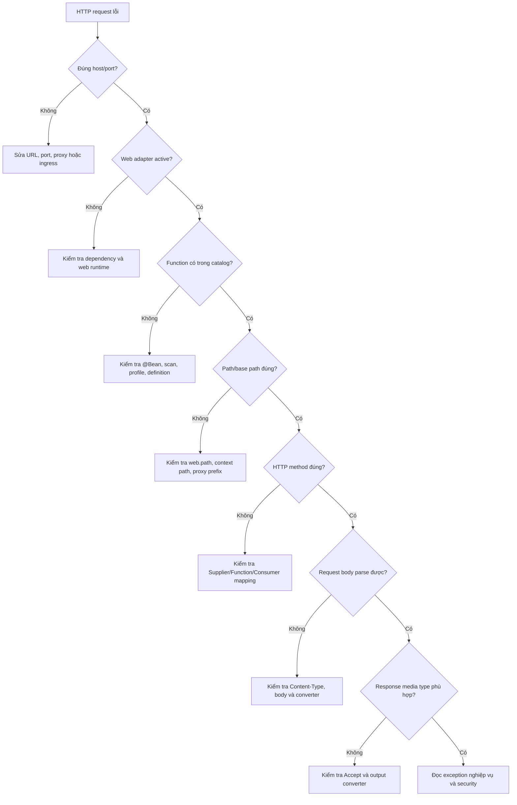

# HTTP trả sai đường dẫn, method hoặc content type

## Mục tiêu học tập

Spring Cloud Function giúp viết logic nghiệp vụ thành `Supplier<O>`, `Function<I,O>` và `Consumer<I>`, đăng ký trong Spring context rồi tra cứu bằng `FunctionCatalog`. Khi thêm Web adapter, các functional bean có thể được gọi qua HTTP mà không cần viết controller riêng cho từng hàm. Nhưng để request tới đúng hàm, ứng dụng vẫn phải khớp **đường dẫn, HTTP method, function definition và kiểu nội dung**.

Bài học này giúp bạn:

- Xác định điều kiện để Spring Cloud Function Web adapter tự xuất bản functional bean thành HTTP endpoint.
- Tìm đúng URL khi ứng dụng có một hoặc nhiều bean trong `FunctionCatalog`.
- Phân biệt base path của Function Web, servlet context path và đường dẫn do reverse proxy thêm.
- Chọn đúng HTTP method cho `Supplier`, `Function` và `Consumer`; tùy chỉnh method mapping khi cần.
- Phân biệt `Content-Type` của request với `Accept` của response.
- Hiểu cách `MessageConverter` chuyển JSON, text và byte array thành kiểu tham số của function.
- Đọc lỗi 404, 405, 406, 415, 400, 401/403 và 500 theo đúng tầng phát sinh.
- Kiểm thử HTTP endpoint bằng `curl`, MockMvc hoặc TestRestTemplate; kiểm tra riêng `FunctionCatalog`.

**Phạm vi:** bài tập trung vào `spring-cloud-function-web` trong ứng dụng Spring Boot chạy HTTP độc lập. Web adapter cung cấp endpoint gọn để xuất bản function stateless; nó không thay thế toàn bộ Spring MVC/WebFlux hoặc một API REST CRUD hoàn chỉnh. Nếu dự án có controller riêng, gateway, servlet context path hoặc ingress/proxy, cần kiểm tra cả các lớp định tuyến đó.

## 1. Xác nhận Web adapter đã được kích hoạt

Spring Cloud Function không tự biến mọi ứng dụng Spring Boot thành HTTP API chỉ vì có một bean `Function`. Ứng dụng cần dependency Web adapter và web runtime phù hợp.

Một trong hai cách khai báo dependency:

```xml
<dependency>
    <groupId>org.springframework.cloud</groupId>
    <artifactId>spring-cloud-function-web</artifactId>
</dependency>
```

Hoặc dùng starter gom các dependency tùy chọn:

```xml
<dependency>
    <groupId>org.springframework.cloud</groupId>
    <artifactId>spring-cloud-starter-function-web</artifactId>
</dependency>
```

Nếu khai báo trực tiếp `spring-cloud-function-web`, ứng dụng MVC cũng cần web runtime, ví dụ:

```xml
<dependency>
    <groupId>org.springframework.boot</groupId>
    <artifactId>spring-boot-starter-web</artifactId>
</dependency>
```

Web configuration của Spring Cloud Function được kích hoạt khi module được đưa vào ứng dụng Spring Boot có web support phù hợp (tài liệu hiện hành mô tả MVC support). Cần quản lý version bằng Spring Cloud BOM tương thích với Spring Boot của dự án; không chép version riêng từ ví dụ khác.

### 1.1. Ví dụ functional bean

```java
import java.util.Locale;
import java.util.function.Consumer;
import java.util.function.Function;
import java.util.function.Supplier;
import org.springframework.boot.SpringApplication;
import org.springframework.boot.autoconfigure.SpringBootApplication;
import org.springframework.context.annotation.Bean;

@SpringBootApplication
public class FunctionHttpApplication {

    @Bean
    public Function<String, String> uppercase() {
        return value -> value.toUpperCase(Locale.ROOT);
    }

    @Bean
    public Function<Person, Person> normalizePerson() {
        return person -> new Person(
                person.name().trim().toUpperCase(Locale.ROOT),
                person.age());
    }

    @Bean
    public Supplier<String> healthText() {
        return () -> "UP";
    }

    @Bean
    public Consumer<String> auditMessage() {
        return value -> System.out.println("AUDIT: " + value);
    }

    public static void main(String[] args) {
        SpringApplication.run(FunctionHttpApplication.class, args);
    }
}
```

`Person` là DTO của ứng dụng:

```java
public record Person(String name, int age) {
}
```

Đặt `Person` trong file `Person.java` riêng nếu khai báo là public record. Các function ở trên sẽ được đăng ký vào `FunctionCatalog`; Web adapter dùng tên bean làm tên function trên URL.

### 1.2. Kiểm tra catalog trước khi kiểm tra URL

Nếu dependency đã có nhưng endpoint không xuất hiện, xác minh bean thực sự được đăng ký:

```java
@Autowired
FunctionCatalog catalog;

void printFunctions() {
    System.out.println(catalog.getNames(null));
}
```

Hoặc bật Spring Boot Actuator và expose endpoint functions:

```properties
management.endpoints.web.exposure.include=health,info,functions
```

Sau đó truy cập:

```text
GET /actuator/functions
```

Endpoint này hiển thị các function, supplier và consumer trong catalog cùng kiểu input/output. Chỉ expose Actuator theo chính sách bảo mật của ứng dụng; không mở metadata nội bộ cho Internet chỉ để debug.

Nếu catalog không có tên bean cần gọi, hãy kiểm tra `@Bean`, component scan, profile, điều kiện auto-configuration và việc bean có đúng kiểu `Supplier`, `Function` hoặc `Consumer` hay không. Sửa URL không thể khắc phục một bean chưa được đăng ký.

## 2. Quy tắc URL và function name

Với Web adapter, endpoint mặc định nằm dưới root path `/`. Tên function thường là một phần của URL:

```text
http://localhost:8080/{functionName}
```

Ví dụ:

```text
POST http://localhost:8080/uppercase
POST http://localhost:8080/normalizePerson
GET  http://localhost:8080/healthText
POST http://localhost:8080/auditMessage
```

Tên URL phải khớp tên function được đăng ký trong catalog. Nếu dùng `@Bean("normalize")` thì tên function là `normalize`, không nhất thiết là tên class hoặc tên method Java.

### 2.1. Một function và nhiều function có quy tắc root khác nhau

| Cấu hình catalog | Cách gọi |
| --- | --- |
| Chỉ có một functional bean | Có thể gọi `/{functionName}` hoặc root `/` |
| Có nhiều functional bean | Gọi từng bean qua `/{functionName}` |
| Có `spring.cloud.function.definition=foo|bar` | Composition `foo|bar` được ánh xạ vào root `/` |
| Có `spring.cloud.function.definition=foo;bar` | Chỉ export `foo` và `bar`; không ánh xạ composition vào root |

Ví dụ chỉ có một bean `uppercase`:

```bash
curl -i -X POST http://localhost:8080/uppercase -H "Content-Type: text/plain" -H "Accept: text/plain" --data "hello"
```

Root path cũng gọi được bean duy nhất:

```bash
curl -i -X POST http://localhost:8080/ -H "Content-Type: text/plain" -H "Accept: text/plain" --data "hello"
```

Khi có nhiều bean, đừng mặc định `/` sẽ tự chọn function mong muốn. Có thể đặt definition tường minh:

```properties
spring.cloud.function.definition=normalizePerson
```

Nếu muốn compose hai function:

```properties
spring.cloud.function.definition=uppercase|reverse
```

Khi truy cập root, Spring Cloud Function gọi composition đã khai báo. Có thể dùng dấu phẩy thay cho pipe trong URL:

```text
POST /uppercase,reverse
```

Pipe `|` hợp lệ trong URL nhưng có thể khó gõ trong một số shell hoặc cần URL encoding; dấu phẩy thường dễ dùng hơn khi gọi trực tiếp.

### 2.2. Function filtering

Khi catalog có nhiều bean nhưng chỉ muốn xuất bản một số bean, có thể dùng dấu chấm phẩy để liệt kê:

```properties
spring.cloud.function.definition=uppercase;normalizePerson
```

Khi đó chỉ các function được liệt kê được export. Không có function composition được ánh xạ vào root path.

Muốn export composition và một function khác:

```properties
spring.cloud.function.definition=uppercase|reverse;normalizePerson
```

Hãy kiểm tra chính xác tên function và delimiter. Dấu `|` biểu thị composition; dấu `;` phân tách các definition được export. Nhầm hai dấu này có thể khiến URL không resolve như dự kiến.

### 2.3. Thay đổi base path của Web adapter

Đặt base path riêng:

```properties
spring.cloud.function.web.path=/functions
```

Khi đó:

```text
POST /functions/uppercase
GET  /functions/healthText
```

Base path của Function Web khác với:

- `server.servlet.context-path`: prefix của toàn bộ servlet application.
- `spring.mvc.servlet.path`: servlet mapping của Spring MVC.
- Prefix hoặc path rewrite do API gateway, ingress, reverse proxy hay load balancer thêm vào.

Ví dụ:

```properties
server.servlet.context-path=/orders
spring.cloud.function.web.path=/functions
```

URL ứng dụng có thể là:

```text
POST /orders/functions/uppercase
```

Nếu proxy public ra `/api/orders` rồi rewrite về `/orders`, cần xác nhận request path **sau rewrite** đến ứng dụng là gì. Đừng cộng hoặc bỏ prefix theo phỏng đoán.

## 3. Chọn đúng HTTP method cho Supplier, Function và Consumer

Web adapter định nghĩa method mapping mặc định theo loại functional bean:

| Loại bean | HTTP method | Path | Kết quả điển hình |
| --- | --- | --- | --- |
| `Supplier<O>` | GET | `/{supplier}` | Trả item do supplier tạo, 200 OK |
| `Function<I,O>` | POST hoặc PUT | `/{function}` | Trả kết quả function, 200 OK |
| `Function<I,O>` | GET | `/{function}/{item}` | Chuyển path item thành input rồi trả kết quả, 200 OK |
| `Consumer<I>` | POST hoặc PUT | `/{consumer}` | Gửi body vào consumer, phản chiếu input, 202 Accepted |
| `Consumer<I>` | DELETE | `/{consumer}` | Gọi consumer theo contract, 204 No Content |

Ví dụ gọi supplier:

```bash
curl -i http://localhost:8080/healthText
```

Ví dụ gọi function bằng POST:

```bash
curl -i -X POST http://localhost:8080/uppercase -H "Content-Type: text/plain" -H "Accept: text/plain" --data "hello"
```

Ví dụ gọi function bằng GET với path item:

```bash
curl -i http://localhost:8080/uppercase/hello
```

Ví dụ gửi message vào consumer:

```bash
curl -i -X POST http://localhost:8080/auditMessage -H "Content-Type: text/plain" --data "order-created"
```

Consumer thường trả 202 và phản chiếu request body. Với DELETE, adapter trả 204 No Content. Đây là contract mặc định của Function Web; nếu ứng dụng cần response CRUD phức tạp, validation theo resource, status/location header hoặc nhiều route tùy biến, hãy cân nhắc viết controller Spring MVC/WebFlux chuyên biệt.

### 3.1. Đổi method mapping theo nhu cầu

Có thể gắn function vào HTTP method bằng property:

```properties
spring.cloud.function.http.GET=healthText;findOrder
spring.cloud.function.http.POST=createOrder;updateOrder
spring.cloud.function.http.DELETE=deleteOrder
```

Quy tắc delimiter vẫn giống function definition:

- `;` liệt kê nhiều function cho method.
- `|` compose nhiều function thành một definition.

Ví dụ:

```properties
spring.cloud.function.http.POST=validateOrder|saveOrder
spring.cloud.function.http.GET=findOrder;listOrders
```

Sau khi thay mapping, kiểm thử cả method được phép và method không được phép. Nếu function `createOrder` chỉ được cấu hình cho POST, request PUT không nên được coi là cùng contract.

### 3.2. GET path item không giống query parameter

Spring Cloud Function hỗ trợ truyền một input đơn giản qua path:

```text
GET /uppercase/hello
```

Query parameter được đưa vào message header có tên `http_request_param`, giá trị là Map của các tham số. Nếu function cần đọc chúng, input signature phải nhận `Message`:

```java
import java.util.Map;
import java.util.function.Function;
import org.springframework.messaging.Message;

@Bean
public Function<Message<String>, String> greet() {
    return message -> {
        Map<?, ?> params = (Map<?, ?>) message.getHeaders()
                .get("http_request_param");
        Object name = params == null ? null : params.get("name");
        return "Hello " + (name == null ? message.getPayload() : name);
    };
}
```

Ví dụ:

```text
GET /greet/Ada?name=Grace
```

Trong ứng dụng thật, ưu tiên dùng constant `HeaderUtils.HTTP_REQUEST_PARAM` nếu muốn tránh hard-code tên header. Đừng kỳ vọng query parameter tự động trở thành field của DTO body.

## 4. Phân biệt Content-Type và Accept

Đây là nguyên nhân phổ biến nhất khiến request đúng URL và method nhưng vẫn lỗi chuyển đổi.

| Header | Ai mô tả? | Câu hỏi |
| --- | --- | --- |
| **`Content-Type`** | Client gửi request | Body đang được gửi theo định dạng nào? |
| **`Accept`** | Client gửi request | Client muốn nhận response theo định dạng nào? |

Ví dụ:

```http
POST /normalizePerson HTTP/1.1
Content-Type: application/json
Accept: application/json

{"name":"  ada  ","age":37}
```

`Content-Type: application/json` báo rằng request body là JSON. `Accept: application/json` báo client muốn nhận JSON. Hai header có vai trò khác nhau; không dùng `Accept` để sửa lỗi parse request body.

### 4.1. Chọn Content-Type theo input function

Spring Cloud Function dùng kiểu tham số của function cùng với `contentType` để chọn converter:

| Function input | Request body | Content-Type nên gửi |
| --- | --- | --- |
| `String` | Văn bản thuần như `hello` | `text/plain` |
| DTO/record như `Person` | JSON object | `application/json` |
| `byte[]` | Dữ liệu nhị phân | `application/octet-stream` |
| `Message<T>` | Payload và metadata | Theo media type của payload; header HTTP được chuyển vào message |

Các converter thường gặp trong Spring Cloud Function:

- **JsonMessageConverter:** chuyển payload JSON sang POJO/record và ngược lại; dùng Jackson mặc định hoặc Gson nếu được cấu hình.
- **ByteArrayMessageConverter:** truyền qua `byte[]` với `application/octet-stream`.
- **StringMessageConverter:** chuyển payload thành `String` với `text/plain`.

Ví dụ function nhận `Person`:

```java
@Bean
public Function<Person, Person> normalizePerson() {
    return person -> new Person(
            person.name().trim().toUpperCase(Locale.ROOT),
            person.age());
}
```

Gọi bằng JSON:

```bash
curl -i -X POST http://localhost:8080/normalizePerson -H "Content-Type: application/json" -H "Accept: application/json" --data "{\"name\":\"  ada  \",\"age\":37}"
```

Nếu gửi body `hello` nhưng khai báo `Content-Type: application/json`, converter sẽ cố đọc body như JSON. Lỗi khi đó nằm ở định dạng request, không phải function name.

### 4.2. Content-Type mặc định không thay thế contract rõ ràng

Khi request không cung cấp content type, Spring Cloud Function có thể dùng mặc định `application/json` trong quá trình chọn MessageConverter. Điều đó không có nghĩa mọi body đều là JSON hoặc client có thể bỏ qua header.

Với API production, hãy gửi Content-Type tường minh. Ví dụ:

```bash
curl -i -X POST http://localhost:8080/uppercase -H "Content-Type: text/plain" -H "Accept: text/plain" --data "hello"
```

Nếu function nhận DTO JSON, dùng `application/json`; nếu nhận văn bản, dùng `text/plain`. Đừng dựa vào auto-detection của client hoặc suy đoán theo phần mở rộng URL.

### 4.3. Accept quyết định representation của response

Client có thể yêu cầu:

```http
Accept: application/json
```

hoặc:

```http
Accept: text/plain
```

Với function trả về một giá trị đơn, response thường là một representation tương ứng với kiểu output và converter có sẵn. Với kết quả nhiều phần tử hoặc reactive stream, client có thể yêu cầu **Server-Sent Events**:

```bash
curl -N -H "Accept: text/event-stream" http://localhost:8080/numberStream
```

Chỉ dùng `text/event-stream` khi function/endpoint thực sự trả kết quả nhiều giá trị phù hợp. Không đặt Accept SSE cho một DTO đơn lẻ rồi kỳ vọng adapter biến nó thành stream.

### 4.4. Content-Type và kiểu Java phải cùng khớp

Content type là gợi ý cho converter; nó không thay thế kiểu tham số của function. Ví dụ:

- `application/json` + `Function<Person, Person>`: JSON có thể được chuyển thành `Person`.
- `text/plain` + `Function<String, String>`: văn bản có thể được chuyển thành String.
- `application/octet-stream` + `Function<byte[], byte[]>`: bytes có thể được truyền qua.

Nếu function nhận `Person` nhưng client gửi `text/plain`, framework không thể tự suy ra field `name` và `age`. Nếu function nhận `String` nhưng client gửi JSON object, cần xác định rõ muốn nhận raw JSON text hay DTO đã parse.

### 4.5. Khi nào cần custom MessageConverter?

Nếu API dùng media type riêng như `application/vnd.example.order-v1+json` hoặc payload binary đặc thù mà converter có sẵn không xử lý được, có thể đăng ký custom converter dưới dạng bean. Spring Cloud Function thêm converter tùy chỉnh vào đầu stack, vì vậy nó có thể được ưu tiên trước converter mặc định.

Ví dụ phác thảo cho một media type riêng:

```java
import org.springframework.context.annotation.Bean;
import org.springframework.context.annotation.Configuration;
import org.springframework.messaging.Message;
import org.springframework.messaging.converter.AbstractMessageConverter;
import org.springframework.messaging.converter.MessageConverter;
import org.springframework.util.MimeType;

@Configuration
class ConverterConfiguration {

    @Bean
    MessageConverter orderMessageConverter() {
        return new OrderMessageConverter();
    }
}

class OrderMessageConverter extends AbstractMessageConverter {

    public OrderMessageConverter() {
        super(new MimeType("application", "vnd.example.order-v1+json"));
    }

    @Override
    protected boolean supports(Class<?> targetClass) {
        return Order.class.isAssignableFrom(targetClass);
    }

    @Override
    protected Object convertFromInternal(
            Message<?> message,
            Class<?> targetClass,
            Object conversionHint) {
        // Parse payload theo schema riêng của Order.
        // parseOrder(...) là helper do ứng dụng triển khai.
        return parseOrder(message.getPayload(), targetClass);
    }
}
```

`Order`, `parseOrder` và xử lý lỗi là phần triển khai của ứng dụng. Với converter hai chiều, cần triển khai thêm logic chuyển object thành `Message` phù hợp. Chỉ thêm custom converter khi đã xác định media type và schema; đừng dùng converter để che một request đang gửi sai `Content-Type`.

## 5. Message headers và response

Nếu function hoặc consumer nhận/trả `Message<?>`, request HTTP headers được chuyển vào message headers; output message headers có thể được chuyển thành HTTP response headers. Payload của `Message` là response body; nếu không có body hoặc body null thì adapter có thể dùng chuỗi rỗng.

Ví dụ:

```java
import org.springframework.messaging.support.MessageBuilder;

@Bean
public Function<Message<String>, Message<String>> annotate() {
    return input -> MessageBuilder
            .withPayload(input.getPayload().toUpperCase(Locale.ROOT))
            .setHeader("x-function-result", "normalized")
            .build();
}
```

Gọi:

```bash
curl -i -X POST http://localhost:8080/annotate -H "Content-Type: text/plain" -H "Accept: text/plain" -H "x-request-id: req-42" --data "hello"
```

Một số HTTP request headers được copy sang response headers theo mặc định. Có thể loại bỏ header không muốn truyền lại bằng:

```properties
spring.cloud.function.http.ignored-headers=authorization,cookie,x-internal-token
```

Không phản chiếu các header nhạy cảm ra response. Kiểm tra chính sách header propagation khi function nhận `Message` hoặc khi chạy qua gateway.

## 6. Chẩn đoán theo HTTP status

Status code cho biết tầng nào có thể đã từ chối request, nhưng exception handler, Spring Boot version, servlet container, security filter và reverse proxy có thể làm response khác nhau. Luôn đọc response body và server log để tìm nguyên nhân gốc.

| Status | Dấu hiệu thường gặp | Kiểm tra đầu tiên |
| --- | --- | --- |
| **404 Not Found** | URL/base path/function name không được resolve | `spring.cloud.function.web.path`, context path, function catalog, definition/filter, proxy rewrite |
| **405 Method Not Allowed** | URL có route nhưng HTTP method không phù hợp | Supplier/Function/Consumer mapping và `spring.cloud.function.http.<method>` |
| **406 Not Acceptable** | Client yêu cầu response media type không có converter phù hợp | `Accept`, kiểu output, converter response |
| **415 Unsupported Media Type** | Request Content-Type không được hỗ trợ ở boundary/converter | `Content-Type`, kiểu input, converter và body thực tế |
| **400 Bad Request** | JSON malformed, thiếu field bắt buộc hoặc parse/validation thất bại | Request body, DTO, Jackson error và validation |
| **401 Unauthorized** | Chưa xác thực hoặc token/credential không hợp lệ | Security filter, Authorization header, auth config |
| **403 Forbidden** | Đã xác thực nhưng không có quyền | Spring Security rule, role/authority, gateway policy |
| **413 Payload Too Large** | Body vượt giới hạn server/proxy/runtime | Max request size ở từng tầng |
| **500 Internal Server Error** | Function ném exception, dependency hoặc business logic lỗi | Root cause trong application log |
| **502/503/504** | Proxy/upstream không kết nối, service chưa sẵn sàng hoặc timeout | Gateway/ingress, port, health, timeout và upstream logs |

**Không kết luận chỉ từ status code:** một lỗi MessageConverter bên trong Spring Cloud Function có thể được ánh xạ thành response khác nhau tùy adapter và exception handling. Nếu status là 500 nhưng stack trace nói không thể convert `String` sang `Person`, hãy sửa content type/body/target type trước khi sửa nghiệp vụ.

### 6.1. Khi nhận 404

Kiểm tra theo thứ tự:

1. Host và port có trỏ đến đúng instance không?
2. Có `spring-cloud-function-web` hoặc starter tương ứng trong runtime không?
3. Base path có được đổi bằng `spring.cloud.function.web.path` không?
4. Có `server.servlet.context-path` hoặc servlet path không?
5. Reverse proxy có thêm/bỏ prefix hoặc rewrite sai path không?
6. Function name có xuất hiện trong `FunctionCatalog` không?
7. `spring.cloud.function.definition` có filter bean đó ra khỏi Web adapter không?
8. URL có dùng đúng tên bean, composition và delimiter không?

Chú ý trường hợp catalog chỉ có một function: tên function trên path có thể là tùy chọn. Khi có nhiều function hoặc dùng filtering, quy tắc export khác đi. Vì vậy, một URL không tồn tại có thể fallback theo definition trong một số cấu hình; hãy xem catalog và property trước khi kết luận route 404.

### 6.2. Khi nhận 405

Kiểm tra loại functional bean:

- Supplier mặc định được gọi bằng GET.
- Function mặc định nhận POST hoặc PUT.
- Consumer mặc định nhận POST/PUT; DELETE có contract 204.

Nếu client gửi GET với JSON body để gọi Function, hãy đổi sang POST/PUT hoặc cấu hình method mapping rõ ràng. Nếu đã dùng `spring.cloud.function.http.POST`, kiểm tra function name có nằm trong danh sách property không.

### 6.3. Khi nhận 406 hoặc 415

Đọc hai header riêng:

- **415:** request gửi body theo media type không được hỗ trợ hoặc không khớp kiểu input.
- **406:** response không có media type phù hợp với `Accept` của client.

Ví dụ request JSON:

```bash
curl -i -X POST http://localhost:8080/normalizePerson -H "Content-Type: application/json" -H "Accept: application/json" --data "{\"name\":\"Ada\",\"age\":37}"
```

Ví dụ request text:

```bash
curl -i -X POST http://localhost:8080/uppercase -H "Content-Type: text/plain" -H "Accept: text/plain" --data "hello"
```

Nếu hai lệnh trên hoạt động nhưng client thật không hoạt động, so sánh raw HTTP request của client với request thành công: method, path, Content-Type, Accept, body bytes và proxy headers.

## 7. Những nhầm lẫn thường gặp

| Nhầm lẫn | Hậu quả | Cách sửa |
| --- | --- | --- |
| Gọi `/function` nhưng bean tên `normalizePerson` | Không resolve đúng function | Dùng tên bean hoặc definition đã cấu hình |
| Đổi `spring.cloud.function.web.path` nhưng client vẫn gọi root cũ | 404 | Cập nhật URL theo base path mới |
| Quên `server.servlet.context-path` | Gọi thiếu prefix | Ghép context path và Function Web path |
| Có nhiều bean nhưng gọi `/` không có definition | Không chọn được function như mong muốn | Gọi `/{beanName}` hoặc đặt definition |
| Đặt `spring.cloud.function.definition=foo;bar` rồi gọi root | Không có root composition | Dùng URL function cụ thể; dùng `|` khi muốn composition |
| Gửi JSON nhưng đặt `Content-Type: text/plain` | Converter nhận sai định dạng | Gửi `application/json` |
| Gửi text nhưng đặt `Content-Type: application/json` | JSON parser báo lỗi | Gửi `text/plain` hoặc serialize text thành JSON string đúng cú pháp |
| Chỉ đặt `Accept` mà quên `Content-Type` | Request body vẫn không được mô tả đúng | Đặt cả hai theo nhu cầu |
| Gọi Supplier bằng POST | Sai method mặc định | Dùng GET hoặc cấu hình method riêng |
| Gọi Consumer rồi mong response business object | Consumer không có output function | Dùng Function nếu cần trả kết quả |
| Dùng path item để gửi DTO nhiều field | Chỉ có một path argument | Dùng POST/PUT JSON body |
| Function trả Flux nhưng client chờ một JSON object | Response streaming không khớp | Dùng Accept phù hợp hoặc thu kết quả thành một giá trị |
| Bean có trong source nhưng không có trong catalog | Function chưa được đăng ký | Kiểm tra component scan, profile và điều kiện bean |
| Test function trực tiếp thành công nhưng HTTP lỗi | Chưa test Web adapter/conversion | Thêm HTTP integration test |

## 8. Kiểm thử endpoint bằng MockMvc

Test ở tầng HTTP giúp xác minh URL, method, header, conversion và response trong cùng một lần chạy. Ví dụ dưới đây dùng Spring MVC và `MockMvc`.

### 8.1. Dependency test

```xml
<dependency>
    <groupId>org.springframework.boot</groupId>
    <artifactId>spring-boot-starter-test</artifactId>
    <scope>test</scope>
</dependency>
```

Ứng dụng phải có Web adapter và MVC runtime phù hợp trong test context. Nếu dự án dùng WebFlux, xác nhận adapter/reactive web support được phiên bản đang dùng hỗ trợ rồi mới chọn `WebTestClient`; không mặc định rằng chỉ đổi test client là đủ để kích hoạt Web adapter.

### 8.2. Test Function với text/plain

```java
import org.springframework.boot.test.autoconfigure.web.servlet.AutoConfigureMockMvc;
import org.springframework.boot.test.context.SpringBootTest;
import org.springframework.beans.factory.annotation.Autowired;
import org.springframework.http.MediaType;
import org.springframework.test.web.servlet.MockMvc;
import org.junit.jupiter.api.Test;

import static org.springframework.test.web.servlet.request.MockMvcRequestBuilders.post;
import static org.springframework.test.web.servlet.request.MockMvcRequestBuilders.get;
import static org.springframework.test.web.servlet.request.MockMvcRequestBuilders.delete;
import static org.springframework.test.web.servlet.result.MockMvcResultMatchers.content;
import static org.springframework.test.web.servlet.result.MockMvcResultMatchers.status;

@SpringBootTest
@AutoConfigureMockMvc
class FunctionHttpTests {

    @Autowired
    MockMvc mvc;

    @Test
    void postsTextToNamedFunction() throws Exception {
        mvc.perform(post("/uppercase")
                .contentType(MediaType.TEXT_PLAIN)
                .accept(MediaType.TEXT_PLAIN)
                .content("hello"))
            .andExpect(status().isOk())
            .andExpect(content().string("HELLO"));
    }
}
```

Các method test ở mục 8.3–8.5 là method bổ sung trong class `FunctionHttpTests` phía trên (hoặc trong test class riêng có cùng cấu hình/import phù hợp). Khi dùng `jsonPath`, thêm static import `MockMvcResultMatchers.jsonPath`.

Test này đồng thời xác minh:

- Web adapter đã được kích hoạt.
- URL `/uppercase` được map tới đúng function.
- POST được hỗ trợ cho Function.
- Body text được chuyển thành String.
- Response body được ghi đúng.

### 8.3. Test JSON DTO

```java
@Test
void postsJsonToPersonFunction() throws Exception {
    mvc.perform(post("/normalizePerson")
            .contentType(MediaType.APPLICATION_JSON)
            .accept(MediaType.APPLICATION_JSON)
            .content("""
                {"name":"  ada  ","age":37}
                """))
        .andExpect(status().isOk())
        .andExpect(jsonPath("$.name").value("ADA"))
        .andExpect(jsonPath("$.age").value(37));
}
```

Text block yêu cầu Java 15 trở lên. Với Java thấp hơn, dùng chuỗi JSON escaped hoặc đọc fixture từ `src/test/resources`.

### 8.4. Test method và path

```java
@Test
void supplierUsesGet() throws Exception {
    mvc.perform(get("/healthText"))
        .andExpect(status().isOk())
        .andExpect(content().string("UP"));
}

@Test
void unknownFunctionPathIsNotExported() throws Exception {
    mvc.perform(post("/notExported")
            .contentType(MediaType.TEXT_PLAIN)
            .content("hello"))
        .andExpect(status().isNotFound());
}
```

Test 404 phải dùng cấu hình catalog có nhiều function hoặc filtering rõ ràng, bảo đảm `notExported` thực sự không được ánh xạ. Nếu chỉ có một function, tên path có thể được bỏ qua; nếu có root definition, một URL không resolve có thể fallback về definition. Hãy thiết kế test theo catalog thật của ứng dụng.

Test 405 cần một path đã tồn tại nhưng method không được phép theo mapping đang cấu hình:

```java
@Test
void supplierDoesNotUsePostByDefault() throws Exception {
    mvc.perform(post("/healthText"))
        .andExpect(status().isMethodNotAllowed());
}
```

Nếu đã cấu hình custom method mapping, cập nhật expectation theo mapping mới.

### 8.5. Test Consumer

```java
@Test
void consumerAcceptsPost() throws Exception {
    mvc.perform(post("/auditMessage")
            .contentType(MediaType.TEXT_PLAIN)
            .content("order-created"))
        .andExpect(status().isAccepted())
        .andExpect(content().string("order-created"));
}

@Test
void consumerDeleteReturnsNoContent() throws Exception {
    mvc.perform(delete("/auditMessage")
            .contentType(MediaType.TEXT_PLAIN)
            .content("order-42"))
        .andExpect(status().isNoContent());
}
```

Trong test production, không nên dùng `System.out.println` làm bằng chứng side effect. Inject một service mock/fake và verify consumer đã gọi service với payload chính xác.

## 9. Kiểm thử qua HTTP port thật

MockMvc kiểm tra MVC pipeline trong test context. Một integration test mở server port ngẫu nhiên sẽ kiểm tra thêm embedded server và URL thực tế.

```java
import org.springframework.boot.test.context.SpringBootTest;
import org.springframework.beans.factory.annotation.Autowired;
import org.springframework.boot.test.web.client.TestRestTemplate;
import org.springframework.http.HttpEntity;
import org.springframework.http.HttpHeaders;
import org.springframework.http.HttpMethod;
import org.springframework.http.HttpStatus;
import org.springframework.http.MediaType;
import org.springframework.http.ResponseEntity;
import org.junit.jupiter.api.Test;

import java.util.List;

import static org.junit.jupiter.api.Assertions.assertEquals;

@SpringBootTest(webEnvironment = SpringBootTest.WebEnvironment.RANDOM_PORT)
class FunctionHttpIntegrationTest {

    @Autowired
    TestRestTemplate rest;

    @Test
    void invokesFunctionOverHttp() {
        HttpHeaders headers = new HttpHeaders();
        headers.setContentType(MediaType.TEXT_PLAIN);
        headers.setAccept(List.of(MediaType.TEXT_PLAIN));

        HttpEntity<String> request =
                new HttpEntity<>("hello", headers);

        ResponseEntity<String> response = rest.exchange(
                "/uppercase",
                HttpMethod.POST,
                request,
                String.class);

        assertEquals(HttpStatus.OK, response.getStatusCode());
        assertEquals("HELLO", response.getBody());
    }
}
```

Đây là cách phù hợp khi muốn kiểm tra server port, context path và các cấu hình web được bật khi ứng dụng khởi động. Với WebFlux/reactive application, có thể dùng `WebTestClient`.

## 10. Kiểm tra bằng curl và đối chiếu request thực tế

### 10.1. In response headers và status

Luôn dùng `-i` khi chẩn đoán:

```bash
curl -i -X POST http://localhost:8080/uppercase -H "Content-Type: text/plain" -H "Accept: text/plain" --data "hello"
```

Để chỉ xem status:

```bash
curl -sS -o response.txt -w "%{http_code}\n" -X POST http://localhost:8080/uppercase -H "Content-Type: text/plain" --data "hello"
```

Nếu đang dùng PowerShell, gọi rõ `curl.exe` để tránh alias `curl` trỏ tới `Invoke-WebRequest` trên một số phiên bản:

```powershell
curl.exe -i -X POST http://localhost:8080/uppercase -H "Content-Type: text/plain" -H "Accept: text/plain" --data "hello"
```

### 10.2. Gửi JSON chính xác

```bash
curl -i -X POST http://localhost:8080/normalizePerson -H "Content-Type: application/json" -H "Accept: application/json" --data '{"name":"Ada","age":37}'
```

Nếu dùng PowerShell, cần chú ý quoting JSON. Có thể dùng single quote bao quanh body JSON trong `curl.exe`:

```powershell
curl.exe -i -X POST http://localhost:8080/normalizePerson -H "Content-Type: application/json" -H "Accept: application/json" --data '{"name":"Ada","age":37}'
```

### 10.3. Gửi cùng body với Content-Type khác nhau

Thử:

```bash
curl -i -X POST http://localhost:8080/normalizePerson -H "Content-Type: text/plain" --data '{"name":"Ada","age":37}'
```

Sau đó đổi thành:

```bash
curl -i -X POST http://localhost:8080/normalizePerson -H "Content-Type: application/json" --data '{"name":"Ada","age":37}'
```

So sánh response và log. Body bytes giống nhau nhưng metadata khác có thể khiến converter chọn đường xử lý khác.

## 11. Đọc log và quan sát conversion

Khi status code không nói rõ nguyên nhân, đọc log quanh thời điểm request:

- Request method và URI sau khi server nhận.
- Function name/definition được resolve.
- Kiểu payload trước và sau conversion.
- `contentType` của Spring `Message`.
- Exception từ Jackson, MessageConverter hoặc function.
- Correlation/request ID để nối request với response.

Không log toàn bộ body mặc định. Payload có thể chứa mật khẩu, token, dữ liệu cá nhân hoặc thông tin nghiệp vụ nhạy cảm. Khi cần debug, log content type, payload class, kích thước, function name và correlation ID; dùng fixture giả lập để tái hiện.

### 11.1. Kiểm tra catalog và endpoint mapping

Nếu có Actuator:

```properties
management.endpoints.web.exposure.include=health,info,functions
```

Gọi:

```bash
curl -i http://localhost:8080/actuator/functions
```

Nếu catalog có bean nhưng endpoint không hoạt động, kiểm tra:

- Bean có bị filter khỏi definition export không?
- Function Web base path có đổi không?
- Có controller/security filter/gateway mapping xung đột không?
- Function có đúng loại `Supplier`, `Function`, `Consumer` không?
- Request có method/content type đúng không?

### 11.2. Quan sát Message headers

Nếu function nhận `Message<T>`, có thể log có chọn lọc:

```java
import org.slf4j.Logger;
import org.slf4j.LoggerFactory;
import java.util.function.Function;
import org.springframework.messaging.Message;

private static final Logger log = LoggerFactory.getLogger(MyFunctionConfiguration.class);

@Bean
public Function<Message<String>, String> inspectRequest() {
    return message -> {
        Object contentType = message.getHeaders().get("contentType");
        Object requestId = message.getHeaders().get("x-request-id");
        log.info("contentType={}, requestId={}", contentType, requestId);
        return message.getPayload();
    };
}
```

Trong thực tế, header HTTP `Content-Type` có thể được ánh xạ vào message header `contentType`; tên header HTTP tùy môi trường có thể được chuẩn hóa. Hãy kiểm tra giá trị thực thay vì giả định mọi header giữ nguyên cách viết.

## 12. Phân biệt Spring Cloud Function Web với controller REST

Function Web tự xuất bản functional bean thành endpoint theo quy tắc chung. Điều đó phù hợp cho logic stateless và serverless-style function. Nó không tự cung cấp đầy đủ:

- Resource-oriented route như `/orders/{id}` với nhiều method theo một resource.
- DTO request/response riêng cho từng route phức tạp.
- Validation/error response contract chi tiết theo API.
- Versioning, pagination, HATEOAS hoặc OpenAPI design theo ý muốn.
- Các chính sách authorization khác nhau cho từng route.

Nếu cần các tính năng đó, có thể viết Spring MVC/WebFlux controller gọi lại function bean hoặc service nghiệp vụ. Khi đó, cần tránh tạo route trùng với Function Web và xác định rõ lớp nào sở hữu URL.

Ví dụ controller gọi service:

```java
@RestController
@RequestMapping("/api/orders")
class OrderController {

    private final OrderService orderService;

    OrderController(OrderService orderService) {
        this.orderService = orderService;
    }

    @PostMapping
    ResponseEntity<OrderView> create(@Valid @RequestBody CreateOrder request) {
        OrderView result = orderService.create(request);
        return ResponseEntity.status(HttpStatus.CREATED).body(result);
    }
}
```

Controller ở đây quản lý HTTP resource contract; function/service giữ logic nghiệp vụ có thể tái sử dụng.

## 13. Quy trình chẩn đoán nhanh

Khi client báo endpoint sai, thực hiện theo thứ tự:

1. **Xác nhận host/port:** request đến đúng ứng dụng và instance.
2. **Xác nhận adapter:** dependency Web và web runtime đã kích hoạt.
3. **Xác nhận catalog:** tên function có trong `FunctionCatalog`.
4. **Xác nhận base path:** ghép Function Web path, servlet context path và proxy prefix.
5. **Xác nhận function mapping:** single bean, nhiều bean, root definition hoặc filtering.
6. **Xác nhận method:** Supplier GET, Function POST/PUT, Consumer POST/PUT/DELETE theo mapping.
7. **Xác nhận Content-Type:** khớp với định dạng body và input Java type.
8. **Xác nhận Accept:** khớp với output representation hoặc SSE.
9. **Xác nhận converter:** JSON, text, byte array hoặc custom converter.
10. **Đọc exception/log:** phân biệt lỗi routing, parsing, conversion, security và business.
11. **Tái hiện bằng fixture:** dùng cùng body/header/path trong curl và integration test.
12. **Thêm regression test:** giữ test cho method/path/content type đã sửa.



## 14. Bài tập thực hành

### Bài tập 1 — Gọi function bằng HTTP

Tạo `Function<String, String> uppercase`. Chạy ứng dụng với Web adapter, gọi `POST /uppercase` bằng `text/plain`. Thử gọi root `/` và giải thích khi nào tên function trên path là tùy chọn.

### Bài tập 2 — Sửa lỗi JSON

Tạo `Function<Person, Person> normalizePerson`. Gửi JSON đúng với `application/json`, sau đó gửi cùng body với `text/plain`. So sánh log, response và kiểu lỗi.

### Bài tập 3 — Method mapping

Tạo một Supplier, một Function và một Consumer. Gọi từng endpoint bằng GET, POST, PUT, DELETE. Ghi lại method/status theo contract mặc định, sau đó đổi mapping bằng `spring.cloud.function.http.<method>`.

### Bài tập 4 — Nhiều function trong catalog

Đăng ký `uppercase` và `normalizePerson`. Gọi từng tên path; sau đó thử `spring.cloud.function.definition=uppercase|reverse` và `uppercase;normalizePerson`. Giải thích sự khác nhau giữa composition và filtering.

### Bài tập 5 — Content negotiation

Gửi một request JSON với `Accept: application/json`, rồi đổi Accept sang media type không hỗ trợ. Xác định response code và converter được chọn. Làm tương tự với function trả về `Flux<String>` và `Accept: text/event-stream`.

### Bài tập 6 — Test regression

Viết MockMvc test cho:

- POST function với text/plain.
- POST function với application/json.
- GET supplier.
- POST consumer trả 202.
- Function path không được export trả 404.
- Method không được phép trả 405.

Đảm bảo test 404 dùng catalog nhiều function hoặc filtering để tránh quy tắc single-function path optional.

### Câu hỏi tự kiểm tra

1. **Web adapter mặc định xuất bản function dưới path nào?** Root `/`, tên function thường nằm trong path; có thể đổi base path bằng `spring.cloud.function.web.path`.
2. **Một function duy nhất có bắt buộc tên trong URL không?** Không; tên có thể bỏ qua.
3. **Function và Consumer mặc định thường nhận method nào?** Function POST/PUT; Consumer POST/PUT và DELETE.
4. **Supplier mặc định được gọi bằng method nào?** GET.
5. **`Content-Type` mô tả điều gì?** Định dạng body request.
6. **`Accept` mô tả điều gì?** Representation response client mong muốn.
7. **Content-Type JSON có tự biến mọi body thành DTO không?** Không; target Java type và converter phải tương thích.
8. **Khi nào dùng `text/plain`?** Khi gửi văn bản cho function nhận String hoặc contract text.
9. **Khi nào dùng `application/octet-stream`?** Khi truyền dữ liệu byte array/binary.
10. **404 và 405 khác nhau thế nào?** 404 là route không được resolve; 405 là route có nhưng method không phù hợp.
11. **406 và 415 khác nhau thế nào?** 406 liên quan Accept/response; 415 liên quan Content-Type/request.
12. **Tại sao test FunctionCatalog chưa đủ?** Nó không kiểm tra HTTP path, method, header và converter.

## 15. Tổng kết và tài liệu tham khảo

Khi HTTP trả sai kết quả trong Spring Cloud Function, hãy kiểm tra theo chuỗi **Web adapter → FunctionCatalog → URL/base path → HTTP method → Content-Type/Accept → MessageConverter → function logic**. Một URL đúng vẫn có thể lỗi nếu method không khớp loại functional bean; một method đúng vẫn có thể lỗi nếu body JSON được gửi dưới `text/plain` hoặc response bị client giới hạn bằng `Accept` không phù hợp.

Hãy dùng `FunctionCatalog` để xác nhận function tồn tại, đọc `spring.cloud.function.definition` và `spring.cloud.function.web.path` để hiểu mapping, rồi tái hiện bằng curl với header tường minh. Cuối cùng, giữ regression test ở tầng HTTP để xác nhận path, method, conversion và response cùng hoạt động.

Tài liệu chính thức:

- [Spring Cloud Function — Standalone Web Applications](https://docs.spring.io/spring-cloud-function/reference/spring-cloud-function/standalone-web-applications.html): dependency Web, endpoint path/method, function mapping/filtering, HTTP headers và method customization.
- [Spring Cloud Function — Programming Model](https://docs.spring.io/spring-cloud-function/reference/spring-cloud-function/programming-model.html): FunctionCatalog, type conversion và MessageConverters.
- [Spring Cloud Function — Testing Functional Applications](https://docs.spring.io/spring-cloud-function/reference/functional.html): kiểm thử HTTP integration bằng Spring Boot Test và TestRestTemplate.
- [Spring Framework — HTTP Message Conversion](https://docs.spring.io/spring-framework/reference/web/webmvc/message-converters.html): HTTP message converter, JSON, String và byte array.
- [Spring Boot — Externalized Configuration](https://docs.spring.io/spring-boot/reference/features/external-config.html): cấu hình property qua file, environment và command line.

**Lưu ý phiên bản:** endpoint mapping, dependency starter và converter behavior có thể thay đổi giữa các release. Tài liệu Spring Cloud Function hiện có nhiều nhánh stable; luôn đối chiếu tài liệu đúng release train của ứng dụng. Các status code trong phần chẩn đoán là dấu hiệu thường gặp, không thay thế việc đọc exception và log thực tế. Nội dung này hoàn thành bước soạn Knowledge, chưa thay thế vòng Content QA/refactor chuyên môn ở bước sau.
