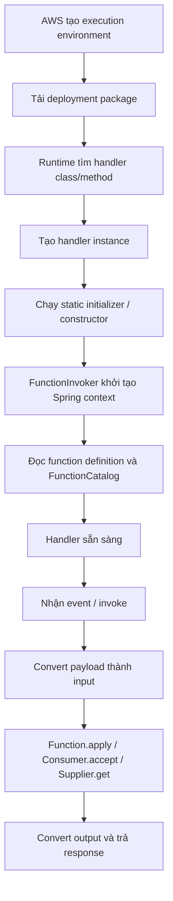

# Handler serverless không khởi tạo được lớp ứng dụng

## 1. Tình huống: Lambda báo lỗi trước khi function xử lý sự kiện

Một đội nghiệp vụ có ứng dụng Spring Boot, khai báo logic dưới dạng bean `Function<OrderRequest, OrderResult>`. Họ đóng gói ứng dụng thành JAR để triển khai lên môi trường serverless. Khi gọi thử, nền tảng báo handler không khởi tạo được lớp ứng dụng; log có thể xuất hiện các lỗi:

- `ClassNotFoundException` hoặc thông báo không tìm thấy handler.
- `NoClassDefFoundError` khi Spring bắt đầu tạo context.
- `BeanCreationException` trong lúc khởi tạo configuration hoặc một bean phụ thuộc.
- `IllegalStateException` do không tìm thấy main class hoặc function definition.
- `Task timed out` hoặc `INIT_REPORT ... Status: timeout` trước khi handler xử lý event.

Những thông báo này thường bị gọi chung là “serverless không chạy được Spring”. Nhưng chúng xuất hiện ở **những giai đoạn khác nhau**. Sửa sai tầng có thể làm cấu hình phức tạp hơn mà không giải quyết nguyên nhân.

Trong module **Spring Cloud Function** (`SPRING_CLOUD_FUNCTION`), nghiệp vụ được tổ chức bằng `Supplier<T>`, `Function<T,R>` và `Consumer<T>`, tra cứu qua `FunctionCatalog`, composition và chuyển đổi message, rồi kích hoạt bằng adapter phù hợp. Bài này tập trung vào **AWS Lambda với Spring Cloud Function AWS adapter** để chẩn đoán lỗi handler/khởi tạo ứng dụng. Các nền tảng serverless khác có handler contract, runtime và quy trình bootstrap riêng; không áp dụng nguyên cấu hình AWS cho Azure Functions, Google Cloud Functions hoặc custom runtime khác.

**Cần phân biệt hai câu hỏi:**

1. **Runtime có tìm và tạo được handler không?** Đây là bước nạp class, kiểm tra handler interface/method và tạo instance.
2. **Handler có khởi tạo được Spring ApplicationContext và tìm thấy function không?** Đây là bước bootstrap Spring, đăng ký bean, chọn function trong catalog và chuẩn bị converter.

Nếu hai bước trên thành công, một lỗi xảy ra sau đó khi đọc event hoặc gọi `apply()` là lỗi **invocation/conversion/logic**, không còn là lỗi khởi tạo lớp ứng dụng.

## 2. Mô hình các giai đoạn khởi chạy AWS Lambda

Một Java Lambda điển hình có thể được nhìn theo luồng:



Sơ đồ mô tả cách phân lớp để chẩn đoán; chi tiết thời điểm tạo instance có thể khác theo Lambda runtime và adapter. Với AWS Lambda, các hoạt động tải code, bootstrap runtime và chạy code khởi tạo thuộc **Init phase**; sau đó mới đến **Invoke phase**. Một execution environment có thể được giữ lại để xử lý các invocation tiếp theo (warm start), nên static state và bean singleton có thể tồn tại qua nhiều lần gọi.

| Giai đoạn | Công việc | Lỗi thường gặp |
| --- | --- | --- |
| **Package/deploy** | Tải đúng ZIP/JAR hoặc image. | Sai artifact, thiếu file, sai architecture. |
| **Handler resolution** | Tìm class/method được cấu hình. | Sai FQCN, handler method, class không có trong JAR. |
| **Handler construction** | Tạo instance, chạy static initializer/constructor. | Constructor lỗi, thiếu dependency, lỗi static init. |
| **Spring bootstrap** | Xác định main class, tạo và refresh context. | Sai `MAIN_CLASS`, thiếu config/bean/dependency, lỗi `@PostConstruct`. |
| **Function selection** | Tìm definition trong `FunctionCatalog`. | Sai tên function, không có bean, nhiều function không chọn rõ. |
| **Invocation** | Đọc event, chuyển đổi input, gọi function. | Payload/schema/content type sai, lỗi nghiệp vụ. |
| **Output** | Serialize result theo adapter contract. | DTO không serialize được, response không đúng định dạng trigger. |

### 2.1. Cold start khác warm invocation

**Cold start** cần tạo execution environment mới, tải code và chạy khởi tạo. **Warm invocation** thường dùng lại environment đã sẵn sàng; do đó không nhất thiết chạy lại constructor, static initializer hoặc Spring context.

Điều này có hai hệ quả chẩn đoán:

- Lỗi chỉ xuất hiện ở lần gọi đầu tiên thường liên quan Init/bootstrap, cold-start timeout hoặc kết nối phụ thuộc được mở lúc khởi động.
- Lỗi chỉ xuất hiện ở invocation thứ hai/trở đi có thể liên quan state dùng chung, connection hết hạn, thread không an toàn hoặc dữ liệu bị giữ lại giữa các lần gọi.

Không nên khởi tạo client, kết nối database hoặc đọc secret mỗi lần trong `Function.apply()` nếu có thể tái sử dụng an toàn; ngược lại, không đặt một thao tác có side effect theo từng request vào static initializer hoặc constructor handler.

## 3. `FunctionInvoker` làm gì?

Với AWS adapter, Spring Cloud Function cung cấp handler tổng quát:

```text
org.springframework.cloud.function.adapter.aws.FunctionInvoker
```

Handler này triển khai AWS `RequestStreamHandler`, nhận input/output stream và `Context`. Nó giúp tách function nghiệp vụ khỏi các chi tiết riêng của API Gateway, S3, SQS hoặc các event source khác; adapter chuyển payload sang kiểu input phù hợp rồi gọi function.

Trong triển khai hiện hành, luồng xử lý của `FunctionInvoker` có các bước chính:

1. Xác định **start class** của ứng dụng từ thông tin đóng gói/khởi động.
2. Khởi chạy Spring context theo kiểu ứng dụng được phát hiện (ví dụ ứng dụng có `ApplicationContextInitializer` hoặc ứng dụng Spring Boot thông thường).
3. Lấy `FunctionCatalog` và JSON mapper từ context.
4. Đọc `spring.cloud.function.definition` nếu handler chưa nhận sẵn function definition.
5. Lookup function trong catalog; nếu không chọn được function cụ thể, adapter có thể dùng `RoutingFunction` để định tuyến theo thông tin routing.
6. Với mỗi event, tạo message từ input stream, gọi function wrapper và serialize output.

Vì vậy, khi handler class đã tìm thấy nhưng log báo lỗi tạo Spring context, cần kiểm tra **main class, bean definitions, auto-configuration, property và dependency**. Khi context khởi động thành công nhưng báo không tìm thấy function, cần kiểm tra **function name/definition và catalog registration**.

### 3.1. Chọn đúng handler entry point

Tài liệu Spring Cloud Function AWS hiện hành hướng dẫn dùng:

```text
org.springframework.cloud.function.adapter.aws.FunctionInvoker::handleRequest
```

Một số cấu hình SAM/IaC khai báo class:

```yaml
Handler: org.springframework.cloud.function.adapter.aws.FunctionInvoker
```

`FunctionInvoker` triển khai `RequestStreamHandler`, vì vậy định dạng handler có thể được biểu diễn bằng class handler trong cấu hình runtime/IaC hoặc method reference theo giao diện mà công cụ triển khai chấp nhận. **Không tự thay bằng tên bean `uppercase` hoặc `quoteOrder`** khi chủ đích dùng generic `FunctionInvoker`; tên function được chọn qua Spring Cloud Function definition/routing.

Nếu tự viết handler thay cho `FunctionInvoker`, phải đảm bảo class có constructor và method/interface đúng theo AWS Java runtime. Một class có method `handleRequest` nhưng không triển khai handler interface và được cấu hình sai dạng method reference có thể không được runtime nhận diện.

### 3.2. Handler class và main application class là hai lớp khác nhau

| Cấu hình | Ví dụ | Trách nhiệm |
| --- | --- | --- |
| AWS Lambda handler | `org.springframework.cloud.function.adapter.aws.FunctionInvoker` | Điểm vào do Lambda gọi. |
| Spring Boot main class | `com.example.OrderFunctionApplication` | Lớp chứa cấu hình/điểm khởi động ứng dụng Spring. |
| Function bean name | `quoteOrder` | Hàm nghiệp vụ được `FunctionCatalog` tra cứu. |
| Function definition | `quoteOrder` hoặc `normalizeOrder|validateOrder` | Hàm/pipeline được chọn để invocation. |

Không dùng FQCN của `@SpringBootApplication` làm handler nếu cấu hình đang sử dụng `FunctionInvoker`. Ngược lại, đặt handler đúng nhưng không tìm được main class vẫn khiến Spring context không thể khởi tạo.

### 3.3. Đừng nhầm functional adapter với Spring Boot Web trên Lambda

Có hai cách phổ biến để chạy Spring trên AWS Lambda:

| Kiểu ứng dụng | Handler/adapter phù hợp | Mô hình gọi |
| --- | --- | --- |
| Spring Cloud Function với `Supplier`/`Function`/`Consumer` | `org.springframework.cloud.function.adapter.aws.FunctionInvoker` | Lambda event được chuyển thành input của function. |
| Spring Boot Web có nhiều `@RestController`/HTTP endpoint | AWS Serverless Java Container, ví dụ `SpringDelegatingLambdaContainerHandler` cho Spring Boot 3 | API Gateway request được chuyển thành servlet/web request. |

Nếu ứng dụng thực chất là Spring Boot Web nhưng lại cấu hình `FunctionInvoker`, adapter có thể không tìm thấy function phù hợp hoặc không phục vụ các controller như mong đợi. Ngược lại, dùng handler của Serverless Java Container cho một function app thuần có thể tạo thêm lớp web không cần thiết. Hãy chọn handler theo **mô hình ứng dụng**, không chỉ theo việc project có dùng Spring Boot.

### 3.4. Native image dùng custom runtime

Nếu package là GraalVM native executable thay vì Java JAR, Lambda cần custom runtime/bootstrap phù hợp. Trong mô hình đó, handler class Java như `FunctionInvoker` không phải entry point được JVM runtime gọi theo cách thông thường; bootstrap script khởi chạy native executable theo Lambda Runtime API. Không trộn cấu hình Java managed runtime với package native/custom runtime.

## 4. Init phase và thông báo INIT_REPORT

AWS Lambda thực hiện **Init phase** để khởi động extension, runtime và static/function initialization. Với on-demand execution environment thông thường, Init phase có giới hạn 10 giây; nếu không hoàn tất, Lambda có thể thử lại việc khởi tạo khi invocation đầu tiên đến, với giới hạn gắn với function timeout. Provisioned Concurrency, SnapStart và Lambda Managed Instances có quy tắc thời gian khác và có thể cho phép thời gian khởi tạo dài hơn.

Khi code crash hoặc timeout trong Init phase, Lambda có thể ghi `INIT_REPORT` vào CloudWatch Logs. Ví dụ:

```text
INIT_REPORT Init Duration: 1236.04 ms Phase: init Status: timeout
```

Hoặc:

```text
INIT_REPORT Init Duration: 1236.04 ms Phase: init Status: error Error Type: Extension.Crash
```

Không phải mọi lần init thành công đều có `INIT_REPORT` trong log thông thường; SnapStart/Provisioned Concurrency có thể tạo báo cáo init theo quy tắc riêng. Do đó, **không thấy `INIT_REPORT` không chứng minh Spring context đã khởi tạo đúng**.

### 4.1. Đọc log theo thời điểm

| Dấu hiệu | Hướng phân tích |
| --- | --- |
| Không có log từ ứng dụng, runtime báo không tìm thấy handler | Xác minh handler setting, package và classpath trước. |
| Log bắt đầu, sau đó stack trace `BeanCreationException` trước `START` | Lỗi Spring bootstrap trong Init. |
| `INIT_REPORT ... Status: timeout` | Khởi tạo quá thời gian; tìm thao tác chặn trong constructor, static init, context refresh. |
| Có `START`, rồi lỗi JSON/conversion | Handler đã vào invocation; kiểm tra payload và converter. |
| `START`/`END` nhưng output không đúng | Kiểm tra function definition, business logic và serialization. |
| Có `REPORT` với `Status: timeout` ở invocation | Function xử lý quá thời gian cho phép, không nhất thiết là lỗi context. |

Đối với mỗi lỗi, giữ lại **RequestId**, timestamp, function version/alias và phần đầu tiên của stack trace. Exception cuối như `Failed to load ApplicationContext` thường chỉ là lớp bao ngoài; nguyên nhân hữu ích nhất thường nằm trong `Caused by` sâu hơn.

## 5. Kiểm tra handler và deployment package

Nếu runtime chưa tạo được `FunctionInvoker`, Spring chưa có cơ hội chạy. Hãy kiểm tra cấu hình handler và JAR trước khi xem xét bean nghiệp vụ.

### 5.1. Xác minh đúng dependency AWS adapter

Project cần adapter AWS của Spring Cloud Function:

```xml
<dependency>
    <groupId>org.springframework.cloud</groupId>
    <artifactId>spring-cloud-function-adapter-aws</artifactId>
</dependency>
```

Version phải được quản lý bằng Spring Cloud BOM tương thích với Spring Boot đang dùng. Không tự chọn một version adapter khác dòng với `spring-cloud-function-context` hoặc Spring Boot chỉ để xử lý lỗi class not found.

Nếu deployment dùng `FunctionInvoker` nhưng artifact không chứa `spring-cloud-function-adapter-aws`, runtime sẽ không tìm được handler class. Một lỗi tương tự xảy ra khi cấu hình nhầm handler sang class của module Web hoặc Stream không có trong package AWS.

### 5.2. AWS Lambda cần artifact có dependency đầy đủ

Tài liệu Spring Cloud Function AWS lưu ý package dành cho Lambda thường cần một **shaded JAR** chứa code ứng dụng và các dependency runtime cần thiết. Một Spring Boot executable JAR dùng để chạy độc lập không nhất thiết là đúng artifact để upload cho AWS Lambda. Sample project có thể tạo hai JAR: một bản AWS có classifier và một bản dành cho ứng dụng Boot chạy độc lập.

Kiểm tra:

- JAR được upload đúng là artifact có classifier dành cho AWS (nếu build tạo riêng).
- Có class `org/springframework/cloud/function/adapter/aws/FunctionInvoker.class`.
- Các class Spring Boot, Spring Cloud Function và dependency runtime cần thiết đều được đóng gói.
- Không vô tình loại `spring-cloud-function-context` hoặc thư viện JSON/message converter.
- Không đưa Web/Stream adapter vào Lambda nếu không dùng; những dependency thừa có thể tăng kích thước và làm phức tạp auto-configuration.

Ví dụ kiểm tra nội dung JAR:

```bash
jar tf target/order-functions-1.0.0-aws.jar
```

Lọc những mục quan trọng (trên shell có `grep`):

```bash
jar tf target/order-functions-1.0.0-aws.jar \
  | grep -E 'FunctionInvoker.class|FunctionConfiguration.class|META-INF/MANIFEST.MF'
```

Tên artifact và tên class trong ví dụ cần thay bằng project thực tế. Nếu không thấy `FunctionInvoker.class`, kiểm tra dependency tree và đúng file được upload; không sửa function bean name để chữa lỗi này.

### 5.3. Kiểm tra metadata Spring khi shade JAR

Khi ghép nhiều dependency vào một JAR, các file metadata cùng đường dẫn có thể bị ghi đè nếu shade plugin không merge/append phù hợp. Ứng dụng Spring có thể mất thông tin auto-configuration hoặc schema dù các class vẫn còn trong archive.

Những resource cần kiểm tra theo dependency/version có thể gồm:

| Resource | Vai trò |
| --- | --- |
| `META-INF/spring.factories` | Một số cơ chế đăng ký Spring/Boot, tùy phiên bản. |
| `META-INF/spring/org.springframework.boot.autoconfigure.AutoConfiguration.imports` | Danh sách auto-configuration trong Spring Boot hiện đại. |
| `META-INF/spring.handlers` và `META-INF/spring.schemas` | Metadata hỗ trợ namespace/schema trong các thư viện có sử dụng. |
| `META-INF/spring.components` | Metadata component index khi có sử dụng. |
| `META-INF/services/*` | Java SPI/provider discovery. |
| `META-INF/MANIFEST.MF` | Manifest, gồm thông tin main/start class khi được cấu hình. |

Spring Cloud Function AWS reference cung cấp ví dụ Maven Shade transformers cho một số metadata Spring. Cấu hình chính xác tùy phiên bản Spring Boot và plugin; **không copy nguyên transformer từ một bản cũ vào project mới mà không kiểm tra**. Nếu thư viện dùng Java `ServiceLoader`, cần giữ các service provider files theo cách merge phù hợp.

### 5.4. Kiểm tra manifest và main class

Spring Cloud Function tìm main class từ manifest attribute `Start-Class` khi được Spring Boot tooling tạo. Nếu manifest không có `Start-Class`, tài liệu AWS adapter cho phép chỉ định biến môi trường hoặc system property `MAIN_CLASS`.

Kiểm tra manifest:

```bash
unzip -p target/order-functions-1.0.0-aws.jar META-INF/MANIFEST.MF
```

Tìm thông tin tương tự:

```text
Main-Class: ...
Start-Class: com.example.OrderFunctionApplication
```

Nếu không có `Start-Class`, khai báo main class đầy đủ:

```text
MAIN_CLASS=com.example.OrderFunctionApplication
```

Tên class phải tồn tại trong deployment package, đúng package/case và có cấu hình Spring hợp lệ. Biến `MAIN_CLASS` không phải tên handler AWS; nó chỉ giúp Spring Cloud Function xác định **ứng dụng Spring cần khởi chạy**.

## 6. Phân biệt lỗi handler resolution với lỗi Spring bootstrap

| Dấu hiệu | Tầng nghi ngờ | Việc kiểm tra đầu tiên |
| --- | --- | --- |
| Handler class không tìm thấy | AWS handler resolution | Handler setting, JAR có adapter, package path. |
| `NoSuchMethodException` hoặc handler method không hợp lệ | Handler contract | Method/interface đúng theo AWS runtime, phiên bản aws-lambda-java-core. |
| `NoClassDefFoundError` cho class Spring/adapter | Deployment dependency | Shaded JAR, dependency scope, version conflict. |
| Không tìm thấy start/main class | Spring bootstrap entry point | Manifest `Start-Class` hoặc `MAIN_CLASS`. |
| `BeanDefinitionStoreException` | Đọc configuration/metadata | Resource Spring bị mất khi shade, cấu hình sai. |
| `BeanCreationException` | Tạo bean | Xem root cause, property, constructor, init callback, network/secret. |
| `NoSuchBeanDefinitionException` | Dependency injection | Component scan, configuration import, profile/condition, bean type. |
| `FunctionCatalog` lookup không tìm thấy tên | Function selection | Bean functional có được đăng ký và definition có đúng không. |
| Function tìm được nhưng lỗi convert event | Invocation | Event shape, generic signature, content type, converter. |

**Đừng coi mọi `NoClassDefFoundError` là thiếu handler.** Đọc chính xác class name trong exception. Thiếu `FunctionInvoker` là lỗi adapter/package; thiếu một JDBC driver hoặc class của application thường là lỗi dependency trong bootstrap; thiếu DTO ở bước deserialize có thể chỉ xảy ra khi invocation.

### 6.1. Đọc Caused by theo thứ tự từ ngoài vào trong

Ví dụ:

```text
Runtime.InitError: Error loading class ...
  caused by: org.springframework.beans.factory.BeanCreationException
    caused by: java.lang.IllegalStateException: Missing SHIPPING_API_URL
```

Lỗi ngoài cùng mô tả handler không khởi tạo được; root cause chỉ ra property còn thiếu. Hướng xử lý đúng là cấp property/secret hoặc điều chỉnh bean để xử lý cấu hình thiếu có chủ đích, không phải đổi handler class.

## 7. Lỗi xác định main class và khởi tạo ApplicationContext

`FunctionInvoker` cần xác định class khởi động ứng dụng rồi mới tạo Spring context. Nếu JAR không có manifest phù hợp, hoặc main class không nằm trong package, context sẽ không thể được khởi tạo.

### 7.1. Kiểm tra Start-Class và MAIN_CLASS

Checklist:

1. Tìm class có `@SpringBootApplication` hoặc class cấu hình/initializer mà ứng dụng dùng để bootstrap.
2. Xác nhận class đó được compile vào đúng artifact AWS.
3. Kiểm tra manifest có `Start-Class` và giá trị là FQCN chính xác.
4. Nếu manifest không có, đặt `MAIN_CLASS` trong cấu hình Lambda.
5. Không đặt `MAIN_CLASS` bằng `org.springframework.cloud.function.adapter.aws.FunctionInvoker`; đó là handler, không phải source application.

Một class nguồn minh họa:

```java
package com.example.orders;

import org.springframework.boot.SpringApplication;
import org.springframework.boot.autoconfigure.SpringBootApplication;

@SpringBootApplication
public class OrderFunctionApplication {
    public static void main(String[] args) {
        SpringApplication.run(OrderFunctionApplication.class, args);
    }
}
```

Trong ứng dụng AWS dùng `FunctionInvoker`, Lambda runtime gọi handler adapter; `main()` không phải method Lambda handler. `OrderFunctionApplication` cung cấp nguồn configuration cho Spring. Không cần gọi `main()` trực tiếp từ handler setting.

### 7.2. Profile, property và environment variable

Một bean có thể cần cấu hình khi context refresh:

```java
@Bean
ShippingClient shippingClient(
        @Value("${shipping.api-url}") String apiUrl) {
    return new ShippingClient(apiUrl);
}
```

Nếu property `shipping.api-url` không có, context có thể thất bại ngay trong Init. Khi chạy local, property có thể đến từ `application.yml` hoặc biến môi trường của máy phát triển; trong Lambda, environment variables phải được khai báo ở function configuration hoặc IaC.

Với Spring Boot relaxed binding, property:

```properties
spring.cloud.function.definition=quoteOrder
```

có thể được biểu diễn trong AWS Lambda environment variables theo dạng:

```text
spring_cloud_function_definition=quoteOrder
```

AWS không cho tên environment variable chứa dấu chấm; Spring Boot hỗ trợ cách ánh xạ tên qua dấu gạch dưới. Dùng đúng tên và giá trị trong cấu hình triển khai. Không nhầm property chọn function với biến `MAIN_CLASS`.

### 7.3. Secret và kết nối ngoài trong startup

Một bean mở kết nối database hoặc gọi API trong constructor/`@PostConstruct` có thể làm toàn bộ context fail nếu:

- Secret chưa được cấp cho execution role hoặc biến môi trường chưa tồn tại.
- VPC/subnet/security group không cho phép truy cập database/API.
- DNS, TLS certificate, proxy hoặc endpoint chưa sẵn sàng.
- Connection timeout dài hơn giới hạn Init phase.
- Service bên ngoài tạm thời lỗi khi Lambda tạo execution environment.

Hãy lấy root cause từ stack trace, kiểm tra quyền IAM và network path, rồi quyết định có nên kết nối eager lúc khởi tạo hay lazy theo invocation. Không log giá trị secret để chẩn đoán.

### 7.4. Tránh đưa web server không cần thiết vào Lambda adapter

`FunctionInvoker` khởi động ứng dụng theo kiểu non-web và tắt Web export của Spring Cloud Function trong quá trình bootstrap. Lambda gọi handler theo event stream; nó không cần một HTTP server lắng nghe port như ứng dụng Boot Web độc lập.

Nếu package chứa các adapter Web/Stream không dùng, hãy xem xét loại chúng khỏi artifact AWS theo hướng dẫn build của release. Không loại dependency mà function thực sự cần; hãy kiểm tra dependency tree và JAR cuối sau khi thay đổi.

## 8. Function bean có trong JAR nhưng FunctionInvoker không chọn được

Sau khi Spring context khởi tạo thành công, `FunctionInvoker` cần một function definition để gọi. Nếu ứng dụng chỉ có một function, framework có thể tìm một mặc định. Nhưng nếu có nhiều bean `Supplier`/`Function`/`Consumer`, không nên dựa vào thứ tự lựa chọn ngầm.

Ví dụ ứng dụng có:

```java
@Configuration(proxyBeanMethods = false)
class OrderFunctions {
    @Bean
    Function<OrderRequest, OrderResult> quoteOrder() {
        return request -> new OrderResult(request.orderId(), "QUOTED");
    }

    @Bean
    Function<OrderRequest, OrderResult> cancelOrder() {
        return request -> new OrderResult(request.orderId(), "CANCELLED");
    }
}
```

Đây là ví dụ minh họa; trong ứng dụng thực tế cần có các record `OrderRequest` và `OrderResult`. Nếu có nhiều function, cấu hình Lambda nên chọn rõ hàm sẽ được gọi.

### 8.1. Chọn function bằng environment variable

Property Spring:

```properties
spring.cloud.function.definition=quoteOrder
```

Trong AWS Lambda, có thể khai báo environment variable theo cách Spring Boot relaxed binding:

```yaml
Environment:
  Variables:
    spring_cloud_function_definition: quoteOrder
```

Ví dụ này phù hợp khi dùng một artifact chứa nhiều function nhưng triển khai thành **hai Lambda riêng**:

| Lambda | Tên biến môi trường |
| --- | --- |
| QuoteOrderFunction | spring_cloud_function_definition=quoteOrder |
| CancelOrderFunction | spring_cloud_function_definition=cancelOrder |

Hai Lambda có thể dùng cùng JAR, nhưng có cấu hình quyền IAM, timeout, memory, concurrency và event source riêng. Đây thường là lựa chọn rõ ràng khi hai thao tác có quyền truy cập hoặc tải khác nhau.

### 8.2. Không dựa vào default routing khi có nhiều function

Nếu không khai báo definition, Spring Cloud Function có cơ chế tìm function mặc định; tài liệu AWS mô tả thứ tự tìm `Function` trước, rồi `Consumer`, cuối cùng `Supplier`. Với nhiều function, `FunctionInvoker` có thể dùng `RoutingFunction` và chờ routing instruction từ message header hoặc routing expression.

Điều đó có nghĩa:

- Context có thể khởi tạo thành công nhưng function được chọn không phải hàm nghiệp vụ mà bạn mong đợi.
- Tên bean trong `FunctionCatalog` không nhất thiết là tên handler AWS.
- Một function duy nhất có thể được chọn mặc định, nhưng khi thêm bean mới thì hành vi mặc định có thể thay đổi.
- Composition như `normalizeOrder|validateOrder` cần đúng tên, thứ tự và kiểu input/output tương thích.

**Khuyến nghị:** với Lambda production, khai báo `spring_cloud_function_definition` rõ ràng cho từng deployment. Nếu cố ý dùng một Lambda để route nhiều function, hãy thiết kế routing callback/header, giới hạn danh sách function được phép và kiểm thử các event thực tế.

### 8.3. Một Lambda xử lý nhiều function

Nếu muốn một Lambda duy nhất gọi nhiều function theo event, có thể dùng routing dựa trên message headers hoặc `MessagingRoutingCallback`. Khi đó, route phải đến từ nguồn đáng tin cậy và được kiểm soát; không cho event bên ngoài chọn tùy ý mọi tên function nội bộ, nhất là những `Consumer` có side effect.

Ví dụ minh họa định nghĩa routing tĩnh:

```yaml
spring:
  cloud:
    function:
      definition: quoteOrder
```

Đây là lựa chọn tĩnh cho một deployment. Nếu cần chọn động theo event, dùng cơ chế routing được Spring Cloud Function hỗ trợ trong release đang dùng; không giả định chỉ thêm field `functionName` vào JSON là tự động kích hoạt routing.

### 8.4. Trì hoãn khởi tạo FunctionInvoker

Trong các phiên bản adapter có hỗ trợ, biến môi trường:

```text
FUNCTION_INVOKER_LATE_INITIALIZATION=true
```

có thể yêu cầu `FunctionInvoker` trì hoãn việc tạo Spring context đến lần request đầu tiên thay vì khởi tạo trong constructor handler. Đây là cách thay đổi **thời điểm** bootstrap:

- Có thể giúp runtime hoàn tất phần handler initialization trước.
- Chi phí khởi tạo chuyển sang invocation đầu tiên, nên request đầu có thể chậm hơn.
- Lỗi bean, dependency hoặc function definition vẫn còn; nó chỉ xuất hiện muộn hơn.
- Timeout của invocation đầu tiên vẫn có thể bị vượt quá.

Chỉ dùng khi version adapter hỗ trợ và có lý do rõ ràng. Không dùng cờ này để che một context khởi tạo quá lâu hoặc một dependency đang lỗi.

## 9. Phân biệt lỗi khởi tạo với lỗi chuyển đổi event

`FunctionInvoker` đọc raw input stream rồi dựa trên kiểu input mà function khai báo để chuyển đổi payload. Ví dụ:

```java
@Bean
Function<OrderRequest, OrderResult> quoteOrder() {
    return request -> new OrderResult(request.orderId(), "QUOTED");
}
```

Với signature có kiểu cụ thể, adapter cố gắng chuyển đổi input stream thành `OrderRequest`. Nếu không xác định được generic type (ví dụ `Function<?, ?>`), Spring Cloud Function có thể chuyển payload thành một `Map` tổng quát. Nếu function nhận `InputStream`, adapter có thể chuyển raw stream trực tiếp mà không thực hiện chuyển đổi.

Vì vậy, cần tách:

| Triệu chứng | Thời điểm | Nguyên nhân có thể |
| --- | --- | --- |
| Không tạo được Spring context | Init | Handler, main class, bean, dependency hoặc property. |
| Function definition không tồn tại | Init/Function selection | Sai tên bean, thiếu functional bean hoặc catalog registration. |
| JSON không deserialize thành DTO | Invoke | Payload shape, field/type, converter, content type. |
| Function nhận Map thay vì DTO | Invoke | Generic signature không được xác định hoặc function khai báo kiểu quá rộng. |
| Function chạy nhưng lỗi NullPointerException | Invoke | Dữ liệu event thiếu field hoặc logic không validate input. |
| Output không serialize được | Invoke/output | DTO, type không serialize được hoặc response không đúng contract. |

### 9.1. API Gateway event không phải lúc nào cũng là business JSON trực tiếp

Khi Lambda được gọi qua API Gateway proxy integration, payload có thể là một envelope gồm path, headers, query parameters, body và metadata khác. Function cần nhận kiểu AWS event tương ứng hoặc cấu hình/adapter chuyển body theo contract mong muốn.

Nếu function khai báo `Function<OrderRequest, OrderResult>` nhưng event thực tế là một API Gateway proxy event, converter không thể tự đoán rằng phải lấy riêng trường `body` rồi parse thành `OrderRequest` trong mọi trường hợp. Kiểm tra event mẫu và chọn một trong các cách:

- Nhận AWS event type tương ứng rồi tự lấy/validate body.
- Dùng một integration contract gửi JSON business object trực tiếp khi adapter/trigger hỗ trợ.
- Nhận `InputStream` hoặc `Map` nếu thật sự cần xử lý payload thô, nhưng tự chịu trách nhiệm schema validation.

### 9.2. Sự kiện S3, SQS và Kinesis có envelope riêng

Một function xử lý S3 event có thể khai báo kiểu `S3Event`; function xử lý SQS có thể dùng `SQSEvent` hoặc kiểu batch response tương ứng. Không nên deserialize các event đó vào DTO đơn hàng chỉ vì DTO là input của function nghiệp vụ khác.

Ví dụ:

```java
@Bean
Function<S3Event, String> processUpload() {
    return event -> {
        // Kiểm tra bucket/key và xử lý nghiệp vụ tại đây.
        return "received";
    };
}
```

Các AWS event types cần dependency phù hợp và version tương thích. Nếu function không cần chi tiết AWS, hãy cân nhắc chuyển event sang một command/domain object tại boundary để lõi nghiệp vụ ít phụ thuộc adapter hơn.

## 10. Bảng lỗi thường gặp và cách xử lý

| Thông báo/dấu hiệu | Tầng | Nguyên nhân hay gặp | Cách xử lý |
| --- | --- | --- | --- |
| Handler class not found | Handler resolution | Sai tên handler hoặc thiếu AWS adapter trong JAR. | Dùng đúng FunctionInvoker, kiểm tra JAR và cấu hình handler. |
| NoClassDefFoundError cho FunctionInvoker | Packaging | Artifact upload thiếu spring-cloud-function-adapter-aws. | Build đúng classifier/shaded JAR. |
| NoClassDefFoundError cho class Spring/Jackson | Dependency | Dependency bị loại, scope sai hoặc shade không đúng. | Kiểm tra dependency tree và nội dung JAR. |
| ClassNotFoundException cho main class | Spring bootstrap | Manifest không có Start-Class hoặc MAIN_CLASS sai. | Xác minh FQCN và manifest. |
| BeanCreationException | Context refresh | Bean init, property, secret, network hoặc dependency lỗi. | Đọc root cause, kiểm tra config/IAM/VPC. |
| NoSuchBeanDefinitionException | Dependency injection | Component scan/import/profile/condition không tạo bean cần thiết. | Kiểm tra package, @Configuration, @Profile, condition. |
| FunctionCatalog không tìm thấy function | Function selection | Definition sai hoặc function chưa đăng ký. | Đặt spring_cloud_function_definition đúng. |
| Function tìm được nhưng lỗi convert event | Invocation | Event shape, generic signature, content type, converter. | Kiểm tra event mẫu và input contract. |
| INIT_REPORT ... timeout | Init | Context startup quá lâu hoặc kết nối ngoài bị chặn. | Đo từng init callback, tăng memory/timeout hợp lý, giảm I/O eager. |
| REPORT ... Status: timeout | Invoke | Logic nghiệp vụ hoặc downstream call quá lâu. | Đo invocation, timeout client, tối ưu xử lý. |
| Local test chạy, Lambda fail | Runtime/package/config | Java runtime, architecture, environment, IAM, VPC hoặc artifact khác. | Tái tạo package và runtime gần production, kiểm tra log Lambda. |

Không thay đổi đồng thời handler, main class, JAR classifier và function definition. Mỗi lần chỉ đổi một nhóm cấu hình để biết lỗi đã chuyển tầng nào.

## 11. Quy trình chẩn đoán từng bước

Khi nhận ticket “serverless handler không khởi tạo được ứng dụng”, hãy đi theo thứ tự sau. Mỗi bước cần một bằng chứng cụ thể trước khi chuyển sang bước kế tiếp.

### Bước 1 — Ghi nhận runtime và handler setting

Thu thập:

- Provider/runtime (ví dụ AWS Lambda Java 21), architecture (x86_64/arm64), memory, timeout.
- Giá trị handler trong Lambda configuration hoặc IaC.
- Function version/alias đang được invoke.
- Loại package: shaded JAR, ZIP có dependency, container image hay custom runtime.
- Thời điểm lỗi: Init, Restore (nếu dùng SnapStart), hay Invoke.

So sánh handler cấu hình với artifact thực tế. Với Spring Cloud Function AWS adapter, kiểm tra `FunctionInvoker`; nếu dùng handler tự viết, xác minh class/interface/method theo AWS Java runtime.

### Bước 2 — Kiểm tra artifact đã upload

1. Build lại từ đúng commit/profile.
2. Xác định đường dẫn và checksum của JAR/ZIP được tạo.
3. Dùng `jar tf` để kiểm tra class handler, main class và function implementation.
4. Kiểm tra manifest `Start-Class`.
5. Xác nhận các metadata Spring cần thiết không bị ghi đè khi shade.
6. So sánh artifact local với artifact được IaC/CI upload.

Không chỉ nhìn tên file trong console. Hai JAR cùng tên nhưng được build ở hai pipeline/profile khác nhau có thể có nội dung khác nhau.

### Bước 3 — Kiểm tra main class và Spring bootstrap

Nếu handler resolution đã thành công:

- Tìm exception đầu tiên trong log Init.
- Đọc toàn bộ chuỗi `Caused by` đến nguyên nhân sâu nhất.
- Kiểm tra `Start-Class` hoặc `MAIN_CLASS`.
- Kiểm tra profile, property, secret, IAM role và network access.
- Kiểm tra bean có kết nối ngoài hoặc thực hiện I/O trong constructor/`@PostConstruct` không.

Nếu context không refresh được, function catalog chưa phải nơi cần sửa đầu tiên.

### Bước 4 — Kiểm tra function registration và definition

Khi Spring context đã khởi tạo:

- Liệt kê các function bean được đăng ký trong source context.
- Đối chiếu tên bean với `spring.cloud.function.definition`.
- Nếu có nhiều function, chọn rõ definition cho Lambda.
- Nếu dùng composition, xác nhận tên từng bước và kiểu output/input tương thích.
- Kiểm tra log `FunctionInvoker` về function đang được locate và kết quả lookup.

Đừng dùng tên class FQCN thay cho tên function bean, hoặc tên handler AWS thay cho definition.

### Bước 5 — Kiểm tra event conversion và invocation

Nếu handler và function selection đều thành công:

1. Lưu event mẫu đã được loại bỏ dữ liệu nhạy cảm.
2. Xác nhận event có đúng shape của trigger (API Gateway, S3, SQS, Kinesis, EventBridge...).
3. Đối chiếu generic input type của function.
4. Kiểm tra JSON field, enum, date/time, number và null.
5. Gọi function bằng một input đơn giản có thể kiểm chứng.
6. Kiểm tra output serialization và response contract.

Lỗi ở bước này không nên được sửa bằng cách đổi main class hoặc handler.

### Bước 6 — Kiểm tra giới hạn tài nguyên và phụ thuộc ngoài

Nếu Init timeout hoặc invocation timeout:

- Đo thời gian tạo context và từng init callback.
- Đo DNS, TLS handshake, database pool, HTTP client và secret lookup.
- Kiểm tra memory/CPU allocation của Lambda; trong Lambda, tăng memory cũng có thể tăng CPU được cấp.
- Phân biệt thời gian Init với thời gian xử lý event.
- Xác minh timeout của client nhỏ hơn timeout tổng của Lambda và có giới hạn retry hợp lý.

Nếu dùng VPC, kiểm tra route, subnet, security group, NAT/endpoint và DNS. Một Spring context có thể fail khi bean eager-connect tới dịch vụ không truy cập được.

## 12. Tái tạo lỗi ở local và kiểm thử theo tầng

### 12.1. Unit test function không cần AWS

Giữ logic nghiệp vụ tách khỏi handler:

```java
package com.example.orders;

import java.util.function.Function;
import org.junit.jupiter.api.Test;

import static org.junit.jupiter.api.Assertions.assertEquals;

final class QuoteOrderFunction implements Function<OrderRequest, OrderResult> {
    @Override
    public OrderResult apply(OrderRequest request) {
        return new OrderResult(request.orderId(), "QUOTED");
    }
}

class QuoteOrderFunctionTest {
    private final Function<OrderRequest, OrderResult> quoteOrder =
            new QuoteOrderFunction();

    @Test
    void quotesOrder() {
        OrderResult result = quoteOrder.apply(
                new OrderRequest("ORD-204"));
        assertEquals("ORD-204", result.orderId());
        assertEquals("QUOTED", result.status());
    }
}
```

Đây là test minh họa; project cần có record `OrderRequest` và `OrderResult` đúng với contract thực. Unit test chứng minh logic, **không** chứng minh handler class, manifest hoặc Spring context được đóng gói đúng.

### 12.2. Context test xác minh FunctionCatalog

Một test Spring Boot có thể xác minh bean được đăng ký trong ứng dụng nguồn:

```java
package com.example.orders;

import java.util.function.Function;

import org.junit.jupiter.api.Test;
import org.springframework.beans.factory.annotation.Autowired;
import org.springframework.boot.test.context.SpringBootTest;
import org.springframework.cloud.function.context.FunctionCatalog;

import static org.junit.jupiter.api.Assertions.assertNotNull;

@SpringBootTest
class FunctionCatalogSmokeTest {
    @Autowired
    FunctionCatalog catalog;

    @Test
    void findsQuoteOrder() {
        Function<OrderRequest, OrderResult> function =
                catalog.lookup("quoteOrder");
        assertNotNull(function);
        OrderResult result =
                function.apply(new OrderRequest("ORD-204"));
        assertNotNull(result);
    }
}
```

Test này kiểm tra **Spring context của ứng dụng nguồn**. Nó chưa kiểm tra `FunctionInvoker`, AWS handler setting, shaded JAR hoặc environment variables được AWS cấp. Hãy giữ riêng một integration test cho package đã build.

### 12.3. Kiểm tra JAR đã build

Ví dụ lệnh:

```bash
mvn clean package
jar tf target/order-functions-1.0.0-aws.jar
unzip -p target/order-functions-1.0.0-aws.jar META-INF/MANIFEST.MF
```

Đổi `order-functions-1.0.0-aws.jar` theo output thật của project. Nếu dùng Gradle, kiểm tra task tạo shaded artifact và classifier tương ứng. Nếu CI tạo nhiều file JAR, phải bảo đảm IaC trỏ tới **đúng AWS artifact**, không phải Boot JAR dành cho chạy standalone.

### 12.4. Dùng AWS SAM local khi dự án hỗ trợ

Với project có AWS SAM template và SAM CLI, có thể mô phỏng invocation:

```bash
sam local invoke QuoteOrderFunction --event events/order.json
```

Lệnh cần thay logical resource name và event file theo template. Local container giúp phát hiện nhiều lỗi packaging, handler và event conversion, nhưng không tái tạo hoàn toàn IAM, VPC, DNS, secrets, timeout và runtime behavior của AWS production. Vẫn phải kiểm thử trong môi trường AWS tương ứng.

### 12.5. Gọi function đã deploy

Sau khi package và cấu hình đã được xác minh, có thể gọi function qua AWS CLI:

```bash
aws lambda invoke \
  --function-name quote-order \
  --cli-binary-format raw-in-base64-out \
  --payload fileb://events/order.json \
  response.json
```

Lệnh trên giả định AWS CLI v2, quyền invoke hợp lệ và event JSON phù hợp. Kiểm tra cả response file và CloudWatch Logs; invocation thành công về mặt transport chưa chắc business result đúng.

## 13. Cấu hình khởi tạo trễ và tối ưu cold start

Không nên tối ưu cold start trước khi biết context đang fail vì nguyên nhân gì. Khi đã sửa lỗi chức năng, mới đo thời gian và tối ưu từng phần.

### 13.1. FUNCTION_INVOKER_LATE_INITIALIZATION

Ở những release AWS adapter hỗ trợ, `FUNCTION_INVOKER_LATE_INITIALIZATION` có thể trì hoãn việc `FunctionInvoker` khởi tạo Spring context đến request đầu tiên. Cách này có thể hữu ích khi muốn thay đổi cách phân bổ thời gian Init, nhưng không loại bỏ công việc bootstrap.

Kiểm tra:

- Invocation đầu có đủ timeout để khởi tạo context và xử lý event không?
- Lambda có lặp lại lỗi ở lần đầu không?
- Cold-start latency có chấp nhận được không?
- Lỗi gốc là thời gian startup hay một bean không thể tạo?

Nếu context lỗi do thiếu property hoặc dependency, trì hoãn chỉ làm lỗi xuất hiện ở invocation đầu tiên.

### 13.2. Giảm công việc trong giai đoạn khởi tạo

Các biện pháp có thể xem xét sau khi đã đo:

- Dùng functional bean registration (`ApplicationContextInitializer`/`GenericApplicationContext.registerBean`) nếu phù hợp để giảm công việc component scanning/bean creation.
- Không tạo connection pool lớn hoặc gọi nhiều API ngoài trong constructor nếu không cần thiết.
- Khởi tạo client dùng chung một lần khi an toàn, đặt timeout kết nối rõ ràng.
- Tránh chạy migration, preload dữ liệu lớn hoặc tác vụ đồng bộ dài trong `@PostConstruct`.
- Chỉ giữ dependency thực sự cần trong AWS JAR; bỏ adapter Web/Stream không sử dụng.
- Đo mức memory của Lambda; cấu hình memory cao hơn có thể cải thiện tốc độ CPU nhưng cũng thay đổi chi phí.

Không chuyển một thao tác bắt buộc phải hoàn tất trước khi xử lý event sang async fire-and-forget chỉ để làm Init nhanh hơn. Điều đó có thể khiến function nhận event trước khi dependency sẵn sàng.

### 13.3. SnapStart và Provisioned Concurrency

AWS Lambda có các cơ chế giảm cold-start như SnapStart hoặc Provisioned Concurrency, tùy runtime/region và giới hạn hỗ trợ. Chúng có thể thay đổi thời điểm tạo execution environment và cách snapshot/khởi tạo được thực hiện.

Nếu dùng SnapStart, cần kiểm tra các resource được tạo trong Init có an toàn khi restore từ snapshot không; connection, credential, random state và thread không phải lúc nào cũng nên giữ nguyên qua snapshot. Đọc hướng dẫn runtime hooks và kiểm thử sau restore. Các cơ chế này **không sửa lỗi handler class, main class, bean creation hoặc function definition**.

## 14. Các sai lầm thường gặp khi xử lý lỗi

| Cách làm dễ gây sai | Vì sao không giải quyết gốc | Cách làm phù hợp |
| --- | --- | --- |
| Đổi handler sang tên function bean | Handler là entry point của runtime; bean name là function selection. | Dùng FunctionInvoker và cấu hình definition riêng. |
| Đổi MAIN_CLASS thành FunctionInvoker | MAIN_CLASS là ứng dụng Spring cần bootstrap. | Trỏ tới class cấu hình/main của ứng dụng. |
| Upload Boot JAR bất kỳ | AWS adapter có yêu cầu package/layout; Boot standalone JAR có thể không phải artifact Lambda. | Tạo và upload đúng shaded AWS JAR theo sample/build profile. |
| Bật bean overriding | Có thể che xung đột bean name và làm function được chọn sai. | Sửa configuration/bean names và kiểm tra catalog. |
| Bỏ dependency để giảm kích thước một cách mù quáng | Có thể làm thiếu adapter, converter hoặc auto-configuration. | Dùng dependency tree và kiểm tra JAR sau build. |
| Tăng timeout để che kết nối bị treo | Vấn đề network/retry vẫn còn và startup có thể chậm hơn. | Đo root cause, đặt timeout cho từng client, kiểm tra VPC/IAM. |
| Dùng late initialization để bỏ qua startup error | Lỗi chỉ chuyển sang invocation đầu tiên. | Sửa nguyên nhân bean/context trước, sau đó mới tối ưu timing. |
| Dựa vào local Spring test thành công | Test không kiểm tra handler setting, JAR shade hoặc Lambda runtime. | Bổ sung package test và SAM/AWS integration test. |
| Gửi event khác schema rồi sửa Spring bean | Lỗi có thể nằm ở API Gateway/SQS envelope hoặc JSON. | Lưu event thực, kiểm tra type conversion và contract. |

## 15. Quy trình khắc phục mẫu: từ lỗi init đến invocation thành công

Giả sử CloudWatch ghi `INIT_REPORT ... Status: error` và stack trace cho thấy không tìm được main class:

1. Kiểm tra handler AWS đang trỏ tới `org.springframework.cloud.function.adapter.aws.FunctionInvoker`.
2. Tải đúng AWS shaded JAR từ pipeline và xác minh class `FunctionInvoker` có trong archive.
3. Đọc manifest; nếu thiếu `Start-Class`, xác định FQCN của ứng dụng Spring.
4. Đặt `MAIN_CLASS` đúng trong Lambda environment configuration, hoặc sửa build để manifest chứa `Start-Class`.
5. Deploy lại đúng artifact và kiểm tra log Init.
6. Khi context refresh thành công, xác minh function bean có tên chính xác.
7. Nếu có nhiều function, đặt `spring_cloud_function_definition` cho function được chọn.
8. Gửi một event mẫu đúng contract; kiểm tra conversion và output.
9. Thử lại với event từ trigger thật (API Gateway, S3, SQS...) trong môi trường test.
10. Theo dõi Init Duration, invocation duration, error rate và memory sau khi sửa.

Nếu root cause thực tế là `BeanCreationException` do secret hoặc database, hãy thay bước 3–4 bằng việc kiểm tra property/IAM/VPC/client timeout. Quy trình phải bắt đầu từ **root cause thật trong log**, không sao chép một checklist cố định cho mọi exception.

## 16. Ví dụ cấu hình Lambda tối thiểu

Một cấu hình SAM minh họa cho ứng dụng có hai function bean:

```yaml
AWSTemplateFormatVersion: '2010-09-09'
Transform: AWS::Serverless-2016-10-31

Resources:
  QuoteOrderFunction:
    Type: AWS::Serverless::Function
    Properties:
      Runtime: java21
      Handler: org.springframework.cloud.function.adapter.aws.FunctionInvoker
      CodeUri: target/order-functions-1.0.0-aws.jar
      MemorySize: 1024
      Timeout: 30
      Environment:
        Variables:
          spring_cloud_function_definition: quoteOrder
```

Đây là **mẫu rút gọn**; role/IAM, event source, architecture, VPC, tracing và các thuộc tính triển khai khác tùy hệ thống. Runtime Java phải phù hợp với bytecode và dependency mà project build ra. Không lấy nguyên tên artifact/handler từ ví dụ nếu POM của bạn tạo file khác.

### 16.1. Đối chiếu cấu hình và artifact

| Giá trị cấu hình | Phải khớp với |
| --- | --- |
| Runtime | Java runtime được AWS hỗ trợ và tương thích với bytecode/dependency. |
| Handler | FunctionInvoker hoặc handler class tự viết đúng contract. |
| CodeUri | Đúng AWS shaded JAR/ZIP được build. |
| spring_cloud_function_definition | Tên function bean/definition đã đăng ký trong catalog. |
| Timeout | Thời gian tối đa cho Init/Invoke theo quy tắc runtime và function. |
| MemorySize | Mức memory đủ cho Spring context, dependency và event workload. |

### 16.2. Nếu manifest không có Start-Class

Có thể cấu hình thêm:

```yaml
Environment:
  Variables:
    MAIN_CLASS: com.example.orders.OrderFunctionApplication
    spring_cloud_function_definition: quoteOrder
```

Không thêm `MAIN_CLASS` nếu manifest đã xác định đúng start class, trừ khi có lý do cần override rõ ràng. Hai nguồn cấu hình mâu thuẫn có thể khiến việc chẩn đoán khó hơn.

## 17. Quyết định lỗi thuộc Init hay Invoke

Sử dụng cây quyết định sau khi đọc CloudWatch Logs:

```text
Lambda báo lỗi
   |
   v
Runtime có tìm được handler class?
   |
   +-- Không --> Handler setting / AWS adapter / artifact / classpath
   |
   v
Handler instance có được tạo?
   |
   +-- Không --> Constructor / static initializer / dependency
   |
   v
Spring context có refresh thành công?
   |
   +-- Không --> MAIN_CLASS / config / bean / secret / network / timeout
   |
   v
FunctionCatalog có function definition?
   |
   +-- Không --> Bean registration / spring.cloud.function.definition
   |
   v
Function có nhận được input đúng kiểu?
   |
   +-- Không --> Event envelope / JSON / converter / generic signature
   |
   v
Function chạy và serialize output thành công?
   |
   +-- Không --> Business exception / downstream / output converter
   |
   v
Invocation hoàn tất
```

Cây này giúp phân loại ban đầu; một số lỗi có thể chồng lấn (ví dụ lazy bean chỉ khởi tạo ở invocation đầu). Hãy dùng stack trace và log thực tế để xác định **thời điểm đầu tiên thất bại**, không chỉ dòng thông báo cuối.

## 18. An toàn khi khởi tạo và vận hành function

### 18.1. Không thực hiện side effect không cần thiết trong constructor

Constructor/static initializer chạy trước khi function nhận event. Tránh:

- Gửi email/message hoặc tạo đơn hàng trong init.
- Chạy tác vụ migration hoặc preload dữ liệu lớn mà không có timeout.
- Tạo thread nền nhưng không có lifecycle/cleanup rõ.
- Gọi API bên ngoài không có connect/read timeout.
- Log secret, token hoặc toàn bộ event có dữ liệu cá nhân.

Các thao tác có thể lặp lại khi Lambda tạo execution environment mới. Thiết kế init nên idempotent và có thể retry an toàn.

### 18.2. Warm environment không phải nơi lưu trạng thái nghiệp vụ bền vững

Lambda có thể tái sử dụng execution environment, nhưng không bảo đảm một instance sẽ tồn tại giữa mọi invocation. Không lưu trạng thái đơn hàng, idempotency key hoặc workflow quan trọng chỉ trong static field/singleton bean. Dùng database, durable store hoặc cơ chế idempotency phù hợp.

### 18.3. Quyền tối thiểu và routing

Nếu dùng cùng một JAR cho nhiều Lambda, không có nghĩa chúng phải có cùng quyền. Ví dụ function đọc S3 và function ghi DynamoDB có thể cần IAM policies khác nhau. Tách Lambda theo function definition giúp cấu hình quyền và event source rõ ràng hơn.

Nếu một Lambda dùng routing động, chỉ cho phép những function được phê duyệt. Không để client/event tùy ý truyền tên function hoặc routing expression có thể kích hoạt `Consumer` nội bộ ngoài dự kiến.

## 19. Tài liệu tham khảo và giới hạn áp dụng

Đối chiếu đúng phiên bản Spring Cloud Function, Spring Boot và AWS runtime đang sử dụng:

- [Spring Cloud Function — AWS Lambda adapter](https://docs.spring.io/spring-cloud-function/reference/adapters/aws-intro.html): handler FunctionInvoker, routing, type conversion, JAR layout, Start-Class/MAIN_CLASS, late initialization và deployment.
- [Spring Cloud Function — FunctionInvoker source](https://github.com/spring-cloud/spring-cloud-function/blob/main/spring-cloud-function-adapters/spring-cloud-function-adapter-aws/src/main/java/org/springframework/cloud/function/adapter/aws/FunctionInvoker.java): luồng start context, function lookup và biến FUNCTION_INVOKER_LATE_INITIALIZATION trong source hiện hành.
- [AWS Lambda — Java handler](https://docs.aws.amazon.com/lambda/latest/dg/java-handler.html): handler interface/method, class initialization và cách runtime gọi Java handler.
- [AWS Lambda — Execution environment lifecycle](https://docs.aws.amazon.com/lambda/latest/dg/lambda-runtime-environment.html): Init, Invoke, Shutdown, INIT_REPORT và lỗi trong Init phase.

Các biến môi trường, handler format và plugin build có thể thay đổi theo release. Một custom runtime, container image hoặc adapter serverless khác có entry point riêng; hãy đọc hướng dẫn của adapter đó thay vì mặc định dùng cấu hình AWS Java Lambda.

## 20. Kết luận

**Handler serverless không khởi tạo được lớp ứng dụng cần được chẩn đoán theo từng giai đoạn: handler resolution → handler construction → Spring bootstrap → function selection → event conversion → invocation.** Với AWS Lambda, FunctionInvoker là handler tổng quát của Spring Cloud Function; nó xác định start class, tạo Spring context, lấy FunctionCatalog và gọi function đã chọn. Một lỗi ở handler/package khác hoàn toàn với lỗi bean creation, function definition hoặc payload conversion.

Quy trình hiệu quả là **xác minh handler và artifact trước, đọc root cause của Init phase, kiểm tra main class và cấu hình Spring, xác nhận function definition, rồi mới kiểm tra event/input/output**. Khi context khởi tạo quá lâu, đo từng init callback và kết nối ngoài trước khi dùng late initialization hoặc cơ chế giảm cold start. Khi đã phân loại đúng tầng, việc sửa lỗi sẽ cụ thể hơn và tránh thay đổi ngẫu nhiên handler, JAR, bean hoặc event contract.

