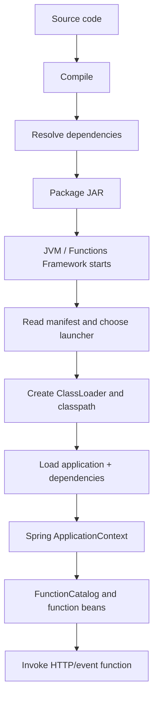
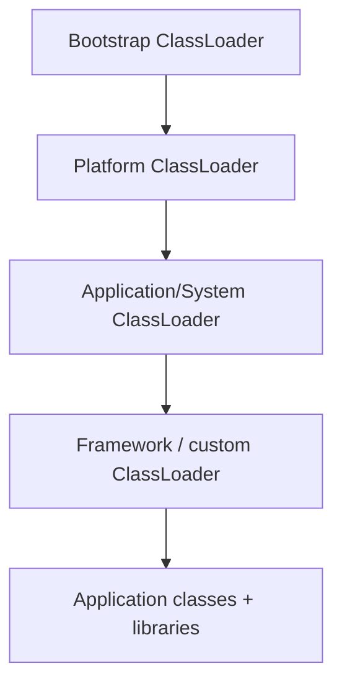
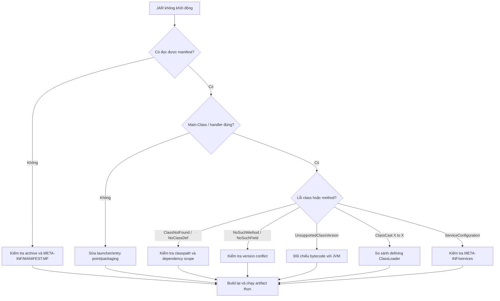

# Nạp JAR lỗi do ClassLoader, manifest hoặc phụ thuộc

## Mục tiêu học tập

Trong Java, một ứng dụng không chạy chỉ vì file JAR tồn tại hoặc vì Maven báo `BUILD SUCCESS`. JVM còn phải tìm đúng lớp khởi động, đọc được các class và resource bên trong archive, nạp đủ thư viện phụ thuộc, rồi liên kết những phiên bản API tương thích. Với **Spring Cloud Function**, quá trình này còn có adapter và `FunctionCatalog`: ứng dụng có thể compile, thậm chí test được trong IDE, nhưng khi chạy bằng JAR hoặc Functions Framework lại lỗi vì entry point, classpath hay định dạng đóng gói khác.

Bài này giúp bạn:

- Hiểu vai trò của **ClassLoader**, parent delegation, classpath và class identity.
- Phân biệt `ClassNotFoundException`, `NoClassDefFoundError`, `UnsupportedClassVersionError`, `NoSuchMethodError`, `ClassCastException` và các lỗi liên quan.
- Đọc `META-INF/MANIFEST.MF`, xác định `Main-Class`, `Start-Class`, `Class-Path` và launcher.
- Phân biệt **plain JAR**, **Spring Boot executable JAR** và **JAR được đóng gói cho Spring Cloud Function GCP adapter**.
- Kiểm tra file JAR và dependency graph bằng `jar tf`, `unzip -p`, `mvn dependency:tree`, `jdeps`, `javap` và log nạp lớp của JVM.
- Xử lý lỗi do dependency scope, phiên bản xung đột, class trùng lặp, service provider bị mất hoặc đóng gói thiếu thư viện.
- Xây dựng quy trình chẩn đoán từ artifact thực tế để tìm nguyên nhân trước khi sửa cấu hình Maven hoặc code.

**Bối cảnh module:** Spring Cloud Function đóng gói logic nghiệp vụ thành `Supplier`, `Function` và `Consumer`, cho phép tra cứu/composition qua `FunctionCatalog` và tái sử dụng qua HTTP, event hoặc serverless. Khi nạp JAR, cần xác minh không chỉ lớp nghiệp vụ mà cả Spring Boot launcher, Spring Cloud Function runtime, adapter giao thức và các dependency được yêu cầu ở runtime.

## 1. Vì sao JAR build thành công nhưng chạy lại thất bại?

Quy trình build và quy trình chạy có những bước khác nhau:



Maven `package` thành công chủ yếu chứng minh các bước build đã hoàn tất theo cấu hình hiện tại. Nó **không tự chứng minh** rằng:

- JAR cuối chứa đúng class được chỉ định làm entry point.
- Launcher hiểu được cách lưu class và dependency trong archive.
- Tất cả dependency cần lúc chạy đều có mặt.
- Các thư viện được đóng gói cùng phiên bản tương thích.
- Resource như `META-INF/services`, file cấu hình hoặc metadata của Spring được giữ lại.
- JVM runtime có thể chạy bytecode của tất cả dependency.
- Google Functions Framework gọi đúng handler của adapter.

Ví dụ: unit test chạy trong IDE sử dụng classpath do Maven/IDE dựng từ thư mục `target/classes` và repository local. Khi chạy `java -jar target/app.jar`, JVM dùng **manifest và launcher của artifact**. Nếu JAR không đóng gói dependency theo đúng định dạng, hai cách chạy có thể cho kết quả khác nhau.

## 2. Xác định đúng loại JAR trước khi kiểm tra

Không có một cấu trúc JAR duy nhất cho mọi ứng dụng Java. Cùng đuôi `.jar` nhưng có thể là ba loại khác nhau.

### 2.1. Plain JAR

Plain JAR thường chứa class ứng dụng ở root:

```text
order-function.jar
├── META-INF/
│   └── MANIFEST.MF
└── com/
    └── example/
        └── OrderApplication.class
```

Các thư viện có thể được đặt **bên ngoài JAR** và truyền qua classpath:

```text
lib/
├── spring-context.jar
├── spring-cloud-function-context.jar
└── other-library.jar
order-function.jar
```

Chạy bằng:

```bash
java -cp "order-function.jar:lib/*" com.example.OrderApplication
```

Trên Windows, dấu phân cách classpath là dấu chấm phẩy:

```powershell
java -cp "order-function.jar;lib/*" com.example.OrderApplication
```

Nếu plain JAR có `Main-Class` và khai báo `Class-Path` phù hợp, có thể chạy `java -jar order-function.jar`. Đường dẫn trong manifest là đường dẫn tương đối được phân giải theo vị trí JAR chứa manifest; không nên trông chờ thư viện nằm ở một thư mục tùy ý trên máy người chạy.

### 2.2. Spring Boot executable JAR

Spring Boot đóng gói dependency thành **nested JAR**. Cấu trúc điển hình:

```text
order-service.jar
├── META-INF/
│   └── MANIFEST.MF
├── org/springframework/boot/loader/
│   └── ... launcher classes ...
└── BOOT-INF/
    ├── classes/
    │   └── com/example/OrderApplication.class
    └── lib/
        ├── spring-boot-*.jar
        ├── spring-context-*.jar
        ├── spring-cloud-function-context-*.jar
        └── other-library.jar
```

Hai thuộc tính manifest thường gặp:

```text
Main-Class: org.springframework.boot.loader.launch.JarLauncher
Start-Class: com.example.OrderApplication
```

- `Main-Class` là **Spring Boot launcher**. Launcher này tạo ClassLoader có khả năng đọc các thư viện nằm trong `BOOT-INF/lib/`.
- `Start-Class` là lớp ứng dụng có phương thức `main(...)`, thường được đặt trong `BOOT-INF/classes/`.
- `JarLauncher` tìm class và resource ở các vị trí nested JAR theo quy ước Spring Boot.

Từ Spring Boot **3.2 trở lên** (bao gồm 3.2/3.3/3.4/3.5 và 4.x), tên launcher là `org.springframework.boot.loader.launch.JarLauncher`. Spring Boot 3.0/3.1 và một số bản Boot 2.x dùng `org.springframework.boot.loader.JarLauncher`. **Phải xem đúng phiên bản Spring Boot của artifact**, không chép tên launcher từ một dự án khác.

Chạy loại JAR này bằng:

```bash
java -jar order-service.jar
```

Không dùng `java -cp order-service.jar com.example.OrderApplication` để thay thế. Java classpath chuẩn không tự đọc dependency JAR lồng bên trong `BOOT-INF/lib/`; chính Spring Boot launcher thực hiện việc đó.

### 2.3. JAR đóng gói cho Spring Cloud Function GCP adapter

Spring Cloud Function GCP adapter có **cơ chế đóng gói riêng**. Tài liệu Spring Cloud Function hướng dẫn:

1. Thêm dependency `org.springframework.cloud:spring-cloud-function-adapter-gcp` vào ứng dụng.
2. Thêm adapter này làm **dependency của `spring-boot-maven-plugin`** để plugin tạo JAR đúng định dạng GCP adapter.
3. Đặt `outputDirectory` như `target/deploy`.
4. Thêm Google Functions Framework Maven plugin để chạy local với `functionTarget` là `org.springframework.cloud.function.adapter.gcp.GcfJarLauncher`.
5. Khi deploy theo mẫu adapter, Java entry point của Google Functions Framework là `GcfJarLauncher`; function nghiệp vụ vẫn được chọn qua Spring Cloud Function.

Fragment Maven theo tài liệu:

```xml
<plugin>
    <groupId>org.springframework.boot</groupId>
    <artifactId>spring-boot-maven-plugin</artifactId>
    <configuration>
        <outputDirectory>target/deploy</outputDirectory>
    </configuration>
    <dependencies>
        <dependency>
            <groupId>org.springframework.cloud</groupId>
            <artifactId>spring-cloud-function-adapter-gcp</artifactId>
        </dependency>
    </dependencies>
</plugin>
```

Plugin Google Functions Framework cho local:

```xml
<plugin>
    <groupId>com.google.cloud.functions</groupId>
    <artifactId>function-maven-plugin</artifactId>
    <version>COMPATIBLE_PLUGIN_VERSION</version>
    <configuration>
        <functionTarget>org.springframework.cloud.function.adapter.gcp.GcfJarLauncher</functionTarget>
        <port>8080</port>
    </configuration>
</plugin>
```

`COMPATIBLE_PLUGIN_VERSION` là placeholder; cần chọn phiên bản phù hợp với Java, Spring Boot, Spring Cloud Function và Google Functions Framework của dự án. Tài liệu Spring Cloud Function hiện có ví dụ `0.9.1`, nhưng không nên coi đây là phiên bản mới nhất hoặc tương thích với mọi JDK.

**Lưu ý về manifest:** trong hướng dẫn GCP adapter, source manifest có thể khai báo `Main-Class` là lớp ứng dụng Spring:

```text
Manifest-Version: 1.0
Main-Class: com.example.OrderApplication

```

Điều này thuộc **quy ước đóng gói của GCP adapter**. Không áp dụng manifest `JarLauncher/Start-Class` của Spring Boot executable JAR một cách máy móc cho artifact đã được adapter biến đổi. Hãy xem hướng dẫn đúng phiên bản và kiểm tra JAR cuối trong `target/deploy`.

| Loại artifact | Lớp/thuộc tính khởi động | Cách chạy/host |
| --- | --- | --- |
| Plain JAR | `Main-Class` là lớp ứng dụng nếu chạy `java -jar` | JVM với classpath dependency bên ngoài |
| Spring Boot executable JAR | `Main-Class=JarLauncher`, `Start-Class=Application` | `java -jar` để launcher nạp nested JAR |
| Spring Cloud Function GCP adapter package | Theo manifest/packaging của adapter; handler GCF là `GcfJarLauncher` | Google Functions Framework/GCP theo hướng dẫn adapter |

## 3. Manifest quyết định điều gì?

Manifest nằm tại:

```text
META-INF/MANIFEST.MF
```

Đây là file metadata trong JAR. Một số thuộc tính quan trọng:

| Thuộc tính | Ý nghĩa | Lỗi khi sai |
| --- | --- | --- |
| `Manifest-Version` | Phiên bản cú pháp manifest | Tool có thể cảnh báo hoặc từ chối manifest không hợp lệ |
| `Main-Class` | Class entry point cho `java -jar` | `no main manifest attribute`, `ClassNotFoundException`, không tìm thấy main |
| `Start-Class` | Lớp ứng dụng mà Spring Boot launcher gọi | Boot launcher không tìm được application class |
| `Class-Path` | Các URL tương đối tới thư viện ngoài trong plain JAR | Thiếu dependency nếu path sai hoặc JAR không nằm ở vị trí mong đợi |
| `Multi-Release` | Đánh dấu multi-release JAR | JVM có thể chọn class theo version khác với dự đoán nếu metadata sai |

### 3.1. `Main-Class` không phải lúc nào cũng là lớp ứng dụng

Với JAR Java thông thường:

```text
Main-Class: com.example.OrderApplication
```

Với Spring Boot executable JAR:

```text
Main-Class: org.springframework.boot.loader.launch.JarLauncher
Start-Class: com.example.OrderApplication
```

Với GCP adapter, cần theo đúng cấu hình adapter. Trong trường hợp này, còn có **Functions Framework target**:

```text
org.springframework.cloud.function.adapter.gcp.GcfJarLauncher
```

Không được đồng nhất `Main-Class`, `Start-Class`, `functionTarget` của Maven plugin và `--entry-point` của Google Cloud CLI. Chúng được dùng bởi các lớp khởi động khác nhau.

### 3.2. `Class-Path` không thay thế nested-JAR launcher

Manifest plain JAR có thể khai báo:

```text
Manifest-Version: 1.0
Main-Class: com.example.OrderApplication
Class-Path: lib/spring-context.jar lib/spring-core.jar

```

`Class-Path` của JAR chuẩn nhận các URL tương đối, phân tách bằng khoảng trắng. Nhưng Spring Boot executable JAR **không cần** khai báo `Class-Path` cho từng dependency trong `BOOT-INF/lib/`: launcher đọc cấu trúc nested JAR để xây dựng classpath.

Nếu bạn thêm `Class-Path: BOOT-INF/lib/spring-context.jar` vào một JAR thường rồi chạy `java -jar`, JVM không tự biến file đó thành Spring Boot executable JAR. Ngược lại, nếu xóa hoặc thay launcher của Boot JAR, các thư viện nested có thể không được nạp.

### 3.3. Quy tắc định dạng manifest

Manifest không phải file properties tùy ý:

- Dùng các dòng `Name: value` và kết thúc section chính bằng một dòng trống.
- Tên thuộc tính cần theo cú pháp JAR specification.
- Dòng dài phải được **wrap** đúng quy tắc bằng continuation line bắt đầu bằng một dấu cách.
- Nội dung UTF-8 và line endings cần được ghi đúng.
- Nếu chỉnh tay, kiểm tra manifest **sau khi build**, vì Maven/Gradle plugin có thể ghi lại manifest trong giai đoạn package/repackage.

Một manifest bị wrap sai có thể khiến JVM không đọc đúng tên class hoặc giá trị thuộc tính. Đừng chỉ mở file nguồn `src/main/resources/META-INF/MANIFEST.MF` rồi kết luận artifact cuối đã chứa nội dung đó.

## 4. ClassLoader hoạt động như thế nào?

`ClassLoader` chịu trách nhiệm tìm dữ liệu bytecode và tạo đối tượng `Class`. Khi một class cần tham chiếu tới class khác, JVM sử dụng cơ chế nạp lớp để tìm và liên kết định nghĩa tương ứng.

Mô hình phổ biến là **parent delegation**:



Theo cách triển khai mặc định của `ClassLoader.loadClass(...)`, loader thường:

1. Kiểm tra class đã được load trước đó chưa.
2. Hỏi parent loader.
3. Nếu parent không tìm thấy, loader hiện tại mới tìm class.

Framework có thể tạo custom ClassLoader để đọc nested JAR, plugin, module hoặc code được nạp động. Vì thế, cùng một class có thể xuất hiện ở nhiều nguồn và có hành vi khác nhau tùy loader đã định nghĩa nó.

### 4.1. Class identity gồm tên và defining ClassLoader

Một class không chỉ được định danh bởi tên đầy đủ như `com.example.OrderEvent`. JVM còn gắn class với **defining ClassLoader** đã định nghĩa nó.

Nếu hai ClassLoader khác nhau cùng nạp `com.example.OrderEvent`, JVM có thể coi đó là hai kiểu khác nhau:

```text
com.example.OrderEvent @ AppClassLoader
com.example.OrderEvent @ PluginClassLoader
```

Đây là một nguyên nhân của lỗi khó hiểu:

```text
ClassCastException:
com.example.OrderEvent cannot be cast to com.example.OrderEvent
```

Tên hai lớp giống hệt nhưng loader khác nhau. Tình huống này thường gặp khi ứng dụng đóng gói trùng một thư viện trong nhiều plugin, shading/relocation không nhất quán, hoặc custom ClassLoader tách class API khỏi class implementation.

### 4.2. Thread Context ClassLoader (TCCL)

Một số API không nạp class từ loader của chính class gọi API mà dùng **thread context ClassLoader**. Các cơ chế như `ServiceLoader`, một số thư viện logging, JDBC driver hoặc framework plugin có thể dựa vào TCCL.

Kiểm tra:

```java
ClassLoader definingLoader = OrderService.class.getClassLoader();
ClassLoader contextLoader =
        Thread.currentThread().getContextClassLoader();

System.out.println("Defining loader = " + definingLoader);
System.out.println("Context loader = " + contextLoader);
System.out.println("Parent = " +
        (contextLoader == null ? null : contextLoader.getParent()));
```

Đừng tự ý đổi TCCL toàn cục để che lỗi. Nếu một thư viện cần loader cụ thể, phải xác định **API nào đang nạp class/resource**, rồi cấu hình đúng tại biên tích hợp.

### 4.3. Kiểm tra nguồn class đang được JVM sử dụng

Đoạn helper:

```java
import java.security.CodeSource;

static void printClassOrigin(Class<?> type) {
    ClassLoader loader = type.getClassLoader();
    CodeSource source = type.getProtectionDomain().getCodeSource();

    System.out.println("Class = " + type.getName());
    System.out.println("Loader = " + loader);
    System.out.println("Code source = "
            + (source == null ? null : source.getLocation()));
}
```

Gọi:

```java
printClassOrigin(OrderService.class);
printClassOrigin(org.springframework.context.ApplicationContext.class);
printClassOrigin(
        org.springframework.cloud.function.context.FunctionCatalog.class);
```

Nếu một class được bootstrap/platform loader nạp hoặc nguồn code không xác định, `CodeSource` có thể là `null`; đó không tự động là lỗi. Hãy so sánh loader và location giữa các class đang bị nghi ngờ.

## 5. Phân biệt các lỗi nạp lớp qua stack trace

Không phải mọi lỗi chứa chữ "Class" đều là thiếu JAR. Hãy đọc **exception đầu tiên** và `Caused by` sâu nhất có ý nghĩa.

| Exception/Error | Ý nghĩa | Nguyên nhân thường gặp |
| --- | --- | --- |
| `ClassNotFoundException` | Code yêu cầu nạp một class theo tên nhưng loader không tìm thấy | `Class.forName`, reflection, tên class sai hoặc classpath thiếu |
| `NoClassDefFoundError` | JVM cần định nghĩa class khi liên kết/chạy nhưng không tìm được hoặc class không thể được định nghĩa | Runtime thiếu dependency, class trước đó khởi tạo thất bại |
| `UnsupportedClassVersionError` | Bytecode class mới hơn mức JVM hỗ trợ | Build bằng JDK cao hơn runtime |
| `ClassFormatError` | Nội dung class file không đúng định dạng | JAR hỏng, bytecode bị biến đổi sai, công cụ đóng gói lỗi |
| `NoSuchMethodError` | Class có mặt nhưng không có method signature mà caller đã compile tham chiếu | Dependency version không tương thích lúc compile/runtime |
| `NoSuchFieldError` | Field được tham chiếu không tồn tại ở class runtime | Version mismatch |
| `AbstractMethodError` | Runtime implementation không cung cấp method abstract mà code gọi cần | API/implementation lệch phiên bản |
| `IncompatibleClassChangeError` | Cấu trúc class/interface/static/instance không khớp kỳ vọng bytecode | Library đổi API/binary compatibility |
| `ClassCastException` | Đối tượng không thể cast sang kiểu yêu cầu | Sai type hoặc cùng tên class được nạp bởi loader khác |
| `ServiceConfigurationError` | `ServiceLoader` không đọc/khởi tạo được provider | Mất `META-INF/services`, provider class thiếu hoặc constructor lỗi |
| `ExceptionInInitializerError` | Static initializer hoặc khởi tạo static field ném exception | Cấu hình/driver/secret/native lib lỗi trong static init |

### 5.1. `ClassNotFoundException` và `NoClassDefFoundError`

**`ClassNotFoundException`** thường xuất hiện khi code chủ động gọi:

```java
Class<?> type = Class.forName("com.example.OptionalAdapter");
```

Ví dụ: Spring hoặc một framework dùng tên class trong cấu hình, nhưng module chứa adapter không nằm trong runtime classpath.

**`NoClassDefFoundError`** thường xuất hiện khi JVM cần một class để resolve bytecode hoặc load superclass/interface nhưng class đó không thể được định nghĩa. Có thể thấy:

```text
java.lang.NoClassDefFoundError: org/springframework/...
Caused by: java.lang.ClassNotFoundException: org.springframework....
```

Trường hợp khác: class có mặt nhưng **static initialization lần đầu đã thất bại**. JVM có thể ném `ExceptionInInitializerError` ở lần đầu, rồi các lần sử dụng sau báo `NoClassDefFoundError: Could not initialize class ...`. Khi gặp thông báo này, tìm **lỗi đầu tiên trong log** thay vì chỉ tìm JAR bị thiếu.

### 5.2. `NoSuchMethodError` không phải classpath thiếu

Ví dụ compile với phiên bản thư viện A có method:

```java
library.parse(input, options);
```

Nhưng runtime lại nạp phiên bản thư viện B chỉ có:

```java
library.parse(input);
```

Class `library` vẫn được tìm thấy, nên không phải `ClassNotFoundException`. Khi bytecode gọi method không còn tồn tại, JVM ném `NoSuchMethodError`.

Cách xử lý là **đồng bộ phiên bản dependency** theo BOM/release train và kiểm tra dependency graph, không thêm một JAR bất kỳ có cùng tên vào thư mục `lib`.

### 5.3. `UnsupportedClassVersionError`

Ví dụ:

```text
UnsupportedClassVersionError:
... class file version 65.0,
this runtime only recognizes up to 61.0
```

Major version 65 tương ứng Java 21; 61 tương ứng Java 17. Lỗi này có nghĩa **JVM đang chạy thấp hơn phiên bản bytecode được biên dịch**.

Khắc phục bằng cách:

- Chọn runtime JDK mới đủ để chạy bytecode; hoặc
- Build lại với `--release` phù hợp runtime.

Đừng nhầm với dependency thiếu: thêm JAR không làm JVM cũ hiểu bytecode mới.

## 6. Dependency thiếu hoặc sai scope trong Maven

Maven dependency có scope quyết định lúc nào thư viện được dùng:

| Scope | Compile | Test | Runtime | Ghi chú |
| --- | --- | --- | --- | --- |
| `compile` (mặc định) | Có | Có | Có | Thư viện ứng dụng thường dùng |
| `provided` | Có | Có | Không mặc định được đóng vào runtime artifact | Runtime container phải cung cấp |
| `runtime` | Không dùng để compile source chính | Có | Có | Driver/implementation chỉ cần khi chạy |
| `test` | Không | Có | Không | Không đưa vào production runtime |
| `system` | Có | Có | Có theo đường dẫn cục bộ | Không khuyến nghị vì phụ thuộc máy |

Ví dụ lỗi:

```xml
<dependency>
    <groupId>org.springframework.cloud</groupId>
    <artifactId>spring-cloud-function-context</artifactId>
    <version>VERSION</version>
    <scope>test</scope>
</dependency>
```

Test có thể chạy vì classpath test chứa dependency, nhưng artifact runtime không có thư viện này. Nếu application cần `FunctionCatalog` khi chạy, dependency ở scope `test` là sai.

Một số lỗi khác:

- Đặt thư viện adapter ở `provided` trong khi runtime không cung cấp adapter.
- Dependency bị đánh dấu `optional` ở module khác và không được truyền transitively.
- Một `<exclusion>` vô tình loại dependency cần thiết.
- Dependency được khai báo trong profile Maven không bật khi build release.
- `spring-cloud-function-adapter-gcp` chỉ được khai báo làm **plugin dependency** nhưng thiếu dependency ứng dụng (hoặc ngược lại), khiến plugin đóng gói và code runtime có classpath khác nhau.

### 6.1. Xem dependency graph thực tế

Lệnh:

```bash
mvn dependency:tree
```

Lọc theo nhóm thư viện:

```bash
mvn dependency:tree -Dincludes=org.springframework.cloud,org.springframework.boot
```

Hiển thị các dependency bị conflict/omitted:

```bash
mvn dependency:tree -Dverbose
```

Xem POM sau khi kế thừa parent, BOM và profile:

```bash
mvn help:effective-pom
```

Kiểm tra dependency được dùng nhưng không khai báo trực tiếp hoặc khai báo mà không dùng:

```bash
mvn dependency:analyze
```

`dependency:analyze` có thể báo false positive đối với reflection, annotation scanning, service loader hoặc các API được framework sử dụng động. Đọc kết quả cùng với runtime logs, không xóa dependency chỉ vì plugin đánh dấu unused.

### 6.2. Giữ phiên bản Spring Boot và Spring Cloud Function tương thích

Trong một ứng dụng Spring, nhiều module cần được quản lý theo release train/BOM. Tránh tự gán version cho từng module Spring khác nhau:

```xml
<dependencyManagement>
    <dependencies>
        <dependency>
            <groupId>org.springframework.cloud</groupId>
            <artifactId>spring-cloud-dependencies</artifactId>
            <version>COMPATIBLE_SPRING_CLOUD_VERSION</version>
            <type>pom</type>
            <scope>import</scope>
        </dependency>
    </dependencies>
</dependencyManagement>
```

`COMPATIBLE_SPRING_CLOUD_VERSION` là placeholder, phải chọn release train phù hợp với Spring Boot của dự án. Nếu `spring-cloud-function-context`, `spring-cloud-function-adapter-gcp` và các module khác bị resolve ở các version không đồng bộ, lỗi có thể xuất hiện dưới dạng `NoSuchMethodError`, `NoSuchFieldError` hoặc lỗi khởi tạo Spring.

**Không sửa bằng cách thêm mọi version vào `pom.xml`**. Trước tiên xác định BOM, dependency mediation và dependency nào thực sự được đóng trong artifact cuối.

## 7. Dependency bị trùng hoặc class bị nạp từ sai JAR

Maven có thể resolve nhiều phiên bản của cùng artifact. Thông thường Maven chọn một phiên bản theo quy tắc dependency mediation; tuy nhiên, dependency có thể vẫn bị đóng trùng nếu:

- Một JAR shaded chứa sẵn class của thư viện khác.
- Thư viện được copy thủ công vào thư mục runtime.
- Plugin hoặc container cung cấp thêm version khác.
- Nhiều plugin/module có ClassLoader riêng.
- Một file fat JAR được ghép từ các archive không đồng nhất.

Khi có hai phiên bản `spring-core` hoặc một API class bị đóng lặp, lỗi có thể không xuất hiện ngay lúc startup. Nó chỉ lộ ra khi một method được gọi hoặc khi object đi qua ranh giới ClassLoader.

### 7.1. Tìm class xuất hiện ở nhiều dependency

Kiểm tra dependency graph:

```bash
mvn dependency:tree -Dverbose -Dincludes=org.springframework:spring-core
```

Kiểm tra nội dung JAR đã đóng gói:

```bash
jar tf target/order-service.jar
```

Với Spring Boot JAR, lọc nested libs:

```bash
jar tf target/order-service.jar | grep 'BOOT-INF/lib/'
```

Nếu cùng thư viện xuất hiện dưới nhiều tên/version, tìm dependency kéo vào từng bản. Nếu class bị nhúng vào một shaded JAR, phải mở JAR đó và kiểm tra class cụ thể.

### 7.2. Lỗi `X cannot be cast to X`

Ví dụ:

```text
com.example.OrderEvent cannot be cast to com.example.OrderEvent
```

Kiểm tra:

1. Hai object có cùng binary class name nhưng loader nào định nghĩa?
2. Class có bị đóng vào cả ứng dụng và plugin không?
3. API/interface có bị copy vào nhiều classloader không?
4. Thread context ClassLoader có bị thay đổi bởi thư viện plugin không?

Giải pháp thường là **đưa API dùng chung lên parent/shared classloader**, loại class trùng khỏi plugin hoặc thống nhất một nguồn định nghĩa class. Đừng ép cast bằng `Object` hoặc reflection nếu ranh giới classloader chưa được thiết kế.

## 8. Resource và ServiceLoader cũng phụ thuộc ClassLoader

Không chỉ `.class` mới có thể bị thiếu. Framework Spring và nhiều thư viện dùng resource trong `META-INF` để khám phá:

- `META-INF/services/<fully-qualified-interface>` cho Java `ServiceLoader`.
- Metadata của Spring factories/auto-configuration tùy phiên bản.
- File cấu hình, schema, message bundle hoặc resource do thư viện đóng gói.

Ví dụ `ServiceLoader`:

```java
import java.util.ServiceLoader;

ServiceLoader<PaymentProvider> providers =
        ServiceLoader.load(
                PaymentProvider.class,
                Thread.currentThread().getContextClassLoader());

for (PaymentProvider provider : providers) {
    System.out.println(provider.getClass().getName());
}
```

Nếu JAR chứa class provider nhưng thiếu file `META-INF/services`, provider có thể không được tìm thấy. Điều này thường xảy ra khi **shaded/uber JAR** gộp nhiều dependency nhưng không merge service descriptor.

Khi dùng Maven Shade Plugin, cần cấu hình transformer phù hợp để hợp nhất service resources, ví dụ `ServicesResourceTransformer`:

```xml
<plugin>
    <groupId>org.apache.maven.plugins</groupId>
    <artifactId>maven-shade-plugin</artifactId>
    <version>COMPATIBLE_SHADE_VERSION</version>
    <executions>
        <execution>
            <phase>package</phase>
            <goals>
                <goal>shade</goal>
            </goals>
            <configuration>
                <transformers>
                    <transformer implementation="org.apache.maven.plugins.shade.resource.ServicesResourceTransformer"/>
                </transformers>
            </configuration>
        </execution>
    </executions>
</plugin>
```

`COMPATIBLE_SHADE_VERSION` là placeholder. Đây là ví dụ cho **uber JAR dùng Shade Plugin**, không phải cấu hình cần thêm mặc định cho mọi Spring Boot executable JAR. Spring Boot executable JAR thường giữ nested dependency JAR nguyên dạng; không cần flatten mọi class thành một archive.

## 9. Kiểm tra artifact thay vì đoán từ source code

Khi lỗi xuất hiện chỉ sau khi package, kiểm tra **file được chạy thực sự**. Đừng chỉ nhìn `target/classes` hoặc `mvn dependency:tree`.

### 9.1. Xem danh sách entry trong JAR

Linux/macOS:

```bash
jar tf target/order-service.jar | head -80
jar tf target/order-service.jar | grep -E 'MANIFEST.MF|OrderApplication.class|BOOT-INF/lib|GcfJarLauncher'
```

Windows PowerShell:

```powershell
jar tf target/order-service.jar | Select-Object -First 80
jar tf target/order-service.jar | Select-String 'MANIFEST.MF|OrderApplication.class|BOOT-INF/lib|GcfJarLauncher'
```

Kiểm tra:

- Có `META-INF/MANIFEST.MF` không?
- Class ứng dụng có nằm đúng vị trí của loại artifact không?
- Nếu là Spring Boot JAR, có `BOOT-INF/classes/` và `BOOT-INF/lib/` không?
- Nếu là GCP adapter package, có các class/metadata theo format adapter của phiên bản đó không?
- Dependency chứa class trong stack trace có thực sự nằm trong artifact hoặc classpath runtime không?

### 9.2. Đọc manifest bên trong artifact

Linux/macOS hoặc Git Bash:

```bash
unzip -p target/order-service.jar META-INF/MANIFEST.MF
```

PowerShell nếu có lệnh `unzip`:

```powershell
unzip -p target/order-service.jar META-INF/MANIFEST.MF
```

Nếu không có `unzip`, dùng thư mục tạm:

```powershell
New-Item -ItemType Directory -Force .\inspect-jar | Out-Null
Push-Location .\inspect-jar
jar xf ..\target\order-service.jar META-INF/MANIFEST.MF
Get-Content .\META-INF\MANIFEST.MF
Pop-Location
```

Đừng kiểm tra một file manifest nguồn rồi cho rằng nó là manifest cuối. Plugin repackage/adapter có thể thay đổi hoặc tạo lại manifest.

### 9.3. Tìm class bị thiếu trong JAR

Giả sử stack trace nói thiếu:

```text
org.springframework.cloud.function.context.FunctionCatalog
```

Với plain JAR, kiểm tra class trong dependency trên classpath. Với Spring Boot executable JAR, trước tiên tìm dependency:

```bash
jar tf target/order-service.jar | grep 'BOOT-INF/lib/spring-cloud-function'
```

Sau đó trích dependency nested để kiểm tra:

```bash
unzip -p target/order-service.jar BOOT-INF/lib/spring-cloud-function-context-VERSION.jar > function-context.jar
jar tf function-context.jar | grep 'FunctionCatalog.class'
```

Thay `VERSION` bằng tên file thực tế nhìn thấy ở lệnh trước. Nếu dependency không tồn tại trong `BOOT-INF/lib`, quay lại kiểm tra scope, exclusion và plugin packaging.

Với GCP adapter package, không giả định dependency sẽ luôn ở `BOOT-INF/lib`; hãy dùng `jar tf` để nhận diện layout thực tế rồi kiểm tra đúng JAR con.

### 9.4. Xác định class version và bytecode

```bash
javap -verbose -classpath target/classes com.example.OrderApplication
```

Trong output, tìm `major version`. Đối với class trong dependency JAR:

```bash
javap -verbose -classpath path/to/library.jar com.example.SomeType
```

Nếu classpath chứa nhiều phiên bản cùng tên, cần kiểm tra từng artifact để tránh đọc nhầm class không phải class runtime thực sự nạp.

## 10. Công cụ chẩn đoán ClassLoader và dependency

### 10.1. In log class được nạp bởi JVM

JDK 9+:

```bash
java -Xlog:class+load=info -jar target/order-service.jar
```

JDK 8:

```bash
java -verbose:class -jar target/order-service.jar
```

Log sẽ cho thấy class được nạp từ nguồn nào. Lọc tên class đáng ngờ, ví dụ `org.springframework.core.SpringVersion`, `FunctionCatalog` hoặc class xuất hiện trong `Caused by`.

Với JVM chạy trong container/serverless, cần truyền JVM option qua cấu hình runtime hoặc biến môi trường hỗ trợ bởi nền tảng. Không giả định `JAVA_TOOL_OPTIONS` có thể được thiết lập tùy ý trong mọi môi trường được quản lý; kiểm tra contract của runtime.

### 10.2. Dùng `jdeps` kiểm tra phụ thuộc bytecode

Ví dụ:

```bash
jdeps --recursive --summary target/order-service.jar
```

Hoặc:

```bash
jdeps --multi-release 17 --ignore-missing-deps --recursive target/order-service.jar
```

`jdeps` phân tích dependency ở mức bytecode. Với Spring Boot executable JAR chứa nested JAR, kết quả có thể không phản ánh đầy đủ dependency bên trong archive; hãy trích class/JAR con hoặc chạy trên các dependency JAR thực tế. Nó cũng không phát hiện mọi class được nạp bằng reflection, `ServiceLoader` hay tên trong cấu hình.

### 10.3. Kiểm tra version trong runtime

Một đoạn diagnostic:

```java
System.out.println("Java = " + System.getProperty("java.version"));
System.out.println("VM = " + System.getProperty("java.vm.name"));
System.out.println("App loader = " +
        ClassLoader.getSystemClassLoader());
System.out.println("Thread context loader = " +
        Thread.currentThread().getContextClassLoader());
```

Có thể in thêm:

```java
System.out.println(
        org.springframework.core.SpringVersion.getVersion());
System.out.println(
        org.springframework.boot.SpringBootVersion.getVersion());
```

Chỉ dùng API trên khi các class tương ứng đã được resolve. Nếu chính `SpringVersion` không nạp được, hãy dùng log JVM hoặc kiểm tra archive trước khi thêm đoạn diagnostic này.

## 11. Quy trình chẩn đoán theo thứ tự

Khi nhận lỗi nạp JAR, đi theo các bước sau:

1. **Ghi nhận artifact và lệnh chạy:** đường dẫn JAR, Java version, lệnh `java -jar`, `java -cp`, `mvn function:run` hay Google handler.
2. **Đọc exception đầu tiên:** tên class/method/resource và toàn bộ chuỗi `Caused by`.
3. **Nhận diện loại JAR:** plain, Spring Boot executable hay GCP adapter package.
4. **Đọc manifest của artifact:** `Main-Class`, `Start-Class`, các thuộc tính liên quan.
5. **Kiểm tra class entry point:** class tồn tại trong archive/classpath và đúng FQCN không?
6. **Kiểm tra dependency graph:** scope, version mediation, exclusion, optional và profile.
7. **Kiểm tra artifact contents:** nested libs, class/resource, `META-INF/services`, manifest và file cấu hình.
8. **Quan sát JVM class-loading logs:** class được nạp từ JAR nào và bởi loader nào?
9. **Đối chiếu bytecode/runtime:** JDK build, compiler release và JVM thực thi.
10. **Sửa một nguyên nhân tại một thời điểm**, build lại artifact và chạy lại bằng đúng lệnh gây lỗi.



## 12. Các tình huống thường gặp trong Spring Cloud Function

### 12.1. Thiếu `FunctionCatalog`

Triệu chứng:

```text
ClassNotFoundException:
org.springframework.cloud.function.context.FunctionCatalog
```

Hoặc:

```text
NoClassDefFoundError:
org/springframework/cloud/function/context/FunctionCatalog
```

Kiểm tra:

- Có dependency `spring-cloud-function-context` trong runtime không?
- Có bị đặt scope `test` hoặc `provided` không?
- GCP adapter/Web/Stream adapter có resolve đúng phiên bản không?
- JAR cuối có chứa dependency tương ứng không?

Nếu IDE test chạy nhưng `java -jar` lỗi, so sánh classpath test với nested libs của artifact.

### 12.2. Không tìm thấy `GcfJarLauncher`

Triệu chứng:

```text
ClassNotFoundException:
org.springframework.cloud.function.adapter.gcp.GcfJarLauncher
```

Nguyên nhân thường gặp:

- Thiếu `spring-cloud-function-adapter-gcp`.
- Dependency chỉ có trong plugin nhưng không nằm trong classpath cần thiết của local invoker/runtime.
- Plugin đóng gói không được cấu hình theo hướng dẫn GCP adapter.
- Đang chạy nhầm JAR từ `target/` thay vì artifact đã tạo trong `target/deploy/`.
- Phiên bản adapter/Functions Framework không tương thích.

Kiểm tra cả dependency tree lẫn file JAR cuối. Tài liệu Spring Cloud Function yêu cầu adapter dependency trong cấu hình `spring-boot-maven-plugin` để plugin đóng gói đúng định dạng, và `functionTarget` là `GcfJarLauncher` cho local Functions Framework.

### 12.3. Không tìm thấy lớp ứng dụng Spring

Triệu chứng:

```text
ClassNotFoundException: com.example.OrderApplication
```

Kiểm tra:

- `Main-Class` hoặc `Start-Class` có đúng package/class không?
- Class có nằm trong `BOOT-INF/classes/com/example/` (Boot JAR) hay root (plain JAR) không?
- Có build nhầm module hoặc nhầm artifact không?
- Maven profile có loại source/module ra khỏi package không?
- Source manifest của GCP adapter có đúng application class không?

Không sửa thành `Main-Class: GcfJarLauncher` chỉ vì launcher Google không tìm thấy lớp application. Trước tiên xác định loại artifact và quy ước manifest của adapter.

### 12.4. `NoSuchMethodError` trong Spring Framework

Triệu chứng:

```text
java.lang.NoSuchMethodError:
org.springframework....someMethod(...)
```

Đây thường là version mismatch: compile sử dụng một version nhưng runtime nạp version khác. Kiểm tra:

```bash
mvn dependency:tree -Dverbose -Dincludes=org.springframework
```

Sau đó:

- Dùng Spring Boot parent/BOM và Spring Cloud BOM tương thích.
- Loại bỏ version override không cần thiết.
- Kiểm tra plugin dependency và dependency ứng dụng có bị lệch không.
- Kiểm tra JAR bị copy thủ công hoặc được container/runtime cung cấp.

### 12.5. `ServiceConfigurationError` hoặc auto-configuration không chạy

Class implementation có thể vẫn tồn tại nhưng file provider/metadata đã mất khi dùng Shade Plugin. Kiểm tra:

```bash
jar tf target/order-service.jar | grep 'META-INF/services/'
```

Nếu cần gộp nhiều provider file trong uber JAR, cấu hình `ServicesResourceTransformer`. Với Spring Boot executable JAR, tránh flatten các nested JAR nếu không thực sự cần; giữ nguyên dependency thường bảo toàn metadata tốt hơn.

### 12.6. Local Functions Framework chạy, deploy GCP lại lỗi

Local plugin có thể chạy bằng Maven classpath và source project, trong khi deployment sử dụng **artifact đã package**. Do đó:

- `mvn function:run` thành công không chứng minh JAR deploy đã đúng layout.
- Kiểm tra file trong `target/deploy`, manifest, classpath và dependency.
- Xác nhận Java entry point của Google Functions Framework đúng `GcfJarLauncher` cho GCP adapter version đang dùng.
- Kiểm tra runtime Java trên cloud không thấp hơn bytecode.
- Không lấy cấu hình của Spring Cloud Function Web adapter để suy ra GCP adapter.

## 13. Ví dụ cấu hình Maven tối thiểu và các điểm phải kiểm tra

Đây là **fragment định hướng**, không phải POM hoàn chỉnh:

```xml
<dependencies>
    <dependency>
        <groupId>org.springframework.cloud</groupId>
        <artifactId>spring-cloud-function-context</artifactId>
    </dependency>
    <dependency>
        <groupId>org.springframework.cloud</groupId>
        <artifactId>spring-cloud-function-adapter-gcp</artifactId>
    </dependency>
</dependencies>

<build>
    <plugins>
        <plugin>
            <groupId>org.springframework.boot</groupId>
            <artifactId>spring-boot-maven-plugin</artifactId>
            <configuration>
                <outputDirectory>target/deploy</outputDirectory>
            </configuration>
            <dependencies>
                <dependency>
                    <groupId>org.springframework.cloud</groupId>
                    <artifactId>spring-cloud-function-adapter-gcp</artifactId>
                </dependency>
            </dependencies>
        </plugin>

        <plugin>
            <groupId>com.google.cloud.functions</groupId>
            <artifactId>function-maven-plugin</artifactId>
            <version>COMPATIBLE_PLUGIN_VERSION</version>
            <configuration>
                <functionTarget>org.springframework.cloud.function.adapter.gcp.GcfJarLauncher</functionTarget>
                <port>8080</port>
            </configuration>
        </plugin>
    </plugins>
</build>
```

Khi build:

```bash
mvn clean package
```

Kiểm tra:

```bash
mvn dependency:tree -Dverbose
jar tf target/deploy/order-function.jar
unzip -p target/deploy/order-function.jar META-INF/MANIFEST.MF
```

Tên file `order-function.jar` chỉ là ví dụ; lấy đúng tên được tạo trong `target/deploy`. Nếu không thấy JAR ở đó, xem effective POM, execution của Spring Boot Maven plugin, module đang build và log Maven. Không copy file `target/*.jar` ngẫu nhiên vào thư mục deploy.

Chạy local:

```bash
mvn function:run
curl -i -X POST http://localhost:8080/ -H "Content-Type: text/plain" --data-binary "hello"
```

Nếu mục tiêu là GCP adapter, hãy xác nhận function target đã đúng và manifest theo đúng hướng dẫn adapter. Không mặc định mọi version Spring Cloud Function đều dùng cùng cấu hình Maven/manifest.

## 14. Checklist trước khi kết luận JAR bị lỗi

| Kiểm tra | Câu hỏi | Bằng chứng |
| --- | --- | --- |
| Artifact | Đang chạy đúng JAR cần deploy? | Đường dẫn, checksum/build ID |
| JAR format | Plain, Boot executable hay GCP adapter package? | `jar tf` và layout |
| Manifest | Main-Class/Start-Class/attributes đúng? | `unzip -p ... META-INF/MANIFEST.MF` |
| Launcher | Launcher có nằm trong archive/classpath? | `jar tf`, `ClassNotFoundException` |
| Application class | Class ứng dụng có đúng vị trí? | `jar tf`, FQCN |
| Dependency | Thư viện bị thiếu có trong runtime graph? | `mvn dependency:tree`, archive inspection |
| Scope | Dependency có bị `test`/`provided`? | Effective POM/dependency tree |
| Version | Có xung đột Spring/Boot/adapter? | Dependency tree verbose, BOM |
| Resource | `META-INF/services` và config còn nguyên? | `jar tf`, nội dung resource |
| ClassLoader | Class được nạp từ đâu, bởi loader nào? | `-Xlog:class+load=info`, CodeSource |
| Bytecode | JVM có hỗ trợ class file version? | `javap -verbose`, `java -version` |
| Runtime | Local và production có cùng classpath/Java? | Startup logs và runtime metadata |
| Function | `FunctionCatalog`/bean được khởi tạo? | Spring logs, catalog test |
| GCP handler | Entry point đúng adapter/trigger? | `functionTarget`, `--entry-point`, runtime config |

## 15. Bài tập thực hành

### Bài tập 1 — Nhận diện JAR

Tạo một Spring Boot executable JAR và chạy:

```bash
jar tf target/app.jar
unzip -p target/app.jar META-INF/MANIFEST.MF
```

Xác định vị trí `OrderApplication.class`, thư viện Spring và `Main-Class`/`Start-Class`. Giải thích vì sao `java -cp app.jar com.example.OrderApplication` không thay thế được `java -jar app.jar`.

### Bài tập 2 — Thiếu dependency runtime

Đưa một dependency chỉ cần khi chạy vào scope `test`. Chạy unit test, sau đó build và chạy executable JAR. Ghi lại exception đầu tiên. Khôi phục scope phù hợp và xác nhận class xuất hiện trong artifact.

### Bài tập 3 — Mismatch version

Tạo hai dependency có API tương thích không đồng nhất (chỉ trong project thử nghiệm), quan sát `NoSuchMethodError` hoặc `NoSuchFieldError`. Dùng `mvn dependency:tree -Dverbose` để xác định version được chọn, rồi dùng BOM để đồng bộ.

### Bài tập 4 — Kiểm tra ClassLoader

In `Class.getClassLoader()` và `ProtectionDomain.getCodeSource()` của một class ứng dụng và một class Spring. Bật `-Xlog:class+load=info` rồi so sánh log. Nêu sự khác biệt giữa defining loader và thread context loader.

### Bài tập 5 — Kiểm tra Spring Cloud Function GCP packaging

Thêm `spring-cloud-function-adapter-gcp` vào dependencies ứng dụng và plugin dependency của `spring-boot-maven-plugin`. Build, kiểm tra `target/deploy`, manifest và cấu hình `functionTarget`. Giải thích vai trò riêng của `GcfJarLauncher` và tên bean được `FunctionCatalog` chọn.

### Bài tập 6 — ServiceLoader

Tạo một interface `PaymentProvider` và provider implementation được khai báo trong `META-INF/services`. Tạo uber JAR thử nghiệm bằng Shade Plugin. Quan sát lỗi khi bỏ service transformer, rồi thêm `ServicesResourceTransformer` và xác minh provider được tìm thấy.

### Câu hỏi tự kiểm tra

1. **Plain JAR khác Spring Boot executable JAR ở đâu?** Plain JAR thường cần classpath dependency bên ngoài; Boot JAR chứa nested libraries và cần Boot launcher.
2. **Trong Boot executable JAR, `Main-Class` thường là gì?** `JarLauncher` phù hợp với phiên bản Boot.
3. **`Start-Class` là gì?** Lớp ứng dụng có phương thức main mà launcher gọi.
4. **Tại sao `java -cp app.jar` không tự đọc `BOOT-INF/lib`?** Classpath chuẩn không nạp nested JAR; Spring Boot launcher xử lý cấu trúc đó.
5. **`ClassNotFoundException` thường xuất hiện khi nào?** Khi code/API yêu cầu nạp class theo tên nhưng loader không tìm thấy.
6. **`NoClassDefFoundError` khác gì?** JVM không thể resolve/định nghĩa class cần thiết khi liên kết hoặc chạy, thường do classpath/khởi tạo trước đó.
7. **`NoSuchMethodError` cho biết điều gì?** Class có mặt nhưng runtime version không có method mà bytecode kỳ vọng.
8. **`ClassCastException: X cannot be cast to X` có thể do đâu?** Hai class cùng tên được định nghĩa bởi hai ClassLoader khác nhau.
9. **Vì sao `mvn test` pass chưa đủ?** Test classpath có thể khác runtime artifact; dependency test không nhất thiết được đóng gói.
10. **GCP adapter dùng Java target nào theo tài liệu Spring Cloud Function?** `org.springframework.cloud.function.adapter.gcp.GcfJarLauncher`, khi dùng đúng phiên bản adapter hỗ trợ.
11. **Vì sao phải kiểm tra manifest trong JAR cuối?** Plugin có thể tạo lại hoặc biến đổi manifest lúc package.
12. **`ServiceConfigurationError` cần kiểm tra resource nào?** `META-INF/services` và class provider.

## 16. Tổng kết và tài liệu tham khảo

Để xử lý lỗi **nạp JAR do ClassLoader, manifest hoặc phụ thuộc**, hãy xác định **loại artifact trước**. Plain JAR, Spring Boot executable JAR và Spring Cloud Function GCP adapter có cách bố trí class, dependency và entry point khác nhau. Với Spring Boot, `JarLauncher` tạo ClassLoader đọc nested JAR ở `BOOT-INF/lib`; với GCP adapter, `spring-cloud-function-adapter-gcp` tùy biến packaging và Google Functions Framework dùng `GcfJarLauncher` làm function target theo hướng dẫn tương ứng.

Sau đó đọc exception đầu tiên, kiểm tra manifest và nội dung JAR, đối chiếu dependency graph với scope/version, quan sát JVM class-loading logs và xác nhận bytecode phù hợp runtime. **Không thêm JAR ngẫu nhiên để che lỗi**: sửa đúng nguyên nhân ở entry point, layout, dependency hoặc classloader rồi kiểm tra lại chính artifact sẽ chạy ở production.

Tài liệu chính thức:

- [Spring Boot — Launching Executable Jars](https://docs.spring.io/spring-boot/specification/executable-jar/launching.html): launcher, `Main-Class`, `Start-Class` và nested JAR loader.
- [Spring Boot — Nested JARs](https://docs.spring.io/spring-boot/specification/executable-jar/nested-jars.html): layout `BOOT-INF/classes`, `BOOT-INF/lib`, classpath index và layer index.
- [Spring Cloud Function — Google Cloud Functions adapter](https://docs.spring.io/spring-cloud-function/docs/current/reference/html/gcp.html): dependency `spring-cloud-function-adapter-gcp`, packaging plugin, `GcfJarLauncher`, local Functions Framework và `target/deploy`.
- [Java SE — ClassLoader API](https://docs.oracle.com/en/java/javase/26/docs/api/java.base/java/lang/ClassLoader.html): delegation, `loadClass`, `findClass`, resource lookup và class loader identity.
- [Java SE — JAR File Specification](https://docs.oracle.com/en/java/javase/17/docs/specs/jar/jar.html): manifest, `Main-Class`, `Class-Path`, service metadata và định dạng archive.
- [Java Language Specification — Execution](https://docs.oracle.com/en/java/javase/26/docs/specs/jls26.pdf): loading, linking, initialization và `LinkageError`.
- [Apache Maven — Dependency Convergence](https://maven.apache.org/plugins/maven-shade-plugin/dependency-convergence.html): nhận diện dependency version conflict.

**Lưu ý:** phiên bản Spring Boot, Spring Cloud Function, GCP adapter, Functions Framework và JDK ảnh hưởng đến launcher, packaging và dependency graph. Các ví dụ dùng placeholder khi không thể chọn một version chung cho mọi dự án; hãy đối chiếu BOM và artifact thực tế trước khi áp dụng. Bài này hoàn thành nội dung STEP 4, không thay thế vòng build hoặc Content QA chuyên môn ở các bước sau.
