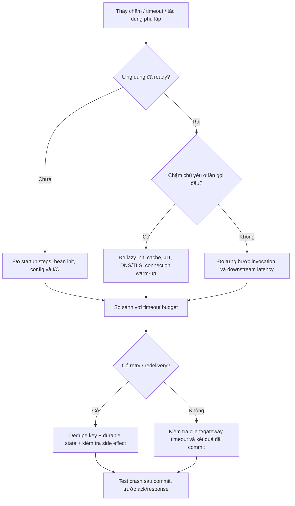

# Chẩn đoán thời gian khởi động dài, vượt timeout hoặc lặp tác dụng phụ trong Spring Cloud Function

## 1. Vấn đề: cùng một hàm có thể chậm hoặc được gọi lại ở nhiều tầng

**Spring Cloud Function (SCF)** tổ chức logic nghiệp vụ dưới dạng các bean `Supplier<O>`, `Function<I, O>` và `Consumer<I>`. `FunctionCatalog` đăng ký, ghép (composition), chuyển đổi đầu vào/đầu ra và giúp tái sử dụng cùng một logic qua **HTTP, sự kiện hoặc môi trường serverless**.

Mô hình này tách code nghiệp vụ khỏi giao thức, nhưng **không xóa những khác biệt về vòng đời và thời gian thực thi**. Một `Function<OrderCommand, OrderReceipt>` có thể:

- Chạy bình thường trong Spring Boot HTTP server đã khởi động từ lâu.
- Mất nhiều thời gian hơn ở lần gọi đầu sau khi process/JVM hoặc môi trường serverless vừa được tạo (**cold start**).
- Vượt thời hạn xử lý của HTTP client, gateway hoặc nền tảng serverless (**timeout**) dù code phía sau vẫn đang hoàn tất tác dụng phụ.
- Được client, broker hoặc nền tảng gửi lại cùng yêu cầu (**retry/redelivery**), tạo hai bản ghi hoặc gọi external API hai lần nếu code chưa idempotent.

Đây không phải ba lỗi độc lập hoàn toàn; chúng có thể tạo thành **chuỗi sự cố**:

```text
Cold start chậm
    -> Request hết hạn ở gateway/client
    -> Client hoặc nguồn sự kiện retry
    -> Cùng nghiệp vụ thực thi lần thứ hai
    -> Database có hai bản ghi / thanh toán hai lần / gửi email hai lần
```

**Mục tiêu chẩn đoán:** xác định thời gian mất ở giai đoạn nào, bên nào đặt timeout, ai thực hiện retry, và tác dụng phụ đã hoàn tất trước khi request bị coi là thất bại hay chưa.

### Sau bài này, người học sẽ

1. Phân biệt **startup**, **cold-start initialization**, **first invocation**, **warm invocation** và **downstream latency**.
2. Đọc timeline thời gian và tìm đúng lớp timeout: client, gateway, server, function platform, broker, database hoặc remote API.
3. Đo khởi động Spring Boot bằng `ApplicationReadyEvent`, `BufferingApplicationStartup`, Actuator và trace theo invocation.
4. Nhận ra các điểm dễ gây side effect lặp: `@PostConstruct`, `CommandLineRunner`, `Supplier`, retry, redelivery và concurrency.
5. Thực hiện thí nghiệm HTTP với hai function: một function **không idempotent** và một function **khử trùng lặp trong bộ nhớ**.
6. Hiểu tại sao `ConcurrentHashMap` chỉ là demo, còn production cần **idempotency key + trạng thái bền vững + unique constraint/transaction + outbox**.
7. Viết runbook và test các tình huống timeout sau khi tác dụng phụ đã xảy ra.

## 2. Cần phân biệt đúng năm mốc thời gian

### 2.1. Application startup

Đối với ứng dụng Spring Boot chạy lâu dài, startup thường gồm:

```text
OS tạo process / khởi động JVM
  -> SpringApplication.run()
  -> tải configuration, tạo ApplicationContext
  -> scan/khởi tạo beans, auto-configuration, conversions
  -> tạo FunctionCatalog và các functional beans
  -> web server, kết nối/phụ thuộc được thiết lập theo cấu hình
  -> ApplicationReadyEvent
  -> sẵn sàng nhận traffic
```

**Không phải mọi thứ đều diễn ra trước ApplicationReadyEvent.** Chế độ lazy initialization, client SDK tạo kết nối trễ, TLS handshake, JIT compilation hoặc cache warm-up có thể khiến **request đầu tiên** tiếp tục chậm sau khi ứng dụng báo ready.

### 2.2. Cold-start initialization của serverless

Một số nền tảng serverless có thể scale về zero hoặc tạo thêm execution environment mới khi tải tăng. Trên AWS Lambda với Java, quá trình cold start có thể bao gồm tải code, khởi động JVM và khởi tạo Spring context trước khi handler xử lý event. SCF cung cấp adapter cho Lambda, nhưng **thời gian cold start vẫn phụ thuộc nền tảng, dependency, cấu hình bộ nhớ/CPU và code khởi tạo**.

**Không đồng nhất:**

- Một cold start của execution environment **không phải** một HTTP request thông thường đến Spring Boot server đã chạy.
- Lambda invocation đồng bộ, invocation bất đồng bộ và event-source mapping có **quy tắc retry khác nhau**.
- Một instance warm không bảo đảm các lần gọi sau luôn nhanh: thread pool, GC, DB pool, network và tải đồng thời có thể thay đổi.

### 2.3. First invocation và warm invocation

Ngay sau khi Spring Boot **ready**, lần gọi đầu có thể còn tốn thời gian cho:

- JIT compilation và class loading chưa xảy ra.
- Tạo kết nối database/HTTP, TLS handshake, DNS.
- Chuẩn bị serializer, validation metadata hoặc cache.
- Khởi tạo lazy bean, function wrapper hoặc converter.
- Tải metadata/secret theo cách ứng dụng cấu hình.

Vì thế phải đo **startup duration** và **first-request latency** riêng, không cộng gộp rồi gọi tất cả là startup.

### 2.4. Thời gian xử lý nghiệp vụ

Thời gian `Function.apply()` có thể bao gồm nhiều thao tác:

```text
HTTP/event decode
 -> conversion -> FunctionCatalog lookup/composition
 -> business logic
 -> DB transaction
 -> external payment/email/HTTP call
 -> response encoding/acknowledgement
```

Trong composition như `normalize|validate|persist`, phải đo từng bước để biết nút nghẽn ở conversion, validation hay tác dụng phụ của `persist`. Một hàm nhanh khi gọi đơn lẻ không bảo đảm toàn pipeline nhanh khi có remote I/O.

### 2.5. Thời điểm client thực sự nhận kết quả

**Server đã ghi dữ liệu** và **client nhận 200 OK** là hai sự kiện khác nhau. Giữa chúng có network, reverse proxy, serialization và kết nối có thể bị ngắt.

| Mốc | Sự kiện | Có thể quan sát ở đâu? |
| --- | --- | --- |
| T0 | Client bắt đầu request | HTTP client/tracing |
| T1 | Gateway chuyển request | Gateway/access log |
| T2 | Handler/function bắt đầu | Server trace + invocation ID |
| T3 | DB commit hoặc external side effect hoàn tất | DB audit/transaction log |
| T4 | Server tạo response | Application/server metrics |
| T5 | Client nhận response hoặc timeout | Client log |
| T6 | Retry/redelivery xảy ra | Client/broker/platform logs |

Nếu `T3 < T5` nhưng client timeout trước khi nhận response, **retry có thể tạo tác dụng phụ trùng**. Kết luận "client timeout nên transaction chắc chắn rollback" là sai.

## 3. Dấu hiệu và nguyên nhân: bảng phân loại ban đầu

| Triệu chứng | Nghi ngờ đầu tiên | Điều cần xác minh |
| --- | --- | --- |
| Sau deploy, request đầu chậm; các request sau nhanh | Cold start, lazy initialization, JIT, kết nối lần đầu | Phân biệt startup và first-invocation duration |
| Chưa nhận được traffic mà process đã khởi động rất lâu | Bean init, classpath, dependency injection, remote config, DB migration | Startup steps, bean initialization, log trước ready |
| Lambda cold invocation chậm nhưng warm nhanh | JVM/Spring init + runtime/platform overhead | Init duration, handler duration, memory/CPU |
| HTTP 504 ở gateway nhưng application log báo xử lý thành công | Gateway timeout sớm hơn server | So sánh timestamps, transaction commit và client deadline |
| Lỗi 408/timeout ở client nhưng không có log server | Request chưa đến server, DNS/TLS/connect/network | Trace ID từ gateway và client |
| Cùng order được xử lý 2 lần sau timeout | HTTP retry hoặc broker redelivery, thiếu idempotency | Correlation key, attempt ID, transaction và ack |
| Email được gửi lại mỗi khi scale out | Side effect trong `@PostConstruct` hoặc `CommandLineRunner` | Số process/instance và lifecycle hooks |
| Consumer nhận lại event dù đã gọi external API | Ack/offset chưa commit hoặc kết nối đứt sau side effect | Broker delivery/ack offset và external response |
| Timeout tăng khi tải cao | Thread starvation, pool saturation, queue, backpressure | Pool, concurrency, GC, CPU, memory, queue depth |
| Tăng timeout giúp giảm lỗi nhưng duplicate vẫn có | Retry và side effect chưa được thiết kế idempotent | Kiểm tra nghiệp vụ lặp độc lập với timeout |

### Sơ đồ phân nhánh chẩn đoán



## 4. Đo startup Spring Boot đúng cách

### 4.1. Mốc cơ bản: ApplicationReadyEvent

Trong Spring Boot, `ApplicationReadyEvent` được phát ở giai đoạn ứng dụng sẵn sàng phục vụ. Trên các dòng Spring Boot tương thích, `event.getTimeTaken()` trả về thời lượng startup mà Spring Boot ghi nhận (có thể `null` nếu không có dữ liệu).

```java
import java.time.Duration;
import org.springframework.boot.context.event.ApplicationReadyEvent;
import org.springframework.context.event.EventListener;
import org.springframework.stereotype.Component;

@Component
class StartupLogger {

    @EventListener
    public void onReady(ApplicationReadyEvent event) {
        Duration elapsed = event.getTimeTaken();
        System.out.println("BOOT_READY startupMs=" +
                (elapsed == null ? "unknown" : elapsed.toMillis()));
    }
}
```

Con số này đo theo cơ chế Spring Boot, **không đồng nghĩa** với tổng thời gian từ lúc nền tảng cấp tài nguyên cho đến khi người dùng nhận response đầu tiên.

### 4.2. BufferingApplicationStartup để thấy từng startup step

Spring Boot hỗ trợ `BufferingApplicationStartup` để ghi nhận các bước khởi động. Ví dụ:

```java
import org.springframework.boot.SpringApplication;
import org.springframework.boot.autoconfigure.SpringBootApplication;
import org.springframework.boot.context.metrics.buffering.BufferingApplicationStartup;

@SpringBootApplication
public class DiagnosticApplication {
    public static void main(String[] args) {
        SpringApplication application =
                new SpringApplication(DiagnosticApplication.class);
        application.setApplicationStartup(
                new BufferingApplicationStartup(2048));
        application.run(args);
    }
}
```

Nếu thêm Spring Boot Actuator và **chủ động** expose endpoint `startup`, có thể đọc các startup steps ở `/actuator/startup` trong môi trường kiểm thử. Ví dụ cấu hình:

```properties
management.endpoints.web.exposure.include=health,info,startup
```

Kiểm tra:

```bash
curl -i 'http://localhost:8080/actuator/health'
curl -i 'http://localhost:8080/actuator/startup'
```

**Cảnh báo bảo mật:** không mở rộng actuator endpoints ra Internet công khai. Giới hạn qua Spring Security, mạng quản trị hoặc profile phát triển. Startup information có thể bộc lộ cấu trúc app; chỉ bật khi phù hợp và tránh giữ buffer không cần thiết trong production.

### 4.3. Các mốc ngoài Spring Boot

Khi serverless cold start, nên bổ sung dữ liệu từ **nền tảng**:

- Container/process được tạo lúc nào?
- Init duration (nếu nền tảng cung cấp) bao lâu?
- Handler/function bắt đầu lúc nào?
- Handler duration, billed duration và timeout settings là bao nhiêu?
- Execution environment là mới hay được tái sử dụng?
- Có bao nhiêu environment được khởi tạo đồng thời trong một đợt traffic?

Ví dụ với AWS Lambda, các log/metrics của Lambda giúp phân biệt chi phí init và thời gian invocation. Không tự đo cold start bằng cách nhìn duy nhất vào thời gian HTTP `curl`; nó bao gồm mạng, gateway và nhiều thành phần khác.

### 4.4. Phân biệt readiness và liveness

- **Liveness:** process còn hoạt động hay đã kẹt đến mức cần được khởi động lại?
- **Readiness:** đã sẵn sàng nhận traffic chưa, bao gồm những dependency thực sự bắt buộc?
- **Startup:** đang ở giai đoạn khởi tạo, có cần thời gian chờ thêm không?

Một readiness check bị cấu hình quá sớm có thể khiến gateway gửi request tới app khi function/converter/DB chưa sẵn sàng. Ngược lại, readiness phụ thuộc vào remote service dễ dao động cũng có thể gây restart/traffic churn không cần thiết. Thiết kế probe theo đặc điểm triển khai, không dùng probe để che một lỗi khởi tạo kéo dài vô hạn.

## 5. Tại sao Spring Cloud Function có thể khởi động lâu?

SCF tích hợp Spring Boot, `FunctionCatalog`, conversion và adapter. Những nguyên nhân phổ biến cần kiểm tra:

| Nhóm nguyên nhân | Ví dụ | Hướng xác minh |
| --- | --- | --- |
| Quá nhiều dependency | Cả web, messaging, cloud SDK, observability không dùng | Dependency graph và startup steps, **không** xóa tùy tiện |
| Bean initialization | Constructor/FactoryBean khởi tạo nhiều resource | `ApplicationStartup`, thread dump, sampling |
| Network trong startup | Lấy secret, gọi config/metadata server, DB ping, DNS/TLS | Phân tách DNS/connect/read timeout, trace network |
| Schema migration | Flyway/Liquibase chạy trước ready | Log migration và lock của DB |
| Tạo pool/client | Connection pool, TLS handshake, SDK client | Time-to-first-connect và pool metrics |
| Scan/auto-configuration | Nhiều package/config và conditional beans | Startup steps, condition evaluation report nếu cần |
| Chế độ serverless | Tải artifact, JVM init, Spring context init | Cold-init metrics của platform |
| CPU/memory/GC | Thiếu CPU hoặc heap quá nhỏ/lớn gây GC | CPU throttle, GC, heap, allocation profiling |
| Lazy initialization | Giảm startup nhưng tạo bean khi request đầu vào | So sánh startup và first-invocation p95/p99 |
| Composition/conversion | FunctionCatalog wrapper, JSON conversion, Message metadata | Trace lần gọi đầu, converter errors |
| Nút nghẽn ngoài ứng dụng | Gateway, proxy, DNS hoặc shared infrastructure | So sánh client/server/infra timestamps |

### 5.1. Điều chỉnh nên thực hiện theo số liệu

1. **Đo baseline**: startup p50/p95, cold-init, first response latency, warm latency và CPU/memory.
2. **Tìm bước chậm nhất**: bean, remote call, migration hoặc initialization của SDK.
3. **Giảm công việc không thiết yếu trong initialization**: tránh request mạng dài, index lớn hoặc khối lượng hàng nghìn bản ghi lúc process boot.
4. **Chọn dependency đúng nhu cầu**: dùng SCF context khi không cần tự động xuất HTTP; không đem thêm toàn bộ web stack vào một adapter event nhỏ chỉ vì tiện.
5. **Thử các cơ chế nền tảng phù hợp**: chẳng hạn AWS Lambda SnapStart khi runtime và cách dùng trạng thái cho phép, cấu hình memory/CPU, Java AOT/native image theo release train.
6. **Chạy lại đo đạc trong môi trường giống production**, đặc biệt cold vs warm và khi scale out.

**Không có một property SCF chung nào bảo đảm mọi startup đều nhanh.** Ví dụ `spring.main.lazy-initialization=true` có thể giảm bước khởi động ban đầu nhưng **dịch chi phí sang request đầu tiên**, nơi timeout có thể còn nghiêm trọng hơn.

### 5.2. Cảnh báo với SnapStart, snapshot và prewarming

Snapshot môi trường được khởi tạo sẵn có thể giảm cold start, nhưng **không được tin rằng connection, token, secret, random state hoặc external handle luôn hợp lệ sau restore**. Phải tuân theo hướng dẫn platform về snapshot/restore, làm mới credential/client nếu cần và kiểm tra tính duy nhất của ID. Không tạo một idempotency key một lần trong static initializer rồi dùng lại cho mọi invocation.

## 6. Timeout: cùng một invocation có nhiều đồng hồ đếm ngược

Một request có thể đi qua:

```text
Client
 -> DNS/TLS/connect deadline
 -> API Gateway / Load Balancer / Ingress timeout
 -> HTTP server / servlet thread / reactive timeout
 -> FunctionCatalog + business logic
 -> DB query/transaction timeout
 -> External HTTP client timeout
 -> Event ack / platform invocation deadline
```

Đây là các **time budget độc lập**. Nếu gateway dừng chờ trước khi function hoàn tất, client có thể nhận 504 trong khi server vẫn tiếp tục xử lý.

| Tầng | Timeout thường liên quan | Sau khi hết hạn có chắc nghiệp vụ dừng không? |
| --- | --- | --- |
| HTTP client | Connect timeout, read/response timeout | Không; client có thể chỉ ngừng chờ |
| Gateway/Ingress | Upstream response timeout | Không; backend có thể vẫn chạy |
| Spring MVC/WebFlux | Async processing/server-specific limits | Không thể suy luận mọi tác dụng phụ đã rollback |
| Serverless invocation | Platform deadline | Environment có thể bị dừng/reset theo nền tảng; external side effect đã hoàn tất có thể còn |
| DB | Statement/transaction timeout | Cần xem DB, isolation và commit thực tế |
| HTTP client bên trong function | Connect/read timeout tới downstream | Downstream có thể đã xử lý nhưng response bị mất |
| Broker consumer | Visibility timeout, ack deadline, max poll interval | Message có thể được giao lại khi chưa ack |
| Scheduler/Retry library | Retry duration, backoff, max attempts | Có thể tạo nhiều lần thực thi trong một request logic |

### 6.1. Tạo timeout budget có chủ đích

Ví dụ minh họa, không phải mặc định của SCF:

```text
Client chờ tối đa:              5.0 giây
Gateway chờ backend:            4.5 giây
Ứng dụng dành cho xử lý:        4.0 giây
Downstream HTTP read timeout:   2.0 giây
DB statement timeout:           1.5 giây
```

Ngân sách thực phải tính cả network/serialization và đường đi **tuần tự hay song song**. Không thể chỉ cộng tất cả số timeout để có SLA: một external call có thể nằm trong DB transaction, retry có thể lặp nhiều lần, queue waiting và startup có thể ăn bớt toàn bộ deadline.

**Nguyên tắc:** timeout phải phản ánh thời hạn nghiệp vụ và hành vi an toàn khi hủy. Không tăng tất cả timeout lên một giá trị lớn để “hết lỗi”; điều đó có thể chỉ kéo dài thời gian chờ, chiếm thread/connection và khiến retry trùng lặp khó thấy hơn.

### 6.2. Timeout không đồng nghĩa cancellation

Trong synchronous Java code, ngắt kết nối HTTP thường không bảo đảm các thread đang chạy code nghiệp vụ bị dừng ngay. Với Reactor `Flux`/`Mono`, cancellation có thể truyền qua pipeline, nhưng blocking I/O hoặc external side effect đã gửi đi vẫn có thể không hủy được.

Nếu một remote service **đã nhận thanh toán** rồi HTTP client của function timeout, retry thanh toán mà không có idempotency key là rủi ro cao.

### 6.3. Phân loại lỗi chính xác

- `408 Request Timeout`: server timeout khi nhận request theo nghĩa HTTP.
- `504 Gateway Timeout`: gateway/proxy không nhận phản hồi upstream đúng hạn.
- Timeout ở HTTP client có thể chỉ là exception client, **không có HTTP status**.
- Một `500` từ function có thể do downstream exception, không nhất thiết startup.
- Một 202 Accepted không chứng minh tác dụng phụ đã hoàn tất hoặc message đã được lưu bền vững.

Dùng log, trace và metrics ở **cả hai đầu** để xác định request đã đến nơi chưa, function đã bắt đầu chưa và tác dụng phụ đã xảy ra chưa.

## 7. Vì sao retry hoặc redelivery có thể tạo tác dụng phụ lặp?

Xét hàm:

```java
@Bean
Function<OrderCommand, OrderReceipt> submitOrder() {
    return command -> {
        paymentService.charge(command.orderId());
        emailService.sendReceipt(command.orderId());
        return new OrderReceipt(command.orderId(), "OK");
    };
}
```

*Đây là đoạn phản ví dụ khái niệm:* `paymentService`/`emailService` chưa được khai báo; nó minh họa rủi ro, không phải chương trình chạy độc lập.

Timeline sự cố:

```text
Lần 1:
  10:00:00  Event/HTTP request cho order-42
  10:00:01  paymentService.charge() THÀNH CÔNG
  10:00:03  HTTP response/ack không tới client/broker
  10:00:04  Client/broker coi là timeout, thử lại

Lần 2:
  10:00:05  Cùng order-42 được gọi lại
  10:00:06  paymentService.charge() chạy LẦN NỮA
  10:00:07  Khách bị thu hai lần
```

Điều này có thể xảy ra ngay cả khi lần thứ nhất **đã hoàn tất phần nghiệp vụ quan trọng**. Lỗi nằm ở **khoảng trống giữa commit side effect và xác nhận kết quả**.

### 7.1. Những nguồn retry khác nhau

| Nguồn | Vì sao gọi lại? | Lưu ý |
| --- | --- | --- |
| HTTP client/browser/mobile app | Timeout, mất kết nối, người dùng bấm lại | Request ID có thể khác, **business key** nên ổn định |
| API gateway/reverse proxy | Chính sách retry upstream | Chỉ retry method/operation có hợp đồng an toàn |
| Resilience4j/Spring Retry | Exception/timeout/bulkhead policy | Cần biết hàm có side effect hay không |
| AWS Lambda asynchronous invocation | Function error/timeout hoặc duplicate delivery | Theo tài liệu AWS, retry tự động có cấu hình; không suy ra behavior của synchronous invocation |
| SQS/Lambda event source mapping | Visibility timeout, batch failure | Có thể redeliver message đã xử lý, tùy ack/batch behavior |
| Kafka consumer | Rebalance, crash trước khi commit offset, retry | At-least-once ở ứng dụng có thể tạo duplicate side effect |
| Scheduler/Supplier | Kích hoạt theo lịch, polling, có nhiều instances | Không đồng nhất invocation theo lịch với một giao dịch nghiệp vụ duy nhất |
| Nền tảng scale-out | Nhiều môi trường cùng nhận công việc khác nhau | Shared dedupe state phải hoạt động cross-instance |

**Không có một chính sách retry duy nhất cho mọi serverless adapter.** Chẳng hạn AWS Lambda synchronous invocation thường để phía client/invoker quyết định retry, trong khi asynchronous invocation có cơ chế retry của Lambda. Phải kiểm tra event source cụ thể, retry settings, dead-letter/on-failure destination và giới hạn thời gian.

### 7.2. Không tạo side effect trong lifecycle hook

Các đoạn sau rất nguy hiểm nếu chúng xử lý **nghiệp vụ chỉ được phép chạy một lần toàn hệ thống**:

```java
@PostConstruct
void onInit() {
    sendWelcomeEmailToAllCustomers();
}

@Bean
CommandLineRunner startupJob() {
    return args -> billingService.chargeMonthlyFees();
}
```

*Hai đoạn trên là phản ví dụ minh họa, các service chưa được khai báo.*

Mỗi process hoặc execution environment có thể chạy init hook riêng khi boot/cold start/scale-out/redeploy. Chúng **không phải** distributed once-only scheduler. Nếu buộc chạy migration hoặc batch, dùng job coordinator, lock bền vững, scheduler có cơ chế leader election hoặc một hệ thống workflow chuyên trách.

### 7.3. Supplier không mặc nhiên chạy một lần

`Supplier<T>` mô tả cách **cung cấp dữ liệu khi được gọi**; số lần gọi phụ thuộc HTTP adapter, scheduler, Spring Cloud Stream poller hoặc serverless platform. Một `Supplier` sinh ra side effect không idempotent có thể bị gọi nhiều lần và tạo dữ liệu trùng nếu không có cơ chế kiểm soát riêng.

## 8. Demo Java: nhìn thấy duplicate và khử trùng lặp trong một JVM

Ví dụ này **có thể chạy** trên Spring Boot/SCF HTTP adapter tương thích, dùng Java 17+. Nó tạo hai bean:

- `unsafeSubmit`: tăng bộ đếm trên **mỗi invocation**.
- `demoSafeSubmit`: dùng `ConcurrentHashMap.compute()` để xử lý **một requestId đúng một lần trong cùng một JVM đang sống**.

Mục đích là dạy cách nhận diện retry. **Không sử dụng in-memory map làm giải pháp production** vì mất dữ liệu khi restart, không chia sẻ giữa nhiều instances và không đồng bộ với DB hoặc external payment.

### 8.1. Maven dependencies

Dự án Spring Boot dùng Spring Cloud BOM tương thích, thêm:

```xml
<dependencies>
    <dependency>
        <groupId>org.springframework.cloud</groupId>
        <artifactId>spring-cloud-starter-function-web</artifactId>
    </dependency>
    <dependency>
        <groupId>org.springframework.boot</groupId>
        <artifactId>spring-boot-starter-actuator</artifactId>
    </dependency>
</dependencies>
```

Cấu hình phiên bản Java/Spring Boot/Spring Cloud cần theo BOM đã chọn. Không tự gán version mới nhất của một starter trong khi nền tảng đang dùng release train cũ.

### 8.2. Source Java đầy đủ

Tạo file `src/main/java/demo/DiagnosticsApplication.java`:

```java
package demo;

import java.time.Duration;
import java.util.concurrent.ConcurrentHashMap;
import java.util.concurrent.ConcurrentMap;
import java.util.concurrent.atomic.AtomicInteger;
import java.util.function.Function;

import org.springframework.boot.SpringApplication;
import org.springframework.boot.autoconfigure.SpringBootApplication;
import org.springframework.boot.context.event.ApplicationReadyEvent;
import org.springframework.context.annotation.Bean;
import org.springframework.context.event.EventListener;
import org.springframework.stereotype.Component;

@SpringBootApplication
public class DiagnosticsApplication {

    public static void main(String[] args) {
        SpringApplication.run(DiagnosticsApplication.class, args);
    }

    @Bean
    public Function<OrderCommand, OrderReceipt> unsafeSubmit(
            InMemoryLedger ledger) {
        return command -> ledger.recordUnsafe(command);
    }

    @Bean
    public Function<OrderCommand, OrderReceipt> demoSafeSubmit(
            InMemoryLedger ledger) {
        return command -> ledger.recordOnceInThisJvm(command);
    }
}

record OrderCommand(
        String requestId, String orderId, int quantity) {}

record OrderReceipt(
        String orderId, String status, int effectSequence) {}

record StoredOrder(
        OrderCommand original, OrderReceipt receipt) {}

@Component
class InMemoryLedger {

    private final AtomicInteger effectCount = new AtomicInteger();
    private final ConcurrentMap<String, StoredOrder> processed =
            new ConcurrentHashMap<>();

    public OrderReceipt recordUnsafe(OrderCommand command) {
        validate(command);
        int sequence = effectCount.incrementAndGet();
        System.out.println("UNSAFE_EFFECT order=" + command.orderId()
                + " sequence=" + sequence);
        return new OrderReceipt(
                command.orderId(), "UNSAFE_RECORDED", sequence);
    }

    public OrderReceipt recordOnceInThisJvm(OrderCommand command) {
        validate(command);

        StoredOrder stored = processed.compute(
                command.requestId(), (key, existing) -> {
                    if (existing != null) {
                        if (!existing.original().equals(command)) {
                            throw new IllegalArgumentException(
                                    "Request ID reused for different data");
                        }
                        return existing;
                    }

                    int sequence = effectCount.incrementAndGet();
                    System.out.println("DEMO_EFFECT order=" +
                            command.orderId() +
                            " sequence=" + sequence);

                    return new StoredOrder(
                            command,
                            new OrderReceipt(
                                    command.orderId(),
                                    "RECORDED_IN_MEMORY",
                                    sequence));
                });

        return stored.receipt();
    }

    private static void validate(OrderCommand command) {
        if (command == null
                || command.requestId() == null
                || command.requestId().isBlank()
                || command.orderId() == null
                || command.orderId().isBlank()
                || command.quantity() <= 0) {
            throw new IllegalArgumentException(
                    "requestId, orderId and quantity are required");
        }
    }

    @EventListener
    public void onReady(ApplicationReadyEvent event) {
        Duration elapsed = event.getTimeTaken();
        System.out.println("BOOT_READY startupMs=" +
                (elapsed == null ? "unknown" : elapsed.toMillis()));
    }
}
```

**Giải thích điểm kỹ thuật:**

1. `unsafeSubmit` tạo `UNSAFE_EFFECT` mỗi lần gọi, dù request body giống hệt.
2. `demoSafeSubmit` dùng `ConcurrentHashMap.compute()` để serialize thao tác cập nhật **cùng một key trong JVM này**. Một key có payload khác bị từ chối để không vô tình xem hai nghiệp vụ khác nhau là một.
3. `effectSequence` là bộ đếm cho minh họa, **không đại diện ID giao dịch thật**; `effectCount` được chia sẻ giữa hai bean.
4. Các lệnh `System.out.println()` là side effect được dùng để quan sát thí nghiệm, **không phải** một cơ chế ghi durable.
5. Nếu JVM restart, `processed` trở về rỗng; nếu có hai pod/Lambda environments, mỗi instance có map riêng.
6. Nếu tác dụng phụ external thất bại ở giữa `compute()`, việc retry có thể tiếp tục tạo tác dụng phụ. Cơ chế này **không** giải quyết atomicity của database/payment.
7. SCF HTTP adapter và Spring Boot có thể trả các status khác nhau cho `IllegalArgumentException` nếu chưa định nghĩa HTTP error mapping; đừng mặc định đó luôn là 400.

### 8.3. Gọi hai endpoint

Chạy:

```bash
mvn spring-boot:run
```

Giả định server tại `http://localhost:8080`. Các lệnh dưới đây dùng Bash; trong PowerShell gọi `curl.exe`.

```bash
# Lần 1: unsafe.
curl -i -X POST 'http://localhost:8080/unsafeSubmit' \
  -H 'Content-Type: application/json' \
  -H 'Accept: application/json' \
  --data '{"requestId":"req-100","orderId":"ord-42","quantity":2}'

# Lần 2: cùng request, unsafe lại ghi thêm một side effect.
curl -i -X POST 'http://localhost:8080/unsafeSubmit' \
  -H 'Content-Type: application/json' \
  -H 'Accept: application/json' \
  --data '{"requestId":"req-100","orderId":"ord-42","quantity":2}'

# Lần 1: dedupe trong JVM.
curl -i -X POST 'http://localhost:8080/demoSafeSubmit' \
  -H 'Content-Type: application/json' \
  -H 'Accept: application/json' \
  --data '{"requestId":"req-200","orderId":"ord-42","quantity":2}'

# Lần 2: cùng key và cùng payload, trả lại receipt cũ.
curl -i -X POST 'http://localhost:8080/demoSafeSubmit' \
  -H 'Content-Type: application/json' \
  -H 'Accept: application/json' \
  --data '{"requestId":"req-200","orderId":"ord-42","quantity":2}'
```

Phản hồi `unsafeSubmit` ở hai lần gọi có thể có `effectSequence` khác nhau, ví dụ:

```json
{"orderId":"ord-42","status":"UNSAFE_RECORDED","effectSequence":1}
```

và:

```json
{"orderId":"ord-42","status":"UNSAFE_RECORDED","effectSequence":2}
```

Trong khi `demoSafeSubmit` trả **cùng một `effectSequence`** cho cả hai request cùng key/payload khi process chưa restart.

### 8.4. Thử reuse key sai dữ liệu

```bash
curl -i -X POST 'http://localhost:8080/demoSafeSubmit' \
  -H 'Content-Type: application/json' \
  --data '{"requestId":"req-200","orderId":"ord-43","quantity":5}'
```

Vì `req-200` đã gắn với `ord-42`, `InMemoryLedger` từ chối yêu cầu có cùng key nhưng payload khác. Trong một API production, có thể quy định response **409 Conflict** cho trường hợp này; nhưng ví dụ SCF auto-export không viết riêng `@ControllerAdvice`, nên status thực phụ thuộc exception mapping của adapter.

### 8.5. Test restart cho thấy giới hạn

Dừng ứng dụng, khởi động lại và gọi `/demoSafeSubmit` với `req-200` một lần nữa. Vì map được tạo mới, bạn sẽ thấy `DEMO_EFFECT` xuất hiện lại và bộ đếm bắt đầu lại. Đây là bằng chứng **dữ liệu trong JVM không đủ để ngăn duplicate sau restart/cold start**.

## 9. Idempotency bền vững: lựa chọn cho production

Với payment, tạo đơn hàng hoặc xuất sự kiện, cần một thiết kế có thể chống retry **giữa nhiều instances và sau restart**.

### 9.1. Xác định idempotency key theo nghiệp vụ

- **HTTP:** client gửi `Idempotency-Key` ổn định qua mọi retry của **cùng một command**; server gắn với user/tenant, endpoint và fingerprint payload.
- **Event:** tận dụng `eventId`, business transaction ID hoặc nguồn định danh ổn định từ producer; không dùng delivery attempt ID vì mỗi attempt có thể khác.
- **Scheduled job:** key gắn với kỳ xử lý, ví dụ `billing:2026-11:customer-42`, thay vì UUID mới mỗi lần chạy.
- **Supplier:** nếu tạo tác dụng phụ, phải có định danh đại diện cho operation/kỳ làm việc, không tự giả định mỗi lần poll là một nghiệp vụ mới.

Key cần đủ unique theo **phạm vi**, có giới hạn độ dài/format, được kiểm soát thời hạn lưu và **không chứa secret/PII trực tiếp**. Nếu client dùng lại key với payload khác, trả lỗi xung đột theo HTTP contract (thường 409) hoặc cơ chế message handling tương ứng.

### 9.2. Bảng trạng thái bền vững

Một schema minh họa cho PostgreSQL:

```sql
CREATE TABLE processed_operations (
    tenant_id      VARCHAR(64) NOT NULL,
    operation_type VARCHAR(64) NOT NULL,
    idempotency_key VARCHAR(128) NOT NULL,
    request_hash   VARCHAR(128) NOT NULL,
    status         VARCHAR(24) NOT NULL,
    response_json  JSONB,
    updated_at     TIMESTAMPTZ NOT NULL DEFAULT now(),
    PRIMARY KEY (tenant_id, operation_type, idempotency_key)
);
```

Cần định nghĩa các trạng thái như:

```text
NEW
  -> PROCESSING
     -> SUCCEEDED  (đã commit kết quả)
     -> FAILED_RETRYABLE (có thể retry an toàn)
     -> FAILED_FINAL (không retry)
```

**Không đơn giản đánh dấu SUCCEEDED trước khi external side effect thật sự hoàn tất.** Và không giữ một giao dịch DB mở lâu trong khi gọi mạng ngoài nếu kiến trúc không kiểm soát được lock/timeout.

### 9.3. Thuật toán giao dịch khái niệm

```text
1. Nhận command kèm (tenant, operation, idempotencyKey).
2. Tính fingerprint payload (không tính các trường thay đổi giữa retry).
3. Trong transaction: INSERT key mới với unique constraint.
4. Nếu key đã tồn tại:
     - hash khác -> Conflict / không thực thi side effect;
     - SUCCEEDED -> trả kết quả đã lưu hoặc xác nhận đã xử lý;
     - PROCESSING -> không thực thi song song; trả trạng thái đang xử lý
       hoặc điều phối wait/lease an toàn;
     - FAILED_* -> quyết định theo chính sách retry.
5. Khi xử lý dữ liệu cùng database:
     - lưu business record và đánh dấu SUCCEEDED cùng transaction.
6. Nếu cần gọi hệ thống ngoài:
     - ghi outbox event/command trong transaction;
     - worker gửi event với idempotency key cho downstream;
     - downstream tự dedupe nếu cần;
     - ghi nhận trạng thái đã xử lý, xử lý retry và reconciliation.
7. Chỉ ack message / trả success theo hợp đồng sau khi trạng thái
   bền vững tương ứng đã được commit.
```

**Cảnh báo atomicity:** một unique constraint chỉ tránh **cùng một key được claim song song**; nó không tự làm atomic giữa database và hệ thống thanh toán/email bên ngoài. Khi external system có API idempotency, truyền **cùng key** đến nó. Khi không có, cần outbox, reconciliation và đôi khi quy trình bù trừ; “exactly once” trên toàn chuỗi nhiều hệ thống thường không thể được suy ra chỉ từ một transaction nội bộ.

### 9.4. Ví dụ câu lệnh claim key

PostgreSQL cho phép:

```sql
INSERT INTO processed_operations (
    tenant_id, operation_type, idempotency_key,
    request_hash, status
)
VALUES ('t-42', 'CREATE_ORDER', 'req-100',
        'sha256-of-canonical-command', 'PROCESSING')
ON CONFLICT DO NOTHING;
```

Sau câu lệnh này, **phải kiểm tra số dòng được insert**. Nếu không có dòng mới, đọc record hiện hữu dưới giao dịch và quy tắc khóa phù hợp rồi áp dụng nhánh duplicate/conflict. Đây là SQL minh họa, chưa phải toàn bộ transaction protocol. Đừng coi `ON CONFLICT DO NOTHING` tự hoàn thành dedupe state machine.

### 9.5. Transactional outbox

Khi nghiệp vụ cần ghi database **và** phát sự kiện:

```text
Một transaction DB:
  - INSERT order / UPDATE trạng thái
  - INSERT outbox_event (eventId, orderId, payload)
  - UPDATE processed_operations = SUCCEEDED
COMMIT

Worker riêng:
  - đọc outbox event chưa gửi
  - gửi tới broker/downstream
  - đánh dấu đã gửi sau khi xác nhận
  - retry nếu lỗi (downstream cũng dedupe theo eventId)
```

Outbox giảm rủi ro “commit DB xong nhưng crash trước khi phát event”, nhưng event vẫn có thể **được gửi hơn một lần** nếu worker crash sau khi broker nhận mà trước khi ghi đã gửi. Consumer vẫn cần idempotency. Cần metrics cho outbox backlog, max age và số lần retry.

## 10. Đặt retry đúng chỗ, không tạo bão retry

Một chính sách retry có thể làm vấn đề nặng hơn khi service đang quá tải.

### 10.1. Khi nào nên retry?

| Loại lỗi | Hướng xử lý |
| --- | --- |
| Timeout connect tới endpoint chưa gửi request | Có thể retry theo policy, nhưng vẫn phải xác minh trạng thái request |
| Read timeout sau khi gửi POST payment | Không retry mù; dùng idempotency key, query trạng thái |
| HTTP 429 từ downstream | Tôn trọng Retry-After nếu có, backoff + jitter, giới hạn attempts |
| HTTP 503 tạm thời | Retry có ngân sách nếu operation idempotent; dùng circuit breaker |
| JSON invalid/validation 400 | Không retry cùng payload nếu không sửa đầu vào |
| Business conflict 409 | Tùy nghiệp vụ, thường cần reconcile hoặc request mới |
| Event failure sau external side effect | Dedupe trước side effect khi redelivery |
| Startup timeout vì instance chưa ready | Điều chỉnh readiness/scale/initialization; không chỉ tăng retry |

### 10.2. Backoff và giới hạn

Thiết kế policy:

- **Max attempts** và tổng thời lượng retry không vượt deadline cấp trên.
- **Exponential backoff + jitter** để tránh nhiều clients cùng retry một lúc.
- **Circuit breaker/bulkhead** để giảm quá tải downstream.
- **Retry theo lỗi phù hợp** (transient), không retry validation hoặc conflict không thể tự phục hồi.
- **Idempotency bất biến** xuyên suốt các attempt.
- **DLQ/on-failure destination** cho event không xử lý được sau giới hạn, kèm công cụ replay có kiểm soát.

Một retry được log bằng **attempt ID mới** nhưng phải giữ **business operation key** cũ để điều tra được một giao dịch logic có bao nhiêu lần thực thi.

### 10.3. Không thay retry bằng sleep trong function

Không nên dùng `Thread.sleep(5000)` như cách “đợi network ổn định”, nhất là trong reactive pipeline hoặc khi có giới hạn concurrency chặt. Điều đó chỉ chiếm thread/time budget. Với Reactor, dùng toán tử phù hợp và bảo đảm call external thực sự non-blocking; với blocking I/O, dùng executor/scheduler thích hợp và timeout rõ ràng.

## 11. Log, metrics và tracing nên chứa những gì?

Một mẫu log cấu trúc đủ để truy vết:

```json
{
  "event": "function.invoke",
  "function": "submitOrder",
  "operationKeyHash": "a1b2c3...",
  "attemptId": "attempt-7",
  "instanceId": "instance-2",
  "coldStart": false,
  "stage": "db_commit",
  "durationMs": 320,
  "outcome": "succeeded"
}
```

**Không log nguyên payload chứa PII, thẻ thanh toán, secret hoặc idempotency token nhạy cảm.** Có thể dùng key đã hash/HMAC theo thiết kế, tránh nhãn metrics có cardinality quá cao.

| Tín hiệu | Mục đích |
| --- | --- |
| Startup duration p50/p95 | Biết thời gian ứng dụng sẵn sàng |
| Cold-start count/init duration | Biết tần suất và chi phí khởi tạo environment |
| First-invocation vs warm duration | Phát hiện lazy init/JIT/connection warm-up |
| Function invocation p50/p95/p99 | Đo biến động runtime |
| Timeout rate theo lớp | Tách client/gateway/platform/DB/downstream |
| Retry count theo nguồn | Phân biệt client retry và broker redelivery |
| Duplicate suppressed count | Đo các thao tác lặp bị chặn |
| Idempotency conflict count | Phát hiện key reuse sai payload |
| In-progress age / stuck operations | Tìm trạng thái PROCESSING bị kẹt |
| Outbox backlog/oldest age | Phát hiện sự kiện chờ gửi |
| Database commit/error duration | Tìm nút nghẽn transaction |
| CPU, GC, thread/pool queue | Đo saturation thay vì chỉ nhìn latency |

### 11.1. Gắn context xuyên các tầng

Khi có HTTP + FunctionCatalog + event adapter, một request có thể có nhiều loại ID:

- **Trace ID:** nối spans qua HTTP, DB, downstream.
- **Request/attempt ID:** xác định một lần thực thi cụ thể.
- **Business operation/idempotency key:** xác định nghiệp vụ logic cần chạy một lần về hiệu ứng.
- **Message/event ID:** định danh sự kiện từ producer.
- **Instance/environment ID:** phân biệt process/pod/Lambda environment.

Không xem các ID này là tương đương. Một business operation có thể có **nhiều attempt IDs**, nhưng nên có **một operation key** ổn định.

### 11.2. Đo trước và sau mỗi side effect

Ví dụ các sự kiện log:

```text
invoke.start  operation=req-100 attempt=1
db.begin
db.commit   operation=req-100
http.write.start
http.write.failed connection_reset

invoke.start  operation=req-100 attempt=2
dedupe.hit   operation=req-100 status=SUCCEEDED
invoke.end   operation=req-100 duplicate=true
```

Timeline này chứng minh kết nối đứt **sau DB commit**, nên request thứ hai phải trả lại kết quả đã lưu thay vì ghi thêm.

## 12. Chẩn đoán theo từng adapter

### 12.1. HTTP adapter của SCF

Triệu chứng thường thấy:

- URL theo tên function/definition sai dẫn tới 404 hoặc fallback không như mong muốn.
- Function nhận JSON chậm do converter/validation hoặc kết nối downstream.
- Client timeout trước response 200 nhưng function tiếp tục ghi DB.
- Gateway retry POST ngoài ý muốn.

Kiểm tra:

1. URL, method và `spring.cloud.function.definition`, `spring.cloud.function.web.path`.
2. Input `Content-Type` và response `Accept`.
3. Server logs xác nhận đúng function đã được gọi.
4. Gateway timeout và retry policy.
5. Transaction commit trước/sau network disconnect.
6. Business key có bền vững qua các retry không.

### 12.2. Spring Cloud Stream / event adapter

Với event sources, cần quan sát:

- Consumer group, partitions, offset/ack và rebalance.
- Batch success/failure, dead-letter queue, poison messages.
- Retry backoff và max attempts từ binder/broker tương ứng.
- `Supplier` polling interval hoặc scheduling behavior nếu đang phát sự kiện.
- Side effect đã commit trước khi message được ack hay chưa.

**Không áp một cấu hình retry của binder Kafka cho Rabbit, AWS SQS hoặc một adapter khác.** Delivery semantics và nơi giữ offset/visibility timeout phụ thuộc nền tảng. Tối thiểu, consumer có side effect phải chịu được **redelivery**.

### 12.3. AWS Lambda/serverless adapter

Tài liệu SCF về AWS Lambda liệt kê các hướng tối ưu: **SnapStart** khi đủ điều kiện, chỉnh memory/CPU, đặt SDK client ở nơi tái sử dụng phù hợp và giảm Spring initialization thông qua cơ chế đăng ký bean thích hợp.

Chẩn đoán:

- Phân biệt cold initialization và thời gian gọi handler.
- Đối chiếu memory/CPU, artifact size, runtime và dependencies.
- Xem invocation là synchronous, asynchronous hay từ event source mapping.
- Với asynchronous invocation, kiểm tra `MaximumRetryAttempts`, giới hạn tuổi event và on-failure destination.
- Nếu platform reset execution environment sau timeout, giả định bộ nhớ local có thể mất; không dùng biến `static` để bảo đảm idempotency.
- Với SDK client tái sử dụng, xử lý connection/token stale theo hướng dẫn nền tảng.

**Không viết một con số retry cứng cho mọi loại Lambda invocation.** Theo tài liệu AWS, asynchronous function error mặc định có thể được thử lại hai lần; synchronous invocation do phía client/invoker quyết định, còn SQS/Kinesis/EventBridge có chính sách nguồn riêng.

## 13. Runbook 15 phút đầu của một sự cố

**Mục tiêu:** xác định lớp gây chậm, bảo toàn bằng chứng và ngăn tác dụng phụ trùng trong khi điều tra.

1. **Ghi sự cố:** thời gian UTC, phiên bản deploy, environment, loại adapter, endpoint/function definition, error/status, tỉ lệ lỗi và số instances.
2. **Ngăn thiệt hại tiếp diễn:** nếu xuất hiện double charge/double email, cân nhắc tạm ngừng riêng luồng side effect hoặc giảm retry có kiểm soát; không tùy tiện xóa dữ liệu/batch.
3. **Dựng một timeline với operation key:** client request, gateway, function.start, DB/external commit, response/ack, lần retry.
4. **Phân đoạn latency:** startup/cold init, first invocation, business processing, downstream, response/ack.
5. **So sánh các timeout:** client, gateway, serverless, DB, broker visibility/ack.
6. **Kiểm tra dấu hiệu saturation:** CPU throttling, GC, thread/connection pool, queue depth, DB lock.
7. **Tìm nguồn retry:** client, gateway, framework retry, message broker hoặc platform.
8. **Xác nhận trạng thái bền vững:** một hay nhiều transaction, external side effect có xảy ra không?
9. **Kiểm tra idempotency:** key ổn định, unique constraint, trạng thái SUCCEEDED, conflict và race condition.
10. **Chọn hành động phù hợp:** tối ưu init, sửa timeout budget, xử lý downstream, thêm dedupe/outbox hoặc sửa route/retry.
11. **Theo dõi sau thay đổi:** timeout p95/p99, duplicate rate, error rate, outbox backlog, latency cold/warm.
12. **Lưu postmortem:** nguyên nhân gốc, bằng chứng và test hồi quy để tránh lặp lại.

### Bốn câu hỏi phải trả lời trước khi retry một operation có side effect

- Đã có dấu hiệu **DB commit/external success** chưa?
- Có **idempotency key** ổn định không?
- Downstream có API idempotent hoặc khả năng **truy vấn trạng thái** không?
- Có cơ chế reconciliation/compensation nếu hai attempts cùng thành công không?

Nếu chưa trả lời được, **không retry mù** một payment/email/order side effect chỉ vì HTTP vừa timeout.

## 14. Bộ kiểm thử hồi quy bắt buộc

| Ca kiểm thử | Cách mô phỏng | Điều phải xác minh |
| --- | --- | --- |
| Startup sau deploy | Restart container/process | Ready duration, không có side effect bất ngờ |
| Cold vs warm | Tạo environment mới rồi gọi lại | p95/first invocation được tách khỏi startup |
| Hai request giống hệt | Gọi cùng key hai lần | Một nghiệp vụ logic, cùng receipt |
| Hai request cùng key nhưng payload khác | Gửi order/quantity khác với key cũ | Conflict, không chạy side effect mới |
| Hai request đồng thời cùng key | Parallel requests | Chỉ một claim hợp lệ qua unique constraint |
| Restart giữa hai requests | Xóa process nhưng giữ DB | Dedupe vẫn hoạt động (in-memory demo sẽ thất bại) |
| Timeout **trước** DB commit | Chèn delay rồi timeout | Retry an toàn theo state machine |
| Timeout **sau** DB commit, trước response | Inject lỗi/ngắt kết nối sau commit | Retry trả kết quả cũ, không ghi lần hai |
| Crash sau DB commit, trước publish event | Dùng outbox | Event còn để worker gửi |
| Crash sau broker nhận, trước outbox ack | Khởi động lại worker | Downstream dedupe event trùng |
| Broker redelivery | Không ack một event thành công | Consumer không chạy side effect hai lần |
| Scale-out nhiều instances | Gửi cùng key vào hai pods | Shared durable store ngăn duplicate |
| Remote payment timeout | Downstream xử lý nhưng không trả response | Không charge lại vô điều kiện |
| Latency tải cao | Load test có giới hạn | Pool/concurrency và timeout budget phù hợp |
| Bad input | DTO sai định dạng | Không retry validation error |
| Supplier/scheduler chạy nhiều instances | Nhiều pollers/instances | Không tạo một batch business trùng theo kỳ |

### 14.1. Dùng curl để quan sát latency

Bash:

```bash
curl -s -o /dev/null \
  -w 'HTTP %{http_code} total=%{time_total}s connect=%{time_connect}s ttfb=%{time_starttransfer}s\n' \
  -X POST 'http://localhost:8080/demoSafeSubmit' \
  -H 'Content-Type: application/json' \
  --data '{"requestId":"req-300","orderId":"ord-99","quantity":1}'
```

- `time_connect`: thời gian tới kết nối TCP (không bao gồm mọi tầng TLS/DNS theo một nghĩa thống nhất).
- `time_starttransfer`: từ đầu request đến byte đầu response; **không phải** chỉ thời gian Java `Function.apply()`.
- `time_total`: tổng thời gian client đo.

So sánh với server trace để biết độ trễ nằm trước, trong hay sau business function. Khi benchmark, dùng nhiều lần gọi và quan sát phân bố; một mẫu duy nhất dễ bị JIT/GC/network noise chi phối.

### 14.2. Test timeout client không đồng nghĩa server rollback

```bash
# Cố ý để client chờ tối đa 1 giây.
# Chỉ có ý nghĩa khi backend được cấu hình mô phỏng xử lý > 1 giây.
curl -i --max-time 1 -X POST \
  'http://localhost:8080/demoSafeSubmit' \
  -H 'Content-Type: application/json' \
  --data '{"requestId":"req-timeout","orderId":"ord-100","quantity":1}'
```

**Lưu ý:** bean demo ở mục 8 chạy rất nhanh, vì vậy lệnh trên **không tự tạo timeout**. Muốn test case thực, dùng test double có delay, network fault injection hoặc proxy trong môi trường kiểm thử; không tự sửa code production để cố làm nó chậm. Sau khi ép timeout, kiểm tra trạng thái đã commit rồi mới retry cùng key.

## 15. Những anti-pattern phải tránh

| Anti-pattern | Vì sao sai | Thay bằng |
| --- | --- | --- |
| Tăng tất cả timeout lên mức rất cao | Che nguyên nhân, chiếm tài nguyên và tăng thời gian chờ | Đo từng tầng, lập timeout budget |
| Dùng `spring.main.lazy-initialization=true` như thuốc chữa mọi cold start | Chuyển chi phí sang first invocation | Benchmark cả startup và first latency |
| Retry mọi exception | Validation/conflict không tự phục hồi | Retry theo lỗi, backoff/jitter và deadline |
| Gán UUID mới cho cùng nghiệp vụ ở mỗi retry | Dedupe không nhận ra duplicate | Key ổn định theo business operation |
| Dedupe bằng `static Set`/`ConcurrentHashMap` trong production | Mất qua restart, không dùng chung giữa instances | Database/Redis durable strategy theo SLA |
| Đánh dấu SUCCEEDED trước side effect | Trả success giả khi external thất bại | Transaction state + outbox/reconcile |
| Ghi DB và publish broker không có outbox | Có cửa sổ crash làm mất event | Transactional outbox và consumer idempotency |
| Đặt charge/email trong `@PostConstruct` | Mỗi cold start/scale-out có thể chạy lại | Job/workflow có lock hoặc claim bền vững |
| Coi HTTP 504 là DB rollback | Backend có thể đã commit | Tra transaction và operation key |
| Coi 202 Accepted là xử lý bền vững | 202 chỉ là hợp đồng HTTP acceptance | Theo dõi job/ack/durability riêng |
| Chỉ log trace ID mà không log business key | Nhiều attempts khó nối với cùng nghiệp vụ | Correlation có business key hash và attempt ID |
| Tin rằng một consumer “exactly once” xử lý cả DB và remote API | Cross-system atomicity không tự tồn tại | Dedupe downstream + outbox/reconciliation |
| Mở Actuator startup endpoint ra Internet | Có thể lộ chi tiết khởi tạo | Security/management network |
| Tắt mọi retry khi có duplicate | Có thể làm mất công việc tạm thời thất bại | Thêm idempotency rồi điều chỉnh retry có kiểm soát |

## 16. Bài tập tự luyện

1. Phân biệt Spring Boot startup, cold start Lambda, first invocation và warm invocation. Vì sao bốn con số có thể khác nhau?
2. Một gateway timeout sau 3 giây, backend commit DB ở 4 giây. Client retry ở 5 giây. Hãy vẽ timeline và xác định nguy cơ duplicate.
3. `ApplicationReadyEvent.getTimeTaken()` đo mốc nào? Vì sao nó không đại diện cho toàn bộ thời gian HTTP client thấy ở request đầu?
4. Cấu hình `BufferingApplicationStartup` giúp chẩn đoán gì? Có nên expose `/actuator/startup` công khai không?
5. Vì sao lazy initialization có thể giảm startup duration nhưng làm tăng first-request latency?
6. Trong mã demo, vì sao hai lần gọi `unsafeSubmit` có hai `effectSequence` khác nhau?
7. Vì sao `demoSafeSubmit` trả cùng receipt trong một JVM nhưng không bảo đảm idempotency sau restart?
8. Với cùng `requestId` nhưng hai `orderId` khác nhau, server nên làm gì? Vì sao?
9. Một external payment service trả timeout sau khi charge đã thành công. Hãy đề xuất cách retry/reconcile an toàn.
10. Phân biệt HTTP retry từ client, AWS Lambda asynchronous retry và Kafka redelivery. Có một giá trị retry attempts chung cho tất cả không?
11. Giải thích lý do `@PostConstruct` không phù hợp để chạy một batch tác dụng phụ chỉ một lần toàn hệ thống.
12. Thiết kế schema idempotency có scope tenant, operation type, key, request hash và status; tại sao unique constraint quan trọng?
13. Một worker outbox gửi event thành công nhưng crash trước khi đánh dấu đã gửi. Consumer cần làm gì?
14. Vì sao `Flux` cancellation hoặc HTTP client disconnect không đủ chứng minh một database transaction/remote call đã rollback?
15. Trong trường hợp throughput giảm, hãy đề xuất metrics để phân biệt CPU saturation, DB pool starvation và retry storm.
16. Nêu ít nhất năm test cần có trước khi thay đổi timeout hoặc retry policy trong hệ thống xử lý đơn hàng.
17. Đề xuất một runbook khi người dùng thấy hai email giống nhau sau deploy; cần thu thập những ID và timestamps nào?
18. Nếu cùng function được dùng qua HTTP và Spring Cloud Stream, hãy phân biệt trách nhiệm của core function, HTTP boundary và event consumer đối với dedupe/ack/retry.

## Tài liệu tham khảo chính thức

- [Spring Cloud Function — AWS Lambda Adapter](https://docs.spring.io/spring-cloud-function/reference/adapters/aws-intro.html): cold start JVM/Spring context, memory tuning, SnapStart, SDK clients và functional registration.
- [Spring Cloud Function — Programming Model](https://docs.spring.io/spring-cloud-function/reference/spring-cloud-function/programming-model.html): `FunctionCatalog`, composition, reactive functions, conversion và integration.
- [Spring Cloud Function — Standalone Web Applications](https://docs.spring.io/spring-cloud-function/reference/spring-cloud-function/standalone-web-applications.html): export function qua HTTP, method/response và adapter semantics.
- [Spring Boot — SpringApplication and ApplicationStartup](https://docs.spring.io/spring-boot/reference/features/spring-application.html): `ApplicationReadyEvent`, `BufferingApplicationStartup` và `FlightRecorderApplicationStartup`.
- [Spring Boot Actuator — Application Startup](https://docs.spring.io/spring-boot/api/rest/actuator/startup.html): xem startup steps ở `/actuator/startup` khi được cấu hình.
- [AWS Lambda — Asynchronous invocation error handling](https://docs.aws.amazon.com/lambda/latest/dg/invocation-async-error-handling.html): retry khi lỗi/timeout và khả năng duplicate events.
- [AWS Lambda — Understanding retry behavior](https://docs.aws.amazon.com/lambda/latest/dg/invocation-retries.html): phân biệt synchronous, asynchronous và event-source retries.
- [Spring for Apache Kafka — Exactly Once Semantics](https://docs.spring.io/spring-kafka/reference/kafka/exactly-once.html): phạm vi exactly-once trong Kafka processing và những giới hạn khi có side effect ngoài Kafka.
- [Spring Framework — Transaction Management](https://docs.spring.io/spring-framework/reference/data-access/transaction.html): transaction boundary, rollback và commit.
- [PostgreSQL — INSERT and ON CONFLICT](https://www.postgresql.org/docs/current/sql-insert.html): unique conflict handling trong bảng idempotency.
- [RFC 9110 — HTTP Semantics](https://www.rfc-editor.org/rfc/rfc9110.html): HTTP timeout/status, retry/idempotent methods và ý nghĩa response.

> **Ghi nhớ:** *Khởi động lâu* không đồng nghĩa *function xử lý lâu*; *timeout* không chứng minh *side effect chưa xảy ra*; *retry* không bảo đảm chỉ xử lý một lần. Hãy **đo đúng mốc thời gian**, **biết ai đặt deadline và retry**, rồi thiết kế **idempotency bền vững** cho mọi tác dụng phụ quan trọng. Giữ core function tái sử dụng được qua HTTP, event và serverless, nhưng xác nhận delivery/ack/timeout theo **từng adapter**.
