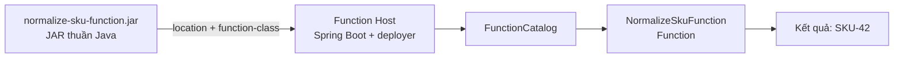

# Nạp hàm từ JAR độc lập và kiểm tra ranh giới kiểu

Spring Cloud Function cho phép đóng gói logic nghiệp vụ thành JAR riêng rồi nạp vào một ứng dụng host. Cách làm này giúp phát triển và phát hành function độc lập, sau đó dùng adapter hoặc runtime khác nhau để gọi cùng function.

Trong bài thực hành này, bạn sẽ tạo một **JAR function thuần Java**, không phụ thuộc Spring, rồi nạp JAR đó vào ứng dụng Spring Boot bằng **spring-cloud-function-deployer**. Ứng dụng host tra cứu function qua **FunctionCatalog**, gọi function và kiểm tra kiểu dữ liệu ở ranh giới giữa hai class loaders.

Bạn sẽ thực hiện:

1. Tạo project Maven đóng gói function thành JAR độc lập.
2. Tạo ứng dụng host có dependency spring-cloud-function-deployer.
3. Chỉ định vị trí JAR và class triển khai function bằng properties.
4. Tra cứu function từ FunctionCatalog và gọi bằng kiểu generic cụ thể.
5. Thử input không hợp lệ, sai tên class và sai vị trí JAR.
6. Phân tích vì sao hai class cùng tên đầy đủ nhưng được nạp bởi hai class loaders khác nhau vẫn có thể là hai kiểu runtime khác nhau.

> **Yêu cầu môi trường:** JDK 17 trở lên, Maven 3.8+ và một cặp Spring Boot/Spring Cloud tương thích. Hãy dùng Spring Cloud BOM phù hợp với phiên bản Spring Boot của dự án. Không lấy một version Spring Cloud Function riêng lẻ từ ví dụ cũ rồi ghép tùy ý với Spring Boot hiện tại.

## 1. Kết quả cần đạt

Kiến trúc lab gồm hai ứng dụng độc lập:



JAR function chứa một class triển khai Function<String, String>. Host không cần compile-time dependency tới JAR function; nó chỉ cần biết đường dẫn artifact và tên class. Deployer khởi chạy function archive trong class loader cô lập rồi đăng ký function vào FunctionCatalog của host.

Kết quả mong đợi khi host gọi function:

```text
Input : " sku-42 "
Output: "SKU-42"
```

Ví dụ dùng String ở hai đầu contract. String thuộc Java platform và được chia sẻ giữa các class loaders, vì vậy ta có thể tập trung quan sát quy trình nạp JAR trước khi thử các DTO riêng.

## 2. Chuẩn bị cấu trúc thư mục

Tạo hai project Maven độc lập, đặt cạnh nhau:

```text
packaged-function-lab/
├── normalize-sku-function/
│   ├── pom.xml
│   └── src/
│       └── main/
│           └── java/
│               └── functions/
│                   └── NormalizeSkuFunction.java
└── function-host/
    ├── pom.xml
    └── src/
        └── main/
            └── java/
                └── demo/
                    └── host/
                        └── FunctionHostApplication.java
```

Hai project không cần là Maven multi-module. Mục tiêu là chứng minh JAR function được build riêng và host chỉ nạp artifact đó lúc chạy.

## 3. Tạo function JAR thuần Java

Trong file normalize-sku-function/pom.xml, khai báo project Java tối thiểu:

```xml
<project xmlns="http://maven.apache.org/POM/4.0.0"
         xmlns:xsi="http://www.w3.org/2001/XMLSchema-instance"
         xsi:schemaLocation="http://maven.apache.org/POM/4.0.0
         https://maven.apache.org/xsd/maven-4.0.0.xsd">
    <modelVersion>4.0.0</modelVersion>

    <groupId>lab.functions</groupId>
    <artifactId>normalize-sku-function</artifactId>
    <version>1.0.0</version>
    <packaging>jar</packaging>

    <properties>
        <maven.compiler.release>17</maven.compiler.release>
        <project.build.sourceEncoding>UTF-8</project.build.sourceEncoding>
    </properties>

    <build>
        <plugins>
            <plugin>
                <groupId>org.apache.maven.plugins</groupId>
                <artifactId>maven-compiler-plugin</artifactId>
                <version>3.13.0</version>
            </plugin>
        </plugins>
    </build>
</project>
```

Project này không cần spring-boot-starter, spring-context hoặc spring-cloud-function-context. Nó chỉ cần Java functional interface java.util.function.Function.

Tạo class normalize-sku-function/src/main/java/functions/NormalizeSkuFunction.java:

```java
package functions;

import java.util.Locale;
import java.util.function.Function;

public final class NormalizeSkuFunction
        implements Function<String, String> {

    public NormalizeSkuFunction() {
    }

    @Override
    public String apply(String input) {
        if (input == null) {
            throw new IllegalArgumentException(
                "SKU must not be null"
            );
        }

        String normalized = input.strip()
            .toUpperCase(Locale.ROOT);

        if (!normalized.matches("[A-Z0-9-]{1,32}")) {
            throw new IllegalArgumentException(
                "SKU must contain 1-32 letters, digits or hyphens"
            );
        }

        return normalized;
    }
}
```

Một số chi tiết cần chú ý:

- Class là public để deployer có thể nạp và khởi tạo.
- Có constructor không tham số công khai để cách đóng gói đơn giản này có thể khởi tạo class.
- Class triển khai trực tiếp Function<String, String>, do đó generic input/output có thể được phát hiện từ khai báo class.
- Logic không phụ thuộc Spring, HTTP, broker hoặc serverless.
- Locale.ROOT giúp chuẩn hóa chữ hoa ổn định, không phụ thuộc locale máy chạy.

### Build JAR

Mở terminal tại thư mục packaged-function-lab:

```bash
mvn -f normalize-sku-function/pom.xml clean package
```

Artifact mong đợi:

```text
normalize-sku-function/target/normalize-sku-function-1.0.0.jar
```

Kiểm tra class đã nằm trong JAR:

```bash
jar tf normalize-sku-function/target/normalize-sku-function-1.0.0.jar
```

Bạn phải nhìn thấy:

```text
functions/NormalizeSkuFunction.class
META-INF/
META-INF/MANIFEST.MF
```

Đây là JAR thuần Java, không phải Spring Boot executable JAR. Với kiểu đóng gói này, deployer cần biết tên class function qua property spring.cloud.function.function-class.

## 4. Tạo ứng dụng host

Host là một Spring Boot application. Nó chứa deployer và FunctionCatalog, nhưng không khai báo dependency compile-time tới normalize-sku-function.

Tạo file function-host/pom.xml:

```xml
<project xmlns="http://maven.apache.org/POM/4.0.0"
         xmlns:xsi="http://www.w3.org/2001/XMLSchema-instance"
         xsi:schemaLocation="http://maven.apache.org/POM/4.0.0
         https://maven.apache.org/xsd/maven-4.0.0.xsd">
    <modelVersion>4.0.0</modelVersion>

    <parent>
        <groupId>org.springframework.boot</groupId>
        <artifactId>spring-boot-starter-parent</artifactId>
        <version>REPLACE_WITH_COMPATIBLE_SPRING_BOOT_VERSION</version>
        <relativePath/>
    </parent>

    <groupId>lab.host</groupId>
    <artifactId>function-host</artifactId>
    <version>1.0.0</version>

    <properties>
        <java.version>17</java.version>
    </properties>

    <dependencyManagement>
        <dependencies>
            <dependency>
                <groupId>org.springframework.cloud</groupId>
                <artifactId>spring-cloud-dependencies</artifactId>
                <version>REPLACE_WITH_COMPATIBLE_SPRING_CLOUD_RELEASE_TRAIN</version>
                <type>pom</type>
                <scope>import</scope>
            </dependency>
        </dependencies>
    </dependencyManagement>

    <dependencies>
        <dependency>
            <groupId>org.springframework.boot</groupId>
            <artifactId>spring-boot-starter</artifactId>
        </dependency>

        <dependency>
            <groupId>org.springframework.cloud</groupId>
            <artifactId>spring-cloud-function-deployer</artifactId>
        </dependency>

        <dependency>
            <groupId>org.springframework.boot</groupId>
            <artifactId>spring-boot-starter-test</artifactId>
            <scope>test</scope>
        </dependency>
    </dependencies>

    <build>
        <plugins>
            <plugin>
                <groupId>org.springframework.boot</groupId>
                <artifactId>spring-boot-maven-plugin</artifactId>
            </plugin>
        </plugins>
    </build>
</project>
```

Thay hai placeholder version bằng một cặp Spring Boot/Spring Cloud release train tương thích theo compatibility matrix chính thức.

Dependency quan trọng là:

```xml
<dependency>
    <groupId>org.springframework.cloud</groupId>
    <artifactId>spring-cloud-function-deployer</artifactId>
</dependency>
```

Deployer tìm JAR được cấu hình, khởi chạy packaged function và đưa function vào catalog của host. Nếu không có dependency này, chỉ đặt spring.cloud.function.location không tự tạo ra cơ chế nạp JAR.

### Viết host application

Tạo file function-host/src/main/java/demo/host/FunctionHostApplication.java:

```java
package demo.host;

import java.util.function.Function;

import org.springframework.boot.ApplicationRunner;
import org.springframework.boot.SpringApplication;
import org.springframework.boot.autoconfigure.SpringBootApplication;
import org.springframework.context.annotation.Bean;
import org.springframework.cloud.function.context.FunctionCatalog;

@SpringBootApplication
public class FunctionHostApplication {

    public static void main(String[] args) {
        SpringApplication.run(
            FunctionHostApplication.class,
            args
        );
    }

    @Bean
    ApplicationRunner verifyPackagedFunction(
        FunctionCatalog catalog
    ) {
        return args -> {
            Function<String, String> normalizeSku =
                catalog.lookup("normalizeSkuFunction");

            if (normalizeSku == null) {
                throw new IllegalStateException(
                    "normalizeSkuFunction was not found in FunctionCatalog"
                );
            }

            String actual = normalizeSku.apply(" sku-42 ");
            String expected = "SKU-42";

            if (!expected.equals(actual)) {
                throw new IllegalStateException(
                    "Unexpected result: " + actual
                );
            }

            System.out.println(
                "Packaged function result: " + actual
            );
        };
    }
}
```

Host chỉ biết contract Function<String, String>. Nó không import functions.NormalizeSkuFunction và không compile trực tiếp với class triển khai trong JAR bên ngoài.

## 5. Build host và nạp JAR bằng deployer

Build host:

```bash
mvn -f function-host/pom.xml clean package
```

Sau đó chạy host từ thư mục packaged-function-lab:

```bash
java -jar function-host/target/function-host-1.0.0.jar \
  --spring.cloud.function.location=./normalize-sku-function/target/normalize-sku-function-1.0.0.jar \
  --spring.cloud.function.function-class=functions.NormalizeSkuFunction
```

Hai property quan trọng:

| Property | Giá trị | Ý nghĩa |
| --- | --- | --- |
| spring.cloud.function.location | Đường dẫn JAR hoặc resource URL | Chỉ định archive chứa function |
| spring.cloud.function.function-class | functions.NormalizeSkuFunction | Chỉ định class triển khai function trong JAR thuần |

location có thể là resource/URL. Với bài lab, đường dẫn tương đối được tính từ working directory nơi bạn chạy lệnh. Nếu chạy từ một thư mục khác, dùng đường dẫn tuyệt đối hoặc điều chỉnh path.

### Kết quả mong đợi

Trong log host, tìm dòng:

```text
Packaged function result: SKU-42
```

Khi kết quả này xuất hiện, bạn đã xác minh được chuỗi:

1. Host đọc spring.cloud.function.location.
2. Deployer nạp JAR độc lập.
3. Deployer tìm functions.NormalizeSkuFunction.
4. Function được đăng ký vào FunctionCatalog.
5. Host lookup theo tên normalizeSkuFunction.
6. Host gọi function bằng input String và nhận output String.

Tên lookup được suy ra từ tên class theo quy ước camel case của function component. Nếu đổi class hoặc dùng nhiều function, kiểm tra tên được expose và lookup đúng tên trong catalog.

## 6. Kiểm tra function trong FunctionCatalog

FunctionCatalog không chỉ trả về object Java nguyên bản. Function được lookup qua catalog được Spring Cloud Function instrument/wrap để hỗ trợ các khả năng như type conversion và composition.

Ví dụ:

```java
Function<String, String> normalizeSku =
    catalog.lookup("normalizeSkuFunction");

String result = normalizeSku.apply(" book-100 ");
// result = "BOOK-100"
```

Đừng nhầm việc lấy bean trực tiếp từ ApplicationContext với việc lookup qua FunctionCatalog. Khi lấy function bean trực tiếp, bạn có thể không nhận được các tính năng mà catalog cung cấp.

### Kiểm tra input hợp lệ

Mở rộng ApplicationRunner hoặc viết test để kiểm tra:

```java
assertEquals(
    "BOOK-100",
    normalizeSku.apply(" book-100 ")
);
```

### Kiểm tra input nghiệp vụ không hợp lệ

Function chủ động từ chối SKU chứa ký tự không được phép:

```java
assertThrows(
    IllegalArgumentException.class,
    () -> normalizeSku.apply("book/100")
);
```

Ở đây exception đến từ validation nghiệp vụ trong function. Trong adapter thực tế, exception có thể được ánh xạ thành HTTP error hoặc event failure theo adapter policy.

### Tự động hóa kiểm tra bằng Spring Boot Test

Tạo file src/test/java/demo/host/PackagedFunctionTests.java trong project host. Chạy Maven từ thư mục function-host để đường dẫn tương đối tới project function ở thư mục cha được xác định ổn định:

```java
package demo.host;

import static org.junit.jupiter.api.Assertions.assertEquals;
import static org.junit.jupiter.api.Assertions.assertNotNull;
import static org.junit.jupiter.api.Assertions.assertThrows;

import java.nio.file.Path;
import java.util.function.Function;

import org.junit.jupiter.api.Test;
import org.springframework.beans.factory.annotation.Autowired;
import org.springframework.boot.test.context.SpringBootTest;
import org.springframework.cloud.function.context.FunctionCatalog;
import org.springframework.test.context.DynamicPropertyRegistry;
import org.springframework.test.context.DynamicPropertySource;

@SpringBootTest
class PackagedFunctionTests {

    private static final Path FUNCTION_JAR = Path.of(
        "..",
        "normalize-sku-function",
        "target",
        "normalize-sku-function-1.0.0.jar"
    ).toAbsolutePath().normalize();

    @DynamicPropertySource
    static void functionProperties(DynamicPropertyRegistry registry) {
        registry.add(
            "spring.cloud.function.location",
            () -> FUNCTION_JAR.toUri().toString()
        );
        registry.add(
            "spring.cloud.function.function-class",
            () -> "functions.NormalizeSkuFunction"
        );
    }

    @Autowired
    FunctionCatalog catalog;

    @Test
    void loadsAndInvokesPackagedFunction() {
        Function<String, String> function =
            catalog.lookup("normalizeSkuFunction");

        assertNotNull(function);
        assertEquals("SKU-42", function.apply(" sku-42 "));
    }

    @Test
    void rejectsInvalidSku() {
        Function<String, String> function =
            catalog.lookup("normalizeSkuFunction");

        assertThrows(
            IllegalArgumentException.class,
            () -> function.apply("book/100")
        );
    }
}
```

Trước khi chạy test, build JAR function. Sau đó chạy từ thư mục function-host:

```bash
mvn test
```

Test này xác minh deployer nạp JAR trước khi test gọi FunctionCatalog. Nếu đổi working directory, hãy cập nhật cách tạo FUNCTION_JAR để trỏ đúng artifact.

## 7. Kiểm tra ranh giới kiểu ở compile time

Khai báo:

```java
Function<String, String> normalizeSku =
    catalog.lookup("normalizeSkuFunction");
```

giúp compiler kiểm tra lời gọi:

```java
String normalized = normalizeSku.apply("sku-42");
```

Lời gọi sau không biên dịch:

```java
normalizeSku.apply(42);
```

Vì Function được khai báo nhận String, truyền một int/Integer không phù hợp với chữ ký compile-time.

Đây là **ranh giới kiểu ở mã host**. Nó không chứng minh mọi dữ liệu bên ngoài đều là String: HTTP body, broker bytes hoặc serverless event vẫn phải được adapter chuyển đổi và xác thực trước khi vào function.

### Generics bị type erasure ở runtime

Java generics chủ yếu được kiểm tra lúc compile time và bị type erasure ở runtime. Vì vậy, khi dùng raw type:

```java
@SuppressWarnings("rawtypes")
Function rawFunction = normalizeSku;
```

compiler không còn bảo vệ input/output như với Function<String, String>. Khi truyền dữ liệu không đúng contract, kết quả phụ thuộc conversion wrapper và converter có sẵn; có thể xảy ra conversion error hoặc lỗi kiểu tại runtime.

Không dùng raw Function trong production code chỉ để né lỗi generic. Hãy giữ chữ ký cụ thể ở host và trong class triển khai.

## 8. Ranh giới class loader: cùng tên class chưa chắc cùng kiểu

Deployer chạy packaged function trong một class loader cô lập theo mặc định. Đây là một lợi ích khi nhiều function JAR có dependency hoặc phiên bản Spring khác nhau.

Trong Java, identity của một class gắn với:

- Tên nhị phân đầy đủ (ví dụ demo.contract.OrderRequest).
- Class loader định nghĩa class đó.

Nếu hai class loaders định nghĩa hai class cùng tên demo.contract.OrderRequest, JVM xem chúng là hai kiểu khác nhau. Do đó:

```java
hostOrderRequestClass.isInstance(pluginObject)
```

có thể trả về false ngay cả khi:

- hostOrderRequestClass.getName() và pluginObject.getClass().getName() giống nhau.
- Hai class có cùng fields, constructors và methods.
- Hai file .class được biên dịch từ cùng source code.

### Vì sao lab bắt đầu bằng String?

String, byte[] và các kiểu Java platform được chia sẻ theo class loader của Java platform/parent delegation. Chúng là những kiểu boundary đơn giản khi host và function được nạp độc lập.

Với DTO riêng, cần có một quyết định rõ:

1. Dùng wire contract như JSON String, byte[] hoặc cấu trúc map đơn giản, rồi chuyển đổi ở một phía.
2. Đặt DTO trong shared contract JAR và bảo đảm class được nạp một lần qua class loader chung theo cấu hình delegation đã kiểm chứng.
3. Dùng giao thức serialization có version/schema rõ ràng để hai phía không cần chia sẻ cùng Java class identity.

Không chỉ copy cùng một DTO JAR vào host và plugin rồi mặc định có thể cast qua lại.

### Bài kiểm tra mở rộng với DTO

Tạo một class OrderSummary trong JAR function và một class có cùng fully-qualified name trong host. Cho function trả về object của class trong plugin, sau đó giữ kết quả ở kiểu Object:

```java
Object result = function.apply(jsonString);

System.out.println(result.getClass().getName());
System.out.println(result.getClass().getClassLoader());
System.out.println(hostOrderSummaryClass.getClassLoader());
System.out.println(
    hostOrderSummaryClass.isInstance(result)
);
```

Quan sát kết quả thay vì đoán. Nếu class được định nghĩa bởi hai loaders khác nhau, isInstance sẽ là false. Nếu cơ chế delegation khiến cả hai tham chiếu tới cùng một class definition, kết quả có thể khác. Bài học cần kiểm tra class identity thực tế, không dựa vào tên class.

## 9. Kiểm tra type conversion tại FunctionCatalog boundary

FunctionCatalog có hỗ trợ type conversion cho function được lookup. Điều này giúp adapter hoặc caller chuyển payload đầu vào sang kiểu mà function khai báo khi converter phù hợp.

Ví dụ một function khai báo Function<String, String> và adapter nhận raw request body. Conversion có thể chuyển dữ liệu transport thành String trước khi gọi function.

Tuy nhiên, conversion không thay thế validation:

- contentType phải mô tả đúng định dạng payload.
- Converter phải hỗ trợ source/target types.
- JSON không hợp lệ vẫn phải bị từ chối.
- DTO không tương thích class loader không tự trở thành DTO host chỉ vì tên class giống nhau.
- Không giả định mọi converter đều được đăng ký trong mọi adapter.

### Thí nghiệm

1. Giữ function contract là Function<String, String>.
2. Gọi function qua FunctionCatalog bằng một String hợp lệ.
3. Gọi qua adapter thật với payload JSON/text tương ứng.
4. Thử content type không khớp.
5. Thử payload sai định dạng.
6. Quan sát conversion error và exception từ validation function.

Phân biệt lỗi conversion boundary với lỗi business validation. Hai loại lỗi có thể được adapter ánh xạ khác nhau.

## 10. Nạp nhiều function class từ cùng một JAR

Một simple JAR có thể chứa nhiều class function. Dùng spring.cloud.function.function-class để liệt kê các fully-qualified class names, phân cách bằng dấu chấm phẩy.

Ví dụ:

```bash
java -jar function-host/target/function-host-1.0.0.jar \
  --spring.cloud.function.location=./function-bundle/target/function-bundle-1.0.0.jar \
  "--spring.cloud.function.function-class=functions.NormalizeSkuFunction;functions.ReverseTextFunction"
```

Sau khi nạp, lookup từng function bằng tên catalog tương ứng:

```java
Function<String, String> normalize =
    catalog.lookup("normalizeSkuFunction");

Function<String, String> reverse =
    catalog.lookup("reverseTextFunction");
```

Tên function phải được xác minh từ convention của phiên bản đang dùng và log/catalog thực tế. Không suy ra tên chỉ từ tên artifact JAR.

## 11. Phân biệt ba kiểu packaged JAR

Spring Cloud Function deployer hỗ trợ nhiều kiểu đóng gói:

| Kiểu archive | Nội dung | Property chọn function |
| --- | --- | --- |
| Simple JAR | Class Java thuần triển khai Function/Supplier/Consumer, không cần Spring | spring.cloud.function.function-class |
| Spring Boot JAR chứa class function | JAR có dependency Spring Boot, nhưng function class được chỉ định trực tiếp | spring.cloud.function.function-class |
| Spring Boot application JAR | Ứng dụng Spring Boot riêng, function là Spring bean | spring.cloud.function.definition |

Với Spring Boot application JAR, archive có main class và function bean:

```java
@SpringBootApplication
public class PackagedFunctionApplication {

    public static void main(String[] args) {
        SpringApplication.run(
            PackagedFunctionApplication.class,
            args
        );
    }

    @Bean
    Function<String, String> uppercase() {
        return String::toUpperCase;
    }
}
```

Khi nạp loại archive này, dùng:

```bash
java -jar function-host/target/function-host-1.0.0.jar \
  --spring.cloud.function.location=./uppercase-app/target/uppercase-app-1.0.0.jar \
  --spring.cloud.function.definition=uppercase
```

Không dùng function-class như thể mọi JAR đều là simple JAR. Với Spring Boot application JAR, function đã được đăng ký như bean trong context của ứng dụng đích; definition chọn bean/function cần expose.

## 12. Dùng Maven coordinates thay vì đường dẫn file

Deployer cũng hỗ trợ maven: location để tìm artifact từ Maven repository:

```text
maven://lab.functions:normalize-sku-function:1.0.0
```

Ví dụ chạy:

```bash
java -jar function-host/target/function-host-1.0.0.jar \
  --spring.cloud.function.location=maven://lab.functions:normalize-sku-function:1.0.0 \
  --spring.cloud.function.function-class=functions.NormalizeSkuFunction
```

Artifact phải tồn tại trong local Maven repository hoặc repository đã cấu hình. Nếu repository private, cấu hình credentials/repository access theo cơ chế Maven an toàn. Không nhúng username/password vào command history hoặc source control.

### Khi nào dùng file location?

- Lab local, kiểm tra nhanh.
- Function JAR được mount từ artifact directory tin cậy.
- CI test với artifact vừa build.

### Khi nào dùng Maven location?

- Artifact đã được publish vào repository.
- Muốn quản lý version theo group/artifact/version.
- Muốn host triển khai function theo artifact version đã phát hành.

Trong production, ưu tiên artifact immutable, version rõ ràng và checksum/signature được xác minh theo supply-chain policy.

## 13. Kiểm tra lỗi có chủ đích

Thực hiện từng thí nghiệm và ghi nhận thông báo lỗi:

| Thí nghiệm | Thay đổi | Kết quả cần quan sát |
| --- | --- | --- |
| Sai JAR path | Đổi location sang file không tồn tại | Deployer không đọc được archive |
| Sai class name | Đổi function-class thành class không tồn tại | Không thể load function class |
| Sai package | Bỏ package prefix | Class không được tìm thấy |
| Sai function name | Lookup tên không có trong catalog | lookup trả null hoặc không tìm được function theo API |
| Sai domain input | Gửi SKU chứa dấu / | Function ném IllegalArgumentException |
| Sai type ở compile time | Truyền Integer cho Function<String, String> | Compiler từ chối |
| Raw type | Dùng raw Function | Mất bảo vệ generic; conversion/runtime behavior phụ thuộc wrapper |
| Thiếu dependency | Function class tham chiếu thư viện không có trong archive/classpath đích | Có thể gặp NoClassDefFoundError hoặc lỗi khởi tạo |

Không phải mọi lỗi đều xảy ra tại cùng thời điểm. Một class có thể được load thành công nhưng chỉ lỗi khi method được gọi hoặc khi một dependency lazy được sử dụng.

### Chẩn đoán bằng log

Khi nạp JAR thất bại:

1. Kiểm tra file có tồn tại và process có quyền đọc không.
2. Dùng jar tf xác minh class path trong archive.
3. Kiểm tra fully-qualified class name.
4. Kiểm tra function có implement đúng Supplier, Function hoặc Consumer.
5. Kiểm tra constructor/khả năng khởi tạo.
6. Kiểm tra dependency của function JAR.
7. Bật log phù hợp cho Spring Cloud Function deployer nếu cần.
8. Xác minh function đã được đăng ký trước khi lookup.

## 14. Giới hạn bảo mật của class loader cô lập

**Isolated class loader không phải sandbox bảo mật.** Function JAR vẫn chạy trong cùng process và thường có quyền hệ điều hành, filesystem, network, environment và tài nguyên mà host process được cấp.

Chỉ nạp artifact tin cậy:

- Chỉ cho phép location nằm trong thư mục/repository được kiểm soát.
- Xác minh checksum hoặc chữ ký artifact.
- Giữ artifact immutable sau khi phê duyệt.
- Không cho người dùng cuối tự truyền URL hoặc đường dẫn JAR tùy ý.
- Không cấp credentials rộng cho host/function process.
- Giới hạn filesystem/network/container permissions ở runtime.
- Ghi log function artifact version và nguồn nạp.

Nếu cần chạy code của bên thứ ba không tin cậy, dùng ranh giới process/container/VM và policy bảo mật phù hợp; đừng dựa vào class loader để cô lập quyền thực thi.

## 15. Bài thực hành mở rộng: kiểm tra DTO qua class loader

Sau khi lab String → String chạy thành công, hãy thử một function nhận JSON string và trả DTO riêng:

```java
package functions;

public record OrderSummary(
    String orderId,
    long totalVnd
) {}
```

```java
package functions;

import java.util.function.Function;

public class SummarizeOrderFunction
        implements Function<String, OrderSummary> {

    @Override
    public OrderSummary apply(String json) {
        // Dữ liệu lab dùng định dạng orderId:totalVnd.
        String[] parts = json.split(":", 2);
        if (parts.length != 2) {
            throw new IllegalArgumentException("Expected orderId:totalVnd");
        }
        return new OrderSummary(parts[0], Long.parseLong(parts[1]));
    }
}
```

Đóng gói cả SummarizeOrderFunction và OrderSummary vào simple JAR của biến thể này, rồi chạy host với property function-class trỏ tới functions.SummarizeOrderFunction. Ở host, nhận output bằng Object:

```java
import java.util.function.Function;

Function<String, Object> function =
    catalog.lookup("summarizeOrderFunction");

Object output = function.apply("ORD-101:130000");

System.out.println(output.getClass().getName());
System.out.println(output.getClass().getClassLoader());
```

Nếu host cũng khai báo một record functions.OrderSummary riêng với cùng source và fully-qualified name, kiểm tra:

```java
package functions;

public record OrderSummary(
    String orderId,
    long totalVnd
) {}
```

Sau đó kiểm tra:

```java
import functions.OrderSummary;

boolean sameRuntimeType =
    OrderSummary.class.isInstance(output);

System.out.println("Same runtime type: " + sameRuntimeType);
```

Nếu hai class được định nghĩa bởi hai loaders khác nhau, kết quả là false. Không cast trực tiếp output sang DTO OrderSummary của host; hãy chuyển qua wire representation hoặc chia sẻ contract class qua một loader chung đã được thiết kế và kiểm thử.

### Câu hỏi phân tích

1. Vì sao String có thể đi qua boundary đơn giản hơn một DTO tùy chỉnh?
2. Nếu hai DTO cùng tên nhưng khác class loader, equals() hoặc cast có thể hoạt động như mong đợi không?
3. Nên đặt version của shared contract ở đâu?
4. Nếu function JAR nâng schema JSON, host cũ có xử lý được không?
5. Nên kiểm tra compatibility bằng unit test, contract test hay integration test?

Ghi lại class name, class loader, schema version và conversion behavior. Đừng chỉ ghi kết quả toString() vì nó không chứng minh type identity.

## 16. Bài tập tự kiểm tra

**Bài 1 — Đóng gói.** Vì sao normalize-sku-function không cần spring-boot-maven-plugin?

*Đáp án:* Đây là simple JAR thuần Java, không khởi chạy như Spring Boot application. Deployer nạp class function được chỉ định bằng function-class.

**Bài 2 — Nạp archive.** Property nào chỉ đường dẫn JAR?

*Đáp án:* spring.cloud.function.location.

**Bài 3 — Chọn class.** Với simple JAR có một class functions.NormalizeSkuFunction, property nào chỉ class cần nạp?

*Đáp án:* spring.cloud.function.function-class=functions.NormalizeSkuFunction.

**Bài 4 — Lookup.** Vì sao host dùng FunctionCatalog.lookup(...) thay vì tự new NormalizeSkuFunction()?

*Đáp án:* Host không compile-time phụ thuộc class function. Catalog cung cấp function đã được Spring Cloud Function đăng ký/instrument, hỗ trợ các tính năng như conversion và composition.

**Bài 5 — Spring Boot archive.** Nếu JAR đích là một Spring Boot application có bean uppercase, nên dùng property nào để chọn function?

*Đáp án:* spring.cloud.function.definition=uppercase; loại archive này chạy một Spring application context riêng và chọn function bean theo definition.

**Bài 6 — Function naming.** Vì sao không nên đoán tên catalog chỉ từ tên artifact?

*Đáp án:* Tên function được suy ra từ function class/bean registration và naming convention, không phải từ artifactId. Cần xác minh class và catalog lookup name.

**Bài 7 — Generic.** Vì sao Function<String, String> an toàn hơn raw Function ở host?

*Đáp án:* Compiler kiểm tra kiểu input/output; raw type làm mất bảo vệ generic và có thể đẩy lỗi sang conversion/runtime.

**Bài 8 — Class loader.** Hai class cùng fully-qualified name có chắc là cùng runtime type không?

*Đáp án:* Không. Class identity còn phụ thuộc class loader định nghĩa class.

**Bài 9 — DTO contract.** Cách nào giảm phụ thuộc class identity giữa host và function JAR?

*Đáp án:* Dùng wire types như JSON String/byte array/map hoặc một shared contract class được nạp duy nhất qua loader chung và được kiểm thử.

**Bài 10 — Maven location.** Khi dùng maven://group:artifact:version, artifact cần có ở đâu?

*Đáp án:* Local Maven repository hoặc repository được Maven cấu hình và có quyền truy cập.

**Bài 11 — Bảo mật.** Isolated class loader có ngăn function JAR đọc environment variables của process không?

*Đáp án:* Không. Class loader không phải sandbox; function vẫn chạy với quyền của process.

**Bài 12 — Lỗi runtime.** Function JAR load thành công nhưng lỗi khi gọi apply(). Nên kiểm tra gì?

*Đáp án:* Dependency được tham chiếu lazy, validation, conversion, resource loading và exception trong function; load class thành công không chứng minh mọi code path hoạt động.

## 17. Tiêu chí hoàn thành lab

- [ ] normalize-sku-function build thành JAR thuần Java.
- [ ] JAR chứa functions/NormalizeSkuFunction.class.
- [ ] Host có spring-cloud-function-deployer và không compile-time phụ thuộc function JAR.
- [ ] Deployer nhận đúng spring.cloud.function.location.
- [ ] Deployer nhận đúng spring.cloud.function.function-class.
- [ ] Function xuất hiện trong FunctionCatalog.
- [ ] Host lookup bằng tên function và gọi thành công.
- [ ] Input hợp lệ trả SKU-42.
- [ ] Input nghiệp vụ không hợp lệ bị từ chối.
- [ ] Hiểu vì sao generic type và class loader ảnh hưởng ranh giới kiểu.
- [ ] Phân biệt simple JAR với Spring Boot JAR/application JAR.
- [ ] Biết rằng class loader cô lập không phải sandbox bảo mật.

## 18. Ghi nhớ

- **Function JAR có thể được build độc lập và nạp bởi Spring Cloud Function deployer.**
- **spring.cloud.function.location xác định archive; spring.cloud.function.function-class chọn class trong simple JAR.**
- **Spring Boot application JAR dùng spring.cloud.function.definition để chọn function bean.**
- **Deployer đăng ký function đã nạp vào FunctionCatalog; host có thể lookup và invoke qua catalog.**
- **Generic cụ thể như Function<String, String> giúp compiler bảo vệ type boundary.**
- **Class identity gồm tên class và class loader; hai class cùng tên vẫn có thể khác kiểu runtime.**
- **Dùng String/byte[]/wire schema hoặc shared contract loader được kiểm soát khi đi qua ranh giới class loader.**
- **Isolated class loader không phải sandbox; chỉ nạp artifact tin cậy và giới hạn quyền process.**

**Tài liệu tham khảo chính thức:**

- [Spring Cloud Function — Deploying a Packaged Function](https://docs.spring.io/spring-cloud-function/reference/spring-cloud-function/deploying-a-packaged.html)
- [Spring Cloud Function — Programming Model and FunctionCatalog](https://docs.spring.io/spring-cloud-function/reference/spring-cloud-function/programming-model.html)
- [Spring Cloud Function — Functional Bean Definitions](https://docs.spring.io/spring-cloud-function/reference/functional.html)
- [Spring Cloud — Supported Versions and Release Trains](https://spring.io/projects/spring-cloud#overview)
- [Java Language Specification — Classes and Objects](https://docs.oracle.com/javase/specs/jls/se17/html/jls-4.html)

Các đường dẫn và API trong lab cần được chạy lại với đúng Spring Boot/Spring Cloud release train của dự án. Bài thực hành hướng dẫn nạp JAR và kiểm tra type boundary; không đồng nghĩa mọi function archive hoặc dependency không đáng tin cậy đều an toàn để chạy trong cùng process.
