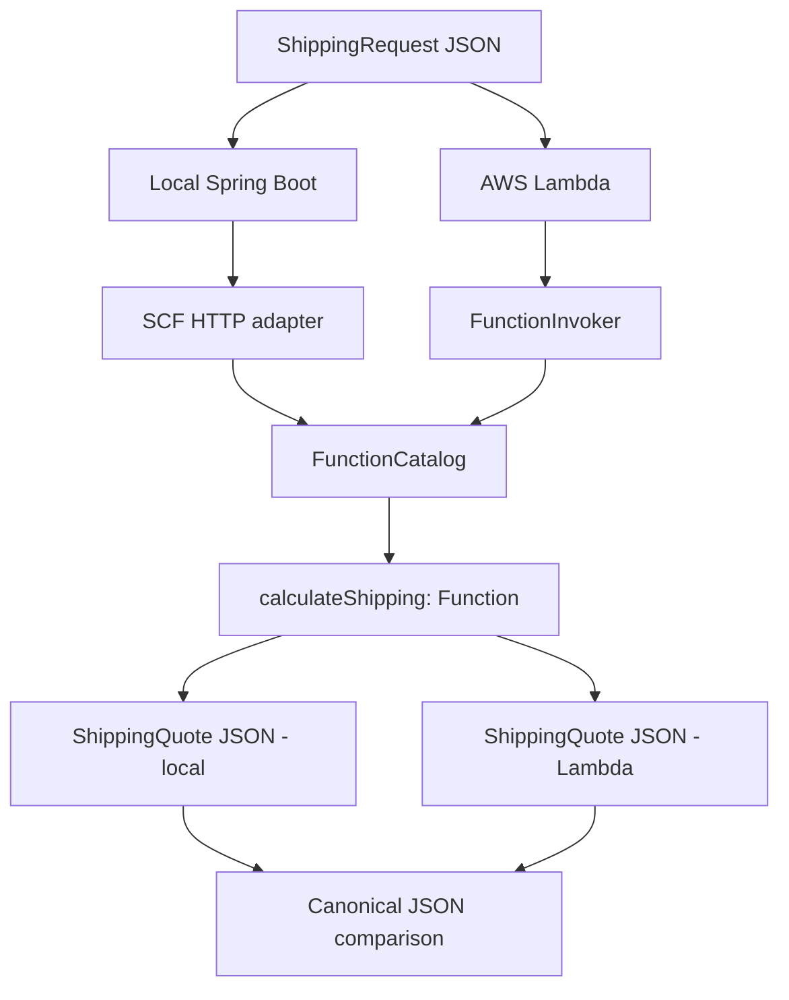

# Thực hành: đưa nghiệp vụ lên một adapter serverless rồi đối chiếu kết quả

## 1. Mục tiêu bài lab

Spring Cloud Function (SCF) giúp tách **logic nghiệp vụ** khỏi giao thức gọi. Một bean **Function<I,O>** có thể được công bố qua HTTP khi chạy Spring Boot hoặc được gọi bởi serverless adapter như AWS Lambda. Khi chuyển adapter, ta giữ nguyên function và hợp đồng dữ liệu; phần khởi tạo, đóng gói, định tuyến, quyền truy cập, timeout, retry và quan sát vận hành sẽ thay đổi theo nền tảng.

Trong bài lab này, bạn sẽ triển khai một function báo giá vận chuyển:

- Nhận **ShippingRequest** gồm điểm đến, khối lượng và lựa chọn giao nhanh.
- Tính phí theo một quy tắc xác định, không gọi dịch vụ bên ngoài.
- Trả **ShippingQuote** dưới dạng JSON.
- Chạy cùng function qua SCF HTTP adapter ở local.
- Đóng gói và triển khai cùng function qua **AWS Lambda adapter**.
- Gửi cùng một JSON event vào hai môi trường rồi đối chiếu kết quả.
- Quan sát cold start, warm invocation, lỗi, quyền IAM và retry semantics.

### Sơ đồ kiểm thử



### Tiêu chí hoàn thành

| Mã | Yêu cầu | Bằng chứng |
| --- | --- | --- |
| LAB-01 | Có một function nghiệp vụ thuần, độc lập AWS | **Function<ShippingRequest, ShippingQuote>** |
| LAB-02 | Local HTTP gọi được function | POST **/functions/calculateShipping** |
| LAB-03 | AWS Lambda gọi được cùng function | Handler **FunctionInvoker** |
| LAB-04 | Cùng event cho cùng kết quả nghiệp vụ | So sánh JSON sau chuẩn hóa |
| LAB-05 | Không cần sửa business code để đổi adapter | Cùng source revision và function bean |
| LAB-06 | Biết chọn function khi có nhiều bean | **spring_cloud_function_definition** |
| LAB-07 | Đọc được log và số đo Lambda | CloudWatch **REPORT**, **Init Duration**, **Duration** |
| LAB-08 | Phân biệt lỗi function với retry của nguồn gọi | Thử trực tiếp và phân tích event source |
| LAB-09 | Có quyền thực thi tối thiểu và quy trình dọn tài nguyên | IAM role, SAM stack, cleanup |

**Phạm vi:** lab dùng AWS Lambda Java 21 và direct invocation bằng AWS CLI. Không cần API Gateway, SQS hay S3 để hoàn thành. Khi gắn API Gateway hoặc event source, payload và retry contract sẽ khác; phần cuối bài hướng dẫn cách mở rộng.

## 2. Chuẩn bị môi trường

### 2.1. Công cụ cần có

- JDK 17 trở lên; Lambda runtime trong ví dụ là Java 21.
- Maven 3.9+ hoặc Maven Wrapper.
- AWS CLI v2 đã cấu hình profile/credentials.
- AWS SAM CLI để triển khai bằng template.
- Một AWS account và region được phép tạo Lambda.
- **curl** và **jq** để gọi local, chuẩn hóa JSON và đối chiếu kết quả.

Xác nhận công cụ:

```bash
java -version
mvn -version
aws --version
sam --version
aws sts get-caller-identity
```

Lệnh cuối xác nhận AWS CLI đang sử dụng danh tính nào. Không chia sẻ output có account ID hoặc thông tin tổ chức trong tài liệu công khai.

### 2.2. Chọn release train

Spring Boot, Spring Cloud và Spring Cloud Function phải thuộc các phiên bản tương thích. Dùng Spring Cloud BOM để quản lý dependency; không gắn version tùy ý vào **spring-cloud-function-adapter-aws** hoặc **spring-cloud-starter-function-web**.

Trước khi triển khai, kiểm tra:

1. Spring Boot parent version của dự án.
2. Spring Cloud release train tương ứng.
3. Version của SCF AWS adapter trong BOM.
4. Java runtime mà AWS Lambda hỗ trợ.
5. POM mẫu AWS của đúng dòng SCF đang dùng.

Tài liệu Spring Cloud Function hiện hướng dẫn Lambda Java 21 và **FunctionInvoker**. Nếu tổ chức đã chuẩn hóa một runtime khác, hãy kiểm tra compatibility matrix và runtime support trước khi đổi.

## 3. Thiết kế hợp đồng dữ liệu dùng chung

### 3.1. Event đầu vào

Tạo file **event.json**:

```json
{
  "destination": "HCMC",
  "weightKg": 2.5,
  "express": true
}
```

Đây là **business payload** của function. Nó không chứa API Gateway proxy envelope, SQS Records hay S3 notification wrapper.

### 3.2. Quy tắc tính phí

Để có thể so sánh chính xác giữa hai adapter, function sử dụng quy tắc xác định:

- Điểm đến **HCMC**, **HANOI** hoặc **DANANG**: phí cơ bản 18.000 VND.
- Điểm đến khác: phí cơ bản 30.000 VND.
- Phần khối lượng: 6.500 VND cho mỗi kg.
- Giao nhanh: phụ phí 12.000 VND.
- Khối lượng phải lớn hơn 0 và không vượt quá 30 kg.
- Điểm đến được trim và chuyển thành chữ in hoa.

Với event mẫu, phí dự kiến:

\[
18.000 + (2,5 \times 6.500) + 12.000 = 46.250\ \text{VND}
\]

Đây là quy tắc mô phỏng phục vụ lab, không phải bảng giá vận chuyển thực tế.

### 3.3. DTO

Tạo **src/main/java/demo/ShippingRequest.java**:

```java
package demo;

import java.math.BigDecimal;

public record ShippingRequest(
        String destination,
        BigDecimal weightKg,
        boolean express) {}
```

Tạo **src/main/java/demo/ShippingQuote.java**:

```java
package demo;

import java.math.BigDecimal;

public record ShippingQuote(
        String destination,
        BigDecimal weightKg,
        String serviceLevel,
        BigDecimal totalFeeVnd,
        String currency,
        String ruleVersion) {}
```

Giữ DTO trong package nghiệp vụ chung. Chúng không phụ thuộc **com.amazonaws.***, API Gateway, SQS hay lớp context của Lambda.

## 4. Viết business function duy nhất

Tạo **src/main/java/demo/ShippingFunctionApplication.java**:

```java
package demo;

import java.math.BigDecimal;
import java.math.RoundingMode;
import java.util.Locale;
import java.util.Set;
import java.util.function.Function;

import org.springframework.boot.SpringApplication;
import org.springframework.boot.autoconfigure.SpringBootApplication;
import org.springframework.context.annotation.Bean;

@SpringBootApplication
public class ShippingFunctionApplication {

    private static final Set<String> INNER_CITIES =
            Set.of("HCMC", "HANOI", "DANANG");

    public static void main(String[] args) {
        SpringApplication.run(
                ShippingFunctionApplication.class, args);
    }

    @Bean
    public Function<ShippingRequest, ShippingQuote> calculateShipping() {
        return request -> {
            validate(request);

            String destination = request.destination()
                    .trim()
                    .toUpperCase(Locale.ROOT);

            BigDecimal baseFee = INNER_CITIES.contains(destination)
                    ? new BigDecimal("18000.00")
                    : new BigDecimal("30000.00");

            BigDecimal weightFee = request.weightKg()
                    .multiply(new BigDecimal("6500.00"));

            BigDecimal expressFee = request.express()
                    ? new BigDecimal("12000.00")
                    : BigDecimal.ZERO;

            BigDecimal total = baseFee
                    .add(weightFee)
                    .add(expressFee)
                    .setScale(2, RoundingMode.HALF_UP);

            return new ShippingQuote(
                    destination,
                    request.weightKg(),
                    request.express() ? "EXPRESS" : "STANDARD",
                    total,
                    "VND",
                    "shipping-v1");
        };
    }

    private static void validate(ShippingRequest request) {
        if (request == null
                || request.destination() == null
                || request.destination().isBlank()
                || request.weightKg() == null
                || request.weightKg().compareTo(BigDecimal.ZERO) <= 0
                || request.weightKg().compareTo(
                        new BigDecimal("30.00")) > 0) {
            throw new IllegalArgumentException(
                    "Destination and weight between 0 and 30 kg are required");
        }
    }
}
```

### 4.1. Vì sao function không biết mình đang chạy ở đâu?

Function chỉ nhận **ShippingRequest** và trả **ShippingQuote**. Nó không:

- Đọc **APIGatewayProxyRequestEvent**.
- Lấy AWS credentials.
- Tự tạo HTTP server.
- Đọc Lambda environment variables.
- Gọi **Context.getAwsRequestId()**.
- Tự quyết định retry hoặc acknowledgment.

Adapter nhận event, chuyển dữ liệu về kiểu Java mà function khai báo, gọi function và chuyển kết quả thành output phù hợp với runtime. Đây là phần giúp business code có thể chạy lại ở môi trường khác.

### 4.2. Vì sao dùng BigDecimal?

Phí vận chuyển là giá trị tiền. **BigDecimal** tránh sai số biểu diễn nhị phân thường gặp khi dùng **double**. Dùng constructor nhận chuỗi cho hằng số tiền và quy định scale/rounding rõ ràng để kết quả giữa các lần chạy ổn định.

## 5. Cấu hình hai adapter cho cùng mã nguồn

### 5.1. Dependencies chung

Trong **pom.xml**, phần dependencies chung có thể gồm:

```xml
<dependencies>
    <dependency>
        <groupId>org.springframework.boot</groupId>
        <artifactId>spring-boot-starter</artifactId>
    </dependency>

    <dependency>
        <groupId>org.springframework.cloud</groupId>
        <artifactId>spring-cloud-function-context</artifactId>
    </dependency>

    <dependency>
        <groupId>org.springframework.boot</groupId>
        <artifactId>spring-boot-starter-test</artifactId>
        <scope>test</scope>
    </dependency>
</dependencies>
```

Spring Boot parent và Spring Cloud BOM cần được khai báo ở phần đầu POM theo release train của dự án.

### 5.2. Profile cho local HTTP và AWS Lambda

Local cần SCF web adapter; Lambda cần SCF AWS adapter. Có thể dùng Maven profiles để hai adapter không bị đưa vào cùng runtime artifact.

```xml
<profiles>
    <profile>
        <id>local</id>
        <activation>
            <activeByDefault>true</activeByDefault>
        </activation>
        <dependencies>
            <dependency>
                <groupId>org.springframework.cloud</groupId>
                <artifactId>spring-cloud-starter-function-web</artifactId>
            </dependency>
        </dependencies>
    </profile>

    <profile>
        <id>aws</id>
        <dependencies>
            <dependency>
                <groupId>org.springframework.cloud</groupId>
                <artifactId>spring-cloud-function-adapter-aws</artifactId>
            </dependency>
        </dependencies>
    </profile>
</profiles>
```

Khi bật profile **aws**, Maven sẽ không tự kích hoạt profile **local** có **activeByDefault**. Như vậy local adapter không bị kéo vào artifact Lambda.

**Đóng gói AWS cần cấu hình thêm:** Lambda cần deployment JAR đã shade và giữ nguyên metadata Spring. Spring Cloud Function cung cấp sample Maven chính thức tạo artifact classifier **aws**; hãy lấy phần **maven-shade-plugin**, resource transformers và thin-layout tương ứng từ sample của đúng release train. Không upload nhầm executable Spring Boot JAR thông thường thay cho shaded Lambda JAR. Cấu trúc JAR là một phần của adapter, không chỉ là đổi tên file.

Tham khảo sample: [Spring Cloud Function AWS sample](https://github.com/spring-cloud/spring-cloud-function/tree/main/spring-cloud-function-samples/function-sample-aws).

### 5.3. Cấu hình local

Tạo **src/main/resources/application.properties**:

```properties
spring.application.name=shipping-function
server.port=8080

spring.cloud.function.web.path=/functions
```

Với một function duy nhất, HTTP adapter cho phép gọi theo tên function ở path. URL của lab là:

**POST http://localhost:8080/functions/calculateShipping**

Vì lab chỉ có một function, bạn không cần đặt property **spring.cloud.function.definition** ở local. Nếu dự án có nhiều function, property này có thể chỉ định function hoặc composition được map ra root path; dấu chấm phẩy liệt kê nhiều function, còn dấu pipe ghép function theo thứ tự.

### 5.4. Cấu hình Lambda

Khi chạy AWS Lambda, adapter dùng **FunctionInvoker**. Property chọn function có thể truyền bằng environment variable:

**spring_cloud_function_definition=calculateShipping**

Tên biến môi trường dùng dấu gạch dưới thay cho dấu chấm của property **spring.cloud.function.definition**. Việc khai báo rõ function giúp tránh chọn nhầm khi ứng dụng sau này có thêm bean **Function**, **Consumer** hoặc **Supplier**.

## 6. Chạy và kiểm tra local HTTP adapter

### 6.1. Khởi chạy

Tại thư mục dự án:

```bash
mvn -Plocal spring-boot:run
```

Kiểm tra ứng dụng đã sẵn sàng ở cổng 8080.

### 6.2. Gọi function qua HTTP

Với file **event.json** đã tạo:

```bash
curl -sS \
  -X POST 'http://localhost:8080/functions/calculateShipping' \
  -H 'Content-Type: application/json' \
  -H 'Accept: application/json' \
  --data-binary @event.json \
  -o local-result.json
```

Xem kết quả:

```bash
cat local-result.json
```

Output nghiệp vụ dự kiến:

```json
{
  "destination": "HCMC",
  "weightKg": 2.5,
  "serviceLevel": "EXPRESS",
  "totalFeeVnd": 46250.00,
  "currency": "VND",
  "ruleVersion": "shipping-v1"
}
```

Thứ tự field và khoảng trắng JSON có thể khác, nhưng các giá trị phải tương đương. Lưu **local-result.json** để dùng ở bước so sánh.

### 6.3. Test function trực tiếp qua FunctionCatalog

Có thể thêm test JUnit để xác minh function được Spring đăng ký:

Tạo **src/test/java/demo/ShippingFunctionTest.java**:

```java
package demo;

import java.math.BigDecimal;
import java.util.function.Function;

import org.junit.jupiter.api.Test;
import org.springframework.beans.factory.annotation.Autowired;
import org.springframework.boot.test.context.SpringBootTest;
import org.springframework.cloud.function.context.FunctionCatalog;

import static org.junit.jupiter.api.Assertions.assertEquals;
import static org.junit.jupiter.api.Assertions.assertNotNull;

@SpringBootTest
class ShippingFunctionTest {

    @Autowired
    FunctionCatalog catalog;

    @Test
    void calculatesExpectedQuote() {
        Function<ShippingRequest, ShippingQuote> function =
                catalog.lookup(Function.class, "calculateShipping");

        assertNotNull(function);

        ShippingQuote quote = function.apply(
                new ShippingRequest(
                        "HCMC",
                        new BigDecimal("2.5"),
                        true));

        assertEquals("HCMC", quote.destination());
        assertEquals(
                new BigDecimal("46250.00"),
                quote.totalFeeVnd());
        assertEquals("EXPRESS", quote.serviceLevel());
    }
}
```

Chạy test:

```bash
mvn -Plocal -Dtest=ShippingFunctionTest test
```

Test này xác minh function trong Spring context và kết quả business. Nó chưa chứng minh HTTP adapter hoặc Lambda adapter hoạt động; hai đường gọi đó phải được kiểm tra riêng.

## 7. Đóng gói cho AWS Lambda

### 7.1. Thêm AWS adapter

Profile **aws** cần dependency:

```xml
<dependency>
    <groupId>org.springframework.cloud</groupId>
    <artifactId>spring-cloud-function-adapter-aws</artifactId>
</dependency>
```

**FunctionInvoker** là generic Lambda handler do Spring Cloud Function cung cấp. Nó triển khai AWS request stream handler và chuyển input stream thành kiểu input mà function khai báo. Với **Function<ShippingRequest, ShippingQuote>**, adapter sẽ cố gắng chuyển JSON input thành **ShippingRequest** rồi serialize **ShippingQuote** thành output.

### 7.2. Tạo Lambda deployment artifact

Dùng build configuration từ official AWS sample và chạy:

```bash
mvn -Paws clean package
```

Với sample Maven tạo classifier **aws**, artifact thường có dạng:

```text
target/
  shipping-function-0.0.1-SNAPSHOT-aws.jar
```

Tên thực tế phụ thuộc **artifactId**, **version** và cấu hình POM. Kiểm tra file đã tồn tại trước khi triển khai.

Các điểm cần xác minh trong JAR:

- Có **org/springframework/cloud/function/adapter/aws/FunctionInvoker.class**.
- Manifest có **Start-Class** trỏ đến **ShippingFunctionApplication**, hoặc cấu hình **MAIN_CLASS** nếu dự án không có **Start-Class**.
- Các resource Spring metadata đã được merge khi shade.
- Artifact AWS không kéo theo web/stream adapter không cần thiết.
- Kích thước package nằm trong giới hạn deployment của Lambda.

**Không chỉ đổi tên file:** JAR thiếu dependency hoặc mất Spring metadata có thể build thành công nhưng thất bại lúc Lambda khởi tạo context.

### 7.3. Kiểm tra artifact

Dùng JDK **jar**:

```bash
jar tf target/shipping-function-0.0.1-SNAPSHOT-aws.jar
```

Tìm các class/resource quan trọng trong output. Có thể kiểm tra manifest:

```bash
jar xf target/shipping-function-0.0.1-SNAPSHOT-aws.jar META-INF/MANIFEST.MF
cat META-INF/MANIFEST.MF
```

Nếu **Start-Class** không có, cấu hình **MAIN_CLASS** theo hướng dẫn của SCF AWS adapter. Không đoán tên main class từ tên artifact.

## 8. Tạo Lambda bằng AWS SAM

### 8.1. Template triển khai

Tạo **template.yaml** ở root dự án:

```yaml
AWSTemplateFormatVersion: '2010-09-09'
Transform: AWS::Serverless-2016-10-31
Description: Spring Cloud Function shipping quote lab

Resources:
  ShippingQuoteFunction:
    Type: AWS::Serverless::Function
    Properties:
      FunctionName: scf-shipping-quote-lab
      Runtime: java21
      Handler: org.springframework.cloud.function.adapter.aws.FunctionInvoker
      CodeUri: target/shipping-function-0.0.1-SNAPSHOT-aws.jar
      MemorySize: 1024
      Timeout: 15
      Architectures:
        - x86_64
      Environment:
        Variables:
          spring_cloud_function_definition: calculateShipping
      Policies:
        - AWSLambdaBasicExecutionRole
```

Các cấu hình là giá trị lab để bắt đầu, không phải mức tối ưu cho mọi ứng dụng:

- **Runtime:** Java 21.
- **Handler:** FunctionInvoker.
- **MemorySize:** 1024 MB, có thể thay đổi sau khi đo.
- **Timeout:** 15 giây, cần phù hợp với latency budget thực tế.
- **AWSLambdaBasicExecutionRole:** quyền cơ bản để ghi CloudWatch Logs.
- **spring_cloud_function_definition:** chọn function nghiệp vụ.

Function không gọi S3, DynamoDB hoặc dịch vụ AWS khác, nên execution role không cần thêm quyền truy cập những dịch vụ đó. Nếu business logic sau này truy cập tài nguyên AWS, thêm đúng action/resource cần thiết, không gán **AdministratorAccess**.

### 8.2. Build và deploy

Sau khi Maven tạo artifact:

```bash
sam build --template-file template.yaml
sam deploy --guided
```

Trong bước guided deployment:

1. Chọn AWS profile và region.
2. Đặt tên CloudFormation stack.
3. Xác nhận các quyền IAM mà SAM cần tạo.
4. Kiểm tra thay đổi template trước khi deploy.
5. Lưu cấu hình deploy theo quy trình của nhóm.

SAM sẽ tạo Lambda function và execution role theo template. Ghi lại tên function, region và stack để phục vụ kiểm thử/cleanup.

### 8.3. Kiểm tra cấu hình sau deploy

```bash
aws lambda get-function-configuration \
  --function-name scf-shipping-quote-lab
```

Xác minh các trường:

- **State** ở trạng thái Active.
- **Runtime** là java21.
- **Handler** trỏ đến FunctionInvoker.
- **Timeout** và **MemorySize** đúng cấu hình.
- Environment có **spring_cloud_function_definition=calculateShipping**.
- Role là execution role của stack và chỉ có quyền cần thiết.

## 9. Gửi cùng event vào AWS Lambda

### 9.1. Invoke trực tiếp

Dùng đúng file **event.json** đã gửi qua local HTTP:

```bash
aws lambda invoke \
  --function-name scf-shipping-quote-lab \
  --invocation-type RequestResponse \
  --payload fileb://event.json \
  lambda-result.json
```

AWS CLI in metadata của invocation ra terminal; output của function được ghi vào **lambda-result.json**.

Đọc response:

```bash
cat lambda-result.json
```

Kết quả nghiệp vụ dự kiến có cùng giá trị:

```json
{
  "destination": "HCMC",
  "weightKg": 2.5,
  "serviceLevel": "EXPRESS",
  "totalFeeVnd": 46250.00,
  "currency": "VND",
  "ruleVersion": "shipping-v1"
}
```

Nếu invocation trả lỗi, kiểm tra **FunctionError** trong metadata, response file và CloudWatch Logs. Với Lambda trực tiếp, không giả định output luôn là HTTP response envelope.

### 9.2. So sánh JSON đã chuẩn hóa

Dùng **jq** để sắp xếp field trước khi diff:

```bash
jq -S . local-result.json > local-canonical.json
jq -S . lambda-result.json > lambda-canonical.json
diff -u local-canonical.json lambda-canonical.json
```

Nếu **diff** không có output và exit code bằng 0, hai JSON sau chuẩn hóa giống nhau.

Trên PowerShell có thể đọc và serialize lại:

```powershell
$local = Get-Content -Raw local-result.json | ConvertFrom-Json
$lambda = Get-Content -Raw lambda-result.json | ConvertFrom-Json

$localJson = $local | ConvertTo-Json -Depth 20 -Compress
$lambdaJson = $lambda | ConvertTo-Json -Depth 20 -Compress

$localJson
$lambdaJson
```

PowerShell output cần được đối chiếu theo giá trị field; nếu muốn diff tự động, ghi hai chuỗi canonical ra file rồi so sánh bằng công cụ diff.

### 9.3. Bảng đối chiếu

| Thành phần | Local HTTP | AWS Lambda |
| --- | --- | --- |
| Input | JSON request body | JSON invocation payload |
| Entry point | SCF web adapter | FunctionInvoker |
| Function lookup | FunctionCatalog | FunctionCatalog qua FunctionInvoker |
| Business function | calculateShipping | calculateShipping |
| Input conversion | HTTP message converter | Lambda adapter input conversion |
| Output | HTTP response body | Lambda invocation result |
| Runtime | JVM local | JVM trong Lambda execution environment |
| Scale | Theo server/process | Theo Lambda concurrency |
| Startup | Spring Boot process startup | Cold initialization của execution environment |
| Retry | Client/gateway policy | Caller, async invocation hoặc event source policy |

**Điều kiện so sánh công bằng:** cùng source revision, cùng business payload, cùng rule version và không có dữ liệu ngoài thay đổi giữa hai lần gọi. Nếu Lambda dùng environment/config khác, ghi lại config đó cùng kết quả.

## 10. Đưa cùng function sang event source khác

Bài lab dùng direct Lambda invocation để payload chỉ là **ShippingRequest**. Khi Lambda được gọi bởi dịch vụ AWS khác, payload có thể là event envelope riêng.

Ví dụ:

- API Gateway gửi HTTP proxy event với headers, path và body.
- S3 gửi **S3Event** chứa bucket/object records.
- SQS gửi **SQSEvent** chứa một batch records.
- Kinesis gửi records theo batch/shard.

Nếu function khai báo input là **ShippingRequest**, không thể mặc định một **SQSEvent** hoặc API Gateway proxy event sẽ tự biến thành **ShippingRequest**. Hãy chọn một trong hai hướng:

1. Viết adapter/normalizer nhận event cụ thể rồi chuyển thành business DTO.
2. Khai báo function nhận kiểu AWS event tương ứng nếu nghiệp vụ thực sự cần metadata của dịch vụ đó.

Ví dụ với S3 hoặc SQS, Spring Cloud Function AWS adapter hỗ trợ function có input type tương ứng:

```java
@Bean
public Function<S3Event, String> processUpload() {
    return event -> {
        // Chuyển event thành command nghiệp vụ.
        return "received";
    };
}
```

```java
@Bean
public Function<SQSEvent, SQSBatchResponse> processBatch() {
    return event -> processRecordsAndBuildBatchResponse(event);
}
```

Ở ví dụ SQS, **processRecordsAndBuildBatchResponse** là helper của ứng dụng: nó xử lý từng record và tạo **SQSBatchResponse** chứa các item thất bại theo contract của Lambda. Các ví dụ này cần dependency **aws-lambda-java-events** ở version tương thích. Đừng thêm AWS event dependency vào core business module nếu logic không cần biết chi tiết AWS.

## 11. Đối chiếu lỗi và retry semantics

### 11.1. Lỗi validation

Thử gửi event không hợp lệ:

```json
{
  "destination": "HCMC",
  "weightKg": 0,
  "express": true
}
```

Qua HTTP, exception có thể được chuyển thành HTTP error bởi web runtime. Qua Lambda, function error được trả về cho invoker và được thể hiện trong metadata/response của Lambda. Hai adapter không nhất thiết trả cùng status hoặc cùng error envelope.

Hợp đồng nghiệp vụ cần thống nhất các điều sau:

- Input nào hợp lệ?
- Output thành công có schema gì?
- Lỗi validation có mã lỗi nghiệp vụ nào?
- Client/event producer có nên retry lỗi này không?
- Lỗi tạm thời và lỗi vĩnh viễn được phân biệt ra sao?

Nếu cần cùng error schema cho nhiều adapter, hãy tạo error model và mapping ở adapter boundary. Không buộc business function phụ thuộc HTTP status hoặc Lambda exception wrapper.

### 11.2. Direct invoke không tự retry lỗi function

Với Lambda được gọi trực tiếp theo kiểu synchronous, caller chịu trách nhiệm quyết định có gọi lại hay không. Nếu retry, function có thể đã chạy toàn bộ, một phần hoặc chưa chạy; do đó side effect phải được thiết kế idempotent.

Với asynchronous invocation, Lambda mặc định retry function errors hai lần. Với event source mapping từ queue hoặc stream, retry/redelivery phụ thuộc loại nguồn, batch, visibility timeout, offset và redrive policy. API Gateway thường chuyển lỗi đồng bộ về caller thay vì tự áp dụng cùng chính sách retry của async invocation.

Không lấy retry behavior của direct invoke áp dụng cho SQS, Kinesis hoặc async invocation.

### 11.3. Function thuần và side effect

**calculateShipping** chỉ tính toán và không ghi database, gửi email hay thu tiền. Vì vậy cùng input luôn cho cùng quote trong lab.

Nếu thay function bằng nghiệp vụ có side effect:

- Dùng idempotency key ổn định cho cùng operation.
- Lưu key và kết quả bền vững ở shared store/database.
- Dùng unique constraint để chặn claim trùng.
- Đảm bảo retry sau commit trả lại kết quả đã lưu.
- Với event, chỉ acknowledge sau khi trạng thái cần thiết đã commit.
- Dùng outbox/reconciliation khi cần phối hợp DB và hệ thống ngoài.

Bộ nhớ trong Lambda execution environment có thể được giữ lại giữa các invocation warm, nhưng không phải kho trạng thái bền vững. Nhiều execution environments có state riêng và có thể bị thay thế bất cứ lúc nào.

## 12. Quan sát cold start, warm invocation và chi phí

### 12.1. Đọc CloudWatch REPORT

Lambda ghi log runtime vào CloudWatch Logs. Với Java, dòng **REPORT** có thể chứa:

- **Duration:** thời gian xử lý handler.
- **Billed Duration:** thời lượng tính phí.
- **Memory Size:** memory đã cấp.
- **Max Memory Used:** mức sử dụng bộ nhớ cao nhất.
- **Init Duration:** thời gian khởi tạo runtime/application cho cold start.
- **RequestId:** ID invocation.

Ví dụ minh họa định dạng, **không phải kết quả đo của lab**:

```text
REPORT RequestId: abc...
Duration: 84.12 ms
Billed Duration: 700 ms
Memory Size: 1024 MB
Max Memory Used: 180 MB
Init Duration: 615.30 ms
```

Xem log:

```bash
aws logs tail /aws/lambda/scf-shipping-quote-lab \
  --since 1h \
  --follow
```

Nếu log group chưa xuất hiện, xác nhận function đã được invoke và execution role có quyền ghi logs.

### 12.2. So sánh first invocation và warm invocation

Gọi nhiều lần:

```bash
for n in 1 2 3 4 5; do
  aws lambda invoke \
    --function-name scf-shipping-quote-lab \
    --payload fileb://event.json \
    "lambda-result-$n.json"
done
```

Sau đó đối chiếu **REPORT** trong CloudWatch:

| Số đo | Ý nghĩa |
| --- | --- |
| Init Duration | Chi phí init của execution environment mới |
| Duration | Thời gian xử lý handler |
| Billed Duration | Thời lượng được tính phí |
| Max Memory Used | Mức memory tối đa quan sát được |
| Local curl time_total | Thời gian client local quan sát, gồm network/HTTP adapter |

Không đảm bảo năm lần gọi luôn dùng cùng execution environment. Lambda có thể tạo thêm environment khi tăng concurrency, hoặc tái sử dụng environment đang warm. Một invocation không có **Init Duration** trong log không chứng minh toàn bộ function không có cold start trong mọi tải.

### 12.3. Đối chiếu latency đúng cách

| Phép đo | Bao gồm | Không bao gồm |
| --- | --- | --- |
| Local curl time_total | HTTP client, loopback network, adapter và function | AWS provisioning/cold start |
| Lambda Duration | Handler execution | Client round-trip từ máy người dùng |
| Lambda Init Duration | Runtime/application initialization | Toàn bộ thời gian client chờ |
| Lambda Billed Duration | Đơn vị thời lượng được tính phí | Không phải latency end-to-end |
| API Gateway latency | Gateway và request path theo metric | Không chỉ riêng business function |

Để đánh giá hiệu năng:

1. Chạy nhiều lần local trong cùng điều kiện.
2. Invoke Lambda đủ nhiều lần để quan sát cả init và warm.
3. Ghi **Duration**, **Init Duration**, memory và request count.
4. So sánh p50/p95/p99 theo cùng workload.
5. Thử nhiều mức memory và concurrency.
6. Ghi rõ cold start, provisioned concurrency hoặc SnapStart có được bật không.

Không so trực tiếp một con số **curl time_total** với một dòng **Duration** rồi kết luận adapter nào nhanh hơn; hai số đo có phạm vi khác nhau.

### 12.4. Tối ưu khi đã có số đo

Các hướng có thể thử:

- Giảm công việc trong Spring initialization và **@PostConstruct**.
- Không tạo kết nối remote không cần thiết trong lúc khởi động.
- Khởi tạo client có thể tái sử dụng ở phạm vi execution environment khi phù hợp.
- Điều chỉnh memory để cân bằng CPU, latency và chi phí.
- Đánh giá SnapStart hoặc provisioned concurrency theo pattern traffic.
- Dùng native image/custom runtime khi lợi ích đo được đủ lớn và team có khả năng vận hành.

Không tối ưu chỉ dựa trên cảm giác. Thay đổi runtime/packaging cần được đo lại trên cùng workload.

## 13. Quyền và bảo mật khi triển khai serverless

Cần phân biệt hai loại quyền:

- **Execution role:** quyền mà code bên trong Lambda được sử dụng để ghi log hoặc truy cập AWS resources.
- **Invoke permission:** quyền của user/service khác được phép gọi Lambda.

Lab chỉ cần quyền CloudWatch Logs cơ bản. Nếu function cần truy cập S3 hoặc DynamoDB, cấp đúng action trên đúng resource ARN. Nếu cho API Gateway, SQS hoặc S3 gọi function, cấu hình resource-based permission hoặc event source mapping tương ứng.

Không:

- Gắn **AdministratorAccess** cho execution role.
- Đưa access key tĩnh vào source code.
- Đặt secret trong file **application.properties** được commit.
- Công khai function tạo side effect mà không có authorization/rate limiting.
- Ghi payload nhạy cảm vào CloudWatch Logs.

Nếu cần secret, dùng AWS Secrets Manager hoặc cơ chế quản lý secret được tổ chức phê duyệt; environment variable không nên trở thành nơi lưu trữ tùy tiện mọi credential.

## 14. Phát hành, rollback và dọn tài nguyên

### 14.1. Trước khi chuyển traffic

- [ ] Build artifact AWS bằng profile đúng.
- [ ] Xác minh **FunctionInvoker** và **Start-Class**.
- [ ] Runtime, handler, memory và timeout đúng.
- [ ] Environment variable chọn đúng function.
- [ ] Execution role chỉ có quyền cần thiết.
- [ ] Direct invocation với event mẫu trả đúng kết quả.
- [ ] Event lỗi validation được xử lý đúng.
- [ ] CloudWatch Logs nhận được log.
- [ ] So sánh JSON local và Lambda đạt.
- [ ] Retry/idempotency đã được kiểm tra nếu function có side effect.

### 14.2. Rollback

Với môi trường production, nên dùng published Lambda versions và alias để chuyển traffic có kiểm soát. Giữ lại version ổn định trước đó, kiểm tra error rate/latency sau phát hành và chuyển alias về version cũ nếu có lỗi.

Không thay đổi function đang phục vụ traffic bằng một artifact chưa được smoke test. Ghi lại artifact version, commit SHA và template đã deploy để có thể tái tạo release.

### 14.3. Dọn lab

Sau khi hoàn thành và lưu kết quả, xóa SAM stack:

```bash
sam delete --stack-name <stack-name> --region <region>
```

Thay **<stack-name>** và **<region>** bằng giá trị thật đã dùng khi deploy. Xác nhận stack và Lambda lab đã bị xóa; không xóa nhầm tài nguyên dùng chung của tài khoản.

## 15. Runbook khi kết quả local và Lambda khác nhau

| Triệu chứng | Kiểm tra |
| --- | --- |
| Local trả đúng, Lambda không khởi động | Handler, runtime, shaded JAR, Start-Class, Spring metadata |
| FunctionInvoker không tìm thấy function | spring_cloud_function_definition, bean name, function catalog |
| Lambda nhận Map thay vì DTO | Generic type declaration, event JSON shape, converter |
| Local URL 404 | spring.cloud.function.web.path, function name, web adapter dependency |
| Lambda trả FunctionError | CloudWatch stack trace, validation, conversion, dependency |
| Output JSON khác | Input thực tế, environment/config, decimal scale, rule version |
| First invoke chậm | Init Duration, Spring startup, classpath và initialization |
| Warm invoke vẫn chậm | Duration, CPU/memory, downstream dependency |
| Gọi lặp tạo duplicate | Idempotency key, shared store, transaction và retry source |
| Chỉ lỗi khi SQS/S3 trigger | Event schema, batch semantics, permission, retry/DLQ |

### 15.1. Lambda không tìm thấy function

Kiểm tra:

1. Có đúng một bean function hay nhiều bean?
2. Tên **@Bean** có đúng là **calculateShipping**?
3. Environment variable có đúng **spring_cloud_function_definition**?
4. Giá trị có ký tự thừa hoặc khoảng trắng không?
5. Artifact được build từ đúng commit không?
6. **Start-Class** có chỉ đúng **ShippingFunctionApplication** không?

### 15.2. Lambda không chuyển được JSON thành DTO

Xác minh payload là business JSON thuần:

```json
{
  "destination": "HCMC",
  "weightKg": 2.5,
  "express": true
}
```

Nếu bạn gửi API Gateway proxy event hoặc SQS event, function sẽ nhận một event shape khác. Hãy khai báo input type phù hợp hoặc thêm adapter chuyển event thành business command.

### 15.3. Lambda lỗi nhưng local chạy được

Đối chiếu:

- JDK local và runtime Java Lambda.
- Dependency có bị thiếu trong shaded JAR?
- Có resource Spring nào bị shade ghi đè?
- Có đọc file từ working directory local mà Lambda không có?
- Có phụ thuộc biến môi trường local chưa được cấu hình?
- Có gọi network/service mà Lambda role hoặc VPC không truy cập được?

Không thêm quyền IAM rộng để che một lỗi cấu hình. Xác định chính xác resource và action bị thiếu rồi cập nhật policy tối thiểu.

## 16. Bài tập mở rộng

1. Thêm function **normalizeDestination** rồi compose với **calculateShipping** trong FunctionCatalog.
2. Chạy composition qua HTTP adapter và Lambda bằng cùng input.
3. Thay đổi function thành **Function<Message<ShippingRequest>, Message<ShippingQuote>>**; xác minh cách header được truyền qua HTTP.
4. Viết function nhận **S3Event** và chuyển object metadata thành business command.
5. Viết consumer xử lý **SQSEvent**, trả partial batch response khi một số record thất bại.
6. Gửi lại cùng event ID hai lần và chứng minh consumer không tạo side effect trùng.
7. Dùng PostgreSQL hoặc DynamoDB để lưu idempotency key bền vững.
8. Mô phỏng Lambda crash sau commit và trước khi event được xác nhận.
9. Tạo API Gateway endpoint và phân biệt API Gateway proxy event với direct invocation payload.
10. Đo cold/warm start ở nhiều memory settings.
11. Bật SnapStart hoặc provisioned concurrency trong môi trường thử nghiệm rồi đối chiếu **Init Duration**.
12. Dùng Lambda alias để phát hành canary và rollback.
13. Viết contract test để đảm bảo schema **ShippingQuote** giống nhau giữa local và Lambda.
14. Tạo CI pipeline build hai artifact từ cùng source revision, chạy local HTTP smoke test và deploy integration environment.

## Tài liệu tham khảo chính thức

- [Spring Cloud Function — AWS Lambda Adapter](https://docs.spring.io/spring-cloud-function/reference/adapters/aws-intro.html): dependency spring-cloud-function-adapter-aws, FunctionInvoker, packaging, routing và deployment.
- [Spring Cloud Function — Standalone Web Applications](https://docs.spring.io/spring-cloud-function/reference/spring-cloud-function/standalone-web-applications.html): HTTP function mapping, spring.cloud.function.web.path, composition và filtering.
- [Spring Cloud Function — Official AWS Sample](https://github.com/spring-cloud/spring-cloud-function/tree/main/spring-cloud-function-samples/function-sample-aws): Maven build và AWS deployment artifact.
- [AWS Lambda — Building Java Functions](https://docs.aws.amazon.com/lambda/latest/dg/lambda-java.html): Java runtime, handler, deployment package và context.
- [AWS Lambda — Retry Behavior](https://docs.aws.amazon.com/lambda/latest/dg/invocation-retries.html): direct, asynchronous và event source retry semantics.
- [AWS Lambda — Environment Variables](https://docs.aws.amazon.com/lambda/latest/dg/configuration-envvars.html): runtime environment variables và cấu hình.
- [AWS Lambda — Java Logging](https://docs.aws.amazon.com/lambda/latest/dg/java-logging.html): CloudWatch Logs và các trường REPORT.
- [AWS SAM — Deploy Serverless Applications](https://docs.aws.amazon.com/serverless-application-model/latest/developerguide/serverless-deploying.html): build, deploy và quản lý stack.
- [AWS IAM — Lambda Execution Role](https://docs.aws.amazon.com/lambda/latest/dg/lambda-intro-execution-role.html): quyền của function khi truy cập AWS resources.

> **Ghi nhớ:** Adapter serverless thay đổi cách function được khởi tạo, nhận event, chuyển đổi dữ liệu, cấp quyền và retry. Hãy giữ **business function độc lập nền tảng**, gửi **cùng một business payload** qua local và Lambda, đối chiếu **output nghiệp vụ** sau chuẩn hóa, rồi đo riêng cold start, warm duration và hành vi lỗi của từng adapter.
