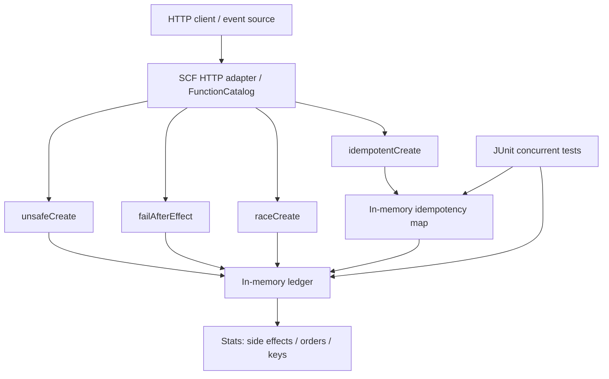

# Thực hành: mô phỏng lỗi, dữ liệu lặp và nhiều lần gọi đồng thời trong Spring Cloud Function

## 1. Mục tiêu bài lab

**Spring Cloud Function (SCF)** cho phép xây dựng logic nghiệp vụ bằng `Supplier<T>`, `Function<I,O>` và `Consumer<T>`, đăng ký chúng qua `FunctionCatalog` rồi sử dụng qua HTTP, sự kiện hoặc serverless. Cùng một function có thể được gọi nhiều lần, từ nhiều request đồng thời hoặc từ nhiều adapter có cơ chế retry riêng.

Bài thực hành này mô phỏng ba tình huống rất dễ xảy ra trong hệ thống thật:

1. **Gửi lại cùng request:** client timeout hoặc người dùng bấm lại, function ghi dữ liệu hai lần.
2. **Lỗi sau tác dụng phụ:** function đã ghi dữ liệu nhưng response thất bại; lần retry lại ghi thêm.
3. **Race condition:** hai invocation đồng thời cùng kiểm tra “chưa tồn tại” rồi cùng tạo một bản ghi.

Sau đó bạn sẽ xây dựng một bản khử trùng lặp bằng `ConcurrentHashMap` để thấy concurrency được kiểm soát trong **một JVM**, viết JUnit test cho các trường hợp đồng thời, và thiết kế hướng xử lý production bằng idempotency key, unique constraint và transactional outbox.

### Sơ đồ bài thực hành



### Kết quả mong đợi

| Mã | Kết quả | Bằng chứng |
| --- | --- | --- |
| LAB-01 | Hai lần gọi unsafe cùng dữ liệu tạo hai side effects | `effectCount` tăng 2 |
| LAB-02 | Lỗi sau khi ghi không có nghĩa dữ liệu chưa được ghi | Retry làm tăng side effect lần nữa |
| LAB-03 | Check-then-act có thể tạo duplicate khi chạy đồng thời | Nhiều effects cho cùng order ID |
| LAB-04 | Cùng idempotency key và payload chỉ tạo một effect trong JVM | Các invocation nhận cùng receipt |
| LAB-05 | Dùng lại key với payload khác bị từ chối | Conflict, effect count không tăng |
| LAB-06 | JUnit kiểm chứng concurrency | Test suite chạy đạt |
| LAB-07 | Hiểu giới hạn của bộ nhớ trong | Restart hoặc scale-out làm mất khả năng dedupe |
| LAB-08 | Có thiết kế production | Durable key, transaction, outbox và downstream dedupe |

**Phạm vi:** ứng dụng mẫu dùng in-memory ledger, không có database hoặc payment thật. Đây là môi trường học tập chạy trên localhost. Không expose các endpoint mô phỏng lỗi ra Internet hoặc dùng chúng để xử lý đơn hàng thật.

## 2. Chuẩn bị dự án Spring Cloud Function

### 2.1. Công cụ

- Java 17 trở lên.
- Maven 3.9+ hoặc Maven Wrapper.
- IDE hoặc editor.
- Terminal Bash/Git Bash/WSL; với PowerShell, dùng `curl.exe` và điều chỉnh cách chạy lệnh song song.
- Một máy có thể chạy nhiều HTTP requests đồng thời.

Dùng Spring Boot và Spring Cloud BOM tương thích với nhau. Không tự chọn version riêng cho từng starter. Nếu dự án hiện có parent/BOM, giữ đúng release train mà dự án đang sử dụng và chỉ bổ sung các dependencies cần thiết.

### 2.2. Dependencies

Dự án cần SCF HTTP adapter và JUnit:

```xml
<dependencies>
    <dependency>
        <groupId>org.springframework.cloud</groupId>
        <artifactId>spring-cloud-starter-function-web</artifactId>
    </dependency>

    <dependency>
        <groupId>org.springframework.boot</groupId>
        <artifactId>spring-boot-starter-test</artifactId>
        <scope>test</scope>
    </dependency>
</dependencies>
```

Version của hai dependency được quản lý bởi Spring Boot parent và Spring Cloud BOM tương thích. Không thêm một version tùy ý trực tiếp vào starter.

### 2.3. Cấu trúc dự án

Tạo dự án lab có cấu trúc:

```text
scf-duplicate-lab/
├── pom.xml
└── src/
    ├── main/
    │   ├── java/demo/
    │   │   ├── DuplicateLabApplication.java
    │   │   ├── OrderCommand.java
    │   │   ├── OrderReceipt.java
    │   │   ├── LedgerStats.java
    │   │   └── OrderLedger.java
    │   └── resources/
    │       └── application.properties
    └── test/
        └── java/demo/
            └── OrderLedgerTest.java
```

Các file trên thuộc **dự án thực hành do học viên tạo**, không phải file của module tài liệu này.

## 3. Xác định dữ liệu của một lần xử lý

Một request tạo đơn hàng trong lab có ba trường:

- `requestId`: định danh ổn định cho một lần thử nghiệp vụ; các lần retry cùng operation phải giữ nguyên giá trị.
- `orderId`: định danh đơn hàng nghiệp vụ.
- `quantity`: số lượng cần tạo.

Ví dụ:

```json
{
  "requestId": "req-100",
  "orderId": "order-42",
  "quantity": 2
}
```

Hai khái niệm phải được tách biệt:

| Định danh | Ý nghĩa | Có thể khác nhau giữa các retry? |
| --- | --- | --- |
| Request/attempt ID | Một lần gửi cụ thể, phục vụ log và trace | Có |
| Idempotency key / operation key | Một nghiệp vụ logic cần tránh thực hiện trùng | **Không** |
| Order ID | Tài nguyên nghiệp vụ được tạo hoặc cập nhật | Theo nghiệp vụ |

Trong lab, `requestId` được dùng làm idempotency key. Trong production, key thường phải có scope như tenant, operation type và caller; không nên giả định một UUID bất kỳ là đủ.

### 3.1. Vì sao chỉ có orderId chưa đủ?

Một hệ thống có thể cho phép nhiều thao tác khác nhau trên cùng order, ví dụ tạo, sửa địa chỉ, thanh toán hoặc hoàn tiền. Vì thế idempotency key nên định danh **một command**, không chỉ định danh tài nguyên.

Ngược lại, nếu yêu cầu nghiệp vụ là “một orderId chỉ được tạo đúng một lần”, cần thêm unique constraint cho order ID ở database. Idempotency key và unique business key giải quyết hai loại trùng khác nhau.

## 4. Viết ứng dụng và các functional beans

### 4.1. DuplicateLabApplication.java

Tạo `src/main/java/demo/DuplicateLabApplication.java`:

```java
package demo;

import java.util.function.Function;
import java.util.function.Supplier;

import org.springframework.boot.SpringApplication;
import org.springframework.boot.autoconfigure.SpringBootApplication;
import org.springframework.context.annotation.Bean;

@SpringBootApplication
public class DuplicateLabApplication {

    public static void main(String[] args) {
        SpringApplication.run(
                DuplicateLabApplication.class, args);
    }

    // Mỗi invocation đều ghi một side effect mới.
    @Bean
    public Function<OrderCommand, OrderReceipt> unsafeCreate(
            OrderLedger ledger) {
        return ledger::unsafeCreate;
    }

    // Mô phỏng check-then-act không atomic.
    @Bean
    public Function<OrderCommand, OrderReceipt> raceCreate(
            OrderLedger ledger) {
        return ledger::raceCreate;
    }

    // Ghi xong rồi cố ý ném lỗi ở invocation đầu tiên.
    @Bean
    public Function<OrderCommand, OrderReceipt> failAfterEffect(
            OrderLedger ledger) {
        return ledger::failAfterEffect;
    }

    // Khử trùng lặp cùng requestId trong một JVM.
    @Bean
    public Function<OrderCommand, OrderReceipt> idempotentCreate(
            OrderLedger ledger) {
        return ledger::idempotentCreate;
    }

    // Đọc thống kê để quan sát kết quả.
    @Bean
    public Supplier<LedgerStats> stats(OrderLedger ledger) {
        return ledger::stats;
    }
}
```

Năm bean được đặt tên rõ ràng để SCF có thể tra cứu qua `FunctionCatalog` và HTTP adapter. Bốn bean đầu là Function nhận JSON; `stats` là Supplier không cần request body.

### 4.2. Các record dữ liệu

Tạo ba record public, mỗi record ở một file cùng package `demo`.

`src/main/java/demo/OrderCommand.java`:

```java
package demo;

public record OrderCommand(
        String requestId, String orderId, int quantity) {}
```

`src/main/java/demo/OrderReceipt.java`:

```java
package demo;

public record OrderReceipt(
        String requestId,
        String orderId,
        int quantity,
        int effectSequence,
        String strategy) {}
```

`src/main/java/demo/LedgerStats.java`:

```java
package demo;

import java.util.List;

public record LedgerStats(
        int sideEffectCount,
        int orderCount,
        int idempotencyKeyCount,
        List<OrderReceipt> effectHistory) {}
```

`StoredRequest` chỉ là kiểu nội bộ của ledger, được khai báo package-private trong `OrderLedger.java` ở mục tiếp theo.

## 5. Mô phỏng ba cách xử lý không an toàn

### 5.1. OrderLedger.java

Tạo phần class trong `src/main/java/demo/OrderLedger.java`:

```java
package demo;

import java.util.concurrent.ConcurrentHashMap;
import java.util.concurrent.ConcurrentLinkedQueue;
import java.util.concurrent.ConcurrentMap;
import java.util.concurrent.CountDownLatch;
import java.util.concurrent.TimeUnit;
import java.util.concurrent.atomic.AtomicBoolean;
import java.util.concurrent.atomic.AtomicInteger;

import org.springframework.stereotype.Component;

@Component
public class OrderLedger {

    private final AtomicInteger effectSequence =
            new AtomicInteger();

    // Một bản ghi hiện tại theo order ID.
    private final ConcurrentMap<String, OrderReceipt> orders =
            new ConcurrentHashMap<>();

    // Ghi nhận mọi side effect đã xảy ra, kể cả duplicate.
    private final ConcurrentLinkedQueue<OrderReceipt> effects =
            new ConcurrentLinkedQueue<>();

    // Bảng idempotency demo, chỉ tồn tại trong JVM.
    private final ConcurrentMap<String, StoredRequest> processed =
            new ConcurrentHashMap<>();

    // Mỗi order ID có một race window dành riêng cho bài lab.
    private final ConcurrentMap<String, CountDownLatch> raceWindows =
            new ConcurrentHashMap<>();

    // Chỉ invocation đầu của failAfterEffect bị lỗi sau khi ghi.
    private final AtomicBoolean failFirstAfterEffect =
            new AtomicBoolean(true);

    public OrderReceipt unsafeCreate(OrderCommand command) {
        validate(command);
        return recordSideEffect(command, "UNSAFE");
    }

    public OrderReceipt raceCreate(OrderCommand command) {
        validate(command);

        OrderReceipt existing = orders.get(command.orderId());
        if (existing != null) {
            return existing;
        }

        // Chờ tối đa 8 invocation cùng order ID tới race window.
        // Nếu chưa đủ 8, sau 1000 ms các invocation đang chờ vẫn tiếp tục.
        CountDownLatch window = raceWindows.computeIfAbsent(
                command.orderId(), ignored -> new CountDownLatch(8));
        window.countDown();
        try {
            window.await(1000, TimeUnit.MILLISECONDS);
        }
        catch (InterruptedException exception) {
            Thread.currentThread().interrupt();
            throw new IllegalStateException(
                    "Interrupted during race demonstration", exception);
        }

        // Hai thread có thể cùng đi tới đây và cùng tạo side effect.
        return recordSideEffect(command, "RACE");
    }

    public OrderReceipt failAfterEffect(OrderCommand command) {
        validate(command);

        // Side effect xảy ra trước khi function trả response.
        OrderReceipt receipt =
                recordSideEffect(command, "FAIL_AFTER_EFFECT");

        if (failFirstAfterEffect.compareAndSet(true, false)) {
            throw new SimulatedFailureException(
                    "Simulated response failure after side effect");
        }

        return receipt;
    }

    public OrderReceipt idempotentCreate(OrderCommand command) {
        validate(command);

        StoredRequest stored = processed.compute(
                command.requestId(),
                (key, existing) -> {

                    if (existing != null) {
                        if (!existing.command().equals(command)) {
                            throw new IdempotencyConflictException(
                                    "Same requestId used with different payload");
                        }
                        return existing;
                    }

                    // Trong demo, đây chỉ là ghi vào bộ nhớ cục bộ.
                    OrderReceipt receipt =
                            recordSideEffect(command, "IDEMPOTENT");

                    return new StoredRequest(command, receipt);
                });

        return stored.receipt();
    }

    private OrderReceipt recordSideEffect(
            OrderCommand command, String strategy) {

        int sequence = effectSequence.incrementAndGet();

        OrderReceipt receipt = new OrderReceipt(
                command.requestId(),
                command.orderId(),
                command.quantity(),
                sequence,
                strategy);

        effects.add(receipt);
        orders.put(command.orderId(), receipt);

        System.out.printf(
                "SIDE_EFFECT sequence=%d requestId=%s orderId=%s strategy=%s%n",
                sequence,
                command.requestId(),
                command.orderId(),
                strategy);

        return receipt;
    }

    public LedgerStats stats() {
        return new LedgerStats(
                effectSequence.get(),
                orders.size(),
                processed.size(),
                java.util.List.copyOf(effects));
    }

    private static void validate(OrderCommand command) {
        if (command == null
                || command.requestId() == null
                || command.requestId().isBlank()
                || command.orderId() == null
                || command.orderId().isBlank()
                || command.quantity() <= 0) {
            throw new IllegalArgumentException(
                    "requestId, orderId and positive quantity are required");
        }
    }

    public int effectCount() {
        return effectSequence.get();
    }

    public int orderCount() {
        return orders.size();
    }

    public int idempotencyKeyCount() {
        return processed.size();
    }
}

record StoredRequest(
        OrderCommand command,
        OrderReceipt receipt) {}

class SimulatedFailureException extends RuntimeException {
    SimulatedFailureException(String message) {
        super(message);
    }
}

class IdempotencyConflictException extends RuntimeException {
    IdempotencyConflictException(String message) {
        super(message);
    }
}
```

**Ghi chú về file:** Java chỉ cho phép một top-level public class trong file có cùng tên. Các exception trong ví dụ là package-private; nếu muốn tái sử dụng rộng hơn, hãy tách chúng ra file riêng và khai báo public.

### 5.2. Đọc các chiến lược

| Function | Hành vi | Vấn đề được mô phỏng |
| --- | --- | --- |
| `unsafeCreate` | Ghi side effect mỗi lần được gọi | Retry tạo duplicate |
| `raceCreate` | Đọc map rồi chờ race window/ghi | Check-then-act không atomic |
| `failAfterEffect` | Ghi thành công rồi ném exception một lần | Client thấy lỗi dù side effect đã xảy ra |
| `idempotentCreate` | Dùng `compute()` theo request ID | Cùng key/payload chỉ ghi một lần trong JVM |
| `stats` | Trả số lượng effects, orders, keys | Quan sát kết quả thí nghiệm |

### 5.3. Vì sao ConcurrentHashMap không cứu được raceCreate?

`orders` là `ConcurrentHashMap`, nhưng pseudocode rút gọn sau vẫn không atomic:

```java
if (orders.get(orderId) == null) {
    waitAtRaceWindow();
    orders.put(orderId, newOrder);
}
```

Từng thao tác `get()` và `put()` đều thread-safe. Tuy nhiên, **cả chuỗi kiểm tra rồi ghi** không được thực hiện như một thao tác nguyên tử. Hai thread có thể cùng đọc `null`, cùng kết luận chưa có order, rồi cùng ghi side effect.

Đây là lý do “dùng collection concurrent” **không đồng nghĩa** “nghiệp vụ đã thread-safe”.

## 6. Cấu hình HTTP endpoints của SCF

Tạo `src/main/resources/application.properties`:

```properties
spring.application.name=scf-duplicate-lab
server.port=8080
server.address=127.0.0.1

spring.cloud.function.web.path=/functions

# Các Function được công bố qua POST.
spring.cloud.function.http.POST=unsafeCreate;raceCreate;failAfterEffect;idempotentCreate

# Supplier đọc thống kê được công bố qua GET.
spring.cloud.function.http.GET=stats
```

Các giá trị có ý nghĩa:

- `web.path` đặt tiền tố endpoint thành `/functions`.
- Dấu `;` liệt kê các function độc lập cùng được ánh xạ cho POST.
- `stats` là Supplier nên được gọi qua GET.
- Các bean chỉ được xuất theo các mapping đã cấu hình.
- `server.address=127.0.0.1` giới hạn server vào loopback của máy lab.

**Không đưa cấu hình này ra Internet.** Các endpoint cố ý chứa hành vi tạo dữ liệu lặp và lỗi giả lập. Nếu cần dùng trong môi trường nhóm, thêm authentication/authorization, rate limit và network restrictions trước khi cho phép truy cập.

### 6.1. Endpoint dự kiến

| HTTP | URL | Function | Input |
| --- | --- | --- | --- |
| POST | `/functions/unsafeCreate` | `unsafeCreate` | JSON `OrderCommand` |
| POST | `/functions/raceCreate` | `raceCreate` | JSON `OrderCommand` |
| POST | `/functions/failAfterEffect` | `failAfterEffect` | JSON `OrderCommand` |
| POST | `/functions/idempotentCreate` | `idempotentCreate` | JSON `OrderCommand` |
| GET | `/functions/stats` | `stats` | Không có body |

Nếu release train đang dùng có khác biệt về HTTP mapping, kiểm tra log startup và integration test của chính adapter; không mặc định một URL đã hoạt động chỉ vì bean tồn tại trong Spring context.

## 7. Chạy ứng dụng và quan sát trạng thái ban đầu

Chạy:

```bash
mvn spring-boot:run
```

Mở terminal thứ hai và kiểm tra Supplier:

```bash
curl -i 'http://localhost:8080/functions/stats'
```

Kết quả ban đầu dự kiến:

```json
{
  "sideEffectCount": 0,
  "orderCount": 0,
  "idempotencyKeyCount": 0,
  "effectHistory": []
}
```

Các field JSON có thể được format hoặc sắp xếp khác. Trong toàn bộ lab, dùng `stats` để quan sát số lượng side effects. Khi muốn bắt đầu lại từ trạng thái rỗng, dừng và khởi động lại JVM; **đây chính là một phần của thí nghiệm chứng minh giới hạn in-memory state**.

## 8. Thực hành A — gửi lại cùng request và tạo dữ liệu lặp

### 8.1. Gọi unsafeCreate lần thứ nhất

```bash
curl -i -X POST 'http://localhost:8080/functions/unsafeCreate' \
  -H 'Content-Type: application/json' \
  -H 'Accept: application/json' \
  --data '{"requestId":"req-100","orderId":"order-100","quantity":2}'
```

Response điển hình:

```json
{
  "requestId": "req-100",
  "orderId": "order-100",
  "quantity": 2,
  "effectSequence": 1,
  "strategy": "UNSAFE"
}
```

### 8.2. Gửi lại đúng request body

```bash
curl -i -X POST 'http://localhost:8080/functions/unsafeCreate' \
  -H 'Content-Type: application/json' \
  -H 'Accept: application/json' \
  --data '{"requestId":"req-100","orderId":"order-100","quantity":2}'
```

Function không ghi nhớ `requestId`, vì vậy lần gọi thứ hai tạo side effect mới. `effectSequence` có thể tăng từ 1 lên 2.

Kiểm tra:

```bash
curl -sS 'http://localhost:8080/functions/stats'
```

Kết quả cần quan sát:

| Thống kê | Giá trị sau hai request |
| --- | ---: |
| `sideEffectCount` | 2 |
| `orderCount` | 1 |
| `idempotencyKeyCount` | 0 |

Tại sao `orderCount` chỉ bằng 1? Map hiện tại được key theo `orderId` và lần ghi thứ hai ghi đè giá trị map cũ. Nhưng queue `effects` và bộ đếm vẫn ghi nhận **hai lần side effect**. Đây là ví dụ vì sao chỉ đếm số bản ghi hiện tại không đủ để phát hiện double execution.

### 8.3. Liên hệ sự cố thật

Một request có thể đã ghi order/payment rồi nhưng client không nhận response do:

- Read timeout hoặc gateway timeout.
- Mất kết nối giữa server và client.
- Client process bị restart.
- Người dùng bấm nút submit hai lần.
- Một retry policy gửi lại POST sau lỗi mạng.

Nếu function không có idempotency, request gửi lại có thể tạo order thứ hai hoặc thu tiền lần thứ hai.

## 9. Thực hành B — lỗi xảy ra sau khi side effect đã hoàn tất

### 9.1. Khởi động lại trước thí nghiệm

Function `failAfterEffect` được thiết kế để **chỉ invocation đầu tiên của bean này** ghi dữ liệu rồi ném exception. Dừng và chạy lại ứng dụng nếu đã thử endpoint này trước đó.

### 9.2. Gửi request đầu

```bash
curl -i -X POST 'http://localhost:8080/functions/failAfterEffect' \
  -H 'Content-Type: application/json' \
  --data '{"requestId":"req-fail-1","orderId":"order-fail-1","quantity":1}'
```

Function thực hiện theo thứ tự:

```text
1. validate request
2. increment effectSequence
3. ghi receipt vào effects queue và orders map
4. ném SimulatedFailureException
5. HTTP adapter trả lỗi thay vì response nghiệp vụ thành công
```

Status thực tế phụ thuộc exception handling của SCF HTTP adapter/web runtime. Điều quan trọng là **side effect đã xảy ra trước exception**.

### 9.3. Kiểm tra trạng thái sau lỗi

```bash
curl -sS 'http://localhost:8080/functions/stats'
```

Bạn sẽ thấy `sideEffectCount` đã tăng dù client vừa nhận lỗi. Đây là bằng chứng rằng một HTTP error **không tự chứng minh** dữ liệu chưa được ghi.

### 9.4. Retry cùng request

```bash
curl -i -X POST 'http://localhost:8080/functions/failAfterEffect' \
  -H 'Content-Type: application/json' \
  --data '{"requestId":"req-fail-1","orderId":"order-fail-1","quantity":1}'
```

Lần này exception giả lập không còn xảy ra. Function lại ghi side effect lần thứ hai. Kiểm tra `/functions/stats`: `sideEffectCount` tăng thêm một.

### 9.5. Kết luận thí nghiệm

| Thời điểm | Client quan sát | Trạng thái trong ledger |
| --- | --- | --- |
| Request đầu | HTTP error | Side effect số 1 đã xảy ra |
| Retry | HTTP success | Side effect số 2 đã xảy ra |
| Tổng kết | Một request logic | Hai lần ghi side effect |

Trong hệ thống có database transaction, kết quả có thể khác tùy **thời điểm commit** và transaction boundary. Nếu exception xảy ra trước commit, transaction có thể rollback. Nếu commit đã thành công rồi response thất bại, retry vẫn có thể gây duplicate. Nếu gọi payment/email bên ngoài, rollback DB **không thể tự hoàn tác** external side effect.

## 10. Thực hành C — mô phỏng race condition bằng nhiều invocation đồng thời

### 10.1. Cách gọi tuần tự không tạo race

Nếu gọi `raceCreate` tuần tự:

```bash
curl -sS -X POST 'http://localhost:8080/functions/raceCreate' \
  -H 'Content-Type: application/json' \
  --data '{"requestId":"race-1","orderId":"order-race-1","quantity":1}'

curl -sS -X POST 'http://localhost:8080/functions/raceCreate' \
  -H 'Content-Type: application/json' \
  --data '{"requestId":"race-2","orderId":"order-race-1","quantity":1}'
```

Request đầu ghi order. Request thứ hai đọc thấy order đã có và trả về receipt hiện tại. Đây là lý do một test chỉ gọi tuần tự **không phát hiện** race condition.

### 10.2. Gọi tám request đồng thời

Khởi động lại ứng dụng hoặc chọn một `orderId` chưa từng sử dụng. Với Bash:

```bash
for n in 1 2 3 4 5 6 7 8; do
  curl -sS -o "/tmp/race-$n.json" \
    -X POST 'http://localhost:8080/functions/raceCreate' \
    -H 'Content-Type: application/json' \
    --data "{\"requestId\":\"race-$n\",\"orderId\":\"order-race-parallel\",\"quantity\":1}" &
done
wait
```

Tám request dùng **cùng order ID** nhưng request ID khác nhau. Chúng có thể cùng đọc `orders.get(orderId) == null` trước khi bất kỳ request nào ghi dữ liệu. Sau bước kiểm tra, một `CountDownLatch` riêng cho order ID chờ tối đa 8 invocation hoặc 1.000 ms, giúp các request đồng thời có cơ hội đi qua cùng race window.

Kiểm tra thống kê:

```bash
curl -sS 'http://localhost:8080/functions/stats'
```

Nếu các request đến trong cùng race window, `sideEffectCount` có thể tăng tám trong khi `orderCount` chỉ tăng một. Kết quả cụ thể tùy scheduler và máy chạy; nếu ít hơn tám, thử lại với một order ID mới và giữ concurrency cao.

**Lưu ý:** mỗi request phải dùng một file output riêng để tránh ghi đè file. Để quan sát response, mở các file `/tmp/race-1.json` đến `/tmp/race-8.json` sau khi lệnh hoàn tất. Trên PowerShell, dùng `Start-Job`, `ForEach-Object -Parallel` (PowerShell 7+) hoặc công cụ load test phù hợp.

### 10.3. Tại sao dữ liệu có thể lặp?

`raceCreate` dùng chuỗi thao tác:

```text
Thread A                         Thread B
--------                         --------
get(order-1) -> null
                                 get(order-1) -> null
wait at race window              wait at race window
record side effect #1
                                 record side effect #2
put(order-1, receipt-1)
                                 put(order-1, receipt-2)
```

Map cuối cùng chỉ giữ một receipt, nhưng hai side effects đã được thực hiện. Nếu side effect là gửi tiền hoặc gửi email, việc map chỉ còn một dòng **không làm biến mất tác dụng phụ trùng**.

### 10.4. Tại sao synchronized không phải giải pháp toàn hệ thống?

Có thể thêm `synchronized` hoặc lock trong một object để tuần tự hóa thread trong một JVM. Tuy nhiên:

- Hai pod có hai monitor/lock khác nhau.
- Hai Lambda execution environments có bộ nhớ riêng.
- Restart process làm mất trạng thái.
- Lock trong JVM không điều phối transaction với database hoặc payment API.

Trong production, tính duy nhất phải được đảm bảo ở nơi **chia sẻ giữa các instance**, thường là database unique constraint, atomic claim hoặc distributed coordination phù hợp.

## 11. Thực hành D — khử trùng lặp bằng ConcurrentHashMap trong một JVM

### 11.1. Gọi idempotentCreate lần đầu

Dùng một key mới:

```bash
curl -i -X POST 'http://localhost:8080/functions/idempotentCreate' \
  -H 'Content-Type: application/json' \
  -H 'Accept: application/json' \
  --data '{"requestId":"idem-100","orderId":"order-idem-100","quantity":2}'
```

Function dùng:

```java
processed.compute(requestId, (key, existing) -> {
    if (existing != null) {
        return existing;
    }
    return createAndStore(command);
});
```

`ConcurrentHashMap.compute()` thực hiện cập nhật atomically cho một key trong map. Hai thread cùng `requestId` sẽ không cùng tạo hai giá trị mới qua đoạn callback này.

### 11.2. Gửi lại cùng key và cùng payload

```bash
curl -i -X POST 'http://localhost:8080/functions/idempotentCreate' \
  -H 'Content-Type: application/json' \
  -H 'Accept: application/json' \
  --data '{"requestId":"idem-100","orderId":"order-idem-100","quantity":2}'
```

Response trả lại receipt đã lưu, có cùng `effectSequence`. Kiểm tra `/functions/stats`: side effect không tăng.

### 11.3. Gửi đồng thời nhiều request cùng key

Khởi động lại app hoặc chọn key mới. Gửi tám request cùng payload:

```bash
for n in 1 2 3 4 5 6 7 8; do
  curl -sS -o "/tmp/idem-$n.json" \
    -X POST 'http://localhost:8080/functions/idempotentCreate' \
    -H 'Content-Type: application/json' \
    --data '{"requestId":"idem-parallel-1","orderId":"order-idem-parallel","quantity":3}' &
done
wait
```

Kiểm tra các response trong `/tmp/idem-*.json`: cùng request key/payload phải trả cùng receipt. `sideEffectCount` chỉ tăng một lần cho operation đó.

### 11.4. Dùng cùng key nhưng payload khác

```bash
curl -i -X POST 'http://localhost:8080/functions/idempotentCreate' \
  -H 'Content-Type: application/json' \
  --data '{"requestId":"idem-100","orderId":"order-other","quantity":9}'
```

Function ném `IdempotencyConflictException` vì key `idem-100` đã được gắn với payload khác. Kiểm tra thống kê: side effect **không tăng**.

SCF HTTP adapter mặc định có thể ánh xạ exception theo cách phụ thuộc web runtime. Trong production, HTTP boundary nên chuyển conflict này thành **409 Conflict** với error body ổn định, hoặc message adapter phải đưa ra error/retry policy tương ứng. Không để client đoán trạng thái nghiệp vụ chỉ từ stack trace.

### 11.5. Vì sao đây chỉ là demo?

`processed` là `ConcurrentHashMap` trong heap:

- Restart JVM: map rỗng.
- Scale từ một lên nhiều pods: mỗi pod có map riêng.
- Serverless tạo execution environment mới: map không chia sẻ.
- Process crash sau external side effect: map có thể mất dù external action đã hoàn tất.
- Dữ liệu trong map không được commit cùng database transaction.
- Map không có TTL, quota hoặc cơ chế dọn dữ liệu cho production.

Vì vậy **không dùng** đoạn này để chống double charge, double order hoặc gửi email trùng trong hệ thống thật. Nó chỉ minh họa nguyên tắc key-based deduplication và concurrency trong một process.

## 12. Viết JUnit tests cho duplicate và concurrency

Các bài kiểm thử sau gọi trực tiếp `OrderLedger` để tập trung vào logic cạnh tranh. Chúng **không** thay thế HTTP integration tests hoặc test database transaction.

### 12.1. OrderLedgerTest.java

Tạo `src/test/java/demo/OrderLedgerTest.java`:

```java
package demo;

import static org.junit.jupiter.api.Assertions.assertEquals;
import static org.junit.jupiter.api.Assertions.assertThrows;
import static org.junit.jupiter.api.Assertions.assertTrue;

import java.util.ArrayList;
import java.util.List;
import java.util.concurrent.CountDownLatch;
import java.util.concurrent.ExecutorService;
import java.util.concurrent.Executors;
import java.util.concurrent.Future;
import java.util.concurrent.TimeUnit;
import java.util.concurrent.atomic.AtomicInteger;

import org.junit.jupiter.api.Test;

class OrderLedgerTest {

    @Test
    void unsafeCreateRecordsEachInvocation() {
        OrderLedger ledger = new OrderLedger();
        OrderCommand command =
                new OrderCommand("req-1", "order-1", 1);

        ledger.unsafeCreate(command);
        ledger.unsafeCreate(command);

        assertEquals(2, ledger.effectCount());
        assertEquals(1, ledger.orderCount());
    }

    @Test
    void failureAfterEffectDoesNotUndoTheEffect() {
        OrderLedger ledger = new OrderLedger();
        OrderCommand command =
                new OrderCommand("req-2", "order-2", 1);

        assertThrows(
                SimulatedFailureException.class,
                () -> ledger.failAfterEffect(command));

        assertEquals(1, ledger.effectCount());

        ledger.failAfterEffect(command);

        assertEquals(2, ledger.effectCount());
    }

    @Test
    void sameKeyAndPayloadCreatesOnlyOneEffectConcurrently()
            throws Exception {

        OrderLedger ledger = new OrderLedger();
        OrderCommand command =
                new OrderCommand("idem-1", "order-3", 2);

        List<OrderReceipt> receipts = runConcurrently(
                12, () -> ledger.idempotentCreate(command));

        assertEquals(12, receipts.size());
        assertEquals(1, ledger.effectCount());

        assertTrue(receipts.stream().allMatch(
                receipt -> receipt.equals(receipts.get(0))));
    }

    @Test
    void sameKeyWithDifferentPayloadIsRejected() {
        OrderLedger ledger = new OrderLedger();

        ledger.idempotentCreate(
                new OrderCommand("idem-2", "order-4", 1));

        assertThrows(
                IdempotencyConflictException.class,
                () -> ledger.idempotentCreate(
                        new OrderCommand("idem-2", "order-5", 9)));

        assertEquals(1, ledger.effectCount());
    }

    @Test
    void checkThenActCanDuplicateUnderConcurrency()
            throws Exception {

        OrderLedger ledger = new OrderLedger();
        AtomicInteger requestSequence = new AtomicInteger();

        List<OrderReceipt> receipts = runConcurrently(
                8,
                () -> ledger.raceCreate(
                        new OrderCommand(
                                "race-" + requestSequence.incrementAndGet(),
                                "order-race",
                                1)));

        assertEquals(8, receipts.size());
        assertTrue(ledger.effectCount() > 1,
                "Race demonstration should create duplicate effects");
    }

    private static <T> List<T> runConcurrently(
            int workers,
            java.util.concurrent.Callable<T> action)
            throws Exception {

        ExecutorService pool =
                Executors.newFixedThreadPool(workers);
        CountDownLatch ready = new CountDownLatch(workers);
        CountDownLatch start = new CountDownLatch(1);
        List<Future<T>> futures = new ArrayList<>();

        try {
            for (int i = 0; i < workers; i++) {
                futures.add(pool.submit(() -> {
                    ready.countDown();

                    if (!start.await(5, TimeUnit.SECONDS)) {
                        throw new IllegalStateException(
                                "Start signal timed out");
                    }

                    return action.call();
                }));
            }

            if (!ready.await(5, TimeUnit.SECONDS)) {
                throw new IllegalStateException(
                        "Workers did not become ready");
            }

            start.countDown();

            List<T> results = new ArrayList<>();
            for (Future<T> future : futures) {
                results.add(future.get(5, TimeUnit.SECONDS));
            }
            return results;
        }
        finally {
            start.countDown();
            pool.shutdownNow();
            pool.awaitTermination(5, TimeUnit.SECONDS);
        }
    }
}
```

Test sử dụng `AtomicInteger` để tạo request ID khác nhau mà vẫn tương thích Java 17.

### 12.2. Chạy test

```bash
mvn -B -ntp test
```

Các test chứng minh:

- `unsafeCreate` ghi side effect mỗi lần.
- Exception sau side effect không tự rollback tác dụng phụ trong memory.
- `idempotentCreate` xử lý cùng key/payload đồng thời trong một JVM.
- Reuse key với payload khác bị từ chối.
- Check-then-act có thể tạo duplicate dưới concurrency.

`raceCreate` dùng một race window có giới hạn 1.000 ms và một latch theo order ID để các invocation đồng thời có cơ hội cùng qua bước check. `raceWindows` giữ một latch cho mỗi order ID, nên map này cũng chỉ dành cho lab và không có chính sách dọn dẹp production. Không mang latch này sang production như một giải pháp đồng bộ nghiệp vụ.

## 13. Chuyển từ demo trong JVM sang idempotency production

### 13.1. Lưu key bền vững và có unique constraint

Một bảng PostgreSQL minh họa:

```sql
CREATE TABLE processed_operations (
    tenant_id        VARCHAR(64) NOT NULL,
    operation_type   VARCHAR(64) NOT NULL,
    idempotency_key  VARCHAR(128) NOT NULL,
    request_hash     VARCHAR(128) NOT NULL,
    status           VARCHAR(24) NOT NULL,
    response_json    JSONB,
    created_at       TIMESTAMPTZ NOT NULL DEFAULT now(),
    updated_at       TIMESTAMPTZ NOT NULL DEFAULT now(),
    PRIMARY KEY (
        tenant_id,
        operation_type,
        idempotency_key
    )
);
```

Khóa chính bảo đảm chỉ có một claim cho cùng tenant, loại operation và idempotency key. `request_hash` giúp phát hiện trường hợp client dùng lại key nhưng gửi payload khác.

### 13.2. Trạng thái xử lý

Một state machine đơn giản:

```text
NEW
  |
  v
PROCESSING
  |----------------------|
  v                      v
SUCCEEDED          FAILED_RETRYABLE
                         |
                         v
                    PROCESSING

FAILED_FINAL: không tự retry
```

Ý nghĩa:

- `NEW`: chưa có worker claim.
- `PROCESSING`: một worker đang xử lý; cần lease/timeout hoặc cơ chế phát hiện worker chết.
- `SUCCEEDED`: kết quả đã được commit, retry cùng key trả lại kết quả đã lưu.
- `FAILED_RETRYABLE`: có thể thử lại theo policy.
- `FAILED_FINAL`: cần sửa dữ liệu hoặc can thiệp; không tự retry vô hạn.

### 13.3. Claim operation bằng unique key

SQL minh họa:

```sql
INSERT INTO processed_operations (
    tenant_id,
    operation_type,
    idempotency_key,
    request_hash,
    status
)
VALUES (
    'tenant-42',
    'CREATE_ORDER',
    'req-100',
    'sha256-of-canonical-request',
    'PROCESSING'
)
ON CONFLICT DO NOTHING;
```

Sau câu lệnh này, application phải kiểm tra số dòng được insert. Nếu không có row mới, đọc bản ghi hiện có và so sánh:

1. Hash giống, status `SUCCEEDED`: trả lại response đã lưu.
2. Hash khác: trả conflict theo contract.
3. Status `PROCESSING`: trả trạng thái đang xử lý hoặc chờ theo một deadline có giới hạn.
4. Status lỗi: áp dụng chính sách retry/compensation đã thiết kế.

`ON CONFLICT DO NOTHING` không tự tạo thành một giao thức idempotency hoàn chỉnh. Cần transaction, xử lý concurrent claims và recovery cho trạng thái bị kẹt.

### 13.4. Database transaction

Nếu toàn bộ nghiệp vụ chỉ thay đổi **cùng một database**, có thể lưu business record và đánh dấu operation thành công trong **cùng transaction**:

```text
BEGIN;

  INSERT INTO processed_operations (...)
  VALUES (...)
  ON CONFLICT DO NOTHING;

  -- Nếu claim thành công:
  INSERT INTO orders (...);
  UPDATE processed_operations
     SET status = 'SUCCEEDED',
         response_json = ...
   WHERE ...;

COMMIT;
```

Phải xử lý nhánh khi claim thất bại và đảm bảo business record có unique constraints phù hợp. Nếu transaction rollback, cả order và idempotency record trong transaction phải rollback nhất quán.

### 13.5. External side effects và transactional outbox

Database transaction **không thể atomically commit** với một API thanh toán hoặc email service bên ngoài. Kiến trúc thường dùng:

```text
Transaction DB:
  - claim idempotency key
  - tạo order
  - ghi outbox event
  - lưu response/result
COMMIT

Outbox worker:
  - đọc event chưa gửi
  - gửi tới broker hoặc downstream API
  - dùng cùng event/idempotency key
  - retry có backoff
  - ghi nhận trạng thái gửi

Consumer:
  - dedupe theo event ID
  - thực hiện side effect theo transaction riêng
  - lưu kết quả đã xử lý
```

Worker có thể gửi event thành công rồi crash trước khi đánh dấu outbox đã gửi; vì vậy event vẫn có thể được gửi lại. **Outbox không tự tạo exactly-once ở mọi hệ thống**; consumer và downstream vẫn cần idempotency/reconciliation.

### 13.6. Truyền key tới hệ thống ngoài

Nếu payment API hỗ trợ `Idempotency-Key`, truyền cùng key ổn định cho mọi retry của cùng operation. Không tạo key mới cho mỗi attempt. Nếu downstream không hỗ trợ idempotency, cần truy vấn trạng thái bằng transaction ID, reconciliation hoặc quy trình bù trừ; không thể giả định một timeout nghĩa là downstream chưa xử lý.

## 14. Áp dụng bài học cho HTTP, event và serverless

| Adapter | Nguồn gọi lại | Định danh nên giữ ổn định | Kiểm soát cần có |
| --- | --- | --- | --- |
| HTTP | Client, gateway, mobile retry | Idempotency-Key theo command | HTTP contract, durable key, response replay |
| Kafka | Redelivery, rebalance, crash trước offset commit | Event ID hoặc business operation ID | Consumer dedupe, offset/transaction, DLQ |
| RabbitMQ | Nack/requeue, connection loss | Message ID/business key | Ack sau commit, dedupe |
| AWS Lambda async | Platform retry khi invocation lỗi | Event/business ID | Retry settings, idempotency, failure destination |
| SQS/Lambda | Visibility timeout và redelivery | Message ID/business key | Visibility timeout, partial batch failure, dedupe |
| Scheduler/Supplier | Nhiều poller/instance cùng chạy kỳ job | Job key theo kỳ/tenant | Distributed claim/lock, unique constraint |

Delivery semantics phụ thuộc broker và invocation mode. Không lấy một cấu hình retry Kafka áp dụng cho SQS hoặc mọi Lambda event source. **Cùng function** có thể tái sử dụng; adapter chịu trách nhiệm nhận diện delivery, acknowledgment, timeout và quyền truy cập của chính nó.

### 14.1. Không dùng request ID ngẫu nhiên cho từng attempt

Ví dụ sai:

```text
Attempt 1: requestId = UUID-A
Attempt 2: requestId = UUID-B
Attempt 3: requestId = UUID-C
```

Nếu mỗi lần retry dùng key mới, hệ thống idempotency sẽ coi đó là ba operation riêng. Ví dụ đúng:

```text
Business operation: create order-42
Idempotency key:    create-order-42-2026-11-24

Attempt 1: key = create-order-42-2026-11-24
Attempt 2: key = create-order-42-2026-11-24
Attempt 3: key = create-order-42-2026-11-24
```

Key cần được tạo và lưu ở phía caller/producer hoặc xác định ổn định từ business command, tùy contract. Không lấy ngày hiện tại làm key nếu retry qua ngày mới vẫn thuộc cùng operation.

## 15. Chẩn đoán và runbook khi thấy dữ liệu lặp

Khi nhận báo cáo “một request tạo hai đơn hàng”, làm theo thứ tự:

1. Xác định **business operation key**, order ID và tenant.
2. Thu thập trace ID, request/attempt ID và event ID của từng lần thực thi.
3. Dựng timeline: request đến, function start, DB commit, external response, HTTP response/ack và retry.
4. Kiểm tra client/gateway retry policy, broker redelivery, consumer ack/offset và platform timeout.
5. Đối chiếu DB transaction log, unique constraints và audit của external system.
6. Kiểm tra cùng operation key có cùng payload hash không.
7. Tìm check-then-act, lock chỉ trong JVM hoặc side effect trong lifecycle hook.
8. Tạm dừng hoặc giới hạn luồng tạo duplicate nếu tác hại còn tiếp diễn; giữ bằng chứng và trạng thái bền vững.
9. Reconcile dữ liệu trùng theo quy trình nghiệp vụ; không xóa ngẫu nhiên vì có thể làm lệch thanh toán/sự kiện.
10. Thêm test tái hiện timeout-after-commit, concurrent same key và restart/scale-out trước khi bật retry lại.

### Những câu hỏi phải trả lời

- Tác dụng phụ đã commit ở thời điểm nào?
- Có nhiều request/attempt IDs cho cùng một business operation không?
- Có key ổn định và unique constraint không?
- Retry đến từ client, gateway, framework, broker hay serverless platform?
- Có hai instances cùng xử lý một operation không?
- Kết quả đã được lưu để trả lại cho retry chưa?
- External service có hỗ trợ idempotency hoặc tra cứu transaction không?

Không kết luận “do người dùng bấm hai lần” khi chưa kiểm tra retry của gateway/broker hoặc race condition nội bộ.

## 16. Checklist kiểm thử trước khi bật retry hoặc scale-out

- [ ] Hai request tuần tự cùng payload có tạo duplicate không?
- [ ] Lỗi sau side effect, trước response có được mô phỏng không?
- [ ] Retry cùng key có trả lại kết quả cũ không?
- [ ] Cùng key nhưng payload khác có bị từ chối không?
- [ ] Hai request đồng thời cùng key có chỉ tạo một effect không?
- [ ] Hai request đồng thời khác key nhưng cùng business ID có được unique constraint xử lý không?
- [ ] Restart process có giữ được idempotency state không?
- [ ] Hai pod/instances có chia sẻ durable store không?
- [ ] Crash sau DB commit, trước broker ack có redelivery an toàn không?
- [ ] Crash sau broker nhận, trước outbox update có consumer dedupe không?
- [ ] Timeout ở external API có được reconciliation không?
- [ ] Idempotency record có TTL/retention và policy xóa phù hợp không?
- [ ] Metrics duplicate-suppressed, conflict và stuck PROCESSING có được theo dõi không?
- [ ] Load test có concurrency và retry giống thực tế không?
- [ ] Negative tests chứng minh side effect không chạy khi request bị từ chối?

## 17. Bài tập tự luyện

1. Gọi `unsafeCreate` hai lần với cùng body. Vì sao `sideEffectCount` tăng hai nhưng `orderCount` có thể chỉ tăng một?
2. Gọi `failAfterEffect`. Vì sao HTTP error không chứng minh side effect đã rollback?
3. Tạo tám request song song đến `raceCreate` cùng order ID. Vẽ timeline hai thread cùng đọc `null`.
4. Tại sao `ConcurrentHashMap` không làm chuỗi `get()` rồi `put()` trở thành atomic?
5. Gọi `idempotentCreate` với cùng key và cùng payload. Vì sao effect chỉ được ghi một lần trong một JVM?
6. Dùng lại key với order ID hoặc quantity khác. Vì sao phải từ chối?
7. Restart JVM sau khi đã xử lý một key. Điều gì xảy ra với map và tại sao?
8. Scale hai instances với hai bộ nhớ độc lập. Vì sao in-memory dedupe không đủ?
9. Tại sao không nên gọi payment API bên trong callback của `ConcurrentHashMap.compute()`?
10. Thiết kế unique constraint cho tenant + operation + idempotency key.
11. Mô tả trạng thái `PROCESSING` bị kẹt nếu worker crash; cần lease/recovery thế nào?
12. Vì sao transactional outbox vẫn có thể gửi cùng event nhiều lần?
13. Client retry POST sau read timeout: cần giữ key nào và cần tra cứu trạng thái nào?
14. So sánh HTTP retry, Kafka redelivery và Lambda asynchronous retry.
15. Một Supplier được poll từ hai instances cùng lúc. Làm thế nào để tránh tạo cùng một batch hai lần?
16. Đề xuất test chứng minh external side effect không bị thực hiện hai lần khi server commit xong rồi mất kết nối.
17. Nếu downstream không hỗ trợ idempotency key, hãy thiết kế reconciliation/compensation.
18. Nêu những metric và log fields cần có để điều tra duplicate mà không ghi payload/secret nhạy cảm.

## Tài liệu tham khảo chính thức

- [Spring Cloud Function — Programming Model](https://docs.spring.io/spring-cloud-function/reference/spring-cloud-function/programming-model.html): `Supplier`, `Function`, `Consumer`, `FunctionCatalog`, composition và conversion.
- [Spring Cloud Function — Standalone Web Applications](https://docs.spring.io/spring-cloud-function/reference/spring-cloud-function/standalone-web-applications.html): xuất functional bean qua HTTP, mapping và adapter behavior.
- [Java — ConcurrentHashMap](https://docs.oracle.com/en/java/javase/17/docs/api/java.base/java/util/concurrent/ConcurrentHashMap.html): semantics của `compute`, `putIfAbsent` và thao tác concurrent theo key.
- [Java — CountDownLatch](https://docs.oracle.com/en/java/javase/17/docs/api/java.base/java/util/concurrent/CountDownLatch.html): đồng bộ nhiều thread trong bài test.
- [PostgreSQL — INSERT](https://www.postgresql.org/docs/current/sql-insert.html): unique constraint và `ON CONFLICT`.
- [Spring Framework — Transaction Management](https://docs.spring.io/spring-framework/reference/data-access/transaction.html): transaction boundary và rollback.
- [Spring for Apache Kafka — Exactly Once Semantics](https://docs.spring.io/spring-kafka/reference/kafka/exactly-once.html): phạm vi và giới hạn của exactly-once trong Kafka.
- [AWS Lambda — Asynchronous invocation error handling](https://docs.aws.amazon.com/lambda/latest/dg/invocation-async-error-handling.html): retry và duplicate event.
- [AWS Lambda — Understanding retry behavior](https://docs.aws.amazon.com/lambda/latest/dg/invocation-retries.html): khác biệt giữa synchronous, asynchronous và event-source retry.
- [Microservices.io — Idempotent Consumer](https://microservices.io/patterns/communication-style/idempotent-consumer.html): mô hình consumer xử lý message trùng.
- [Microservices.io — Transactional Outbox](https://microservices.io/patterns/data/transactional-outbox.html): lưu business update và event trong cùng transaction.

> **Ghi nhớ:** Một invocation thất bại không đồng nghĩa tác dụng phụ chưa xảy ra; một collection thread-safe không làm cả chuỗi check-then-act trở thành atomic; và một map trong JVM không bảo vệ được nhiều instances. Hãy định danh operation bằng **idempotency key ổn định**, bảo vệ tính duy nhất ở **kho dữ liệu dùng chung**, kiểm thử lỗi sau commit và concurrency, rồi thiết kế acknowledgment/retry riêng cho HTTP, event và serverless.
