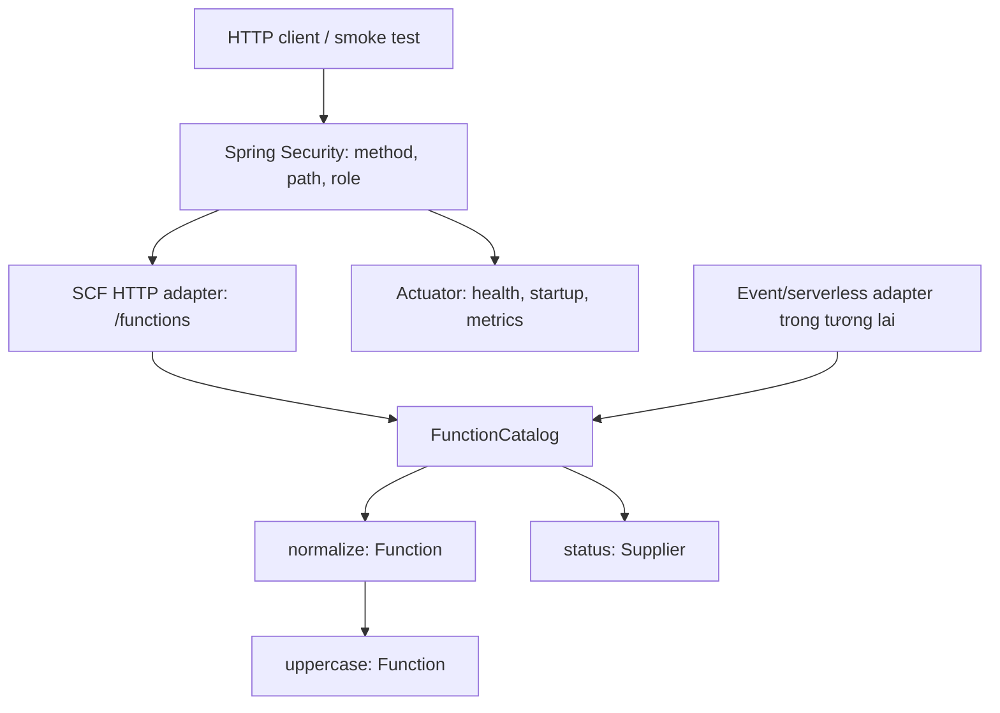

# Thực hành: đo khởi động, bảo vệ điểm vào và hoàn thiện kiểm thử triển khai Spring Cloud Function

## 1. Tình huống và mục tiêu bài lab

Một dịch vụ **Spring Cloud Function (SCF)** có thể rất nhỏ về nghiệp vụ nhưng vẫn cần được triển khai an toàn. Logic được viết bằng `Supplier<O>`, `Function<I,O>` và `Consumer<I>`, được quản lý qua `FunctionCatalog`. Cùng logic có thể được gọi từ **HTTP, sự kiện hoặc serverless**; mỗi adapter lại có thời điểm khởi tạo, kiểm soát quyền, timeout và vòng đời riêng.

Bạn được giao hoàn thiện dịch vụ demo **scf-practice** với các yêu cầu:

- Có pipeline `normalize|uppercase` xử lý văn bản và một `Supplier` đọc trạng thái.
- Đo thời gian Spring Boot sẵn sàng, xem được các bước startup và đo latency thực tế.
- Chỉ công bố pipeline và Supplier, không xuất các bean nội bộ thành endpoint HTTP.
- Người dùng gọi function phải xác thực; chỉ người vận hành mới đọc startup/metrics.
- Có unit test, kiểm thử HTTP âm tính, smoke test sau deploy và kế hoạch rollback.

### Kiến trúc



**Thông điệp quan trọng:** HTTP authorization **không tự bảo vệ** broker consumer hoặc Lambda handler. Khi tái sử dụng function ở những môi trường đó, bạn cần áp dụng identity, permissions và retry policy riêng.

### Tiêu chí hoàn thành

| Mã | Yêu cầu | Bằng chứng |
| --- | --- | --- |
| AC-01 | Có log thời gian khởi động Spring Boot | `BOOT_READY startupMs=...` |
| AC-02 | OPS đọc được startup steps; caller bị từ chối | `/actuator/startup` trả 200/403 theo role |
| AC-03 | Đo riêng request đầu và các request warm | Kết quả `curl -w` và function timer |
| AC-04 | Composition trả đúng văn bản | POST `/functions/normalize,uppercase` → `HELLO WORLD` |
| AC-05 | Supplier trả trạng thái | GET `/functions/status` → JSON |
| AC-06 | Function không cho anonymous gọi | 401 với Basic Auth của lab |
| AC-07 | Tài khoản OPS không tự có quyền gọi function | 403 |
| AC-08 | Bean nội bộ, route khác và HTTP method khác bị chặn | 403 với user đã xác thực |
| AC-09 | Probe, test tự động, smoke test đều hoạt động | Health/readiness, test report, exit code |
| AC-10 | Có quy trình rollout/rollback và không lộ secret | Checklist triển khai |

Bài dùng **Spring MVC + SCF HTTP adapter**, `Spring Security` và `Spring Boot Actuator` cho một **lab trên máy hoặc staging riêng**. Không có database hay nghiệp vụ thanh toán thật. Mọi lệnh Maven/Docker/Kubernetes là hướng dẫn để người học tự chạy trong dự án thực hành; việc biên soạn bài này không đồng nghĩa đã chạy ứng dụng.

## 2. Chuẩn bị và chọn Spring Boot/Spring Cloud đúng release train

### 2.1. Công cụ

- Java 17 trở lên; trong ví dụ Docker dùng JRE 21.
- Maven 3.9+ hoặc Maven Wrapper.
- `curl`, terminal Bash/Git Bash/WSL; với PowerShell cần điều chỉnh dấu xuống dòng và sử dụng `curl.exe`.
- Tùy chọn: Docker và Kubernetes để thực hành deployment.

**Compatibility:** Spring Cloud **2025.1.x** tương thích với Spring Boot **4.0.x/4.1.x** ở các bản phát hành được hỗ trợ; Spring Cloud **2025.0.x** dành cho Spring Boot **3.5.x**. Những dòng Spring Cloud Function tương ứng có thể khác version. Không trộn Spring Cloud 2025.0.x với Boot 4.x. Trước khi thực hiện deployment thật, cần kiểm tra **bản vá bảo mật mới nhất đã được tổ chức phê duyệt** và ma trận tương thích chính thức.

### 2.2. POM tham khảo

Dùng Spring Initializr hoặc tạo `pom.xml` trong **dự án lab riêng**. Ví dụ ghép Spring Boot 4.1.2 và Spring Cloud 2025.1.5:

```xml
<project xmlns="http://maven.apache.org/POM/4.0.0"
         xmlns:xsi="http://www.w3.org/2001/XMLSchema-instance"
         xsi:schemaLocation="http://maven.apache.org/POM/4.0.0 https://maven.apache.org/xsd/maven-4.0.0.xsd">
    <modelVersion>4.0.0</modelVersion>
    <parent>
        <groupId>org.springframework.boot</groupId>
        <artifactId>spring-boot-starter-parent</artifactId>
        <version>4.1.2</version>
        <relativePath/>
    </parent>
    <groupId>demo</groupId>
    <artifactId>scf-practice</artifactId>
    <version>0.0.1-SNAPSHOT</version>
    <properties>
        <java.version>17</java.version>
        <spring-cloud.version>2025.1.5</spring-cloud.version>
    </properties>
    <dependencyManagement>
        <dependencies>
            <dependency>
                <groupId>org.springframework.cloud</groupId>
                <artifactId>spring-cloud-dependencies</artifactId>
                <version>${spring-cloud.version}</version>
                <type>pom</type>
                <scope>import</scope>
            </dependency>
        </dependencies>
    </dependencyManagement>
    <dependencies>
        <dependency>
            <groupId>org.springframework.cloud</groupId>
            <artifactId>spring-cloud-starter-function-web</artifactId>
        </dependency>
        <dependency>
            <groupId>org.springframework.boot</groupId>
            <artifactId>spring-boot-starter-actuator</artifactId>
        </dependency>
        <dependency>
            <groupId>org.springframework.boot</groupId>
            <artifactId>spring-boot-starter-security</artifactId>
        </dependency>
        <dependency>
            <groupId>org.springframework.boot</groupId>
            <artifactId>spring-boot-starter-test</artifactId>
            <scope>test</scope>
        </dependency>
        <dependency>
            <groupId>org.springframework.security</groupId>
            <artifactId>spring-security-test</artifactId>
            <scope>test</scope>
        </dependency>
    </dependencies>
    <build>
        <plugins>
            <plugin>
                <groupId>org.springframework.boot</groupId>
                <artifactId>spring-boot-maven-plugin</artifactId>
            </plugin>
        </plugins>
    </build>
</project>
```

Đây là **một cặp phiên bản để học tập**, không phải khuyến nghị khóa mãi trong production. Bản vá SCF/Boot mới có thể được phát hành, và dependency compatibility/test packages có thể đổi giữa các thế hệ.

### 2.3. Cấu trúc dự án

```text
scf-practice/
├── pom.xml
└── src/
    ├── main/
    │   ├── java/demo/
    │   │   ├── PracticeApplication.java
    │   │   └── LabSecurityConfig.java
    │   └── resources/application.properties
    └── test/java/demo/CatalogBehaviorTest.java
```

## 3. Viết functional beans và đo thời gian startup

### 3.1. PracticeApplication.java

Tạo `src/main/java/demo/PracticeApplication.java`:

```java
package demo;

import java.time.Duration;
import java.util.Locale;
import java.util.concurrent.TimeUnit;
import java.util.function.Function;
import java.util.function.Supplier;

import org.slf4j.Logger;
import org.slf4j.LoggerFactory;
import org.springframework.boot.SpringApplication;
import org.springframework.boot.autoconfigure.SpringBootApplication;
import org.springframework.boot.context.event.ApplicationReadyEvent;
import org.springframework.boot.context.metrics.buffering.BufferingApplicationStartup;
import org.springframework.context.annotation.Bean;
import org.springframework.context.event.EventListener;
import org.springframework.stereotype.Component;

import io.micrometer.core.instrument.MeterRegistry;
import io.micrometer.core.instrument.Timer;

@SpringBootApplication
public class PracticeApplication {

    public static void main(String[] args) {
        SpringApplication app =
                new SpringApplication(PracticeApplication.class);

        // Lưu startup steps để Actuator có thể cung cấp cho OPS.
        app.setApplicationStartup(
                new BufferingApplicationStartup(2048));
        app.run(args);
    }

    @Bean
    public Function<String, String> normalize(
            MeterRegistry registry) {

        Timer timer = Timer.builder("lab.normalize.duration")
                .description("Duration of normalization")
                .register(registry);

        return input -> {
            long begin = System.nanoTime();
            try {
                if (input == null) {
                    throw new IllegalArgumentException(
                            "Input cannot be null");
                }
                return input.trim().replaceAll("\\s+", " ");
            }
            finally {
                timer.record(
                        System.nanoTime() - begin,
                        TimeUnit.NANOSECONDS);
            }
        };
    }

    @Bean
    public Function<String, String> uppercase() {
        return input -> input.toUpperCase(Locale.ROOT);
    }

    @Bean
    public Supplier<ServiceStatus> status() {
        return () -> new ServiceStatus(
                "READY", "SPRING_CLOUD_FUNCTION");
    }

    // Vẫn là functional bean nhưng không được công bố độc lập.
    @Bean
    public Function<String, String> internalOnly() {
        return text -> "INTERNAL:" + text;
    }
}

record ServiceStatus(String state, String service) {}

@Component
class StartupEvents {

    private static final Logger log =
            LoggerFactory.getLogger(StartupEvents.class);

    @EventListener
    public void onReady(ApplicationReadyEvent event) {
        Duration elapsed = event.getTimeTaken();

        log.info("BOOT_READY startupMs={}",
                elapsed == null ?
                        "unknown" : elapsed.toMillis());
    }
}
```

**Phân tích:**

- `normalize` và `uppercase` là `Function<String,String>`, có kiểu tương thích để ghép qua `FunctionCatalog`.
- `status` là `Supplier<ServiceStatus>`, thích hợp cho một GET endpoint có output JSON.
- `internalOnly` giúp thử negative security; nó có trong catalog nhưng không nên lộ HTTP.
- `ApplicationReadyEvent` báo mốc ứng dụng ready, **không** đo toàn bộ thời gian cấp container/serverless execution environment.
- `BufferingApplicationStartup` lưu startup steps; cần Actuator và cấu hình exposure để đọc được.
- `Timer` chỉ đo phần xử lý của `normalize`; không bao gồm network, serialization, Spring Security hay toàn bộ composition.
- `System.nanoTime()` thích hợp cho đo khoảng thời gian trong JVM; không dùng timestamp wall clock để đo đoạn ngắn khi đồng hồ hệ thống có thể bị điều chỉnh.
- Không gắn user ID, raw payload hay trace ID thành **metric tag** vì gây high cardinality.

### 3.2. Phân biệt các mốc đo

| Thước đo | Phạm vi | Không nên suy ra |
| --- | --- | --- |
| `BOOT_READY startupMs` | Thời lượng startup Spring Boot ghi nhận | Thời gian client nhận request đầu |
| `/actuator/startup` | Các bước khởi tạo Spring context | Toàn bộ chi phí provision VM/container |
| `lab.normalize.duration` | Thời gian trong một functional bean | Latency HTTP end-to-end |
| `curl time_starttransfer` | Thời gian tới byte đầu response | Riêng function duration |
| `curl time_total` | Tổng thời gian client quan sát | Chỉ startup hoặc chỉ server CPU |
| Cold start platform | Theo log/metrics môi trường serverless | Phân bố latency của các request warm |

## 4. Chỉ xuất những function cần thiết

Tạo `src/main/resources/application.properties`:

```properties
spring.application.name=scf-practice
server.port=8080

# SCF HTTP adapter và function filtering.
spring.cloud.function.web.path=/functions
spring.cloud.function.definition=normalize|uppercase;status

# Không phản chiếu credential/client secret qua response theo mặc định.
spring.cloud.function.http.ignored-headers=Authorization,Cookie,X-Internal-Token

# Actuator và startup/readiness probes.
management.endpoints.web.exposure.include=health,metrics,startup
management.endpoint.health.probes.enabled=true
management.endpoint.health.probes.add-additional-paths=true

# Hai biến môi trường phải có giá trị khi chạy.
lab.auth.caller-password=${LAB_CALLER_PASSWORD}
lab.auth.ops-password=${LAB_OPS_PASSWORD}
```

### 4.1. Hiểu definition

```text
normalize|uppercase;status
         |         ;
         |         +-- mục thứ 2: status
         +------------ mục thứ 1: normalize rồi uppercase
```

- `|`: ghép hai hàm theo thứ tự.
- `;`: liệt kê **hai** mục được HTTP adapter công bố.
- Composition có URL `POST /functions/normalize,uppercase`.
- Supplier có URL `GET /functions/status`.
- Các bean `normalize`, `uppercase` và `internalOnly` **không** tự xuất thành endpoint riêng.
- Chế độ filtering nhiều mục **không tự ánh xạ root** `/functions`.

**Không coi filtering là security.** HTTP adapter có thể không xuất route theo tên bean, nhưng vẫn phải có authorization bảo vệ URL/method và những routing paths khác. Property `ignored-headers` chỉ giảm propagation mặc định; function/proxy vẫn có thể chủ động thêm response header. Kiểm tra bí mật tại boundary toàn tuyến.

### 4.2. Bảo vệ Actuator

`health` có thể được công bố cho probe với thông tin chi tiết giới hạn. `metrics` và `startup` có thể tiết lộ cấu trúc hệ thống; chúng phải có rule security riêng. Khi ứng dụng tự định nghĩa `SecurityFilterChain`, cần bảo vệ rõ ràng các actuator endpoints đã expose, không dựa vào security auto-configuration mặc định.

## 5. Bảo vệ điểm vào bằng Spring Security

Bài lab dùng hai role riêng:

- **FUNCTION_CALLER:** chỉ được gọi POST composition và GET Supplier.
- **OPS:** chỉ được đọc startup/metrics, không mặc nhiên có quyền gọi các function.

Các health probes được phép GET không cần credential. Mọi URL/method khác bị từ chối theo `denyAll`.

### 5.1. LabSecurityConfig.java

Tạo `src/main/java/demo/LabSecurityConfig.java`:

```java
package demo;

import jakarta.servlet.DispatcherType;

import org.springframework.beans.factory.annotation.Value;
import org.springframework.context.annotation.Bean;
import org.springframework.context.annotation.Configuration;
import org.springframework.http.HttpMethod;
import org.springframework.security.config.Customizer;
import org.springframework.security.config.annotation.web.builders.HttpSecurity;
import org.springframework.security.config.http.SessionCreationPolicy;
import org.springframework.security.core.userdetails.User;
import org.springframework.security.core.userdetails.UserDetailsService;
import org.springframework.security.crypto.bcrypt.BCryptPasswordEncoder;
import org.springframework.security.crypto.password.PasswordEncoder;
import org.springframework.security.provisioning.InMemoryUserDetailsManager;
import org.springframework.security.web.SecurityFilterChain;

@Configuration
class LabSecurityConfig {

    @Bean
    PasswordEncoder passwordEncoder() {
        return new BCryptPasswordEncoder();
    }

    @Bean
    UserDetailsService users(
            @Value("${lab.auth.caller-password}")
            String callerPassword,
            @Value("${lab.auth.ops-password}")
            String opsPassword,
            PasswordEncoder encoder) {

        if (callerPassword.isBlank() || opsPassword.isBlank()) {
            throw new IllegalArgumentException(
                    "LAB_CALLER_PASSWORD and LAB_OPS_PASSWORD required");
        }

        return new InMemoryUserDetailsManager(
            User.withUsername("caller")
                .password(encoder.encode(callerPassword))
                .roles("FUNCTION_CALLER")
                .build(),
            User.withUsername("ops")
                .password(encoder.encode(opsPassword))
                .roles("OPS")
                .build()
        );
    }

    @Bean
    SecurityFilterChain webSecurity(HttpSecurity http)
            throws Exception {

        http
            // Dành RIÊNG cho lab stateless không có browser session.
            .csrf(csrf -> csrf.disable())
            .sessionManagement(session ->
                session.sessionCreationPolicy(
                    SessionCreationPolicy.STATELESS))
            .authorizeHttpRequests(auth -> auth
                .dispatcherTypeMatchers(
                    DispatcherType.ERROR).permitAll()

                .requestMatchers(
                    HttpMethod.GET,
                    "/actuator/health",
                    "/actuator/health/**",
                    "/livez",
                    "/readyz"
                ).permitAll()

                .requestMatchers(
                    HttpMethod.POST,
                    "/functions/normalize,uppercase"
                ).hasRole("FUNCTION_CALLER")
                .requestMatchers(
                    HttpMethod.GET,
                    "/functions/status"
                ).hasRole("FUNCTION_CALLER")

                .requestMatchers(
                    HttpMethod.GET,
                    "/actuator/startup",
                    "/actuator/metrics",
                    "/actuator/metrics/**"
                ).hasRole("OPS")

                .anyRequest().denyAll()
            )
            .httpBasic(Customizer.withDefaults());

        return http.build();
    }
}
```

### 5.2. Đọc mã bảo mật

| Quy tắc | Ý nghĩa |
| --- | --- |
| `hasRole("FUNCTION_CALLER")` | Yêu cầu authority `ROLE_FUNCTION_CALLER` |
| `hasRole("OPS")` | Yêu cầu authority `ROLE_OPS` |
| `HttpMethod.POST + /functions/normalize,uppercase` | Chỉ mở một composition qua POST |
| `HttpMethod.GET + /functions/status` | Chỉ mở Supplier qua GET |
| `/actuator/startup`, `/actuator/metrics` | Chỉ người vận hành được đọc |
| `.anyRequest().denyAll()` | Mọi route/method còn lại đều bị chặn |
| `DispatcherType.ERROR` | Cho phép error dispatch không bị đổi thành 403 ngoài ý muốn |

Cần phân biệt **authentication** (xác định ai đang gọi) và **authorization** (người đó được làm gì). Spring Security chịu trách nhiệm bảo vệ HTTP entry points; nó không thay thế việc xác thực event producer hoặc IAM trong serverless.

### 5.3. Cảnh báo về mật khẩu và CSRF

`InMemoryUserDetailsManager` và HTTP Basic ở đây chỉ dành cho **lab trên localhost hoặc staging cô lập**. Password được nhận từ môi trường và mã hóa bằng BCrypt trong UserDetailsService; không hardcode secret thật vào repository.

Ví dụ tắt CSRF vì giả định client **không phải browser, không có session/cookie**, và request được gửi có chủ đích bởi test runner. **Không copy cấu hình CSRF disabled sang API sử dụng browser session hoặc Basic Auth mà browser có thể tự gửi credential.** Production cần TLS, secret manager, OAuth2/JWT/mTLS hoặc cơ chế identity phù hợp, security reviews và rate limiting.

Một lệnh `curl -u` còn có thể làm plaintext credential xuất hiện trong process arguments trên máy dùng chung. Chỉ dùng trong môi trường lab có kiểm soát; trên CI/production cần secret injection và cách cung cấp auth an toàn hơn. Không bật `set -x` trong script chứa mật khẩu.

### 5.4. Khởi chạy

Bash:

```bash
export LAB_CALLER_PASSWORD='replace-with-lab-secret-one'
export LAB_OPS_PASSWORD='replace-with-different-lab-secret-two'

mvn spring-boot:run
```

Hai chuỗi ở trên là **giá trị minh họa, không được dùng làm secret production**. Trên PowerShell sử dụng `$env:LAB_CALLER_PASSWORD = '...'` và tương tự cho OPS.

Khi ứng dụng ready, cần thấy `BOOT_READY startupMs=...`. Nếu không cấp biến môi trường, ứng dụng nên **fail fast** thay vì chạy với mật khẩu yếu mặc định.

## 6. Thực hành A — đo khởi động

### 6.1. Kiểm tra Actuator startup

```bash
# Public health có thể được probe gọi không có auth.
curl -i 'http://localhost:8080/actuator/health'

# OPS được xem startup steps.
curl -i -u "ops:$LAB_OPS_PASSWORD" \
  'http://localhost:8080/actuator/startup'

# Caller không được xem startup steps.
curl -i -u "caller:$LAB_CALLER_PASSWORD" \
  'http://localhost:8080/actuator/startup'
```

Kỳ vọng khi ứng dụng healthy: health `200`, OPS startup `200`, caller startup `403`. Không expose `/actuator/startup` công khai trên Internet vì nó cung cấp thông tin chẩn đoán cấu trúc ứng dụng.

Nếu startup endpoint không tồn tại hoặc rỗng:

1. Đã gọi `setApplicationStartup(new BufferingApplicationStartup(...))` **trước** `run()` chưa?
2. Có `spring-boot-starter-actuator` không?
3. Endpoint `startup` đã được expose chưa?
4. Auth có role OPS không, management port/path có khác không?
5. Có proxy rewrite URL hoặc policy riêng chặn nó không?

### 6.2. Đo thời gian từ client

```bash
curl -sS -o /dev/null \
  -w 'http=%{http_code} connect=%{time_connect}s ttfb=%{time_starttransfer}s total=%{time_total}s\n' \
  -u "caller:$LAB_CALLER_PASSWORD" \
  -X POST 'http://localhost:8080/functions/normalize,uppercase' \
  -H 'Content-Type: text/plain' \
  -H 'Accept: text/plain' \
  --data '  hello   world  '
```

- `time_connect`: phần kết nối TCP từ góc nhìn client, không phải toàn bộ DNS/TLS.
- `time_starttransfer`: từ lúc request bắt đầu tới byte phản hồi đầu tiên.
- `time_total`: tổng thời gian client chờ nhận response.
- `lab.normalize.duration`: thời gian riêng code `normalize` (xem tiếp mục 6.4).

Ví dụ hình thức kết quả (giá trị **không phải đo thực**):

```text
http=200 connect=0.003s ttfb=0.042s total=0.043s
```

### 6.3. So sánh request đầu và warm requests

Sau khi restart ứng dụng, đo ít nhất một request đầu, rồi lặp thêm:

```bash
for n in 1 2 3 4 5 6 7 8 9 10; do
  curl -sS -o /dev/null \
    -w "run=$n status=%{http_code} total=%{time_total}s\n" \
    -u "caller:$LAB_CALLER_PASSWORD" \
    -X POST 'http://localhost:8080/functions/normalize,uppercase' \
    -H 'Content-Type: text/plain' \
    --data '  hello   world  '
done
```

Ghi bảng:

| Nhóm đo | Số đo cần lưu | Dùng để |
| --- | --- | --- |
| App startup | `BOOT_READY startupMs` | So sánh chi phí tạo ApplicationContext |
| First request sau ready | `time_total` | Nhận diện JIT, lazy init, converter, connection setup |
| Warm requests | Các giá trị total của lần 2–10 | Quan sát phân bố độ trễ |
| Function timer | `lab.normalize.duration` | Xác định normalize có thực sự chậm? |
| Nhiều cold starts | Nhiều lần **tạo process mới** | Đo cold-start distribution, không suy ra từ một JVM |

**Không gọi 10 requests trong cùng một JVM là 10 cold starts.** Một request đầu chậm có thể do TLS, DNS, JIT, lazy bean, thread scheduling hoặc network. Đo nhiều lần khởi động và đối chiếu server-side trace trước khi tối ưu.

### 6.4. Xem Micrometer timer

Sau ít nhất một invocation:

```bash
curl -i -u "ops:$LAB_OPS_PASSWORD" \
  'http://localhost:8080/actuator/metrics/lab.normalize.duration'
```

Timer thường hiển thị các measurement như `COUNT`, `TOTAL_TIME`, `MAX` tùy configuration. Nếu thiếu metric, xác nhận function đã được gọi, tên meter đúng và Actuator/Micrometer registry đang hoạt động.

### 6.5. Bảng chẩn đoán startup

| Triệu chứng | Cần kiểm tra trước |
| --- | --- |
| Chậm trước `BOOT_READY` | Bean initialization, remote config, dependency, CPU, DB migration |
| Ready nhanh nhưng request đầu chậm | JIT, lazy initialization, converter, pool, DNS/TLS |
| Function timer nhanh nhưng curl chậm | Security/auth, proxy, network, serialization, queue |
| Cold start serverless chậm | Platform init, image load, JVM/Spring, memory/CPU |
| Độ trễ tăng khi tải cao | GC, thread/DB pool, downstream, CPU throttling |

Không dùng `spring.main.lazy-initialization=true` như “thuốc chữa tất cả”: nó có thể chuyển chi phí sang request đầu tiên và làm tăng rủi ro timeout.

## 7. Thực hành B — bảo vệ HTTP endpoints

### 7.1. Ma trận quyền truy cập

| Request | Anonymous | Caller | OPS |
| --- | --- | --- | --- |
| GET `/actuator/health` | 200 khi UP | 200 | 200 |
| GET `/readyz` | 200 khi ready | 200 | 200 |
| POST `/functions/normalize,uppercase` | **401** | **200** | **403** |
| GET `/functions/status` | **401** | **200** | **403** |
| GET `/actuator/startup` | **401** | **403** | **200** |
| GET `/actuator/metrics` | **401** | **403** | **200** |
| POST `/functions/internalOnly` | Có thể 401/403 | **403** | **403** |
| POST `/functions/normalize` | Có thể 401/403 | **403** | **403** |
| PUT `/functions/normalize,uppercase` | Có thể 401/403 | **403** | **403** |
| GET `/functions` | Có thể 401/403 | **403** | **403** |

Với URL bị `denyAll`, filter chain có thể quyết định từ chối **trước khi** MVC xác định có handler. Vì vậy authenticated caller thường nhận `403`, không nhất thiết `404`/`405`. Đối với anonymous tới route đã được cấu hình role, Basic authentication entry point thường trả `401`.

### 7.2. Request hợp lệ tới composition

```bash
curl -i -u "caller:$LAB_CALLER_PASSWORD" \
  -X POST 'http://localhost:8080/functions/normalize,uppercase' \
  -H 'Content-Type: text/plain' \
  -H 'Accept: text/plain' \
  --data '  hello   world  '
```

Body mong đợi:

```text
HELLO WORLD
```

`normalize` giảm khoảng trắng dư, sau đó `uppercase` chuyển thành chữ in hoa. HTTP status thành công thông thường là `200 OK`.

### 7.3. Request hợp lệ tới Supplier

```bash
curl -i -u "caller:$LAB_CALLER_PASSWORD" \
  -H 'Accept: application/json' \
  'http://localhost:8080/functions/status'
```

Body dự kiến:

```json
{"state":"READY","service":"SPRING_CLOUD_FUNCTION"}
```

Field order và khoảng trắng JSON có thể khác; integration test nên parse JSON.

### 7.4. Các ca kiểm tra âm tính

```bash
# Không xác thực -> 401.
curl -i -X POST \
  'http://localhost:8080/functions/normalize,uppercase' \
  -H 'Content-Type: text/plain' --data 'hello'

# OPS không được gọi function -> 403.
curl -i -u "ops:$LAB_OPS_PASSWORD" \
  -X POST 'http://localhost:8080/functions/normalize,uppercase' \
  -H 'Content-Type: text/plain' --data 'hello'

# Caller không được xem startup -> 403.
curl -i -u "caller:$LAB_CALLER_PASSWORD" \
  'http://localhost:8080/actuator/startup'

# Bean nội bộ không được công bố -> 403.
curl -i -u "caller:$LAB_CALLER_PASSWORD" \
  -X POST 'http://localhost:8080/functions/internalOnly' \
  -H 'Content-Type: text/plain' --data 'hello'

# Không mở phần tử đơn lẻ của composition -> 403.
curl -i -u "caller:$LAB_CALLER_PASSWORD" \
  -X POST 'http://localhost:8080/functions/normalize' \
  -H 'Content-Type: text/plain' --data 'hello'

# Sai HTTP method -> 403.
curl -i -u "caller:$LAB_CALLER_PASSWORD" \
  -X PUT 'http://localhost:8080/functions/normalize,uppercase' \
  -H 'Content-Type: text/plain' --data 'hello'

# Không tự mở root path -> 403.
curl -i -u "caller:$LAB_CALLER_PASSWORD" \
  'http://localhost:8080/functions'
```

**Không chỉ nhìn status:** kiểm tra log/spy để xác minh function bị cấm **thực sự không chạy**, kể cả khi có proxy/router và HTTP fallback. Một response 403 không chứng minh mọi adapter khác đều đã bị chặn.

### 7.5. Sai path prefix và header routing

Nếu thay `spring.cloud.function.web.path`, phải sửa đồng thời Spring Security `requestMatchers`, ingress/gateway và smoke tests. Không cho user bên ngoài lựa chọn `FunctionCatalog.lookup(name)` tùy ý hoặc điều khiển `functionRouter` tới function nhạy cảm qua header mà không có allowlist/authorization.

## 8. Thực hành C — kiểm thử FunctionCatalog và HTTP boundary

### 8.1. Test catalog bằng JUnit

Tạo `src/test/java/demo/CatalogBehaviorTest.java`:

```java
package demo;

import java.util.function.Function;

import org.junit.jupiter.api.Test;
import org.springframework.beans.factory.annotation.Autowired;
import org.springframework.boot.test.context.SpringBootTest;
import org.springframework.cloud.function.context.FunctionCatalog;

import static org.junit.jupiter.api.Assertions.assertEquals;
import static org.junit.jupiter.api.Assertions.assertNotNull;

@SpringBootTest(properties = {
    "lab.auth.caller-password=local-test-caller",
    "lab.auth.ops-password=local-test-ops"
})
class CatalogBehaviorTest {

    @Autowired
    FunctionCatalog catalog;

    @Test
    void compositionWorks() {
        Function<String, String> composition =
                catalog.lookup(Function.class,
                        "normalize|uppercase");

        assertNotNull(composition);
        assertEquals("HELLO WORLD",
                composition.apply("  hello   world  "));
    }

    @Test
    void internalBeanStillExists() {
        Function<String, String> internal =
                catalog.lookup(Function.class, "internalOnly");

        assertNotNull(internal);
        assertEquals("INTERNAL:abc", internal.apply("abc"));
    }
}
```

Chạy test:

```bash
mvn -B -ntp test
```

Test này xác minh **logic catalog** chứ chưa chứng minh Spring Security chặn HTTP đúng. Ở Boot 4, một số test auto-configuration packages thay đổi so với Boot 3; tránh copy nguyên `@AutoConfigureMockMvc` của dòng cũ mà không kiểm tra tài liệu. Các test HTTP có thể dùng server thật hoặc `MockMvc` với filter chain hoạt động.

### 8.2. Test HTTP cần xác minh những gì?

- Caller POST composition thành công và body chuẩn hóa/in hoa chính xác.
- Caller GET Supplier thành công với JSON đúng.
- Anonymous không truy cập function đã xuất.
- OPS không có quyền function; caller không có quyền startup/metrics.
- Bean nội bộ, path không khai báo, sai method đều bị chặn.
- `health`/`readyz` hoạt động trước và sau rollout.
- Credential không bị phản chiếu vào response hoặc log.
- Cấu hình thay đổi profile/gateway không vô tình lộ function.

Một unit test như `uppercase().apply("hello")` không đủ để chứng minh HTTP entry point đã được bảo vệ.

### 8.3. Đo coverage theo các tầng

| Tầng | Cần test |
| --- | --- |
| Functional core | Phép biến đổi String, null/invalid input, composition order |
| FunctionCatalog | Lookup tên/function, composition, type conversion |
| HTTP adapter | Body, Content-Type, Accept, path, method |
| Spring Security | 200/401/403, role/method matcher, denyAll |
| Actuator | Health/probes; startup và metrics chỉ cho OPS |
| Deployment | Secrets, image, startup/readiness, path rewrite |
| Event/serverless mở rộng | IAM/broker permissions, retry, dedupe, timeout |

## 9. Viết smoke test phục vụ staging/deployment

### 9.1. Script Bash

Tạo `scripts/smoke.sh` trong **dự án lab**, không phải trong module tài liệu:

```bash
#!/usr/bin/env bash
set -euo pipefail

BASE_URL="${BASE_URL:-http://localhost:8080}"
: "${LAB_CALLER_PASSWORD:?caller password missing}"
: "${LAB_OPS_PASSWORD:?ops password missing}"

tmp="$(mktemp)"
trap 'rm -f "$tmp"' EXIT

check_status() {
    local expected="$1"
    shift
    local actual
    actual="$(curl -sS -o "$tmp" -w '%{http_code}' "$@")"
    if [[ "$actual" != "$expected" ]]; then
        printf 'FAIL: expected %s, got %s\n' \
            "$expected" "$actual" >&2
        exit 1
    fi
    printf 'PASS HTTP %s\n' "$expected"
}

check_status 200 "$BASE_URL/actuator/health"

check_status 200 \
  -u "caller:$LAB_CALLER_PASSWORD" \
  -X POST "$BASE_URL/functions/normalize,uppercase" \
  -H 'Content-Type: text/plain' \
  -H 'Accept: text/plain' \
  --data '  hello   world  '

if [[ "$(cat "$tmp")" != "HELLO WORLD" ]]; then
    echo 'FAIL: wrong composition body' >&2
    exit 1
fi

check_status 401 \
  -X POST "$BASE_URL/functions/normalize,uppercase" \
  -H 'Content-Type: text/plain' --data 'hello'

check_status 403 \
  -u "ops:$LAB_OPS_PASSWORD" \
  -X POST "$BASE_URL/functions/normalize,uppercase" \
  -H 'Content-Type: text/plain' --data 'hello'

check_status 403 \
  -u "caller:$LAB_CALLER_PASSWORD" \
  "$BASE_URL/actuator/startup"

check_status 200 \
  -u "ops:$LAB_OPS_PASSWORD" \
  "$BASE_URL/actuator/startup"

check_status 403 \
  -u "caller:$LAB_CALLER_PASSWORD" \
  -X POST "$BASE_URL/functions/internalOnly" \
  -H 'Content-Type: text/plain' --data 'hello'

check_status 403 \
  -u "caller:$LAB_CALLER_PASSWORD" \
  -X PUT "$BASE_URL/functions/normalize,uppercase" \
  -H 'Content-Type: text/plain' --data 'hello'

check_status 200 "$BASE_URL/readyz"

check_status 200 \
  -u "caller:$LAB_CALLER_PASSWORD" \
  -H 'Accept: application/json' \
  "$BASE_URL/functions/status"

grep -q '"state":"READY"' "$tmp" || {
    echo 'FAIL: incorrect status JSON' >&2
    exit 1
}

echo 'SMOKE_PASS'
```

### 9.2. Giải thích script và giới hạn

- `set -euo pipefail` giúp dừng khi có lệnh không thành công hoặc biến bắt buộc chưa có.
- `mktemp` và `trap` tạo file phản hồi tạm rồi xóa khi script kết thúc.
- `curl -w` chỉ lấy HTTP status mà không in toàn bộ body; tránh lộ dữ liệu trong log CI.
- `grep` cuối cùng chỉ kiểm tra chuỗi JSON đơn giản; test robust hơn nên **parse JSON** thay vì so chuỗi nguyên văn.
- Script **không** chứng minh mọi URL hay mọi security threat đều an toàn; đây là minimum deployment gate.
- `curl -u` đưa mật khẩu vào process arguments: lab cô lập có thể chấp nhận, nhưng CI production nên dùng secret injection và phương thức authentication phù hợp.
- Nếu staging có gateway rewrite hoặc authentication khác, điều chỉnh smoke test theo **API contract thực tế**, không tùy tiện sửa server để hợp thức hóa một kết quả bất thường.

Chạy:

```bash
bash scripts/smoke.sh
```

`SMOKE_PASS` chỉ xuất hiện khi tất cả checks đạt. Exit code khác 0 phải làm pipeline **fail/không chuyển traffic**.

## 10. Container và kiểm tra readiness khi rollout

### 10.1. Dockerfile minh họa

```dockerfile
FROM eclipse-temurin:21-jre
WORKDIR /app
COPY target/scf-practice-0.0.1-SNAPSHOT.jar /app/app.jar
USER 10001
EXPOSE 8080
ENTRYPOINT ["java", "-jar", "/app/app.jar"]
```

Build và chạy trong môi trường lab:

```bash
mvn -B -ntp clean verify
docker build -t scf-practice:lab .
docker run --rm -p 8080:8080 \
  -e LAB_CALLER_PASSWORD \
  -e LAB_OPS_PASSWORD \
  scf-practice:lab
```

Để dùng `-e VAR`, shell phải có sẵn biến tương ứng. Container chạy với numeric non-root user; cần kiểm tra file permissions/runtime filesystem khi triển khai thực. Production nên **pin base image bằng digest**, quét OS/JVM/dependencies, ghi SBOM và không dùng tag trôi nổi không được kiểm soát.

### 10.2. Readiness, liveness và startup probe khác nhau thế nào?

- **Startup probe:** tránh liveness restart app quá sớm khi JVM/Spring còn init.
- **Liveness probe:** đánh giá process còn hoạt động đủ để nên tiếp tục chạy hay phải restart.
- **Readiness probe:** quyết định instance đã sẵn sàng nhận traffic chưa.
- **Startup duration:** số đo khởi động từ Spring Boot/platform, không phải thời lượng chờ một probe.

Cấu hình `management.endpoint.health.probes.add-additional-paths=true` cho phép `/livez` và `/readyz` trên **cổng chính** khi các health probes được bật. Điều này đặc biệt hữu ích khi Actuator dùng management port riêng.

### 10.3. Mẫu Kubernetes Deployment

```yaml
apiVersion: apps/v1
kind: Deployment
metadata:
  name: scf-practice
spec:
  replicas: 2
  selector:
    matchLabels:
      app: scf-practice
  template:
    metadata:
      labels:
        app: scf-practice
    spec:
      containers:
        - name: app
          image: registry.example.com/scf-practice:replace-with-digest
          ports:
            - containerPort: 8080
              name: http
          env:
            - name: LAB_CALLER_PASSWORD
              valueFrom:
                secretKeyRef:
                  name: scf-practice-auth
                  key: caller-password
            - name: LAB_OPS_PASSWORD
              valueFrom:
                secretKeyRef:
                  name: scf-practice-auth
                  key: ops-password
          startupProbe:
            httpGet:
              path: /livez
              port: 8080
            periodSeconds: 5
            failureThreshold: 30
          readinessProbe:
            httpGet:
              path: /readyz
              port: 8080
            periodSeconds: 5
            failureThreshold: 3
          livenessProbe:
            httpGet:
              path: /livez
              port: 8080
            periodSeconds: 10
            failureThreshold: 3
          resources:
            requests:
              cpu: "100m"
              memory: "256Mi"
            limits:
              memory: "512Mi"
```

**Đây là mẫu cần hoàn thiện** với Secret, Service, image digest thật, namespace, registry access, NetworkPolicy và CI/CD của môi trường cụ thể. Các probe budgets và resources chỉ là giá trị minh họa. Hãy dùng **startup p95/p99 thực tế** và memory/GC profile để lựa chọn, không copy mù quáng sang production.

### 10.4. Deployment chỉ được đánh dấu ready khi

1. Process khởi động và ghi `BOOT_READY`.
2. Startup probe vượt qua giai đoạn init.
3. Readiness probe trả healthy trên cổng phục vụ traffic.
4. Secrets được cấp đúng, không có fallback mật khẩu yếu.
5. Smoke test qua đúng public ingress/auth thành công.
6. Error rate, timeout, p95 latency không vượt ngưỡng đã định.
7. Không có chức năng nội bộ/Actuator nhạy cảm được truy cập ngoài policy.

Nếu probe bị 401/403, kiểm tra matcher cho `/readyz` hoặc `/actuator/health/readiness`; **không tắt toàn bộ Spring Security**.

## 11. Cổng kiểm tra CI/CD trước triển khai

| Gate | Công việc | Điều kiện fail |
| --- | --- | --- |
| Dependency/SBOM | So Spring Boot/Cloud BOM, kiểm tra CVE | Lệch version/vi phạm security policy |
| Compile/test | `mvn -B -ntp clean verify` | Build hoặc tests fail |
| Catalog test | Lookup/composition và kiểu dữ liệu | Kết quả sai |
| HTTP security integration | 200/401/403, role, path/method | Một endpoint nhạy cảm bị lộ |
| Image build | Build non-root, pin digest | Image không chạy/không xác định được bản |
| Staging deploy | Secrets, readiness/startup | Ứng dụng không ready |
| Smoke test | Route được phép và bị cấm | Bất kỳ case nào fail |
| Performance | Startup, cold vs warm, p95/p99 | Vượt SLO/ngân sách timeout |
| Progressive rollout | Canary/rolling quan sát error rate | Lỗi tăng hoặc auth bypass |
| Rollback | Giữ image/config phiên bản trước | Không thể rollback khi cần |

Chuỗi lệnh tham khảo:

```bash
mvn -B -ntp clean verify
docker build -t scf-practice:build-123 .

# Push image và triển khai staging qua hệ thống CI/CD.
# Sau khi ready và secret đã có:
BASE_URL='https://staging.example.com' bash scripts/smoke.sh
```

Không tồn tại một lệnh triển khai chung an toàn cho mọi cluster. Pipeline phải quản lý credentials registry, image digest, approvals, rollout health và rollback theo chính sách tổ chức.

### Những tình huống buộc dừng rollout

- Tài khoản/mật khẩu nằm trong source hoặc được in vào CI log.
- Anonymous gọi được function cần bảo vệ.
- User caller đọc được startup/metrics hoặc OPS gọi được function ngoài quyền.
- `internalOnly` truy cập được qua HTTP.
- `/readyz` không hoạt động hoặc báo ready trước khi thành phần bắt buộc sẵn sàng.
- Startup p95 vượt giới hạn startupProbe.
- Smoke tests bị vô hiệu hóa để “chạy kịp release”.
- Dependency có advisory nghiêm trọng chưa được xử lý theo policy.
- Không xác định được phiên bản image để rollback.

## 12. Runbook chẩn đoán lỗi triển khai

### 12.1. Startup chậm, process restart liên tục

1. Xem container log và Kubernetes events: crash, OOMKilled hay probe timeout?
2. Có `BOOT_READY` chưa? Nếu chưa, startup step nào kéo dài?
3. CPU throttling, heap/GC, thread count, resource limits và image pull.
4. Environment secrets, remote config, DNS/DB, TLS handshake có chậm không?
5. StartupProbe budget có phù hợp với cold-start distribution không?
6. Nếu ready nhanh nhưng request đầu chậm, kiểm tra lazy init/JIT/connection pool.

Không tăng mọi timeout lên mức cao mà không tìm nguyên nhân. Timeout client/gateway cũng không bảo đảm backend đã hủy việc xử lý hoặc rollback side effect.

### 12.2. HTTP trả 401/403/404/405

| Status | Nghi vấn đầu tiên |
| --- | --- |
| 401 | Credential thiếu/sai hoặc Basic challenge |
| 403 | Đã auth nhưng sai role, method/path hoặc `denyAll` |
| 404 | Không có SCF export, sai prefix/definition hoặc gateway rewrite |
| 405 | Handler tồn tại nhưng method không được hỗ trợ; security có thể chặn trước thành 403 |
| 406 | `Accept` không phù hợp response |
| 415 | `Content-Type` không phù hợp input |
| 500 | Function exception, conversion hoặc bean/config lỗi |
| 503 | Readiness/upstream unavailable |
| 504 | Gateway không nhận response đúng hạn; backend có thể vẫn xử lý |

Giá trị HTTP status phải được đối chiếu với log/trace. Một request bị chặn có thể trả 403 thay vì 404/405 vì security filter chạy **trước** handler mapping.

### 12.3. Actuator không có startup/metrics

- Có dependency Actuator không?
- `BufferingApplicationStartup` được đặt trước `run()` không?
- `startup`/`metrics` có được expose và user có role OPS không?
- Function đã được gọi để tạo `lab.normalize.duration` chưa?
- Có management port/path riêng hoặc gateway rewrite không?
- Metrics filter/registry có tắt meter không?

### 12.4. Smoke test pass localhost nhưng fail qua gateway

So sánh URL **client nhìn thấy** và URL **backend nhận được**. Kiểm tra TLS termination, forwarded headers, path rewrite, response cache, user identity và auth/authorization policy tại hai tầng. Không sửa `anyRequest().denyAll()` thành `permitAll()` chỉ để test qua.

## 13. Đưa cùng function sang event/serverless

SCF giúp code `normalize` và `uppercase` **không phụ thuộc HTTP**:

```text
HTTP text body
  -> normalize -> uppercase -> HTTP response

Event payload
  -> normalize -> uppercase -> output event

Serverless event
  -> adapter -> normalize -> uppercase -> platform result
```

Tuy nhiên, việc tái sử dụng function không tự sao chép:

- Spring Security HTTP `SecurityFilterChain` sang broker/Lambda IAM.
- HTTP status/headers sang message acknowledgment.
- Client timeout sang broker visibility timeout.
- FunctionCatalog HTTP path composition sang tên binding/config của event source.
- HTTP retry safety sang consumer idempotency.

Khi dùng chức năng dynamic routing như `functionRouter`, không để client không tin cậy gửi tên function đích tùy ý trong headers hoặc message payload. Cần allowlist và authorization ở adapter phù hợp.

## 14. Checklist hoàn thành bài lab

- [ ] POM dùng Spring Boot/Spring Cloud BOM tương thích; kiểm tra bản vá security.
- [ ] App khởi động khi có env secrets và fail fast khi thiếu.
- [ ] Có log `BOOT_READY startupMs=...` và dữ liệu `/actuator/startup`.
- [ ] OPS được đọc startup/metrics; caller và anonymous không được đọc.
- [ ] Đã đo first/warm requests và ghi kết quả thật.
- [ ] Micrometer timer `lab.normalize.duration` hoạt động.
- [ ] Caller POST composition ra `HELLO WORLD`.
- [ ] Caller GET Supplier ra đúng JSON.
- [ ] Anonymous không gọi được function được công bố.
- [ ] OPS không có quyền gọi function; caller không có quyền vận hành.
- [ ] Bean nội bộ, route không khai báo và sai method bị chặn.
- [ ] Readiness/liveness có thể dùng làm probes.
- [ ] JUnit catalog test, HTTP/security tests và smoke script đạt.
- [ ] Không có credential hoặc response nhạy cảm trong log.
- [ ] Container non-root, startup/readiness probes và resource limits được xác minh.
- [ ] Có image digest, performance gate và kế hoạch rollback.
- [ ] Biết rằng security HTTP cần bổ sung riêng khi chuyển sang event/serverless.

### Câu hỏi tự kiểm tra

1. Vì sao `BOOT_READY` không bằng `curl time_total`?
2. Vì sao cần `BufferingApplicationStartup` **và** cấu hình Actuator exposure?
3. `normalize|uppercase;status` nghĩa là gì? Khác `normalize;uppercase;status` ra sao?
4. Tại sao `internalOnly` có trong catalog mà không được công bố HTTP?
5. Vì sao vẫn dùng `denyAll` dù đã có SCF function filtering?
6. Vì sao OPS không nên tự có quyền gọi mọi function?
7. Khi user gọi sai method nhận 403 thay vì 405, bạn cần kiểm tra tầng nào?
8. Vì sao `curl -u` phải được cân nhắc kỹ trong CI production?
9. Tại sao readiness probe cần chạy tại cổng phục vụ traffic?
10. Một request đầu chậm có chắc là cold start không?
11. Khi thay `web.path`, cần cập nhật những cấu hình và tests nào?
12. Một event consumer nhận cùng message hai lần, HTTP SecurityFilterChain có giúp chống duplicate không?
13. Đề xuất tối thiểu 5 negative tests cần chạy trước production rollout.
14. Nếu smoke test pass localhost nhưng fail qua ingress, bạn sẽ thu thập chứng cứ gì?
15. Nêu điều kiện để một bản release phải bị rollback ngay.

## Tài liệu tham khảo chính thức

- [Spring Cloud Function — Standalone Web Applications](https://docs.spring.io/spring-cloud-function/reference/spring-cloud-function/standalone-web-applications.html): function HTTP mapping, composition, filtering, `web.path`.
- [Spring Cloud Function — Programming Model](https://docs.spring.io/spring-cloud-function/reference/spring-cloud-function/programming-model.html): `Supplier`, `Function`, `Consumer`, `FunctionCatalog`.
- [Spring Cloud — Release Train Compatibility](https://spring.io/projects/spring-cloud/): chọn cặp Spring Boot/Spring Cloud BOM tương thích.
- [Spring Boot — SpringApplication and Startup](https://docs.spring.io/spring-boot/reference/features/spring-application.html): `ApplicationReadyEvent`, `BufferingApplicationStartup`.
- [Spring Boot Actuator — Endpoints and Probes](https://docs.spring.io/spring-boot/reference/actuator/endpoints.html): health, metrics, startup, readiness/liveness, endpoint exposure.
- [Spring Security — Authorize HTTP Requests](https://docs.spring.io/spring-security/reference/servlet/authorization/authorize-http-requests.html): `SecurityFilterChain`, request/method matchers, `denyAll`.
- [Spring Security — HTTP Basic](https://docs.spring.io/spring-security/reference/servlet/authentication/passwords/basic.html): Basic authentication.
- [Micrometer — Timers](https://docs.micrometer.io/micrometer/reference/concepts/timers.html): `Timer` và cách đo duration.
- [Kubernetes — Liveness, Readiness and Startup Probes](https://kubernetes.io/docs/tasks/configure-pod-container/configure-liveness-readiness-startup-probes/): probe semantics và failure thresholds.
- [Spring Boot — Testing](https://docs.spring.io/spring-boot/reference/testing/spring-boot-applications.html): `@SpringBootTest`, integration testing.
- [OWASP — Secrets Management](https://cheatsheetseries.owasp.org/cheatsheets/Secrets_Management_Cheat_Sheet.html): bảo vệ mật khẩu và token trong runtime/CI.

> **Ghi nhớ:** Hoàn thiện một dịch vụ Spring Cloud Function không chỉ là gọi được hàm. Bạn phải **đo startup và latency**, **giới hạn function HTTP được công bố**, **phân quyền theo method/path**, **chặn mặc định những route còn lại**, rồi **kiểm thử cả request thành công lẫn bị từ chối** ở môi trường triển khai. Core function vẫn độc lập giao thức; security, timeout và retry phải được thiết kế riêng cho HTTP, event hoặc serverless adapter.
