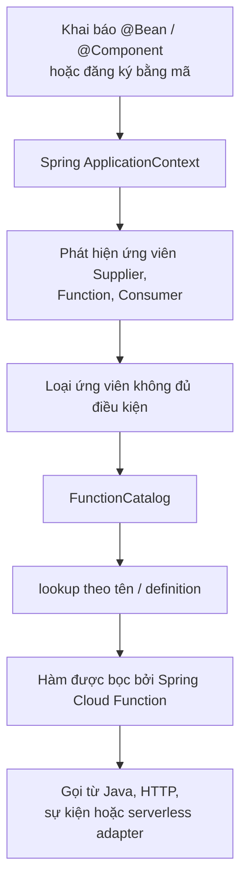

# Cơ chế phát hiện và đăng ký các functional bean

**Chương:** FunctionCatalog  
**Công nghệ:** Spring Cloud Function (`SPRING_CLOUD_FUNCTION`)

Spring Cloud Function cho phép đóng gói logic nghiệp vụ thành các hàm Java dùng chung, độc lập với giao thức gọi. Một hàm có thể được sử dụng từ mã Java, được gọi qua HTTP, được kết nối với hệ thống sự kiện bằng Spring Cloud Stream hoặc được triển khai trong môi trường serverless thông qua adapter phù hợp. Điểm kết nối giữa hàm nghiệp vụ và môi trường thực thi là **`FunctionCatalog`**.

Sau bài này, bạn có thể:

- Giải thích một `Supplier`, `Function` hoặc `Consumer` trở thành **functional bean** như thế nào.
- Phân biệt việc đăng ký bean trong `ApplicationContext` với việc tra cứu hàm qua `FunctionCatalog`.
- Khai báo, đặt tên, tìm kiếm, lọc và đăng ký tường minh functional bean.
- Xác định nguyên nhân một hàm có trong mã nguồn nhưng không tìm thấy trong catalog.

## 1. Functional bean là gì và vì sao cần cơ chế phát hiện?

Trong Java, ba giao diện cơ bản thuộc gói `java.util.function` thể hiện ba vai trò:

| Giao diện | Chữ ký tiêu biểu | Ý nghĩa nghiệp vụ | Ví dụ |
| --- | --- | --- | --- |
| `Supplier<O>` | `O get()` | Tạo hoặc cung cấp dữ liệu, không nhận đối số | Sinh mã đơn hàng |
| `Function<I, O>` | `O apply(I input)` | Nhận dữ liệu và trả về kết quả | Chuẩn hóa mã đơn hàng |
| `Consumer<I>` | `void accept(I input)` | Nhận dữ liệu để xử lý, không trả giá trị | Ghi nhật ký kiểm toán |

Một đối tượng Java thực thi các giao diện trên **chưa tự động** là bean của Spring. Nó chỉ được Spring quản lý khi được khai báo bằng `@Bean`, phát hiện qua component scanning như `@Component`, hoặc đăng ký vào application context bằng một cơ chế tương ứng.

**Functional bean** là bean Spring có kiểu chức năng phù hợp. Spring Cloud Function sử dụng những bean đó làm ứng viên để cung cấp thông qua `FunctionCatalog`. Nhờ vậy, adapter HTTP hoặc adapter sự kiện chỉ cần biết **tên hàm** thay vì phụ thuộc trực tiếp vào lớp chứa logic nghiệp vụ.

Ví dụ, một `Function<String, String>` tên `normalize` có thể được:

1. Gọi trực tiếp khi kiểm thử mã Java.
2. Tra cứu theo tên trong `FunctionCatalog`.
3. Chọn làm hàm xử lý thông điệp qua `spring.cloud.function.definition=normalize`.
4. Xuất thành endpoint HTTP khi ứng dụng có Spring Cloud Function Web và cấu hình tương ứng.

Cả bốn cách đều hướng tới cùng một phần logic; transport hoặc adapter quyết định cách nhận và trả dữ liệu.

## 2. Từ bean của Spring đến hàm trong FunctionCatalog

`ApplicationContext` là nơi Spring quản lý bean, vòng đời và dependency injection. `FunctionCatalog` là **cơ chế tra cứu theo tên** dành cho các hàm mà Spring Cloud Function hỗ trợ; catalog còn cung cấp lớp bọc để thực hiện những chức năng như chuyển đổi kiểu dữ liệu hoặc composition.

`FunctionCatalog` nhận diện functional bean trong application context và **đăng ký theo nhu cầu** (lazy registration): một ứng viên có thể được nhận diện từ bean definition, còn việc tạo biểu diễn hàm được Spring Cloud Function quản lý có thể xảy ra khi `lookup(...)` được gọi. Vì vậy không nên hình dung rằng mọi bean đều bị sao chép và bọc sẵn vào lúc ứng dụng khởi động.



Một lượt tra cứu điển hình:

1. Spring khởi tạo cấu hình, component scanning và các bean definition.
2. Spring Cloud Function nhận diện các bean chức năng có thể tham gia catalog. Framework cũng tự loại bỏ một số bean hạ tầng không dành cho nghiệp vụ.
3. Mã ứng dụng hoặc adapter yêu cầu hàm bằng tên, chẳng hạn `catalog.lookup("normalize")`.
4. Catalog tìm bean thích hợp, xác định thông tin kiểu vào/ra và tạo biểu diễn hàm có khả năng thích ứng với môi trường gọi.
5. Bên gọi sử dụng hàm đã tra cứu. Các adapter chịu trách nhiệm ánh xạ HTTP, thông điệp hay lời gọi serverless sang mô hình hàm.

**Phân biệt quan trọng:** `applicationContext.getBean("normalize")` lấy bean do bạn viết; `catalog.lookup("normalize")` lấy biểu diễn hàm do Spring Cloud Function quản lý. Cơ chế bọc và composition của Spring Cloud Function thuộc đường đi qua catalog.

## 3. Cách phổ biến nhất: tự động phát hiện qua @Bean

Ví dụ sau dùng Spring Boot có tích hợp Spring Cloud Function. Chúng ta khai báo ba dạng functional bean, thêm một hàm xử lý thứ hai để minh họa composition, rồi truy vấn catalog.

```java
import java.util.Locale;
import java.util.function.Consumer;
import java.util.function.Function;
import java.util.function.Supplier;

import org.springframework.boot.ApplicationRunner;
import org.springframework.boot.SpringApplication;
import org.springframework.boot.autoconfigure.SpringBootApplication;
import org.springframework.cloud.function.context.FunctionCatalog;
import org.springframework.context.annotation.Bean;

@SpringBootApplication
public class FunctionCatalogDemo {

    public static void main(String[] args) {
        SpringApplication.run(FunctionCatalogDemo.class, args);
    }

    @Bean
    public Supplier<String> newOrderCode() {
        return () -> "ord-42";
    }

    @Bean
    public Function<String, String> normalize() {
        return value -> value.trim().toUpperCase(Locale.ROOT);
    }

    @Bean
    public Function<String, String> addPrefix() {
        return value -> "ID-" + value;
    }

    @Bean
    public Consumer<String> audit() {
        return value -> System.out.println("Audit: " + value);
    }

    @Bean
    public ApplicationRunner inspectCatalog(FunctionCatalog catalog) {
        return args -> {
            System.out.println("Catalog names: " + catalog.getNames(null));

            Function<String, String> function =
                catalog.lookup(Function.class, "normalize");
            if (function == null) {
                throw new IllegalStateException("Missing function: normalize");
            }

            System.out.println(function.apply("  ord-42  "));
            // ORD-42
        };
    }
}
```

**Điều kiện để ví dụ chạy:** ứng dụng cần Spring Boot và dependency Spring Cloud Function tương thích với phiên bản Spring Boot đang dùng (ví dụ thành phần `spring-cloud-function-context` thông qua cấu hình phụ thuộc của dự án). Ví dụ chỉ truy vấn catalog, nên không cần cài thêm HTTP adapter.

Ở đoạn mã trên:

- `@Bean` khiến Spring đăng ký bean với tên mặc định là tên phương thức: `newOrderCode`, `normalize`, `addPrefix`, `audit`.
- Kiểu khai báo `Supplier<String>`, `Function<String, String>` và `Consumer<String>` cung cấp thông tin để Spring Cloud Function nhận diện ứng viên và suy ra kiểu dữ liệu.
- `ApplicationRunner` được tiêm `FunctionCatalog` và tra cứu `normalize` sau khi ứng dụng khởi động.
- `catalog.getNames(null)` liệt kê các tên hàm sẵn có theo API catalog. Tùy cấu hình và phiên bản, danh sách còn có thể chứa hàm hạ tầng như `functionRouter`; không nên kiểm tra bằng cách đòi hỏi danh sách phải bằng đúng bốn tên đã tự khai báo.

### 3.1. Đặt tên tường minh cho bean

Tên lookup thông thường chính là **tên bean**, nên bạn có thể đặt tên ổn định:

```java
@Bean("normalizeOrderCode")
public Function<String, String> normalize() {
    return value -> value.trim().toUpperCase(Locale.ROOT);
}
```

Trong trường hợp này, tên cần tra cứu là `normalizeOrderCode`, dù tên phương thức Java vẫn là `normalize`.

Khi nhiều nhóm hoặc adapter cùng tham chiếu tới một hàm, việc đặt tên có chủ đích giúp tránh làm hỏng cấu hình chỉ vì đổi tên phương thức Java.

### 3.2. Phát hiện lớp @Component thực thi Function

Ngoài `@Bean`, một lớp được Spring quét và quản lý cũng có thể trở thành functional bean:

```java
import java.util.function.Function;
import org.springframework.stereotype.Component;

@Component("calculateLength")
public class CalculateLength implements Function<String, Integer> {

    @Override
    public Integer apply(String value) {
        return value.length();
    }
}
```

Nếu lớp này nằm trong phạm vi component scanning, `calculateLength` là tên bean để catalog tra cứu. Nếu lớp ở ngoài phạm vi quét hoặc không được đăng ký vào context, chỉ việc `implements Function` **không đủ** để nó xuất hiện trong catalog.

Đây là hai cách tạo bean **thay thế nhau**. Không nên vừa khai báo cùng một đối tượng qua `@Component` vừa tạo thêm bean cùng tên qua `@Bean`.

## 4. Đăng ký tường minh bằng FunctionRegistration

Khai báo `@Bean` là cách thuận tiện khi dùng Spring Boot thông thường. Spring Cloud Function cũng hỗ trợ kiểu khởi tạo ứng dụng theo hướng **functional bean registration**, cho phép đăng ký bean trực tiếp vào `GenericApplicationContext` thay vì khai báo bean qua annotation.

Trong cách khai báo thủ công, Spring có thể không suy ra đầy đủ generic type từ biểu thức lambda do **type erasure**. `FunctionRegistration` gói hàm cùng metadata về kiểu đầu vào và đầu ra, giúp catalog biết cách bọc và chuyển đổi dữ liệu chính xác.

Ví dụ dưới đây là **một ứng dụng thay thế độc lập**, không ghép vào lớp `FunctionCatalogDemo` ở phần trước:

```java
import java.util.Locale;
import java.util.function.Function;

import org.springframework.boot.SpringBootConfiguration;
import org.springframework.cloud.function.context.FunctionRegistration;
import org.springframework.cloud.function.context.FunctionalSpringApplication;
import org.springframework.cloud.function.context.catalog.FunctionTypeUtils;
import org.springframework.context.ApplicationContextInitializer;
import org.springframework.context.support.GenericApplicationContext;

@SpringBootConfiguration
public class ManualFunctionApp
        implements ApplicationContextInitializer<GenericApplicationContext> {

    public static void main(String[] args) {
        FunctionalSpringApplication.run(ManualFunctionApp.class, args);
    }

    @Override
    public void initialize(GenericApplicationContext context) {
        Function<String, String> normalize =
            value -> value.trim().toUpperCase(Locale.ROOT);

        context.registerBean(
            "normalize",
            FunctionRegistration.class,
            () -> new FunctionRegistration<>(normalize)
                .type(FunctionTypeUtils.functionType(
                    String.class, String.class))
        );
    }
}
```

Trong ví dụ này:

1. `FunctionalSpringApplication` khởi động kiểu ứng dụng khai báo bean theo cách functional.
2. `ApplicationContextInitializer` chạy mã đăng ký bean.
3. `context.registerBean(...)` bổ sung một bean `FunctionRegistration` mang tên `normalize`.
4. `type(...)` mô tả chữ ký `String → String`, giữ lại thông tin mà chỉ nhìn vào lớp lambda có thể không suy ra được.
5. Spring Cloud Function có thể phát hiện registration này và phục vụ tra cứu theo tên.

| Khía cạnh | `@Bean` / `@Component` | `FunctionRegistration` với functional startup |
| --- | --- | --- |
| Đăng ký với Spring | Từ annotation và cơ chế cấu hình/scan | Qua lời gọi `context.registerBean(...)` |
| Thông tin generic | Thường suy ra từ chữ ký khai báo rõ ràng | Nên cung cấp rõ bằng `type(...)` khi cần |
| Mức độ cấu hình | Thuận tiện trong ứng dụng Spring Boot thông thường | Hữu ích cho ứng dụng tối giản hoặc cần đăng ký có kiểm soát |
| Tra cứu cuối cùng | Qua `FunctionCatalog` | Qua `FunctionCatalog` |

Không cần dùng `FunctionRegistration` cho mọi hàm. Nếu `@Bean public Function<String, String> normalize()` đã được Spring phát hiện đúng, hãy ưu tiên cách khai báo đơn giản đó.

## 5. Liệt kê và tra cứu đúng kiểu hàm

`FunctionCatalog` có các thao tác quan trọng:

```java
// Liệt kê tên các functional bean và hàm có sẵn:
Set<String> allNames = catalog.getNames(null);

// Chỉ truy vấn các tên theo loại Function:
Set<String> functionNames = catalog.getNames(Function.class);

// Tra cứu một hàm cụ thể:
Function<String, String> normalize =
    catalog.lookup(Function.class, "normalize");

// Ghép hai Function bằng cú pháp composition:
Function<String, String> pipeline =
    catalog.lookup(Function.class, "normalize|addPrefix");

String result = pipeline.apply("  ord-42  "); // ID-ORD-42
```

Đoạn mã giả định đã có biến `catalog` được tiêm qua Spring và hai bean `normalize`, `addPrefix` trong ví dụ trước. Để sử dụng `Set` cần import `java.util.Set`.

**Phải kiểm tra kết quả lookup:** nếu definition không hợp lệ, bean không được nhận diện hoặc bị loại khỏi catalog, lời gọi có thể không trả về hàm phù hợp. Đừng gọi `apply(...)` trên kết quả chưa được kiểm tra trong mã sản xuất.

### 5.1. Tên hàm và function definition là hai khái niệm

- **Tên hàm**: tên một functional bean, ví dụ `normalize`.
- **Function definition**: mô tả hàm cần dùng, có thể là một tên đơn lẻ hoặc chuỗi composition, ví dụ `normalize|addPrefix`.

Khai báo cho môi trường sử dụng adapter:

```yaml
spring:
  cloud:
    function:
      definition: normalize|addPrefix
```

Với definition này, hàm `normalize` được thực thi trước, kết quả được đưa vào `addPrefix`. Hai hàm phải tương thích về đầu ra/đầu vào. `Supplier` và `Consumer` cũng có các quy tắc composition riêng; không thể nối tùy ý mọi loại hàm.

**Chú ý:** đặt `spring.cloud.function.definition` là cách **chọn hàm hoặc composition cho adapter** như Spring Cloud Stream; bản thân property này không biến một đối tượng Java chưa được đăng ký với Spring thành functional bean.

### 5.2. Hành vi khi catalog chỉ có một hàm

Khi chỉ có một functional bean đủ điều kiện, Spring Cloud Function có cơ chế *single-function fallback*: một lookup thiếu tên hoặc có tên không khớp vẫn có thể được ánh xạ về hàm duy nhất. Hành vi tiện cho ứng dụng nhỏ nhưng dễ che giấu lỗi gõ sai tên.

Có thể vô hiệu hóa hành vi này để việc tra cứu yêu cầu đúng tên:

```properties
spring.cloud.function.single-function-fallback-enabled=false
```

Khi sử dụng Spring Cloud Stream hoặc triển khai nhiều hàm, nên khai báo `spring.cloud.function.definition` tường minh để tránh phụ thuộc vào quy tắc fallback.

## 6. Lọc ứng viên không muốn đưa vào catalog

Một Spring `ApplicationContext` có thể chứa các bean `Function` phục vụ nội bộ thư viện, không phải nghiệp vụ muốn công khai cho Spring Cloud Function. Framework đã loại một số trường hợp hạ tầng; bạn có thể khai báo thêm **tên bean definition không đủ điều kiện**:

```properties
spring.cloud.function.ineligible-definitions=internalTransformer,legacyAudit
```

Sự khác nhau giữa hai cấu hình thường dễ nhầm:

| Cấu hình | Mục đích | Ví dụ |
| --- | --- | --- |
| `spring.cloud.function.ineligible-definitions` | Loại ứng viên khỏi quá trình đăng ký/tra cứu qua catalog | `internalTransformer,legacyAudit` |
| `spring.cloud.function.definition` | Chọn hàm hoặc composition cho môi trường tích hợp | `normalize|addPrefix` |

Việc một hàm có trong catalog **không đồng nghĩa** nó luôn được xuất thành HTTP endpoint hoặc được gắn với message binding. Mỗi adapter có quy tắc công bố hàm và cấu hình riêng. Ngược lại, muốn adapter sử dụng hàm thì hàm đó trước tiên phải tồn tại và có thể được catalog tìm thấy.

Nếu cần giới hạn endpoint HTTP, hãy xem thêm quy tắc export/filter của Spring Cloud Function Web. Không dùng `ineligible-definitions` như sự thay thế cho xác thực, phân quyền hay chính sách bảo mật API.

## 7. Kiểu dữ liệu và lớp bọc có vai trò gì?

Khi Spring Cloud Function tra cứu một functional bean, catalog cung cấp biểu diễn đã được xử lý để các adapter có thể dùng thống nhất. Thông tin kiểu như `Function<OrderCreated, Receipt>` rất quan trọng vì adapter có thể phải chuyển một payload nhận từ JSON hoặc message thành `OrderCreated` trước khi gọi hàm và chuyển kết quả trở lại.

Ví dụ chữ ký hàm nghiệp vụ:

```java
record OrderCreated(String orderId, long amount) {}
record Receipt(String orderId, boolean accepted) {}

@Bean
public Function<OrderCreated, Receipt> validateOrder() {
    return order -> new Receipt(
        order.orderId(),
        order.amount() > 0
    );
}
```

Chữ ký có generic rõ ràng giúp framework suy ra `OrderCreated` là đầu vào và `Receipt` là đầu ra. Cách thực sự nhận JSON hay thông điệp phụ thuộc adapter và cấu hình chuyển đổi dữ liệu; bản thân hàm Java không cần biết HTTP request hoặc broker.

Spring Cloud Function cũng hỗ trợ kiểu phản ứng, chẳng hạn `Function<Flux<OrderCreated>, Flux<Receipt>>`. Cần phân biệt **một sự kiện mỗi lần gọi** của hàm imperative với **một luồng dữ liệu** trong hàm reactive. Bài này chỉ tập trung vào cách các bean đó được nhận diện và đăng ký; mô hình gọi reactive có thêm yêu cầu riêng về xử lý luồng.

## 8. Kiểm chứng quá trình phát hiện

### 8.1. Kiểm thử trực tiếp bằng FunctionCatalog

Với lớp `FunctionCatalogDemo` ở mục 3 và dependency kiểm thử Spring Boot/JUnit 5 phù hợp, bạn có thể kiểm tra khả năng tra cứu và composition:

```java
import static org.junit.jupiter.api.Assertions.*;

import java.util.function.Function;
import org.junit.jupiter.api.Test;
import org.springframework.beans.factory.annotation.Autowired;
import org.springframework.boot.test.context.SpringBootTest;
import org.springframework.cloud.function.context.FunctionCatalog;

@SpringBootTest(classes = FunctionCatalogDemo.class)
class FunctionCatalogDemoTest {

    @Autowired
    private FunctionCatalog catalog;

    @Test
    void detectsAndComposesFunctions() {
        assertTrue(catalog.getNames(Function.class).contains("normalize"));
        assertTrue(catalog.getNames(Function.class).contains("addPrefix"));

        Function<String, String> operation =
            catalog.lookup(Function.class, "normalize|addPrefix");

        assertNotNull(operation);
        assertEquals("ID-ORD-42", operation.apply("  ord-42  "));
    }
}
```

Kiểm thử này chứng minh đồng thời rằng bean được phát hiện theo tên, catalog trả về hàm có thể gọi và thứ tự composition đúng. Không cần khởi tạo HTTP server hay message broker để kiểm tra logic ở tầng catalog.

### 8.2. Quan sát catalog khi ứng dụng chạy

Một cách chẩn đoán nhẹ là in ra `catalog.getNames(null)` hoặc `catalog.getNames(Function.class)` trong mã quản trị/kiểm thử. Nếu đã cấu hình Spring Boot Actuator và endpoint `functions` theo tài liệu phiên bản đang dùng, bạn còn có thể quan sát danh sách hàm qua actuator. Hãy kiểm soát việc xuất endpoint quản trị trong môi trường thực tế.

### 8.3. Các lỗi thường gặp

| Triệu chứng | Nguyên nhân đáng kiểm tra | Cách xử lý |
| --- | --- | --- |
| `lookup("myFunction")` không tìm được hàm | Tên bean khác tên dự kiến, sai chính tả hoặc tên chưa được đăng ký | Kiểm tra `getNames(null)` và tên trong `@Bean`/`@Component` |
| Lớp `implements Function` nhưng không xuất hiện | Đối tượng chưa phải Spring bean hoặc nằm ngoài component scanning | Khai báo `@Bean`/`@Component` đúng phạm vi hoặc đăng ký thủ công |
| Hàm có trong context nhưng không tra cứu được | Bean bị đánh dấu không đủ điều kiện hoặc cấu hình filter loại bỏ | Kiểm tra `spring.cloud.function.ineligible-definitions` |
| Chuyển đổi JSON/message thành kiểu Java không đúng | Mất metadata kiểu do dùng raw type, khai báo `Object` hoặc lambda đăng ký không chỉ rõ kiểu | Giữ chữ ký generic cụ thể hoặc dùng `FunctionRegistration.type(...)` |
| Composition trả kết quả sai hoặc không thực hiện được | Sai thứ tự hàm, đầu ra và đầu vào không tương thích | Kiểm tra chuỗi `a|b` có nghĩa là thực thi `a` trước `b` |
| Gõ sai tên nhưng vẫn gọi được một hàm | Catalog chỉ có một hàm và single-function fallback đang bật | Dùng tên tường minh, cân nhắc tắt fallback |
| Có trong catalog nhưng không có endpoint HTTP | Chưa có HTTP adapter hoặc chưa export hàm | Kiểm tra dependency, cấu hình web adapter và `spring.cloud.function.definition` |

## 9. Bài tập tự thực hành

Giả sử hệ thống đơn hàng đã có `normalize` và `addPrefix`. Hãy thử:

1. Thêm một bean `Function<String, Integer> codeLength` trả về độ dài chuỗi.
2. Truy vấn `catalog.getNames(Function.class)` để xác minh `codeLength` có tên trong catalog.
3. Tra cứu composition `normalize|addPrefix|codeLength` và dự đoán đầu ra với `"  ord-42  "`. Đáp án mong đợi là `9` vì `"ID-ORD-42"` có 9 ký tự.
4. Đổi tên bean `codeLength` thành `measureCodeLength` bằng `@Bean("measureCodeLength")`, sau đó quan sát vì sao definition cũ không còn hợp lệ.
5. Khai báo `spring.cloud.function.ineligible-definitions=measureCodeLength` và kiểm tra xem có thể tra cứu hàm đó nữa hay không.

**Câu hỏi kiểm tra hiểu biết:** Khi một hàm Java đã chạy tốt bằng `applicationContext.getBean(...)` nhưng không tìm thấy qua `FunctionCatalog`, bạn nên điều tra khâu nào trước? Hãy kiểm tra loại bean, tên bean, phạm vi scan và danh sách ineligible trước khi thay đổi adapter HTTP hay message broker.

## 10. Ghi nhớ

- **Spring quản lý bean; FunctionCatalog quản lý việc nhận diện và tra cứu hàm** phục vụ Spring Cloud Function.
- `@Bean` và `@Component` là các cách thông dụng để một `Supplier`, `Function` hoặc `Consumer` được phát hiện; quá trình đưa ứng viên vào catalog diễn ra theo nhu cầu.
- `FunctionRegistration` hữu ích khi đăng ký thủ công và cần giữ metadata kiểu vào/ra.
- Tên bean là hợp đồng để catalog, composition và adapter cùng tham chiếu; cấu hình `definition` quyết định hàm nào được sử dụng trong ngữ cảnh tích hợp.
- Kiểm tra `catalog.getNames(...)` và `lookup(...)` là bước đầu tiên khi chẩn đoán lỗi phát hiện hàm.

### Tài liệu tham khảo

- [Spring Cloud Function — Programming Model](https://docs.spring.io/spring-cloud-function/reference/spring-cloud-function/programming-model.html): functional bean, lazy registration, `FunctionCatalog`, filter và composition.
- [Spring Cloud Function — Functional Bean Definitions](https://docs.spring.io/spring-cloud-function/reference/functional.html): đăng ký functional bean bằng `FunctionRegistration`, theo dõi catalog và kiểm thử.
- [Spring Cloud Function — Standalone Web Applications](https://docs.spring.io/spring-cloud-function/reference/spring-cloud-function/standalone-web-applications.html): quy tắc export hàm qua HTTP.
