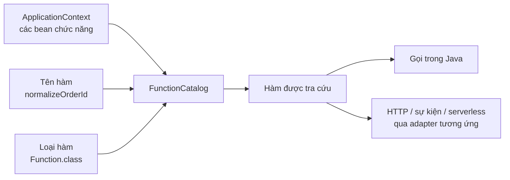

# Tra cứu theo tên và theo loại hàm trong FunctionCatalog

**Chương:** FunctionCatalog  
**Module:** Spring Cloud Function (`SPRING_CLOUD_FUNCTION`)

Spring Cloud Function cho phép viết logic nghiệp vụ dưới dạng `Supplier`, `Function` và `Consumer` để tái sử dụng độc lập với cách gọi. Cùng một hàm có thể được dùng trong mã Java, từ HTTP adapter, hệ thống sự kiện hoặc môi trường serverless. Thay vì yêu cầu nơi gọi biết lớp Java cụ thể, **`FunctionCatalog`** cung cấp cơ chế tìm hàm theo **tên** và theo **loại functional interface**.

Bài học này tập trung vào thao tác tra cứu: chọn đúng hàm, phân biệt ba loại hàm, hiểu giới hạn kiểm tra kiểu ở thời điểm chạy, xử lý lỗi tra cứu và áp dụng trong ứng dụng.

## 1. Vì sao cần tra cứu thay vì gọi bean trực tiếp?

Giả sử hệ thống đơn hàng có ba tác vụ:

- Sinh mã đơn hàng: `Supplier<String>`.
- Chuẩn hóa mã: `Function<String, String>`.
- Ghi nhận mã đã xử lý: `Consumer<String>`.

Mã nghiệp vụ có thể gọi trực tiếp từng bean Spring. Tuy nhiên, adapter HTTP hoặc hệ thống nhận sự kiện thường chỉ được cấu hình bằng tên hàm, chẳng hạn `normalizeOrderId`. `FunctionCatalog` biến tên đó thành đối tượng hàm có thể sử dụng. Catalog đồng thời là nơi Spring Cloud Function áp dụng các cơ chế hỗ trợ như bọc hàm, thích ứng kiểu dữ liệu và ghép hàm (*composition*) khi cần.



**Phân biệt:** `ApplicationContext.getBean("normalizeOrderId")` lấy một Spring bean. `FunctionCatalog.lookup(...)` lấy hàm theo mô hình Spring Cloud Function; biểu diễn trả về có thể được framework bọc và xử lý thêm. Khi xây dựng tích hợp, nên tra cứu qua catalog để dùng cùng ngữ nghĩa với adapter.

## 2. API cần nắm

Các thao tác quan trọng của `org.springframework.cloud.function.context.FunctionCatalog`:

| Thao tác | Ý nghĩa | Tình huống |
| --- | --- | --- |
| `catalog.lookup("normalizeOrderId")` | Tra cứu bằng tên hoặc function definition | Đã biết tên nhưng chưa ràng buộc loại trong lời gọi |
| `catalog.lookup(Function.class, "normalizeOrderId")` | Tra cứu với loại `Function` | Cần một hàm nhận đầu vào, trả kết quả |
| `catalog.lookup(Supplier.class, "newOrderId")` | Tra cứu với loại `Supplier` | Cần hàm cung cấp dữ liệu |
| `catalog.lookup(Consumer.class, "auditOrderId")` | Tra cứu với loại `Consumer` | Cần hàm nhận dữ liệu để xử lý |
| `catalog.getNames(null)` | Liệt kê tên hàm có thể tra cứu trong catalog | Khám phá và chẩn đoán |
| `catalog.getNames(Function.class)` | Liệt kê tên theo loại functional interface | Kiểm tra các ứng viên thuộc nhóm `Function` |

Hai ý cần nhớ:

1. **Tên** xác định *hàm nào*, ví dụ `normalizeOrderId`. Mặc định, khi khai báo qua `@Bean`, tên bean là tên phương thức; có thể đặt tường minh bằng `@Bean("...")`.
2. **Loại** xác định *cách hàm được gọi*: `Supplier` dùng `get()`, `Function` dùng `apply(input)`, `Consumer` dùng `accept(input)`.

Đối số `Function.class` chỉ kiểm tra nhóm giao diện ở mức kiểu lớp. Nó **không xác minh đầy đủ** các tham số generic `String`, `Integer` hay kiểu DTO mà bạn ghi trong biến Java.

## 3. Ví dụ đầy đủ: khai báo và tìm ba loại hàm

Ví dụ sau dùng ứng dụng Spring Boot có Spring Cloud Function context và các dependency phiên bản tương thích. Nó không cần HTTP adapter hay message broker vì mọi thao tác được thực hiện trực tiếp qua `FunctionCatalog`.

```java
import java.util.Locale;
import java.util.Set;
import java.util.function.Consumer;
import java.util.function.Function;
import java.util.function.Supplier;

import org.springframework.boot.ApplicationRunner;
import org.springframework.boot.SpringApplication;
import org.springframework.boot.autoconfigure.SpringBootApplication;
import org.springframework.cloud.function.context.FunctionCatalog;
import org.springframework.context.annotation.Bean;

@SpringBootApplication
public class CatalogLookupApplication {

    public static void main(String[] args) {
        SpringApplication.run(CatalogLookupApplication.class, args);
    }

    @Bean("newOrderId")
    public Supplier<String> newOrderId() {
        return () -> "ord-42";
    }

    @Bean("normalizeOrderId")
    public Function<String, String> normalizeOrderId() {
        return value -> value.trim().toUpperCase(Locale.ROOT);
    }

    @Bean("orderIdLength")
    public Function<String, Integer> orderIdLength() {
        return String::length;
    }

    @Bean("auditOrderId")
    public Consumer<String> auditOrderId() {
        return value -> System.out.println("AUDIT " + value);
    }

    @Bean
    public ApplicationRunner demonstrateLookup(FunctionCatalog catalog) {
        return args -> {
            Set<String> functionNames = catalog.getNames(Function.class);
            System.out.println("Functions: " + functionNames);

            Supplier<String> supplier =
                catalog.lookup(Supplier.class, "newOrderId");
            Function<String, String> normalizer =
                catalog.lookup(Function.class, "normalizeOrderId");
            Consumer<String> auditor =
                catalog.lookup(Consumer.class, "auditOrderId");

            if (supplier == null || normalizer == null || auditor == null) {
                throw new IllegalStateException(
                    "Missing one or more registered functions");
            }

            String rawId = supplier.get();
            String normalizedId = normalizer.apply(rawId);
            auditor.accept(normalizedId);

            System.out.println(normalizedId); // ORD-42
        };
    }
}
```

**Phân tích:**

- `@Bean("newOrderId")` làm Spring đăng ký bean có tên chính xác `newOrderId`; catalog có thể tìm thấy bean đó theo tên.
- `lookup(Supplier.class, "newOrderId")` trả về đối tượng có thể gọi `get()`, không truyền tham số.
- `lookup(Function.class, "normalizeOrderId")` trả về đối tượng có thể gọi `apply(String)`; kết quả mẫu là `ORD-42`.
- `lookup(Consumer.class, "auditOrderId")` trả về đối tượng có thể gọi `accept(String)`; bản thân `Consumer` không trả kết quả.
- `orderIdLength` cũng là `Function`, nhưng đầu ra là `Integer`. Cùng thuộc nhóm `Function` không có nghĩa tất cả hàm trong nhóm có chung kiểu vào/ra.

`catalog.getNames(Function.class)` cần chứa tên `normalizeOrderId` và `orderIdLength`. Không nên so sánh danh sách này với một tập tên cố định bằng phép bằng tuyệt đối vì catalog có thể chứa hàm từ các cấu hình và thư viện khác.

### 3.1. Khai báo Spring bean là điều kiện đầu tiên

Đối tượng Java chỉ `implements Function` chưa đủ để tra cứu. Spring phải quản lý đối tượng đó dưới dạng bean qua `@Bean`, `@Component` trong phạm vi quét, hoặc cơ chế đăng ký tường minh được Spring Cloud Function hỗ trợ.

Ví dụ, nếu viết:

```java
Function<String, String> temporary =
    value -> value.trim().toUpperCase(Locale.ROOT);
```

thì biến `temporary` không tự xuất hiện trong catalog. Ngược lại, các phương thức có `@Bean` trong ứng dụng mẫu được Spring đăng ký và có thể được phát hiện làm ứng viên của catalog.

## 4. Tra cứu theo tên: tên phương thức, tên bean và definition

### 4.1. Tên mặc định và tên đặt tường minh

```java
@Bean
public Function<String, String> trimText() {
    return String::trim;
}

@Bean("normalizeCustomerCode")
public Function<String, String> normalizeCode() {
    return value -> value.trim().toUpperCase(Locale.ROOT);
}
```

Với các khai báo này:

| Khai báo | Tên dùng khi lookup |
| --- | --- |
| `@Bean` trên phương thức `trimText()` | `trimText` |
| `@Bean("normalizeCustomerCode")` trên `normalizeCode()` | `normalizeCustomerCode` |

Đừng suy tên tra cứu từ tên class hoặc loại generic. Trong ví dụ thứ hai, `normalizeCode` chỉ là tên phương thức Java, còn tên bean đã được đặt là `normalizeCustomerCode`.

### 4.2. Sử dụng lookup chỉ với tên

Khi người gọi đã biết hợp đồng của hàm, có thể sử dụng overload không truyền loại:

```java
Function<String, String> normalize =
    catalog.lookup("normalizeOrderId");

if (normalize == null) {
    throw new IllegalStateException("Function not found");
}
System.out.println(normalize.apply("  ord-42  ")); // ORD-42
```

Trong ví dụ, biến `catalog` đã được tiêm và bean `normalizeOrderId` đã đăng ký theo mục 3. Trình biên dịch suy kiểu generic mong muốn từ biến nhận, nhưng kiểu đó **không phải bằng chứng** bean thực tế là `Function<String, String>`. Sai khác về loại hoặc kiểu dữ liệu có thể gây lỗi khi chạy.

Vì vậy, khi hệ thống xử lý nhiều loại functional bean, overload có tham số loại dễ đọc và giúp thể hiện ý định hơn:

```java
Function<String, String> normalize =
    catalog.lookup(Function.class, "normalizeOrderId");
```

### 4.3. Tra cứu cả một chuỗi hàm

Tham số thứ hai của `lookup` được gọi là *function definition*. Ngoài tên một bean, definition có thể thể hiện composition bằng dấu `|`:

```java
@Bean("addOrderPrefix")
public Function<String, String> addOrderPrefix() {
    return value -> "ID-" + value;
}
```

Sau khi đăng ký bean trên, mã sử dụng:

```java
Function<String, String> pipeline =
    catalog.lookup(
        Function.class, "normalizeOrderId|addOrderPrefix");

if (pipeline == null) {
    throw new IllegalStateException("Pipeline not found");
}

String result = pipeline.apply("  ord-42  ");
// ID-ORD-42
```

Catalog thực thi `normalizeOrderId` trước, đưa đầu ra vào `addOrderPrefix`. Kiểu dữ liệu giữa các hàm nối với nhau phải tương thích. Đây là một **definition**, không nhất thiết là tên của một bean đơn lẻ; `getNames(Function.class)` thường được dùng để kiểm tra tên các hàm đăng ký, không để liệt kê mọi chuỗi composition có thể tạo ra.

## 5. Tra cứu theo loại hàm: Supplier, Function, Consumer

### 5.1. Supplier: không có đầu vào

```java
Supplier<String> producer =
    catalog.lookup(Supplier.class, "newOrderId");
if (producer == null) {
    throw new IllegalStateException("Supplier not found");
}
String generated = producer.get();
```

Một `Supplier<T>` nhận **không** tham số và cung cấp `T`. Phù hợp với hàm sinh dữ liệu hoặc tạo sự kiện. Mỗi lần gọi `get()` có thể tạo kết quả khác nhau tùy logic; không mặc định là hàm thuần hoặc bất biến.

### 5.2. Function: có đầu vào và đầu ra

```java
Function<String, Integer> counter =
    catalog.lookup(Function.class, "orderIdLength");
if (counter == null) {
    throw new IllegalStateException("Function not found");
}
int characters = counter.apply("ORD-42"); // 6
```

`Function<T, R>` nhận `T` và trả `R`. Khi tra cứu bằng `Function.class`, catalog lọc theo **loại giao diện**; phần `<String, Integer>` trong biến Java vẫn cần khớp với chữ ký thực của bean.

### 5.3. Consumer: có đầu vào, không có kết quả

```java
Consumer<String> audit =
    catalog.lookup(Consumer.class, "auditOrderId");
if (audit == null) {
    throw new IllegalStateException("Consumer not found");
}
audit.accept("ORD-42");
```

`Consumer<T>` chỉ nhận `T` và thực hiện hành động, ví dụ ghi log hoặc gửi sự kiện. Không thể dùng `apply(...)` hay mong đợi giá trị trả về từ nó.

| Loại cần tìm | Cách tra cứu | Cách gọi |
| --- | --- | --- |
| `Supplier<T>` | `catalog.lookup(Supplier.class, "name")` | `supplier.get()` |
| `Function<T, R>` | `catalog.lookup(Function.class, "name")` | `function.apply(input)` |
| `Consumer<T>` | `catalog.lookup(Consumer.class, "name")` | `consumer.accept(input)` |

**Lưu ý về type safety:** `Supplier.class`, `Function.class` và `Consumer.class` không thể mang thông tin generic đầy đủ ở runtime do cơ chế *type erasure* của Java. Khi xử lý DTO, JSON, message hoặc composition, hãy khai báo chữ ký generic cụ thể ngay tại bean để Spring Cloud Function có đủ metadata suy luận và chuyển đổi kiểu.

## 6. Khám phá tên trước khi lookup

Thay vì đoán tên, hãy xem danh mục của catalog:

```java
Set<String> allNames = catalog.getNames(null);
Set<String> suppliers = catalog.getNames(Supplier.class);
Set<String> functions = catalog.getNames(Function.class);
Set<String> consumers = catalog.getNames(Consumer.class);

System.out.println("All: " + allNames);
System.out.println("Suppliers: " + suppliers);
System.out.println("Functions: " + functions);
System.out.println("Consumers: " + consumers);
```

Những ví dụ ở mục này sử dụng import `java.util.Set`. Trong ứng dụng mẫu ở mục 3, bạn có thể mong đợi:

- Tập `suppliers` có `newOrderId`.
- Tập `functions` có `normalizeOrderId` và `orderIdLength`.
- Tập `consumers` có `auditOrderId`.

Các tập trả về là danh sách để **khám phá và kiểm chứng**, không phải cam kết rằng catalog chỉ có những tên đã liệt kê ở đây. Không dựa vào thứ tự phần tử của `Set` và không giả định mọi tên đều được công bố thành endpoint hoặc message binding.

### Ví dụ: kiểm tra điều kiện trước khi sử dụng

```java
String functionName = "normalizeOrderId";

if (!catalog.getNames(Function.class).contains(functionName)) {
    throw new IllegalArgumentException(
        "Unknown Function: " + functionName);
}

Function<String, String> function =
    catalog.lookup(Function.class, functionName);

if (function == null) {
    throw new IllegalStateException(
        "Function was listed but lookup failed: " + functionName);
}

String value = function.apply("  ord-42  ");
```

Kiểm tra `getNames(...)` hữu ích để chẩn đoán và hỗ trợ giao diện chọn hàm. Tuy nhiên, trong hệ thống có khả năng thay đổi cấu hình/bean theo vòng đời, bước tra cứu vẫn phải xử lý trường hợp không lấy được hàm. Danh sách tên cũng **không phải cơ chế phân quyền**.

## 7. Trường hợp thực tế: chọn hàm xử lý theo cấu hình

Một dịch vụ cần chọn giữa hai phép xử lý cùng hợp đồng `Function<String, String>`, ví dụ chuẩn hóa mã hoặc thêm tiền tố. Ta chỉ chấp nhận những tên được ứng dụng định nghĩa rõ ràng.

Giả sử hai bean `normalizeOrderId` và `addOrderPrefix` đã đăng ký, lớp dịch vụ có thể viết:

```java
import java.util.Set;
import java.util.function.Function;
import org.springframework.cloud.function.context.FunctionCatalog;
import org.springframework.stereotype.Service;

@Service
public class OrderIdProcessor {

    private static final Set<String> ALLOWED_HANDLERS =
        Set.of("normalizeOrderId", "addOrderPrefix");

    private final FunctionCatalog catalog;

    public OrderIdProcessor(FunctionCatalog catalog) {
        this.catalog = catalog;
    }

    public String process(String handlerName, String rawOrderId) {
        if (!ALLOWED_HANDLERS.contains(handlerName)) {
            throw new IllegalArgumentException(
                "Unsupported handler: " + handlerName);
        }

        Function<String, String> handler =
            catalog.lookup(Function.class, handlerName);

        if (handler == null) {
            throw new IllegalStateException(
                "Handler is not registered: " + handlerName);
        }

        return handler.apply(rawOrderId);
    }
}
```

Ở đây, `OrderIdProcessor` phụ thuộc vào hợp đồng `FunctionCatalog` và tên hàm đã thống nhất; nó không phụ thuộc trực tiếp vào lớp cài đặt của từng hàm. Nếu HTTP controller, message listener hay serverless adapter cần cùng logic, các thành phần đó có thể sử dụng một dịch vụ tương tự hoặc kết nối tới function definition phù hợp.

Tập `ALLOWED_HANDLERS` giúp tránh thực thi tùy ý một hàm trong catalog chỉ vì người dùng bên ngoài gửi một tên bất kỳ. Cơ chế lọc theo tên ở đây phục vụ lựa chọn nghiệp vụ; các yêu cầu xác thực và phân quyền của hệ thống vẫn phải được xử lý riêng.

### 7.1. Khác biệt giữa lookup và spring.cloud.function.definition

```yaml
spring:
  cloud:
    function:
      definition: normalizeOrderId
```

Thuộc tính `spring.cloud.function.definition` cho adapter biết hàm hoặc composition nào nên được sử dụng mặc định trong bối cảnh tích hợp. Còn `catalog.lookup(Function.class, "normalizeOrderId")` là lời gọi Java chủ động tra cứu một hàm tại thời điểm chạy.

Hai cách dùng chung tên định danh nhưng khác mục đích:

| Tình huống | Cách dùng |
| --- | --- |
| Mã Java cần gọi một hàm cụ thể | `catalog.lookup(...)` |
| Mã Java cần biết các hàm sẵn có | `catalog.getNames(...)` |
| Adapter cần chọn hàm để kết nối | `spring.cloud.function.definition` theo hướng dẫn của adapter |

Chỉ cấu hình `definition` không khiến một đối tượng Java thông thường tự trở thành Spring functional bean. Hàm vẫn phải được khai báo hoặc đăng ký đúng cách.

## 8. Xử lý trường hợp không tìm thấy hoặc nhầm loại

Một lookup không thành công có thể đến từ tên không tồn tại, bean chưa được đăng ký, chọn sai loại hoặc sự khác biệt trong cấu hình. Với đường đi dùng trong ứng dụng, nên kiểm tra `null` và xử lý lỗi liên quan đến runtime/type conversion ở lớp phù hợp.

**Ví dụ lỗi kiểu:**

```java
// orderIdLength thực sự là Function<String, Integer>.
Function<String, String> incorrectlyTyped =
    catalog.lookup(Function.class, "orderIdLength");

// Không an toàn: Function.class không xác nhận String là kiểu trả về.
// Việc sử dụng như Function<String, String> có thể phát sinh lỗi runtime.
```

Đoạn mã minh họa này cố ý **không được gọi thực thi**. Nó cho thấy việc gán biến với generic mong muốn không thể thay thế kiểm tra hợp đồng của bean.

### 8.1. Single-function fallback

Ở một số cấu hình/phiên bản, khi catalog chỉ có **một** hàm đủ điều kiện, cơ chế *single-function fallback* có thể chọn hàm duy nhất ngay cả khi bên gọi không đưa tên chính xác. Do đó, thử một tên sai trong ứng dụng chỉ có một hàm không phải phép kiểm thử đáng tin cậy cho quy tắc tìm tên.

Bạn có thể cấu hình để yêu cầu khớp tên thay vì dựa vào fallback khi phiên bản sử dụng hỗ trợ thuộc tính:

```properties
spring.cloud.function.single-function-fallback-enabled=false
```

Trong dự án nhiều hàm, hãy đặt tên rõ ràng và chỉ định `spring.cloud.function.definition` cho từng adapter khi cần. Khi nâng cấp phiên bản, kiểm tra lại tài liệu cấu hình tương ứng.

### 8.2. Bảng chẩn đoán nhanh

| Hiện tượng | Điều cần xác minh | Hướng giải quyết |
| --- | --- | --- |
| Không thấy tên trong `getNames(null)` | Bean chưa được Spring quản lý hoặc không nằm trong phạm vi component scan | Khai báo `@Bean` hoặc `@Component` và kiểm tra cấu hình quét |
| Không tìm thấy tên dự kiến | Có `@Bean("explicitName")` nên tên tra cứu khác tên phương thức | Dùng đúng tên bean |
| Có trong catalog nhưng tìm nhầm loại | Dùng `Supplier.class` cho một bean `Function`, hoặc ngược lại | Đối chiếu kiểu bean, chọn loại phù hợp |
| Lookup thành công nhưng gọi hàm bị lỗi kiểu | Kiểu generic kỳ vọng khác với chữ ký bean thực tế | Xác minh `Function<I, O>`, `Supplier<O>` hoặc `Consumer<I>` thật |
| Không thấy bean vốn được khai báo hợp lệ | Bean bị loại khỏi danh sách đủ điều kiện | Kiểm tra `spring.cloud.function.ineligible-definitions` |
| Gõ sai tên vẫn có thể chạy được | Môi trường chỉ có một hàm và đang dùng fallback | Tắt fallback nếu được hỗ trợ, kiểm tra tên cụ thể |
| Tra cứu được qua catalog nhưng không có URL HTTP | Adapter Web chưa được khai báo hoặc hàm chưa được export | Kiểm tra dependency và cấu hình adapter HTTP |

Đặc biệt, một hàm có tên trong catalog **không tự đồng nghĩa** với việc nó có HTTP endpoint, consumer binding trên broker hay serverless entry point. Các adapter thiết lập những kết nối đó theo cấu hình và vòng đời riêng.

## 9. Kiểm thử đúng hành vi lookup

Với lớp `CatalogLookupApplication` trong mục 3 và dependency `spring-boot-starter-test` tương thích, có thể viết JUnit 5 test:

```java
import static org.junit.jupiter.api.Assertions.*;

import java.util.function.Consumer;
import java.util.function.Function;
import java.util.function.Supplier;

import org.junit.jupiter.api.Test;
import org.springframework.beans.factory.annotation.Autowired;
import org.springframework.boot.test.context.SpringBootTest;
import org.springframework.cloud.function.context.FunctionCatalog;

@SpringBootTest(classes = CatalogLookupApplication.class)
class CatalogLookupApplicationTest {

    @Autowired
    private FunctionCatalog catalog;

    @Test
    void findsFunctionsByNameAndType() {
        assertTrue(catalog.getNames(Function.class)
                          .contains("normalizeOrderId"));
        assertTrue(catalog.getNames(Supplier.class)
                          .contains("newOrderId"));
        assertTrue(catalog.getNames(Consumer.class)
                          .contains("auditOrderId"));

        Supplier<String> supplier =
            catalog.lookup(Supplier.class, "newOrderId");
        Function<String, String> normalize =
            catalog.lookup(Function.class, "normalizeOrderId");
        Consumer<String> audit =
            catalog.lookup(Consumer.class, "auditOrderId");

        assertNotNull(supplier);
        assertNotNull(normalize);
        assertNotNull(audit);

        String result = normalize.apply(supplier.get());
        assertEquals("ORD-42", result);
        assertDoesNotThrow(() -> audit.accept(result));
    }

    @Test
    void distinguishesFunctionsWithDifferentOutputTypes() {
        Function<String, Integer> length =
            catalog.lookup(Function.class, "orderIdLength");

        assertNotNull(length);
        assertEquals(6, length.apply("ORD-42"));
    }
}
```

Kiểm thử trên xác minh **hợp đồng lookup và việc gọi kết quả**, không phụ thuộc thứ tự liệt kê tên hay số lượng bean hạ tầng. Vì không liên quan HTTP hoặc broker, thử nghiệm tại tầng catalog giúp phát hiện lỗi tên và kiểu trước khi bổ sung adapter.

## 10. Bài tập tự thực hành

1. Thêm bean `@Bean("reverseOrderId")` kiểu `Function<String, String>` để đảo chuỗi. Kiểm tra tên này có trong `catalog.getNames(Function.class)` rồi dùng `lookup(Function.class, "reverseOrderId")` để gọi.
2. Thử tra cứu `newOrderId` với `Supplier.class`, sau đó so sánh với việc yêu cầu `Function.class`. Quan sát hành vi thực tế và giải thích vì sao phải chỉ đúng loại.
3. Thêm `Function<String, Integer>` đếm độ dài chuỗi; giải thích tại sao `Function.class` không đủ bảo đảm kiểu trả về là `String`.
4. Viết composition `normalizeOrderId|reverseOrderId`. Với input `"  ord-42  "`, kết quả mong đợi là `"24-DRO"`.
5. Thay tên `reverseOrderId` bằng `@Bean("reverseCode")` rồi cập nhật chỗ `lookup` và function definition đang tham chiếu tới nó.

**Câu hỏi mở:** Nếu ứng dụng có hàng chục functional bean, một API cho phép người dùng nhập tên bất kỳ để chạy hàm có an toàn không? Hãy thiết kế danh sách hàm được phép gọi, kiểm tra đúng loại, kiểm soát quyền và xử lý lỗi tra cứu.

## 11. Tóm lược kiến thức

- `FunctionCatalog.lookup("name")` tìm hàm bằng tên/definition; overload `lookup(Supplier.class / Function.class / Consumer.class, "name")` thể hiện rõ loại cần dùng.
- `getNames(null)` và `getNames(type)` hữu ích để khám phá tên và chẩn đoán, nhưng không phải hợp đồng cố định về thứ tự hoặc phạm vi export của adapter.
- Tên tra cứu là **tên bean** Spring; việc đặt tên tường minh bằng `@Bean("name")` giúp cấu hình ổn định.
- Loại giao diện không xác minh đầy đủ generic. Người gọi phải biết đúng hợp đồng đầu vào/đầu ra, đặc biệt khi làm việc với DTO hoặc message.
- Sau khi tra cứu, hãy kiểm tra kết quả và gọi đúng `get()`, `apply(input)` hoặc `accept(input)`. Mô hình này là nền tảng để dùng lại một hàm từ HTTP, sự kiện hoặc serverless adapter.

**Đọc thêm:** [Spring Cloud Function Reference Guide — Programming Model](https://docs.spring.io/spring-cloud-function/reference/spring-cloud-function/programming-model.html), bao gồm `FunctionCatalog`, chữ ký functional bean, cơ chế tra cứu và composition.
