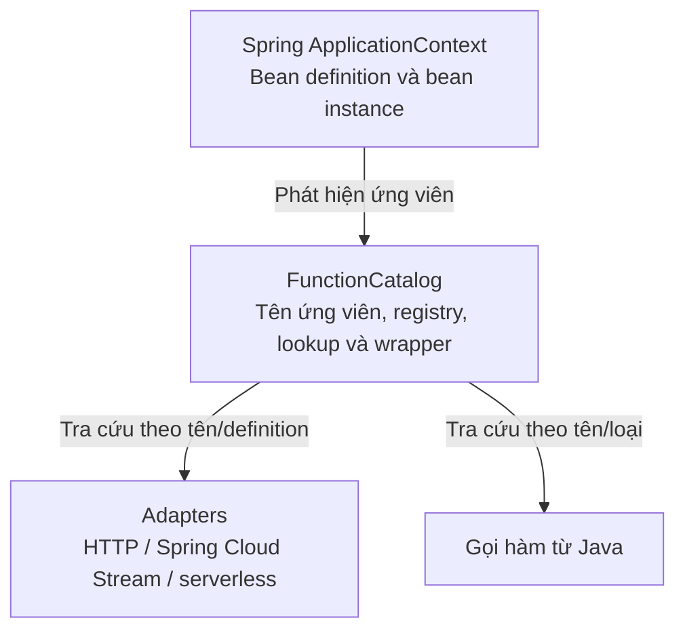
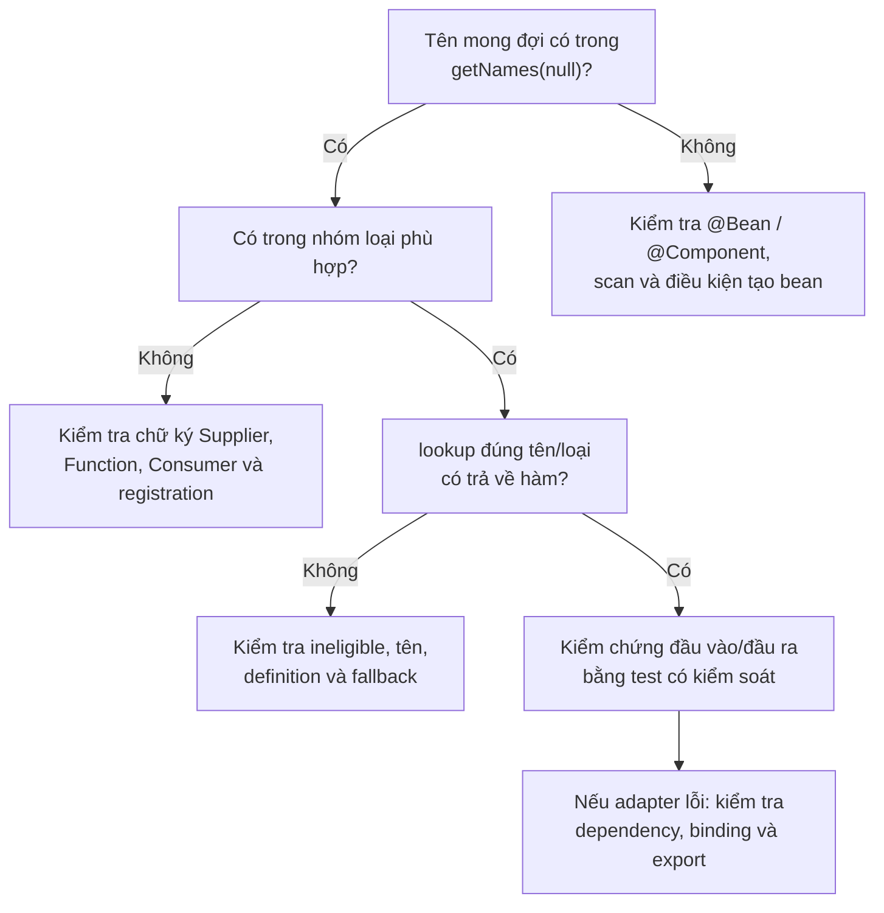

# Liệt kê tên hàm và kiểm tra nội dung catalog

**Chương:** FunctionCatalog  
**Module:** Spring Cloud Function (`SPRING_CLOUD_FUNCTION`)

Khi một ứng dụng Spring Cloud Function có nhiều `Supplier`, `Function` và `Consumer`, người phát triển cần biết **những hàm nào đã được ứng dụng nhận diện**, **tên nào dùng để tra cứu** và **hàm được tra cứu có đúng hợp đồng hay không**. Đây là công việc của việc kiểm tra (inspection) `FunctionCatalog`.

Spring Cloud Function cho phép viết logic nghiệp vụ tái sử dụng, độc lập với giao thức gọi. Một hàm có thể phục vụ mã Java, HTTP, xử lý sự kiện qua Spring Cloud Stream hoặc môi trường serverless. Trước khi kết nối một adapter, kiểm tra catalog là cách nhanh để xác minh rằng hàm nghiệp vụ thực sự sẵn sàng ở tầng Spring Cloud Function.

Sau bài này, bạn sẽ có thể:

1. Liệt kê mọi tên hàm và liệt kê theo loại `Supplier`, `Function`, `Consumer`.
2. Dùng `size()`, `getNames(...)` và `lookup(...)` đúng mục đích, hiểu giới hạn của từng thao tác.
3. Kiểm tra thông tin loại hàm và kiểu dữ liệu qua Spring Boot Actuator khi được cấu hình.
4. Đối chiếu catalog với `ApplicationContext` và chẩn đoán trường hợp danh sách tên không đúng kỳ vọng.
5. Viết kiểm thử tự động cho danh mục hàm mà ứng dụng cần cung cấp.

## 1. “Nội dung catalog” bao gồm những gì?

`FunctionCatalog` là giao diện dùng để tra cứu các functional bean được Spring Cloud Function quản lý. Catalog nhận diện các bean chức năng từ Spring `ApplicationContext` và có thể bọc chúng để hỗ trợ chuyển đổi kiểu, composition và tích hợp với adapter. Quá trình đăng ký/bọc hàm có thể diễn ra **theo nhu cầu** khi tra cứu, do đó không nên xem catalog như một `Map<String, Object>` tĩnh chứa sẵn toàn bộ hàm ở mọi thời điểm.

Có nhiều lớp thông tin khác nhau:

| Câu hỏi | Cách kiểm tra | Ý nghĩa |
| --- | --- | --- |
| Ứng dụng biết những tên hàm nào? | `catalog.getNames(null)` | Danh sách tên được nhận diện từ catalog và context |
| Những tên nào thuộc nhóm `Function`? | `catalog.getNames(Function.class)` | Nhóm tên theo loại functional interface |
| Catalog báo kích thước bao nhiêu? | `catalog.size()` | Chỉ số tham khảo về số đăng ký/ứng viên |
| Tên cụ thể có tra cứu thành hàm được không? | `catalog.lookup(Function.class, "name")` | Xác minh đường tra cứu thực tế |
| Hàm khai báo kiểu đầu vào/đầu ra nào? | `/actuator/functions` nếu được bật | Thông tin loại và kiểu do endpoint báo cáo |
| HTTP hay message broker có sử dụng hàm không? | Cấu hình và trạng thái của adapter | Không thể kết luận chỉ từ `getNames(...)` |

**Phân biệt ba tầng:**



- Một Java `Function` chỉ xuất hiện khi nó đã được đăng ký phù hợp với Spring; khai báo một biến lambda cục bộ không tự thêm nó vào catalog.
- Một tên được liệt kê **không bảo đảm** tra cứu sẽ thành công trong mọi trường hợp: một số ứng viên có thể bị loại khỏi đường lookup hoặc được đăng ký theo cách đặc biệt.
- Một tên tra cứu được **không đồng nghĩa** hàm đã có endpoint HTTP hoặc message binding; adapter còn cần dependency và cấu hình phù hợp.

## 2. Các API dùng để kiểm tra catalog

Giao diện `org.springframework.cloud.function.context.FunctionCatalog` hỗ trợ các thao tác thường dùng:

```java
// Giả sử catalog đã được Spring tiêm vào ứng dụng.

int reportedSize = catalog.size();

Set<String> allNames = catalog.getNames(null);
Set<String> suppliers = catalog.getNames(Supplier.class);
Set<String> functions = catalog.getNames(Function.class);
Set<String> consumers = catalog.getNames(Consumer.class);

Function<String, String> normalize =
    catalog.lookup(Function.class, "normalizeOrderCode");
```

Đoạn mã trên cần các import `java.util.Set`, `java.util.function.Supplier`, `Function` và `Consumer`.

### 2.1. getNames(null): liệt kê toàn bộ tên

`catalog.getNames(null)` trả về `Set<String>` các tên mà catalog nhận diện. Một `Set` không cam kết thứ tự xuất hiện, nên khi in ra log hoặc so sánh kết quả, hãy **sắp xếp trước khi hiển thị**.

Danh sách thực tế có thể có tên hàm do thư viện hoặc framework cung cấp, chẳng hạn `functionRouter`. Không nên mặc định rằng mọi tên trong `getNames(null)` đều là phương thức `@Bean` bạn tự viết.

### 2.2. getNames(type): liệt kê theo loại

Thay vì lọc theo tiền tố hoặc hậu tố tên, truyền loại giao diện:

```java
catalog.getNames(Supplier.class);
catalog.getNames(Function.class);
catalog.getNames(Consumer.class);
```

Với Spring Cloud Function thông thường, các tham số này giúp tách tên thành ba nhóm chức năng. Tuy nhiên, cách một bản đăng ký đặc biệt được phản ánh trong các nhóm có thể phụ thuộc cách đăng ký, phiên bản và registry phía dưới. Để xác nhận một tên cụ thể thực thi theo hợp đồng nào, hãy **tra cứu đúng loại rồi thử gọi có kiểm soát**.

`getNames(Function.class)` không cung cấp đủ generic type để phân biệt `Function<String, String>` với `Function<String, Integer>`. Cả hai đều là `Function`.

### 2.3. size(): chỉ số tham khảo, không phải phép kiểm kê tuyệt đối

Tài liệu cung cấp `catalog.size()` để quan sát kích thước catalog. Với cơ chế đăng ký lười và cách registry tính các ứng viên, con số này có thể mang tính **xấp xỉ**; thêm vào đó, một đăng ký có thể mang nhiều tên (alias) và tên composition không phải một bean độc lập.

Do đó, đừng viết quy tắc nghiệp vụ như:

```java
// Tránh lấy mối quan hệ này làm điều kiện bắt buộc:
// catalog.size() == catalog.getNames(null).size()
```

Để đảm bảo hệ thống có các hàm bắt buộc, hãy kiểm tra **tên mong đợi** và khả năng `lookup` của từng tên. Dùng `size()` như một chỉ số hỗ trợ quan sát, không như số lượng API đã xuất ra.

## 3. Ví dụ thực hành: in danh mục hàm khi khởi động

Ví dụ dưới đây là ứng dụng Spring Boot độc lập, sử dụng Spring Cloud Function context tương thích với phiên bản Spring Boot của dự án. Chưa cần HTTP adapter hay message broker.

```java
import java.util.Locale;
import java.util.Set;
import java.util.function.Consumer;
import java.util.function.Function;
import java.util.function.Supplier;

import org.springframework.boot.ApplicationRunner;
import org.springframework.boot.SpringApplication;
import org.springframework.boot.autoconfigure.SpringBootApplication;
import org.springframework.cloud.function.context.FunctionCatalog;
import org.springframework.context.annotation.Bean;

@SpringBootApplication
public class CatalogInspectionApplication {

    public static void main(String[] args) {
        SpringApplication.run(CatalogInspectionApplication.class, args);
    }

    @Bean
    public Supplier<String> newOrderCode() {
        return () -> "ord-42";
    }

    @Bean
    public Function<String, String> normalizeOrderCode() {
        return value -> value.trim().toUpperCase(Locale.ROOT);
    }

    @Bean
    public Function<String, Integer> countCharacters() {
        return String::length;
    }

    @Bean
    public Consumer<String> auditOrderCode() {
        return value -> System.out.println("AUDIT: " + value);
    }

    @Bean
    public ApplicationRunner reportCatalog(FunctionCatalog catalog) {
        return args -> {
            System.out.println("Reported size: " + catalog.size());
            printNames("All", catalog.getNames(null));
            printNames("Suppliers", catalog.getNames(Supplier.class));
            printNames("Functions", catalog.getNames(Function.class));
            printNames("Consumers", catalog.getNames(Consumer.class));
        };
    }

    private static void printNames(String group, Set<String> names) {
        System.out.println(group + ":");
        names.stream()
            .sorted()
            .forEach(name -> System.out.println("  - " + name));
    }
}
```

**Kết quả cần kiểm chứng:**

| Nhóm gọi | Tên nghiệp vụ cần xuất hiện |
| --- | --- |
| `getNames(Supplier.class)` | `newOrderCode` |
| `getNames(Function.class)` | `normalizeOrderCode`, `countCharacters` |
| `getNames(Consumer.class)` | `auditOrderCode` |
| `getNames(null)` | Cả bốn tên nghiệp vụ trên |

Trong môi trường thực, các danh sách có thể chứa thêm những tên khác. Vì vậy, chỉ cần kiểm tra **có chứa các tên mong đợi**, thay vì yêu cầu tập trả về bằng đúng tập bốn phần tử.

Ví dụ cũng cho thấy catalog phân loại dựa trên kiểu giao diện chứ không phân loại theo đầu ra: `normalizeOrderCode` và `countCharacters` cùng thuộc nhóm `Function` dù một hàm trả `String`, hàm còn lại trả `Integer`.

### 3.1. Tên bean nào được dùng để liệt kê?

Mặc định, phương thức:

```java
@Bean
public Function<String, String> normalizeOrderCode() {
    return value -> value.trim().toUpperCase(Locale.ROOT);
}
```

tạo bean tên `normalizeOrderCode`.

Nếu đặt tên tường minh:

```java
@Bean("normalizeOrder")
public Function<String, String> normalizeOrderCode() {
    return value -> value.trim().toUpperCase(Locale.ROOT);
}
```

thì tên tra cứu và tên mong đợi trong catalog là `normalizeOrder`. Đoạn này minh họa **một cách khai báo thay thế** cho bean trước, không phải yêu cầu tạo đồng thời hai bean trùng chức năng.

Trong ứng dụng tích hợp, hãy chọn tên rõ ràng và ổn định vì tên đó thường được tham chiếu qua `spring.cloud.function.definition` hoặc cấu hình adapter.

## 4. Từ “tên có trong danh sách” đến “hàm thực sự dùng được”

`getNames(...)` cho biết tên được nhận diện; để kiểm tra sâu hơn, hãy tra cứu và xác minh hợp đồng hành vi. Chẳng hạn, dùng các bean ở mục 3:

```java
Function<String, String> normalize =
    catalog.lookup(Function.class, "normalizeOrderCode");
if (normalize == null) {
    throw new IllegalStateException(
        "Catalog cannot resolve normalizeOrderCode");
}
String normalized = normalize.apply("  ord-42  ");
System.out.println(normalized); // ORD-42

Function<String, Integer> counter =
    catalog.lookup(Function.class, "countCharacters");
if (counter == null) {
    throw new IllegalStateException(
        "Catalog cannot resolve countCharacters");
}
System.out.println(counter.apply(normalized)); // 6
```

Chỉ kiểm tra `normalize != null` cũng chưa đủ nếu mục tiêu là chứng minh đầu ra đúng nghiệp vụ; kiểm thử nên có đầu vào và kết quả mong đợi rõ ràng.

### 4.1. lookup theo loại giao diện, không theo generic

Ví dụ:

```java
Function<String, Integer> counter =
    catalog.lookup(Function.class, "countCharacters");
```

Đối số `Function.class` giúp chỉ ra đây là **Function**. Nó không mang `String` và `Integer` ở runtime vì Java có *type erasure*. Do đó, khai báo:

```java
// Không an toàn: countCharacters thật sự trả Integer.
Function<String, String> wrongType =
    catalog.lookup(Function.class, "countCharacters");
```

có thể biên dịch nhưng dẫn tới lỗi kiểu trong lúc sử dụng. Cần đối chiếu chữ ký bean hoặc metadata kiểu do Spring Cloud Function quản lý, nhất là khi làm việc với DTO và thông điệp JSON.

### 4.2. Không dùng giá trị sản xuất để kiểm thử Consumer

`Consumer` thường có side effect như gửi mail, ghi database hoặc phát sự kiện. Để xác minh nó có trong catalog, có thể tra cứu và kiểm tra giá trị trả về khác `null`; nếu cần gọi `accept(...)`, hãy dùng môi trường kiểm thử với dependency được thay thế an toàn.

```java
Consumer<String> audit =
    catalog.lookup(Consumer.class, "auditOrderCode");
if (audit == null) {
    throw new IllegalStateException("Missing auditOrderCode");
}
// Chỉ gọi audit.accept(...) trong bài demo hoặc test có kiểm soát.
```

Tương tự, `Supplier` có thể sinh dữ liệu hoặc gọi hệ thống ngoài nên `get()` cũng không nhất thiết là thao tác “đọc không tác dụng phụ”.

## 5. Quan sát metadata qua Spring Boot Actuator

Ngoài API Java, Spring Cloud Function hỗ trợ endpoint **`/actuator/functions`** để xem những hàm được công bố trong catalog cùng thông tin mô tả kiểu. Cách này hữu ích khi bạn cần chẩn đoán từ bên ngoài tiến trình ứng dụng.

### 5.1. Chuẩn bị dependency

Ứng dụng cần Spring Cloud Function cùng Spring Boot Actuator và một web stack (MVC hoặc WebFlux) tương thích. Với dự án Maven, có thể bổ sung các dependency Spring Boot sau, sử dụng cơ chế quản lý phiên bản của dự án:

```xml
<dependency>
    <groupId>org.springframework.boot</groupId>
    <artifactId>spring-boot-starter-actuator</artifactId>
</dependency>

<dependency>
    <groupId>org.springframework.boot</groupId>
    <artifactId>spring-boot-starter-web</artifactId>
</dependency>
```

Hai dependency trên **chưa thay thế** dependency Spring Cloud Function đã có trong ứng dụng. Nếu dự án đã dùng WebFlux, hãy dùng web stack phù hợp thay vì tự ý thêm cả MVC và WebFlux.

Trong `application.yml`, bật phơi bày endpoint:

```yaml
management:
  endpoints:
    web:
      exposure:
        include: health,info,functions
```

Với địa chỉ ứng dụng mẫu ở localhost, truy vấn:

```bash
curl http://localhost:8080/actuator/functions
```

Tùy phiên bản, cấu hình và những hàm có trong context, phản hồi có thể có cấu trúc **tương tự ví dụ minh họa**:

```json
{
  "newOrderCode": {
    "type": "SUPPLIER",
    "output-type": "string"
  },
  "normalizeOrderCode": {
    "type": "FUNCTION",
    "input-type": "string",
    "output-type": "string"
  },
  "countCharacters": {
    "type": "FUNCTION",
    "input-type": "string",
    "output-type": "integer"
  },
  "auditOrderCode": {
    "type": "CONSUMER",
    "input-type": "string"
  }
}
```

Đây là dữ liệu minh họa, không phải output cố định: response có thể có thêm hàm như `functionRouter`, khác cách biểu diễn kiểu hoặc khác thứ tự trường theo phiên bản.

### 5.2. Đọc kết quả endpoint thế nào?

| Trường | Ý nghĩa |
| --- | --- |
| Tên JSON key, ví dụ `normalizeOrderCode` | Tên hàm mà endpoint liệt kê |
| `type` | Nhóm loại `SUPPLIER`, `FUNCTION`, `CONSUMER` |
| `input-type` | Kiểu đầu vào được nhận diện, nếu hàm có đầu vào |
| `output-type` | Kiểu đầu ra được nhận diện, nếu hàm có đầu ra |

Một `Supplier` thường không có `input-type`, còn `Consumer` thường không có `output-type`. Với hàm dùng `Message<T>`, DTO phức tạp hoặc reactive type, cách endpoint hiển thị metadata có thể khác với ví dụ chuỗi đơn giản.

**Lưu ý vận hành:** endpoint Actuator phục vụ quan sát và quản trị. Chỉ xuất các endpoint cần thiết, đặt cơ chế bảo vệ thích hợp trước khi dùng ở môi trường có người truy cập bên ngoài. Việc xem danh sách hàm không chứng minh những hàm đó có thể được gọi qua cùng URL.

### 5.3. Phân biệt endpoint Actuator với endpoint gọi hàm

| Đường truy cập | Mục đích |
| --- | --- |
| `GET /actuator/functions` | Quan sát tên/metadata của hàm (nếu endpoint đã được bật) |
| Endpoint hàm do Spring Cloud Function Web export | Gọi logic nghiệp vụ qua HTTP, phụ thuộc web adapter và cấu hình |
| Message binding trong Spring Cloud Stream | Kết nối hàm với broker và binding, phụ thuộc stream adapter |

Một ứng dụng chỉ cài Spring Cloud Function context vẫn có thể kiểm tra `getNames(...)` và `lookup(...)` bằng mã Java, kể cả khi không có web stack và không xuất endpoint.

## 6. Vì sao getNames(), size() và lookup() có thể không trùng kỳ vọng?

Catalog kết hợp thông tin từ Spring context và registry của Spring Cloud Function. Một phần đăng ký có thể xảy ra theo nhu cầu khi hàm được tra cứu; một số bean hỗ trợ framework cũng là `Function`. Ngoài ra, `FunctionRegistration` và cách đăng ký chức năng đặc biệt có thể ảnh hưởng đến cách tên/loại được phản ánh.

Điều này tạo ra ba nguyên tắc khi kiểm tra:

1. **Dùng getNames để quan sát ứng viên, không xem như bằng chứng thực thi.** Chỉ khi `lookup` trả về hàm phù hợp mới biết đường tra cứu có kết quả.
2. **Dùng size như chỉ số hỗ trợ.** Không buộc nó bằng số tên hay số endpoint HTTP; số đăng ký, alias và composition là những khái niệm khác nhau.
3. **Tách danh mục của Spring khỏi phạm vi được export.** `spring.cloud.function.definition` chọn hàm/composition cho adapter; nó không phải API “liệt kê toàn bộ bean” và không tạo bean mới.

### 6.1. Tham chiếu thêm ApplicationContext khi debug

Trong một ứng dụng đang có bean `normalizeOrderCode`:

```java
// Giả sử đã được tiêm ApplicationContext context
// và FunctionCatalog catalog.

String[] beanNames =
    context.getBeanNamesForType(Function.class);
Set<String> functionNames =
    catalog.getNames(Function.class);
```

Hai danh sách trả lời **hai câu hỏi khác nhau**: Spring biết bean nào có kiểu `Function`, còn Spring Cloud Function biết tên hàm nào qua giao diện catalog. Không nên coi hai tập luôn bằng nhau; các bước lọc, registration và adapter có thể ảnh hưởng đến kết quả quan sát.

Nếu `getBeanNamesForType(Function.class)` không có tên dự kiến, kiểm tra `@Bean`, component scanning, điều kiện tạo bean và cấu hình Spring trước. Nếu context có bean nhưng catalog không tra cứu được, kiểm tra loại bean, tên, các cơ chế lọc và đường lookup.

### 6.2. Function definition và composition không phải danh mục tên

Ví dụ, nếu có hai bean `normalizeOrderCode` và `addPrefix` tương thích nhau:

```properties
spring.cloud.function.definition=normalizeOrderCode|addPrefix
```

Tham số `definition` chọn chuỗi xử lý cho adapter. Bạn có thể tra cứu chuỗi:

```java
Function<String, String> composed =
    catalog.lookup(
        Function.class, "normalizeOrderCode|addPrefix");
```

nhưng không nên đòi hỏi `getNames(Function.class)` xuất hiện một bean mang nguyên tên `normalizeOrderCode|addPrefix`. Danh mục tên và các tổ hợp có thể tạo từ chúng là hai tập thông tin khác nhau.

### 6.3. Một hàm duy nhất và quy tắc fallback

Spring Cloud Function có cơ chế *single-function fallback*: nếu chỉ còn một functional bean đủ điều kiện, một lookup thiếu tên hoặc dùng tên không khớp có thể vẫn chọn được hàm duy nhất. Điều này thuận tiện cho ứng dụng nhỏ nhưng có thể che giấu lỗi chính tả khi thử nghiệm.

Khi phiên bản đang dùng hỗ trợ và muốn yêu cầu tên chính xác:

```properties
spring.cloud.function.single-function-fallback-enabled=false
```

Hãy giữ ít nhất hai hàm trong bài thử kiểm tra lỗi chọn tên, hoặc tắt fallback một cách có chủ đích. Đừng kết luận một tên đã được đăng ký chỉ vì `lookup("ten-go-sai")` trả về kết quả trong ứng dụng chỉ có một hàm.

## 7. Chẩn đoán theo một quy trình lặp lại được

Khi một chức năng không xuất hiện trong danh sách hoặc adapter không gọi được nó, kiểm tra theo thứ tự:



| Triệu chứng | Nguyên nhân cần xem xét | Bước tiếp theo |
| --- | --- | --- |
| `getNames(null)` không có hàm | Chưa đăng ký Spring bean, class nằm ngoài phạm vi scan, điều kiện cấu hình không thỏa | Kiểm tra tên và bean definition trong `ApplicationContext` |
| Có tên trong danh sách chung, vắng trong nhóm `Function` | Hàm thuộc `Supplier`/`Consumer` hoặc được đăng ký theo cơ chế khác | Kiểm tra loại và cách đăng ký thực tế |
| Có tên nhưng `lookup(...)` không trả về hàm | Tên/definition sai, lọc `ineligible-definitions` hoặc đường registration không phù hợp | Thử tên chính xác, xem bộ lọc và cấu hình |
| `lookup(...)` trả về hàm nhưng chạy lỗi kiểu | Generic khai báo và kiểu dữ liệu đầu vào/đầu ra không tương thích | Kiểm tra chữ ký thực và metadata chuyển đổi |
| `getNames(...)` có thêm tên ngoài mong đợi | Bean từ thư viện, framework hoặc `functionRouter` | Phân biệt tên hạ tầng với tên nghiệp vụ |
| `size()` không bằng số tên | Cách đếm đăng ký/ứng viên và alias khác nhau | Không dùng đẳng thức hai giá trị làm kiểm thử |
| `GET /actuator/functions` trả 404 | Thiếu Actuator/web stack, chưa expose endpoint hoặc không hỗ trợ trong cấu hình hiện tại | Kiểm tra dependency và `management.endpoints.web.exposure.include` |
| Catalog có hàm, nhưng HTTP hoặc broker không gọi được | Chưa cấu hình adapter, export, binding hoặc `definition` | Kiểm tra cấu hình adapter; catalog chỉ là một tầng |

**Mẹo khi đọc log:** in các tập tên đã sắp xếp và ghi nhận tên/loại bạn đang kỳ vọng. Không ghi payload nhạy cảm hoặc dữ liệu nghiệp vụ thật chỉ để xác nhận catalog.

## 8. Kiểm thử tự động: danh mục quan trọng phải được giữ ổn định

Kiểm tra catalog là một dạng **contract test** hữu ích: khi ai đó đổi tên bean, loại bỏ cấu hình hoặc thay đổi cách đăng ký, test sẽ phát hiện trước khi adapter ngừng gọi được hàm.

Với lớp `CatalogInspectionApplication` ở mục 3 và Spring Boot Test/JUnit 5 tương thích:

```java
import static org.junit.jupiter.api.Assertions.*;

import java.util.Set;
import java.util.function.Consumer;
import java.util.function.Function;
import java.util.function.Supplier;

import org.junit.jupiter.api.Test;
import org.springframework.beans.factory.annotation.Autowired;
import org.springframework.boot.test.context.SpringBootTest;
import org.springframework.cloud.function.context.FunctionCatalog;

@SpringBootTest(classes = CatalogInspectionApplication.class)
class CatalogInspectionApplicationTest {

    @Autowired
    private FunctionCatalog catalog;

    @Test
    void catalogContainsRequiredBusinessFunctions() {
        Set<String> names = catalog.getNames(null);

        assertTrue(names.containsAll(Set.of(
            "newOrderCode",
            "normalizeOrderCode",
            "countCharacters",
            "auditOrderCode"
        )));
        assertTrue(
            catalog.getNames(Supplier.class).contains("newOrderCode"));
        assertTrue(
            catalog.getNames(Function.class).contains("normalizeOrderCode"));
        assertTrue(
            catalog.getNames(Function.class).contains("countCharacters"));
        assertTrue(
            catalog.getNames(Consumer.class).contains("auditOrderCode"));
    }

    @Test
    void lookupProducesExpectedResults() {
        Function<String, String> normalize =
            catalog.lookup(Function.class, "normalizeOrderCode");
        Function<String, Integer> count =
            catalog.lookup(Function.class, "countCharacters");

        assertNotNull(normalize);
        assertNotNull(count);

        String result = normalize.apply("  ord-42  ");
        assertEquals("ORD-42", result);
        assertEquals(6, count.apply(result).intValue());
    }

    @Test
    void otherKindsAreResolvable() {
        Supplier<String> supplier =
            catalog.lookup(Supplier.class, "newOrderCode");
        Consumer<String> consumer =
            catalog.lookup(Consumer.class, "auditOrderCode");

        assertNotNull(supplier);
        assertNotNull(consumer);
    }
}
```

Kiểm thử trên **không so sánh** `getNames(null)` với đúng bốn tên, vì framework có thể thêm hàm phụ trợ. Nó cũng tránh khẳng định `catalog.size() == 4` hoặc gọi `Consumer.accept(...)` khi việc gọi có thể phát sinh side effect.

## 9. Tình huống thực tế: catalog hiển thị đúng nhưng endpoint không hoạt động

Một nhóm triển khai hàm chuẩn hóa mã đơn hàng:

```java
@Bean
public Function<String, String> normalizeOrderCode() {
    return value -> value.trim().toUpperCase(Locale.ROOT);
}
```

Trong Java, họ thấy `getNames(Function.class)` có `normalizeOrderCode`, và `lookup(Function.class, "normalizeOrderCode")` chạy thành công. Tuy nhiên, họ gọi HTTP endpoint và nhận lỗi 404.

Cách điều tra:

1. **Đã xác nhận tầng catalog hoạt động.** Không cần đổi logic hàm chỉ vì endpoint không tồn tại.
2. **Kiểm tra HTTP adapter**: dự án có Spring Cloud Function Web và web stack tương thích không, có cấu hình export hay giới hạn function definition không?
3. **Kiểm tra cấu hình đường dẫn/phương thức HTTP** theo phiên bản adapter thực tế.
4. **Phân biệt endpoint kiểm tra với endpoint gọi hàm**: `GET /actuator/functions` chỉ cung cấp thông tin quan sát, không phải request chạy `normalizeOrderCode`.

Ngược lại, nếu `getNames(...)` không có hàm, cần xác minh bean đã được Spring tạo và đăng ký đúng trước khi điều tra đường HTTP. Cách phân tầng giúp không sửa nhầm phần logic nghiệp vụ.

## 10. Bài tập luyện tập

1. Chạy ứng dụng ở mục 3, in danh sách từ `getNames(null)`, `getNames(Supplier.class)`, `getNames(Function.class)` và `getNames(Consumer.class)`. Xác nhận các tên nghiệp vụ xuất hiện đúng nhóm.
2. Thêm `@Bean("maskOrderCode")` kiểu `Function<String, String>`, triển khai hàm thay ba ký tự cuối bằng `***`. Dùng `getNames(Function.class)` để xác nhận tên mới rồi `lookup` để kiểm tra hành vi.
3. Đổi tên `maskOrderCode` thành `redactOrderCode` và cập nhật test. Quan sát vì sao test kiểm tra hợp đồng tên giúp phát hiện thay đổi có thể làm hỏng cấu hình adapter.
4. Cố ý tạo thêm một bean `Function<String, Integer>`. So sánh thông tin bạn nhận được từ `getNames(Function.class)` với metadata `input-type`/`output-type` ở `/actuator/functions` khi endpoint được bật.
5. So sánh số `size()` với số tên trong `getNames(null)`. Ghi nhận quan sát thực tế, nhưng không xây dựng test bắt hai giá trị phải bằng nhau.
6. Xác minh bằng `lookup(...)` rằng `normalizeOrderCode` hoạt động rồi cấu hình adapter HTTP. Nếu HTTP lỗi, tìm nguyên nhân ở tầng adapter trước khi sửa bean.

## 11. Những điều cần nhớ

- `catalog.getNames(null)` liệt kê tên các hàm catalog nhận diện; `catalog.getNames(type)` nhóm theo loại giao diện.
- `catalog.size()` là chỉ số tham khảo; nó không nhất thiết bằng số tên hoặc số endpoint đã export.
- **Danh sách tên chưa đủ để khẳng định chức năng sẵn sàng**: hãy dùng `lookup(...)` và kiểm thử hành vi với đầu vào có kiểm soát.
- Thông tin generic như `Function<String, Integer>` không thể suy ra chỉ từ `Function.class`; endpoint Actuator có thể giúp quan sát metadata kiểu khi đã được bật.
- Tầng Spring bean, tầng FunctionCatalog và tầng adapter phục vụ mục đích khác nhau. Kiểm tra đúng tầng sẽ rút ngắn thời gian tìm lỗi khi cùng một hàm được đưa ra HTTP, sự kiện hoặc serverless.

### Tài liệu tham khảo

- [Spring Cloud Function — Functional Bean Definitions: Function visualization and control](https://docs.spring.io/spring-cloud-function/reference/functional.html): `size()`, `getNames(null)` và endpoint Actuator `functions`.
- [Spring Cloud Function — Programming Model](https://docs.spring.io/spring-cloud-function/reference/spring-cloud-function/programming-model.html): functional bean, `FunctionCatalog`, lookup, metadata và function definition.
