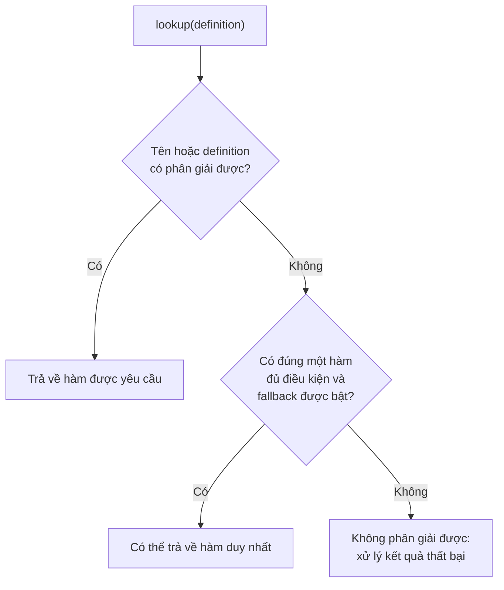

# Quy tắc tra cứu khi chỉ có một hàm và khi có nhiều hàm

**Chương:** FunctionCatalog  
**Module:** Spring Cloud Function (`SPRING_CLOUD_FUNCTION`)

Spring Cloud Function cho phép đóng gói logic nghiệp vụ thành `Supplier`, `Function` và `Consumer`, rồi dùng lại logic đó qua mã Java, HTTP, sự kiện hoặc môi trường serverless. Một thành phần trung tâm của mô hình này là `FunctionCatalog`: nơi các adapter và mã ứng dụng có thể tìm hàm theo **tên** hoặc **function definition**.

Có một quy tắc dễ gây nhầm lẫn: **nếu catalog chỉ có một hàm chức năng đủ điều kiện, Spring Cloud Function có thể trả về hàm duy nhất ngay cả khi tên tra cứu rỗng hoặc không khớp**. Khi có nhiều hàm, ứng dụng cần xác định rõ hàm hoặc chuỗi hàm muốn dùng. Hiểu quy tắc này giúp tránh tình trạng thử nghiệm một ứng dụng nhỏ thành công, nhưng đến lúc thêm hàm thứ hai thì cấu hình hoặc lời gọi cũ hoạt động khác đi.

Sau bài học, bạn có thể:

- Dự đoán hành vi `lookup(...)` với một hoặc nhiều functional bean.
- Phân biệt tra cứu theo tên chính xác với cơ chế *single-function fallback*.
- Vô hiệu hóa fallback khi cần phát hiện lỗi tên sớm.
- Khai báo `spring.cloud.function.definition` rõ ràng cho ứng dụng dùng adapter.
- Viết ví dụ và kiểm thử cho cả chế độ một hàm lẫn nhiều hàm.

## 1. Khái niệm cần thống nhất

Một **functional bean** là Spring bean thuộc mô hình chức năng được Spring Cloud Function hỗ trợ, thường là:

| Giao diện | Phương thức sử dụng | Ví dụ |
| --- | --- | --- |
| `Supplier<O>` | `O get()` | Sinh mã đơn hàng |
| `Function<I, O>` | `O apply(I input)` | Chuẩn hóa mã đơn hàng |
| `Consumer<I>` | `void accept(I input)` | Ghi nhật ký kiểm toán |

Các bean được khai báo qua `@Bean`, `@Component` trong phạm vi quét hoặc một cách đăng ký Spring tương thích có thể được Spring Cloud Function nhận diện. `FunctionCatalog` hỗ trợ tra cứu chúng theo tên và cung cấp biểu diễn hàm đã được framework xử lý, phù hợp cho composition và các cơ chế thích ứng kiểu.

Ví dụ, bean sau có tên mặc định là `normalizeOrderCode`:

```java
@Bean
public Function<String, String> normalizeOrderCode() {
    return input -> input.trim().toUpperCase(Locale.ROOT);
}
```

Nếu đặt `@Bean("normalize")`, tên dùng để tìm hàm là `normalize`, cho dù phương thức Java vẫn có tên `normalizeOrderCode`.

**Phạm vi “một hàm”:** quy tắc fallback đề cập đến **một ứng viên chức năng khả dụng** trong catalog, không có nghĩa ứng dụng chỉ có một Spring bean tất cả các loại. Một `DataSource`, một service thông thường hay `ApplicationRunner` không tự biến thành một functional bean. Ngược lại, một `Supplier` cộng với một `Consumer` là **hai** functional bean, dù mỗi loại chỉ có một.

Framework có thể có thêm hàm hạ tầng, chẳng hạn `functionRouter`, và có thể loại các bean chức năng không đủ điều kiện. Vì thế, khi xác định trường hợp một hay nhiều hàm, cần quan sát **các hàm đủ điều kiện** thực tế thay vì suy từ số phương thức trong một lớp.

## 2. Tổng quan: một hàm và nhiều hàm khác nhau thế nào?

Giả sử bean `normalizeOrderCode` đã được đăng ký. Spring Cloud Function mặc định cho phép cơ chế **single-function fallback** khi chỉ có một hàm phù hợp.

| Lệnh tra cứu | Chỉ có `normalizeOrderCode`, fallback bật | Có thêm `addPrefix` |
| --- | --- | --- |
| `lookup("normalizeOrderCode")` | Tìm đúng hàm | Tìm đúng hàm |
| `lookup("")` | Có thể trả về hàm duy nhất | Không nên trông đợi một hàm mặc định |
| `lookup(null)` | Có thể trả về hàm duy nhất | Không nên trông đợi một hàm mặc định |
| `lookup("tenKhongTonTai")` | Có thể trả về `normalizeOrderCode` | Không tìm được tên đã yêu cầu; cần xử lý thất bại |
| `lookup("addPrefix")` | Nếu không tồn tại, fallback có thể trả về hàm duy nhất | Tìm đúng `addPrefix` |
| `lookup("normalizeOrderCode|addPrefix")` | Bean `addPrefix` chưa tồn tại; không thể dựa vào lookup để có composition hai hàm như mong muốn | Có thể tạo composition khi hai kiểu tương thích |

Ở bảng này, `lookup(...)` là cách gọi API dạng không chỉ rõ loại. Khi lập trình Java, bạn cũng có thể dùng overload `lookup(Function.class, "normalizeOrderCode")` để diễn đạt loại giao diện mong đợi.

**Điểm cốt lõi:** fallback khiến một lời gọi **sai tên vẫn có thể chạy đúng logic của hàm duy nhất**. Điều này không chứng minh tên sai đã được đăng ký. Khi thêm hàm thứ hai, fallback không còn là cách lựa chọn hàm đáng tin cậy, và lỗi cấu hình cũ sẽ lộ ra.



Sơ đồ mô tả nguyên tắc lựa chọn, không phải toàn bộ mã nguồn nội bộ. Khi definition là một chuỗi composition, hãy xác minh mọi thành phần thực sự tồn tại với tên mong muốn; không nên dựa vào fallback để “chữa” một composition bị viết sai.

## 3. Khi chỉ có một hàm: fallback hoạt động ra sao?

Theo tài liệu Spring Cloud Function, giả sử `uppercase` là functional bean duy nhất, các lệnh sau đều có thể được ánh xạ tới hàm này theo hành vi mặc định:

```java
Function<String, String> byName = catalog.lookup("uppercase");
Function<String, String> byEmpty = catalog.lookup("");
Function<String, String> byNull = catalog.lookup((String) null);
Function<String, String> byOtherName = catalog.lookup("foo");
```

Trong đoạn mã, `catalog` là instance của `FunctionCatalog`. Chúng ta ép `(String) null` để làm rõ đây là lời gọi overload nhận *function definition*. Tham số generic trong biến nhận giả định chữ ký thực tế là `Function<String, String>`.

Với một bean duy nhất, bốn cách tra cứu có thể lấy cùng logic nghiệp vụ. Tình huống này có lợi khi một môi trường thực thi chỉ cần một điểm vào và tên hàm không được chỉ rõ. Tuy nhiên, lời gọi `lookup("foo")` **không chứng minh** catalog có bean tên `foo`.

### 3.1. Vấn đề: tên bị gõ sai nhưng kiểm thử vẫn xanh

Giả sử lập trình viên viết:

```java
// Sai chính tả: bean thực tế tên normalizeOrderCode.
Function<String, String> normalize =
    catalog.lookup(Function.class, "normaliseOrderCode");

String value = normalize.apply("  ord-42  ");
```

Khi chỉ có một hàm và fallback bật, đoạn mã có thể chạy thành công, cho kết quả `ORD-42`. Sau này ứng dụng bổ sung một bean `Function` hoặc `Consumer` khác, lookup theo tên viết sai không còn được giải quyết theo cùng cách; mã có thể nhận `null` hoặc gặp lỗi khi tiếp tục thực thi.

Vì vậy:

1. Luôn dùng tên chính xác, ổn định cho functional bean.
2. Tra cứu với tên rõ ràng, đồng thời kiểm tra kết quả trước khi gọi `apply/get/accept`.
3. Với ứng dụng cần phát hiện lỗi tên, cân nhắc tắt fallback ở tất cả các môi trường.

### 3.2. Tắt fallback bằng cấu hình

Đặt cấu hình:

```properties
spring.cloud.function.single-function-fallback-enabled=false
```

Hoặc trong `application.yml`:

```yaml
spring:
  cloud:
    function:
      single-function-fallback-enabled: false
```

Khi cấu hình này có hiệu lực, catalog yêu cầu tra cứu bằng tên hợp lệ của hàm, ngay cả khi chỉ có một functional bean.

Ví dụ:

```java
Function<String, String> found =
    catalog.lookup(Function.class, "normalizeOrderCode");

Function<String, String> missing =
    catalog.lookup(Function.class, "normaliseOrderCode");

// Với bean tên normalizeOrderCode và fallback đã tắt:
// found != null; missing == null.
```

Không nên coi việc để fallback bật là lỗi tự thân. Đây là tính năng có chủ đích của Spring Cloud Function; lựa chọn bật/tắt tùy yêu cầu tương thích và khả năng chấp nhận một tên tra cứu không đúng.

## 4. Khi có nhiều hàm: phải lựa chọn tường minh

Giả sử chúng ta đăng ký:

```java
@Bean
public Function<String, String> normalizeOrderCode() {
    return input -> input.trim().toUpperCase(Locale.ROOT);
}

@Bean
public Function<String, String> addPrefix() {
    return input -> "ID-" + input;
}
```

Lúc này có **hai** `Function<String, String>`. Để dùng một trong hai:

```java
Function<String, String> normalize =
    catalog.lookup(Function.class, "normalizeOrderCode");

Function<String, String> prefix =
    catalog.lookup(Function.class, "addPrefix");

if (normalize == null || prefix == null) {
    throw new IllegalStateException("Required function is missing");
}

System.out.println(normalize.apply("  ord-42  ")); // ORD-42
System.out.println(prefix.apply("ORD-42"));         // ID-ORD-42
```

Việc hai bean có cùng nhóm `Function` và cùng kiểu dữ liệu **không cho catalog một lý do để tự chọn** bean nào là mặc định. Đặc biệt, không nên viết mã nghiệp vụ phụ thuộc vào `lookup("")` hoặc tên bất kỳ khi đã có nhiều hàm.

### 4.1. Tra cứu theo loại không có nghĩa chọn được một trong nhiều hàm

API:

```java
Function<String, String> selected =
    catalog.lookup(Function.class, "normalizeOrderCode");
```

có hai thông tin:

- `Function.class`: yêu cầu nhóm functional interface.
- `"normalizeOrderCode"`: yêu cầu đúng tên/definition.

Chỉ truyền `Function.class` không biểu diễn được ý định “chọn hàm chuẩn hóa thay vì thêm tiền tố”. Một catalog có thể chứa nhiều `Function<?, ?>`, và giới hạn *type erasure* của Java khiến `Function.class` cũng không bảo đảm kiểu generic `String → String`.

Điều tương tự áp dụng khi ứng dụng có các loại khác nhau. Nếu có một `Supplier` và một `Consumer`, đó vẫn là nhiều functional bean; đừng suy rằng có “một hàm duy nhất” chỉ vì mỗi giao diện xuất hiện một lần.

### 4.2. Chọn chuỗi composition khi cần chạy nhiều hàm liên tiếp

Spring Cloud Function cho phép dùng function definition:

```java
Function<String, String> pipeline =
    catalog.lookup(
        Function.class, "normalizeOrderCode|addPrefix");

if (pipeline == null) {
    throw new IllegalStateException("Composition not found");
}

System.out.println(pipeline.apply("  ord-42  "));
// ID-ORD-42
```

Dấu `|` mô tả thứ tự: chạy `normalizeOrderCode`, sau đó đưa kết quả vào `addPrefix`. Đây là một **definition gồm hai hàm**, không đòi hỏi bạn khai báo thêm một bean Java mang nguyên tên `normalizeOrderCode|addPrefix`.

Composition chỉ hợp lệ khi các thành phần có thể ghép về mặt kiểu dữ liệu và mô hình thực thi. Nếu viết sai tên một thành phần, ứng dụng nên sửa definition; không xem fallback là cơ chế tự phục hồi cho composition.

## 5. Ví dụ chạy được ở cả hai chế độ bằng Spring Profile

Ví dụ độc lập sau dùng một ứng dụng Spring Boot có Spring Cloud Function context tương thích với Spring Boot. Trong profile mặc định, chỉ có một hàm nghiệp vụ; bật profile `many` thì thêm hàm thứ hai.

```java
import java.util.Locale;
import java.util.function.Function;

import org.springframework.boot.ApplicationRunner;
import org.springframework.boot.SpringApplication;
import org.springframework.boot.autoconfigure.SpringBootApplication;
import org.springframework.cloud.function.context.FunctionCatalog;
import org.springframework.context.annotation.Bean;
import org.springframework.context.annotation.Profile;

@SpringBootApplication
public class LookupRulesApplication {

    public static void main(String[] args) {
        SpringApplication.run(LookupRulesApplication.class, args);
    }

    @Bean("normalizeOrderCode")
    public Function<String, String> normalizeOrderCode() {
        return input -> input.trim().toUpperCase(Locale.ROOT);
    }

    @Bean("addPrefix")
    @Profile("many")
    public Function<String, String> addPrefix() {
        return input -> "ID-" + input;
    }

    @Bean
    public ApplicationRunner showLookupRules(FunctionCatalog catalog) {
        return args -> {
            System.out.println(
                "Available functions: " + catalog.getNames(Function.class));

            Function<String, String> named =
                catalog.lookup(Function.class, "normalizeOrderCode");
            Function<String, String> unknown =
                catalog.lookup(Function.class, "unknownName");

            if (named == null) {
                throw new IllegalStateException("normalizeOrderCode missing");
            }

            System.out.println(
                "Exact name: " + named.apply("  ord-42  "));
            System.out.println(
                "Unknown name resolved: " + (unknown != null));

            if (catalog.getNames(Function.class).contains("addPrefix")) {
                Function<String, String> pipeline =
                    catalog.lookup(
                        Function.class, "normalizeOrderCode|addPrefix");

                if (pipeline != null) {
                    System.out.println(
                        "Composition: " + pipeline.apply("  ord-42  "));
                }
            }
        };
    }
}
```

**Cách chạy và dự đoán:**

| Cấu hình khi khởi động | Functional bean nghiệp vụ | Kỳ vọng cho `unknownName` khi fallback bật |
| --- | --- | --- |
| Không bật profile `many` | `normalizeOrderCode` | Có thể được ánh xạ sang hàm duy nhất |
| Thêm `--spring.profiles.active=many` | `normalizeOrderCode`, `addPrefix` | Không phân giải được tên không tồn tại |
| Không bật `many`, đặt `single-function-fallback-enabled=false` | `normalizeOrderCode` | Không phân giải được tên không tồn tại |

Các tên hạ tầng có thể xuất hiện thêm trong `getNames(Function.class)`. Ví dụ nhằm kiểm tra các bean **nghiệp vụ** và tác động của fallback; khi xác minh, hãy in catalog thực tế thay vì mặc định danh sách chỉ chứa đúng một hoặc hai phần tử.

Khi có profile `many`, bạn cũng có thể yêu cầu:

```java
Function<String, String> selected =
    catalog.lookup(Function.class, "addPrefix");
```

Đây là cách tra cứu có ý định rõ ràng; nó không phụ thuộc việc catalog có bao nhiêu hàm.

## 6. spring.cloud.function.definition chọn hàm cho adapter thế nào?

`FunctionCatalog.lookup(...)` là API gọi từ Java. Trong mô hình tích hợp, adapter thường nhận định danh hàm qua thuộc tính:

```properties
spring.cloud.function.definition=normalizeOrderCode
```

Hoặc khai báo composition:

```properties
spring.cloud.function.definition=normalizeOrderCode|addPrefix
```

Thuộc tính này mô tả **hàm hoặc chuỗi hàm được chọn cho một ngữ cảnh tích hợp**. Nó không tạo bean mới, không xóa các bean còn lại trong `ApplicationContext` và không thay thế việc đăng ký functional bean.

| Bối cảnh | Khi một hàm | Khi nhiều hàm |
| --- | --- | --- |
| Mã Java gọi catalog | Có fallback khi tên rỗng/sai nếu đang bật | Tra cứu bằng đúng tên hoặc composition |
| Spring Cloud Stream | Có thể chọn hàm duy nhất theo quy tắc mặc định của adapter, nhưng nên khai báo `definition` | Cần chỉ rõ function definition/binding phù hợp theo thiết kế |
| Spring Cloud Function Web | Cách ánh xạ đường dẫn phụ thuộc quy tắc web adapter và cấu hình | Dùng tên/definition theo quy tắc export của web adapter |
| Serverless adapter | Cách chọn hàm phụ thuộc entry point và adapter | Chỉ định definition hoặc routing theo hướng dẫn triển khai |

**Khuyến nghị thực hành:** với Spring Cloud Stream, tài liệu Spring Cloud Function khuyến nghị **luôn đặt `spring.cloud.function.definition`**, kể cả khi ứng dụng hiện chỉ có một hàm. Điều này giúp cấu hình giữ nguyên ý nghĩa khi thêm hàm mới.

Ví dụ với Spring Cloud Stream:

```yaml
spring:
  cloud:
    function:
      definition: normalizeOrderCode
```

Khi cần ghép hai hàm:

```yaml
spring:
  cloud:
    function:
      definition: normalizeOrderCode|addPrefix
```

Với adapter HTTP, sự kiện hoặc serverless, phải kiểm tra thêm dependency, mapping, binding và quy tắc routing riêng. Không thể kết luận từ một lần `lookup("unknownName")` rằng HTTP route hoặc event binding cùng tên cũng sẽ có hành vi fallback y hệt.

## 7. Không nhầm single-function fallback với function routing

Spring Cloud Function còn có **routing**, thường thông qua hàm hạ tầng `functionRouter`. Router là một hàm có trách nhiệm lựa chọn đích xử lý dựa trên thông tin routing như header hoặc cấu hình, tùy trường hợp.

| Tính năng | Single-function fallback | Function routing |
| --- | --- | --- |
| Mục đích | Dùng hàm duy nhất khi tên lookup rỗng/không khớp | Chọn hàm đích theo quyết định routing |
| Điều kiện đáng chú ý | Chỉ có một functional bean phù hợp và fallback bật | Có router và cấu hình/quy tắc xác định route |
| Cách điều khiển | `spring.cloud.function.single-function-fallback-enabled` | Function definition, routing expression, header hoặc callback theo adapter |
| Dùng khi có nhiều hàm? | Không nên dựa vào để chọn một hàm tùy ý | Có thể dùng để điều phối nhiều hàm |

Khi dùng router, người phát triển vẫn phải xác định quy tắc chọn hàm đích. Việc catalog có `functionRouter` **không** có nghĩa mọi tên sai sẽ được tự động chuyển tới một trong các hàm nghiệp vụ.

Chỉ nên đưa dữ liệu điều khiển route từ nguồn đáng tin cậy và kiểm soát tập hàm đích cho phép nếu hệ thống nhận yêu cầu từ bên ngoài.

## 8. Kiểm tra catalog và xử lý lookup thất bại

Có thể liệt kê tên bằng:

```java
Set<String> all = catalog.getNames(null);
Set<String> functions = catalog.getNames(Function.class);
Set<String> suppliers = catalog.getNames(Supplier.class);
Set<String> consumers = catalog.getNames(Consumer.class);
```

Đoạn mã cần import `java.util.Set` cùng ba functional interface tương ứng.

### 8.1. Vì sao getNames không thay thế lookup?

`getNames(...)` giúp xem tên các hàm được nhận diện, trong khi `lookup(...)` mới thực sự phân giải một tên/definition thành hàm sử dụng được.

Trong chế độ **một hàm có fallback**, tên `unknownName` có thể **không nằm trong** `getNames(null)` nhưng `lookup("unknownName")` vẫn trả về hàm duy nhất. Vì vậy, không được suy ngược rằng `lookup("unknownName") != null` chứng minh có bean tên `unknownName`.

Nếu bạn xây giao diện lựa chọn hoặc API điều phối tên hàm, hãy kiểm tra tên theo một **danh sách cho phép** của ứng dụng, thay vì chấp nhận mọi chuỗi có thể tra cứu:

```java
import java.util.Set;
import java.util.function.Function;
import org.springframework.cloud.function.context.FunctionCatalog;

public final class NamedFunctionService {

    private static final Set<String> ALLOWED =
        Set.of("normalizeOrderCode", "addPrefix");

    private final FunctionCatalog catalog;

    public NamedFunctionService(FunctionCatalog catalog) {
        this.catalog = catalog;
    }

    public String process(String name, String input) {
        if (!ALLOWED.contains(name)) {
            throw new IllegalArgumentException("Unknown handler: " + name);
        }

        Function<String, String> handler =
            catalog.lookup(Function.class, name);

        if (handler == null) {
            throw new IllegalStateException(
                "Handler is not registered: " + name);
        }

        return handler.apply(input);
    }
}
```

Đây là ví dụ lớp Java nhận `FunctionCatalog` qua constructor; trong ứng dụng Spring, lớp có thể được khai báo làm service nếu cần. Bộ lọc theo tên giúp tránh lỗi chọn nhầm hàm do fallback và giới hạn chức năng được phép gọi. Xác thực/phân quyền cho người sử dụng bên ngoài vẫn là trách nhiệm riêng.

### 8.2. Checklist chẩn đoán

| Triệu chứng | Điều cần kiểm tra |
| --- | --- |
| Sai tên nhưng vẫn gọi được hàm | Có đúng một hàm đủ điều kiện và fallback đang bật không? |
| Sau khi thêm bean thứ hai, lookup cũ thất bại | Có đang dựa vào tên rỗng, tên giả hoặc tên sai không? |
| `lookup("normalizeOrderCode")` không tìm thấy | Tên `@Bean` thật, phạm vi component scan, cấu hình ineligible, kiểu hàm |
| Có nhiều hàm cùng loại và adapter không biết chọn hàm | `spring.cloud.function.definition` và cấu hình adapter |
| Tên đúng nhưng dữ liệu xử lý sai | Hợp đồng generic, chuyển đổi thông điệp, thứ tự composition |
| Có `functionRouter` trong danh sách | Phân biệt router hạ tầng với các hàm nghiệp vụ |
| Test chỉ kiểm tra `lookup("typo") != null` | Thay bằng tên chính xác, kiểm tra trong `getNames` hoặc tắt fallback |

## 9. Viết kiểm thử cho cả một hàm và nhiều hàm

Lớp `LookupRulesApplication` ở mục 5 cho phép kiểm thử cùng một logic ở hai bối cảnh. Các test sau giả định dự án đã có Spring Boot Test và JUnit 5 tương thích.

### 9.1. Kiểm thử một hàm, tắt fallback để bắt lỗi tên

```java
import static org.junit.jupiter.api.Assertions.*;

import java.util.function.Function;
import org.junit.jupiter.api.Test;
import org.springframework.beans.factory.annotation.Autowired;
import org.springframework.boot.test.context.SpringBootTest;
import org.springframework.cloud.function.context.FunctionCatalog;

@SpringBootTest(
    classes = LookupRulesApplication.class,
    properties =
        "spring.cloud.function.single-function-fallback-enabled=false"
)
class SingleFunctionStrictLookupTest {

    @Autowired
    private FunctionCatalog catalog;

    @Test
    void requiresCorrectName() {
        Function<String, String> correct =
            catalog.lookup(Function.class, "normalizeOrderCode");
        Function<String, String> wrong =
            catalog.lookup(Function.class, "normaliseOrderCode");

        assertNotNull(correct);
        assertEquals("ORD-42", correct.apply("  ord-42  "));
        assertNull(wrong);
    }
}
```

Test này cố tình tắt fallback để tránh một tên sai vẫn trả về hàm đúng. Hãy đảm bảo profile `many` **không** được kích hoạt trong bối cảnh kiểm thử này.

### 9.2. Kiểm thử khi profile many có hai hàm

```java
import static org.junit.jupiter.api.Assertions.*;

import java.util.function.Function;
import org.junit.jupiter.api.Test;
import org.springframework.beans.factory.annotation.Autowired;
import org.springframework.boot.test.context.SpringBootTest;
import org.springframework.cloud.function.context.FunctionCatalog;
import org.springframework.test.context.ActiveProfiles;

@ActiveProfiles("many")
@SpringBootTest(classes = LookupRulesApplication.class)
class MultipleFunctionsLookupTest {

    @Autowired
    private FunctionCatalog catalog;

    @Test
    void resolvesExactNamesAndComposition() {
        assertTrue(
            catalog.getNames(Function.class).contains("normalizeOrderCode"));
        assertTrue(
            catalog.getNames(Function.class).contains("addPrefix"));

        Function<String, String> normalizer =
            catalog.lookup(Function.class, "normalizeOrderCode");
        Function<String, String> prefix =
            catalog.lookup(Function.class, "addPrefix");
        Function<String, String> pipeline =
            catalog.lookup(
                Function.class, "normalizeOrderCode|addPrefix");

        assertNotNull(normalizer);
        assertNotNull(prefix);
        assertNotNull(pipeline);
        assertEquals("ORD-42", normalizer.apply("  ord-42  "));
        assertEquals("ID-ORD-42", prefix.apply("ORD-42"));
        assertEquals("ID-ORD-42", pipeline.apply("  ord-42  "));
    }
}
```

Hai test có thể đặt trong hai tệp Java riêng cùng package với ứng dụng. Chúng tập trung vào **tên và hành vi có ý định**, không yêu cầu `getNames(Function.class)` chỉ chứa đúng một hoặc hai phần tử vì các bean hạ tầng có thể xuất hiện.

Một kiểm thử riêng cho fallback mặc định có thể xác minh `lookup("typo")` hoạt động khi chỉ có một hàm; tuy nhiên, đối với mã ứng dụng dài hạn, kiểm thử yêu cầu tên chính xác thường hữu ích hơn.

## 10. Tình huống thực tế: từ PoC một hàm đến dịch vụ xử lý nhiều sự kiện

Ban đầu một dịch vụ chỉ có:

```java
@Bean
public Function<String, String> normalizeOrderCode() {
    return s -> s.trim().toUpperCase(Locale.ROOT);
}
```

Khi nối với một adapter, nhóm phát triển không ghi `spring.cloud.function.definition` vì dịch vụ chỉ có một hàm. Ở môi trường thử nghiệm, việc chọn hàm mặc định vẫn hoạt động.

Vài tuần sau, nhóm thêm:

```java
@Bean
public Consumer<String> auditOrderCode() {
    return id -> System.out.println("AUDIT: " + id);
}
```

Giờ ứng dụng có hai functional bean, mặc dù chỉ có **một `Function`** và **một `Consumer`**. Nếu adapter từng phụ thuộc vào suy đoán “hàm duy nhất”, cấu hình trở nên không rõ ràng. Cách sửa là xác định rõ hàm xử lý đầu vào:

```properties
spring.cloud.function.definition=normalizeOrderCode
```

Nếu cần xử lý kiểm toán như một nhánh hoặc một composition, phải thiết kế luồng phù hợp với chữ ký và adapter, thay vì cho rằng `Consumer` tự được gọi sau `Function` chỉ vì cùng tồn tại trong catalog.

**Bài học từ tình huống:** tính tái sử dụng của Spring Cloud Function đến từ hợp đồng chức năng và cách chọn hàm; cấu hình chọn hàm rõ ràng giúp cùng logic hoạt động ổn định khi ứng dụng phát triển từ một hàm sang nhiều hàm.

## 11. Bài tập và câu hỏi tự kiểm tra

1. Tạo ứng dụng chỉ có `Function<String, String> normalizeOrderCode`. Khi fallback bật, thử `lookup("normalizeOrderCode")`, `lookup("")` và `lookup("typo")`. Dùng `getNames(null)` để phân biệt tên bean thực tế với tên được fallback chấp nhận.
2. Đặt `spring.cloud.function.single-function-fallback-enabled=false` và chạy lại. Hãy giải thích kết quả khác nhau của `lookup("typo")`.
3. Thêm bean `Supplier<String> newOrderCode`. Theo bạn, số functional bean là bao nhiêu? Lời gọi tra cứu không cung cấp tên có còn là cách chọn hàm ổn định không?
4. Bật profile `many` của ví dụ ở mục 5. Tra cứu riêng `normalizeOrderCode` và `addPrefix`; sau đó dùng definition `normalizeOrderCode|addPrefix`.
5. Cố tình viết sai một thành phần trong composition, quan sát lookup và sửa tên đúng. Tại sao không nên dùng fallback như một chiến lược xử lý lỗi composition?
6. Viết một test bắt buộc ứng dụng có hai tên nghiệp vụ trong catalog, thay vì kiểm tra `catalog.size() == 2`.

### Câu hỏi phỏng vấn ngắn

**Hỏi:** Vì sao `catalog.lookup("missingName")` có thể trả về hàm trong môi trường kiểm thử nhưng không hoạt động sau khi deploy?

**Đáp:** Môi trường thử nghiệm có thể chỉ có một functional bean và đang bật *single-function fallback*, nên catalog trả về hàm duy nhất dù tên không đúng. Môi trường deploy có thêm functional bean, khiến fallback không còn là cách chọn hàm phù hợp. Cần dùng tên/definition đúng, kiểm tra catalog và cấu hình adapter tường minh.

## 12. Ghi nhớ

- **Một hàm:** khi fallback mặc định đang bật, tên rỗng, `null` hoặc một tên khác có thể được ánh xạ về hàm duy nhất.
- **Nhiều hàm:** tra cứu phải dựa vào tên chính xác hoặc definition hợp lệ; đừng trông cậy vào việc framework tự đoán hàm cần chọn.
- `spring.cloud.function.single-function-fallback-enabled=false` giúp yêu cầu tên hợp lệ ngay cả trong ứng dụng chỉ có một hàm.
- `spring.cloud.function.definition` nên được khai báo rõ cho adapter, đặc biệt với Spring Cloud Stream; property này không đăng ký bean thay cho Spring.
- Để kiểm chứng đúng tên, hãy kết hợp `getNames(...)`, `lookup(...)`, test hành vi và phân biệt các functional bean nghiệp vụ với hàm hạ tầng/routing.

### Tài liệu tham khảo

- [Spring Cloud Function — Programming Model](https://docs.spring.io/spring-cloud-function/reference/spring-cloud-function/programming-model.html): phần *Function definition* giải thích lookup theo tên rỗng/tên bất kỳ khi chỉ có một hàm, cách tắt fallback và cấu hình function definition.
- [Spring Cloud Function — Functional Bean Definitions](https://docs.spring.io/spring-cloud-function/reference/functional.html): kiểm tra catalog qua `getNames(null)`, `size()` và công cụ quan sát.
