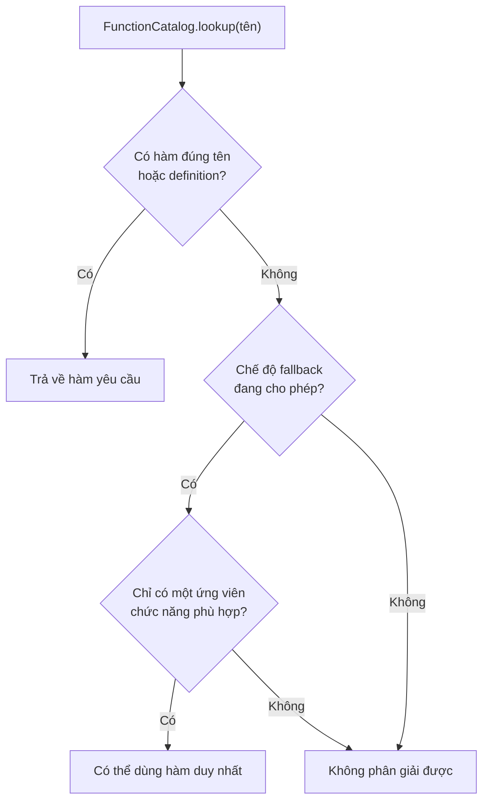
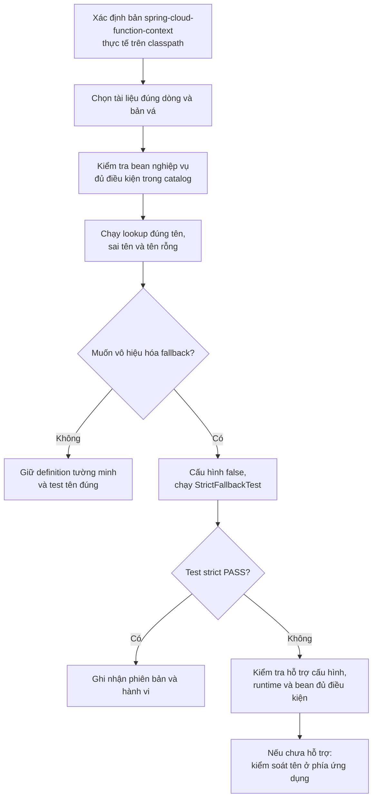

# Đối chiếu chế độ tra cứu dự phòng khi chỉ có một hàm theo phiên bản

**Chương:** FunctionCatalog  
**Module:** Spring Cloud Function (`SPRING_CLOUD_FUNCTION`)

Spring Cloud Function giúp tách logic nghiệp vụ thành `Supplier`, `Function` và `Consumer` để tái sử dụng qua lời gọi Java, HTTP, sự kiện hoặc môi trường serverless. `FunctionCatalog` cung cấp điểm tra cứu các hàm này theo tên. Một hành vi đặc biệt của catalog là **single-function fallback**: nếu chỉ có một hàm đủ điều kiện, việc tra cứu bằng tên rỗng hoặc tên không trùng có thể vẫn trả về hàm đó.

**Vấn đề cần giải quyết:** quy tắc fallback đã được tài liệu hóa trong nhiều dòng Spring Cloud Function, nhưng **khả năng tắt fallback bằng cấu hình phải được đối chiếu với phiên bản cụ thể**. Việc một thuộc tính xuất hiện trong tài liệu mới không có nghĩa bản cũ cũng hiểu thuộc tính ấy.

Bài học tập trung vào cách đọc tài liệu theo phiên bản, xác minh hành vi chạy thực tế và viết mã không vô tình phụ thuộc vào fallback. Đây là kiến thức quan trọng khi nâng cấp ứng dụng từ một hàm sang nhiều hàm, hoặc khi adapter như Spring Cloud Stream cần chọn đúng hàm xử lý.

Sau bài học, bạn có thể:

1. Giải thích điều kiện và tác động của single-function fallback.
2. Phân biệt **quy tắc đã được tài liệu hóa** với **khả năng cấu hình được xác minh** ở từng phiên bản.
3. Thiết kế phép thử kiểm chứng lookup theo tên đúng, tên sai và tên rỗng.
4. Kiểm tra tác dụng thực tế của `spring.cloud.function.single-function-fallback-enabled=false`.
5. Viết đường tra cứu nghiêm ngặt hoạt động ngay cả khi phiên bản đang dùng chưa hỗ trợ công tắc tắt fallback.

## 1. Single-function fallback là gì?

Trong ứng dụng Spring, các functional bean thường là:

| Loại | Chữ ký | Ví dụ |
| --- | --- | --- |
| `Supplier<O>` | `O get()` | Cung cấp mã đơn hàng |
| `Function<I, O>` | `O apply(I input)` | Chuẩn hóa mã |
| `Consumer<I>` | `void accept(I input)` | Ghi nhận một sự kiện |

Giả sử ứng dụng chỉ có một bean chức năng:

```java
@Bean
public Function<String, String> normalizeOrderCode() {
    return value -> value.trim().toUpperCase(Locale.ROOT);
}
```

Hàm được Spring đăng ký với tên `normalizeOrderCode`. Trong trường hợp fallback được bật, các lời gọi sau **có thể cùng phân giải về hàm duy nhất**:

```java
Function<String, String> byExactName =
    catalog.lookup(Function.class, "normalizeOrderCode");

Function<String, String> byEmptyName =
    catalog.lookup(Function.class, "");

Function<String, String> byMissingName =
    catalog.lookup(Function.class, "notRegistered");

Function<String, String> byNullName =
    catalog.lookup(Function.class, (String) null);
```

Trong ví dụ này, `catalog` là `FunctionCatalog` do Spring tiêm. Việc ép `(String) null` làm rõ overload nhận tên/definition.

Khi `byMissingName` khác `null`, **không được kết luận** rằng có một Spring bean tên `notRegistered`. Framework có thể đã chọn hàm duy nhất làm phương án dự phòng.

Vì thế, fallback là **quy tắc chọn hàm khi thiếu thông tin**, không phải cơ chế tạo alias hay đăng ký tên mới.

### 1.1. Điều kiện “chỉ một hàm” cần hiểu chính xác

“Một hàm” chỉ nói về các **ứng viên chức năng đủ điều kiện trong catalog**, không phải toàn bộ số bean của `ApplicationContext`. Một ứng dụng có hàng trăm service, repository và bean cấu hình vẫn có thể chỉ có một `Function` nghiệp vụ được catalog nhận diện.

Ngược lại, một `Function` và một `Consumer` thường là **hai** functional bean, dù mỗi nhóm giao diện chỉ xuất hiện một lần.

Hệ thống có thể còn có hàm hạ tầng như `functionRouter`. Bản cài đặt catalog có quy tắc nhận diện/lọc các hàm đặc biệt; vì vậy không suy số hàm đủ điều kiện chỉ bằng việc đếm tất cả tên mà `getNames(null)` trả về.

### 1.2. Phân biệt fallback với tra cứu chính xác



Sơ đồ mô tả nguyên tắc. Chi tiết xử lý tên, cấu hình hệ thống, hàm hạ tầng và composition có thể khác theo bản phát hành; kết quả thực tế luôn cần được kiểm chứng với artifact mà ứng dụng đang chạy.

## 2. Vì sao phải đối chiếu theo phiên bản?

Một dự án dùng Spring Cloud Function 4.x có thể đọc một hướng dẫn trực tuyến được cập nhật cho 5.x. Nếu sao chép ngay cấu hình `single-function-fallback-enabled=false` mà phiên bản của dự án **chưa xác nhận hỗ trợ**, ứng dụng có thể tiếp tục fallback mặc dù file cấu hình đã có thuộc tính. Không nên xem sự hiện diện của dòng YAML là bằng chứng rằng hành vi lookup đã thay đổi.

Để so sánh, phải giữ ba yếu tố riêng biệt:

1. **Phiên bản thực tế của dependency** `spring-cloud-function-context` trong runtime, không chỉ phiên bản Spring Boot hoặc Spring Cloud BOM dự định sử dụng.
2. **Hành vi mặc định** của lookup khi chỉ có một functional bean.
3. **Khả năng vô hiệu hóa fallback**, nếu phiên bản đó hỗ trợ, cùng phép thử chứng minh cấu hình có tác dụng.

### 2.1. Bảng đối chiếu tài liệu chính thức

Bảng sau đối chiếu những **bản tài liệu tham khảo đã kiểm tra**. “Chưa nêu” nghĩa là trong mục *Function definition* của tài liệu ở nhánh đó **không ghi rõ công tắc này**; nó **không chứng minh** rằng mọi artifact thuộc dòng phiên bản đều thiếu tính năng.

| Tài liệu phiên bản | Fallback khi chỉ một hàm | Thuộc tính tắt fallback trong mục Function definition | Kết luận an toàn |
| --- | --- | --- | --- |
| `4.0.4` | Có mô tả lookup bằng tên rỗng hoặc tên khác | Chưa nêu | Kiểm chứng trên artifact đang chạy trước khi dùng tùy chọn cấu hình |
| `4.1.6` | Có mô tả | Chưa nêu | Không tự suy rằng tùy chọn từ tài liệu 5.x đã hỗ trợ |
| `4.2.4` | Có mô tả | Chưa nêu | Xác minh riêng tại bản vá đang sử dụng |
| `4.3.4` | Có mô tả | Chưa nêu | Xác minh riêng tại bản vá đang sử dụng |
| `5.0.6` | Có mô tả | **Có nêu** `single-function-fallback-enabled=false` | Có thể cấu hình và kiểm chứng bằng lookup tên sai |
| `5.1.0` | Có mô tả | **Có nêu** thuộc tính trên | Có thể cấu hình và kiểm chứng bằng lookup tên sai |

**Nguồn đối chiếu:** [Spring Cloud Function 4.0.4](https://docs.spring.io/spring-cloud-function/docs/4.0.4/reference/html/spring-cloud-function.html), [4.1](https://docs.spring.io/spring-cloud-function/reference/4.1/spring-cloud-function/programming-model.html), [4.2](https://docs.spring.io/spring-cloud-function/reference/4.2/spring-cloud-function/programming-model.html), [4.3](https://docs.spring.io/spring-cloud-function/reference/4.3/spring-cloud-function/programming-model.html), [5.0](https://docs.spring.io/spring-cloud-function/reference/5.0/spring-cloud-function/programming-model.html) và [5.1](https://docs.spring.io/spring-cloud-function/reference/5.1/spring-cloud-function/programming-model.html).

Các trang theo nhánh có thể cập nhật tới bản vá mới hơn theo thời gian. Vì vậy, bảng này là **đối chiếu tài liệu cho các bản được ghi ở cột trái**, không phải lời khẳng định về *mọi* bản vá của một dòng.

### 2.2. Bối cảnh xuất hiện nhu cầu tắt fallback

Một vấn đề được báo cáo tại dự án Spring Cloud Function vào **19/05/2026**, [issue #1391](https://github.com/spring-cloud/spring-cloud-function/issues/1391), mô tả việc một ứng dụng Spring Cloud Stream đăng ký nhầm hàm xử lý lỗi: khi catalog chỉ có một hàm, lookup một tên không tồn tại lại trả về hàm duy nhất. Điều này che khuất lỗi cấu hình thay vì báo thiếu hàm.

Vấn đề đó minh họa lý do cần chế độ tra cứu nghiêm ngặt. Tuy nhiên, ngày mở issue **không tự nó xác định** bản vá đầu tiên có thuộc tính cấu hình. Muốn xác định chính xác bản nào có tùy chọn, cần xem mã nguồn/tag hoặc thử trên dependency của bản đó.

### 2.3. Đừng suy phiên bản Function từ tên “Spring Cloud”

Spring Cloud là một tập hợp dự án dùng release train/BOM. Spring Cloud Function có **artifact version riêng**. Cần kiểm tra resolved dependency của:

```text
org.springframework.cloud:spring-cloud-function-context
```

Với Maven, có thể đọc cây dependency:

```bash
mvn dependency:tree -Dincludes=org.springframework.cloud:spring-cloud-function-context
```

Với Gradle:

```bash
./gradlew dependencyInsight --dependency spring-cloud-function-context --configuration runtimeClasspath
```

Chạy lệnh phù hợp trong dự án thực tế, đọc phiên bản đã phân giải, rồi chọn đúng tài liệu phiên bản đó. Nếu ứng dụng có nhiều module, hãy kiểm tra module chạy ứng dụng và classpath của môi trường được triển khai.

## 3. Ma trận hành vi cần kiểm chứng

Giả sử `normalizeOrderCode` là functional bean duy nhất, và `addPrefix` chỉ xuất hiện ở chế độ nhiều hàm. Các kết quả sau là **kỳ vọng kiểm thử**:

| Lời gọi | Một hàm, fallback bật | Một hàm, fallback đã tắt **và được phiên bản hỗ trợ** | Hai hàm |
| --- | --- | --- | --- |
| `lookup("normalizeOrderCode")` | Hàm `normalizeOrderCode` | Hàm `normalizeOrderCode` | Hàm `normalizeOrderCode` |
| `lookup("")` | Có thể trả về hàm duy nhất | Không được tự chọn vì tên rỗng | Không có lựa chọn mặc định đáng tin cậy |
| `lookup((String) null)` | Có thể trả về hàm duy nhất | Không được tự chọn vì tên rỗng | Không có lựa chọn mặc định đáng tin cậy |
| `lookup("notRegistered")` | Có thể trả về hàm duy nhất | Không phân giải được tên sai | Không phân giải được tên sai |
| `lookup("addPrefix")` | Có thể trả về hàm duy nhất dù bean không tồn tại | Không phân giải được nếu bean chưa đăng ký | Tìm được đúng `addPrefix` |

Ở đây “không phân giải được” thường được thể hiện bằng `null` khi lookup không tìm thấy; những đường đi có validation hoặc adapter riêng còn có thể ném ngoại lệ. Vì thế, ví dụ kiểm thử phải kiểm tra kết quả và xử lý lỗi tương ứng, không gọi `apply(...)` trực tiếp trên kết quả chưa kiểm tra.

**Không dùng tên sai để chứng minh bean đã tồn tại.** Khi fallback bật, `lookup("notRegistered") != null` không đủ để khẳng định có bean tên `notRegistered`. Hãy dùng `getNames(...)`, tên bean đã khai báo và một lookup đúng tên.

## 4. Ví dụ Spring Boot có thể chuyển giữa một và hai hàm

Ví dụ dưới đây cho phép so sánh các chế độ với cùng mã nguồn. Nó yêu cầu Spring Boot và Spring Cloud Function context tương thích với nhau; chưa cần HTTP adapter hay message broker.

### 4.1. Cấu hình ứng dụng và functional bean

```java
import java.util.Locale;
import java.util.Set;
import java.util.function.Function;

import org.springframework.boot.ApplicationRunner;
import org.springframework.boot.SpringApplication;
import org.springframework.boot.autoconfigure.SpringBootApplication;
import org.springframework.cloud.function.context.FunctionCatalog;
import org.springframework.context.annotation.Bean;
import org.springframework.context.annotation.Profile;

@SpringBootApplication
public class VersionedFallbackApplication {

    public static void main(String[] args) {
        SpringApplication.run(VersionedFallbackApplication.class, args);
    }

    @Bean("normalizeOrderCode")
    public Function<String, String> normalizeOrderCode() {
        return input -> input.trim().toUpperCase(Locale.ROOT);
    }

    @Bean("addPrefix")
    @Profile("many")
    public Function<String, String> addPrefix() {
        return input -> "ID-" + input;
    }

    @Bean
    public ApplicationRunner inspect(FunctionCatalog catalog) {
        return args -> {
            Set<String> names = catalog.getNames(Function.class);
            System.out.println("Function names: " + names);

            check(catalog, "normalizeOrderCode");
            check(catalog, "notRegistered");
            check(catalog, "");
        };
    }

    private static void check(FunctionCatalog catalog, String name) {
        Function<String, String> function =
            catalog.lookup(Function.class, name);

        System.out.println(
            "lookup('" + name + "') found: " + (function != null));

        if (function != null) {
            System.out.println(
                "result: " + function.apply("  ord-42  "));
        }
    }
}
```

**Lưu ý:** mã minh họa có chủ đích gọi lookup với tên sai để quan sát fallback. Trong ứng dụng nghiệp vụ, bạn nên kiểm tra tên trước khi cho phép thực thi hàm.

### 4.2. Ba cấu hình chạy thử

**Trường hợp A — một hàm, cấu hình mặc định:**

```properties
# Không kích hoạt profile many
# Không đặt single-function-fallback-enabled
```

Khi đó `normalizeOrderCode` là bean nghiệp vụ duy nhất. Ở các phiên bản tài liệu mô tả fallback, tên sai hoặc rỗng có thể vẫn trả về hàm đó.

**Trường hợp B — hai hàm:**

```properties
spring.profiles.active=many
```

Catalog có `normalizeOrderCode` và `addPrefix`. Tên sai không thể dùng làm cách chọn một trong hai hàm. Hãy tra cứu `normalizeOrderCode` hoặc `addPrefix` bằng tên đúng.

**Trường hợp C — một hàm, yêu cầu tên nghiêm ngặt:**

```properties
spring.cloud.function.single-function-fallback-enabled=false
```

Chỉ áp dụng kỳ vọng “tên sai không phân giải” **sau khi xác nhận phiên bản hỗ trợ thuộc tính này**. Nếu bản cũ bỏ qua thuộc tính, đầu ra vẫn có thể giống trường hợp A. Khi đó lỗi nằm ở giả định về tính tương thích, không phải ở bean `normalizeOrderCode`.

### 4.3. Các tiêu chí quan sát

Khi chạy mỗi cấu hình, ghi nhận:

1. Phiên bản `spring-cloud-function-context` thực tế.
2. Tên trong `catalog.getNames(Function.class)`.
3. `lookup("normalizeOrderCode")` có trả kết quả đúng hay không.
4. `lookup("notRegistered")` có trả `null`, trả hàm khác hay ném lỗi không.
5. Kết quả của `lookup("")` và ảnh hưởng của profile `many`.

Không kết luận từ một lần chạy trên phiên bản khác rằng phiên bản hiện tại sẽ có cùng hành vi. Khi nâng cấp, hãy lặp lại cùng ma trận để phát hiện thay đổi.

## 5. Kiểm thử JUnit xác nhận hỗ trợ fallback theo phiên bản

Có thể dùng Spring Boot Test và JUnit 5 để biến việc so sánh thành các phép kiểm tra lặp lại được. Ba lớp kiểm thử dưới đây là **ba tệp Java riêng** cùng package với `VersionedFallbackApplication`.

### 5.1. Fallback mặc định khi chỉ có một hàm

```java
import static org.junit.jupiter.api.Assertions.*;

import java.util.function.Function;
import org.junit.jupiter.api.Test;
import org.springframework.beans.factory.annotation.Autowired;
import org.springframework.boot.test.context.SpringBootTest;
import org.springframework.cloud.function.context.FunctionCatalog;

@SpringBootTest(classes = VersionedFallbackApplication.class)
class DefaultFallbackTest {

    @Autowired
    FunctionCatalog catalog;

    @Test
    void missingNameMayResolveToOnlyBusinessFunction() {
        assertTrue(catalog.getNames(Function.class)
                .contains("normalizeOrderCode"));

        Function<String, String> correct =
            catalog.lookup(Function.class, "normalizeOrderCode");
        Function<String, String> missing =
            catalog.lookup(Function.class, "notRegistered");

        assertNotNull(correct);
        assertNotNull(missing);
        assertEquals("ORD-42", missing.apply("  ord-42  "));
    }
}
```

Test minh họa hành vi fallback đã được tài liệu hóa. Nếu trong runtime có functional bean nghiệp vụ khác do cấu hình tự động hoặc thư viện thêm vào, điều kiện “chỉ một hàm đủ điều kiện” không còn được bảo đảm; lúc đó cần điều chỉnh test fixture cho cô lập hơn, chứ không vội kết luận phiên bản đã đổi hành vi.

### 5.2. Kiểm thử thuộc tính tắt fallback

```java
import static org.junit.jupiter.api.Assertions.*;

import java.util.function.Function;
import org.junit.jupiter.api.Test;
import org.springframework.beans.factory.annotation.Autowired;
import org.springframework.boot.test.context.SpringBootTest;
import org.springframework.cloud.function.context.FunctionCatalog;

@SpringBootTest(
    classes = VersionedFallbackApplication.class,
    properties = {
        "spring.cloud.function.single-function-fallback-enabled=false"
    }
)
class StrictFallbackTest {

    @Autowired
    FunctionCatalog catalog;

    @Test
    void rejectsAnUnregisteredName() {
        Function<String, String> correct =
            catalog.lookup(Function.class, "normalizeOrderCode");
        Function<String, String> wrong =
            catalog.lookup(Function.class, "notRegistered");

        assertNotNull(correct);
        assertEquals("ORD-42", correct.apply("  ord-42  "));
        assertNull(wrong);
    }
}
```

**Cách đọc kết quả:** nếu `StrictFallbackTest` thất bại vì `wrong` khác `null` trong khi `DefaultFallbackTest` thành công, một khả năng đáng kiểm tra là phiên bản của Spring Cloud Function chưa áp dụng thuộc tính đó. Cũng cần kiểm tra giá trị cấu hình hiệu lực, cách khởi tạo context và những bean được đăng ký thực tế.

Không xem đoạn test này là bằng chứng tự động cho mọi bản 4.x; nó được viết để **kiểm chứng phiên bản mà dự án đang sử dụng**.

### 5.3. Thêm hàm thứ hai

```java
import static org.junit.jupiter.api.Assertions.*;

import java.util.function.Function;
import org.junit.jupiter.api.Test;
import org.springframework.beans.factory.annotation.Autowired;
import org.springframework.boot.test.context.SpringBootTest;
import org.springframework.cloud.function.context.FunctionCatalog;
import org.springframework.test.context.ActiveProfiles;

@ActiveProfiles("many")
@SpringBootTest(classes = VersionedFallbackApplication.class)
class MultipleFunctionLookupTest {

    @Autowired
    FunctionCatalog catalog;

    @Test
    void requiresSpecificFunctionDefinition() {
        assertTrue(catalog.getNames(Function.class)
                .contains("normalizeOrderCode"));
        assertTrue(catalog.getNames(Function.class)
                .contains("addPrefix"));

        Function<String, String> normalize =
            catalog.lookup(Function.class, "normalizeOrderCode");
        Function<String, String> prefix =
            catalog.lookup(Function.class, "addPrefix");
        Function<String, String> missing =
            catalog.lookup(Function.class, "notRegistered");

        assertNotNull(normalize);
        assertNotNull(prefix);
        assertNull(missing);

        assertEquals("ORD-42", normalize.apply("  ord-42  "));
        assertEquals("ID-ORD-42", prefix.apply("ORD-42"));
    }
}
```

Test này kiểm tra rằng catalog tìm được cả hai tên và một tên không tồn tại không tự ánh xạ đến một trong hai hàm. Điều kiện kiểm thử độc lập với việc có công tắc tắt fallback hay không.

### 5.4. Ma trận test nên lưu lại khi nâng cấp

| Kiểm thử | Điều kiện | Mục tiêu |
| --- | --- | --- |
| `DefaultFallbackTest` | Một hàm, không đặt công tắc | Xác nhận fallback mặc định đang có hiệu lực |
| `StrictFallbackTest` | Một hàm, công tắc bằng `false` | Xác nhận phiên bản có thực sự áp dụng công tắc |
| `MultipleFunctionLookupTest` | Hai hàm, tên rõ ràng | Xác nhận lookup không đoán hàm tùy ý khi có nhiều ứng viên |

Khi chuyển giữa các phiên bản, dùng **cùng dữ liệu đầu vào**, cùng tên bean và cùng ba phép thử. Ghi nhận phiên bản dependency thực tế trong kết quả chạy; một kết quả “PASS” không có phiên bản đi kèm sẽ khó dùng lại về sau.

## 6. Giải pháp tra cứu nghiêm ngặt tương thích cả với bản cũ

Nếu dự án chưa thể nâng cấp hoặc chưa xác nhận hỗ trợ thuộc tính `single-function-fallback-enabled`, bạn vẫn có thể kiểm soát tra cứu trong **mã ứng dụng do bạn sở hữu**. Cách làm là kiểm tra tên yêu cầu thuộc tập cho phép và có mặt trong catalog trước khi gọi `lookup(...)`.

```java
import java.util.Set;
import java.util.function.Function;

import org.springframework.cloud.function.context.FunctionCatalog;

public final class StrictFunctionDispatcher {

    private static final Set<String> ALLOWED_NAMES =
        Set.of("normalizeOrderCode", "addPrefix");

    private final FunctionCatalog catalog;

    public StrictFunctionDispatcher(FunctionCatalog catalog) {
        this.catalog = catalog;
    }

    public String invoke(String requestedName, String input) {
        if (requestedName == null || !ALLOWED_NAMES.contains(requestedName)) {
            throw new IllegalArgumentException(
                "Unsupported function: " + requestedName);
        }

        Set<String> availableNames = catalog.getNames(Function.class);
        if (!availableNames.contains(requestedName)) {
            throw new IllegalStateException(
                "Function is not registered: " + requestedName);
        }

        Function<String, String> function =
            catalog.lookup(Function.class, requestedName);
        if (function == null) {
            throw new IllegalStateException(
                "Lookup failed: " + requestedName);
        }

        return function.apply(input);
    }
}
```

**Vì sao cách này tránh nhầm lẫn?** Với yêu cầu `"notRegistered"`, lớp kiểm tra tên sẽ từ chối trước khi `lookup(...)` có cơ hội sử dụng fallback. Dù catalog chỉ có một bean, mã nghiệp vụ vẫn phải truyền một trong các tên được cho phép và thực sự có trong danh mục.

Giải pháp này chỉ bảo vệ **đường gọi đi qua `StrictFunctionDispatcher`**. Nó không thay đổi hành vi toàn cục của Spring Cloud Function hoặc các adapter độc lập, nên cần cấu hình đúng tên cho HTTP, Stream và serverless adapter.

Đừng biến danh sách mọi tên từ `getNames(null)` thành tập hàm mà người dùng bên ngoài được quyền gọi. Catalog có thể chứa hàm hạ tầng hoặc chức năng nội bộ; quyền truy cập phải được quyết định theo hợp đồng ứng dụng.

## 7. Tác động đến HTTP, sự kiện và serverless

### 7.1. spring.cloud.function.definition

Khi adapter cần chọn một hàm, hãy định danh rõ ràng:

```yaml
spring:
  cloud:
    function:
      definition: normalizeOrderCode
```

Với hai hàm có thể ghép hợp lệ:

```yaml
spring:
  cloud:
    function:
      definition: normalizeOrderCode|addPrefix
```

Thuộc tính `spring.cloud.function.definition` là **hợp đồng chọn hàm hoặc composition** cho ngữ cảnh tích hợp. Nó không tạo ra Spring bean mới và cũng không bảo đảm bản cũ đã có công tắc vô hiệu hóa single-function fallback.

### 7.2. Vì sao adapter cần được kiểm thử riêng?

| Cách gọi | Điều đã được kiểm tra khi thử `FunctionCatalog.lookup` | Điều vẫn phải kiểm tra ở adapter |
| --- | --- | --- |
| Java trực tiếp | Catalog tìm và trả một hàm theo tên/loại | Cách mã ứng dụng kiểm tra tên, xử lý lỗi và kiểu dữ liệu |
| Spring Cloud Function Web | Hàm tồn tại trong catalog | Dependency Web, đường dẫn, method HTTP và quy tắc export |
| Spring Cloud Stream | Có hàm tương ứng với definition | Binding, binder, tên kênh và lựa chọn function definition |
| Serverless | Hàm có thể được catalog tìm thấy | Adapter cloud, entry point, event mapping và cấu hình deploy |

Tài liệu Spring Cloud Function khuyến nghị đặt `spring.cloud.function.definition` tường minh khi tích hợp Spring Cloud Stream, kể cả khi hiện tại chỉ có một hàm. Khi thêm hàm thứ hai, cấu hình đã có tên rõ ràng nên ít phụ thuộc vào cơ chế đoán mặc định.

**Không đồng nhất các thuộc tính:** `spring.cloud.stream.function.autodetect` của Spring Cloud Stream phục vụ auto-detection/auto-binding trong Stream; nó **khác** `spring.cloud.function.single-function-fallback-enabled` của Spring Cloud Function. Tắt autodetect của Stream không phải bằng chứng rằng lookup trong `FunctionCatalog` đã chuyển sang chế độ nghiêm ngặt.

### 7.3. Một tình huống lỗi theo phiên bản

Giả sử môi trường cũ có một hàm `normalizeOrderCode`. Một thành phần adapter lại cấu hình sai tên thành `normalizeOderCode` (thiếu chữ `r`). Nếu fallback đang bật, lookup có thể trả về `normalizeOrderCode` và che giấu lỗi.

Khi nâng cấp hoặc thêm chức năng:

1. Catalog có thể xuất hiện thêm ứng viên, nên lookup tên sai không còn được cứu bằng fallback.
2. Hoặc đội ngũ bật công tắc tắt fallback ở phiên bản mới, khiến lỗi tên sai bộc lộ ngay.
3. Trong cả hai trường hợp, cần sửa cấu hình thành **tên bean thực**: `normalizeOrderCode`.

Không nên giải quyết bằng cách tạo thêm một bean alias không cần thiết chỉ để giữ một tên sai trong cấu hình. Hãy sửa hợp đồng tên giữa bean và adapter, sau đó bổ sung test.

## 8. Quy trình xác minh trước và sau nâng cấp



Quy trình thực tế:

1. Xem resolved dependency, tránh suy phiên bản từ parent POM hoặc thông báo của framework khác.
2. Liệt kê `catalog.getNames(null)` và `catalog.getNames(Function.class)`.
3. Đảm bảo fixture chỉ có một functional bean khi kiểm tra fallback mặc định.
4. Gọi tên đúng, tên sai và tên rỗng, ghi nhận rõ `null`/khác `null`/ngoại lệ.
5. Nếu muốn cấu hình strict, đặt thuộc tính theo tài liệu bản đang dùng và chạy lại trên context mới.
6. Kiểm thử adapter liên quan với `spring.cloud.function.definition` tường minh.
7. Lưu kết quả cùng phiên bản artifact để đối chiếu sau lần cập nhật tiếp theo.

### 8.1. Những lỗi suy luận phổ biến

| Kết luận vội vàng | Vấn đề | Cách kiểm chứng |
| --- | --- | --- |
| “Có dòng YAML thì chắc chắn fallback đã tắt.” | Bản cũ có thể không hỗ trợ thuộc tính hoặc cấu hình không được áp dụng | Chạy `StrictFallbackTest` trên phiên bản đang dùng |
| “Lookup tên sai vẫn trả hàm, vậy tên đó tồn tại.” | Có thể chỉ là fallback về hàm duy nhất | Đối chiếu `getNames(null)` và tên bean thực |
| “Chỉ có một Function nên catalog chỉ có một hàm.” | Có thể có thêm `Supplier` hoặc `Consumer` đủ điều kiện | Xem cả ba nhóm functional interface |
| “Bản 4.x nào cũng giống 5.x.” | Các bản khác nhau về tính năng và tài liệu cấu hình | Kiểm tra bản vá cụ thể, thử hành vi |
| “getNames có thêm functionRouter nên fallback chắc chắn tắt.” | Hàm router hạ tầng có thể được xử lý đặc biệt | Đọc quy tắc của bản đang dùng và kiểm tra thực tế |
| “Tắt autodetect của Stream sẽ tắt lookup fallback.” | Đây là hai thành phần/cấu hình khác nhau | Kiểm thử riêng `FunctionCatalog.lookup` |
| “Test unit qua Java đã đủ chứng minh HTTP hoạt động.” | HTTP adapter còn yêu cầu mapping/export riêng | Kiểm thử tích hợp HTTP/Stream/serverless tương ứng |

## 9. Bài tập thực hành

**Bài 1 — Thiết lập mốc tham chiếu:** dùng `VersionedFallbackApplication` khi không bật profile `many`. Chạy các lookup với `normalizeOrderCode`, `notRegistered` và tên rỗng. Ghi lại tên từ `getNames(null)` và giải thích vì sao một tên không có trong danh mục vẫn có thể cho kết quả.

**Bài 2 — Đối chiếu hai phiên bản:** chọn hai bản Spring Cloud Function mà môi trường học tập hỗ trợ. Chạy `DefaultFallbackTest` và `StrictFallbackTest` trên từng bản, ghi rõ artifact version và trạng thái PASS/FAIL. Nếu test strict thất bại, không tự kết luận nguyên nhân trước khi kiểm tra cấu hình và các bean đủ điều kiện.

**Bài 3 — Tác động khi thêm hàm:** bật profile `many`, chạy `MultipleFunctionLookupTest`. Thử gọi `lookup("notRegistered")` rồi sửa thành `lookup("addPrefix")`. So sánh với môi trường chỉ có một hàm.

**Bài 4 — Bảo vệ mã nghiệp vụ:** dùng `StrictFunctionDispatcher`. Thử ba tên `normalizeOrderCode`, `addPrefix` và `notRegistered` khi có và khi không có profile `many`. Vì sao đường gọi qua dispatcher giữ được quy tắc kiểm soát tên ngay cả khi fallback mặc định bật?

**Bài 5 — Adapter:** bổ sung `spring.cloud.function.definition=normalizeOrderCode` cho cấu hình tích hợp đang dùng. Sau đó thêm bean `addPrefix` và kiểm tra adapter có vẫn chọn đúng `normalizeOrderCode` không.

### Câu hỏi tự kiểm tra

1. “Fallback được mô tả trong tài liệu 4.2” có chứng minh bản 4.2 đang dùng hiểu `single-function-fallback-enabled=false` không? **Không**. Đây là hai khẳng định khác nhau, cần kiểm chứng riêng.
2. Cần làm gì nếu muốn strict lookup trên một phiên bản chưa được xác nhận có công tắc? **Kiểm tra tên với allowlist và `getNames(...)` trước lookup trong mã ứng dụng; tiếp tục cấu hình adapter theo tên rõ ràng.**
3. Vì sao phải kiểm thử lại sau khi thêm bean `Consumer`? Vì số ứng viên chức năng có thể thay đổi, làm thay đổi điều kiện áp dụng fallback.
4. `spring.cloud.function.definition` giải quyết vấn đề gì? Nó xác định hàm/composition để adapter sử dụng; không trực tiếp đăng ký bean và không thay thế kiểm chứng hỗ trợ công tắc fallback.

## 10. Ghi nhớ

- **Hành vi fallback khi chỉ có một hàm** được mô tả ở nhiều tài liệu Spring Cloud Function: lookup tên rỗng hoặc sai có thể trả về hàm duy nhất.
- **Khả năng tắt fallback cần so sánh theo phiên bản:** tài liệu chính thức 5.0.6 và 5.1.0 nêu `spring.cloud.function.single-function-fallback-enabled=false`; tài liệu 4.0–4.3 được đối chiếu ở trên chưa nêu công tắc trong mục tương ứng.
- **“Chưa được ghi trong tài liệu” không đồng nghĩa “chắc chắn không có trong mã”.** Dùng phiên bản artifact đã phân giải và integration test để kết luận.
- Khi chọn hàm cho HTTP, Stream và serverless adapter, hãy cấu hình tên/definition rõ ràng để ổn định khi ứng dụng tăng từ một lên nhiều functional bean.
- Khi cần tra cứu nghiêm ngặt nhưng chưa chắc phiên bản hỗ trợ công tắc, hãy xác nhận tên qua danh sách cho phép và catalog trước khi gọi `lookup(...)` trong mã bạn kiểm soát.

### Tài liệu tham khảo

- [Spring Cloud Function 4.0.4 — Function definition](https://docs.spring.io/spring-cloud-function/docs/4.0.4/reference/html/spring-cloud-function.html).
- [Spring Cloud Function 4.1 — Programming model](https://docs.spring.io/spring-cloud-function/reference/4.1/spring-cloud-function/programming-model.html).
- [Spring Cloud Function 4.2 — Programming model](https://docs.spring.io/spring-cloud-function/reference/4.2/spring-cloud-function/programming-model.html).
- [Spring Cloud Function 4.3 — Programming model](https://docs.spring.io/spring-cloud-function/reference/4.3/spring-cloud-function/programming-model.html).
- [Spring Cloud Function 5.0 — Programming model](https://docs.spring.io/spring-cloud-function/reference/5.0/spring-cloud-function/programming-model.html).
- [Spring Cloud Function 5.1 — Programming model](https://docs.spring.io/spring-cloud-function/reference/5.1/spring-cloud-function/programming-model.html).
- [Spring Cloud Function issue #1391 — yêu cầu có cấu hình tắt single-function fallback](https://github.com/spring-cloud/spring-cloud-function/issues/1391).
