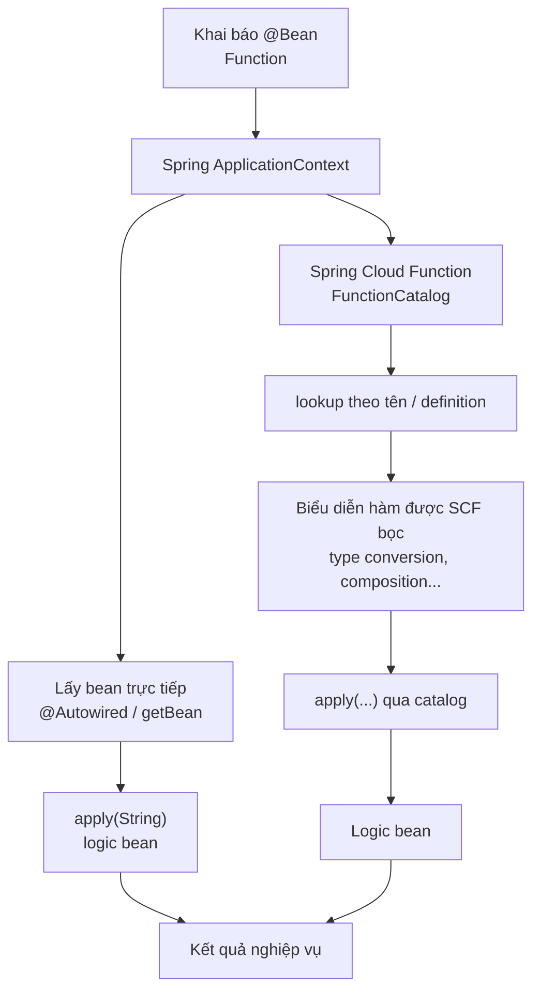
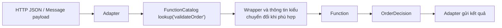
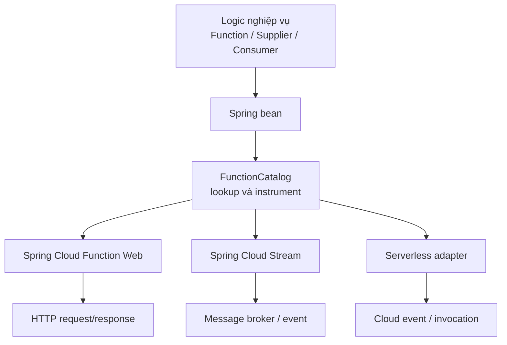

# Phân biệt gọi bean trực tiếp với gọi qua FunctionCatalog

**Chương:** FunctionCatalog  
**Module:** Spring Cloud Function (`SPRING_CLOUD_FUNCTION`)

Spring Cloud Function cho phép viết logic nghiệp vụ dưới dạng `Supplier`, `Function` và `Consumer`, rồi tái sử dụng cùng logic qua mã Java, HTTP, hệ thống sự kiện hoặc môi trường serverless. Khi các hàm này là bean của Spring, chúng có thể được gọi theo **hai đường**: lấy trực tiếp từ Spring `ApplicationContext`, hoặc tra cứu qua **`FunctionCatalog`**.

Hai đường gọi có thể tạo ra **cùng kết quả nghiệp vụ** với một đầu vào đơn giản, nhưng không tương đương về chức năng của framework. Theo tài liệu chính thức, lấy bean trực tiếp cho bạn bean đã khai báo; lookup qua catalog cho bạn biểu diễn hàm được Spring Cloud Function **bọc (instrumented/wrapped)** để cung cấp thêm các khả năng như chuyển đổi kiểu và composition.

Sau bài học, bạn có thể:

1. Phân biệt **Spring bean** với **hàm được FunctionCatalog quản lý**.
2. So sánh kết quả, cách tra cứu, kiểu dữ liệu, composition và cơ chế lỗi giữa hai đường gọi.
3. Xác định trường hợp nên dùng dependency injection trực tiếp và trường hợp nên dùng `FunctionCatalog`.
4. Hiểu vai trò của catalog trong đường đi HTTP, Spring Cloud Stream và serverless.
5. Viết mã và kiểm thử thể hiện sự khác nhau mà không phụ thuộc vào lớp nội bộ của framework.

## 1. Hai đường gọi từ cùng một functional bean

Giả sử ứng dụng khai báo:

```java
@Bean("normalizeOrderCode")
public Function<String, String> normalizeOrderCode() {
    return value -> value.trim().toUpperCase(Locale.ROOT);
}
```

Hàm Java này nhận một `String` và trả `String` đã chuẩn hóa. Sau khi Spring quản lý nó làm bean, bạn có thể:

**Cách A — lấy bean trực tiếp:**

```java
import java.util.function.Function;
import org.springframework.beans.factory.annotation.Qualifier;
import org.springframework.stereotype.Component;

@Component
public class DirectCaller {
    private final Function<String, String> direct;

    public DirectCaller(
            @Qualifier("normalizeOrderCode")
            Function<String, String> direct) {
        this.direct = direct;
    }

    public String normalize(String input) {
        return direct.apply(input);
    }
}

// Ví dụ gọi: directCaller.normalize("  ord-42  ") trả ORD-42.
```

**Cách B — tra cứu qua catalog:**

```java
Function<String, String> viaCatalog =
    catalog.lookup(Function.class, "normalizeOrderCode");

if (viaCatalog == null) {
    throw new IllegalStateException("Function not found");
}

String output = viaCatalog.apply("  ord-42  "); // ORD-42
```

Ở ví dụ này, cả hai đều tạo ra `ORD-42` vì đầu vào đã đúng kiểu `String`, và bản thân logic chỉ là `trim` và `toUpperCase`. **Việc hai kết quả giống nhau không có nghĩa hai đường gọi có cùng các tính năng.**



Sơ đồ là mô hình khái niệm. Bean do Spring cung cấp trực tiếp vẫn có thể đi qua những proxy thông thường của Spring như AOP; điều được phân biệt ở đây là **lớp xử lý bổ sung riêng của Spring Cloud Function khi lookup qua catalog**.

## 2. ApplicationContext và FunctionCatalog phục vụ mục đích khác nhau

`ApplicationContext` quản lý tất cả các loại Spring bean: service, repository, configuration, HTTP controller và functional bean. Nó cho phép dependency injection, quản lý vòng đời, scope và các khả năng thông thường của Spring.

`FunctionCatalog` tập trung vào **functional bean** và function definition, nhằm giúp nhiều môi trường gọi chung một mô hình hàm. Theo tài liệu Spring Cloud Function, các `Supplier`, `Function` và `Consumer` đủ điều kiện được nhận diện từ context và có thể được đăng ký/bọc theo nhu cầu khi tra cứu.

| Tiêu chí | Gọi bean trực tiếp | Gọi qua `FunctionCatalog` |
| --- | --- | --- |
| Điểm truy cập | `@Autowired`, constructor injection, `ApplicationContext.getBean(...)` | `catalog.lookup(...)` |
| Đối tượng trả về | Bean được Spring cung cấp theo khai báo, có thể có Spring proxy | Biểu diễn hàm được Spring Cloud Function bọc |
| Chọn hàm | Qua tên/loại bean của Spring hoặc tiêm có `@Qualifier` | Qua tên hàm hoặc *function definition* |
| Gọi nghiệp vụ | `get()`, `apply(...)`, `accept(...)` | Cũng dùng các phương thức chức năng tương ứng |
| Chuyển đổi kiểu do Spring Cloud Function | Không tự có chỉ vì gọi bean trực tiếp | Có thể được áp dụng bởi wrapper khi kiểu/metadata phù hợp |
| Composition theo định nghĩa `a|b` | Tự viết mã ghép bằng Java | Catalog có thể phân giải composition |
| Phục vụ adapter HTTP/Stream/serverless | Adapter muốn dùng các khả năng SCF phải tự tạo đường tích hợp thích hợp | Đây là đường tiêu chuẩn để adapter tra cứu/instrument hàm |
| Phụ thuộc chính | Spring bean và hợp đồng Java | Spring Cloud Function context, catalog và hợp đồng hàm |

**Không nhầm:** `FunctionCatalog` không thay thế toàn bộ `ApplicationContext`. Catalog sử dụng khả năng quản lý bean của Spring, rồi bổ sung cách tra cứu và xử lý dành cho hàm. Cũng không nên kết luận rằng mọi lời gọi qua catalog đều tạo phép chuyển đổi dữ liệu; nếu đầu vào đã đúng kiểu và không có composition, hành vi có thể gần giống gọi trực tiếp.

## 3. Ví dụ Spring Boot: hai đường gọi trong cùng ứng dụng

Ví dụ sau là một ứng dụng độc lập. Giả sử dự án đã dùng Spring Boot và dependency Spring Cloud Function context tương thích, chưa cần HTTP adapter hay message broker.

```java
import java.util.Locale;
import java.util.function.Function;

import org.springframework.beans.factory.annotation.Qualifier;
import org.springframework.boot.ApplicationRunner;
import org.springframework.boot.SpringApplication;
import org.springframework.boot.autoconfigure.SpringBootApplication;
import org.springframework.cloud.function.context.FunctionCatalog;
import org.springframework.context.annotation.Bean;

@SpringBootApplication
public class DirectVsCatalogApplication {

    public static void main(String[] args) {
        SpringApplication.run(DirectVsCatalogApplication.class, args);
    }

    @Bean("normalizeOrderCode")
    public Function<String, String> normalizeOrderCode() {
        return value -> value.trim().toUpperCase(Locale.ROOT);
    }

    @Bean("addPrefix")
    public Function<String, String> addPrefix() {
        return value -> "ID-" + value;
    }

    @Bean
    public ApplicationRunner compareCalls(
            @Qualifier("normalizeOrderCode")
            Function<String, String> direct,
            FunctionCatalog catalog) {
        return args -> {
            String input = "  ord-42  ";

            String directResult = direct.apply(input);

            Function<String, String> catalogFunction =
                catalog.lookup(Function.class, "normalizeOrderCode");
            if (catalogFunction == null) {
                throw new IllegalStateException(
                    "Missing normalizeOrderCode");
            }

            String catalogResult = catalogFunction.apply(input);

            System.out.println("Direct:  " + directResult);
            System.out.println("Catalog: " + catalogResult);
            // Cả hai in ORD-42 với input String.
        };
    }
}
```

Phân tích:

- Tham số `direct` được Spring tiêm bằng `@Qualifier("normalizeOrderCode")`, tức là dùng bean trực tiếp theo cơ chế injection.
- `FunctionCatalog` cũng được Spring tiêm, nhưng `catalog.lookup(Function.class, "normalizeOrderCode")` thực hiện **tra cứu hàm qua Spring Cloud Function**.
- Cả hai được gọi bằng `apply(input)` vì cùng triển khai hợp đồng `Function<String, String>`.
- Có **hai** bean `Function` để không dựa vào single-function fallback. Nếu gõ sai tên, catalog không nên tự đoán tên nghiệp vụ mong muốn.

### 3.1. Lấy bean trực tiếp bằng ApplicationContext

Ngoài việc inject với `@Qualifier`, mã có thể lấy bean theo tên:

```java
// Giả sử đã được tiêm ApplicationContext context.
Function<?, ?> bean =
    context.getBean("normalizeOrderCode", Function.class);
```

`Function<?, ?>` nhắc rằng khi chỉ truy vấn bằng `Function.class`, Java không kiểm chứng `String` là kiểu tham số và kiểu trả về. Với mã ứng dụng có hợp đồng rõ ràng, constructor injection với `@Qualifier` và kiểu generic đầy đủ thường dễ đọc hơn.

Ví dụ `getBean(...)` yêu cầu bean tồn tại trong Spring context và phù hợp loại được yêu cầu; nếu thiếu, Spring thường ném ngoại lệ như `NoSuchBeanDefinitionException`. Trong khi đó, catalog có quy tắc lookup và fallback riêng được phân tích ở phần sau.

### 3.2. Có nên so sánh direct == viaCatalog?

**Không.** Spring Cloud Function có thể bọc/instrument bean được tra cứu. Do đó, không được dùng kiểm tra object identity `direct == catalogFunction` như một hợp đồng ổn định. Cũng không nên ép `catalogFunction` về lớp cài đặt cụ thể để gọi thêm phương thức riêng.

Hãy kiểm thử **hợp đồng và kết quả nghiệp vụ**. Nếu cần truy cập API riêng của service bên ngoài `Function`, nên inject service đó theo cơ chế Spring thông thường.

## 4. Khác biệt thực tế nhất: wrapper và chuyển đổi kiểu

Một hàm Java có kiểu cụ thể:

```java
Function<String, String> normalize = value ->
    value.trim().toUpperCase(Locale.ROOT);
```

Khi gọi trực tiếp:

```java
String result = normalize.apply("  ord-42  ");
```

Java yêu cầu bạn cung cấp đầu vào đúng hợp đồng của hàm. Không có lớp chuyển đổi Spring Cloud Function chạy kèm chỉ vì đối tượng là Spring bean.

Trong môi trường HTTP hay sự kiện, đầu vào có thể ban đầu là **byte array**, **message**, JSON hoặc một đối tượng có metadata. Adapter cần giải mã/chuyển dữ liệu thành kiểu mà hàm thực sự chấp nhận. Đó là lúc wrapper và thông tin kiểu do Spring Cloud Function quản lý phát huy tác dụng.

### 4.1. Tách dữ liệu truyền tải khỏi dữ liệu nghiệp vụ

Ví dụ logic nghiệp vụ chỉ nhận DTO:

```java
record OrderRequest(String orderId, long amount) {}
record OrderDecision(String orderId, boolean accepted) {}

@Bean("validateOrder")
public Function<OrderRequest, OrderDecision> validateOrder() {
    return order -> new OrderDecision(
        order.orderId(),
        order.amount() > 0
    );
}
```

**Đường bean trực tiếp:** mã gọi phải tự tạo `OrderRequest` đúng kiểu trước khi gọi `apply(...)`:

```java
OrderRequest request = new OrderRequest("ORD-42", 1500);
OrderDecision decision = directValidator.apply(request);
```

Trong đó `directValidator` là bean `Function<OrderRequest, OrderDecision>` được Spring tiêm.

**Đường catalog/adapters:** adapter có thể nhận request/message, sử dụng thông tin kiểu `OrderRequest` và các bộ chuyển đổi phù hợp rồi gọi wrapper của `validateOrder`. Spring Cloud Function hỗ trợ cơ chế này, nhưng việc chuyển đổi thành công còn phụ thuộc media type, cấu hình converter, payload và phiên bản.



Không nên cho rằng `lookup(...)` tự khởi chạy HTTP server, tự giải mã mọi JSON hoặc tự kết nối broker. Các adapter và dependency tương ứng vẫn là điều kiện cần. Catalog cung cấp mô hình hàm và các khả năng bổ sung cho chúng.

### 4.2. Message và header không phải lúc nào cũng được trả nguyên dạng

Spring Cloud Function có hỗ trợ nhận/trả Spring `Message<?>`, chuyển đổi payload và quản lý header trong những trường hợp được mô hình và adapter hỗ trợ. Một số hàm khai báo trực tiếp `Function<Message<T>, Message<R>>` để dùng header nghiệp vụ, còn hàm kiểu `Function<T, R>` có thể không cần biết tới envelope của message.

Vì vậy, **không ép mọi kết quả từ catalog thành `Message<?>`** và cũng không giả định output luôn là payload thuần. Loại dữ liệu thực tế phụ thuộc chữ ký hàm, kiểu đầu vào, cấu hình và đường gọi.

Ví dụ một bean cần đọc header:

```java
import java.util.function.Function;
import org.springframework.messaging.Message;
import org.springframework.context.annotation.Bean;

@Bean("inspectSource")
public Function<Message<String>, String> inspectSource() {
    return message -> {
        String source = String.valueOf(
            message.getHeaders().getOrDefault("source", "unknown"));
        return source + ":" + message.getPayload();
    };
}
```

Trong ví dụ `inspectSource`, bean **đã tự nhận Message** nên mã Java gọi trực tiếp hoàn toàn có thể truyền một `Message<String>` đã tạo. Lợi ích khác biệt của catalog là wrapper có các khả năng thích ứng với hệ sinh thái Spring Cloud Function; không phải chỉ catalog mới có thể truyền một object `Message` cho hàm Java.

### 4.3. Giữ metadata generic rõ ràng

Chữ ký `@Bean public Function<OrderRequest, OrderDecision> validateOrder()` giúp Spring Cloud Function suy ra kiểu vào/ra. Nếu đăng ký lambda thủ công hoặc dùng raw type `Function` mà không cung cấp thông tin kiểu, conversion có thể không hoạt động theo kỳ vọng.

Khi sử dụng cơ chế đăng ký functional bean của Spring Cloud Function, `FunctionRegistration` có thể gắn metadata kiểu một cách tường minh. Tuy nhiên, đối với ứng dụng Spring Boot dùng `@Bean` với generic cụ thể, thường không cần đăng ký lại chỉ để có catalog lookup.

## 5. Khác biệt thứ hai: composition theo function definition

Giả sử ứng dụng có hai bean:

```java
@Bean("normalizeOrderCode")
public Function<String, String> normalizeOrderCode() {
    return value -> value.trim().toUpperCase(Locale.ROOT);
}

@Bean("addPrefix")
public Function<String, String> addPrefix() {
    return value -> "ID-" + value;
}
```

Nếu lấy trực tiếp hai bean, bạn phải **tự ghép**:

```java
// directNormalize và directAddPrefix là hai bean được inject.
Function<String, String> manual =
    directNormalize.andThen(directAddPrefix);

System.out.println(manual.apply("  ord-42  "));
// ID-ORD-42
```

Qua catalog, bạn có thể mô tả thứ tự bằng **function definition**:

```java
Function<String, String> composed =
    catalog.lookup(
        Function.class, "normalizeOrderCode|addPrefix");

if (composed == null) {
    throw new IllegalStateException("Composition not found");
}

System.out.println(composed.apply("  ord-42  "));
// ID-ORD-42
```

Hai cách đều ghép hàm nhưng **khác điểm cấu hình**:

- Ghép trực tiếp trong Java bằng `andThen(...)` hoặc `compose(...)` cần tham chiếu tới các đối tượng hàm.
- Catalog phân giải chuỗi `normalizeOrderCode|addPrefix` theo tên và áp dụng các quy tắc composition của Spring Cloud Function.
- Cách định nghĩa bằng tên phù hợp với adapter nhận cấu hình `spring.cloud.function.definition`, ví dụ:

```yaml
spring:
  cloud:
    function:
      definition: normalizeOrderCode|addPrefix
```

`spring.cloud.function.definition` không tạo ra Spring bean mới theo tên này; nó **chọn hàm hoặc composition** cho môi trường tích hợp. Composition yêu cầu các phần tử tương thích về kiểu đầu vào/đầu ra, và có quy tắc bổ sung cho `Supplier`, `Consumer` và hàm reactive.

## 6. Khác biệt thứ ba: tra cứu, tên và xử lý lỗi

Gọi trực tiếp từ `ApplicationContext` tuân theo quy tắc lấy bean của Spring. Gọi qua `FunctionCatalog` tuân theo quy tắc function definition của Spring Cloud Function, bao gồm khả năng fallback trong một số cấu hình.

| Tình huống | Spring bean trực tiếp | FunctionCatalog |
| --- | --- | --- |
| Tên bean chính xác | `getBean("normalizeOrderCode")` trả bean tương ứng | `lookup("normalizeOrderCode")` tra cứu hàm theo tên |
| Tên bean không tồn tại | `getBean(...)` thường ném `NoSuchBeanDefinitionException` | Lookup thường không phân giải được; có thể fallback nếu chỉ có một hàm và đang bật |
| Nhiều bean cùng loại | Injection không định danh có thể bị lỗi ambiguity | Dùng tên/definition để chọn rõ hàm |
| Yêu cầu composition `a|b` | Không phải tên bean thông thường; phải tự ghép | Có thể được phân giải thành composition hợp lệ |
| Muốn xem tên ứng viên | `getBeanNamesForType(Function.class)` | `getNames(Function.class)` hoặc `getNames(null)` |

### 6.1. Single-function fallback có thể che giấu tên sai

Spring Cloud Function có cơ chế **single-function fallback**: khi chỉ có một functional bean đủ điều kiện và fallback đang bật, một tên rỗng hoặc sai có thể vẫn được ánh xạ tới hàm duy nhất.

Ví dụ: nếu chỉ có bean `normalizeOrderCode`, `catalog.lookup("normaliseOrderCode")` có thể trả về chính hàm đó. Điều này không có nghĩa Spring đã đăng ký thêm bean với tên sai.

Trong các phiên bản hỗ trợ thuộc tính sau, có thể tắt fallback:

```properties
spring.cloud.function.single-function-fallback-enabled=false
```

Hãy kiểm tra tài liệu đúng phiên bản runtime; nếu bản cũ không hỗ trợ, chỉ có dòng cấu hình chưa đủ chứng minh đã tắt hành vi.

**Điểm thực hành:** nếu cần yêu cầu đúng tên, hãy xác nhận `getNames(Function.class).contains(name)` cùng một danh sách hàm cho phép của ứng dụng trước khi lookup, và luôn kiểm tra kết quả lookup. Đừng dựa vào việc lookup tên sai trả về khác `null`.

### 6.2. Phân biệt getBeanNamesForType và getNames

`ApplicationContext.getBeanNamesForType(Function.class)` hỏi Spring những bean nào có kiểu `Function`. `catalog.getNames(Function.class)` hỏi Spring Cloud Function các tên hàm nào được nhận diện theo loại.

Hai tập **không bắt buộc bằng nhau**: catalog có thể lọc ứng viên, dùng registration riêng hoặc có hàm hạ tầng; BeanFactory có thể có các bean Java `Function` không được định dùng làm functional endpoint.

Một cấu hình ảnh hưởng ứng viên catalog là:

```properties
spring.cloud.function.ineligible-definitions=internalTransform
```

Thuộc tính này dùng để loại ứng viên khỏi catalog theo tên, **không phải** một chính sách phân quyền HTTP. Nếu chức năng không xuất hiện, hãy kiểm tra phạm vi component scanning, tên bean, loại giao diện và cấu hình lọc trước khi sửa logic nghiệp vụ.

## 7. Có nên tự gọi bean trực tiếp trong ứng dụng tích hợp?

Không có quy tắc “mọi lời gọi đều bắt buộc qua catalog”. Lựa chọn hợp lý dựa vào việc bên gọi cần gì.

**Dùng bean trực tiếp khi:**

- Một service trong cùng ứng dụng muốn gọi một hàm Java đã biết rõ kiểu, bằng dependency injection rõ ràng.
- Logic không cần SCF composition hoặc adaptation, và mã gọi đã có dữ liệu đúng kiểu.
- Bạn muốn unit test logic `Function<T, R>` độc lập với Spring Cloud Function bằng cách tạo lambda hoặc đối tượng Java.

**Dùng FunctionCatalog khi:**

- Cần chọn hàm bằng tên, cấu hình hoặc function definition.
- Cần tận dụng lớp bọc của Spring Cloud Function và cách biểu diễn thống nhất cho adapter.
- Cần composition bằng chuỗi định nghĩa.
- Đang viết tích hợp hoặc kiểm thử sát với cách Spring Cloud Stream, Spring Cloud Function Web hay serverless adapter tìm hàm.

Trong kiến trúc thực tế, một ứng dụng có thể dùng cả hai: các service thông thường gọi bean trực tiếp để giữ đơn giản, còn adapter sử dụng catalog để xử lý thông điệp/giao thức và định nghĩa hàm. **Không cần thay thế mọi dependency injection bằng lookup theo chuỗi.**

### 7.1. Catalog và adapter có trách nhiệm khác nhau



Catalog cung cấp một **hợp đồng hàm chung**, trong khi mỗi adapter chịu trách nhiệm cụ thể về đường HTTP, message binding, payload, entry point và cấu hình triển khai. Có hàm trong catalog không đảm bảo tự động xuất endpoint HTTP hoặc binding sự kiện.

### 7.2. Ba giao diện Supplier, Function và Consumer

Cùng nguyên tắc áp dụng cho cả ba loại:

```java
Supplier<String> supplier =
    catalog.lookup(Supplier.class, "newOrderCode");
Function<String, String> function =
    catalog.lookup(Function.class, "normalizeOrderCode");
Consumer<String> consumer =
    catalog.lookup(Consumer.class, "auditOrderCode");
```

Đoạn mã giả định đã có các bean đúng tên, đúng loại và biến `catalog`. Sau khi kiểm tra khác `null`:

- `Supplier` được gọi bằng `get()`.
- `Function` được gọi bằng `apply(input)`.
- `Consumer` được gọi bằng `accept(input)`.

Việc dùng `Supplier.class`, `Function.class` hoặc `Consumer.class` chỉ thể hiện nhóm giao diện; nó **không chứng minh đầy đủ kiểu generic** như `String` hoặc DTO. Metadata kiểu từ chữ ký khai báo vẫn rất quan trọng cho conversion.

## 8. Kiểm thử chứng minh sự tương đồng và khác biệt

Với `DirectVsCatalogApplication` ở mục 3, có thể viết JUnit 5 test sau khi đã khai báo Spring Boot Test phù hợp. Bài kiểm thử này xác minh **cùng kết quả khi nhận String đúng kiểu**, đồng thời xác minh **composition được tra cứu theo function definition**.

```java
import static org.junit.jupiter.api.Assertions.*;

import java.util.function.Function;
import org.junit.jupiter.api.Test;
import org.springframework.beans.factory.annotation.Autowired;
import org.springframework.beans.factory.annotation.Qualifier;
import org.springframework.boot.test.context.SpringBootTest;
import org.springframework.cloud.function.context.FunctionCatalog;

@SpringBootTest(classes = DirectVsCatalogApplication.class)
class DirectVsCatalogApplicationTest {

    @Autowired
    @Qualifier("normalizeOrderCode")
    Function<String, String> directNormalize;

    @Autowired
    @Qualifier("addPrefix")
    Function<String, String> directAddPrefix;

    @Autowired
    FunctionCatalog catalog;

    @Test
    void sameBusinessResultForTypedInput() {
        Function<String, String> wrapped =
            catalog.lookup(Function.class, "normalizeOrderCode");

        assertNotNull(wrapped);
        assertEquals("ORD-42",
            directNormalize.apply("  ord-42  "));
        assertEquals("ORD-42",
            wrapped.apply("  ord-42  "));
    }

    @Test
    void compositionViaJavaOrCatalog() {
        Function<String, String> manual =
            directNormalize.andThen(directAddPrefix);
        Function<String, String> catalogComposition =
            catalog.lookup(
                Function.class, "normalizeOrderCode|addPrefix");

        assertNotNull(catalogComposition);
        assertEquals("ID-ORD-42",
            manual.apply("  ord-42  "));
        assertEquals("ID-ORD-42",
            catalogComposition.apply("  ord-42  "));
    }

    @Test
    void catalogListsTheRegisteredFunctions() {
        assertTrue(catalog.getNames(Function.class)
            .contains("normalizeOrderCode"));
        assertTrue(catalog.getNames(Function.class)
            .contains("addPrefix"));
    }
}
```

Test tập trung vào **hành vi có thể quan sát**. Nó không khẳng định wrapper và bean có cùng đối tượng, cũng không mặc định catalog chỉ có đúng hai tên vì framework có thể thêm các hàm hạ tầng.

Một phép thử chuyển đổi JSON hoặc `Message<?>` cần cấu hình adapter/converter thực tế và dữ liệu kiểm thử phù hợp. Đừng suy ra rằng conversion đã được kiểm chứng chỉ từ test `String → String` ở trên.

## 9. Các lỗi và ngộ nhận thường gặp

| Nhận định hoặc triệu chứng | Phân tích | Cách xử lý |
| --- | --- | --- |
| “Gọi trực tiếp trả kết quả giống catalog nên hai cách như nhau.” | Với input đúng kiểu, wrapper có thể không phải biến đổi gì thêm | So sánh các chức năng lookup, conversion và composition theo nhu cầu |
| “Muốn FunctionCatalog hoạt động phải tạo HTTP endpoint.” | Catalog có thể chạy trong ứng dụng Java không có web adapter | Kiểm tra bằng Java hoặc Spring Boot Test |
| “Lấy bean trực tiếp cũng tự nhận JSON như HTTP.” | Bean Java chỉ biết kiểu đầu vào do hàm định nghĩa | Chuyển đổi JSON ở adapter hoặc lớp gọi phù hợp |
| “Có thể ép wrapper về lớp Lambda/bean của mình.” | Wrapper không hứa giữ nguyên lớp/identity của bean | Dùng giao diện `Function`/`Supplier`/`Consumer` |
| “Lookup bằng tên sai khác null thì tên đã đăng ký.” | Có thể do single-function fallback | Kiểm tra `getNames(...)` và cấu hình fallback |
| “getNames phải giống getBeanNamesForType.” | Hai API có phạm vi lọc/đăng ký khác nhau | Kiểm tra ứng viên ineligible và registration |
| “Chuỗi `a|b` là bean Spring cùng tên.” | Đây có thể là definition để ghép hàm | Tra cứu composition qua `FunctionCatalog` |
| “Có tên trong catalog thì chắc chắn nhận HTTP.” | HTTP adapter/export là một tầng riêng | Kiểm tra dependency, function definition và mapping |
| “Mọi conversion của catalog đều thành công.” | Phụ thuộc metadata, payload, converter và runtime | Kiểm thử tích hợp với đúng kiểu message |

## 10. Bài tập thực hành

1. Dùng ứng dụng ở mục 3. Gọi `normalizeOrderCode` bằng dependency injection và bằng `catalog.lookup(...)`. So sánh kết quả với `"  ord-42  "`.
2. Tạo bean `Function<String, Integer> countCharacters`. Gọi trực tiếp với `"ORD-42"`, rồi tra cứu qua catalog. Vì sao `Function.class` chưa đủ xác minh kiểu trả về là `Integer`?
3. Tự ghép `normalizeOrderCode.andThen(addPrefix)` ở mã Java. So sánh với `catalog.lookup(Function.class, "normalizeOrderCode|addPrefix")` về kết quả, cách cấu hình và khả năng dùng lại qua adapter.
4. Thêm bean `Function<OrderRequest, OrderDecision> validateOrder`. Viết một unit test trực tiếp bằng `new OrderRequest(...)`, sau đó thiết kế integration test qua HTTP hoặc message converter để kiểm chứng chuyển đổi dữ liệu khi dùng adapter.
5. Thử một tên tra cứu sai khi chỉ có một functional bean và khi có nhiều bean. Giải thích single-function fallback và vì sao `getBean(...)` của Spring có quy tắc khác.
6. Bỏ cấu hình HTTP adapter, giữ nguyên Spring Cloud Function context và chạy test ở mục 8. Tại sao `FunctionCatalog.lookup(...)` vẫn hoạt động?

### Câu hỏi phỏng vấn

**Hỏi:** Có nên thay thế mọi lời gọi `@Autowired Function<T, R>` bằng `FunctionCatalog.lookup(...)` không?

**Đáp:** Không cần. Gọi bean trực tiếp phù hợp khi mã cùng ứng dụng biết sẵn hàm và kiểu dữ liệu, đặc biệt để kiểm thử logic độc lập. Catalog phù hợp khi cần tra cứu qua tên/definition, composition và các khả năng xử lý bổ sung của Spring Cloud Function, nhất là ở ranh giới HTTP, sự kiện và serverless. Hai đường có thể tạo cùng kết quả nghiệp vụ nhưng mang hợp đồng tích hợp khác nhau.

## 11. Ghi nhớ

- **ApplicationContext trả bean Spring theo khai báo; FunctionCatalog trả biểu diễn hàm do Spring Cloud Function quản lý và bọc.**
- Với `String → String` đơn giản, hai cách gọi có thể cho cùng kết quả; **sự khác biệt nằm ở ngữ nghĩa tích hợp** như conversion, composition và lookup theo function definition.
- Gọi trực tiếp dùng hợp đồng Java và dependency injection; catalog tra cứu bằng tên/loại và hỗ trợ composition để tái sử dụng cùng hàm từ nhiều adapter.
- Không dùng object identity, ép kiểu về lớp cài đặt hoặc một phép thử đầu ra đơn giản để kết luận hai đối tượng hoàn toàn giống nhau.
- Để kiểm tra conversion, hãy viết integration test có payload/message và converter phù hợp; để kiểm tra logic nghiệp vụ thuần, unit test gọi trực tiếp thường là đủ.

### Tài liệu tham khảo

- [Spring Cloud Function — Programming Model](https://docs.spring.io/spring-cloud-function/reference/spring-cloud-function/programming-model.html): giải thích trực tiếp sự khác biệt giữa lấy bean từ `ApplicationContext` và tra cứu wrapper qua `FunctionCatalog`; có thêm ví dụ về composition và chuyển đổi kiểu.
- [Spring Cloud Function — Functional Bean Definitions](https://docs.spring.io/spring-cloud-function/reference/functional.html): minh họa kiểm thử hàm qua `FunctionCatalog` và các phương thức quan sát catalog.
