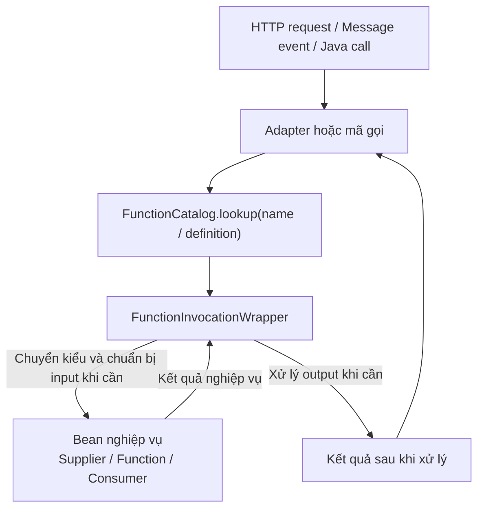
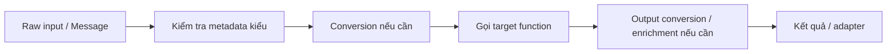

# Vai trò của FunctionInvocationWrapper trong Spring Cloud Function

**Chương:** FunctionCatalog  
**Module:** Spring Cloud Function (`SPRING_CLOUD_FUNCTION`)

Một `Supplier`, `Function` hoặc `Consumer` chỉ cần chứa logic nghiệp vụ để có thể dùng lại trong Java, HTTP, hệ thống sự kiện hoặc môi trường serverless. Tuy nhiên, các môi trường gọi này không luôn truyền và nhận cùng một kiểu dữ liệu: HTTP có thể gửi JSON, message broker mang payload kèm header, còn một service Java có thể truyền thẳng DTO.

Spring Cloud Function giải quyết sự khác biệt đó bằng cách đưa functional bean vào một **mô hình thực thi thống nhất**. Lớp `FunctionInvocationWrapper` là một phần quan trọng của mô hình này: nó bao quanh hàm đích, giữ metadata cần thiết và điều phối các bước xử lý trước/sau khi gọi hàm. Khi lấy hàm qua `FunctionCatalog`, mã gọi thường đang làm việc với biểu diễn đã được bọc thay vì bean gốc.

Bài học giải thích **wrapper làm gì, khác bean gốc ở đâu, cách quan sát nó qua API và những giới hạn cần lưu ý khi tích hợp**. Sau khi học, bạn có thể:

1. Giải thích vai trò của `FunctionInvocationWrapper` trong đường đi của `FunctionCatalog.lookup(...)`.
2. Phân biệt ba tầng: bean nghiệp vụ, wrapper của Spring Cloud Function và adapter giao thức.
3. Sử dụng wrapper để xem tên hàm, kiểu đầu vào/đầu ra, loại hàm và composition.
4. Hiểu việc chuyển đổi dữ liệu qua `MessageConverter` và `ConversionService`.
5. Biết khi nào nên dùng `FunctionCatalog` hoặc functional interface, và khi nào chỉ nên xem wrapper như chi tiết tích hợp.

## 1. FunctionInvocationWrapper là gì?

Trong mã nguồn Spring Cloud Function, `FunctionInvocationWrapper` được khai báo bên trong `SimpleFunctionRegistry`:

```java
// Import kiểu lồng nhau trong SimpleFunctionRegistry:
import org.springframework.cloud.function.context.catalog.SimpleFunctionRegistry.FunctionInvocationWrapper;
```

Đây là **lớp bao (wrapper)** chứ không phải lớp bạn cần kế thừa để viết chức năng nghiệp vụ. Thông thường, bạn khai báo bean bằng giao diện chuẩn Java:

```java
@Bean("normalizeOrderCode")
public Function<String, String> normalizeOrderCode() {
    return value -> value.trim().toUpperCase(Locale.ROOT);
}
```

Khi gọi:

```java
Function<String, String> function =
    catalog.lookup(Function.class, "normalizeOrderCode");
```

Spring Cloud Function tìm định nghĩa phù hợp và cung cấp một đối tượng hàm đã được **instrumented/wrapped**, qua đó có thể áp dụng chuyển đổi kiểu, xử lý ngữ cảnh thông điệp và composition. Trong những phiên bản có lớp `FunctionInvocationWrapper` như trên, mã quan sát có thể nhận wrapper một cách tường minh:

```java
FunctionInvocationWrapper wrapper =
    catalog.lookup("normalizeOrderCode");
```

Đoạn thứ hai cần import `org.springframework.cloud.function.context.catalog.SimpleFunctionRegistry.FunctionInvocationWrapper`; `catalog` được Spring tiêm kiểu `org.springframework.cloud.function.context.FunctionCatalog`.

**Điều quan trọng:** `FunctionCatalog` là giao diện chính để ứng dụng tra cứu hàm; `FunctionInvocationWrapper` là lớp triển khai do framework quản lý. Mã nghiệp vụ thông thường nên phụ thuộc vào `Function`, `Supplier` hoặc `Consumer`, chỉ dùng kiểu wrapper khi cần quan sát metadata hoặc viết tích hợp đặc thù.

### 1.1. Ba tầng trong một lời gọi



| Tầng | Trách nhiệm |
| --- | --- |
| **Bean nghiệp vụ** | Xử lý dữ liệu theo hợp đồng Java, ví dụ `Function<Order, Receipt>` |
| **FunctionCatalog và wrapper** | Tra cứu tên/definition; giữ metadata kiểu; phối hợp conversion, invocation, composition và xử lý output |
| **Adapter** | Nhận/gửi HTTP, binding sự kiện hoặc lời gọi serverless; ánh xạ dữ liệu/giao thức vào hàm được catalog cung cấp |

Wrapper không tự mở HTTP server, không tạo message broker và không triển khai một serverless function lên cloud. Những tác vụ đó thuộc adapter và hạ tầng triển khai.

## 2. Tại sao không gọi bean trực tiếp là đủ?

Giả sử bạn lấy bean như sau:

```java
Function<String, String> direct =
    context.getBean("normalizeOrderCode", Function.class);

String answer = direct.apply("  ord-42  "); // ORD-42
```

Đây là lời gọi Java trực tiếp; mã bên ngoài tự đảm bảo đầu vào thuộc kiểu `String`. `ApplicationContext` chỉ trả bean Spring (có thể kèm proxy Spring thông thường), không tự bổ sung quá trình chuyển đổi thông điệp đặc thù của Spring Cloud Function vào lời gọi đó.

Khi tra cứu qua catalog:

```java
Function<String, String> wrapped =
    catalog.lookup(Function.class, "normalizeOrderCode");

String answer = wrapped.apply("  ord-42  "); // ORD-42
```

Với đầu vào đã đúng kiểu, hai đường thường cho cùng kết quả. Điểm khác biệt xuất hiện khi môi trường thực thi cần **tra cứu bằng definition**, **chuyển payload/Message thành kiểu hàm yêu cầu**, hoặc **ghép nhiều hàm**.

| Điều cần làm | Bean trực tiếp | Hàm lấy qua FunctionCatalog |
| --- | --- | --- |
| Gọi `apply(String)` với đầu vào đúng kiểu | Có | Có |
| Tra cứu một tên hàm hoặc definition từ cấu hình | Cần tự xây cơ chế lựa chọn | Được catalog hỗ trợ |
| Ghép `normalizeOrderCode|addPrefix` theo chuỗi cấu hình | Tự gọi `andThen(...)` hoặc viết mã ghép | Catalog phân giải composition |
| Chuyển `Message<byte[]>` thành DTO | Lớp gọi phải xử lý | Wrapper có thể sử dụng converter khi metadata/cấu hình phù hợp |
| Xem metadata và loại của một hàm được catalog quản lý | Có thể dùng reflection hoặc khai báo bean | Wrapper cung cấp các phương thức quan sát |
| Kết nối HTTP, sự kiện hay serverless | Cần tầng giao thức tương ứng | Vẫn cần adapter tương ứng |

**Không dùng `direct == wrapped` như phép thử đúng/sai.** Đối tượng nhận từ catalog có thể là wrapper riêng; việc hai lời gọi cho cùng kết quả không đảm bảo cùng identity hoặc cùng lớp Java.

## 3. Wrapper điều phối những bước nào khi thực thi?

Ở mức khái niệm, trình tự khi wrapper nhận một đầu vào có thể gồm:

1. **Nhận dữ liệu từ bên gọi:** đối tượng Java, `Message<?>` hoặc một kiểu publisher reactive.
2. **Xác định kiểu mà hàm đích chấp nhận:** dùng metadata của functional bean/registration.
3. **Chuyển đổi đầu vào khi cần:** ví dụ giải mã message có `contentType=application/json` thành DTO.
4. **Gọi đối tượng đích:** `get()`, `apply(input)` hoặc `accept(input)` theo hợp đồng chức năng.
5. **Xử lý đầu ra khi cần:** chuyển kiểu kết quả, tương tác với message envelope/header theo quy tắc áp dụng, hoặc chuyển dữ liệu cho hàm kế tiếp trong composition.
6. **Trả kết quả cho bên gọi/adapter:** adapter sau đó tiếp tục ánh xạ kết quả về giao thức.



Đây là **mô hình**, không phải khẳng định mọi bước luôn chạy. Nếu dữ liệu đã đúng kiểu, conversion có thể không cần thiết. Nếu đầu vào hoặc đầu ra là reactive publisher, có những quy tắc xử lý luồng riêng. Nếu đầu vào là `Message<?>`, kiểu kết quả trả về còn phụ thuộc chữ ký hàm, wrapper và cấu hình thông điệp.

### 3.1. MessageConverter và ConversionService khác nhau thế nào?

Spring Cloud Function dùng các cơ chế chuyển đổi quen thuộc của Spring:

| Dạng đầu vào | Cơ chế thường dùng | Nguồn thông tin quan trọng |
| --- | --- | --- |
| `Message<?>` chứa payload và header | Spring `MessageConverter` | Kiểu đầu vào của hàm, header `contentType` và converter có sẵn |
| Dữ liệu không ở dạng `Message` | Spring `ConversionService` | Kiểu nguồn, kiểu đích, converter/formatter đã đăng ký |
| Đã đúng kiểu Java | Có thể gọi thẳng target | Không cần chuyển đổi thêm |

Ví dụ `Function<OrderRequest, Receipt>` nhận một DTO `OrderRequest`. Nếu adapter gửi `Message<byte[]>` chứa JSON, wrapper có thể sử dụng converter để tạo `OrderRequest` trước khi gọi logic. Nếu đưa vào một cấu trúc không được converter hỗ trợ, conversion có thể thất bại; Spring Cloud Function không hứa tự hiểu mọi định dạng.

`contentType` là **thông tin hỗ trợ chọn converter**, không phải bảo đảm rằng payload sẽ được chuyển thành bất kỳ kiểu đích nào. Cần có cả metadata kiểu của hàm và converter phù hợp.

### 3.2. Header và envelope không phải lúc nào cũng giữ nguyên

Nếu hàm khai báo `Function<Message<OrderRequest>, Message<Receipt>>`, hàm tự chịu trách nhiệm về dữ liệu header cần đọc hoặc viết. Nếu hàm khai báo `Function<OrderRequest, Receipt>`, adapter/wrapper có thể xử lý phần message envelope để logic nghiệp vụ không phải phụ thuộc `Message<?>`.

Đừng giả định mọi lời gọi `wrapper.apply(message)` sẽ trả về `Message<?>` có đủ nguyên các header cũ. Việc giữ hoặc thêm header phụ thuộc kiểu hàm, cấu hình như `copy-input-headers`, và cách adapter xử lý. Hãy kiểm thử với đúng phiên bản và cấu hình ứng dụng.

## 4. Ví dụ đầy đủ: quan sát wrapper trên ứng dụng Spring Boot

Ứng dụng sau dùng Spring Boot và `spring-cloud-function-context` tương thích. Nó khai báo đủ ba loại hàm, thêm một hàm `Function` thứ hai để thử composition, rồi quan sát `FunctionInvocationWrapper` trong một `ApplicationRunner`.

```java
import java.lang.reflect.Type;
import java.util.Locale;
import java.util.function.Consumer;
import java.util.function.Function;
import java.util.function.Supplier;

import org.springframework.beans.factory.annotation.Qualifier;
import org.springframework.boot.ApplicationRunner;
import org.springframework.boot.SpringApplication;
import org.springframework.boot.autoconfigure.SpringBootApplication;
import org.springframework.cloud.function.context.FunctionCatalog;
import org.springframework.cloud.function.context.catalog.SimpleFunctionRegistry.FunctionInvocationWrapper;
import org.springframework.context.annotation.Bean;

@SpringBootApplication
public class WrapperDemoApplication {

    public static void main(String[] args) {
        SpringApplication.run(WrapperDemoApplication.class, args);
    }

    @Bean("newOrderCode")
    public Supplier<String> newOrderCode() {
        return () -> "ord-42";
    }

    @Bean("normalizeOrderCode")
    public Function<String, String> normalizeOrderCode() {
        return value -> value.trim().toUpperCase(Locale.ROOT);
    }

    @Bean("addPrefix")
    public Function<String, String> addPrefix() {
        return value -> "ID-" + value;
    }

    @Bean("auditOrderCode")
    public Consumer<String> auditOrderCode() {
        return value -> System.out.println("AUDIT: " + value);
    }

    @Bean
    public ApplicationRunner inspectWrapper(
            @Qualifier("normalizeOrderCode")
            Function<String, String> directBean,
            FunctionCatalog catalog) {
        return args -> {
            FunctionInvocationWrapper wrapper =
                catalog.lookup("normalizeOrderCode");

            if (wrapper == null) {
                throw new IllegalStateException("Missing function");
            }

            Type inputType = wrapper.getInputType();
            Type outputType = wrapper.getOutputType();

            System.out.println(
                "Definition: " + wrapper.getFunctionDefinition());
            System.out.println("Input type: " + inputType);
            System.out.println("Output type: " + outputType);
            System.out.println("Is Function: " + wrapper.isFunction());
            System.out.println("Is composed: " + wrapper.isComposed());

            String directResult = directBean.apply("  ord-42  ");

            Function<String, String> throughCatalog =
                catalog.lookup(Function.class, "normalizeOrderCode");
            if (throughCatalog == null) {
                throw new IllegalStateException(
                    "Cannot look up normalizeOrderCode");
            }

            String catalogResult =
                throughCatalog.apply("  ord-42  ");

            System.out.println("Direct: " + directResult);
            System.out.println("Catalog: " + catalogResult);
            // Hai dòng cùng in ORD-42.

            FunctionInvocationWrapper composed =
                catalog.lookup("normalizeOrderCode|addPrefix");
            if (composed == null) {
                throw new IllegalStateException(
                    "Cannot compose functions");
            }

            System.out.println("Composed: " + composed.isComposed());
            System.out.println(
                composed.apply("  ord-42  ")); // ID-ORD-42
        };
    }
}
```

**Đọc kết quả:**

- `wrapper.getFunctionDefinition()` trả tên/definition đang được catalog xử lý, ở đây là `normalizeOrderCode`.
- `getInputType()` và `getOutputType()` cho biết metadata kiểu mà wrapper nắm được; với bean ở trên, đó là kiểu `String`. Dạng in ra của một `Type` không nhất thiết chỉ là từ `String`.
- `isFunction()` phản ánh một hàm có cả đầu vào và đầu ra; `isComposed()` cho biết wrapper có đại diện cho một composition hay không.
- Khi tra cứu `normalizeOrderCode|addPrefix`, catalog tạo biểu diễn hàm ghép; đầu ra của lần gọi ví dụ là `ID-ORD-42`.

Không cần `spring-cloud-function-web`, Spring Cloud Stream hoặc broker để kiểm tra wrapper bằng mã Java. Các adapter chỉ cần khi muốn đưa cùng hàm ra bên ngoài ứng dụng.

### 4.1. Vì sao vẫn nên dùng Function<T, R> trong service nghiệp vụ?

Trong ứng dụng mẫu, `throughCatalog` được khai báo `Function<String, String>`, còn `wrapper` được khai báo `FunctionInvocationWrapper`. Cả hai đều có thể gọi `apply(...)`, nhưng mục tiêu khác nhau:

- `Function<String, String>` thể hiện **hợp đồng nghiệp vụ** mà code bình thường cần.
- `FunctionInvocationWrapper` cho phép xem **metadata và hành vi tích hợp** của Spring Cloud Function.

Vì lớp wrapper nằm trong phần triển khai registry, việc mã nghiệp vụ phụ thuộc sâu vào các phương thức riêng của nó có thể khiến nâng cấp phiên bản khó hơn. Dùng `FunctionCatalog` và các giao diện Java tiêu chuẩn ở ranh giới ứng dụng; chỉ dùng API wrapper trực tiếp khi thực sự cần.

## 5. Metadata quan sát được từ FunctionInvocationWrapper

Với API wrapper có trong các phiên bản tham khảo, bạn có thể thấy những phương thức sau:

| Phương thức | Ý nghĩa | Cách đọc kết quả |
| --- | --- | --- |
| `getFunctionDefinition()` | Tên hoặc chuỗi definition đã được phân giải | `normalizeOrderCode` hoặc `normalizeOrderCode|addPrefix` |
| `getInputType()` | Kiểu đầu vào của hàm ở dạng `java.lang.reflect.Type` | Có thể là kiểu đơn, `Message<T>` hoặc reactive type |
| `getOutputType()` | Kiểu đầu ra ở dạng `Type` | Với `Consumer` có thể không có kiểu đầu ra |
| `getRawInputType()`, `getRawOutputType()` | Lớp Java raw tương ứng với metadata | Không mang đầy đủ generic type |
| `isSupplier()` | Wrapper mô tả hàm không nhận đầu vào | `Supplier` dùng `get()` |
| `isFunction()` | Wrapper mô tả hàm có đầu vào và đầu ra | `Function` dùng `apply(...)` |
| `isConsumer()` | Wrapper mô tả hàm không có đầu ra nghiệp vụ | `Consumer` dùng `accept(...)` |
| `isComposed()` | Wrapper đại diện cho composition | Có thể khác với một bean đơn lẻ |
| `isInputTypeMessage()`, `isOutputTypeMessage()` | Kiểu vào/ra có liên quan tới `Message` | Hỗ trợ adapter hiểu envelope |
| `isInputTypePublisher()`, `isOutputTypePublisher()` | Kiểu vào/ra có phải publisher reactive | Quan trọng khi kết hợp với `Flux`/`Mono` |

**Lưu ý về phiên bản:** tên lớp/phương thức ở bảng này phản ánh API của các phiên bản Spring Cloud Function có `SimpleFunctionRegistry.FunctionInvocationWrapper`. Khi xây thư viện tích hợp hoặc nâng cấp major version, hãy đối chiếu Javadoc hoặc mã nguồn đúng artifact của dự án. Không suy đoán rằng tất cả thuộc tính nội bộ sẽ bất biến mãi.

### 5.1. Wrapper có thể thực thi cả ba giao diện

Trong mã triển khai, `FunctionInvocationWrapper` có thể thực thi các giao diện `Function<Object, Object>`, `Supplier<Object>`, `Consumer<Object>` và `Runnable` để thống nhất cách gọi. Điều này **không có nghĩa** một functional bean là đồng thời cả ba loại về mặt nghiệp vụ.

Loại thực của hàm cần dựa trên metadata và định nghĩa đích:

```java
FunctionInvocationWrapper producer =
    catalog.lookup("newOrderCode");
FunctionInvocationWrapper transformer =
    catalog.lookup("normalizeOrderCode");
FunctionInvocationWrapper sink =
    catalog.lookup("auditOrderCode");

if (producer == null || transformer == null || sink == null) {
    throw new IllegalStateException("Catalog is incomplete");
}

System.out.println(producer.isSupplier());   // true
System.out.println(transformer.isFunction()); // true
System.out.println(sink.isConsumer());        // true
```

Trong mã sản xuất, cách rõ ràng hơn là tra cứu đúng loại:

```java
Supplier<String> producer =
    catalog.lookup(Supplier.class, "newOrderCode");

Function<String, String> transformer =
    catalog.lookup(Function.class, "normalizeOrderCode");

Consumer<String> sink =
    catalog.lookup(Consumer.class, "auditOrderCode");
```

Sau khi kiểm tra các biến khác `null`, lần lượt gọi `producer.get()`, `transformer.apply(input)` và `sink.accept(input)`. Với `Consumer`, không suy luận một giá trị trả về nghiệp vụ từ `apply(...)` của wrapper; `Consumer` có hợp đồng `void accept(...)`.

### 5.2. Đừng nhầm kiểu raw với kiểu dữ liệu thật

`getRawInputType()` có thể báo `Message.class` hoặc `Flux.class`, trong khi kiểu dữ liệu bên trong là `Message<OrderRequest>` hoặc `Flux<OrderRequest>`. Muốn phân tích generic type, dùng `getInputType()`/`getOutputType()` cùng API reflection phù hợp; không đọc tên class raw rồi giả định payload là `String`.

Tương tự, `catalog.lookup(Function.class, "validateOrder")` chỉ xác định nhóm giao diện, không kiểm chứng toàn bộ `Function<OrderRequest, Receipt>` ở compile time do Java có *type erasure*.

## 6. Ví dụ chuyển đổi message thành DTO

Xét logic nghiệp vụ:

```java
record OrderRequest(String orderId, long amount) {}
record OrderDecision(String orderId, boolean accepted) {}

@Bean("validateOrder")
public Function<OrderRequest, OrderDecision> validateOrder() {
    return order -> new OrderDecision(
        order.orderId(),
        order.amount() > 0
    );
}
```

Khi gọi trực tiếp, bạn cần tạo đúng đối tượng:

```java
OrderRequest input = new OrderRequest("ORD-42", 1500);
OrderDecision decision = directValidator.apply(input);
```

Trong đoạn mã, `directValidator` là `Function<OrderRequest, OrderDecision>` được Spring tiêm theo tên `validateOrder`. Nếu dữ liệu ban đầu là JSON từ HTTP hoặc broker, sẽ có bước chuyển đổi trước khi hàm nghiệp vụ có thể xử lý.

Với đường gọi qua catalog, có thể minh họa request dưới dạng message:

```java
import java.nio.charset.StandardCharsets;
import org.springframework.messaging.Message;
import org.springframework.messaging.MessageHeaders;
import org.springframework.messaging.support.MessageBuilder;

// Giả sử FunctionCatalog catalog đã được tiêm.
FunctionInvocationWrapper wrapped = catalog.lookup("validateOrder");
if (wrapped == null) {
    throw new IllegalStateException("validateOrder missing");
}

Message<byte[]> incoming = MessageBuilder
    .withPayload((
        "{\"orderId\":\"ORD-42\",\"amount\":1500}"
    ).getBytes(StandardCharsets.UTF_8))
    .setHeader(MessageHeaders.CONTENT_TYPE, "application/json")
    .build();

// Cần JSON MessageConverter phù hợp trong ứng dụng.
Object result = wrapped.apply(incoming);
System.out.println(result);
```

Đây là **minh họa cho đường đi conversion**, cần chạy trong ứng dụng có converter hỗ trợ JSON và DTO tương ứng (ví dụ cấu hình Jackson phù hợp). Kết quả có thể được biểu diễn bằng DTO, `Message<?>` hoặc dạng đầu ra được adapter yêu cầu; không nên ép kiểu `result` một cách mù quáng. Trong kiểm thử tích hợp, hãy xác minh rõ payload, header và kiểu dữ liệu thực tế.

Nếu muốn kiểm tra chỉ riêng logic, unit test trực tiếp với `OrderRequest` sẽ đơn giản hơn. Nếu muốn kiểm tra việc Spring Cloud Function nhận `Message<byte[]>` rồi chuyển thành DTO, phải kiểm thử **đường catalog/wrapper kèm converter**, không chỉ gọi bean Java trực tiếp.

## 7. Wrapper phối hợp composition như thế nào?

Với hai bean từ ví dụ chính:

```java
@Bean("normalizeOrderCode")
public Function<String, String> normalizeOrderCode() {
    return value -> value.trim().toUpperCase(Locale.ROOT);
}

@Bean("addPrefix")
public Function<String, String> addPrefix() {
    return value -> "ID-" + value;
}
```

Trong Java thuần, hai hàm có thể được ghép bằng `andThen(...)`:

```java
Function<String, String> manual = directNormalize
    .andThen(directAddPrefix);
String value = manual.apply("  ord-42  "); // ID-ORD-42
```

Ở đây `directNormalize` và `directAddPrefix` là hai bean được inject. Spring Cloud Function hỗ trợ một cách tương ứng bằng **definition**:

```java
FunctionInvocationWrapper composed =
    catalog.lookup("normalizeOrderCode|addPrefix");

if (composed == null) {
    throw new IllegalStateException("No composed function");
}

System.out.println(composed.isComposed()); // true
System.out.println(composed.getFunctionDefinition());
// normalizeOrderCode|addPrefix

System.out.println(composed.apply("  ord-42  "));
// ID-ORD-42
```

Wrapper giữ metadata và điều phối các bước trong chuỗi composition; do đó, framework có thể xử lý chuyển đổi ở ranh giới các hàm khi cấu hình và converter phù hợp.

**Giới hạn:** không phải mọi loại hàm đều có thể nối tùy ý. Chẳng hạn, một `Consumer` không có kết quả nghiệp vụ để nối tiếp một `Function` khác; kiểu reactive cũng có quy tắc đặc thù. Hãy để catalog phân giải definition hợp lệ và kiểm thử chuỗi bằng dữ liệu thực.

### 7.1. Vì sao không gọi andThen trên wrapper tùy tiện?

Triển khai `FunctionInvocationWrapper` có logic composition riêng, bao gồm việc quản lý metadata và conversion. Việc tự dùng `wrapper.andThen(rawJavaFunction)` không nhất thiết được hỗ trợ; có phiên bản yêu cầu thành phần ghép cũng là wrapper.

Khi cần composition do Spring Cloud Function quản lý, ưu tiên:

```java
Function<String, String> pipeline =
    catalog.lookup(
        Function.class, "normalizeOrderCode|addPrefix");
```

Điều này cũng thuận tiện cho adapter vì cùng definition có thể được khai báo trong cấu hình:

```properties
spring.cloud.function.definition=normalizeOrderCode|addPrefix
```

Thuộc tính `definition` chọn hàm/chuỗi hàm để adapter dùng; nó không tự đăng ký thêm bean Java mang tên chuỗi đó.

## 8. Reactive function và wrapper

Spring Cloud Function hỗ trợ cả các hàm reactive của Project Reactor:

```java
@Bean("normalizeStream")
public Function<Flux<String>, Flux<String>> normalizeStream() {
    return flux -> flux.map(
        s -> s.trim().toUpperCase(Locale.ROOT)
    );
}
```

Ví dụ trên cần import `reactor.core.publisher.Flux` và `java.util.function.Function`. Khi tra cứu qua catalog, wrapper có thể cung cấp thông tin `isInputTypePublisher()` và `isOutputTypePublisher()` để adapter hiểu đầu vào/đầu ra thuộc dạng publisher.

Không nên suy rằng với `Function<Flux<String>, Flux<String>>` framework sẽ tự gọi hàm một lần cho từng `String`. Hàm này nhận cả một publisher theo hợp đồng reactive; chiến lược gọi và quản lý luồng cần tuân theo quy tắc của adapter. Những hàm imperative kiểu `Function<String, String>` có mô hình thực thi khác.

Ở thời điểm tích hợp, loại hàm/metadata của wrapper giúp adapter quyết định đường chuyển đổi và cách xử lý kết quả; điều đó không thay thế việc lập trình viên hiểu tính bất đồng bộ, backpressure hay vòng đời subscription.

## 9. Kiểm thử wrapper và hành vi nghiệp vụ

Với `WrapperDemoApplication` ở mục 4 và Spring Boot Test/JUnit 5 tương thích, có thể kiểm tra:

```java
import static org.junit.jupiter.api.Assertions.*;

import java.util.function.Function;
import org.junit.jupiter.api.Test;
import org.springframework.beans.factory.annotation.Autowired;
import org.springframework.beans.factory.annotation.Qualifier;
import org.springframework.boot.test.context.SpringBootTest;
import org.springframework.cloud.function.context.FunctionCatalog;
import org.springframework.cloud.function.context.catalog.SimpleFunctionRegistry.FunctionInvocationWrapper;

@SpringBootTest(classes = WrapperDemoApplication.class)
class FunctionInvocationWrapperTest {

    @Autowired
    private FunctionCatalog catalog;

    @Autowired
    @Qualifier("normalizeOrderCode")
    private Function<String, String> directBean;

    @Test
    void preservesBusinessBehaviorAndExposesMetadata() {
        FunctionInvocationWrapper wrapper =
            catalog.lookup("normalizeOrderCode");

        assertNotNull(wrapper);
        assertEquals(
            "normalizeOrderCode", wrapper.getFunctionDefinition());
        assertTrue(wrapper.isFunction());
        assertFalse(wrapper.isComposed());
        assertEquals(String.class, wrapper.getInputType());
        assertEquals(String.class, wrapper.getOutputType());

        String input = "  ord-42  ";
        assertEquals(
            directBean.apply(input), wrapper.apply(input));
    }

    @Test
    void compositionHasASeparateDefinition() {
        FunctionInvocationWrapper composed =
            catalog.lookup("normalizeOrderCode|addPrefix");

        assertNotNull(composed);
        assertTrue(composed.isComposed());
        assertEquals(
            "ID-ORD-42", composed.apply("  ord-42  "));
    }

    @Test
    void supplierAndConsumerHaveDifferentRoles() {
        FunctionInvocationWrapper supplier =
            catalog.lookup("newOrderCode");
        FunctionInvocationWrapper consumer =
            catalog.lookup("auditOrderCode");

        assertNotNull(supplier);
        assertNotNull(consumer);
        assertTrue(supplier.isSupplier());
        assertTrue(consumer.isConsumer());
    }
}
```

Kiểm thử trên chứng minh metadata, composition và việc wrapper vẫn gọi logic nghiệp vụ đúng. Để xác nhận **chuyển đổi JSON/message**, cần test riêng với converter và payload. Đừng khẳng định conversion đã được kiểm chứng chỉ bằng việc truyền `String` vào một hàm `Function<String, String>`.

### 9.1. Tại sao không kiểm tra class cụ thể của wrapper trong mọi test?

Nếu mục đích của test là đảm bảo adapter/ứng dụng lấy đúng hàm và xử lý đúng input, hãy kiểm tra API ổn định:

```java
Function<String, String> operation =
    catalog.lookup(Function.class, "normalizeOrderCode");
assertNotNull(operation);
assertEquals("ORD-42", operation.apply("  ord-42  "));
```

Còn khi mục tiêu là kiểm tra chính **metadata của `FunctionInvocationWrapper`**, mới cần import lớp triển khai. Tách hai loại kiểm thử giúp nâng cấp Spring Cloud Function dễ đánh giá hơn.

## 10. Các nhầm lẫn thường gặp

| Nhận định / lỗi | Nguyên nhân thực tế | Hướng xử lý |
| --- | --- | --- |
| “FunctionInvocationWrapper là interface để tôi viết logic.” | Đây là wrapper do framework quản lý | Viết `Supplier`, `Function`, `Consumer` và đăng ký Spring bean |
| “Bean lấy qua `getBean` đã có conversion của SCF.” | `getBean` không tự thêm lớp instrument của catalog | Dùng `FunctionCatalog.lookup(...)` ở đường tích hợp |
| “Có wrapper nghĩa là mọi JSON đều chuyển đổi được.” | Cần đúng metadata, content type và converter | Kiểm thử đúng dạng payload, đăng ký converter khi cần |
| “Wrapper luôn trả về `Message<?>`.” | Dạng kết quả phụ thuộc input, chữ ký hàm và cấu hình | Kiểm tra hợp đồng đầu ra/adapter trước khi ép kiểu |
| “Wrapper luôn là cùng object với bean.” | Catalog có thể dùng đối tượng đã bọc | So sánh hành vi, không phụ thuộc identity |
| “Wrapper implements cả ba interface nên mọi hàm đều là cả ba loại.” | Đây là kỹ thuật thống nhất entry point trong lớp triển khai | Dùng metadata và giao diện nghiệp vụ đúng loại |
| “Ghép wrapper với Java Function tùy ý sẽ giống `a|b`.” | Composition của catalog quản lý metadata/conversion riêng | Dùng function definition và kiểm tra tương thích kiểu |
| “Thêm hàm vào catalog đồng nghĩa có endpoint HTTP.” | Adapter là lớp riêng | Kiểm tra dependency, export, mapping hoặc binding |
| “Có thể dựa hoàn toàn vào tên sai khi chỉ có một hàm.” | Single-function fallback có thể che lỗi | Tra cứu bằng tên chính xác, kiểm tra catalog và cấu hình |
| “Lấy `Function.class` sẽ kiểm tra generic `String → DTO`.” | Java type erasure | Duy trì chữ ký bean rõ ràng và test dữ liệu thực |

## 11. Bài tập tự thực hành

1. Chạy `WrapperDemoApplication`. So sánh kết quả khi gọi `directBean.apply(...)` và `catalog.lookup(Function.class, "...").apply(...)` với cùng input.
2. Dùng `FunctionInvocationWrapper` để in `getFunctionDefinition()`, `getInputType()` và `getOutputType()` của `normalizeOrderCode`; giải thích vì sao metadata khác với kết quả nghiệp vụ.
3. Tra cứu `normalizeOrderCode|addPrefix` và kiểm tra `isComposed()`. Thay thứ tự thành `addPrefix|normalizeOrderCode`, thử input `"  ord-42  "` và giải thích vì sao kết quả/chuỗi xử lý có thể khác.
4. Khai báo thêm `Function<OrderRequest, OrderDecision> validateOrder`, thử gọi trực tiếp với DTO và thử gọi wrapper với `Message<byte[]>` mang JSON; quan sát điều kiện để converter hoạt động.
5. Dùng `isSupplier()`, `isFunction()`, `isConsumer()` cho ba bean khác nhau và giải thích vì sao cùng lớp wrapper không đồng nghĩa ba hợp đồng nghiệp vụ giống nhau.
6. Tạo một hàm `Function<Flux<String>, Flux<String>>`. Quan sát metadata publisher và giải thích khác biệt giữa nhận publisher với nhận từng phần tử.

### Câu hỏi phỏng vấn

**Hỏi:** Vì sao Spring Cloud Function cần `FunctionInvocationWrapper` khi Java đã có `java.util.function.Function`?

**Đáp:** `Function` mô tả hợp đồng xử lý dữ liệu thuần Java. `FunctionInvocationWrapper` bổ sung lớp điều phối chung để Spring Cloud Function giữ metadata, chuyển đổi dữ liệu khi cần, hỗ trợ composition và giúp adapter gọi cùng logic từ HTTP, sự kiện hoặc serverless. Nhờ đó, logic nghiệp vụ không phải trực tiếp xử lý từng giao thức.

## 12. Ghi nhớ

- `FunctionInvocationWrapper` là **lớp bao quanh functional bean** trong cơ chế đăng ký/tra cứu của Spring Cloud Function; ứng dụng thông thường tạo bean `Supplier`, `Function` hoặc `Consumer`, không tự tạo wrapper.
- Tra cứu qua `FunctionCatalog` cho biểu diễn hàm đã được xử lý bổ sung; lấy bean trực tiếp từ `ApplicationContext` chỉ sử dụng hành vi Spring bean thông thường.
- Wrapper giữ metadata như function definition, input/output type, loại hàm và trạng thái composition, hỗ trợ điều phối type conversion qua `MessageConverter` hoặc `ConversionService`.
- Conversion, header handling và composition **phụ thuộc loại dữ liệu, metadata và cấu hình**, không phải phép biến đổi luôn xảy ra trong mọi lời gọi.
- Nên ưu tiên giao diện ổn định `FunctionCatalog` và các functional interface trong mã nghiệp vụ; truy cập trực tiếp wrapper khi thực sự cần quan sát hoặc viết tích hợp chuyên sâu.

### Tài liệu tham khảo

- [Spring Cloud Function — Programming Model](https://docs.spring.io/spring-cloud-function/reference/spring-cloud-function/programming-model.html): wrapper, conversion, composition, Message và content type negotiation.
- [Spring Cloud Function — Functional Bean Definitions](https://docs.spring.io/spring-cloud-function/reference/functional.html): cách đăng ký và kiểm tra các hàm trong catalog.
- [Mã nguồn SimpleFunctionRegistry và FunctionInvocationWrapper](https://github.com/spring-cloud/spring-cloud-function/blob/main/spring-cloud-function-context/src/main/java/org/springframework/cloud/function/context/catalog/SimpleFunctionRegistry.java): vị trí lớp wrapper và các phương thức quan sát; khi áp dụng thực tế, đối chiếu tag/phiên bản dependency đang dùng.
