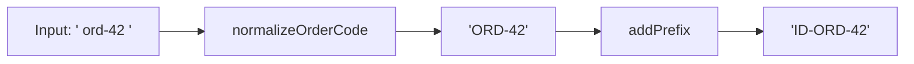

# Chọn một hàm hoặc định nghĩa ghép hàm trong Spring Cloud Function

**Chương:** FunctionCatalog  
**Module:** Spring Cloud Function (`SPRING_CLOUD_FUNCTION`)

Trong Spring Cloud Function, logic nghiệp vụ được khai báo dưới dạng `Supplier`, `Function` hoặc `Consumer` để có thể tái sử dụng mà không phụ thuộc vào giao thức gọi. Một hàm có thể được gọi từ Java, được xuất qua HTTP, nhận sự kiện qua Spring Cloud Stream hoặc chạy trong môi trường serverless. Khi ứng dụng có nhiều hàm, câu hỏi quan trọng là: **chọn hàm nào để thực thi, hoặc ghép những hàm nào theo thứ tự nào?**

`FunctionCatalog` hỗ trợ tìm hàm theo **tên/định nghĩa hàm** (*function definition*). Thuộc tính `spring.cloud.function.definition` cho phép adapter chọn cùng tên/định nghĩa đó từ cấu hình, thay vì mã nguồn phải biết trước từng đường gọi. Một definition có thể chỉ gồm một tên như `normalizeOrderCode` hoặc là một chuỗi như `normalizeOrderCode|addPrefix`.

Sau bài này, bạn có thể:

- Chọn một functional bean cụ thể bằng `FunctionCatalog.lookup(...)` hoặc `spring.cloud.function.definition`.
- Phân biệt **tên bean**, **function definition**, **composition** và **nhiều definition độc lập**.
- Dự đoán thứ tự, kiểu đầu vào/đầu ra và loại giao diện tạo thành khi ghép hàm.
- Chọn definition cho Java, Spring Cloud Stream, HTTP và serverless adapter.
- Viết kiểm thử xác minh kết quả, phát hiện cấu hình tên sai và loại bỏ việc phụ thuộc vào fallback.

## 1. Từ tên bean đến function definition

Giả sử ứng dụng có hai bean:

```java
@Bean("normalizeOrderCode")
public Function<String, String> normalizeOrderCode() {
    return input -> input.trim().toUpperCase(Locale.ROOT);
}

@Bean("addPrefix")
public Function<String, String> addPrefix() {
    return input -> "ID-" + input;
}
```

Đây là **hai functional bean**. Tên của chúng là `normalizeOrderCode` và `addPrefix`, do `@Bean("...")` quy định. Bạn có thể chọn từng hàm hoặc yêu cầu một đường xử lý gồm cả hai:

| Function definition | Ý nghĩa | Với đầu vào `"  ord-42  "` |
| --- | --- | --- |
| `normalizeOrderCode` | Chỉ chạy hàm chuẩn hóa | `ORD-42` |
| `addPrefix` | Chỉ thêm tiền tố | `ID-  ord-42  ` |
| `normalizeOrderCode|addPrefix` | Chuẩn hóa rồi thêm tiền tố | `ID-ORD-42` |
| `addPrefix|normalizeOrderCode` | Thêm tiền tố rồi mới chuẩn hóa | `ID-  ORD-42  ` |

Thứ tự composition **có ý nghĩa**. Nối hai hàm cùng kiểu không bảo đảm kết quả như nhau khi đảo thứ tự. `normalizeOrderCode|addPrefix` là một **definition**, không nhất thiết là tên của một Spring bean mới.



### 1.1. Ba khái niệm dễ bị nhầm

| Khái niệm | Ví dụ | Vai trò |
| --- | --- | --- |
| **Tên bean** | `normalizeOrderCode` | Tên đối tượng chức năng được Spring quản lý |
| **Function definition** | `normalizeOrderCode|addPrefix` | Chỉ ra một hàm hoặc một chuỗi hàm cần dùng |
| **Binding/HTTP mapping** | `normalizeOrderCode-in-0`, đường HTTP | Cách adapter gắn hàm với giao thức hoặc nguồn/đích bên ngoài |

`FunctionCatalog` dùng definition để phân giải hàm. Adapter như Spring Cloud Stream còn cần binder, destination và binding name; HTTP adapter cần đường dẫn và phương thức gọi. **Definition không tự tạo HTTP endpoint, broker hoặc Spring bean mới.**

## 2. Cú pháp chọn một hoặc nhiều definition

Trong Spring Cloud Function, cách viết thường gặp:

| Cú pháp | Tác dụng | Ghi chú |
| --- | --- | --- |
| `foo` | Chọn một hàm | Dùng tên bean đã đăng ký |
| `foo|bar` | Ghép `foo` rồi `bar` | Cách viết nên ưu tiên |
| `foo,bar` | Dấu phẩy có thể dùng thay dấu `|` để ghép hàm | Được mô tả trong tài liệu Spring Cloud Function |
| `foo|bar|baz` | Ghép ba hàm theo thứ tự | Output mỗi bước phải phù hợp input bước sau |
| `foo;bar` | **Hai definition độc lập** trong các adapter hỗ trợ danh sách, ví dụ Stream hoặc Web | Không có nghĩa “chạy `foo` rồi `bar`” |
| `foo|bar;baz` | Một definition ghép `foo|bar`, cộng một definition riêng `baz` | Cách export/binding phụ thuộc adapter |

Đặc biệt cần nhớ:

- **`|` (pipe)** thể hiện một chuỗi xử lý. Tài liệu Spring Cloud Function cũng cho phép `,` trong vai trò dấu ghép, nhưng `|` trực quan hơn.
- **`;` (semicolon)** được dùng khi adapter nhận danh sách **nhiều chức năng được chọn**. Ví dụ, Spring Cloud Stream có thể tạo các binding riêng cho `foo` và `bar`; Spring Cloud Function Web có thể giới hạn các chức năng được export.
- Không xem `catalog.lookup("foo;bar")` như cách chuẩn để có một hàm composition; dùng `catalog.lookup("foo|bar")` khi muốn **một pipeline**.

Khi cấu hình qua YAML, có thể đặt giá trị chứa dấu `|` vào chuỗi có dấu nháy:

```yaml
spring:
  cloud:
    function:
      definition: "normalizeOrderCode|addPrefix"
```

Nếu bỏ dấu nháy trong ví dụ YAML này, phần lớn trường hợp vẫn đọc được vì dấu `|` ở giữa chuỗi không mở *block scalar*. Dùng dấu nháy giúp tránh nhầm với cú pháp YAML và làm rõ toàn bộ chuỗi là một giá trị.

## 3. Ví dụ Spring Boot: khai báo tập hàm nghiệp vụ

Ứng dụng dưới đây độc lập, dùng Spring Boot với Spring Cloud Function context tương thích. Nó cung cấp các hàm khác nhau để bạn chọn một hàm hoặc ghép thành pipeline.

```java
import java.util.Locale;
import java.util.function.Consumer;
import java.util.function.Function;
import java.util.function.Supplier;

import org.springframework.boot.ApplicationRunner;
import org.springframework.boot.SpringApplication;
import org.springframework.boot.autoconfigure.SpringBootApplication;
import org.springframework.cloud.function.context.FunctionCatalog;
import org.springframework.context.annotation.Bean;

@SpringBootApplication
public class FunctionSelectionApplication {

    public static void main(String[] args) {
        SpringApplication.run(FunctionSelectionApplication.class, args);
    }

    @Bean("issueOrderCode")
    public Supplier<String> issueOrderCode() {
        return () -> "  ord-42  ";
    }

    @Bean("normalizeOrderCode")
    public Function<String, String> normalizeOrderCode() {
        return value -> value.trim().toUpperCase(Locale.ROOT);
    }

    @Bean("addPrefix")
    public Function<String, String> addPrefix() {
        return value -> "ID-" + value;
    }

    @Bean("codeLength")
    public Function<String, Integer> codeLength() {
        return String::length;
    }

    @Bean("auditOrderCode")
    public Consumer<String> auditOrderCode() {
        return value -> System.out.println("AUDIT: " + value);
    }

    @Bean
    public ApplicationRunner demonstrate(FunctionCatalog catalog) {
        return args -> {
            Function<String, String> one =
                catalog.lookup(Function.class, "normalizeOrderCode");
            Function<String, String> composed =
                catalog.lookup(
                    Function.class, "normalizeOrderCode|addPrefix");
            Function<String, Integer> measured =
                catalog.lookup(
                    Function.class,
                    "normalizeOrderCode|addPrefix|codeLength");

            if (one == null || composed == null || measured == null) {
                throw new IllegalStateException(
                    "A required function definition was not resolved");
            }

            String input = "  ord-42  ";
            System.out.println(one.apply(input));       // ORD-42
            System.out.println(composed.apply(input));  // ID-ORD-42
            System.out.println(measured.apply(input));  // 9
        };
    }
}
```

**Giải thích:** `codeLength` nhận `String` và trả `Integer`. Sau ba bước `normalizeOrderCode|addPrefix|codeLength`, kết quả là số ký tự của `ID-ORD-42`, tức `9`. Pipeline có hợp đồng **`Function<String, Integer>`**, không còn là `Function<String, String>`.

Để dùng ví dụ, ứng dụng cần dependency `spring-cloud-function-context` cùng các thành phần Spring Boot tương thích. Chỉ tra cứu catalog trong Java thì chưa cần `spring-cloud-function-web` hoặc Spring Cloud Stream binder.

## 4. Chọn một hàm cụ thể

### 4.1. Chọn trong mã Java

Với bean ở mục 3:

```java
Function<String, String> selected =
    catalog.lookup(Function.class, "normalizeOrderCode");

if (selected == null) {
    throw new IllegalStateException("normalizeOrderCode not found");
}

String result = selected.apply("  ord-42  ");
// ORD-42
```

`catalog` được Spring tiêm vào mã gọi với kiểu `FunctionCatalog`. Overload `lookup(Function.class, "name")` thể hiện rõ **loại giao diện** bạn mong đợi; nó không tự bảo đảm generic `String → String` ở runtime. Người gọi vẫn cần biết đúng hợp đồng của bean.

Ví dụ chọn `Supplier` hoặc `Consumer`:

```java
Supplier<String> supplier =
    catalog.lookup(Supplier.class, "issueOrderCode");
Consumer<String> consumer =
    catalog.lookup(Consumer.class, "auditOrderCode");

if (supplier == null || consumer == null) {
    throw new IllegalStateException("Missing Supplier or Consumer");
}

String issued = supplier.get();
consumer.accept(issued);
```

Với `Supplier` dùng `get()`; `Consumer` dùng `accept(input)`; với `Function` dùng `apply(input)`. Tránh cố gọi `apply(...)` trên một `Consumer` theo hợp đồng Java của nó.

### 4.2. Chọn qua cấu hình

Khi dùng adapter, nên tách quyết định chọn hàm khỏi mã nguồn:

```properties
spring.cloud.function.definition=normalizeOrderCode
```

Hoặc:

```yaml
spring:
  cloud:
    function:
      definition: normalizeOrderCode
```

Với Spring Cloud Stream, thuộc tính trên cho framework biết **hàm nào sẽ được kết nối với binding**. Với Spring Cloud Function Web, nó có thể tác động tới hàm được export/mapping. Serverless adapter cũng có quy tắc chọn entry point hoặc definition riêng.

**Không nhầm lẫn hai đường chọn:** một dòng cấu hình `spring.cloud.function.definition=normalizeOrderCode` không ngăn mã Java gọi `catalog.lookup(Function.class, "addPrefix")`. Nó chỉ định lựa chọn mặc định hoặc danh sách lựa chọn cho **ngữ cảnh tích hợp sử dụng thuộc tính đó**. Việc truy cập trực tiếp catalog vẫn chịu quy tắc catalog.

### 4.3. Vì sao nên ghi tên tường minh ngay cả khi chỉ có một hàm?

Khi chỉ một functional bean đủ điều kiện, Spring Cloud Function có thể dùng **single-function fallback**: một lookup tên rỗng hoặc tên không khớp vẫn có thể được ánh xạ về hàm duy nhất. Nếu sau này thêm hàm thứ hai, hành vi này có thể thay đổi.

Tài liệu Spring Cloud Function đặc biệt khuyến nghị cấu hình `spring.cloud.function.definition` khi dùng Spring Cloud Stream, kể cả lúc ứng dụng chỉ có một hàm.

Trong phiên bản hỗ trợ, có thể yêu cầu tra cứu đúng tên bằng:

```properties
spring.cloud.function.single-function-fallback-enabled=false
```

Hãy kiểm tra đúng phiên bản dependency và hành vi chạy thực tế trước khi dựa vào công tắc này. Tên chính xác và kiểm thử vẫn cần thiết dù bạn bật hay tắt fallback.

## 5. Chọn pipeline composition

Giả sử bạn muốn chuẩn hóa mã, thêm tiền tố, rồi đếm ký tự. Có hai cách diễn đạt.

**Ghép bằng Java trực tiếp:**

```java
Function<String, String> normalize = value ->
    value.trim().toUpperCase(Locale.ROOT);
Function<String, String> prefix = value -> "ID-" + value;
Function<String, Integer> length = String::length;

Function<String, Integer> manual =
    normalize.andThen(prefix).andThen(length);

System.out.println(manual.apply("  ord-42  ")); // 9
```

**Ghép bằng Spring Cloud Function:**

```java
Function<String, Integer> pipeline =
    catalog.lookup(
        Function.class,
        "normalizeOrderCode|addPrefix|codeLength");

if (pipeline == null) {
    throw new IllegalStateException("Pipeline not found");
}

System.out.println(pipeline.apply("  ord-42  ")); // 9
```

Hai cách cùng có thể cho kết quả `9`. Cách qua catalog sử dụng **tên bean**, có thể được adapter nhận từ thuộc tính `spring.cloud.function.definition`, và được Spring Cloud Function bọc để xử lý metadata/conversion khi phù hợp. Cách Java `andThen(...)` dùng những đối tượng hàm mà mã hiện có.

### 5.1. Kiểm tra sự tương thích giữa các bước

Xét pipeline `a|b|c`:

```text
a : A -> B
b : B -> C
c : C -> D
---------------
pipeline : A -> D
```

Mỗi bước phải cung cấp giá trị mà bước kế tiếp có thể nhận. Spring Cloud Function có cơ chế chuyển đổi kiểu trong các ngữ cảnh phù hợp, nhưng **không nên dùng conversion để che giấu một hợp đồng dữ liệu thiết kế sai**. Hãy xác định rõ input/output từng bean.

| Definition | Kiểu vào | Kiểu ra | Ý nghĩa |
| --- | --- | --- | --- |
| `normalizeOrderCode` | `String` | `String` | Chuẩn hóa |
| `normalizeOrderCode|addPrefix` | `String` | `String` | Chuẩn hóa rồi thêm tiền tố |
| `normalizeOrderCode|addPrefix|codeLength` | `String` | `Integer` | Chuẩn hóa, thêm tiền tố, đếm ký tự |
| `codeLength|addPrefix` | `String` | Không khớp rõ ràng: `Integer` sang `String` | Không dựa vào việc framework tự sửa khác biệt kiểu này |

**Thứ tự là một phần của hợp đồng:** `normalizeOrderCode|addPrefix` và `addPrefix|normalizeOrderCode` có thể cùng được phân giải nhưng tạo đầu ra khác nhau. Trước khi thay đổi definition trong production, cần có test chứng minh thứ tự mới đúng nghiệp vụ.

### 5.2. Composition không phải function routing

Composition tạo **một chuỗi xử lý cố định**. Routing chọn **một đích xử lý** dựa trên cấu hình, header hoặc một quy tắc khác. Spring Cloud Function có router hạ tầng tên `functionRouter` để phục vụ routing, nhưng nó không tự động làm cho `a|b` trở thành một lựa chọn động giữa `a` và `b`.

Nếu muốn gọi tuần tự cả hai, dùng `a|b`. Nếu muốn chọn một trong hai theo điều kiện tại thời điểm nhận thông điệp, hãy nghiên cứu routing riêng và giới hạn các đích được phép gọi.

## 6. Composition giữa Supplier, Function và Consumer

Spring Cloud Function còn hỗ trợ ghép những loại hàm khác nhau, với điều kiện thứ tự và dữ liệu hợp lý. **Loại hàm cuối cùng của composition** phụ thuộc vị trí của source/transformer/sink:

| Chuỗi | Kết quả về loại | Cách dùng chính |
| --- | --- | --- |
| `Function<A,B>|Function<B,C>` | `Function<A,C>` | Nhận một giá trị, trả một giá trị |
| `Supplier<A>|Function<A,B>` | `Supplier<B>` | Tạo rồi chuyển đổi dữ liệu |
| `Function<A,B>|Consumer<B>` | `Consumer<A>` | Nhận dữ liệu, chuyển đổi rồi xử lý side effect |
| `Supplier<A>|Consumer<A>` | `Runnable` | Tạo dữ liệu và xử lý, không có tham số/giá trị trả về nghiệp vụ |
| `Consumer<A>|Function<A,B>` | **Không ghép theo cách thông thường** | `Consumer` không có đầu ra để truyền tiếp |
| `Consumer<A>|Supplier<B>` | **Không ghép theo cách thông thường** | `Consumer` không tạo giá trị cho bước sau |

Ví dụ các bean từ mục 3:

```java
Supplier<String> producedAndNormalized =
    catalog.lookup(
        Supplier.class, "issueOrderCode|normalizeOrderCode");

Consumer<String> normalizedAndAudited =
    catalog.lookup(
        Consumer.class, "normalizeOrderCode|auditOrderCode");

if (producedAndNormalized == null
        || normalizedAndAudited == null) {
    throw new IllegalStateException("Composition unavailable");
}

System.out.println(producedAndNormalized.get()); // ORD-42
normalizedAndAudited.accept("  ord-42  ");
// AUDIT: ORD-42
```

Trong chuỗi đầu, `Supplier` tạo dữ liệu và `Function` xử lý tiếp, kết quả vẫn được lấy qua `get()`. Trong chuỗi thứ hai, `Function` chuẩn hóa và `Consumer` ghi nhận, nên bên gọi dùng `accept(...)`.

`issueOrderCode|auditOrderCode` có kết quả logic tương đương một `Runnable`. Trong tích hợp thực tế, adapter phải hỗ trợ đúng mô hình source/sink và vòng đời kích hoạt; không thể coi một `Runnable` là `Function<String,String>`.

### 6.1. Quy tắc riêng với hàm reactive

Ví dụ:

```java
@Bean("normalizeStream")
public Function<Flux<String>, Flux<String>> normalizeStream() {
    return stream ->
        stream.map(value -> value.trim().toUpperCase(Locale.ROOT));
}
```

Đoạn mã dùng `reactor.core.publisher.Flux`. Hàm reactive nhận và trả một publisher, khác với `Function<String,String>` imperative xử lý từng giá trị. Trong Spring Cloud Stream, reactive function có thể được gọi một lần với tham chiếu tới stream trong khi imperative function được gọi trên từng sự kiện. Khi composition trộn hai dạng, adapter và framework có quy tắc riêng; hãy kiểm tra tài liệu cùng bản dependency và thử nghiệm bằng dữ liệu stream thực tế.

## 7. Phân biệt lựa chọn cho Java, Spring Cloud Stream và HTTP

### 7.1. Java: gọi lookup theo definition bạn đã chọn

Trong mã Java:

```java
Function<String, String> selected =
    catalog.lookup(Function.class, "normalizeOrderCode");

Function<String, String> composed =
    catalog.lookup(
        Function.class, "normalizeOrderCode|addPrefix");
```

Hai lệnh đều hợp lệ dù ứng dụng có thêm các bean chức năng khác. Luôn kiểm tra kết quả lookup trước khi gọi `apply(...)`.

### 7.2. Spring Cloud Stream: chọn handler và binding

Với dependency Spring Cloud Stream và một binder thích hợp, adapter có thể kết nối một `Function` tới broker. Chọn **một** pipeline:

```yaml
spring:
  cloud:
    function:
      definition: "normalizeOrderCode|addPrefix"
```

Nếu cần hai handler độc lập trên những binding khác nhau, có thể cấu hình:

```properties
spring.cloud.function.definition=normalizeOrderCode;addPrefix
```

Đây là **hai definition**, nên Spring Cloud Stream có thể cấu hình binding cho từng hàm theo mô hình functional binding. Dấu `;` không làm cho output của `normalizeOrderCode` chảy tự động vào input của `addPrefix`.

Ví dụ chọn riêng `normalizeOrderCode`:

```properties
spring.cloud.function.definition=normalizeOrderCode
spring.cloud.stream.bindings.normalizeOrderCode-in-0.destination=orders.raw
spring.cloud.stream.bindings.normalizeOrderCode-out-0.destination=orders.normalized
```

`-in-0` và `-out-0` là quy ước binding cho một `Function` có một đầu vào và một đầu ra. Với composition, tên binding mặc định có thể chứa nguyên definition dài; có thể đặt tên binding dễ đọc bằng cấu hình `spring.cloud.stream.function.bindings`. Hãy xem tài liệu Spring Cloud Stream của đúng phiên bản để xác định tên binding cho pipeline thực tế.

### 7.3. Spring Cloud Function Web: chọn hàm được export

Khi cài Spring Cloud Function Web, các hàm có thể được gọi theo HTTP mapping. Theo tài liệu Spring Cloud Function Web:

- Một hàm duy nhất có thể được ánh xạ tới đường gốc trong những cấu hình mặc định.
- Với nhiều hàm, tên hàm có thể nằm trong đường dẫn.
- `spring.cloud.function.definition=normalizeOrderCode|addPrefix` có thể chọn pipeline để ánh xạ tới đường gốc.
- Dạng `spring.cloud.function.definition=normalizeOrderCode;addPrefix` được dùng để **giới hạn tập hàm export**, với mapping riêng theo tên, thay vì định nghĩa một chuỗi composition.

Ví dụ khi web adapter đã có trong ứng dụng và các bean được export phù hợp:

```bash
curl -H "Content-Type: text/plain" \
  -d "  ord-42  " \
  http://localhost:8080/normalizeOrderCode
```

Với composition, adapter cũng hỗ trợ cách biểu diễn đường dẫn như `/normalizeOrderCode,addPrefix` theo tài liệu. Địa chỉ và phương thức HTTP cụ thể cần được kiểm tra theo phiên bản web adapter, cấu hình export và cổng ứng dụng.

**Không suy trực tiếp từ lựa chọn của Stream sang HTTP.** Cùng một property được các adapter diễn giải trong ngữ cảnh khác nhau (binding hoặc export). Luôn kiểm thử trên adapter thực tế.

### 7.4. Serverless: chọn điểm vào phù hợp

Ở môi trường serverless, một adapter có thể lấy hàm thông qua `FunctionCatalog` hoặc function definition rồi ánh xạ cloud event/invocation vào lời gọi hàm. Cùng bean `normalizeOrderCode` có thể tái sử dụng, nhưng cách khai báo handler, packaging và deployment phụ thuộc nền tảng cloud và adapter được chọn.

Khi có nhiều hàm, xác định rõ definition mà entry point sẽ xử lý và kiểm tra payload của nền tảng. Property definition không tự triển khai chức năng lên môi trường serverless.

## 8. Chọn definition động trong mã ứng dụng

Một số hệ thống cần cho phép chọn giữa những phép xử lý đã được phê duyệt, ví dụ chuẩn hóa mã hoặc chuẩn hóa rồi thêm tiền tố. Vì `FunctionCatalog` nhận một chuỗi definition, bạn có thể xây một lớp dispatcher. Đừng truyền trực tiếp chuỗi tùy ý từ request vào catalog mà không có quy tắc chọn hợp lệ.

```java
import java.util.Map;
import java.util.function.Function;

import org.springframework.cloud.function.context.FunctionCatalog;
import org.springframework.stereotype.Service;

@Service
public class OrderCodeDispatcher {

    private static final Map<String, String> DEFINITIONS = Map.of(
        "normalize", "normalizeOrderCode",
        "standard", "normalizeOrderCode|addPrefix"
    );

    private final FunctionCatalog catalog;

    public OrderCodeDispatcher(FunctionCatalog catalog) {
        this.catalog = catalog;
    }

    public String process(String mode, String value) {
        String definition = mode == null
            ? null : DEFINITIONS.get(mode);
        if (definition == null) {
            throw new IllegalArgumentException("Unsupported mode: " + mode);
        }

        Function<String, String> selected =
            catalog.lookup(Function.class, definition);
        if (selected == null) {
            throw new IllegalStateException(
                "Function definition unavailable: " + definition);
        }

        return selected.apply(value);
    }
}
```

Mã ứng dụng ở đây chỉ cho phép hai **mode nghiệp vụ** đã biết. Mỗi mode ánh xạ tới một definition cố định, tránh để người dùng ngoài tự tạo chuỗi composition hoặc chỉ định một hàm nội bộ. Cấu hình `spring.cloud.function.definition` ở cấp adapter vẫn là lựa chọn của adapter và **không tự thay đổi** chỉ vì dịch vụ Java tra cứu một mode khác.

Nếu một definition nhận input/output kiểu khác, không thể ép tất cả vào `Function<String,String>` như ví dụ; cần mô hình các hợp đồng rõ ràng cho từng loại pipeline.

## 9. Kiểm thử: một hàm, composition và thứ tự

Với `FunctionSelectionApplication` ở mục 3 và Spring Boot Test/JUnit 5 phù hợp, có thể kiểm tra hợp đồng theo tên/definition:

```java
import static org.junit.jupiter.api.Assertions.*;

import java.util.function.Consumer;
import java.util.function.Function;
import java.util.function.Supplier;

import org.junit.jupiter.api.Test;
import org.springframework.beans.factory.annotation.Autowired;
import org.springframework.boot.test.context.SpringBootTest;
import org.springframework.cloud.function.context.FunctionCatalog;

@SpringBootTest(classes = FunctionSelectionApplication.class)
class FunctionSelectionApplicationTest {

    @Autowired
    FunctionCatalog catalog;

    @Test
    void selectsOneFunctionByName() {
        assertTrue(catalog.getNames(Function.class)
                .contains("normalizeOrderCode"));

        Function<String, String> selected =
            catalog.lookup(Function.class, "normalizeOrderCode");

        assertNotNull(selected);
        assertEquals("ORD-42", selected.apply("  ord-42  "));
    }

    @Test
    void composesFunctionsInTheSpecifiedOrder() {
        Function<String, String> pipeline =
            catalog.lookup(
                Function.class, "normalizeOrderCode|addPrefix");

        assertNotNull(pipeline);
        assertEquals("ID-ORD-42", pipeline.apply("  ord-42  "));
    }

    @Test
    void compositionCanChangeTheOutputType() {
        Function<String, Integer> pipeline =
            catalog.lookup(
                Function.class,
                "normalizeOrderCode|addPrefix|codeLength");

        assertNotNull(pipeline);
        assertEquals(9, pipeline.apply("  ord-42  ").intValue());
    }

    @Test
    void composesSupplierAndFunction() {
        Supplier<String> supplier =
            catalog.lookup(
                Supplier.class, "issueOrderCode|normalizeOrderCode");

        assertNotNull(supplier);
        assertEquals("ORD-42", supplier.get());
    }

    @Test
    void composesFunctionAndConsumer() {
        Consumer<String> sink =
            catalog.lookup(
                Consumer.class, "normalizeOrderCode|auditOrderCode");

        assertNotNull(sink);
        assertDoesNotThrow(() -> sink.accept("  ord-42  "));
    }
}
```

Kiểm thử `Consumer` ở trên dùng bean demo chỉ ghi ra console. Khi `Consumer` ghi database hoặc phát sự kiện thật, hãy thay thế dependency bằng test double hoặc môi trường test, tránh kích hoạt side effect không mong muốn.

### 9.1. Kiểm tra tên sai mà không bị fallback che giấu

Để xác minh tên chính xác, kiểm tra `catalog.getNames(Function.class)` và các thành phần của definition trước khi tra cứu. Lý do: khi chỉ có một hàm đủ điều kiện, single-function fallback ở một số phiên bản/cấu hình có thể khiến `lookup("tenSai")` vẫn trả về hàm duy nhất.

Trong ứng dụng có nhiều hàm và cấu hình nghiêm ngặt, có thể bổ sung test tên không tồn tại, nhưng đừng cho rằng một lần lookup trả khác `null` chứng minh tên vừa hỏi thực sự được đăng ký.

### 9.2. Không dựa vào thứ tự của catalog

`getNames(...)` trả một tập tên để quan sát. Thứ tự phần tử trong tập này không quyết định thứ tự thực thi. **Thứ tự pipeline phải được ghi tường minh trong definition**, và kiểm thử phải xác minh output tương ứng.

## 10. Lỗi thường gặp khi chọn hàm hoặc ghép hàm

| Triệu chứng / ngộ nhận | Nguyên nhân cần kiểm tra | Hướng xử lý |
| --- | --- | --- |
| Chỉ có một hàm nên lookup tên sai vẫn chạy | Single-function fallback có thể đang bật | Dùng tên đúng, kiểm tra catalog, xem tùy chọn tắt fallback theo phiên bản |
| Thêm hàm thứ hai rồi adapter không chọn được hàm | Trước đó dựa vào việc suy đoán hàm duy nhất | Đặt `spring.cloud.function.definition` tường minh |
| `foo;bar` không chạy nối tiếp | `;` là danh sách nhiều definition trong adapter hỗ trợ | Dùng `foo|bar` khi muốn pipeline |
| `foo|bar` có kết quả khác dự kiến | Thứ tự hai bước sai | Kiểm tra input/output từng bước, thử đảo thứ tự có chủ đích |
| Definition dùng tên phương thức không tìm thấy | Bean được đặt tên tường minh bằng `@Bean("...")` | Dùng đúng tên bean |
| Pipeline không phân giải được hoặc lỗi kiểu | Một thành phần chưa đăng ký, bị lọc, hoặc không tương thích kiểu | Kiểm tra `getNames(...)`, chữ ký generic và conversion |
| Ghép `Consumer|Function` thất bại | `Consumer` không cung cấp đầu ra để truyền tiếp | Thiết kế lại thứ tự hoặc đường xử lý |
| `Supplier|Function` nhưng lại gọi `apply(input)` | Kết quả composition vẫn là `Supplier` | Gọi `get()` |
| `Function|Consumer` nhưng lại chờ giá trị trả về | Kết quả composition là `Consumer` | Gọi `accept(input)` và xử lý side effect |
| Web không xuất đúng pipeline | Thiếu Web adapter hoặc cấu hình export/mapping không khớp | Kiểm tra dependency và quy tắc Web của phiên bản |
| Stream không nhận/gửi dữ liệu | Chưa cấu hình binder/destination hoặc binding name sai | Kiểm tra definition, `-in-0`/`-out-0` và cấu hình broker |
| Tự thay đổi chuỗi definition từ input người dùng | Có thể gọi nhầm hàm nội bộ hoặc ghép chuỗi không dự kiến | Định nghĩa tập mode/definition cho phép |

## 11. Bài tập thực hành

1. **Chọn một hàm:** chạy ứng dụng mẫu, tra cứu `normalizeOrderCode` và `addPrefix` riêng. Đưa vào cùng chuỗi `"  ord-42  "`, giải thích vì sao kết quả khác nhau.
2. **Thử thứ tự:** so sánh `normalizeOrderCode|addPrefix` với `addPrefix|normalizeOrderCode`. Hãy viết test giữ nguyên thứ tự được sản phẩm yêu cầu.
3. **Ghép ba bước:** chạy `normalizeOrderCode|addPrefix|codeLength` và giải thích vì sao output cuối cùng là `Integer`. Dự đoán kết quả với `"  ord-9  "` trước khi thử.
4. **Phân loại kết quả:** dự đoán kiểu giao diện và cách gọi của `issueOrderCode|normalizeOrderCode`, `normalizeOrderCode|auditOrderCode` và `issueOrderCode|auditOrderCode`.
5. **Phân biệt dấu phân cách:** cấu hình `spring.cloud.function.definition=normalizeOrderCode;addPrefix` trong một ứng dụng Spring Cloud Stream thử nghiệm. Quan sát các binding riêng; sau đó đổi thành `normalizeOrderCode|addPrefix` để tạo một pipeline.
6. **Dùng lại qua HTTP:** khi có Spring Cloud Function Web, thử truy cập endpoint theo tên và endpoint composition theo tài liệu của adapter. Phân biệt HTTP mapping với `FunctionCatalog.lookup(...)`.
7. **Chọn có kiểm soát:** thêm mode `length` vào `OrderCodeDispatcher`. Vì output của definition mới là `Integer`, hãy thiết kế một hợp đồng riêng hoặc mô hình kết quả có kiểu phù hợp, không ép về `String`.

### Tình huống phỏng vấn

**Hỏi:** Ứng dụng có hai bean `normalizeOrderCode` và `addPrefix`. Điều gì khác nhau giữa:

```properties
spring.cloud.function.definition=normalizeOrderCode|addPrefix
```

và:

```properties
spring.cloud.function.definition=normalizeOrderCode;addPrefix
```

**Đáp:** Dấu `|` tạo một definition composite: `normalizeOrderCode` chạy trước, kết quả chuyển cho `addPrefix`. Dấu `;` biểu diễn hai definition độc lập trong adapter có hỗ trợ danh sách (như Spring Cloud Stream hoặc Spring Cloud Function Web); các handler có thể có binding/endpoint riêng và không tự truyền output cho nhau.

## 12. Ghi nhớ

- **Chọn một hàm:** dùng đúng tên bean trong `catalog.lookup(...)` hoặc `spring.cloud.function.definition`.
- **Ghép hàm:** dùng `|` (hoặc dấu `,` được tài liệu hỗ trợ), giữ rõ thứ tự và hợp đồng dữ liệu qua từng bước.
- **Chọn nhiều definition độc lập:** trong adapter hỗ trợ danh sách, dùng `;`; đừng nhầm với composition.
- **Loại sau composition** có thể là `Function`, `Supplier`, `Consumer` hoặc `Runnable` tùy chuỗi.
- `FunctionCatalog` phân giải logic hàm; Stream, Web và serverless adapter quyết định binding, endpoint hoặc entry point. Cùng một logic có thể được tái sử dụng nhưng cần cấu hình adapter phù hợp.
- Khi có nhiều hàm, luôn đặt definition có chủ đích và kiểm thử đầu vào/đầu ra; không dựa vào single-function fallback hoặc thứ tự tên được catalog liệt kê.

### Tài liệu tham khảo

- [Spring Cloud Function — Programming Model: Function definition và Function Composition](https://docs.spring.io/spring-cloud-function/reference/spring-cloud-function/programming-model.html): tra cứu theo tên, `|`/`,`, composition giữa `Supplier`/`Function`/`Consumer` và routing.
- [Spring Cloud Function — Standalone Web Applications](https://docs.spring.io/spring-cloud-function/reference/spring-cloud-function/standalone-web-applications.html): mapping đường dẫn, composition và danh sách hàm được export bằng `;`.
- [Spring Cloud Stream — Producing and Consuming Messages](https://docs.spring.io/spring-cloud-stream/reference/spring-cloud-stream/producing-and-consuming-messages.html): chọn một hoặc nhiều functional bean bằng `spring.cloud.function.definition`.
- [Spring Cloud Stream — Functional Binding Names](https://docs.spring.io/spring-cloud-stream/reference/spring-cloud-stream/functional-binding-names.html): quy ước `-in-0`/`-out-0` và đổi tên binding cho composition.
