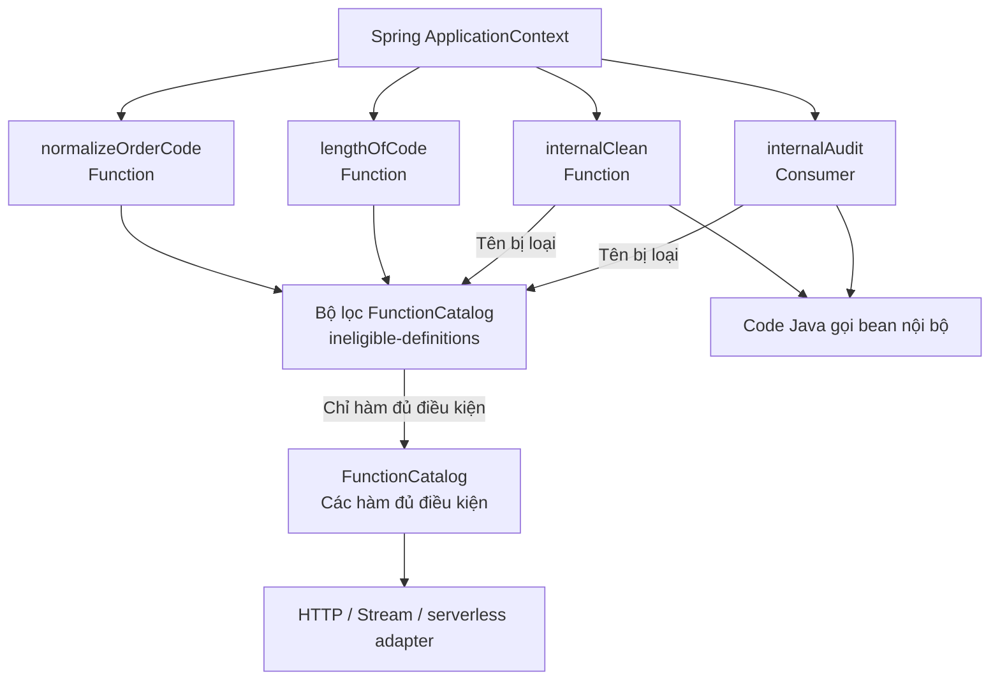
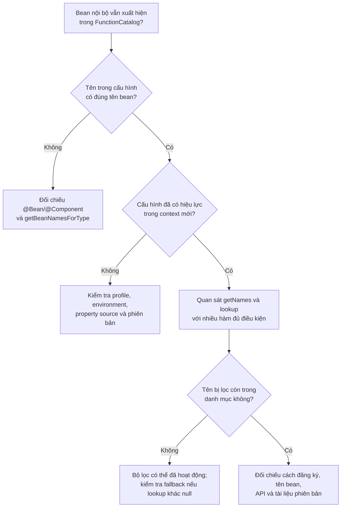

# Loại trừ bean bằng spring.cloud.function.ineligible-definitions

**Chương:** FunctionCatalog  
**Module:** Spring Cloud Function (`SPRING_CLOUD_FUNCTION`)

Trong Spring Cloud Function, các bean triển khai `Supplier`, `Function` và `Consumer` là những ứng viên để framework nhận diện và đăng ký với `FunctionCatalog`. Đây là cơ sở để một logic nghiệp vụ có thể tái sử dụng độc lập với giao thức: được gọi từ Java, qua HTTP, qua sự kiện trong Spring Cloud Stream hoặc từ một môi trường serverless.

Tuy nhiên, **không phải mọi Spring bean có kiểu hàm đều được chủ ý công bố như một chức năng nghiệp vụ**. Một thư viện có thể tạo `Function` để chuyển đổi dữ liệu nội bộ; một service có thể dùng `Consumer` để ghi log; một ứng dụng có thể cần một hàm hỗ trợ cho bean khác mà không muốn hàm hỗ trợ trở thành ứng viên được adapter lựa chọn.

Spring Cloud Function cung cấp thuộc tính **`spring.cloud.function.ineligible-definitions`** để chỉ định các **tên bean cần loại khỏi tập ứng viên đăng ký trong FunctionCatalog**. Bài này giải thích cách dùng thuộc tính, tác động của nó tới catalog và adapter, cách kiểm chứng hành vi, cũng như những ngộ nhận cần tránh.

Sau bài học, bạn có thể:

1. Phân biệt bean tồn tại trong `ApplicationContext` với bean đủ điều kiện xuất hiện trong `FunctionCatalog`.
2. Cấu hình một hoặc nhiều tên bean bằng `spring.cloud.function.ineligible-definitions`.
3. Giải thích vì sao hàm bị loại trừ vẫn có thể được inject và gọi trực tiếp trong Java.
4. Xác minh lọc catalog bằng `getNames(...)`, `lookup(...)` và kiểm thử Spring Boot.
5. Phân biệt lọc catalog với chọn `spring.cloud.function.definition`, giới hạn HTTP export và phân quyền bảo mật.
6. Chẩn đoán trường hợp tên bị lọc nhưng một lookup tên sai vẫn có kết quả do *single-function fallback*.

## 1. Bài toán: cùng là Java Function nhưng không cùng mục đích

Giả sử dịch vụ đơn hàng có bốn bean:

| Tên bean | Kiểu | Vai trò | Có muốn adapter gọi trực tiếp? |
| --- | --- | --- | --- |
| `normalizeOrderCode` | `Function<String, String>` | Chuẩn hóa mã đơn hàng | Có |
| `lengthOfCode` | `Function<String, Integer>` | Tính chiều dài mã | Có |
| `internalClean` | `Function<String, String>` | Hàm hỗ trợ cắt khoảng trắng | Không |
| `internalAudit` | `Consumer<String>` | Ghi nhận thông tin vận hành nội bộ | Không |

Tất cả đều là Spring bean hợp lệ. Nhưng chỉ hai bean đầu tiên được thiết kế như **chức năng có thể tra cứu ở tầng Spring Cloud Function**.

Nếu không cấu hình lọc, những bean `internalClean` và `internalAudit` cũng có thể trở thành ứng viên của `FunctionCatalog` vì chúng sử dụng các functional interface chuẩn Java.

Vấn đề không chỉ là danh sách tên dài thêm. Khi các adapter hoặc mã điều phối sử dụng tên hàm, tập ứng viên không mong muốn có thể gây:

- Lựa chọn nhầm hàm trong cấu hình hoặc thông điệp routing.
- Khó xác định đâu là hàm nghiệp vụ và đâu là công cụ nội bộ.
- Thay đổi hành vi suy đoán hàm mặc định khi số functional bean tăng lên.
- Nguy cơ mở rộng phạm vi chức năng được adapter export nếu không cấu hình kiểm soát.

**Giải pháp:** giữ các bean cần thiết trong Spring context, nhưng loại những tên không phù hợp ra khỏi tập ứng viên của catalog.



Trong sơ đồ, mũi tên từ bean nội bộ tới bộ lọc chỉ minh họa việc chúng **được xem xét rồi không trở thành ứng viên catalog**. Chúng không bị xóa khỏi `ApplicationContext`.

## 2. Chính xác thì ineligible-definitions làm gì?

Tài liệu Spring Cloud Function mô tả hai lớp lọc:

1. **Bộ lọc mặc định của framework:** tự loại một số bean đã biết là không nên trở thành ứng viên chức năng.
2. **Danh sách do ứng dụng bổ sung:** sử dụng `spring.cloud.function.ineligible-definitions` để thêm các **tên bean definition** muốn loại trừ.

Ví dụ từ tài liệu chính thức:

```properties
spring.cloud.function.ineligible-definitions=foo,bar
```

Điều đó có nghĩa: `foo` và `bar` là các **tên bean** không nên được xem là ứng viên cho `FunctionCatalog`. Đây **không phải** danh sách tên Java class, tên package hoặc danh sách địa chỉ HTTP.

### 2.1. Điều gì thay đổi và không thay đổi?

| Khía cạnh | Sau khi đặt một tên vào ineligible-definitions |
| --- | --- |
| Spring `ApplicationContext` | Bean vẫn có thể tồn tại và được Spring quản lý |
| Constructor injection / `@Qualifier` | Vẫn có thể tiêm bean trực tiếp nếu bean thỏa điều kiện của Spring |
| `context.getBean("internalClean")` | Vẫn có thể tìm được bean theo cơ chế Spring |
| `FunctionCatalog` | Tên bị loại không còn là ứng viên chức năng để catalog đăng ký/tra cứu theo cách thông thường |
| Composition qua catalog | Không nên dựa vào tên bị loại để tạo chuỗi composition |
| Adapter dựa trên FunctionCatalog | Không nên coi bean bị lọc là hàm có thể chọn/export qua catalog |
| Quyền truy cập Java hoặc endpoint khác | **Không tự bị chặn**; đây không phải cơ chế security |

Điểm quan trọng nhất: **lọc khỏi catalog khác hoàn toàn với hủy Spring bean**.

Nếu `internalClean` là một hàm hỗ trợ được inject vào `normalizeOrderCode`, hai bean vẫn có thể cộng tác trực tiếp trong Java. Chỉ có tư cách của `internalClean` trong catalog là thay đổi.

### 2.2. Tại sao framework cũng phải có bộ lọc mặc định?

Một `ApplicationContext` thực tế chứa nhiều bean do Spring Boot auto-configuration và thư viện khác cung cấp. Một số bean của chúng có thể vô tình thuộc `java.util.function.Function`, `Supplier` hoặc `Consumer` nhưng được tạo ra cho mục đích nội bộ.

Nếu tất cả đều được đưa vào catalog, một adapter sử dụng Spring Cloud Function có thể nhầm chúng với hàm nghiệp vụ. Vì vậy, framework đã có cơ chế loại một số bean được biết trước. Thuộc tính `ineligible-definitions` cho phép ứng dụng **bổ sung những tên cụ thể của mình**, không phải yêu cầu viết lại danh sách mặc định từ đầu.

Không nên hard-code một danh sách “các bean mặc định luôn bị lọc” mà không đối chiếu đúng bản Spring Cloud Function, vì thành phần hạ tầng và cách lọc có thể thay đổi theo phiên bản.

## 3. Cú pháp cấu hình đúng

### 3.1. Một bean

Trong `application.properties`:

```properties
spring.cloud.function.ineligible-definitions=internalClean
```

### 3.2. Nhiều bean

Dùng dấu phẩy để ngăn cách **tên bean definition**:

```properties
spring.cloud.function.ineligible-definitions=internalClean,internalAudit
```

Trong `application.yml`:

```yaml
spring:
  cloud:
    function:
      ineligible-definitions: "internalClean,internalAudit"
```

Đây là cách viết phản ánh trực tiếp cú pháp danh sách phân cách dấu phẩy được tài liệu hóa. Đối với phiên bản hoặc binder cụ thể, hãy dùng kiểu cấu hình mà nó hỗ trợ và xác minh kết quả thực tế.

### 3.3. Kết hợp với function definition cho adapter

Có thể đồng thời cấu hình **loại trừ hàm nội bộ** và **chọn hàm được adapter sử dụng**:

```yaml
spring:
  cloud:
    function:
      ineligible-definitions: "internalClean,internalAudit"
      definition: normalizeOrderCode
```

Hai thuộc tính **không trùng vai trò**:

- `ineligible-definitions`: một số tên **không được làm ứng viên catalog**.
- `definition`: **chọn một hàm hoặc composition** trong số các hàm có thể dùng cho ngữ cảnh tích hợp.

Nếu đặt `definition: internalClean` trong khi đồng thời loại `internalClean`, cấu hình đang tự mâu thuẫn: adapter yêu cầu hàm mà catalog không được phép nhận diện làm ứng viên. Kết quả cụ thể (không tạo binding, không phân giải được, thông báo lỗi...) phụ thuộc adapter và phiên bản, nhưng cách cấu hình đúng là chọn một hàm **đủ điều kiện**.

### 3.4. Tên chính xác quan trọng hơn tên phương thức

```java
@Bean("internalClean")
public Function<String, String> trimInput() {
    return String::trim;
}
```

Tên bean là `internalClean`, không phải `trimInput`. Vì vậy:

```properties
spring.cloud.function.ineligible-definitions=internalClean
```

là lựa chọn rõ ràng. Đừng nhầm tên phương thức Java với tên bean đã đặt tường minh.

Tương tự, nếu dùng `@Component("internalClean")`, hãy đối chiếu tên bean thực tế. Không dựa vào tên class, alias tự suy hoặc một mẫu `internal*` nếu tài liệu phiên bản không nói thuộc tính hỗ trợ wildcard.

## 4. Ví dụ Spring Boot tự chứa: lọc hàm hỗ trợ, giữ hàm nghiệp vụ

Ví dụ này có **hai functional bean công khai** và **hai bean hỗ trợ nội bộ**. Việc giữ hai ứng viên hợp lệ còn giúp quan sát lỗi tên không bị single-function fallback che giấu.

```java
import java.util.Locale;
import java.util.Set;
import java.util.function.Consumer;
import java.util.function.Function;

import org.springframework.beans.factory.annotation.Qualifier;
import org.springframework.boot.ApplicationRunner;
import org.springframework.boot.SpringApplication;
import org.springframework.boot.autoconfigure.SpringBootApplication;
import org.springframework.cloud.function.context.FunctionCatalog;
import org.springframework.context.ApplicationContext;
import org.springframework.context.annotation.Bean;

@SpringBootApplication
public class FunctionFilterApplication {

    public static void main(String[] args) {
        SpringApplication.run(FunctionFilterApplication.class, args);
    }

    // Bean hỗ trợ: vẫn cần dùng bên trong code Java.
    @Bean("internalClean")
    public Function<String, String> internalClean() {
        return String::trim;
    }

    // Bean nghiệp vụ: adapter có thể chọn theo tên.
    @Bean("normalizeOrderCode")
    public Function<String, String> normalizeOrderCode(
            @Qualifier("internalClean")
            Function<String, String> clean) {
        return value ->
            clean.apply(value).toUpperCase(Locale.ROOT);
    }

    // Một bean nghiệp vụ khác.
    @Bean("lengthOfCode")
    public Function<String, Integer> lengthOfCode() {
        return String::length;
    }

    // Bean nội bộ: không muốn được adapter chọn làm sink.
    @Bean("internalAudit")
    public Consumer<String> internalAudit() {
        return value -> System.out.println("INTERNAL AUDIT: " + value);
    }

    @Bean
    public ApplicationRunner inspectFiltering(
            ApplicationContext context,
            FunctionCatalog catalog) {
        return args -> {
            System.out.println(
                "Spring contains internalClean: "
                    + context.containsBean("internalClean"));
            System.out.println(
                "Spring contains internalAudit: "
                    + context.containsBean("internalAudit"));

            Set<String> functionNames =
                catalog.getNames(Function.class);
            Set<String> allNames = catalog.getNames(null);

            System.out.println("Catalog functions: " + functionNames);
            System.out.println("Catalog all: " + allNames);

            Function<String, String> normalize =
                catalog.lookup(
                    Function.class, "normalizeOrderCode");
            if (normalize == null) {
                throw new IllegalStateException(
                    "normalizeOrderCode not available");
            }

            System.out.println(
                normalize.apply("  ord-42  ")); // ORD-42
        };
    }
}
```

Để chạy ví dụ **với bộ lọc**, thêm cấu hình:

```properties
spring.cloud.function.ineligible-definitions=internalClean,internalAudit
spring.cloud.function.definition=normalizeOrderCode
```

**Kết quả cần quan sát:**

| Kiểm tra | Kỳ vọng |
| --- | --- |
| `context.containsBean("internalClean")` | `true` |
| `context.containsBean("internalAudit")` | `true` |
| `catalog.getNames(Function.class)` | Có `normalizeOrderCode`, `lengthOfCode` |
| `catalog.getNames(null)` | Không nên có `internalClean`, `internalAudit` trong danh mục ứng viên |
| `lookup(Function.class, "normalizeOrderCode")` | Có thể gọi và cho ra `ORD-42` |
| `normalizeOrderCode` gọi `internalClean` | Vẫn hoạt động qua Java injection |

Danh sách catalog có thể chứa những hàm khác do framework đăng ký. Vì vậy, không nên dùng kiểm thử `getNames(null).size() == 2`; hãy kiểm tra **tên phải có và tên không được có**.

### 4.1. Tại sao normalizeOrderCode vẫn hoạt động?

Hàm `normalizeOrderCode` nhận dependency:

```java
@Qualifier("internalClean")
Function<String, String> clean
```

Spring vẫn quản lý bean `internalClean`, vì thuộc tính `ineligible-definitions` không xóa Spring bean. Khi `normalizeOrderCode.apply(...)` thực hiện `clean.apply(...)`, đây là lời gọi **trực tiếp từ Java tới bean hỗ trợ**, không phải một lookup độc lập qua catalog.

Điểm này quan trọng với thiết kế: có thể giữ một functional collaborator làm thành phần nội bộ mà không công bố nó thành function entry point.

### 4.2. Khi nào nên đổi hàm hỗ trợ thành service thông thường?

Nếu `internalClean` chỉ phục vụ một vài service, đôi khi mô hình rõ ràng hơn là dùng một lớp service có phương thức cụ thể:

```java
import org.springframework.stereotype.Component;

@Component
public class OrderCodeCleaner {
    public String clean(String value) {
        return value.trim();
    }
}
```

Với `OrderCodeCleaner`, lớp không triển khai `Function` nên không trở thành ứng viên catalog chỉ vì hợp đồng functional interface. Đây là **lựa chọn thiết kế thay thế** cho bean `internalClean` trong ví dụ, không phải lời khuyên tạo cả hai.

Nếu bean đã cần dùng như một `Function` ở nhiều vị trí, hoặc đến từ thư viện khác không sửa được, `ineligible-definitions` vẫn là công cụ phù hợp.

## 5. Xác minh qua ApplicationContext và FunctionCatalog

Để điều tra một tên bị lọc, hãy nhìn vào **hai nguồn thông tin riêng**:

### 5.1. Spring ApplicationContext: bean có tồn tại không?

```java
String[] javaFunctions =
    context.getBeanNamesForType(Function.class);

String[] javaConsumers =
    context.getBeanNamesForType(Consumer.class);
```

Các dòng mã này giả định `context` có kiểu `ApplicationContext`. Chúng cho biết những bean mà Spring nhận diện theo kiểu. Một bean nằm trong danh sách này **chưa chắc** là ứng viên catalog.

### 5.2. FunctionCatalog: hàm nào có thể được nhận diện?

```java
Set<String> functions =
    catalog.getNames(Function.class);

Set<String> consumers =
    catalog.getNames(Consumer.class);

Set<String> all =
    catalog.getNames(null);
```

Với cấu hình lọc, các tên `internalClean` và `internalAudit` không nên xuất hiện như ứng viên catalog. Trong khi đó, `normalizeOrderCode` và `lengthOfCode` cần tồn tại trong nhóm `Function`.

**Lưu ý:** `getNames(...)` là công cụ quan sát danh mục; khi cần chứng minh một chức năng thực thi được, hãy tra cứu bằng `lookup(...)` và kiểm tra hành vi trên dữ liệu thử. Đừng suy rằng một tên xuất hiện trong catalog đồng nghĩa tự động có endpoint HTTP.

### 5.3. Vì sao đôi khi lookup tên bị lọc vẫn trả một hàm?

Đây là bẫy thường gặp: **single-function fallback**.

Nếu sau khi lọc chỉ còn **một functional bean đủ điều kiện**, một số phiên bản/cấu hình Spring Cloud Function cho phép:

```java
// Giả sử catalog chỉ còn normalizeOrderCode và fallback bật:
Function<String, String> result =
    catalog.lookup(Function.class, "internalClean");
```

Khi đó `result` **có thể không phải** bean `internalClean`. Catalog có thể trả về **hàm duy nhất khác tên** do fallback. Việc lookup trả khác `null` vì vậy **không chứng minh lọc bị hỏng**.

Để xác minh chính xác:

1. Kiểm tra `catalog.getNames(null)` có chứa tên bị loại không.
2. Dùng một fixture có **từ hai ứng viên chức năng hợp lệ trở lên**, như `normalizeOrderCode` và `lengthOfCode` trong ví dụ này.
3. Hoặc tắt fallback khi phiên bản thực tế hỗ trợ:

```properties
spring.cloud.function.single-function-fallback-enabled=false
```

Không giả định công tắc trên có ở mọi bản cũ; phải đối chiếu tài liệu và thử trên dependency đã phân giải. Nếu lookup một tên bị lọc vẫn cho kết quả trong ứng dụng chỉ có một hàm, trước hết hãy xác định **đó là hàm nào**.

## 6. Tác động tới definition, composition và adapter

### 6.1. spring.cloud.function.definition chọn từ những hàm đủ điều kiện

```properties
spring.cloud.function.ineligible-definitions=internalClean,internalAudit
spring.cloud.function.definition=normalizeOrderCode
```

Khi adapter sử dụng `spring.cloud.function.definition`, nó yêu cầu `normalizeOrderCode` từ catalog. Đây là một hàm được phép nhận diện, nên cách chọn hợp lý.

Ngược lại:

```properties
spring.cloud.function.ineligible-definitions=internalClean
spring.cloud.function.definition=internalClean
```

là cấu hình không nhất quán: một thuộc tính loại `internalClean`, thuộc tính còn lại yêu cầu chính tên đó. Hãy sửa tên definition hoặc thay đổi quyết định lọc; đừng dựa vào cơ chế fallback để ứng dụng “tự chọn” một hàm khác.

### 6.2. Composition không thể phụ thuộc vào một ứng viên đã bị lọc

Khi hai hàm `normalizeOrderCode` và `lengthOfCode` được catalog nhận diện:

```java
Function<String, Integer> pipeline =
    catalog.lookup(
        Function.class, "normalizeOrderCode|lengthOfCode");

if (pipeline == null) {
    throw new IllegalStateException("Pipeline unavailable");
}
System.out.println(pipeline.apply("  ord-42  ")); // 6
```

Đây là composition hợp lệ vì `normalizeOrderCode` trả `String` và `lengthOfCode` nhận `String`.

Trong khi đó, chuỗi:

```text
internalClean|normalizeOrderCode
```

không phải definition nên dựa vào khi `internalClean` đã bị đánh dấu ineligible. Nếu muốn dùng logic làm sạch trước chuẩn hóa, có hai hướng:

- Giữ việc gọi trực tiếp `internalClean` từ bên trong `normalizeOrderCode` như ví dụ ở mục 4.
- Nếu thực sự muốn nó là một mắt xích composition có thể tra cứu, xem lại quyết định loại trừ hoặc tách một bean nghiệp vụ phù hợp với mục đích export.

Trong cả hai trường hợp, **không biến tính năng lọc thành cơ chế routing/composition**; nó chỉ quyết định tính đủ điều kiện của ứng viên.

### 6.3. HTTP, Spring Cloud Stream và serverless

| Môi trường sử dụng | Tác động của lọc catalog | Việc vẫn cần cấu hình |
| --- | --- | --- |
| Java gọi `FunctionCatalog.lookup(...)` | Tên bị lọc không còn là ứng viên bình thường của catalog | Kiểm tra tên, kiểu hàm và fallback |
| Spring Cloud Function Web | Adapter dựa trên catalog không nên export tên bị lọc như một hàm có thể gọi | Web dependency, mapping, cấu hình export, Spring Security |
| Spring Cloud Stream | Hàm bị lọc không nên được chọn làm function binding qua catalog | `spring.cloud.function.definition`, binder, destination, tên binding |
| Serverless adapter | Hàm bị lọc không nên trở thành đích lookup thông thường của entry point | Handler/entry point, event mapping, cấu hình nền tảng cloud |
| Code Java gọi bean nội bộ | Không bị loại khỏi `ApplicationContext` | DI, vòng đời bean và quyền truy cập theo kiến trúc ứng dụng |

**Lọc catalog không phải tính năng bảo mật.** Một controller tự viết vẫn có thể inject `internalClean` và gọi nó; một endpoint khác có thể phơi bày logic đó bằng con đường không đi qua catalog. Việc hạn chế ai được gọi chức năng nào phải được thực hiện ở tầng API, xác thực, phân quyền, hạ tầng và thiết kế ứng dụng.

### 6.4. Giới hạn HTTP export không giống ineligible-definitions

Spring Cloud Function Web cho phép dùng danh sách function definition khi cần kiểm soát những hàm được export trong adapter, ví dụ:

```properties
spring.cloud.function.definition=normalizeOrderCode;lengthOfCode
```

Trong ngữ cảnh adapter hỗ trợ cú pháp này, dấu `;` biểu thị **nhiều definition độc lập**, không phải composition nối tiếp.

So sánh:

| Cơ chế | Ý nghĩa |
| --- | --- |
| `ineligible-definitions=internalClean` | Không coi `internalClean` là ứng viên chức năng trong catalog |
| `definition=normalizeOrderCode` | Chọn `normalizeOrderCode` cho ngữ cảnh tích hợp |
| `definition=normalizeOrderCode;lengthOfCode` | Chọn nhiều definition độc lập trong adapter có hỗ trợ |
| `definition=normalizeOrderCode|lengthOfCode` | Chọn một pipeline composition |

Một danh sách export tường minh của Web hoặc Stream chỉ điều chỉnh **adapter liên quan**; nó không thay thế quyết định loại trừ ứng viên trong catalog.

## 7. Kiểm thử tự động cho hành vi lọc

Với `FunctionFilterApplication` ở mục 4 và dependency Spring Boot Test/JUnit 5 tương thích, viết kiểm thử:

```java
import static org.junit.jupiter.api.Assertions.*;

import java.util.Set;
import java.util.function.Consumer;
import java.util.function.Function;

import org.junit.jupiter.api.Test;
import org.springframework.beans.factory.annotation.Autowired;
import org.springframework.beans.factory.annotation.Qualifier;
import org.springframework.boot.test.context.SpringBootTest;
import org.springframework.cloud.function.context.FunctionCatalog;
import org.springframework.context.ApplicationContext;

@SpringBootTest(
    classes = FunctionFilterApplication.class,
    properties = {
        "spring.cloud.function.ineligible-definitions=internalClean,internalAudit"
    }
)
class IneligibleDefinitionsTest {

    @Autowired
    private ApplicationContext context;

    @Autowired
    private FunctionCatalog catalog;

    @Autowired
    @Qualifier("internalClean")
    private Function<String, String> directClean;

    @Test
    void excludedBeansRemainInSpringContext() {
        assertTrue(context.containsBean("internalClean"));
        assertTrue(context.containsBean("internalAudit"));

        assertEquals("ord-42",
            directClean.apply("  ord-42  "));
    }

    @Test
    void catalogContainsBusinessFunctionsOnly() {
        Set<String> functions =
            catalog.getNames(Function.class);
        Set<String> allNames =
            catalog.getNames(null);

        assertTrue(functions.contains("normalizeOrderCode"));
        assertTrue(functions.contains("lengthOfCode"));

        assertFalse(allNames.contains("internalClean"));
        assertFalse(allNames.contains("internalAudit"));
    }

    @Test
    void businessFunctionsStillExecute() {
        Function<String, String> normalize =
            catalog.lookup(Function.class, "normalizeOrderCode");
        Function<String, Integer> length =
            catalog.lookup(Function.class, "lengthOfCode");

        assertNotNull(normalize);
        assertNotNull(length);

        String normalized = normalize.apply("  ord-42  ");
        assertEquals("ORD-42", normalized);
        assertEquals(6, length.apply(normalized).intValue());
    }

    @Test
    void excludedNamesAreNotNormalLookupCandidates() {
        // Có ít nhất hai bean chức năng hợp lệ để tránh
        // single-function fallback che giấu kết quả.
        assertTrue(catalog.getNames(Function.class)
            .containsAll(Set.of("normalizeOrderCode", "lengthOfCode")));

        assertNull(
            catalog.lookup(Function.class, "internalClean"));
        assertNull(
            catalog.lookup(Consumer.class, "internalAudit"));
    }
}
```

Các test kiểm tra ba hợp đồng riêng:

1. **Bean Spring vẫn tồn tại:** bị lọc khỏi catalog không làm hỏng dependency injection.
2. **Danh mục catalog phản ánh bộ lọc:** tên nội bộ không còn là ứng viên, tên nghiệp vụ vẫn có.
3. **Logic nghiệp vụ còn hoạt động:** `normalizeOrderCode` vẫn sử dụng `internalClean` bên trong, và các hàm công khai vẫn tra cứu được.

Test không yêu cầu `catalog.size() == 2` hoặc `getNames(null)` bằng đúng hai tên, vì framework có thể cung cấp thêm hàm hạ tầng. Test cũng không thực sự gửi message tới broker hoặc HTTP: đó là nhiệm vụ của kiểm thử tích hợp adapter ở tầng tiếp theo.

### 7.1. So sánh với trường hợp không cấu hình bộ lọc

Để quan sát trước/sau:

1. Chạy ứng dụng không có `spring.cloud.function.ineligible-definitions` và ghi lại danh sách `getNames(null)`.
2. Khởi động **context mới** với thuộc tính `internalClean,internalAudit`.
3. So sánh những tên ứng viên đã biến mất.
4. Kiểm tra `context.containsBean(...)` của cả hai trường hợp.

Đừng đổi một file cấu hình bên ngoài rồi trông đợi catalog hiện có lập tức tái xây dựng toàn bộ đăng ký. Hãy xác minh trên một lần khởi động hoặc context mới với giá trị cấu hình thực tế đã có hiệu lực.

## 8. Phân biệt với các cơ chế khác của Spring

Nhiều công cụ khác cũng có vẻ như “ẩn” hoặc “chọn” một bean nhưng xử lý ở **tầng khác**.

| Cơ chế | Tác động chính | Có xóa Spring bean? | Có phải security? |
| --- | --- | --- | --- |
| `spring.cloud.function.ineligible-definitions` | Lọc ứng viên `FunctionCatalog` theo tên | Không | Không |
| `@Qualifier("name")` | Chọn dependency nào được inject | Không | Không |
| `@Primary` | Ưu tiên một bean khi có nhiều ứng viên DI | Không | Không |
| `@ConditionalOnProperty` | Điều kiện tạo bean trong Spring context | Có thể khiến bean không được tạo | Không |
| `spring.cloud.function.definition` | Chọn function/definition cho adapter | Không | Không |
| Cấu hình export HTTP | Chọn hàm được Web adapter ánh xạ | Không nhất thiết | Không thay thế security |
| Spring Security / cơ chế phân quyền API | Kiểm soát quyền truy cập | Không | Có, nếu thiết kế đúng |

### Ví dụ: @Primary không loại chức năng khỏi catalog

Nếu có hai bean `Function<String, String>`, đặt `@Primary` lên một bean có thể giúp Spring chọn nó ở một điểm injection không có `@Qualifier`. Điều đó **không đồng nghĩa** bean còn lại không thể được catalog nhận diện.

Nếu muốn chỉ `normalizeOrderCode` làm ứng viên catalog và `internalClean` chỉ là hàm nội bộ, hãy dùng thuộc tính lọc theo tên hoặc đổi `internalClean` thành service không triển khai functional interface, tùy kiến trúc.

### Ví dụ: @ConditionalOnProperty khác loại trừ catalog

Nếu điều kiện của một bean không thỏa mãn, Spring có thể không tạo bean đó. Khi ấy không chỉ catalog mà code Java phụ thuộc vào bean cũng bị ảnh hưởng.

Trong khi đó, `ineligible-definitions` cho phép bean vẫn tồn tại trong Spring context và được inject, chỉ ngăn nó trở thành ứng viên catalog theo cơ chế của Spring Cloud Function.

## 9. Chẩn đoán trường hợp cấu hình không có tác dụng



### 9.1. Checklist khi debug

- **Đúng key?** `spring.cloud.function.ineligible-definitions`, không phải `spring.cloud.function.definition`.
- **Đúng danh sách?** Các tên phân cách bằng dấu phẩy như `foo,bar`.
- **Đúng tên bean?** Kiểm tra `@Bean("explicitName")`, `@Component("name")` và danh sách Spring context.
- **Cấu hình được nạp?** Xem file `application.yml`, profile đang bật, biến môi trường và property source ưu tiên cao hơn.
- **Bean có kiểu gì?** `Supplier`, `Function`, `Consumer`; có dùng wrapper hoặc kiểu đăng ký đặc biệt không?
- **Đang quan sát tầng nào?** `getBeanNamesForType(...)` trả bean Spring; `catalog.getNames(...)` trả tên ứng viên catalog.
- **Có fallback?** Nếu chỉ còn một hàm, `lookup("tenBiLoc") != null` chưa đủ nói bộ lọc thất bại.
- **Có kiểm thử đúng adapter?** Web/Stream/serverless có cấu hình selection và export riêng.
- **Phiên bản nào?** Đối chiếu tài liệu đúng bản Spring Cloud Function trong runtime.

### 9.2. Bảng lỗi thường gặp

| Hiện tượng | Nguyên nhân có thể | Hướng giải quyết |
| --- | --- | --- |
| Tên nội bộ vẫn ở `getNames(null)` | Gõ sai tên bean, property không được nạp hoặc đăng ký đặc biệt | Kiểm tra tên bean definition và cấu hình hiệu lực |
| Spring không inject được `internalClean` | Bean không được tạo hoặc bị cấu hình Spring loại bỏ | Kiểm tra `ApplicationContext`; bản thân ineligible không xóa bean |
| Lookup tên bị lọc trả về hàm khác | Single-function fallback còn bật | Kiểm tra tên trong danh mục và thử với nhiều hàm hợp lệ |
| Hàm nghiệp vụ biến mất khỏi catalog | Vô tình thêm tên công khai vào danh sách ineligible | Sửa danh sách lọc và khởi động context mới |
| Composition không tìm thấy `internalClean` | Thành phần này đã bị loại khỏi catalog | Gọi trực tiếp như collaborator hoặc xem lại thiết kế pipeline |
| Stream không tạo binding mong muốn | Definition trỏ vào tên bị loại hoặc sai tên | Chọn hàm đủ điều kiện và kiểm tra binder |
| HTTP vẫn có đường truy cập logic nội bộ | Controller/custom route nằm ngoài catalog hoặc cấu hình khác | Rà soát API và phân quyền; ineligible không phải security |
| Dùng `@Primary` nhưng catalog vẫn liệt kê cả hai | `@Primary` chỉ chọn dependency để inject | Dùng `ineligible-definitions` cho ứng viên không cần catalog |

## 10. Tình huống thực tế: tránh để helper nội bộ trở thành endpoint

Một ứng dụng thương mại điện tử có pipeline nghiệp vụ `normalizeOrderCode` được gọi từ HTTP hoặc nhận event. Trong cùng ứng dụng có `internalAudit` ghi thông tin phục vụ vận hành.

Ban đầu, developer viết:

```java
@Bean("internalAudit")
public Consumer<String> internalAudit() {
    return text -> System.out.println("AUDIT: " + text);
}
```

Về mặt Java, đây chỉ là một `Consumer<String>`. Nhưng với Spring Cloud Function, bean đó cũng là một loại functional bean và có thể được nhận diện làm ứng viên catalog. Nếu không muốn adapter lựa chọn nó độc lập, cấu hình:

```properties
spring.cloud.function.ineligible-definitions=internalAudit
spring.cloud.function.definition=normalizeOrderCode
```

Kết quả dự kiến:

1. `internalAudit` vẫn là Spring bean; service nội bộ có thể inject nó để ghi log.
2. Catalog loại `internalAudit` khỏi tập ứng viên, nên definition dành cho adapter không nên trỏ tới nó.
3. `normalizeOrderCode` vẫn được tìm theo tên và có thể sử dụng từ Java, HTTP hoặc sự kiện với adapter tương ứng.

**Giới hạn an toàn:** nếu hệ thống có một HTTP controller khác trực tiếp gọi `internalAudit.accept(...)`, cấu hình lọc này không chặn controller. Cần bảo vệ endpoint bằng xác thực, phân quyền và thiết kế đường API phù hợp. Cũng không nên ghi dữ liệu nhạy cảm ra console chỉ vì ví dụ dùng `System.out.println(...)`.

## 11. Bài tập tự thực hành

1. **Lọc một bean:** chạy `FunctionFilterApplication` không cấu hình lọc, ghi lại danh sách tên. Thêm `spring.cloud.function.ineligible-definitions=internalClean`, khởi động lại, rồi so sánh `getNames(Function.class)`.
2. **Lọc hai loại:** thêm `internalAudit` vào danh sách. Dùng `getNames(null)` và `getNames(Consumer.class)` để kiểm tra kết quả. Vì sao `ApplicationContext.containsBean("internalAudit")` vẫn trả `true`?
3. **Sử dụng collaborator:** xác minh `normalizeOrderCode.apply("  ord-42  ")` vẫn trả `ORD-42` dù `internalClean` bị lọc khỏi catalog.
4. **Thử composition:** chạy `normalizeOrderCode|lengthOfCode`. Sau đó thử `internalClean|normalizeOrderCode` và giải thích vì sao không nên dùng một hàm bị lọc như thành phần definition.
5. **Xử lý fallback:** tạo phiên bản chỉ có một hàm được phép trong catalog. Quan sát `lookup("internalClean")` và so sánh với `catalog.getNames(null)`. Giải thích vì sao khác `null` không đồng nghĩa tên đó được đăng ký.
6. **Thiết kế lại helper:** thay bean `internalClean` bằng service `OrderCodeCleaner` không triển khai `Function`. So sánh cách này với cấu hình lọc, nêu lợi ích và đánh đổi của mỗi cách.
7. **Adapter:** nếu dự án có Spring Cloud Function Web hoặc Spring Cloud Stream, đặt `definition=normalizeOrderCode` và kiểm tra adapter gọi đúng hàm; không dùng `internalAudit` làm entry point.

### Câu hỏi phỏng vấn

**Hỏi:** Điều gì khác nhau giữa `spring.cloud.function.ineligible-definitions=internalClean` và `spring.cloud.function.definition=normalizeOrderCode`?

**Đáp:** Thuộc tính thứ nhất **loại `internalClean` khỏi danh sách ứng viên FunctionCatalog** nhưng không xóa bean khỏi Spring context. Thuộc tính thứ hai **chọn `normalizeOrderCode` làm hàm hoặc definition cho một ngữ cảnh tích hợp**; nó không mặc nhiên loại những hàm khác khỏi catalog. Hai thuộc tính bổ sung cho nhau và không thay thế cơ chế phân quyền.

## 12. Ghi nhớ

- `spring.cloud.function.ineligible-definitions` nhận **danh sách tên bean definition phân cách bằng dấu phẩy**, ví dụ `internalClean,internalAudit`.
- Spring Cloud Function vốn đã có **bộ lọc mặc định** cho một số bean không phù hợp; thuộc tính này giúp bổ sung tên cần loại ở ứng dụng.
- Bean bị lọc **vẫn có thể tồn tại trong `ApplicationContext` và được inject trực tiếp**. Chỉ khả năng được catalog nhận diện làm ứng viên chức năng là thay đổi.
- Đừng dùng `lookup("tenBiLoc") != null` làm bằng chứng loại trừ thất bại khi chỉ còn một hàm: phải tính tới *single-function fallback*.
- Phân biệt rõ **lọc ứng viên** (`ineligible-definitions`), **chọn definition** (`spring.cloud.function.definition`), **export/binding qua adapter** và **bảo mật hệ thống**.
- Cách kiểm chứng đáng tin cậy là đối chiếu `ApplicationContext` với `FunctionCatalog.getNames(...)`, kiểm tra lookup và hành vi nghiệp vụ, sau đó kiểm thử adapter phù hợp.

### Tài liệu tham khảo

- [Spring Cloud Function — Programming Model: Filtering ineligible functions](https://docs.spring.io/spring-cloud-function/reference/spring-cloud-function/programming-model.html): bộ lọc mặc định, cú pháp `spring.cloud.function.ineligible-definitions=foo,bar`, FunctionCatalog và function definition.
- [Spring Cloud Function — Functional Bean Definitions](https://docs.spring.io/spring-cloud-function/reference/functional.html): quan sát những tên hàm đang có trong catalog.
- [Spring Cloud Function 4.0.4 — Reference Guide](https://docs.spring.io/spring-cloud-function/docs/4.0.4/reference/html/spring-cloud-function.html): ví dụ về cách lọc các functional bean trong một dòng phiên bản trước.
- [Spring Cloud Stream — Producing and Consuming Messages](https://docs.spring.io/spring-cloud-stream/reference/spring-cloud-stream/producing-and-consuming-messages.html): chọn các hàm được kết nối với binding thông qua function definition.
