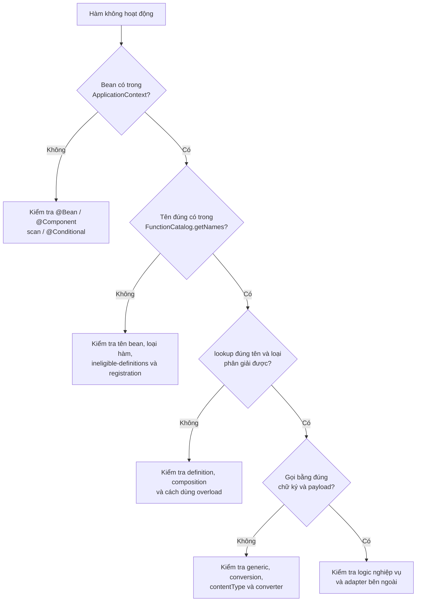

# Nhận diện hàm không tồn tại, sai tên hoặc sai chữ ký

**Chương:** FunctionCatalog  
**Module:** Spring Cloud Function (`SPRING_CLOUD_FUNCTION`)

Spring Cloud Function giúp viết logic nghiệp vụ thành `Supplier`, `Function` và `Consumer` để tái sử dụng độc lập với cách được gọi. Cùng một hàm có thể chạy từ mã Java, được gọi qua HTTP, xử lý sự kiện bằng Spring Cloud Stream hoặc triển khai trong môi trường serverless. Trung tâm của cơ chế lựa chọn và thực thi đó là **`FunctionCatalog`**.

Khi một lời gọi thất bại, thông báo “không tìm thấy hàm” có thể che giấu nhiều nguyên nhân khác nhau: chưa có Spring bean, dùng sai tên, chọn sai functional interface, gán nhầm kiểu generic hoặc gửi payload không chuyển đổi được. Cách chẩn đoán đúng là **xác định lỗi xảy ra ở tầng nào**, thay vì sửa ngẫu nhiên `spring.cloud.function.definition` hay thay đổi chữ ký hàm.

Bài này hướng dẫn một quy trình có thể lặp lại để phân biệt các trường hợp đó, có ví dụ Spring Boot, bảng lỗi, phép thử JUnit và các lưu ý khi xuất hàm qua HTTP/sự kiện/serverless.

## 1. Bốn nhóm lỗi cần phân biệt

| Nhóm | Ví dụ | Câu hỏi cần kiểm tra |
| --- | --- | --- |
| **Hàm không tồn tại / chưa đăng ký** | `lookup("notRegistered")` | Bean có thực sự được Spring tạo và catalog nhận diện không? |
| **Sai tên hoặc definition** | Bean tên `normalizeOrderCode` nhưng gọi `normaliseOrderCode` | Tên thực tế, `@Bean("...")` hoặc chuỗi composition có khớp không? |
| **Sai loại hàm** | Mong `Supplier` nhưng bean thực tế là `Function` | Hàm dùng `get()`, `apply(input)` hay `accept(input)`? |
| **Sai chữ ký kiểu dữ liệu** | `Function<String, Integer>` bị dùng như `Function<String, String>` | Kiểu input/output, generic, message/payload và converter có đúng không? |

Đặc biệt, **chữ ký** có hai tầng:

1. **Loại giao diện:** `Supplier<O>`, `Function<I,O>` hoặc `Consumer<I>`. Chúng khác số lượng tham số và cách gọi.
2. **Kiểu dữ liệu:** ví dụ `Function<String,Integer>` khác `Function<OrderRequest,OrderDecision>`, dù cùng thuộc `Function.class`.

Một lỗi ở tầng loại không nhất thiết giống lỗi ở tầng generic. Cũng không nên đồng nhất lỗi do adapter HTTP hoặc message binding với lỗi `FunctionCatalog`.



Sơ đồ là thứ tự kiểm tra thực dụng, không phải biểu diễn mã nguồn nội bộ. Có những trường hợp catalog dùng đăng ký riêng hoặc cơ chế tra cứu dự phòng, nên kết luận cuối cùng phải dựa vào tên và hành vi quan sát được.

## 2. Nắm chắc các API trước khi chẩn đoán

`FunctionCatalog` thường được tiêm vào bean Spring:

```java
import java.util.Set;
import java.util.function.Consumer;
import java.util.function.Function;
import java.util.function.Supplier;
import org.springframework.cloud.function.context.FunctionCatalog;

// Giả sử biến catalog đã được Spring tiêm.
Set<String> all = catalog.getNames(null);
Set<String> suppliers = catalog.getNames(Supplier.class);
Set<String> functions = catalog.getNames(Function.class);
Set<String> consumers = catalog.getNames(Consumer.class);

Function<String, String> operation =
    catalog.lookup(Function.class, "normalizeOrderCode");
```

| API | Dùng để làm gì? | Không chứng minh điều gì? |
| --- | --- | --- |
| `getNames(null)` | Liệt kê các tên chức năng được catalog nhận diện | Không bảo đảm mọi tên đã có HTTP route hoặc binding |
| `getNames(Function.class)` | Kiểm tra ứng viên thuộc nhóm `Function` | Không phân biệt được generic `String → String` với `String → Integer` |
| `getNames(Supplier.class)`, `getNames(Consumer.class)` | Kiểm tra ứng viên theo nhóm | Không khẳng định hàm không có side effect |
| `lookup("name")` | Phân giải tên/definition thành biểu diễn hàm | Không đảm bảo tên thực sự tồn tại nếu single-function fallback bật |
| `lookup(Function.class, "name")` | Diễn đạt loại giao diện dự kiến và tra cứu theo tên | Không phải phép kiểm tra đầy đủ kiểu generic |
| `ApplicationContext.getBean("name")` | Lấy Spring bean trực tiếp | Không kiểm tra tư cách ứng viên catalog |

`FunctionCatalog.lookup(...)` có thể trả về một **wrapper** do Spring Cloud Function quản lý. Khi không phân giải được một tên, API thường không trả về một hàm sử dụng được; nhưng với *single-function fallback*, một tên sai vẫn có thể ánh xạ sang hàm duy nhất. Ngoài ra, lookup hoặc invocation có thể phát sinh ngoại lệ khi gặp definition không hợp lệ, sai loại hoặc lỗi conversion. **Không viết mã giả định mọi lỗi đều chỉ trả `null`.**

## 3. Ứng dụng mẫu: đủ loại hàm để phân biệt lỗi

Ví dụ sau dùng Spring Boot và Spring Cloud Function context tương thích. Nó có nhiều functional bean để khi kiểm tra tên sai không vô tình được *single-function fallback* cứu.

```java
import java.util.Locale;
import java.util.Set;
import java.util.function.Consumer;
import java.util.function.Function;
import java.util.function.Supplier;

import org.springframework.boot.ApplicationRunner;
import org.springframework.boot.SpringApplication;
import org.springframework.boot.autoconfigure.SpringBootApplication;
import org.springframework.cloud.function.context.FunctionCatalog;
import org.springframework.context.ApplicationContext;
import org.springframework.context.annotation.Bean;

@SpringBootApplication
public class FunctionDiagnosisApplication {

    public static void main(String[] args) {
        SpringApplication.run(FunctionDiagnosisApplication.class, args);
    }

    // Tên bean là normalizeOrderCode, KHÔNG PHẢI normalize().
    @Bean("normalizeOrderCode")
    public Function<String, String> normalize() {
        return value -> value.trim().toUpperCase(Locale.ROOT);
    }

    @Bean("codeLength")
    public Function<String, Integer> countCharacters() {
        return String::length;
    }

    @Bean("issueOrderCode")
    public Supplier<String> issueOrderCode() {
        return () -> "ord-42";
    }

    @Bean("auditOrderCode")
    public Consumer<String> auditOrderCode() {
        return value -> System.out.println("AUDIT: " + value);
    }

    @Bean
    public ApplicationRunner inspectCatalog(
            ApplicationContext context,
            FunctionCatalog catalog) {
        return args -> {
            System.out.println(
                "Bean exists: "
                    + context.containsBean("normalizeOrderCode"));

            print("All", catalog.getNames(null));
            print("Suppliers", catalog.getNames(Supplier.class));
            print("Functions", catalog.getNames(Function.class));
            print("Consumers", catalog.getNames(Consumer.class));

            Function<String, String> normalizer =
                catalog.lookup(Function.class, "normalizeOrderCode");

            if (normalizer == null) {
                throw new IllegalStateException(
                    "Required function was not resolved");
            }
            System.out.println(
                normalizer.apply("  ord-42  ")); // ORD-42
        };
    }

    private static void print(String label, Set<String> names) {
        System.out.println(label + ":");
        names.stream().sorted()
            .forEach(name -> System.out.println("  - " + name));
    }
}
```

**Kỳ vọng đối với những tên nghiệp vụ:**

| Nhóm | Tên cần có |
| --- | --- |
| `Supplier` | `issueOrderCode` |
| `Function` | `normalizeOrderCode`, `codeLength` |
| `Consumer` | `auditOrderCode` |

Các danh sách có thể có tên hạ tầng như `functionRouter`. Không nên so sánh chúng bằng phép bằng tuyệt đối với đúng bốn tên. Hãy kiểm tra tập trả về **có chứa các tên cần thiết**.

## 4. Trường hợp A: hàm không tồn tại hoặc chưa được đăng ký

### 4.1. Một đối tượng Java không tự trở thành Spring bean

```java
Function<String, String> localOnly = String::trim;
```

Biến cục bộ trên không tự được Spring quản lý, nên không thể mong:

```java
catalog.lookup(Function.class, "localOnly");
```

trả về chính lambda đó.

Để hàm được catalog nhận diện trong mô hình Spring Boot thông thường, cần khai báo bean:

```java
@Bean("trimOrderCode")
public Function<String, String> trimOrderCode() {
    return String::trim;
}
```

Ngoài `@Bean`, có thể dùng `@Component` trong vùng component scan hoặc cách đăng ký tường minh được Spring Cloud Function hỗ trợ.

### 4.2. Bean không được tạo do cấu hình Spring

Một class có `@Component` nhưng nằm ngoài phạm vi quét, một `@Bean` có điều kiện không thỏa mãn, hoặc một cấu hình không được import đều có thể khiến bean không tồn tại.

Đừng bắt đầu bằng cách sửa `FunctionCatalog.lookup(...)` nếu:

```java
context.containsBean("trimOrderCode") // false
```

Khi ấy hãy kiểm tra:

- Class chứa `@Bean` có thuộc Spring configuration được nạp không?
- `@Component` có nằm trong phạm vi scan không?
- Profile cần thiết đã được kích hoạt chưa?
- `@Conditional...` có khiến Spring bỏ qua bean không?
- Có lỗi khởi tạo bean ở log startup không?

**Phân biệt:** `ApplicationContext.getBean(...)` báo thiếu bean thì vấn đề nằm ở Spring registration; catalog không thể giải quyết bằng một function definition khác.

### 4.3. Bean tồn tại nhưng catalog không nhận diện

Một bean bình thường có thể tồn tại trong Spring nhưng không đủ điều kiện làm functional bean. Ngoài ra, Spring Cloud Function có bộ lọc những ứng viên không nên đăng ký, kể cả danh sách tên tùy chỉnh:

```properties
spring.cloud.function.ineligible-definitions=trimOrderCode
```

Khi tên này được đánh dấu ineligible, `trimOrderCode` vẫn có thể được inject hoặc lấy từ Spring context, nhưng không nên xuất hiện trong danh sách ứng viên catalog thông thường.

Trong trường hợp này, hãy đối chiếu **hai tầng**:

```java
boolean beanExists =
    context.containsBean("trimOrderCode");

boolean catalogContainsName =
    catalog.getNames(Function.class)
           .contains("trimOrderCode");
```

Nếu `beanExists == true` nhưng `catalogContainsName == false`, xem lại loại bean, cách đăng ký, cấu hình `ineligible-definitions` và phiên bản framework. Không kết luận đây là lỗi Spring bean chưa tồn tại.

## 5. Trường hợp B: sai tên bean hoặc viết sai function definition

### 5.1. Tên phương thức Java không nhất thiết là tên bean

Trong ứng dụng mẫu:

```java
@Bean("normalizeOrderCode")
public Function<String, String> normalize() {
    return value -> value.trim().toUpperCase(Locale.ROOT);
}
```

Tên dùng khi tra cứu là **`normalizeOrderCode`**, không phải `normalize`. Hai lời gọi sau mang ý nghĩa khác nhau:

```java
// Đúng:
catalog.lookup(Function.class, "normalizeOrderCode");

// Không phải tên bean đã khai báo:
catalog.lookup(Function.class, "normalize");
```

Nếu bạn viết `@Bean` mà không truyền tên, mặc định tên bean là tên phương thức. Với `@Component("name")`, tên tường minh trong annotation cũng là điểm cần kiểm tra.

### 5.2. Lỗi chính tả, chữ hoa/chữ thường và khoảng trắng

Ví dụ tên đúng là `normalizeOrderCode`:

| Giá trị cấu hình | Nhận xét |
| --- | --- |
| `normalizeOrderCode` | Tên đúng |
| `normaliseOrderCode` | Sai cách viết `normalize` |
| `NormalizeOrderCode` | Khác chữ hoa đầu tên |
| `normalizeOrderCodes` | Thừa ký tự cuối |
| `normalize()` | Tên phương thức, không phải tên bean trong ví dụ |
| `normalizeOrderCode|addPrefix` | Một definition có hai bước; cần có bean `addPrefix` |

Đừng cố đoán tên bằng cách nhìn tên class. Hãy in `catalog.getNames(null)`, xác định tên bean thực tế và chuẩn hóa chuỗi cấu hình tại nơi phát sinh.

### 5.3. Một thành phần trong composition không tồn tại

Function definition có thể biểu diễn chuỗi:

```properties
spring.cloud.function.definition=normalizeOrderCode|codeLength
```

Chuỗi này hợp lý về kiểu: `normalizeOrderCode` nhận/trả `String`, `codeLength` nhận `String` và trả `Integer`.

Nhưng nếu cấu hình:

```properties
spring.cloud.function.definition=normalizeOrderCode|missingStep
```

thì `missingStep` chưa phải một bean được đăng ký trong ví dụ. Catalog không có đủ thành phần để tạo pipeline như mong muốn. Tùy phiên bản và đường gọi, việc phân giải có thể thất bại hoặc phát sinh ngoại lệ; đừng giả định sẽ có cơ chế tự sửa tên.

Khi debug composition:

1. Tách definition theo `|`.
2. Kiểm tra từng thành phần trong `getNames(...)`.
3. Kiểm tra loại và chữ ký của từng thành phần.
4. Kiểm tra thứ tự đầu ra của bước trước và đầu vào bước sau.
5. Tra cứu toàn bộ definition rồi thử với dữ liệu nhỏ, có thể dự đoán kết quả.

## 6. Trường hợp C: sai nhóm Supplier, Function hay Consumer

Ba giao diện có hợp đồng gọi khác nhau:

| Giao diện | Chữ ký | Cách gọi đúng | Ví dụ trong bài |
| --- | --- | --- | --- |
| `Supplier<O>` | Không nhận tham số, trả `O` | `supplier.get()` | `issueOrderCode` |
| `Function<I,O>` | Nhận `I`, trả `O` | `function.apply(input)` | `normalizeOrderCode`, `codeLength` |
| `Consumer<I>` | Nhận `I`, không trả kết quả | `consumer.accept(input)` | `auditOrderCode` |

**Ví dụ đúng:**

```java
Supplier<String> source =
    catalog.lookup(Supplier.class, "issueOrderCode");
Function<String, String> normalizer =
    catalog.lookup(Function.class, "normalizeOrderCode");
Consumer<String> audit =
    catalog.lookup(Consumer.class, "auditOrderCode");

if (source == null || normalizer == null || audit == null) {
    throw new IllegalStateException("Required functions missing");
}

String normalized = normalizer.apply(source.get());
audit.accept(normalized);
```

**Ví dụ sai về tư duy:** muốn gọi `issueOrderCode` bằng `apply("x")`. Về hợp đồng nghiệp vụ, đây là một `Supplier`, nên không nhận input.

### 6.1. Vì sao chỉ xét instanceof có thể gây hiểu nhầm?

Biểu diễn trả về từ `FunctionCatalog` có thể là `FunctionInvocationWrapper` của Spring Cloud Function. Trong một số phiên bản, wrapper cài đặt nhiều functional interface để thống nhất đường gọi. Vì vậy, không nên dùng:

```java
Object candidate = catalog.lookup("issueOrderCode");
boolean looksLikeAFunction = candidate instanceof Function;
```

làm phép xác định **loại nghiệp vụ gốc**. Kết quả `instanceof` ở lớp wrapper không nhất thiết thể hiện chữ ký của bean ban đầu.

Hãy đối chiếu `catalog.getNames(Supplier.class)`, `getNames(Function.class)`, `getNames(Consumer.class)`, khai báo bean và, khi cần, metadata loại hàm từ wrapper.

### 6.2. Quan sát metadata của FunctionInvocationWrapper

Khi phiên bản có API này và bạn đang chẩn đoán sâu:

```java
import java.lang.reflect.Type;
import org.springframework.cloud.function.context.catalog.SimpleFunctionRegistry.FunctionInvocationWrapper;

// Giả sử catalog đã được Spring tiêm.
FunctionInvocationWrapper wrapper =
    catalog.lookup("codeLength");

if (wrapper == null) {
    throw new IllegalStateException("codeLength missing");
}

System.out.println(wrapper.getFunctionDefinition());
System.out.println(wrapper.isFunction());
Type input = wrapper.getInputType();
Type output = wrapper.getOutputType();
System.out.println(input + " -> " + output);
```

Với bean `codeLength`, thông tin đầu vào/đầu ra có thể phản ánh `String → Integer`. Đây là công cụ chẩn đoán hữu ích, nhưng `FunctionInvocationWrapper` là lớp triển khai: khi cập nhật Spring Cloud Function, kiểm tra lại API ở đúng artifact version.

Trong code nghiệp vụ, nên ưu tiên `FunctionCatalog` và các giao diện Java chuẩn thay vì phụ thuộc vào lớp wrapper nội bộ.

## 7. Trường hợp D: generic đúng sai và type erasure

Đây là lỗi tinh vi hơn sai nhóm hàm. Hai bean:

```java
@Bean("normalizeOrderCode")
public Function<String, String> normalize() {
    return value -> value.trim().toUpperCase(Locale.ROOT);
}

@Bean("codeLength")
public Function<String, Integer> countCharacters() {
    return String::length;
}
```

đều thuộc `Function.class`, nhưng khác kiểu kết quả. Tra cứu như sau là **đúng**:

```java
Function<String, Integer> length =
    catalog.lookup(Function.class, "codeLength");

if (length == null) {
    throw new IllegalStateException("codeLength missing");
}
Integer result = length.apply("ORD-42"); // 6
```

Ngược lại, đoạn mã dưới đây **gán sai kiểu dự kiến**:

```java
// Ví dụ có chủ đích sai, không nên dùng trong ứng dụng:
Function<String, String> wrong =
    catalog.lookup(Function.class, "codeLength");

// codeLength thực tế trả Integer, KHÔNG trả String.
// String result = wrong.apply("ORD-42");
```

Vấn đề là `Function.class` chỉ chứa loại giao diện đã bị xóa generic. Java có thể cho phép kiểu gán trên vì chữ ký generic của `lookup(...)` được suy từ nơi nhận, nhưng điều đó **không chứng minh** hàm thực tế trả `String`. Khi sử dụng kết quả như `String`, chương trình có thể gặp `ClassCastException` hoặc lỗi runtime phù hợp với đường chuyển đổi.

**Nguyên tắc:** loại giao diện và kiểu generic phải được xác minh từ chữ ký bean cùng dữ liệu thực, không suy ra từ biến nhận của `lookup`.

### 7.1. Sai kiểu input

Nếu `codeLength` nhận `String`, lời gọi dưới đây không đúng hợp đồng compile time:

```java
Function<String, Integer> length =
    catalog.lookup(Function.class, "codeLength");

// Không biên dịch: length.apply(42);
// Vì 42 là int/Integer, không phải String.
```

Nếu bypass generic bằng raw type hoặc reflection, lỗi có thể chỉ xuất hiện lúc chạy. Wrapper của Spring Cloud Function có thể cố gắng chuyển đổi kiểu trong những tình huống hỗ trợ, nhưng **không có bảo đảm mọi đầu vào sẽ được tự đổi thành đúng loại**.

### 7.2. Sai loại kết quả khi ghép hàm

Xét chuỗi:

```text
normalizeOrderCode : String -> String
codeLength          : String -> Integer
```

Do đó:

```text
normalizeOrderCode|codeLength : String -> Integer
```

Không được gán logic pipeline này thành `Function<String,String>` và mong đợi một chuỗi. Khi definition đổi, cần kiểm tra **hợp đồng đầu ra cuối cùng** và sửa code/adapter nhận kết quả tương ứng.

## 8. Sai chữ ký do payload, Message và content type

Chữ ký Java có thể hoàn toàn đúng mà lời gọi thông qua adapter vẫn thất bại vì không chuyển được payload thành kiểu mà hàm cần.

Ví dụ:

```java
record OrderRequest(String id, long amount) {}
record OrderDecision(String id, boolean accepted) {}

@Bean("validateOrder")
public Function<OrderRequest, OrderDecision> validateOrder() {
    return order ->
        new OrderDecision(order.id(), order.amount() > 0);
}
```

**Gọi trực tiếp đúng kiểu:**

```java
OrderRequest request = new OrderRequest("ORD-42", 1500);
OrderDecision decision = validator.apply(request);
```

Trong đoạn này, `validator` là bean `Function<OrderRequest,OrderDecision>` được Spring tiêm.

**Qua adapter:** đầu vào có thể là `Message<byte[]>` mang JSON. Spring Cloud Function sử dụng metadata kiểu hàm cùng các bộ chuyển đổi phù hợp, ví dụ `MessageConverter`, để tạo `OrderRequest` từ payload; với đầu vào không phải `Message`, có thể dùng `ConversionService`.

Đây là những vấn đề **khác nhau**:

| Triệu chứng | Nguyên nhân có thể | Điều nên kiểm tra |
| --- | --- | --- |
| `lookup("validateOrder")` không phân giải | Tên/bean/definition sai | `@Bean`, `getNames(...)`, ineligible |
| Lookup có kết quả nhưng áp dụng payload thất bại | JSON hỏng, sai schema, không có converter phù hợp | Payload, `contentType`, converter và metadata |
| DTO được tạo nhưng giá trị nghiệp vụ không hợp lệ | Quy tắc xác thực của ứng dụng | Validation và xử lý domain |
| Output đúng từ Java nhưng sai khi gửi HTTP/message | Bước chuyển đổi output hoặc adapter | Kiểu output, serialization, cấu hình giao thức |

### 8.1. Metadata generic rất quan trọng

Spring Cloud Function thường suy loại dữ liệu từ chữ ký:

```java
@Bean("validateOrder")
public Function<OrderRequest, OrderDecision> validateOrder() {
    return order ->
        new OrderDecision(order.id(), order.amount() > 0);
}
```

Nếu thay bằng raw `Function` hoặc lambda được đăng ký mà không có đủ metadata, framework có thể không biết phải deserialize JSON thành kiểu nào. Khi đăng ký thủ công, các API như `FunctionRegistration` có thể giúp cung cấp type metadata, nhưng cấu hình cụ thể phụ thuộc cách đăng ký và phiên bản.

Không nên “sửa lỗi” bằng cách cast tùy ý `Message<?>` thành DTO. Hãy kiểm tra loại input mà bean khai báo và cách adapter truyền dữ liệu tới wrapper.

### 8.2. Content-Type không phải phép màu

Với JSON, header `contentType=application/json` có thể hướng dẫn framework chọn converter thích hợp. Nếu dữ liệu thực tế là text thuần hoặc cấu trúc JSON sai, chuyển đổi vẫn có thể thất bại.

Khi kiểm tra:

1. In kiểu payload thực tế mà adapter cung cấp trong môi trường kiểm thử.
2. Kiểm tra chữ ký bean và metadata generic.
3. Xác minh `contentType` có đúng với payload.
4. Kiểm tra converter/JSON mapper có trên classpath.
5. Thử lần lượt gọi trực tiếp với DTO chuẩn, rồi gọi qua đường adapter với payload tương ứng.

Việc gọi trực tiếp `Function<OrderRequest,OrderDecision>` bằng DTO thành công **không chứng minh** HTTP hay message conversion đã hoạt động.

## 9. Bẫy đặc biệt: single-function fallback che giấu tên sai

Spring Cloud Function hỗ trợ *single-function fallback*: khi chỉ có **một functional bean đủ điều kiện**, catalog có thể ánh xạ lookup tên rỗng hoặc bất kỳ tên nào về hàm duy nhất.

Giả sử chỉ đăng ký `normalizeOrderCode`. Trong một số cấu hình:

```java
Function<String, String> maybe =
    catalog.lookup(Function.class, "normaliseOrderCode");

// Có thể khác null, dù bean thật tên normalizeOrderCode.
```

Điều này dẫn đến lỗi chẩn đoán phổ biến:

> “Tôi gọi tên sai mà vẫn nhận được Function; vậy chắc tên đó là alias hợp lệ.”

Không đúng: kết quả có thể đến từ fallback. Khi thêm một `Function` hoặc `Consumer` khác, cơ chế chọn hàm có thể thay đổi; lỗi tên sai sẽ lộ ra.

### 9.1. Cách kiểm tra tên thật

```java
String requestedName = "normaliseOrderCode";
boolean nameRegistered =
    catalog.getNames(null).contains(requestedName);

System.out.println(nameRegistered); // false trong ví dụ này
```

Nếu cần tra cứu nghiêm ngặt, kiểm tra tên có mặt trong danh mục và thuộc danh sách hàm cho phép của ứng dụng **trước khi gọi lookup**.

### 9.2. Tắt fallback khi phiên bản hỗ trợ

```properties
spring.cloud.function.single-function-fallback-enabled=false
```

Tài liệu Spring Cloud Function hiện hành có mô tả công tắc trên. Khi dùng dự án cũ, hãy kiểm tra tài liệu **đúng phiên bản artifact** và thử hành vi trên runtime của dự án; một property không được phiên bản hỗ trợ có thể không tạo hiệu ứng như bạn kỳ vọng.

Trong mọi trường hợp, cấu hình `spring.cloud.function.definition` tường minh cho adapter giúp giảm phụ thuộc vào quy tắc chọn hàm mặc định.

## 10. Đường chẩn đoán an toàn cho ứng dụng nghiệp vụ

Khi ứng dụng cho phép chọn hàm theo tên, tốt hơn là xác định rõ các chức năng được phép gọi. Ví dụ, service chỉ cho phép thực thi hàm chuẩn hóa:

```java
import java.util.Set;
import java.util.function.Function;
import org.springframework.cloud.function.context.FunctionCatalog;
import org.springframework.stereotype.Service;

@Service
public class OrderCodeFunctionResolver {

    private static final Set<String> ALLOWED =
        Set.of("normalizeOrderCode");

    private final FunctionCatalog catalog;

    public OrderCodeFunctionResolver(FunctionCatalog catalog) {
        this.catalog = catalog;
    }

    public Function<String, String> requireNormalizer(String name) {
        if (name == null || !ALLOWED.contains(name)) {
            throw new IllegalArgumentException(
                "Unsupported function name: " + name);
        }

        if (!catalog.getNames(Function.class).contains(name)) {
            throw new IllegalStateException(
                "Function is not registered as Function: " + name);
        }

        Function<String, String> function =
            catalog.lookup(Function.class, name);

        if (function == null) {
            throw new IllegalStateException(
                "Lookup failed for function: " + name);
        }

        return function;
    }
}
```

Service trên xử lý ba vấn đề:

- **Tên không được phép:** từ chối trước khi lookup, tránh gọi nhầm hàm nội bộ.
- **Tên không có trong nhóm Function:** báo lỗi rõ hơn việc để lời gọi `apply(...)` thất bại muộn.
- **Không phân giải được khi lookup:** có ngoại lệ ứng dụng có nghĩa, thay vì `NullPointerException` khi gọi trên kết quả `null`.

Lớp này chỉ cho phép một hợp đồng đã biết là `Function<String,String>`. Nếu muốn dispatcher hỗ trợ nhiều hàm có generic khác nhau, cần thiết kế **các hợp đồng có kiểu rõ ràng** cho từng mode, không tự gán mọi kết quả catalog vào `Function<String,String>`.

Danh sách hàm cho phép không thay thế xác thực hoặc phân quyền của API. Không nên cung cấp khả năng chạy một function definition bất kỳ do người dùng bên ngoài gửi tới nếu chưa kiểm soát mục đích nghiệp vụ và quyền truy cập.

## 11. Kiểm thử JUnit: chứng minh đúng tên và đúng chữ ký

Giả sử đã có `FunctionDiagnosisApplication` trong mục 3 và dependency Spring Boot Test/JUnit 5 tương thích:

```java
import static org.junit.jupiter.api.Assertions.*;

import java.util.Set;
import java.util.function.Consumer;
import java.util.function.Function;
import java.util.function.Supplier;

import org.junit.jupiter.api.Test;
import org.springframework.beans.factory.annotation.Autowired;
import org.springframework.boot.test.context.SpringBootTest;
import org.springframework.cloud.function.context.FunctionCatalog;
import org.springframework.context.ApplicationContext;

@SpringBootTest(classes = FunctionDiagnosisApplication.class)
class FunctionDiagnosisApplicationTest {

    @Autowired
    private ApplicationContext context;

    @Autowired
    private FunctionCatalog catalog;

    @Test
    void registeredNamesMatchTheBusinessContract() {
        Set<String> all = catalog.getNames(null);

        assertTrue(all.contains("normalizeOrderCode"));
        assertTrue(all.contains("codeLength"));
        assertTrue(all.contains("issueOrderCode"));
        assertTrue(all.contains("auditOrderCode"));

        assertFalse(all.contains("normaliseOrderCode"));
        assertFalse(all.contains("normalize"));
        assertTrue(context.containsBean("normalizeOrderCode"));
    }

    @Test
    void groupMembershipMatchesTheInterface() {
        assertTrue(catalog.getNames(Function.class)
            .containsAll(Set.of("normalizeOrderCode", "codeLength")));
        assertTrue(catalog.getNames(Supplier.class)
            .contains("issueOrderCode"));
        assertTrue(catalog.getNames(Consumer.class)
            .contains("auditOrderCode"));
    }

    @Test
    void correctGenericContractsProduceExpectedValues() {
        Function<String, String> normalize =
            catalog.lookup(Function.class, "normalizeOrderCode");
        Function<String, Integer> length =
            catalog.lookup(Function.class, "codeLength");

        assertNotNull(normalize);
        assertNotNull(length);

        String normalized = normalize.apply("  ord-42  ");
        assertEquals("ORD-42", normalized);
        assertEquals(6, length.apply(normalized).intValue());
    }

    @Test
    void unknownFunctionIsNotAnAlias() {
        // Có nhiều bean đủ điều kiện nên không dựa vào
        // hành vi single-function fallback.
        assertFalse(catalog.getNames(null)
            .contains("definitelyMissingOrderFunction"));

        assertNull(catalog.lookup(
            Function.class, "definitelyMissingOrderFunction"));
    }

    @Test
    void simpleCompositionHasIntegerOutput() {
        Function<String, Integer> pipeline =
            catalog.lookup(
                Function.class, "normalizeOrderCode|codeLength");

        assertNotNull(pipeline);
        assertEquals(6, pipeline.apply("  ord-42  ").intValue());
    }
}
```

Các test trên kiểm tra **tên**, **nhóm giao diện**, **hành vi thực thi** và **kiểu output** bằng các ví dụ có thể dự đoán. Chúng không dùng `catalog.size() == 4` vì catalog có thể có thêm hàm hạ tầng và cách đếm có thể phụ thuộc registry.

### 11.1. Có nên viết test cố ý gây ClassCastException?

Có thể viết một test riêng để minh họa *type erasure* trong môi trường học tập, nhưng trong test hợp đồng sản phẩm, nên xác minh kiểu đúng bằng dữ liệu đại diện. Cố tình gán `Function<String,Integer>` thành `Function<String,String>` rồi kiểm tra nó thất bại dễ gắn chặt test vào chi tiết wrapper/conversion của một phiên bản.

Nếu cần chứng minh kiểu cụ thể trước khi chạy, có thể kết hợp metadata của wrapper và một test với input/output thật. Việc assert kiểu dữ liệu bằng thử nghiệm không thay thế việc duy trì chữ ký rõ ràng ở bean.

### 11.2. Kiểm thử negative case và version

Một test yêu cầu `lookup("tenSai") == null` có thể thất bại trong ứng dụng chỉ có một functional bean vì single-function fallback, dù tên đó thực sự không tồn tại. Do vậy:

- Dùng fixture có nhiều functional bean đủ điều kiện như ví dụ này.
- Hoặc tắt fallback nếu phiên bản thực tế hỗ trợ.
- Luôn xác minh thêm `getNames(null)` không chứa tên sai.

Khi cập nhật Spring Cloud Function, chạy lại cả test positive case và negative case trên đúng classpath mới.

## 12. Khi lỗi xuất hiện ở HTTP, Stream hoặc serverless

Các adapter dựa trên catalog nhưng có thêm tầng cấu hình và xử lý lỗi riêng. Không nên kết luận “FunctionCatalog không tìm thấy hàm” chỉ từ một HTTP 404 hoặc một message không xuất hiện ở đầu ra.

| Hiện tượng | Tầng đáng kiểm tra | Ví dụ nguyên nhân |
| --- | --- | --- |
| HTTP trả `404` | Web adapter / mapping / export | Không có route hoặc tên được export khác tên gọi |
| HTTP báo lỗi payload | Chuyển đổi HTTP/message | Sai `Content-Type`, JSON/schema hoặc converter |
| Spring Cloud Stream không tạo binding | Adapter Stream và `definition` | Chọn sai tên, thiếu binder hoặc cấu hình binding |
| Stream nhận event nhưng handler lỗi | Metadata kiểu/payload hoặc logic | DTO mismatch, converter, lỗi domain |
| Router báo không có hàm đích | Routing rule và catalog | Header/definition dẫn tới tên chưa đăng ký |
| Serverless handler không chạy | Deployment/entry point/adapter | Sai handler name, packaging hoặc payload mapping |

### 12.1. Kiểm tra theo thứ tự

1. **Tầng Spring:** bean đã được tạo chưa?
2. **Tầng catalog:** tên đúng, đúng nhóm và lookup giải quyết được không?
3. **Tầng chữ ký:** input/output generic, composition, message conversion có phù hợp không?
4. **Tầng adapter:** function definition, mapping/binding, routing và giao thức có đúng không?
5. **Tầng nghiệp vụ:** với input hợp lệ, hàm có cho ra output mong đợi không?

Ví dụ, nếu Java gọi `catalog.lookup(Function.class, "normalizeOrderCode")` rồi `apply("ord-42")` chạy đúng nhưng HTTP trả 404, bước tiếp theo là xem Web adapter, đường dẫn và cách export; không cần đổi logic chuẩn hóa chỉ vì route bị thiếu.

### 12.2. Quan sát catalog bằng Actuator khi có Web

Nếu ứng dụng cài Spring Boot Actuator cùng web stack và bật endpoint:

```yaml
management:
  endpoints:
    web:
      exposure:
        include: health,info,functions
```

có thể xem danh mục:

```bash
curl http://localhost:8080/actuator/functions
```

Phản hồi có thể cho thấy tên, nhóm hàm và kiểu input/output do framework nhận diện, giúp tìm vấn đề sai loại/generic. Endpoint này chỉ hoạt động khi đã có dependency, cấu hình và cách bảo vệ endpoint phù hợp. **Đây là endpoint quan sát, không phải endpoint thực thi chức năng.**

Không xuất toàn bộ thông tin quản trị ra Internet công khai; cần kiểm soát endpoint Actuator và dữ liệu log trong môi trường production.

## 13. Bảng tra nhanh nguyên nhân và cách sửa

| Triệu chứng | Có thể do | Bước sửa phù hợp |
| --- | --- | --- |
| Không có bean trong Spring context | Thiếu `@Bean`/`@Component`, scan hoặc condition | Sửa registration/configuration |
| Spring có bean nhưng catalog không liệt kê | Không phải functional bean, bị lọc hoặc registration khác | Xem loại bean và `ineligible-definitions` |
| Gọi `normalize` không tìm thấy, dù có phương thức `normalize()` | `@Bean("normalizeOrderCode")` đổi tên bean | Dùng `normalizeOrderCode` |
| Lookup tên sai vẫn được hàm | Single-function fallback | Kiểm tra `getNames(null)` và cấu hình strict |
| Nhận nhầm `Supplier` thành `Function` | Sai nhóm giao diện | Kiểm tra `getNames(type)` và gọi đúng `get/apply/accept` |
| Gán `Function<String,Integer>` thành `Function<String,String>` | Generic bị suy sai sau lookup | Đối chiếu chữ ký bean và kiểm thử kiểu output |
| Composition có bước không tìm thấy | Viết sai tên một thành phần | Xác minh từng tên/definition |
| Composition có bước không tương thích | Output trước khác input sau | Điều chỉnh thứ tự/chữ ký hoặc conversion có chủ đích |
| Lookup đúng nhưng nhận JSON lỗi | Thiếu metadata hoặc converter/payload sai | Kiểm tra `contentType`, schema và JSON mapper |
| HTTP 404 trong khi Java gọi đúng | Sai đường dẫn hoặc Web export | Chẩn đoán adapter, không đổi bean |
| Stream không nhận message | Sai definition/binding/binder | Kiểm tra cấu hình Spring Cloud Stream |
| Test âm tính không ổn định | Fixture chỉ có một hàm/fallback theo phiên bản | Tách test fixture hoặc tắt fallback được hỗ trợ |

## 14. Bài tập thực hành và tình huống phỏng vấn

1. **Sai tên:** với ứng dụng mẫu, cố tra cứu `normalize` thay vì `normalizeOrderCode`. Dùng `getNames(null)` và `context.containsBean(...)` để giải thích sai ở tầng nào.
2. **Thiếu bean:** tạo một lambda `Function<String,String>` cục bộ rồi thử tra cứu theo tên biến. Chuyển nó thành bean `@Bean("trimOrderCode")` và so sánh.
3. **Sai nhóm:** tra cứu `issueOrderCode`, `normalizeOrderCode` và `auditOrderCode`. Viết bảng chỉ rõ cách gọi `get()`, `apply(...)`, `accept(...)`.
4. **Sai generic:** giải thích vì sao `codeLength` trả `Integer` dù `lookup(Function.class, ...)` không mang generic type. Viết test chứng minh kết quả là `6` với input `ORD-42`.
5. **Composition:** thử `normalizeOrderCode|codeLength`, rồi thay tên `codeLength` bằng một tên chưa đăng ký. Lập checklist xác minh từng thành phần.
6. **Fallback:** tạo ứng dụng chỉ còn một functional bean, thử tra cứu tên sai. Kiểm tra xem tên sai có xuất hiện trong `getNames(null)` không; sau đó thử trên phiên bản hỗ trợ `single-function-fallback-enabled=false`.
7. **DTO/JSON:** tạo `Function<OrderRequest,OrderDecision>`. Viết unit test bằng DTO trực tiếp và integration test qua HTTP hoặc message với JSON để phân biệt lỗi nghiệp vụ với lỗi converter.
8. **Adapter:** tạo endpoint Web gọi `normalizeOrderCode`. Nếu HTTP 404 nhưng lookup Java thành công, ghi lại các bước điều tra mà không sửa code của hàm.

### Câu hỏi phỏng vấn 1

**Hỏi:** Vì sao `catalog.lookup(Function.class, "codeLength")` có thể gán vào biến `Function<String,String>` dù bean thực trả `Integer`?

**Đáp:** Tham số `Function.class` là raw class, không mang generic type. Java có thể suy generic từ kiểu biến nhận mà không xác minh chữ ký bean. Vì vậy cần đối chiếu kiểu khai báo thực tế và kiểm tra output/runtime; không chỉ tin vào biến nhận.

### Câu hỏi phỏng vấn 2

**Hỏi:** Tại sao `lookup("notRegistered")` khác `null` không đủ chứng minh hàm tồn tại?

**Đáp:** Trong ứng dụng chỉ có một functional bean đủ điều kiện, single-function fallback có thể trả hàm duy nhất kể cả khi tên lookup không khớp. Cần kiểm tra tên trong catalog, cấu hình fallback và chữ ký của hàm thực sự được phân giải.

### Câu hỏi phỏng vấn 3

**Hỏi:** Một `Function<OrderRequest,OrderDecision>` hoạt động trong unit test nhưng không xử lý được HTTP JSON. Có nên sửa function body trước không?

**Đáp:** Chưa. Trước hết kiểm tra HTTP adapter, content type, JSON mapper, metadata input/output và converter. Nếu unit test với DTO đúng đã chạy, nguyên nhân có thể nằm ở bước chuyển đổi dữ liệu trước khi gọi logic.

## 15. Tổng kết

- **Không tồn tại**: xác minh Spring bean đã được tạo và catalog nhận diện; phân biệt registration với việc bị lọc bởi `ineligible-definitions`.
- **Sai tên**: đối chiếu tên bean thực tế từ `@Bean("...")` và `getNames(...)`; kiểm tra từng thành phần khi dùng composition.
- **Sai chữ ký nhóm**: `Supplier` dùng `get()`, `Function` dùng `apply(input)`, `Consumer` dùng `accept(input)`.
- **Sai generic**: `Function.class` không xác minh đầy đủ kiểu vào/ra; cần giữ chữ ký bean cụ thể và thử kết quả thực tế.
- **Sai conversion**: có tên và lookup thành công vẫn chưa chứng minh payload JSON/Message có thể chuyển thành DTO; phải kiểm tra converter, content type và adapter.
- **Single-function fallback** có thể che tên sai. Dùng danh mục tên, test âm tính có kiểm soát và cấu hình strict phù hợp phiên bản.
- **Tách tầng chẩn đoán** Spring → FunctionCatalog → chữ ký/conversion → adapter → nghiệp vụ giúp sửa đúng lỗi và giữ khả năng dùng lại logic qua HTTP, sự kiện hoặc serverless.

### Tài liệu tham khảo

- [Spring Cloud Function — Programming Model](https://docs.spring.io/spring-cloud-function/reference/spring-cloud-function/programming-model.html): đăng ký, `FunctionCatalog.lookup`, function definition, fallback, composition và type conversion.
- [Spring Cloud Function — Functional Bean Definitions](https://docs.spring.io/spring-cloud-function/reference/functional.html): liệt kê tên hàm, kiểm tra catalog và Actuator `functions`.
- [Spring Cloud Function — Standalone Web Applications](https://docs.spring.io/spring-cloud-function/reference/spring-cloud-function/standalone-web-applications.html): cách export và gọi hàm qua HTTP.
- [Spring Cloud Stream — Producing and Consuming Messages](https://docs.spring.io/spring-cloud-stream/reference/spring-cloud-stream/producing-and-consuming-messages.html): lựa chọn hàm qua function definition và kết nối với message binding.
