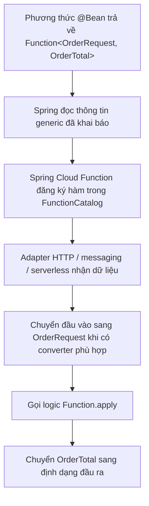

# Suy luận kiểu đầu vào đầu ra từ chữ ký generic

Trong Spring Cloud Function, một hàm có thể được gọi qua HTTP, thông điệp sự kiện hoặc môi trường serverless mà không phải viết lại logic nghiệp vụ. Để chuyển dữ liệu từ các giao thức đó thành đối tượng Java phù hợp, framework cần biết **hàm nhận kiểu gì và trả về kiểu gì**. Nguồn thông tin quan trọng nhất là chữ ký generic của `Supplier`, `Function` và `Consumer` được khai báo trong ứng dụng.

Bài học thuộc chương **Kiểu dữ liệu**, tập trung vào cách đọc chữ ký generic, cách Spring Cloud Function sử dụng thông tin kiểu khi đăng ký hàm vào `FunctionCatalog`, những giới hạn do type erasure của Java và cách tránh mất thông tin kiểu khi viết bean.

## 1. Đọc đúng hợp đồng kiểu của ba loại hàm

Spring Cloud Function xây dựng mô hình lập trình trên ba functional interface chuẩn của Java:

| Loại hàm | Chữ ký | Kiểu đầu vào | Kiểu đầu ra | Ý nghĩa |
| --- | --- | --- | --- | --- |
| Nguồn dữ liệu | `Supplier<T>` | Không có tham số đầu vào | `T` | Tạo hoặc cung cấp một giá trị |
| Biến đổi dữ liệu | `Function<T, R>` | `T` | `R` | Nhận giá trị kiểu `T`, trả về giá trị kiểu `R` |
| Xử lý tác dụng phụ | `Consumer<T>` | `T` | Không có giá trị trả về | Nhận dữ liệu để ghi log, lưu trữ, phát sự kiện… |

Ví dụ, các chữ ký sau đã truyền đạt hợp đồng dữ liệu mà không phụ thuộc HTTP hay hệ thống message broker:

```java
Supplier<OrderEvent> newOrderEvent;
Function<OrderRequest, OrderReceipt> createReceipt;
Consumer<OrderEvent> auditEvent;
```

- `newOrderEvent` tạo ra `OrderEvent`; nó không có kiểu đầu vào cần suy luận.
- `createReceipt` nhận `OrderRequest`, tạo `OrderReceipt`.
- `auditEvent` nhận `OrderEvent` và **không có đầu ra**. Không nên diễn giải `Consumer<T>` như `Function<T, Void>`: hai interface có hợp đồng phương thức khác nhau (`accept` so với `apply`).

Đối với `Function<T, R>`, thứ tự tham số generic là cố định: **`T` đứng trước là input, `R` đứng sau là output**. Chẳng hạn `Function<String, Integer>` nhận chuỗi và trả số nguyên; không phải chiều ngược lại.

## 2. Tại sao phải khai báo generic trên phương thức `@Bean`?

Hãy xét một hàm nghiệp vụ tính tổng tiền theo số lượng sản phẩm. Ví dụ dưới đây dùng Java 17 trở lên để có `record`; dự án dùng phiên bản Java cũ hơn có thể thay `record` bằng lớp DTO thông thường.

```java
package demo.function;

import java.math.BigDecimal;
import java.util.function.Function;
import org.springframework.context.annotation.Bean;
import org.springframework.context.annotation.Configuration;

@Configuration
public class OrderFunctions {

    public record OrderRequest(String sku, int quantity) {}

    public record OrderTotal(String sku, BigDecimal total) {}

    @Bean
    public Function<OrderRequest, OrderTotal> calculateTotal() {
        BigDecimal unitPrice = new BigDecimal("125000");

        return request -> {
            if (request == null || request.quantity() <= 0) {
                throw new IllegalArgumentException("quantity must be positive");
            }

            BigDecimal total = unitPrice.multiply(
                BigDecimal.valueOf(request.quantity())
            );
            return new OrderTotal(request.sku(), total);
        };
    }
}
```

Điểm then chốt nằm ở chữ ký phương thức:

```java
@Bean
public Function<OrderRequest, OrderTotal> calculateTotal()
```

Spring có thể đọc **kiểu trả về đã khai báo của phương thức bean** và nhận ra hai tham số generic `OrderRequest`, `OrderTotal`. Lambda `request -> ...` cung cấp phần xử lý, nhưng ta không nên trông chờ framework suy ra chính xác hai kiểu nghiệp vụ chỉ bằng cách quan sát đối tượng lambda lúc chạy.

Trong ứng dụng có cấu hình Spring Cloud Function Web adapter, một lời gọi HTTP có thể chuyển JSON đầu vào thành `OrderRequest`, gọi hàm và chuyển `OrderTotal` thành JSON đầu ra:

```bash
curl -X POST http://localhost:8080/calculateTotal \
  -H 'Content-Type: application/json' \
  -d '{"sku":"BK-101","quantity":2}'
```

Kết quả minh họa:

```json
{"sku":"BK-101","total":250000}
```

Ví dụ HTTP giả định ứng dụng đã cài đặt và bật Web adapter tương ứng, có bộ chuyển đổi JSON hỗ trợ DTO, đồng thời endpoint `calculateTotal` được expose. **Chữ ký generic cung cấp thông tin kiểu; bản thân nó không tạo endpoint hay cài đặt JSON converter.**

## 3. Quá trình suy luận kiểu diễn ra như thế nào?

Có thể hình dung luồng xử lý theo sơ đồ:



Ba ý cần phân biệt:

1. **Suy luận kiểu ở thời điểm biên dịch:** trình biên dịch Java kiểm tra việc lambda nhận `OrderRequest` và trả `OrderTotal` theo khai báo `Function<OrderRequest, OrderTotal>`.
2. **Khám phá thông tin kiểu lúc chạy:** JVM thực hiện *type erasure* với generic, nhưng chữ ký generic được khai báo trên phương thức/lớp vẫn có thể được đọc qua reflection. Spring sử dụng các cơ chế phân giải kiểu, chẳng hạn `ResolvableType`, để xử lý metadata này.
3. **Chuyển đổi dữ liệu tại biên hệ thống:** Spring Cloud Function có thể dùng thông tin kiểu để hỗ trợ chuyển payload từ adapter sang kiểu mà hàm cần. Việc chuyển đổi thành công vẫn phụ thuộc định dạng đầu vào, `content-type`, converter khả dụng và cách adapter gọi hàm.

Vì vậy, **biết `Function<OrderRequest, OrderTotal>` không đồng nghĩa JSON bất kỳ đều chuyển được thành `OrderRequest`**. Ví dụ, JSON thiếu trường bắt buộc hoặc chứa giá trị sai kiểu vẫn có thể gây lỗi ở lớp chuyển đổi hoặc logic nghiệp vụ.

### Minh họa cách đọc chữ ký bằng `ResolvableType`

Đoạn mã dưới đây dùng API của Spring Framework để quan sát metadata generic trên chính phương thức trong ví dụ, không phải mã nội bộ bắt buộc của `FunctionCatalog`:

```java
import java.lang.reflect.Method;
import org.springframework.core.ResolvableType;

Method method = OrderFunctions.class.getDeclaredMethod("calculateTotal");
ResolvableType signature = ResolvableType.forMethodReturnType(method);

Class<?> inputType = signature.getGeneric(0).resolve();
Class<?> outputType = signature.getGeneric(1).resolve();

System.out.println(inputType.getSimpleName());  // OrderRequest
System.out.println(outputType.getSimpleName()); // OrderTotal
```

`getGeneric(0)` trỏ đến đối số `T` của `Function<T, R>`; `getGeneric(1)` trỏ đến `R`. Kết quả `resolve()` có thể là `null` nếu một đối số generic không thể quy về một lớp cụ thể, ví dụ một số trường hợp dùng type variable chưa được ràng buộc.

## 4. Suy luận kiểu với `Message<T>` và reactive type

Đối số generic không nhất thiết là DTO trực tiếp. Nó có thể là một lớp bao (*wrapper*) chứa DTO hoặc một luồng dữ liệu.

| Chữ ký | Thông tin kiểu có thể đọc được | Lưu ý khi sử dụng |
| --- | --- | --- |
| `Function<String, Integer>` | Payload `String` → `Integer` | Chuỗi được xử lý như giá trị đầu vào của hàm |
| `Function<OrderRequest, OrderTotal>` | DTO đầu vào → DTO đầu ra | Converter có thể dùng kiểu DTO để chuyển JSON |
| `Function<Message<OrderRequest>, Message<OrderTotal>>` | Thông điệp chứa `OrderRequest` → thông điệp chứa `OrderTotal` | Hàm thao tác cả payload và header |
| `Consumer<Message<OrderEvent>>` | Thông điệp chứa `OrderEvent` | Không có kết quả trả về |
| `Supplier<Message<OrderEvent>>` | Thông điệp chứa `OrderEvent` | Có thể cung cấp thêm header ở đầu ra |
| `Function<Flux<OrderRequest>, Flux<OrderTotal>>` | Luồng Reactor `Flux` ở cả hai phía | Áp dụng mô hình xử lý luồng reactive |
| `Function<List<OrderRequest>, List<OrderTotal>>` | Danh sách DTO → danh sách DTO | Không mặc định đồng nghĩa với stream hay batch của message broker |

Ví dụ giữ lại các header khi xử lý message:

```java
import java.util.function.Function;
import org.springframework.context.annotation.Bean;
import org.springframework.messaging.Message;
import org.springframework.messaging.support.MessageBuilder;

@Bean
public Function<Message<OrderRequest>, Message<OrderRequest>> tagOrder() {
    return message -> MessageBuilder
        .withPayload(message.getPayload())
        .copyHeaders(message.getHeaders())
        .setHeader("processedBy", "tagOrder")
        .build();
}
```

Đoạn `tagOrder` giả định `OrderRequest` đã được khai báo trong phạm vi có thể truy cập. Chữ ký `Message<OrderRequest>` nói rõ **đối tượng đầu vào của hàm là `Message`**, trong khi payload bên trong có kiểu `OrderRequest`. Adapter có thể cung cấp hoặc ánh xạ metadata thông điệp theo cơ chế riêng; không nên giả định mọi giao thức đều truyền nguyên vẹn cùng một tập header.

Với Reactor, `Function<Flux<A>, Flux<B>>` là hợp đồng nhận một publisher và trả một publisher. Nó khác `Function<A, B>` nhận một phần tử và trả một phần tử. Kiểu của từng phần tử vẫn thể hiện qua `A`, `B`, nhưng thời điểm xử lý, số phần tử và cách báo lỗi thuộc về luồng reactive. Nếu ứng dụng sử dụng `Mono<T>`, cách đọc generic tương tự, với đặc điểm luồng có tối đa một phần tử.

### Generic lồng nhau

Đối với chữ ký `Function<Message<List<OrderRequest>>, Message<OrderTotal>>`, có thể đọc từ ngoài vào trong:

```text
Function<
    Message<List<OrderRequest>>,  // input: Message -> List -> OrderRequest
    Message<OrderTotal>           // output: Message -> OrderTotal
>
```

Framework có thể biết không chỉ lớp ngoài là `Message` mà còn các đối số generic lồng nhau, miễn thông tin này được giữ trong khai báo. Tuy nhiên, việc deserialize tập hợp và cách áp dụng batch còn tùy converter/adapter cụ thể; cần kiểm thử qua giao thức đang dùng.

## 5. Kết hợp nhiều hàm dựa trên kiểu đầu vào, đầu ra

Spring Cloud Function hỗ trợ *function composition* thông qua tên hàm trong `FunctionCatalog` hoặc cấu hình `spring.cloud.function.definition`. Thông tin generic giúp người phát triển xác định các mắt xích có tương thích hay không.

Giả sử ứng dụng định nghĩa:

```java
@Bean
Function<OrderRequest, OrderTotal> calculateTotal() { /* ... */ }

@Bean
Function<OrderTotal, Invoice> createInvoice() { /* ... */ }
```

Đây là hai **chữ ký minh họa**, không phải hai phương thức hoàn chỉnh để biên dịch. Có thể khai báo chuỗi xử lý:

```yaml
spring:
  cloud:
    function:
      definition: calculateTotal|createInvoice
```

Hợp đồng kiểu của chuỗi là:

```text
OrderRequest --calculateTotal--> OrderTotal --createInvoice--> Invoice
```

Đầu ra `OrderTotal` của hàm thứ nhất phù hợp với đầu vào `OrderTotal` của hàm thứ hai. Ngược lại, khi nối `Function<OrderRequest, OrderTotal>` với `Function<Customer, Invoice>`, hai kiểu ở điểm nối không trùng nhau. Không nên dựa vào một phép chuyển đổi ngầm không được kiểm chứng để làm cho composition hoạt động; hãy điều chỉnh chữ ký hoặc viết một hàm chuyển đổi tường minh.

Khi composition trộn hàm xử lý `Message<T>` và hàm chỉ nhận payload `T`, cần kiểm tra cả cách framework xử lý wrapper/header tại mỗi điểm nối. Đọc tương thích kiểu Java mới chỉ là một phần của kiểm chứng toàn bộ đường đi dữ liệu.

## 6. Những trường hợp làm mất hoặc làm mờ thông tin kiểu

**Trường hợp 1 — dùng raw type.**

```java
@Bean
@SuppressWarnings({"rawtypes", "unchecked"})
public Function unsafeFunction() {
    return value -> value;
}
```

`Function` không có đối số generic khiến chữ ký bean không diễn đạt kiểu payload cụ thể. Compiler cũng không thể kiểm tra đầu vào và đầu ra theo hợp đồng nghiệp vụ. Framework có thể phải dựa vào thông tin khác hoặc không đủ dữ kiện để thực hiện chuyển đổi mong muốn.

**Trường hợp 2 — khai báo quá rộng.**

```java
@Bean
public Function<Object, Object> opaqueFunction() {
    return value -> value;
}
```

Ở đây thông tin generic không bị xóa hoàn toàn nhưng chỉ nói được `Object` → `Object`. Một adapter không thể từ đó kết luận payload cần là `OrderRequest`. `Function<?, ?>` hoặc kiểu trả về bean quá tổng quát cũng gây vấn đề tương tự khi cần phân giải DTO cụ thể.

**Trường hợp 3 — cất lambda trong biến không giữ hợp đồng nghiệp vụ.**

```java
Function raw = (Function) (value -> value);
```

Ép về raw type loại bỏ kiểm tra generic tại điểm sử dụng. Ngay cả khi logic bên trong luôn thao tác một DTO cụ thể, reflection trên đối tượng lambda không phải cách đáng tin cậy để khôi phục tên DTO đó.

**Trường hợp 4 — sử dụng generic chưa được ràng buộc.**

```java
class CommonFunctions<T> {
    Function<T, T> identity() {
        return value -> value;
    }
}
```

Nếu `T` chưa được gắn với một lớp cụ thể tại nơi đăng ký bean, hệ thống chưa có đủ metadata để biết DTO nào cần deserialize. Phương thức bean cụ thể nên khai báo loại dữ liệu thực, ví dụ `Function<OrderRequest, OrderRequest>`.

**Trường hợp 5 — wrapper hoặc proxy che chữ ký.**

Một lớp triển khai `Function<OrderRequest, OrderTotal>` có thể mang thông tin generic trong interface mà nó implements. Nhưng nếu bạn đăng ký thông qua factory, proxy hoặc phương thức trả về `Object`/raw `Function`, metadata mà framework quan sát được có thể khác với mong muốn. Khi dùng các kỹ thuật này, nên kiểm tra cả kiểu được đăng ký lẫn hành vi chuyển đổi qua adapter thực tế.

Để giảm rủi ro: khai báo kiểu cụ thể ngay trên `@Bean`, giữ generic qua các lớp trung gian, ưu tiên DTO có cấu trúc rõ ràng và tránh ép kiểu không cần thiết.

## 7. Kiểm chứng hợp đồng kiểu qua `FunctionCatalog`

`FunctionCatalog` cho phép tìm hàm theo tên hoặc biểu thức composition. Ví dụ sau gọi hàm đã đăng ký trong Spring context bằng dữ liệu Java có kiểu rõ ràng:

```java
import static org.junit.jupiter.api.Assertions.assertEquals;

import java.math.BigDecimal;
import java.util.function.Function;
import org.junit.jupiter.api.Test;
import org.springframework.beans.factory.annotation.Autowired;
import org.springframework.boot.test.context.SpringBootTest;
import org.springframework.cloud.function.context.FunctionCatalog;

@SpringBootTest
class OrderFunctionsTest {

    @Autowired
    FunctionCatalog catalog;

    @Test
    void calculatesTotal() {
        Function<OrderFunctions.OrderRequest, OrderFunctions.OrderTotal> function =
            catalog.lookup("calculateTotal");

        OrderFunctions.OrderTotal result = function.apply(
            new OrderFunctions.OrderRequest("BK-101", 2)
        );

        assertEquals(new BigDecimal("250000"), result.total());
    }
}
```

Kiểm thử này cần môi trường test Spring Boot với `OrderFunctions` được quét hoặc import vào context và có các dependency liên quan. Nó xác minh tên đăng ký và logic của hàm trên đối tượng Java. Muốn kiểm chứng suy luận kiểu khi JSON hoặc event đi qua adapter, **cần thêm một bài kiểm thử tích hợp ở biên giao thức**, bởi lời gọi Java trực tiếp chưa kiểm tra bước chuyển đổi payload.

Khi một request thất bại, có thể chẩn đoán theo thứ tự:

1. Kiểm tra `@Bean` có trả về `Supplier<T>`, `Function<T, R>` hay `Consumer<T>` với kiểu cụ thể hay không.
2. Kiểm tra tên trong `FunctionCatalog`/`spring.cloud.function.definition` có chọn đúng hàm hoặc chuỗi hàm không.
3. Kiểm tra shape của payload, `content-type`, converter và DTO có tương thích không.
4. Nếu dùng `Message<T>`, `List<T>`, `Flux<T>` hoặc `Mono<T>`, xác định lớp nào là wrapper, lớp nào là dữ liệu nghiệp vụ và adapter diễn giải chúng ra sao.
5. Nếu lỗi chỉ xuất hiện sau composition, kiểm tra đầu ra của mỗi hàm có phù hợp với đầu vào của hàm ngay sau đó không.

## 8. Luyện tập tự kiểm tra

**Tình huống A:** Bạn khai báo `Function<String, Integer> countCharacters`. Đầu vào và đầu ra framework có thể đọc được là gì?

**Đáp án:** `String` ở đầu vào và `Integer` ở đầu ra. Không cần quan sát phần thân lambda để xác định hai kiểu này.

**Tình huống B:** Một `@Bean` trả về raw `Function` nhưng bên trong lambda xử lý `OrderRequest`. Vì sao API HTTP không chắc chuyển JSON thành `OrderRequest`?

**Đáp án:** Chữ ký được công bố không giữ `OrderRequest`; type erasure và bản chất lambda không đảm bảo có đủ metadata để khôi phục DTO. Nên sửa chữ ký thành `Function<OrderRequest, OrderTotal>` hoặc hợp đồng cụ thể thích hợp.

**Tình huống C:** Có thể nối `Function<OrderRequest, OrderTotal>` với `Function<OrderTotal, Invoice>` không? Điều gì còn phải kiểm tra?

**Đáp án:** Hai kiểu ở điểm nối tương thích về mặt khai báo. Vẫn phải kiểm tra logic, converter khi đi qua adapter, wrapper message và hành vi thực tế nếu dùng giao thức bên ngoài.

**Tình huống D:** `Consumer<Message<OrderEvent>>` có trả về `Message<Void>` không?

**Đáp án:** Không. `Consumer` nhận một `Message<OrderEvent>` và không trả về giá trị. Giao thức gọi có thể có thông báo xác nhận riêng, nhưng đó không phải output kiểu Java của `Consumer`.

## Ghi nhớ

Chữ ký generic là **hợp đồng dữ liệu** của hàm trong Spring Cloud Function: `Supplier<T>` xác định kiểu cung cấp, `Function<T, R>` xác định cặp đầu vào/đầu ra, còn `Consumer<T>` chỉ xác định đầu vào. Giữ hợp đồng này rõ ràng trên bean giúp framework và người đọc hiểu kiểu cần xử lý, hỗ trợ chuyển đổi thông điệp và kết hợp hàm qua `FunctionCatalog`. Type erasure không xóa sạch metadata của một khai báo generic cụ thể, nhưng cũng không cho phép framework đoán lại kiểu nghiệp vụ đã bị che bởi raw type hoặc khai báo quá rộng. Muốn chắc chắn hàm chạy đúng qua HTTP, messaging hay serverless, hãy kiểm thử cả logic Java và biên chuyển đổi của adapter đang dùng.
