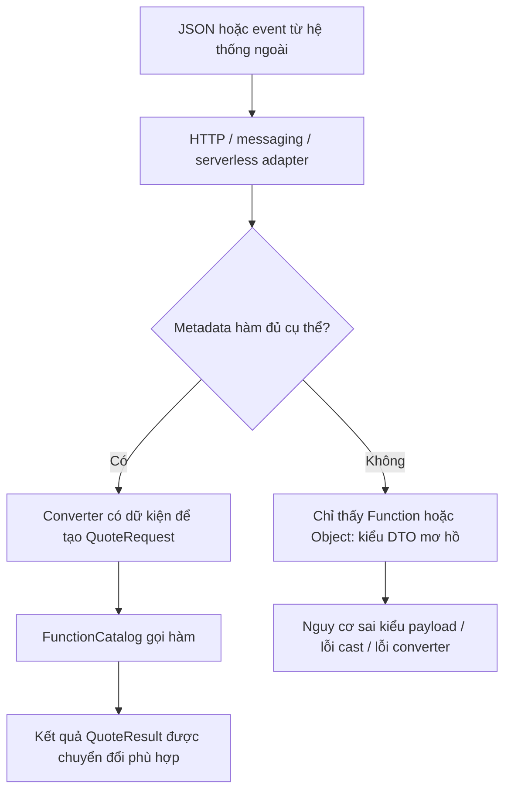

# Mất thông tin kiểu khi dùng raw type, Object hoặc lambda đăng ký động

Spring Cloud Function cho phép viết logic dưới dạng `Supplier`, `Function` hoặc `Consumer` rồi tái sử dụng qua HTTP, sự kiện từ message broker hay môi trường serverless. Tuy nhiên, để một adapter nhận JSON hoặc một message rồi gọi đúng hàm, framework cần biết **kiểu payload mà hàm thực sự mong đợi**. Những khai báo như raw `Function`, `Function<Object, Object>` hoặc một lambda được đăng ký động bằng `Function.class` có thể làm thông tin kiểu không còn đủ cụ thể.

Bài này thuộc chương **Kiểu dữ liệu** và tập trung vào ba nguyên nhân làm mất hoặc làm mờ metadata generic: dùng **raw type**, dùng **`Object` làm kiểu công bố** và **đăng ký lambda động mà không kèm mô tả kiểu**. Mục tiêu là nhận biết rủi ro, sửa khai báo, và kiểm chứng một hàm được truy xuất qua `FunctionCatalog` vẫn chuyển đổi dữ liệu đúng ở biên giao thức.

## 1. Thông tin kiểu được dùng ở đâu?

Giả sử hệ thống tính báo giá qua một hàm Java:

```java
public record QuoteRequest(String sku, int quantity) {}
public record QuoteResult(String sku, long amount) {}

Function<QuoteRequest, QuoteResult> quote = request ->
    new QuoteResult(request.sku(), request.quantity() * 1_000L);
```

Về **logic Java**, biến `quote` có chữ ký `Function<QuoteRequest, QuoteResult>`; trình biên dịch kiểm tra rằng lambda xử lý `QuoteRequest` và trả `QuoteResult`. Nhưng khi dữ liệu đi từ JSON hoặc một event đến hàm, Spring Cloud Function và adapter phải giải quyết bài toán khác: nên biến payload nhận được thành lớp Java nào trước khi gọi `apply()`?

Với một bean khai báo cụ thể:

```java
@Bean
public Function<QuoteRequest, QuoteResult> quote() {
    return request -> new QuoteResult(
        request.sku(), request.quantity() * 1_000L
    );
}
```

Spring có thể đọc chữ ký generic từ **kiểu trả về của phương thức `@Bean`**. Khi một adapter phù hợp gọi hàm, metadata này giúp xác định kiểu đầu vào/đầu ra để phối hợp chuyển đổi payload. Phần chuyển đổi còn phụ thuộc `content-type`, converter, cấu trúc DTO và cách cấu hình adapter.

Ba tầng cần phân biệt:

| Tầng | Câu hỏi cần trả lời | Nguồn thông tin |
| --- | --- | --- |
| Biên dịch Java | `apply()` nhận và trả kiểu gì? | Generic của biến, interface, phương thức |
| Đăng ký hàm | `FunctionCatalog` có biết kiểu cụ thể của hàm không? | Metadata từ bean/class hoặc đăng ký kiểu tường minh |
| Biên HTTP/message/serverless | Payload bên ngoài được chuyển sang DTO nào? | Metadata hàm **và** converter, content type, adapter |

**Type erasure** của Java không có nghĩa mọi chữ ký generic đều biến mất: thông tin tham số hóa của một phương thức hoặc một lớp được khai báo cụ thể vẫn có thể được đọc bằng reflection. Nhưng một đối tượng lambda thường không lưu lại đầy đủ `QuoteRequest`/`QuoteResult` như metadata đáng tin cậy trên chính lớp runtime của nó. Vì thế, **kiểu được công bố khi đăng ký** quan trọng không kém kiểu mà mã nguồn dùng để biên dịch lambda.

## 2. Raw type: chữ ký bị mất đối số generic

Raw type là cách dùng interface generic mà bỏ đối số kiểu: `Function` thay cho `Function<I, O>`, `Supplier` thay cho `Supplier<O>`, `Consumer` thay cho `Consumer<I>`.

### Ví dụ có vấn đề

Đoạn sau cố tình dùng raw type để minh họa. Giả sử `QuoteRequest` và `QuoteResult` đã được định nghĩa như phần trước:

```java
import java.util.function.Function;
import org.springframework.context.annotation.Bean;

@Bean
@SuppressWarnings("rawtypes")
public Function quoteRaw() {
    Function<QuoteRequest, QuoteResult> implementation = request ->
        new QuoteResult(request.sku(), request.quantity() * 1_000L);

    return implementation;
}
```

Bên trong phương thức, `implementation` vẫn là một `Function<QuoteRequest, QuoteResult>`. Tuy nhiên, **hợp đồng kiểu của `@Bean` chỉ là `Function`**. Nếu một cơ chế khám phá hàm chỉ thấy chữ ký này, nó không thể suy ra `QuoteRequest` và `QuoteResult` từ đối số generic của kiểu trả về. Điều này có thể làm mất dữ kiện để chọn converter cho JSON hoặc message.

Một tác hại khác là có thể gọi raw function với sai kiểu và chỉ phát hiện lỗi khi chạy:

```java
@SuppressWarnings({"rawtypes", "unchecked"})
Function unsafe = (Function<QuoteRequest, QuoteResult>) request ->
    new QuoteResult(request.sku(), request.quantity() * 1_000L);

unsafe.apply("this is not a QuoteRequest"); // Có thể ném ClassCastException
```

Ở đây compiler không còn buộc `apply()` phải nhận `QuoteRequest`. Đây là lỗi type safety của Java; còn lỗi deserialize ở biên Spring Cloud Function là một hậu quả khác của việc công bố thiếu metadata.

### Cách sửa

```java
@Bean
public Function<QuoteRequest, QuoteResult> quote() {
    return request -> new QuoteResult(
        request.sku(), request.quantity() * 1_000L
    );
}
```

Khai báo đầy đủ generic **ngay tại phương thức đăng ký bean**. Không chỉ giữ kiểu trong biến cục bộ hoặc dùng unchecked cast để che cảnh báo compiler.

## 3. `Object`: có generic nhưng hợp đồng quá rộng

`Function<Object, Object>` **không phải raw type**: nó có đủ hai đối số generic, nhưng cả hai chỉ là `Object`. Java biết chính xác hợp đồng được công bố là nhận `Object`, trả `Object`; điều chưa biết là **kiểu nghiệp vụ**.

```java
@Bean
public Function<Object, Object> quoteTooBroad() {
    return input -> {
        QuoteRequest request = (QuoteRequest) input;
        return new QuoteResult(
            request.sku(), request.quantity() * 1_000L
        );
    };
}
```

Trong lời gọi trực tiếp `quoteTooBroad.apply(new QuoteRequest("P-01", 2))`, cast có thể thành công. Nhưng một adapter nhận JSON `{"sku":"P-01","quantity":2}` không có lý do để tự kết luận cần tạo `QuoteRequest`, vì metadata chỉ công bố `Object`. Tùy converter và adapter, đối tượng thực tế chuyển vào có thể là kiểu khác (chẳng hạn một `Map`), khi đó cast sang `QuoteRequest` có thể thất bại. Không nên giả định chắc chắn converter luôn trả `Map` hoặc luôn báo một loại exception cố định.

So sánh các chữ ký:

| Khai báo | Điều metadata có thể diễn đạt | Hệ quả |
| --- | --- | --- |
| `Function<QuoteRequest, QuoteResult>` | DTO đầu vào và DTO đầu ra cụ thể | Đủ dữ liệu kiểu để framework chọn hướng chuyển đổi phù hợp |
| `Function<Object, Object>` | Đầu vào/ra là `Object` | Không chỉ rõ DTO nghiệp vụ |
| `Function<?, ?>` | Hai đối số wildcard chưa xác định | Không thể coi như DTO cụ thể |
| `Function<QuoteRequest, Object>` | Đầu vào cụ thể, đầu ra tổng quát | Bên nhận đầu ra khó suy luận `QuoteResult` |
| `Consumer<Object>` | Có đầu vào `Object`, không có kết quả | Không nói rõ lớp event cần xử lý |
| `Supplier<Object>` | Có đầu ra `Object`, không có đầu vào | Không nói rõ kiểu dữ liệu được phát ra |

Sử dụng `Object` **không tự động là sai**. Hàm chuyển tiếp dữ liệu đa dạng hoặc một thành phần routing có thể chủ ý nhận `Object` hay `Message<?>`. Vấn đề nảy sinh khi **thực tế chỉ xử lý một DTO** nhưng API lại công bố hợp đồng quá rộng. Khi đó, hãy dùng DTO cụ thể hoặc tự triển khai phần phân loại/kiểm tra/chuyển đổi kiểu cho đúng mục đích.

## 4. Lambda đăng ký động: kiểu của biến chưa chắc trở thành metadata của bean

Chữ ký một lambda có thể rất rõ trong mã nguồn:

```java
Function<QuoteRequest, QuoteResult> quote = request ->
    new QuoteResult(request.sku(), request.quantity() * 1_000L);
```

Nhưng cách đăng ký sau công bố một bean dưới raw class `Function.class`:

```java
// Ví dụ đặt trong ApplicationContextInitializer<GenericApplicationContext>
context.registerBean("quote", Function.class, () -> quote);
```

Java giữ kiểu cho biến `quote` ở thời điểm biên dịch, trong khi `Function.class` **không có tham số generic**. Các API đăng ký động không mặc định nhận được chữ ký `Function<QuoteRequest, QuoteResult>` chỉ vì nhà phát triển từng gán lambda vào một biến có generic. Spring Cloud Function có thể khám phá kiểu bằng những cơ chế khác tùy cách đăng ký, nhưng không nên dựa vào việc suy đoán kiểu từ lớp lambda tổng hợp (*synthetic class*).

Điều này đặc biệt dễ gặp khi:

- Đăng ký nhiều hàm dựa trên cấu hình thay vì dùng `@Bean` tĩnh.
- Tạo lambda trong factory rồi trả về `Function`, `Object` hoặc một interface tổng quát.
- Lưu các hàm khác kiểu trong `Map<String, Function>` hoặc `List<Function<?, ?>>` mà không giữ metadata của từng phần tử.
- Bao hàm qua decorator/proxy rồi chỉ công bố lớp bọc không có generic cụ thể.

Trong mỗi trường hợp, câu hỏi quan trọng là: **type metadata ở điểm đăng ký cuối cùng còn mô tả input/output thật hay không?**

## 5. Khắc phục khi đăng ký động bằng `FunctionRegistration`

Spring Cloud Function cung cấp `FunctionRegistration` để đi kèm hàm với metadata, gồm cả thông tin kiểu đầu vào/đầu ra. Khi không có phương thức `@Bean` mang generic rõ ràng, ta có thể **khai báo type tường minh**.

Ví dụ dưới đây minh họa cách đăng ký hàm theo kiểu functional bean của Spring Cloud Function. Mã sử dụng Java 17 trở lên (`record`), Spring Boot và các dependency Spring Cloud Function tương ứng:

```java
package demo;

import java.util.function.Function;

import org.springframework.boot.SpringBootConfiguration;
import org.springframework.cloud.function.context.FunctionRegistration;
import org.springframework.cloud.function.context.FunctionalSpringApplication;
import org.springframework.cloud.function.context.catalog.FunctionTypeUtils;
import org.springframework.context.ApplicationContextInitializer;
import org.springframework.context.support.GenericApplicationContext;

@SpringBootConfiguration
public class QuoteApplication
        implements ApplicationContextInitializer<GenericApplicationContext> {

    public record QuoteRequest(String sku, int quantity) {}
    public record QuoteResult(String sku, long amount) {}

    public static void main(String[] args) {
        FunctionalSpringApplication.run(QuoteApplication.class, args);
    }

    @Override
    public void initialize(GenericApplicationContext context) {
        Function<QuoteRequest, QuoteResult> quote = request -> {
            if (request.quantity() <= 0) {
                throw new IllegalArgumentException("quantity must be positive");
            }
            return new QuoteResult(
                request.sku(), request.quantity() * 1_000L
            );
        };

        context.registerBean("quote", FunctionRegistration.class,
            () -> new FunctionRegistration<>(quote)
                .type(FunctionTypeUtils.functionType(
                    QuoteRequest.class, QuoteResult.class
                )));
    }
}
```

Đoạn mã này làm hai việc rõ ràng:

1. `quote` chứa logic nghiệp vụ độc lập với giao thức gọi.
2. `FunctionTypeUtils.functionType(QuoteRequest.class, QuoteResult.class)` mô tả metadata `Function<QuoteRequest, QuoteResult>` để `FunctionRegistration` cung cấp khi đăng ký.

`FunctionRegistration` là một **cách đăng ký dành riêng cho Spring Cloud Function**, không đồng nghĩa với việc mọi bean được đăng ký động bằng `GenericApplicationContext` đều phải sử dụng lớp này. Ví dụ minh họa mẫu khởi chạy functional application; ở ứng dụng khởi tạo Spring theo cách khác, cần bảo đảm `ApplicationContextInitializer` được thực thi trước khi catalog tra cứu hàm.

### `Supplier` và `Consumer` cũng cần metadata phù hợp

Với các hàm phát hoặc nhận dữ liệu, `FunctionTypeUtils` có các phương thức xây dựng kiểu tương ứng:

```java
// Đặt trong ngữ cảnh đang xây dựng FunctionRegistration tương ứng.
FunctionTypeUtils.supplierType(QuoteResult.class);
FunctionTypeUtils.consumerType(QuoteRequest.class);
```

Không gán giả một kiểu input cho `Supplier` hoặc output cho `Consumer`: hai loại hàm này có hợp đồng riêng.

### Khi input/output là generic lồng nhau

Với `Function<Message<QuoteRequest>, Message<QuoteResult>>`, `Message.class` riêng lẻ **không thể hiện kiểu của payload**. Có thể biểu diễn kiểu lồng nhau qua `ResolvableType`:

```java
import java.lang.reflect.Type;
import org.springframework.core.ResolvableType;
import org.springframework.messaging.Message;

Type requestMessage = ResolvableType.forClassWithGenerics(
    Message.class, QuoteRequest.class
).getType();

Type resultMessage = ResolvableType.forClassWithGenerics(
    Message.class, QuoteResult.class
).getType();

Type messageFunctionType = FunctionTypeUtils.functionType(
    requestMessage, resultMessage
);

// Sử dụng messageFunctionType trong .type(...) của FunctionRegistration.
```

Đoạn trên giả định đã có `QuoteRequest`, `QuoteResult` và `FunctionTypeUtils` trong scope. Việc cung cấp đúng thông tin lồng nhau giúp mô tả payload, nhưng cách ánh xạ header, JSON hay batch vẫn do adapter/converter quyết định.

## 6. Một lớp `Function` cụ thể cũng có thể giữ generic

Nếu không muốn truyền kiểu riêng trong `FunctionRegistration`, một cách khác là đưa hợp đồng generic lên khai báo của lớp triển khai:

```java
import java.util.function.Function;

public final class QuoteFunction
        implements Function<QuoteRequest, QuoteResult> {

    @Override
    public QuoteResult apply(QuoteRequest request) {
        return new QuoteResult(
            request.sku(), request.quantity() * 1_000L
        );
    }
}
```

Vì `QuoteFunction` implements `Function<QuoteRequest, QuoteResult>` trong khai báo lớp, reflection có thể tìm thấy cặp generic từ interface. Spring Cloud Function có thể khai thác metadata này khi đăng ký lớp cụ thể đúng cách. Tuy nhiên, một factory hoặc proxy công bố lại đối tượng này dưới raw `Function` có thể che thông tin mà framework quan sát được. Hãy xác minh kiểu ở **lối vào của catalog**, không chỉ trên lớp triển khai.

Nên chọn cách nào?

| Cách tổ chức | Khi phù hợp | Điểm cần giữ |
| --- | --- | --- |
| Phương thức `@Bean` trả `Function<I, O>` | Hàm được khai báo tĩnh bằng cấu hình Spring | Generic cụ thể ở kiểu trả về bean |
| Lớp `implements Function<I, O>` | Logic có tên, cần tái sử dụng hay kiểm thử độc lập | Interface generic trên lớp được đăng ký |
| `FunctionRegistration` với `.type(...)` | Hàm được khởi tạo/đăng ký động, lambda hoặc decorator | Metadata input/output chính xác, kể cả kiểu lồng nhau |

## 7. Tác động khi đi qua HTTP, message hoặc composition

Vấn đề không nhất thiết xuất hiện khi gọi trực tiếp `quote.apply(new QuoteRequest(...))`; nó thường bộc lộ **ở biên**, nơi framework phải tạo đối tượng Java từ dữ liệu ngoài.



### HTTP

Ví dụ, với Spring Cloud Function Web adapter được cài đặt và expose hàm `quote`, request có thể là:

```bash
curl -X POST http://localhost:8080/quote \
  -H 'Content-Type: application/json' \
  -d '{"sku":"P-01","quantity":2}'
```

Kết quả kỳ vọng khi metadata, converter và cấu hình đều phù hợp:

```json
{"sku":"P-01","amount":2000}
```

Nếu đăng ký thành `Function<Object, Object>`, không thể từ chữ ký đó khẳng định JSON sẽ tự được chuyển thành `QuoteRequest`. Nếu dùng raw type, thậm chí cặp generic cũng có thể không còn sẵn trên bean definition. Cả hai tình huống đều cần kiểm tra luồng chuyển đổi thực tế thay vì chỉ nhìn vào việc Java gọi lambda thành công.

### Messaging và `Message<T>`

Với một hàm `Function<Message<QuoteRequest>, Message<QuoteResult>>`, metadata không chỉ nói rằng đối số là `Message`, mà còn mô tả kiểu payload bên trong. Trong hệ thống phát/nhận sự kiện, thiếu generic có thể khiến converter không đủ thông tin để deserialize payload. Header `contentType`, cấu hình binder và converter cụ thể vẫn tham gia quyết định. Không nên coi lỗi payload là bằng chứng rằng message broker tự làm mất generic: generic vốn là metadata của **hàm trong ứng dụng Java**, không nằm trong mọi event được truyền trên mạng.

### Function composition

Giả sử có hai hàm:

```java
Function<QuoteRequest, QuoteResult> quote = /* ... */;
Function<QuoteResult, String> format = /* ... */;
```

Về mặt hợp đồng, phép kết hợp `quote|format` đưa `QuoteRequest` thành `String`. Nhưng nếu hàm đầu tiên được công bố dưới `Function<Object, Object>`, metadata bề mặt của chuỗi có thể không mô tả rõ cặp kiểu nghiệp vụ. Composition không tự sửa hợp đồng sai: cần giữ kiểu thực cho từng hàm và kiểm chứng kết quả tại điểm nối, đặc biệt khi dùng `Message<T>` hoặc chuyển đổi thông điệp.

## 8. Đọc metadata bằng reflection để hiểu vấn đề

`ResolvableType` của Spring Framework giúp kiểm tra generic trên khai báo Java:

```java
import java.lang.reflect.Method;
import java.util.function.Function;
import org.springframework.core.ResolvableType;

class FunctionBeans {
    public Function<QuoteRequest, QuoteResult> typed() {
        return request -> new QuoteResult(request.sku(), 1_000L);
    }

    @SuppressWarnings("rawtypes")
    public Function raw() {
        return typed();
    }

    public Function<Object, Object> broad() {
        return value -> value;
    }
}

Method typedMethod = FunctionBeans.class.getMethod("typed");
Method rawMethod = FunctionBeans.class.getMethod("raw");
Method broadMethod = FunctionBeans.class.getMethod("broad");

ResolvableType typed = ResolvableType.forMethodReturnType(typedMethod)
    .as(Function.class);
ResolvableType raw = ResolvableType.forMethodReturnType(rawMethod)
    .as(Function.class);
ResolvableType broad = ResolvableType.forMethodReturnType(broadMethod)
    .as(Function.class);

System.out.println(typed.getGeneric(0).resolve());  // QuoteRequest
System.out.println(typed.getGeneric(1).resolve());  // QuoteResult
System.out.println(broad.getGeneric(0).resolve());  // java.lang.Object
System.out.println(broad.getGeneric(1).resolve());  // java.lang.Object

// raw.getGeneric(...) không cung cấp DTO cụ thể đáng tin cậy.
```

Đây là **mã minh họa gồm các đoạn đặt trong một ngữ cảnh Java hợp lệ**, với `QuoteRequest`/`QuoteResult` đã được khai báo; các lệnh `Method ...` và `System.out.println(...)` có thể đặt trong một phương thức `main` hoặc test. `ResolvableType` dùng ở đây để hiểu thông tin có thể đọc trên chữ ký phương thức; không có nghĩa Spring Cloud Function bắt buộc dùng chính đoạn mã này trong mọi đường đăng ký.

Quan sát cần rút ra: `typed` có metadata DTO cụ thể; `broad` chỉ cung cấp `Object`; `raw` không diễn đạt DTO qua generic. Việc ép cast kết quả `FunctionCatalog.lookup(...)` sang `Function<QuoteRequest, QuoteResult>` **không tự bổ sung metadata** cho bean vốn được đăng ký thiếu kiểu.

## 9. Cách kiểm chứng trong ứng dụng

Một bài kiểm thử gọi lambda trực tiếp có thể chứng minh logic đúng nhưng không cho biết adapter có chuyển JSON/event sang đúng kiểu hay không. Nên kiểm tra theo hai lớp:

1. **Kiểm tra catalog:** hàm có được đăng ký đúng tên, đúng cấu trúc `Supplier`/`Function`/`Consumer` và có metadata input/output mong đợi không?
2. **Kiểm tra adapter tích hợp:** gửi payload thật qua HTTP hoặc binder/test harness tương ứng, xác nhận chuyển DTO, thực thi logic và serialize đầu ra.

Ví dụ kiểm thử catalog bằng Java (giả định Spring context đã đăng ký `quote`):

```java
import static org.junit.jupiter.api.Assertions.assertEquals;
import static org.junit.jupiter.api.Assertions.assertNotNull;

import java.util.function.Function;
import org.junit.jupiter.api.Test;
import org.springframework.beans.factory.annotation.Autowired;
import org.springframework.boot.test.context.SpringBootTest;
import org.springframework.cloud.function.context.FunctionCatalog;

@SpringBootTest
class QuoteCatalogTest {
    @Autowired FunctionCatalog catalog;

    @Test
    void quoteIsCallable() {
        Function<QuoteRequest, QuoteResult> function = catalog.lookup("quote");
        assertNotNull(function);

        QuoteResult result = function.apply(new QuoteRequest("P-01", 2));
        assertEquals(2_000L, result.amount());
    }
}
```

Các DTO trong ví dụ test phải được import từ lớp khai báo tương ứng (hoặc đặt test cùng phạm vi); ứng dụng và dependency test cần được cấu hình phù hợp. **Test trên chỉ xác nhận lookup và gọi Java**, không trực tiếp kiểm tra JSON conversion. Với functional registration, cấu hình khởi chạy test cũng cần thực thi initializer đã đăng ký hàm.

Khi adapter báo lỗi, hãy lần lượt đối chiếu:

| Dấu hiệu | Điều cần kiểm tra | Hướng xử lý |
| --- | --- | --- |
| Đầu vào là `Map`/đối tượng không như mong đợi | Bean có khai báo `Object`/raw type không? | Công bố DTO cụ thể hoặc xử lý phân loại thủ công |
| `ClassCastException` trong `apply()` | Kiểu runtime có khớp loại mà lambda ép kiểu không? | Sửa kiểu bean và kiểm thử conversion |
| Lookup được hàm nhưng request JSON thất bại | `content-type`, converter, shape của DTO, bean registration | Test ở biên giao thức; đừng chỉ dựa vào unit test |
| Dynamic lambda gọi trực tiếp đúng nhưng chạy qua adapter sai | Đăng ký bằng `Function.class` và thiếu `.type(...)`? | Dùng `FunctionRegistration` với kiểu tường minh |
| Chuỗi composition trả sai kiểu | Hợp đồng output/input ở từng mắt xích | Sửa từng chữ ký hoặc thêm hàm chuyển đổi |

Không nên suy luận nguyên nhân chỉ từ một exception; cùng một lỗi runtime có thể do payload sai, DTO validation, converter hoặc chính logic bên trong hàm.

## 10. Bài tập ứng dụng

**Bài 1 — Chỉ ra phần thông tin bị mất.**

```java
@Bean
public Function rawLength() {
    return (Function<String, Integer>) String::length;
}
```

*Câu hỏi:* Compiler biết kiểu của lambda trong biểu thức cast, nhưng chữ ký bean công bố gì? Nếu sửa để giữ generic, khai báo ra sao?

*Gợi ý đáp án:* Bean công bố raw `Function`, không có `String` và `Integer` trong đối số generic. Sửa thành `public Function<String, Integer> rawLength()` và giữ phần thân lambda phù hợp.

**Bài 2 — Phân biệt raw type và `Object`.**

```java
Function<Object, Object> identity = value -> value;
```

*Câu hỏi:* Có phải `identity` bị raw type không? Vì sao có thể đúng khi xây dựng hàm pass-through nhưng không đủ khi hàm thực sự chỉ chấp nhận `QuoteRequest`?

*Gợi ý đáp án:* Không phải raw type; đây là generic hợp lệ với hợp đồng `Object` → `Object`. Nếu nghiệp vụ buộc phải nhận `QuoteRequest`, thông tin công bố hiện tại quá rộng để hỗ trợ chuyển JSON sang DTO đó một cách đáng tin cậy.

**Bài 3 — Sửa đăng ký động.**

```java
Function<QuoteRequest, QuoteResult> quote = /* logic nghiệp vụ */;
context.registerBean("quote", Function.class, () -> quote);
```

*Câu hỏi:* Đăng ký lại theo Spring Cloud Function để giữ metadata như thế nào?

*Gợi ý đáp án:* Dùng `FunctionRegistration` và `.type(FunctionTypeUtils.functionType(QuoteRequest.class, QuoteResult.class))` như ví dụ ở mục 5. Nếu có generic lồng nhau, cung cấp `Type` đủ chi tiết thay vì chỉ lớp wrapper.

**Bài 4 — Khảo sát lỗi từ HTTP.**

Một hàm `Function<Object, Object>` ép input sang `QuoteRequest`, chạy tốt trong unit test nhưng lỗi khi gửi JSON qua HTTP. Nêu ba nơi cần kiểm tra trước khi sửa logic.

*Gợi ý đáp án:* (1) Chữ ký và metadata đăng ký của bean; (2) `content-type`, converter và cấu trúc JSON/DTO; (3) kiểu dữ liệu thực nhận bởi `apply()` ở biên HTTP. Sau đó sửa hợp đồng kiểu và thêm integration test.

## Ghi nhớ

- **Raw type** như `Function` bỏ hoàn toàn đối số generic trên chữ ký được công bố.
- **`Object`** không làm generic biến mất, nhưng khiến hợp đồng trở nên quá rộng nếu nghiệp vụ thật cần một DTO cụ thể.
- **Lambda đăng ký động** có thể đánh mất metadata đầu vào/đầu ra nếu chỉ đăng ký qua raw `Function.class`, ngay cả khi biến cục bộ được khai báo với kiểu đầy đủ.
- **Cách sửa ưu tiên** là trả về `Function<I, O>` cụ thể từ `@Bean`, triển khai lớp `Function<I, O>` có generic rõ ràng, hoặc đăng ký động bằng `FunctionRegistration` kèm `.type(...)`.
- **Tiêu chí hoàn thành** là hàm vừa gọi được trong Java, vừa nhận và trả đúng kiểu khi đi qua adapter HTTP, sự kiện hoặc serverless đã cấu hình.

Tham khảo thêm: [Spring Cloud Function — Functional Bean Definitions](https://docs.spring.io/spring-cloud-function/reference/functional.html) về khai báo hàm theo kiểu functional và `FunctionRegistration`.
