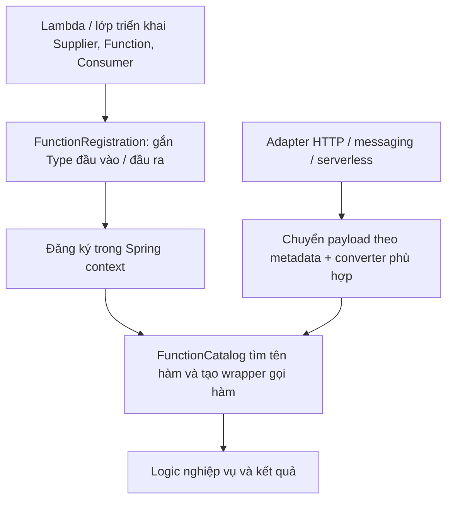

# FunctionRegistration và khai báo thông tin kiểu tường minh

Trong Spring Cloud Function, bạn có thể phát triển một hàm nghiệp vụ bằng `Supplier`, `Function` hoặc `Consumer`, đưa hàm vào `FunctionCatalog`, sau đó gọi cùng logic đó từ HTTP, sự kiện hoặc môi trường serverless. Để chuyển dữ liệu ở các biên giao thức thành đối tượng Java phù hợp, framework phải biết **hàm nhận kiểu gì và trả về kiểu gì**.

Với phương thức `@Bean` có chữ ký generic rõ ràng, Spring thường có thể đọc thông tin này từ khai báo phương thức. Nhưng với **lambda đăng ký động**, kiểu `Function.class` hoặc một factory không bộc lộ generic, thông tin về DTO có thể không được giữ lại. `FunctionRegistration` là cơ chế của Spring Cloud Function để **đăng ký hàm cùng với metadata kiểu tường minh**.

Bài học thuộc chương **Kiểu dữ liệu**. Sau khi học, bạn có thể:

- Giải thích vai trò của `FunctionRegistration` và đối tượng `java.lang.reflect.Type` được truyền qua `.type(...)`.
- Đăng ký `Function<I, O>`, `Supplier<O>` và `Consumer<I>` bằng `FunctionTypeUtils`.
- Mô tả kiểu lồng nhau như `Message<PriceRequest>`, `List<PriceRequest>` và `Flux<PriceRequest>`.
- Chọn giữa khai báo `@Bean`, lớp triển khai có generic và đăng ký kiểu tường minh.
- Kiểm tra tên hàm, hợp đồng kiểu và chuyển đổi payload qua `FunctionCatalog` hoặc adapter thực tế.

## 1. Vì sao khai báo kiểu tường minh lại quan trọng?

Giả sử một hàm tính tiền có hợp đồng:

```java
public record PriceRequest(String productId, int quantity) {}
public record PriceResponse(String productId, long totalVnd) {}

Function<PriceRequest, PriceResponse> calculatePrice =
    request -> new PriceResponse(
        request.productId(),
        request.quantity() * 1_000L
    );
```

Ở mã nguồn Java, compiler biết input là `PriceRequest` và output là `PriceResponse`. Tuy nhiên, hai cách đăng ký bean sau không cung cấp cùng một lượng thông tin cho các thành phần cần phân giải generic:

```java
// Khai báo thông thường: chữ ký bean thể hiện cả hai DTO.
@Bean
public Function<PriceRequest, PriceResponse> calculatePrice() {
    return request -> new PriceResponse(
        request.productId(),
        request.quantity() * 1_000L
    );
}
```

```java
// Đăng ký động: chỉ công bố lớp thô Function.class.
context.registerBean("calculatePrice", Function.class, () -> calculatePrice);
```

Đoạn thứ hai được đặt trong ngữ cảnh có biến `context` và `calculatePrice` đã khai báo trước. Mặc dù biến lambda có generic tại thời điểm biên dịch, `Function.class` **không chứa** `PriceRequest` và `PriceResponse`. Lớp runtime của lambda cũng không phải nơi đáng tin cậy để suy luận lại hai DTO đó.

| Cách công bố hàm | Thông tin input/output có thể khai thác | Ý nghĩa |
| --- | --- | --- |
| `@Bean Function<PriceRequest, PriceResponse>` | `PriceRequest` → `PriceResponse` | Spring có thể phân giải từ chữ ký phương thức |
| `Function` (raw type) | Không có tham số generic cụ thể | Thiếu hợp đồng DTO ở điểm công bố |
| `Function<Object, Object>` | `Object` → `Object` | Metadata có tồn tại nhưng quá rộng |
| Lambda đăng ký bằng `Function.class` | Chỉ có thông tin lớp `Function` ở đăng ký ban đầu | Có thể mất kiểu thực của lambda |
| `FunctionRegistration` và `.type(...)` | Kiểu được cung cấp tường minh | Dùng được ngay cả khi lambda không bộc lộ generic |

**Type erasure không xóa tất cả metadata generic của Java**: những khai báo như `Function<PriceRequest, PriceResponse>` trên phương thức hoặc trên interface mà một lớp triển khai có thể được đọc qua reflection. Nhưng nếu API đăng ký chỉ công bố raw class, không thể dựa vào kiểu của một biến cục bộ để tái tạo metadata một cách chắc chắn.

## 2. `FunctionRegistration` chứa những gì?

Hãy hình dung một registration gồm ba thành phần:

```text
FunctionRegistration
├── target: hàm Java thực thi logic (Supplier / Function / Consumer)
├── name(s): tên để nhận diện hàm trong FunctionCatalog
└── type: mô tả generic đầy đủ của hàm (java.lang.reflect.Type)
```

`FunctionRegistration` là **đối tượng mô tả việc đăng ký**, không thay thế cho `Function.apply`, `Supplier.get` hay `Consumer.accept`. Target vẫn chứa nghiệp vụ. Metadata nói cho Spring Cloud Function biết kiểu nào cần dùng khi chuẩn hóa lời gọi và hỗ trợ chuyển đổi dữ liệu.

Ví dụ cốt lõi:

```java
Function<PriceRequest, PriceResponse> target = request ->
    new PriceResponse(request.productId(), request.quantity() * 1_000L);

FunctionRegistration<Function<PriceRequest, PriceResponse>> registration =
    new FunctionRegistration<>(target)
        .type(FunctionTypeUtils.functionType(
            PriceRequest.class,
            PriceResponse.class
        ));
```

Ở đây, `FunctionTypeUtils.functionType(...)` xây dựng một giá trị `Type` tương đương **`Function<PriceRequest, PriceResponse>`**. Phương thức `.type(...)` nhận **kiểu của toàn bộ interface hàm**, không đơn thuần là kiểu input.

Sự khác nhau quan trọng:

```text
PriceRequest.class
    Chỉ biểu diễn lớp PriceRequest.

FunctionTypeUtils.functionType(PriceRequest.class, PriceResponse.class)
    Biểu diễn Function<PriceRequest, PriceResponse>.
```

Vì vậy, `.type(PriceRequest.class)` **không phải** cách khai báo input cho một `Function`. Hãy truyền kiểu chức năng đầy đủ, hoặc một lớp triển khai có metadata interface đủ cụ thể.

## 3. Ví dụ hoàn chỉnh: đăng ký `Function` bằng functional bean

Ví dụ dưới đây dùng Java 17 trở lên (vì có `record`), Spring Boot và Spring Cloud Function tương thích. Ta tạo một lambda, cung cấp metadata và đăng ký bằng `GenericApplicationContext`.

```java
package demo.function;

import java.util.function.Function;

import org.springframework.boot.SpringBootConfiguration;
import org.springframework.cloud.function.context.FunctionRegistration;
import org.springframework.cloud.function.context.FunctionalSpringApplication;
import org.springframework.cloud.function.context.catalog.FunctionTypeUtils;
import org.springframework.context.ApplicationContextInitializer;
import org.springframework.context.support.GenericApplicationContext;

@SpringBootConfiguration
public class PriceApplication
        implements ApplicationContextInitializer<GenericApplicationContext> {

    public record PriceRequest(String productId, int quantity) {}
    public record PriceResponse(String productId, long totalVnd) {}

    public static void main(String[] args) {
        FunctionalSpringApplication.run(PriceApplication.class, args);
    }

    @Override
    public void initialize(GenericApplicationContext context) {
        Function<PriceRequest, PriceResponse> calculatePrice = request -> {
            if (request == null || request.quantity() <= 0) {
                throw new IllegalArgumentException(
                    "quantity must be a positive number"
                );
            }

            long total = Math.multiplyExact(request.quantity(), 1_000L);
            return new PriceResponse(request.productId(), total);
        };

        context.registerBean(
            "calculatePrice",
            FunctionRegistration.class,
            () -> new FunctionRegistration<>(calculatePrice)
                .type(FunctionTypeUtils.functionType(
                    PriceRequest.class,
                    PriceResponse.class
                ))
        );
    }
}
```

**Đọc ví dụ theo thứ tự thực thi:**

1. `calculatePrice` là lambda thuần Java, không phụ thuộc HTTP hay message broker.
2. `FunctionTypeUtils.functionType(PriceRequest.class, PriceResponse.class)` mô tả hợp đồng `Function<PriceRequest, PriceResponse>`.
3. `new FunctionRegistration<>(calculatePrice).type(...)` gắn hợp đồng đó với target.
4. `context.registerBean("calculatePrice", FunctionRegistration.class, ...)` đưa registration vào Spring context, để Spring Cloud Function khám phá và dùng tên `calculatePrice` khi tra cứu.
5. `FunctionalSpringApplication` khởi tạo ứng dụng theo chế độ functional mà ví dụ đang dùng.

`@SpringBootConfiguration` trong mẫu functional không tự bật mọi auto-configuration như `@SpringBootApplication`. Nếu ứng dụng cần Web adapter, messaging binder, truy cập cơ sở dữ liệu hoặc các tích hợp khác, hãy cài đúng dependency và bật cấu hình cần thiết theo chế độ khởi chạy. Đoạn mã trên minh họa đăng ký và hợp đồng kiểu; chỉ riêng nó chưa chứng minh có endpoint HTTP đang hoạt động.

### Minh họa gọi hàm qua HTTP

Khi ứng dụng đã có Spring Cloud Function Web adapter và endpoint `calculatePrice` được expose, một request có thể là:

```bash
curl -X POST http://localhost:8080/calculatePrice \
  -H 'Content-Type: application/json' \
  -d '{"productId":"P-100","quantity":3}'
```

Kết quả minh họa khi converter JSON và cấu hình adapter phù hợp:

```json
{"productId":"P-100","totalVnd":3000}
```

Thông tin `Function<PriceRequest, PriceResponse>` giúp framework xác định DTO mong đợi. Nó **không tự cài đặt** JSON converter, không thay thế validate input và cũng không quyết định cơ chế phản hồi của mọi nền tảng serverless.

## 4. Khai báo kiểu cho cả `Supplier` và `Consumer`

Ba loại hàm có hợp đồng generic khác nhau:

| Loại | Phương thức nghiệp vụ | Kiểu input | Kiểu output | Helper xây dựng `Type` |
| --- | --- | --- | --- | --- |
| `Supplier<O>` | `get()` | Không có | `O` | `FunctionTypeUtils.supplierType(O.class)` |
| `Function<I, O>` | `apply(I)` | `I` | `O` | `FunctionTypeUtils.functionType(I.class, O.class)` |
| `Consumer<I>` | `accept(I)` | `I` | Không có | `FunctionTypeUtils.consumerType(I.class)` |

Ví dụ đăng ký thêm hai hàm trong `initialize(...)`:

```java
import java.util.function.Consumer;
import java.util.function.Supplier;

Supplier<PriceRequest> sampleRequest =
    () -> new PriceRequest("P-100", 1);

Consumer<PriceResponse> auditPrice =
    response -> System.out.println(
        "Audit product " + response.productId()
    );

context.registerBean(
    "sampleRequest",
    FunctionRegistration.class,
    () -> new FunctionRegistration<>(sampleRequest)
        .type(FunctionTypeUtils.supplierType(PriceRequest.class))
);

context.registerBean(
    "auditPrice",
    FunctionRegistration.class,
    () -> new FunctionRegistration<>(auditPrice)
        .type(FunctionTypeUtils.consumerType(PriceResponse.class))
);
```

Các biến `PriceRequest` và `PriceResponse` trong ví dụ này là những record ở mục 3; các khai báo `import` được đặt ở đầu tệp Java, các lệnh đăng ký được đặt trong `initialize(...)`. `Supplier` không có input và `Consumer` không có output theo hợp đồng Java; vì vậy không nên tạo các kiểu giả `Function<Void, O>` hoặc `Function<I, Void>` rồi coi chúng hoàn toàn tương đương.

## 5. Kiểu lồng nhau: tại sao `Class<?>` chưa đủ?

Với `Function<Message<PriceRequest>, Message<PriceResponse>>`, việc truyền `Message.class` chỉ cho biết lớp wrapper, chưa diễn đạt **payload bên trong**. Tương tự, `List.class` không mô tả kiểu phần tử.

`java.lang.reflect.Type` là giao diện chung cho nhiều dạng kiểu Java; `Class<?>` chỉ là một dạng trong số đó. Với kiểu tham số hóa, có thể dùng `ResolvableType` của Spring để tạo `Type` giữ được generic lồng nhau.

### Đăng ký `Message<I>` → `Message<O>`

Đoạn mã sau minh họa phần xây dựng metadata (các DTO, target và import của `FunctionTypeUtils` được khai báo trong ngữ cảnh ứng dụng):

```java
import java.lang.reflect.Type;
import org.springframework.core.ResolvableType;
import org.springframework.messaging.Message;

Type inputMessageType = ResolvableType.forClassWithGenerics(
    Message.class, PriceRequest.class
).getType();

Type outputMessageType = ResolvableType.forClassWithGenerics(
    Message.class, PriceResponse.class
).getType();

Type signature = FunctionTypeUtils.functionType(
    inputMessageType,
    outputMessageType
);

// Dùng: new FunctionRegistration<>(messageFunction).type(signature)
```

Target thực sự phải phù hợp với signature, chẳng hạn:

```java
import java.util.function.Function;
import org.springframework.messaging.Message;
import org.springframework.messaging.support.MessageBuilder;

Function<Message<PriceRequest>, Message<PriceResponse>> messageFunction =
    message -> {
        PriceRequest request = message.getPayload();
        PriceResponse response = new PriceResponse(
            request.productId(),
            request.quantity() * 1_000L
        );
        return MessageBuilder.withPayload(response)
            .copyHeaders(message.getHeaders())
            .build();
    };
```

`Message<PriceRequest>` chỉ ra rằng **đầu vào Java là một thông điệp**, còn `PriceRequest` là payload; điều này khác với `Function<PriceRequest, PriceResponse>` nhận DTO trực tiếp. Converter và adapter vẫn chịu trách nhiệm diễn giải payload/header ở biên. Đừng truyền metadata `Message<I>` nếu target thực tế chỉ nhận `I`.

### Danh sách có kiểu phần tử

Có thể dùng `ParameterizedTypeReference` để lấy `Type` cho danh sách:

```java
import java.lang.reflect.Type;
import java.util.List;
import org.springframework.core.ParameterizedTypeReference;

Type inputList = new ParameterizedTypeReference<List<PriceRequest>>() {}
    .getType();
Type outputList = new ParameterizedTypeReference<List<PriceResponse>>() {}
    .getType();

Type listFunctionType = FunctionTypeUtils.functionType(
    inputList, outputList
);
```

Khai báo `Function<List<PriceRequest>, List<PriceResponse>>` mô tả **một đối tượng danh sách** ở mỗi phía. Nó không tự bật chế độ batch ở message broker và cũng không đồng nghĩa một `Supplier` sẽ tự xuất bản từng phần tử riêng.

### Reactive types

Nếu target xử lý publisher của Project Reactor, hãy mô tả cả wrapper và kiểu phần tử:

```java
import java.lang.reflect.Type;
import org.springframework.core.ResolvableType;
import reactor.core.publisher.Flux;

Type inputFlux = ResolvableType.forClassWithGenerics(
    Flux.class, PriceRequest.class
).getType();

Type outputFlux = ResolvableType.forClassWithGenerics(
    Flux.class, PriceResponse.class
).getType();

Type reactiveFunctionType = FunctionTypeUtils.functionType(
    inputFlux, outputFlux
);
```

Metadata biểu diễn `Function<Flux<PriceRequest>, Flux<PriceResponse>>`, khác hợp đồng nhận/trả một đối tượng đơn lẻ. Chính target reactive quyết định cách transform dòng dữ liệu và xử lý tín hiệu lỗi; metadata không tự biến một lambda imperative thành pipeline reactive.

## 6. Cung cấp lớp triển khai thay cho việc dựng `Type` thủ công

Không phải trường hợp nào cũng cần `FunctionTypeUtils.functionType(...)`. Nếu một lớp **implements interface generic cụ thể**, class declaration có thể giữ đủ thông tin để framework đọc lại:

```java
public final class PriceFunction
        implements Function<PriceRequest, PriceResponse> {

    @Override
    public PriceResponse apply(PriceRequest request) {
        long total = Math.multiplyExact(request.quantity(), 1_000L);
        return new PriceResponse(request.productId(), total);
    }
}
```

Khi đăng ký lớp này, Spring Cloud Function cũng hỗ trợ cách khai báo dạng:

```java
context.registerBean(
    "calculatePrice",
    FunctionRegistration.class,
    () -> new FunctionRegistration<>(new PriceFunction())
        .type(PriceFunction.class)
);
```

Đoạn mã giả định `PriceFunction` và hai DTO ở cùng phạm vi có thể truy cập. Lựa chọn `.type(PriceFunction.class)` có ý nghĩa vì lớp đã khai báo `implements Function<PriceRequest, PriceResponse>`. Trong khi đó, `.type(Function.class)` không thể diễn đạt cặp DTO từ raw class. Với một lambda, cách an toàn và rõ ràng là truyền `FunctionTypeUtils.functionType(...)`.

| Cách khai báo | Có thể suy metadata từ đâu? | Nên dùng khi |
| --- | --- | --- |
| `@Bean Function<I, O>` | Generic của kiểu trả về phương thức | Ứng dụng Spring khai báo bean thông thường |
| `class X implements Function<I, O>` | Generic của interface trên lớp | Logic có lớp riêng, dễ kiểm thử và tái sử dụng |
| `FunctionRegistration<>(lambda).type(Type)` | `Type` được gắn tường minh | Factory, lambda động, khởi động functional |

## 7. Tương tác với `FunctionCatalog` và composition

Sau khi chức năng được đăng ký đúng trong context và Spring Cloud Function khởi tạo catalog, có thể tìm theo tên. Ví dụ dùng `FunctionCatalog`:

```java
import java.util.function.Function;
import org.springframework.cloud.function.context.FunctionCatalog;

Function<PriceRequest, PriceResponse> function =
    catalog.lookup(Function.class, "calculatePrice");

PriceResponse result = function.apply(
    new PriceRequest("P-100", 3)
);

System.out.println(result.totalVnd());  // 3000
```

Đây là đoạn sử dụng trong một phương thức có biến `catalog` đã được Spring inject, cùng các record được khai báo trước. Generic trên biến nhận kết quả lookup giúp mã Java dễ đọc, **nhưng việc ép kiểu khi lấy từ catalog không tự sửa được metadata đăng ký sai**.

Bạn cũng có thể đăng ký một hàm định dạng:

```java
Function<PriceResponse, String> formatPrice =
    response -> response.productId() + ": " + response.totalVnd();

context.registerBean(
    "formatPrice",
    FunctionRegistration.class,
    () -> new FunctionRegistration<>(formatPrice)
        .type(FunctionTypeUtils.functionType(
            PriceResponse.class,
            String.class
        ))
);
```

Khi cả hai hàm đã có trong catalog, biểu thức composition có thể là:

```yaml
spring:
  cloud:
    function:
      definition: calculatePrice|formatPrice
```

```text
PriceRequest
    │
    ▼
calculatePrice : Function<PriceRequest, PriceResponse>
    │ PriceResponse
    ▼
formatPrice : Function<PriceResponse, String>
    │
    ▼
String
```

Đầu ra `PriceResponse` của hàm thứ nhất khớp với đầu vào `PriceResponse` của hàm thứ hai. Nếu metadata khai báo nhầm `String` ở giữa, biểu thức nối hàm vẫn có tên hợp lệ nhưng hợp đồng không phù hợp và có nguy cơ lỗi chuyển đổi hoặc kiểu tại runtime. **Composition dựa vào chức năng và metadata đúng; nó không làm metadata khai báo sai trở thành đúng.**

## 8. Những điều `.type(...)` làm được và không làm được



| `.type(...)` hỗ trợ | `.type(...)` không bảo đảm |
| --- | --- |
| Khai báo rõ hợp đồng generic của target | Chạy kiểm tra kiểu runtime trên mọi giá trị |
| Giữ thông tin DTO khi bean được đăng ký động | Tự biến JSON sai cấu trúc thành DTO hợp lệ |
| Diễn đạt kiểu `Message<T>` / `List<T>` / `Flux<T>` | Tự cài HTTP adapter, message binder hoặc serverless handler |
| Hỗ trợ catalog chọn hướng chuyển đổi và composition | Tự khắc phục target có cast sai hoặc logic lỗi |
| Tránh phải suy kiểu từ lớp lambda không có metadata | Bảo đảm mọi giao thức giữ nguyên tất cả message header |

Tính độc lập giao thức nằm ở **logic hàm nghiệp vụ**, còn adapter chịu trách nhiệm kết nối kiểu Java với đầu vào/đầu ra thực tế. Khi triển khai cùng hàm qua HTTP và sự kiện, cùng metadata kiểu có thể được tái sử dụng, nhưng nên kiểm thử mỗi đường vào riêng.

## 9. Các lỗi khai báo thường gặp

### Lỗi A — Truyền kiểu payload thay vì kiểu hàm

```java
// Sai mục đích:
new FunctionRegistration<>(calculatePrice)
    .type(PriceRequest.class);

// Đúng:
new FunctionRegistration<>(calculatePrice)
    .type(FunctionTypeUtils.functionType(
        PriceRequest.class, PriceResponse.class
    ));
```

`FunctionRegistration.type(...)` mô tả một functional signature đầy đủ. `PriceRequest.class` không phải `Function<PriceRequest, PriceResponse>`.

### Lỗi B — Metadata không đúng với logic

```java
Function<PriceRequest, PriceResponse> target = /* ... */;

// Không đúng: công bố sai kiểu đầu vào.
new FunctionRegistration<>(target)
    .type(FunctionTypeUtils.functionType(
        String.class, PriceResponse.class
    ));
```

Đây là đoạn minh họa lỗi khai báo; phần `/* ... */` cần có implementation khi biên dịch. `.type(...)` **không viết lại lambda**, nên khi adapter cung cấp chuỗi theo metadata, target vốn cần `PriceRequest` có thể thất bại. Luôn giữ `Type` khớp với kiểu thực tế của target.

### Lỗi C — Chỉ lưu `List.class` hoặc `Message.class`

```java
// Mất kiểu phần tử trong wrapper:
FunctionTypeUtils.functionType(Message.class, Message.class);

// Khi cần payload cụ thể, dùng Type cho Message<PriceRequest>
// và Message<PriceResponse> như mục 5.
```

### Lỗi D — Nhầm tên đăng ký với tên method

Trong `context.registerBean("calculatePrice", ...)`, `calculatePrice` là tên đăng ký tại context. Nó không nhất thiết trùng với tên biến lambda hay phương thức khởi tạo. Khi `FunctionCatalog.lookup(...)` trả `null`, hãy kiểm tra tên đã đăng ký/được khám phá, cấu hình `spring.cloud.function.definition` và chế độ khởi động.

### Lỗi E — Khởi tạo sai chế độ ứng dụng

Đối với mẫu `ApplicationContextInitializer<GenericApplicationContext>`, hãy bảo đảm initializer được thực thi. `FunctionalSpringApplication` trong ví dụ ở mục 3 thực hiện mẫu khởi tạo functional được Spring Cloud Function hướng dẫn. Nếu dùng một cấu hình Spring Boot khác, cần xác minh initializer đã được đăng ký đúng; khai báo lớp initializer nhưng không chạy nó thì registration sẽ không có mặt trong context.

## 10. Kiểm chứng ở ba cấp

**Cấp 1 — metadata của đối tượng registration.** Trong unit test hoặc công cụ chẩn đoán, có thể đọc `Type` đã khai báo:

```java
import java.lang.reflect.Type;
import org.springframework.core.ResolvableType;

Type signature = FunctionTypeUtils.functionType(
    PriceRequest.class, PriceResponse.class
);

ResolvableType contract = ResolvableType.forType(signature)
    .as(Function.class);

System.out.println(contract.getGeneric(0).resolve()); // PriceRequest
System.out.println(contract.getGeneric(1).resolve()); // PriceResponse
```

Mã minh họa giả định đã import `Function` và `FunctionTypeUtils`, các record tồn tại trong scope. Với registration thực, đọc `registration.getType()` để xem chính `Type` được gắn vào target thay vì tạo lại bằng tay.

**Cấp 2 — truy xuất bằng catalog.** Kiểm tra được tên và target mà ứng dụng đã đăng ký:

```java
// Ví dụ phần thân của một test trong context đã khởi tạo:
Function<PriceRequest, PriceResponse> function =
    catalog.lookup(Function.class, "calculatePrice");

assertNotNull(function);
PriceResponse response = function.apply(
    new PriceRequest("P-100", 3)
);
assertEquals(3000L, response.totalVnd());
```

Ví dụ này sử dụng assertion của JUnit và biến `catalog` từ context. Đối với ứng dụng functional, cấu hình test phải khởi tạo initializer như khi chạy thật. Thử nghiệm này xác nhận lookup và thực thi trên đối tượng Java; nó chưa chứng minh adapter có thể deserialize JSON.

**Cấp 3 — kiểm thử qua biên thực tế.** Gửi JSON qua HTTP nếu bật Web adapter, hoặc gửi message theo cơ chế test của binder tương ứng. Kiểm tra `content-type`, payload, chuyển DTO, logic và kết quả trả về. Với serverless, kiểm tra định dạng sự kiện và adapter của nền tảng định triển khai.

| Triệu chứng | Nơi cần kiểm tra đầu tiên |
| --- | --- |
| Không tìm thấy hàm theo tên | Bean registration, initializer, tên trong `FunctionCatalog` |
| Catalog gọi được nhưng nhận input sai kiểu | `.type(...)`, wrapper, converter, `content-type` |
| `ClassCastException` bên trong lambda | Metadata không khớp target hoặc payload runtime |
| `Message` nhận payload không đúng DTO | Generic của `Message<T>` và message converter |
| Lỗi chỉ xảy ra sau khi nối hai hàm | Kiểu output/input ở điểm nối và cách composition xử lý wrapper |
| Unit test pass nhưng HTTP/event thất bại | Kiểm thử tích hợp adapter, DTO mapping, cấu hình giao thức |

## 11. Bài tập thực hành

**Bài 1 — Hoàn thiện metadata.** Một lambda nhận `String` và trả `Integer`. Hãy điền phần còn thiếu:

```java
Function<String, Integer> count = String::length;

context.registerBean("count", FunctionRegistration.class,
    () -> new FunctionRegistration<>(count)
        .type(/* điền tại đây */));
```

*Đáp án:* `FunctionTypeUtils.functionType(String.class, Integer.class)`.

**Bài 2 — Chọn helper đúng.** Có `Supplier<PriceRequest>` và `Consumer<PriceResponse>`. Hai metadata tương ứng phải tạo từ API nào?

*Đáp án:* `FunctionTypeUtils.supplierType(PriceRequest.class)` và `FunctionTypeUtils.consumerType(PriceResponse.class)`. `Supplier` không có input; `Consumer` không có output.

**Bài 3 — Generic lồng nhau.** Một hàm nhận `Message<List<PriceRequest>>`. Vì sao `Message.class` không đủ? Hãy nêu các lớp generic cần lưu.

*Đáp án:* `Message.class` chỉ biểu diễn wrapper bên ngoài. Cần một `Type` giữ đường đi `Message` → `List` → `PriceRequest`, có thể tạo bằng `ResolvableType` lồng nhau, rồi đưa vào `FunctionTypeUtils.functionType(inputType, outputType)` cùng kiểu output đúng.

**Bài 4 — Lựa chọn cách đăng ký.** Một dự án dùng `@Bean` tĩnh và return type đã là `Function<PriceRequest, PriceResponse>`. Có cần viết thêm `FunctionRegistration` cho mọi hàm không?

*Đáp án:* Không bắt buộc. Spring có thể phân giải generic từ chữ ký `@Bean` tường minh. `FunctionRegistration` đặc biệt hữu ích khi đăng ký hàm theo kiểu functional hoặc động mà thông tin generic không có sẵn ở bean declaration.

**Bài 5 — Tìm lỗi sai tại runtime.** Lambda thật nhận `PriceRequest`, nhưng được đăng ký với `FunctionTypeUtils.functionType(String.class, PriceResponse.class)`. Unit test gọi lambda trực tiếp thành công, còn request qua HTTP thất bại. Bạn sẽ sửa gì?

*Đáp án:* Sửa metadata thành `Function<PriceRequest, PriceResponse>`, sau đó kiểm tra DTO JSON, converter và tích hợp HTTP. Unit test trực tiếp không kiểm chứng khâu chuyển đổi của adapter.

## Kết luận

`FunctionRegistration` giúp Spring Cloud Function giữ **hàm nghiệp vụ và hợp đồng kiểu của nó** cùng nhau khi đăng ký theo kiểu functional. Với lambda `Function<I, O>`, nên dùng `.type(FunctionTypeUtils.functionType(I.class, O.class))`; `Supplier` và `Consumer` có helper riêng. Với `Message<T>`, `List<T>` hoặc `Flux<T>`, hãy cung cấp `Type` tham số hóa đầy đủ, không chỉ `Class` của wrapper.

Metadata đúng là điều kiện quan trọng để `FunctionCatalog`, composition và adapter HTTP/messaging/serverless hiểu dữ liệu; nó không thay thế logic, validation hay converter. Cần xác nhận cả **kiểu được đăng ký** lẫn **hành vi qua giao thức thực tế**.

**Tài liệu tham khảo:**

- [Spring Cloud Function — Functional Bean Definitions](https://docs.spring.io/spring-cloud-function/reference/functional.html): ví dụ chính thức về `ApplicationContextInitializer`, `FunctionRegistration` và `.type(...)`.
- [Spring Cloud Function — Programming Model](https://docs.spring.io/spring-cloud-function/reference/spring-cloud-function/programming-model.html): mô hình `FunctionCatalog`, chữ ký hàm và reactive functions.
