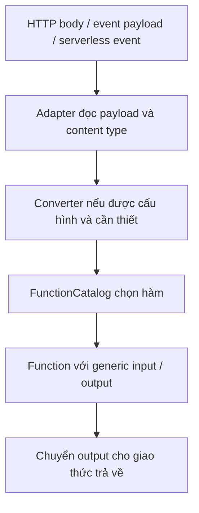

# Chuyển đổi String, byte[], POJO và tập hợp dữ liệu

Một hàm nghiệp vụ trong **Spring Cloud Function** có thể được gọi qua HTTP, sự kiện hoặc môi trường serverless mà vẫn dùng cùng mã Java. Tuy nhiên, dữ liệu đi vào từ các giao thức thường là chuỗi, dãy byte hoặc JSON, trong khi `Function<I, O>` của ứng dụng có thể nhận một POJO hoặc một tập hợp các đối tượng. **Chuyển đổi dữ liệu** là cầu nối giữa nội dung được truyền ở biên giao thức và kiểu Java mà hàm công bố.

Bài học thuộc chương **Kiểu dữ liệu**, tập trung vào bốn hình dạng payload thường gặp: `String`, `byte[]`, POJO (đối tượng Java có cấu trúc) và tập hợp như `List<T>`. Ta sẽ phân biệt chuyển đổi do code Java chủ động thực hiện với chuyển đổi có điều kiện do adapter và message converter hỗ trợ, sau đó áp dụng vào `Supplier`, `Function`, `Consumer`, `FunctionCatalog` và composition.

Sau bài này, bạn có thể đọc đúng hợp đồng kiểu của một hàm, lựa chọn định dạng payload phù hợp, giữ generic khi truyền danh sách DTO, và xác minh việc chuyển đổi ở cả mức Java lẫn HTTP/message.

## 1. Bốn dạng dữ liệu và hai nơi có thể diễn ra chuyển đổi

| Dạng dữ liệu | Ví dụ Java | Dạng thường gặp ở biên | Điều cần chú ý |
| --- | --- | --- | --- |
| Văn bản | `String` | Plain text, JSON string | Charset và cách diễn giải dấu ngoặc kép của JSON |
| Byte thô | `byte[]` | Binary payload, nội dung đã mã hóa | Byte không tự mang thông tin charset hay cấu trúc |
| Đối tượng nghiệp vụ | `OrderRequest` | JSON object | Trường, kiểu dữ liệu, constructor/record và quy tắc converter |
| Tập hợp | `List<OrderItem>` | JSON array hoặc batch của adapter | Cần giữ cả kiểu collection **và** kiểu phần tử |

Ví dụ chuỗi xử lý:



Có **hai lớp chuyển đổi**:

1. **Trong logic Java:** do nhà phát triển viết rõ, ví dụ `text.getBytes(StandardCharsets.UTF_8)` hoặc `new String(bytes, UTF_8)`. Kết quả phụ thuộc trực tiếp vào đoạn mã.
2. **Tại biên adapter:** HTTP adapter, messaging adapter hoặc serverless adapter có thể dựa vào chữ ký generic, `content-type` và converter khả dụng để biến payload đến thành đối tượng Java. Đây là khả năng **phụ thuộc cấu hình và adapter**, không phải đảm bảo cho mọi dữ liệu hay giao thức.

`FunctionCatalog` quản lý và cung cấp hàm; converter là thành phần xử lý định dạng payload. Đăng ký thành công `Function<OrderRequest, OrderResult>` không đồng nghĩa mọi JSON đều hợp lệ hoặc mọi adapter đều tự bật.

## 2. Ví dụ xuyên suốt: một nhóm hàm với đầu vào/đầu ra khác nhau

Chúng ta xây dựng các hàm tính tiền và xử lý văn bản. Ví dụ Java 17+ sử dụng `record` và `Stream.toList()`; với Java cũ hơn có thể thay record bằng DTO thường và dùng collector tương ứng.

```java
package example.function;

import java.nio.charset.StandardCharsets;
import java.util.List;
import java.util.Locale;
import java.util.Objects;
import java.util.function.Function;

import org.springframework.context.annotation.Bean;
import org.springframework.context.annotation.Configuration;

@Configuration
public class PayloadFunctions {

    public record OrderItem(
        String sku, int quantity, long unitPriceVnd
    ) {}

    public record ItemTotal(String sku, long subtotalVnd) {}

    public record OrderRequest(
        String orderId, List<OrderItem> items
    ) {}

    public record OrderResult(String orderId, long totalVnd) {}

    @Bean
    public Function<String, byte[]> encodeUtf8() {
        return text -> text.getBytes(StandardCharsets.UTF_8);
    }

    @Bean
    public Function<byte[], String> decodeUtf8() {
        return bytes -> new String(bytes, StandardCharsets.UTF_8);
    }

    @Bean
    public Function<String, String> normalizeText() {
        return text -> text.strip().toUpperCase(Locale.ROOT);
    }

    @Bean
    public Function<OrderRequest, OrderResult> calculateOrder() {
        return request -> {
            Objects.requireNonNull(request, "request");
            List<OrderItem> items =
                Objects.requireNonNull(request.items(), "items");

            long total = 0L;
            for (OrderItem item : items) {
                total = Math.addExact(total, subtotal(item));
            }
            return new OrderResult(request.orderId(), total);
        };
    }

    @Bean
    public Function<List<OrderItem>, List<ItemTotal>> calculateLines() {
        return items -> {
            Objects.requireNonNull(items, "items");
            return items.stream()
                .map(item -> new ItemTotal(
                    item.sku(), subtotal(item)
                ))
                .toList();
        };
    }

    private static long subtotal(OrderItem item) {
        Objects.requireNonNull(item, "item");
        if (item.quantity() <= 0 || item.unitPriceVnd() < 0) {
            throw new IllegalArgumentException(
                "quantity must be positive and unitPriceVnd nonnegative"
            );
        }
        return Math.multiplyExact(
            item.unitPriceVnd(), item.quantity()
        );
    }
}
```

Các phương thức `@Bean` công bố kiểu input/output ngay trên kiểu trả về. Đây là nguồn metadata hữu ích để Spring Cloud Function nhận diện hợp đồng của hàm khi đưa vào `FunctionCatalog`:

| Hàm | Input | Output |
| --- | --- | --- |
| `encodeUtf8` | `String` | `byte[]` |
| `decodeUtf8` | `byte[]` | `String` |
| `normalizeText` | `String` | `String` |
| `calculateOrder` | `OrderRequest` | `OrderResult` |
| `calculateLines` | `List<OrderItem>` | `List<ItemTotal>` |

Lớp này là ví dụ về logic và đăng ký bean. Để gọi các tên hàm qua HTTP cần có Spring Cloud Function Web adapter và cấu hình ứng dụng phù hợp; để gọi qua một message broker cần thêm adapter/binder tương ứng.

## 3. `String`: văn bản không đồng nghĩa với JSON

`String` biểu diễn chuỗi ký tự Java (UTF-16 ở cấp API), còn nội dung truyền qua mạng được mã hóa thành byte theo một charset, thường là UTF-8. Các payload sau khác nhau:

```text
Plain text (text/plain):
  Xin chào

JSON string (application/json):
  "Xin chào"

JSON object (application/json):
  {"message":"Xin chào"}
```

Plain text chứa ký tự `X` ở đầu. JSON string có dấu ngoặc kép và quy tắc escape JSON. JSON object chứa trường `message`, về mặt cấu trúc là một đối tượng. **Không nên coi ba dạng này là cùng một payload chỉ vì chúng đều có chữ.**

Trong Java:

```java
Function<String, String> normalize = text ->
    text.strip().toUpperCase(Locale.ROOT);

System.out.println(normalize.apply("  xin chào  "));
// XIN CHÀO
```

Với Web adapter được cấu hình đúng, một lời gọi gửi văn bản thô có thể được biểu diễn:

```bash
curl -X POST http://localhost:8080/normalizeText \
  -H 'Content-Type: text/plain; charset=UTF-8' \
  --data-binary '  hello spring  '
```

Giá trị Java mà logic mong đợi là `"  hello spring  "`; kết quả tính toán là `"HELLO SPRING"`. Dạng body và `Content-Type` **trên phản hồi HTTP** còn tùy adapter/converter đã cấu hình. Khi gửi JSON string thay cho text/plain, hãy dùng cú pháp JSON đúng và kiểm tra adapter có hỗ trợ diễn giải scalar JSON thành `String` như bạn mong muốn không.

### Charset và tính đúng đắn của dữ liệu

```java
String text = "Cà phê";
byte[] utf8 = text.getBytes(StandardCharsets.UTF_8);
String restored = new String(utf8, StandardCharsets.UTF_8);

System.out.println(text.equals(restored)); // true
```

Không dùng `text.getBytes()` hoặc `new String(bytes)` không chỉ định charset khi hệ thống cần trao đổi chính xác giữa nhiều môi trường; các overload đó dựa vào charset mặc định của nền tảng Java đang chạy. Ngoài ra, `new String(bytes, UTF_8)` có thể thay thế byte sequence UTF-8 không hợp lệ bằng ký tự thay thế, nên **không được coi là cách giải mã không mất dữ liệu của byte tùy ý**.

Nếu dữ liệu bắt buộc là UTF-8 hợp lệ, hãy giải mã nghiêm ngặt:

```java
import java.nio.ByteBuffer;
import java.nio.charset.CharacterCodingException;
import java.nio.charset.CodingErrorAction;
import java.nio.charset.StandardCharsets;

String strictUtf8(byte[] payload) throws CharacterCodingException {
    return StandardCharsets.UTF_8.newDecoder()
        .onMalformedInput(CodingErrorAction.REPORT)
        .onUnmappableCharacter(CodingErrorAction.REPORT)
        .decode(ByteBuffer.wrap(payload))
        .toString();
}
```

Nếu byte không phải UTF-8 hợp lệ, phương thức này ném `CharacterCodingException`. Các hàm xử lý văn bản nhận từ nguồn không đáng tin cậy có thể chọn chiến lược báo lỗi hoặc thay thế ký tự theo yêu cầu nghiệp vụ.

## 4. `byte[]`: nội dung nhị phân và mã hóa văn bản là hai chuyện khác nhau

`byte[]` chỉ chứa dãy byte, không tự mang thông tin nó là ảnh, file PDF, UTF-8, JSON hay dữ liệu nén. Cùng một kiểu Java có thể biểu diễn:

- Nội dung văn bản đã mã hóa UTF-8;
- Một phần hoặc toàn bộ file nhị phân;
- JSON đã được serialize thành UTF-8;
- Dữ liệu mã hóa/nén từ hệ thống bên ngoài.

Vì thế, `Function<byte[], String>` chỉ có nghĩa hàm nhận byte và trả chuỗi; nó **chưa đủ** để kết luận byte đầu vào là UTF-8, base64 hoặc JSON. Trong ví dụ `decodeUtf8`, việc diễn giải UTF-8 là một quyết định rõ ràng của code.

```java
byte[] incoming = new byte[] {72, 105, 33};  // "Hi!" trong ASCII/UTF-8
String text = new String(incoming, StandardCharsets.UTF_8);
byte[] roundTrip = text.getBytes(StandardCharsets.UTF_8);

System.out.println(text); // Hi!
// roundTrip có các phần tử 72, 105, 33
```

**Không dùng `byte[].toString()` để giải mã văn bản**: phương thức đó tạo biểu diễn định danh của mảng Java, không giải mã nội dung.

### Khi sử dụng `application/octet-stream`

Với HTTP, payload nhị phân thường đi kèm `Content-Type: application/octet-stream`. Trong messaging, thông tin tương tự có thể nằm trong header `contentType` hoặc metadata riêng của adapter. Một hàm `Function<byte[], byte[]>` có thể truyền hoặc xử lý byte mà không cần parse thành text. Tuy nhiên, byte gửi ở request có tới target dưới dạng `byte[]` hay cần một converter trung gian vẫn phụ thuộc adapter.

Không tự động chuyển mọi binary payload sang String để xử lý. Việc giải mã tùy tiện có thể làm mất thông tin, nhất là khi đầu vào là ảnh, tệp đã nén, dữ liệu mã hóa hoặc byte UTF-8 không hợp lệ.

### `byte[]` và base64

Base64 là **cách mã hóa byte thành ký tự**, hữu ích khi một giao thức chỉ nhận text/JSON; nó không giống giải mã UTF-8:

```java
import java.util.Base64;

byte[] raw = new byte[] {0, 1, 2, (byte) 255};
String encoded = Base64.getEncoder().encodeToString(raw);
byte[] restored = Base64.getDecoder().decode(encoded);

System.out.println(encoded);                 // AAEC/w==
System.out.println(java.util.Arrays.equals(raw, restored)); // true
```

Đầu ra base64 thực tế của đoạn mã trên là `AAEC/w==`. Nếu một hệ thống JSON biểu diễn nhị phân bằng base64, các bên phải thống nhất quy tắc đó. **Đừng hiểu chuỗi base64 là nội dung UTF-8 nguyên bản**.

## 5. POJO: JSON object cần metadata của lớp đích

POJO trong phạm vi này là đối tượng dữ liệu Java, có thể là class với getter/setter/constructor phù hợp hoặc Java `record`. Với ví dụ `OrderRequest`:

```json
{
  "orderId": "ORD-101",
  "items": [
    {"sku": "BOOK-1", "quantity": 2, "unitPriceVnd": 5000},
    {"sku": "PEN-2", "quantity": 1, "unitPriceVnd": 3000}
  ]
}
```

Nếu adapter và JSON converter được cài đúng và đọc được chữ ký `Function<OrderRequest, OrderResult>`, bước chuyển đổi mong đợi là:

```text
HTTP/event JSON object
    ↓ deserialize theo OrderRequest
OrderRequest("ORD-101", List<OrderItem>)
    ↓ calculateOrder.apply(...)
OrderResult("ORD-101", 13000)
    ↓ serialize (nếu đầu ra được biểu diễn bằng JSON)
{"orderId":"ORD-101","totalVnd":13000}
```

Ví dụ HTTP (giả định adapter expose `calculateOrder` và converter JSON xử lý được record):

```bash
curl -X POST http://localhost:8080/calculateOrder \
  -H 'Content-Type: application/json' \
  -d '{"orderId":"ORD-101","items":[{"sku":"BOOK-1","quantity":2,"unitPriceVnd":5000},{"sku":"PEN-2","quantity":1,"unitPriceVnd":3000}]}'
```

Kết quả minh họa khi cấu hình phù hợp:

```json
{"orderId":"ORD-101","totalVnd":13000}
```

Cần phân biệt **deserialization** (JSON → POJO), **xử lý nghiệp vụ** (POJO → POJO khác) và **serialization** (POJO → JSON). Chữ ký generic giúp converter biết kiểu đích nhưng không thực hiện validation nghiệp vụ. Ví dụ:

- JSON thiếu `items` có thể tạo giá trị `null` trong record tùy converter và thiết lập; code `calculateOrder` ở trên cố tình kiểm tra và báo lỗi.
- `quantity` âm hoặc bằng 0 không bị loại chỉ vì kiểu Java là `int`; ví dụ dùng điều kiện nghiệp vụ ở `subtotal()`.
- Số quá lớn có thể gây tràn; ví dụ dùng `Math.multiplyExact` và `Math.addExact` để phát hiện thay vì âm thầm trả tổng sai.
- Nếu tên trường JSON khác với tên thuộc tính DTO, cần quy tắc mapping thích hợp của converter.

Một payload JSON hợp cú pháp chưa chắc phù hợp hợp đồng dữ liệu. Đặc biệt, `{"items": {...}}` (object) khác `{"items": [{...}]}` (array).

### Chủ động parse JSON trong code

Khi nghiệp vụ thật sự nhận một `String` JSON hoặc `byte[]` JSON và cần parse **bên trong hàm**, phải dùng codec/JSON library một cách tường minh. Ví dụ minh họa với Jackson 2:

```java
import com.fasterxml.jackson.databind.ObjectMapper;

ObjectMapper mapper = new ObjectMapper();
String json = """
    {"orderId":"ORD-101","items":[
      {"sku":"BOOK-1","quantity":2,"unitPriceVnd":5000}
    ]}
    """;

PayloadFunctions.OrderRequest order =
    mapper.readValue(json, PayloadFunctions.OrderRequest.class);

byte[] jsonBytes = mapper.writeValueAsBytes(order);
```

Đây là snippet trong ngữ cảnh có xử lý checked exception của Jackson (ví dụ `throws JsonProcessingException`/`Exception` trong method test). API/package của thư viện JSON có thể khác theo phiên bản Spring Boot; ví dụ dùng Jackson 2 và cần dependency tương ứng. Nếu adapter đã deserialize trực tiếp đến `OrderRequest`, **không cần parse JSON thêm lần nữa trong hàm nghiệp vụ**.

## 6. Tập hợp: `List<OrderItem>` có hai tầng thông tin kiểu

Một danh sách JSON được biểu diễn bằng dấu ngoặc vuông:

```json
[
  {"sku":"BOOK-1","quantity":2,"unitPriceVnd":5000},
  {"sku":"PEN-2","quantity":1,"unitPriceVnd":3000}
]
```

Hàm `calculateLines` có hợp đồng:

```java
Function<List<PayloadFunctions.OrderItem>,
         List<PayloadFunctions.ItemTotal>> calculateLines;
```

Đây là **một đầu vào dạng List**, khác với hai lần gọi `Function<OrderItem, ItemTotal>`. Trong một lần gọi, lambda nhận cả danh sách và trả một danh sách mới.

Nếu hệ thống hỗ trợ deserialize JSON array theo generic của hàm, kết quả tương ứng:

```json
[
  {"sku":"BOOK-1","subtotalVnd":10000},
  {"sku":"PEN-2","subtotalVnd":3000}
]
```

Điều kiện là converter và adapter phải hiểu `List<OrderItem>`, không chỉ biết lớp thô `List.class`.

### Vì sao `List.class` hoặc `List<Object>` có thể gây lỗi?

Trong Java, generic chịu *type erasure*. Một phương thức/bean khai báo rõ `List<OrderItem>` vẫn có metadata generic có thể đọc qua reflection, nhưng nếu bạn chỉ công bố `List` hoặc `List<Object>`, converter không có thông tin rõ về lớp phần tử. Với một số JSON mapper, danh sách JSON object được đọc theo kiểu tổng quát có thể thành các `Map`; việc ép từng phần tử sang `OrderItem` khi đó gây `ClassCastException`.

```java
// Giữ hợp đồng của phần tử trên bean:
@Bean
public Function<List<PayloadFunctions.OrderItem>,
                List<PayloadFunctions.ItemTotal>> calculateLines() {
    return items -> items.stream()
        .map(item -> new PayloadFunctions.ItemTotal(
            item.sku(),
            Math.multiplyExact(item.unitPriceVnd(), item.quantity())
        ))
        .toList();
}
```

Đoạn trên chỉ minh họa việc **khai báo return type của bean**, với `PayloadFunctions` và DTO đã được định nghĩa; khi biên dịch trong ứng dụng thực tế, chỉ đăng ký một bean tên `calculateLines` (đừng thêm bản minh họa thứ hai trùng tên với ví dụ mục 2). Bản chính ở mục 2 có kiểm tra dữ liệu trước khi tính toán.

### Parse `List<T>` bằng Jackson

Nếu code phải tự chuyển JSON array sang List, sử dụng một type token tham số hóa thay vì chỉ `List.class`:

```java
import java.util.List;
import com.fasterxml.jackson.core.type.TypeReference;
import com.fasterxml.jackson.databind.ObjectMapper;

ObjectMapper mapper = new ObjectMapper();
String payload = """
    [{"sku":"BOOK-1","quantity":2,"unitPriceVnd":5000}]
    """;

List<PayloadFunctions.OrderItem> items = mapper.readValue(
    payload,
    new TypeReference<List<PayloadFunctions.OrderItem>>() {}
);
```

Đây cũng là snippet Jackson 2, giả định đã xử lý checked exception. `new TypeReference<List<OrderItem>>() {}` giữ kiểu phần tử để Jackson tạo đúng DTO. Tương tự, ở `FunctionRegistration` khi đăng ký lambda động, cần giữ `Type` lồng nhau của `List<OrderItem>` và `List<ItemTotal>`; chỉ truyền `List.class` là thiếu thông tin.

### List không đồng nghĩa với reactive stream hay batch broker

| Hợp đồng Java | Đơn vị input logic nhận | Điều không nên suy ra |
| --- | --- | --- |
| `Function<OrderItem, ItemTotal>` | Một phần tử | Không chắc adapter sẽ gọi nhiều lần trên một JSON array |
| `Function<List<OrderItem>, List<ItemTotal>>` | Một danh sách | Không tự bật chế độ batch của message broker |
| `Function<Flux<OrderItem>, Flux<ItemTotal>>` | Một publisher Reactor | Không có nghĩa logic là List trong bộ nhớ |
| `Consumer<Message<List<OrderItem>>>` | Một Message chứa List | Không tự xác định số event được ack hoặc cách binder gom nhóm |

`Flux<T>` xử lý dòng dữ liệu reactive, có cơ chế subscription, backpressure và tín hiệu lỗi; `List<T>` là một cấu trúc dữ liệu hữu hạn trong bộ nhớ. Hai loại này có thể chứa cùng DTO nhưng không cùng mô hình xử lý.

## 7. `Message<T>`: tách payload và metadata

Khi xử lý sự kiện, bên cạnh nội dung còn có header như mã tương quan, content type hoặc thông tin routing. Spring Messaging biểu diễn thông điệp bằng `Message<T>`:

```java
import java.util.function.Function;
import org.springframework.context.annotation.Bean;
import org.springframework.messaging.Message;
import org.springframework.messaging.support.MessageBuilder;

@Bean
public Function<Message<PayloadFunctions.OrderRequest>,
                Message<PayloadFunctions.OrderResult>> calculateOrderEvent() {
    return incoming -> {
        PayloadFunctions.OrderRequest request = incoming.getPayload();
        long total = 0L;

        for (PayloadFunctions.OrderItem item : request.items()) {
            total = Math.addExact(
                total,
                Math.multiplyExact(item.unitPriceVnd(), item.quantity())
            );
        }

        PayloadFunctions.OrderResult result =
            new PayloadFunctions.OrderResult(request.orderId(), total);

        MessageBuilder<PayloadFunctions.OrderResult> builder =
            MessageBuilder.withPayload(result);

        Object correlationId = incoming.getHeaders().get("correlationId");
        if (correlationId != null) {
            builder.setHeader("correlationId", correlationId);
        }
        return builder.build();
    };
}
```

Đây là một bean minh họa độc lập, có thể đặt trong một `@Configuration` khác; phần tính tiền đã được rút gọn để làm rõ cấu trúc `Message`, không dùng thay logic kiểm tra dữ liệu ở mục 2 trong môi trường production.

`Message<OrderRequest>` nghĩa là **đối tượng input Java là Message**, bên trong payload là `OrderRequest`. Khi payload đến từ broker dưới dạng `byte[]` hoặc `String` JSON, adapter và converter có thể dùng generic `OrderRequest` để chuyển đổi. Tuy nhiên, header của các adapter khác nhau có thể được ánh xạ hoặc chuẩn hóa khác nhau; không nên mặc định rằng mọi header truyền nguyên vẹn giữa HTTP, broker và serverless.

Không sao chép mù quáng toàn bộ header khi đổi định dạng payload. Ví dụ, giữ lại `contentType` của dữ liệu nhị phân cũ trong khi payload mới đã thành JSON có thể gây hiểu nhầm cho converter phía sau. Chọn header cần giữ và để adapter/converter thiết lập metadata định dạng phù hợp.

### `Supplier<T>` và `Consumer<T>` tại biên chuyển đổi

Với `Supplier<OrderResult>`, hàm không nhận đầu vào; adapter xuất dữ liệu có thể cần serialize `OrderResult` thành JSON hoặc thông điệp theo giao thức đích. Với `Consumer<OrderRequest>`, converter có thể cần tạo `OrderRequest` từ payload trước khi gọi `accept(...)`; bản thân `Consumer` không có giá trị trả về.

```java
import java.util.function.Consumer;
import java.util.function.Supplier;

@Bean
public Supplier<PayloadFunctions.OrderResult> sampleOrderResult() {
    return () -> new PayloadFunctions.OrderResult("ORD-101", 13000L);
}

@Bean
public Consumer<PayloadFunctions.OrderRequest> auditOrder() {
    return request -> System.out.println("Received: " + request.orderId());
}
```

Đây là hai bean minh họa riêng, có thể đặt trong lớp cấu hình Spring với DTO được import hoặc truy cập bằng tên `PayloadFunctions`. Tần suất phát dữ liệu của supplier và cách acknowledgment của consumer phụ thuộc adapter/binder; chữ ký generic chỉ mô tả kiểu nghiệp vụ.

## 8. Kết hợp các hàm có kiểu tương thích

Mỗi `Function<I, O>` có hợp đồng input/output xác định. Spring Cloud Function hỗ trợ composition qua tên hàm, ví dụ nối ba hàm từ mục 2:

```text
byte[]
  │
  ▼
decodeUtf8: Function<byte[], String>
  │ String
  ▼
normalizeText: Function<String, String>
  │ String
  ▼
encodeUtf8: Function<String, byte[]>
  │
  ▼
byte[]
```

Có thể lựa chọn chuỗi trong cấu hình:

```yaml
spring:
  cloud:
    function:
      definition: decodeUtf8|normalizeText|encodeUtf8
```

Khi chọn hàm composite, input cuối cùng của chuỗi là `byte[]` và output là `byte[]`. Chữ ký của mỗi bước nối khớp kiểu Java:

1. `decodeUtf8` trả `String`, phù hợp với đầu vào `String` của `normalizeText`.
2. `normalizeText` trả `String`, phù hợp với đầu vào `String` của `encodeUtf8`.
3. Composite nhận byte UTF-8 được kỳ vọng, trả byte UTF-8 tương ứng với văn bản đã chuẩn hóa.

**Metadata đúng không bảo đảm dữ liệu hợp lệ**: nếu byte đầu vào không phải UTF-8, decoder đơn giản có thể thay ký tự lỗi; với yêu cầu nghiêm ngặt cần lựa chọn strict decoder ở mục 3. Composition không tự đoán hoặc sửa charset.

Nếu cần nối `calculateOrder` với một hàm định dạng hóa đơn, hàm tiếp theo phải nhận `OrderResult` hoặc có một bước chuyển đổi tường minh. Không nên giả định Spring tự chuyển mọi POJO sang `String` ở mọi điểm giữa các hàm.

## 9. Tra cứu qua `FunctionCatalog` và phân biệt unit test với kiểm thử giao thức

`FunctionCatalog` là điểm truy xuất hàm theo tên. Với Spring context có các bean ở mục 2:

```java
import java.util.function.Function;
import org.springframework.cloud.function.context.FunctionCatalog;

// Đặt trong một phương thức có biến catalog được inject.
Function<PayloadFunctions.OrderRequest, PayloadFunctions.OrderResult> fn =
    catalog.lookup("calculateOrder");

PayloadFunctions.OrderRequest input =
    new PayloadFunctions.OrderRequest(
        "ORD-101",
        java.util.List.of(
            new PayloadFunctions.OrderItem("BOOK-1", 2, 5000),
            new PayloadFunctions.OrderItem("PEN-2", 1, 3000)
        )
    );

PayloadFunctions.OrderResult result = fn.apply(input);
System.out.println(result.totalVnd()); // 13000
```

Lời gọi Java này xác minh tên hàm và logic trên một POJO **đã được tạo sẵn**. Nó chưa kiểm chứng rằng body JSON từ HTTP hoặc payload message sẽ được chuyển sang `OrderRequest` một cách chính xác. Để kiểm tra chuyển đổi, hãy gửi payload qua adapter đang triển khai rồi xác nhận cả kiểu runtime lẫn kết quả.

Ví dụ các đầu vào cần thử:

| Trường hợp | Payload / header | Kết quả cần quan sát |
| --- | --- | --- |
| Văn bản thường | `text/plain; charset=UTF-8`, có khoảng trắng | `String` được chuẩn hóa đúng |
| Byte UTF-8 | `application/octet-stream` và byte hợp lệ | `decodeUtf8` ra chuỗi đúng |
| Byte sai charset | Byte không phải UTF-8 | Chính sách lỗi/thay ký tự diễn ra như mong đợi |
| JSON object | `application/json` và OrderRequest hợp lệ | Converter tạo đúng POJO |
| JSON array | `application/json` và `List<OrderItem>` | Mỗi phần tử là OrderItem, không phải Map |
| JSON sai shape | `items` là object thay vì array | Converter hoặc validation báo lỗi phù hợp |
| Message có header | Payload + `correlationId` | Dữ liệu và header cần thiết được giữ đúng |

Đối với HTTP, cần chạy một ứng dụng có Web adapter. Đối với messaging, cần test với binder/test binder hoặc hạ tầng thực tế. Serverless có thể bọc sự kiện theo một cấu trúc riêng; hãy kiểm thử event envelope của nền tảng cụ thể, không suy luận rằng nó giống request HTTP.

## 10. Lỗi thường gặp và cách tìm nguyên nhân

### Lỗi A — Đọc byte bất kỳ thành String

```java
// Không phù hợp cho nội dung binary tùy ý:
String content = new String(binaryPayload, StandardCharsets.UTF_8);
```

Nếu payload là ảnh hoặc nén, chuyển thành String không giúp hiểu định dạng và có thể mất dữ liệu. Hãy giữ `byte[]` và dùng parser/codec theo định dạng thực tế. Nếu là text, phải thống nhất charset.

### Lỗi B — Khai báo `Function<Object, Object>` rồi ép sang DTO

```java
@Bean
public Function<Object, Object> unsafeOrder() {
    return payload -> {
        PayloadFunctions.OrderRequest order =
            (PayloadFunctions.OrderRequest) payload;
        return order.orderId();
    };
}
```

Một adapter nhận JSON có thể tạo kiểu tổng quát thay vì `OrderRequest` vì metadata chỉ nói `Object`. Hãy công bố `Function<OrderRequest, String>` nếu đó là hợp đồng thực sự. Raw `Function` hoặc lambda đăng ký động thiếu thông tin kiểu có nguy cơ tương tự.

### Lỗi C — Không giữ kiểu phần tử khi đọc JSON array

```java
// Chỉ cung cấp lớp raw List cho JSON parser:
List<?> values = mapper.readValue(json, List.class);

// Nên dùng TypeReference<List<OrderItem>> khi parse thủ công,
// hoặc để converter đọc generic List<OrderItem> từ bean.
```

Đoạn này giả định `mapper` là một Jackson ObjectMapper và `json` chứa JSON array; cần xử lý checked exception. Nếu parser tạo `List<Map<...>>` rồi code ép thành `List<OrderItem>`, lỗi có thể chỉ xuất hiện khi lấy một phần tử ra.

### Lỗi D — Gửi sai `Content-Type`

Gửi JSON object nhưng khai báo `text/plain` có thể khiến adapter coi body là text. Gửi byte thô nhưng khai báo `application/json` có thể kích hoạt JSON parsing không phù hợp. Cần đồng bộ **payload thực**, `content-type`, chữ ký generic và converter.

### Lỗi E — Hiểu nhầm số lượng phần tử với số lần gọi hàm

Một JSON array không chắc tự trở thành nhiều lần gọi `Function<Item, Result>`. Ngược lại, `Function<List<Item>, List<Result>>` không tự kích hoạt batch consumer của message broker. Số lần gọi phụ thuộc adapter và cấu hình; mô hình Java của hàm phải phù hợp.

### Lỗi F — Bỏ qua validation và lỗi overflow

Deserialize thành công không đồng nghĩa dữ liệu hợp lệ về nghiệp vụ. `int quantity` vẫn có thể là 0 hoặc âm, `items` có thể `null`, và phép tính giá tiền có thể tràn. Nên kiểm tra input và xác định cách trả lỗi ở từng adapter.

## 11. Bài tập thực hành

**Bài 1 — Chọn đúng phương thức chuyển đổi.** Viết chuyển đổi qua lại giữa `String "Xin chào"` và `byte[]` UTF-8. Có nên dùng `byte[].toString()` không?

*Đáp án:* Dùng `text.getBytes(StandardCharsets.UTF_8)` và `new String(bytes, StandardCharsets.UTF_8)`. `byte[].toString()` không giải mã nội dung.

**Bài 2 — Đọc hợp đồng danh sách.** Một bean trả `Function<List<OrderItem>, List<ItemTotal>>`. Converter cần biết những lớp nào khi parse JSON array?

*Đáp án:* Đầu vào là `List` gồm các phần tử `OrderItem`, đầu ra là `List` gồm các phần tử `ItemTotal`. Chỉ có `List.class` không đủ để biết kiểu phần tử.

**Bài 3 — Phân biệt JSON string và JSON object.** Payload `"hello"` với `Content-Type: application/json` khác gì payload `{"message":"hello"}`?

*Đáp án:* Payload đầu là một giá trị JSON string; payload sau là một JSON object có trường `message`. Chúng tương ứng các kiểu Java và cơ chế mapping khác nhau, phụ thuộc converter/adapter.

**Bài 4 — Lập kế hoạch composition.** Muốn nhận byte UTF-8, bỏ khoảng trắng thừa, viết hoa chữ rồi trả byte UTF-8 thì nối các hàm nào?

*Đáp án:* `decodeUtf8|normalizeText|encodeUtf8`. Hợp đồng tổng thể là `Function<byte[], byte[]>`, với yêu cầu đầu vào thực sự là UTF-8 hợp lệ.

**Bài 5 — Phát hiện lỗi chuyển đổi qua HTTP.** Unit test gọi trực tiếp `calculateOrder.apply(OrderRequest)` thành công, nhưng POST JSON trả lỗi. Nêu ít nhất bốn thứ cần kiểm tra.

*Đáp án:* Xác nhận Web adapter/endpoint hoạt động, header `Content-Type` đúng, JSON object/array khớp DTO, chữ ký generic được công bố đầy đủ, converter hỗ trợ record/DTO, và dữ liệu thỏa validation nghiệp vụ.

**Bài 6 — Dữ liệu nhị phân trên giao thức JSON.** Khi nào cần base64, và vì sao không dùng `new String(raw, UTF_8)`?

*Đáp án:* Khi giao thức muốn vận chuyển byte trong một trường text/JSON theo quy ước base64, hãy encode/decode base64 ở hai đầu. Byte tùy ý không nhất thiết là UTF-8, nên giải mã thành text có thể làm hỏng dữ liệu.

## Ghi nhớ

- `String` là văn bản; `byte[]` là byte thô. Muốn đổi qua lại dưới dạng text phải xác định charset, thường là UTF-8. Base64 là phương pháp khác để biểu diễn byte dưới dạng ký tự.
- JSON object phù hợp với POJO khi converter biết lớp đích; JSON array phù hợp với collection khi giữ được **generic của phần tử**.
- `FunctionCatalog`, adapter và converter dùng hợp đồng kiểu của bean để hỗ trợ chuyển payload, nhưng việc convert thành công còn phụ thuộc `content-type`, cấu trúc dữ liệu và cấu hình giao thức.
- `List<T>`, `Flux<T>` và `Message<T>` không đồng nghĩa nhau: mỗi kiểu có ngữ nghĩa riêng về đơn vị dữ liệu, luồng xử lý và header.
- Kiểm thử trực tiếp một hàm Java chỉ xác minh logic. Muốn xác minh chuyển đổi, phải gửi dữ liệu thật qua HTTP, messaging hoặc serverless adapter đang dùng.

**Tài liệu đọc thêm:** [Spring Cloud Function Reference](https://docs.spring.io/spring-cloud-function/reference/) (programming model, function composition và message conversion). Cơ chế cụ thể của mỗi Spring Cloud Function adapter cần được đối chiếu với tài liệu adapter tương ứng.
