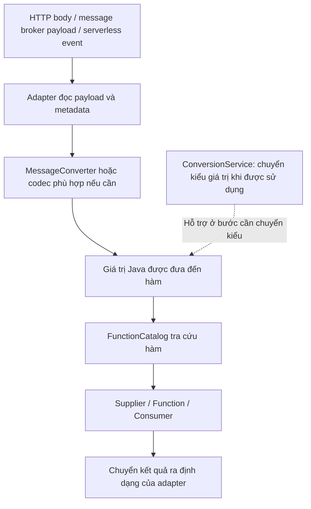

# Vai trò của MessageConverter và ConversionService

Spring Cloud Function cho phép xây dựng logic nghiệp vụ bằng `Supplier<T>`, `Function<I, O>` và `Consumer<T>`, đăng ký trong `FunctionCatalog` rồi gọi qua HTTP, hệ thống sự kiện hoặc môi trường serverless. Các giao thức này không nhất thiết gửi đối tượng Java có đúng kiểu mà hàm mong đợi: request HTTP có body JSON, broker có thể chuyển payload ở dạng byte, còn một đối số nghiệp vụ có thể chứa mã định danh dạng chuỗi cần chuyển thành kiểu miền riêng.

Trong chương **Kiểu dữ liệu**, hai cơ chế dễ bị nhầm là **`MessageConverter`** và **`ConversionService`**. Chúng đều liên quan đến chuyển đổi dữ liệu nhưng giải quyết những bài toán khác nhau:

- **`MessageConverter`** xử lý payload của **thông điệp**, thường dựa vào kiểu đích và metadata như `contentType`. Một ví dụ là chuyển JSON trong `Message<byte[]>` thành DTO.
- **`ConversionService`** chuyển đổi **giá trị Java từ kiểu này sang kiểu khác**, chẳng hạn `"12"` thành `Integer` hoặc `String` thành một lớp định danh miền nghiệp vụ.

Hai cơ chế là nền tảng của Spring Framework. Cách Spring Cloud Function, HTTP adapter, Spring Cloud Stream binder hoặc serverless adapter dùng chúng còn phụ thuộc cấu hình và phiên bản cụ thể. Bài này trình bày hợp đồng API, ví dụ Java minh họa và cách kiểm tra đường đi dữ liệu để không đánh đồng việc chuyển đổi có thể thực hiện với việc adapter chắc chắn sẽ tự thực hiện.

## 1. Phân biệt nhanh trước khi viết code

| Tiêu chí | `MessageConverter` | `ConversionService` |
| --- | --- | --- |
| API thường dùng | `org.springframework.messaging.converter.MessageConverter` | `org.springframework.core.convert.ConversionService` |
| Đơn vị xử lý | `Message<?>` có payload và headers | Một giá trị Java riêng lẻ |
| Dữ kiện đầu vào | Payload, kiểu đích, headers như `contentType` | Kiểu nguồn, kiểu đích, converter đã đăng ký |
| Ví dụ điển hình | JSON `byte[]` → `OrderRequest` | `"5"` → `Integer` |
| Đầu ra | Payload đã đổi kiểu hoặc một `Message<?>` mới | Một giá trị Java thuộc kiểu đích |
| Metadata giao thức | Có thể tham gia lựa chọn converter | Không trực tiếp biết HTTP/broker headers |
| Mở rộng | Viết/đăng ký `MessageConverter`, dùng composite | Viết `Converter<S,T>`, `ConverterFactory` hoặc `GenericConverter` |
| Điều không tự bảo đảm | DTO hợp lệ, endpoint tồn tại, mọi header đều được giữ | Parse JSON thành POJO hoặc tự cấu hình adapter |

**Điểm mấu chốt:** `MessageConverter` gắn với *hợp đồng thông điệp và định dạng truyền tải*; `ConversionService` gắn với *quan hệ giữa các kiểu giá trị Java*. Một ứng dụng có thể dùng cả hai, nhưng không nên giả định có một chuỗi fallback cố định cho mọi HTTP request hay event.

### Bức tranh chuyển đổi ở biên ứng dụng



Sơ đồ là **mô hình khái niệm**, không khẳng định mọi adapter gọi đúng một lớp `MessageConverter` trước khi gọi catalog. Một số adapter có cơ chế codec riêng. Muốn xác nhận đường đi thực tế, cần kiểm thử với adapter và cấu hình đang triển khai.

## 2. Ví dụ nghiệp vụ dùng chung qua các giao thức

Giả sử một cửa hàng nhận yêu cầu tạo đơn hàng. Hợp đồng của logic là một POJO đầu vào và một POJO đầu ra. Dưới đây là bean đầy đủ, dùng Java 17 trở lên (vì có `record`):

```java
package demo.order;

import java.util.function.Function;
import org.springframework.context.annotation.Bean;
import org.springframework.context.annotation.Configuration;

@Configuration
public class OrderFunctions {

    public record OrderRequest(String orderId, int quantity) {}

    public record OrderReceipt(
        String orderId,
        long totalVnd,
        String status
    ) {}

    @Bean
    public Function<OrderRequest, OrderReceipt> createReceipt() {
        return request -> {
            if (request == null ||
                request.orderId() == null ||
                request.orderId().isBlank() ||
                request.quantity() <= 0) {
                throw new IllegalArgumentException(
                    "orderId and positive quantity are required"
                );
            }

            long total = Math.multiplyExact(
                request.quantity(), 50_000L
            );

            return new OrderReceipt(
                request.orderId(),
                total,
                "ACCEPTED"
            );
        };
    }
}
```

Chữ ký `Function<OrderRequest, OrderReceipt>` cho Spring Cloud Function thông tin kiểu cần thiết để hỗ trợ chuyển đổi payload. Không phải converter nào cũng có thể chuyển mọi định dạng sang `OrderRequest`: chuyển đổi phải có định dạng nguồn phù hợp và một converter/codec tương ứng.

Một lời gọi Java thuần với bean này:

```java
OrderFunctions.OrderReceipt receipt = createReceipt.apply(
    new OrderFunctions.OrderRequest("ORD-001", 2)
);

System.out.println(receipt.totalVnd()); // 100000
```

Đoạn trên giả định `createReceipt` là biến `Function<OrderRequest, OrderReceipt>` đã lấy từ bean. Ở đây đầu vào đã là POJO nên **không cần deserialize JSON**. Việc unit test này thành công chưa chứng minh HTTP hay messaging adapter sẽ chuyển JSON thành DTO đúng kiểu.

## 3. `MessageConverter`: biến đổi payload có ý thức về thông điệp

Interface `MessageConverter` của Spring Messaging cung cấp hai hướng chuyển đổi chính:

```java
// Chữ ký khái niệm của org.springframework.messaging.converter.MessageConverter
Object fromMessage(Message<?> message, Class<?> targetClass);

Message<?> toMessage(Object payload, MessageHeaders headers);
```

Đây là hai khai báo chữ ký để giải thích API; phương thức thực tế còn có thể xuất hiện qua interface mở rộng hoặc overload khác. `fromMessage(...)` đọc thông điệp nguồn và chuyển payload sang kiểu đích, trong khi `toMessage(...)` đóng gói/serialize một giá trị Java thành thông điệp mới.

Các header quan trọng thường được đọc qua `MessageHeaders`:

```java
MessageHeaders.CONTENT_TYPE          // "contentType"
MessageHeaders.ID
MessageHeaders.TIMESTAMP
```

Giá trị `contentType` có thể là MIME type như `application/json`, `text/plain` hoặc `application/octet-stream`. Converter cần dựa vào cả kiểu đích và định dạng dữ liệu; chỉ nhìn thấy `byte[]` không thể biết đó là JSON, ảnh hay nội dung nén.

### Một số converter thường gặp

| Converter Spring Messaging | Mục đích điển hình | Điều cần lưu ý |
| --- | --- | --- |
| `StringMessageConverter` | Payload văn bản và `String` | Charset và MIME type phù hợp |
| `ByteArrayMessageConverter` | Payload `byte[]` | Byte không tự mô tả cấu trúc |
| `MappingJackson2MessageConverter` | JSON ↔ giá trị Java qua Jackson 2 | Cần Jackson và cấu hình kiểu/định dạng phù hợp |
| `CompositeMessageConverter` | Thử một tập converter theo thứ tự | Thứ tự và khả năng hỗ trợ của từng converter ảnh hưởng kết quả |

Không phải tất cả các lớp này đều được mọi adapter Spring Cloud Function khởi tạo hoặc cấu hình giống nhau. Chẳng hạn, Spring MVC có họ `HttpMessageConverter` cho body HTTP; Spring Messaging có `MessageConverter` cho `Message<?>`. Hai họ API **có tên gần giống nhưng không phải cùng interface**.

## 4. Chuyển `Message<byte[]>` JSON thành POJO

Đây là ví dụ gọi trực tiếp một converter cụ thể để thấy chính xác input, metadata và output. Ta sử dụng `MappingJackson2MessageConverter` của Spring Messaging với Jackson 2 hỗ trợ Java records (Jackson 2.12 trở lên).

```java
import java.nio.charset.StandardCharsets;

import org.springframework.messaging.Message;
import org.springframework.messaging.MessageHeaders;
import org.springframework.messaging.converter.MappingJackson2MessageConverter;
import org.springframework.messaging.support.MessageBuilder;
import org.springframework.util.MimeTypeUtils;

MappingJackson2MessageConverter converter =
    new MappingJackson2MessageConverter();

String json = """
    {"orderId":"ORD-001","quantity":2}
    """;

Message<byte[]> incoming = MessageBuilder
    .withPayload(json.getBytes(StandardCharsets.UTF_8))
    .setHeader(
        MessageHeaders.CONTENT_TYPE,
        MimeTypeUtils.APPLICATION_JSON
    )
    .build();

Object converted = converter.fromMessage(
    incoming,
    OrderFunctions.OrderRequest.class
);

if (!(converted instanceof OrderFunctions.OrderRequest request)) {
    throw new IllegalStateException(
        "Cannot convert incoming JSON to OrderRequest"
    );
}

System.out.println(request.orderId());  // ORD-001
System.out.println(request.quantity()); // 2
```

Đặt snippet này trong một phương thức Java có thể ném exception và có thể truy cập `OrderFunctions`. Với nội dung JSON và thư viện phù hợp, `fromMessage(...)` có thể tạo `OrderRequest`. Trong trường hợp khác, converter có thể không hỗ trợ định dạng/kiểu đích và trả `null` hoặc báo lỗi chuyển đổi tùy implementation và tình huống.

Ba dữ kiện quyết định ví dụ:

1. **Payload:** dãy byte thực sự chứa JSON UTF-8, không phải byte bất kỳ.
2. **Header:** `MessageHeaders.CONTENT_TYPE` mang MIME type `application/json`.
3. **Kiểu đích:** `OrderRequest.class` cho converter biết cần tạo DTO nào.

Nếu bỏ kiểu đích hoặc cung cấp `Object.class`, không thể mặc định converter tạo đúng `OrderRequest`. Nếu payload là JPEG nhưng khai `application/json`, việc giải mã thất bại dù header có vẻ hợp lệ.

### Chiều ngược lại: DTO → message JSON

```java
import java.util.Map;

OrderFunctions.OrderReceipt receipt =
    new OrderFunctions.OrderReceipt(
        "ORD-001", 100_000L, "ACCEPTED"
    );

MessageHeaders headers = new MessageHeaders(Map.of(
    MessageHeaders.CONTENT_TYPE,
    MimeTypeUtils.APPLICATION_JSON
));

Message<?> outbound = converter.toMessage(receipt, headers);
if (outbound == null) {
    throw new IllegalStateException("Cannot serialize receipt");
}

System.out.println(outbound.getHeaders().getContentType());
// application/json
```

Đoạn trên nối tiếp ngữ cảnh có biến `converter` từ ví dụ trước. Payload message đầu ra có thể là `byte[]` hoặc dạng khác tùy implementation/cấu hình converter. **Không ép kiểu đầu ra thành `String` nếu chưa kiểm tra kiểu payload thực tế**. Đầu ra JSON cũng chưa đồng nghĩa message sẽ tự được gửi đến broker; khâu phát sự kiện thuộc adapter/binder.

## 5. Lựa chọn converter theo `contentType`, kiểu đích và thứ tự

Với một hệ thống hỗ trợ cả văn bản, byte và JSON, ứng dụng có thể sử dụng composite converter:

```java
import java.util.List;
import org.springframework.messaging.converter.ByteArrayMessageConverter;
import org.springframework.messaging.converter.CompositeMessageConverter;
import org.springframework.messaging.converter.MappingJackson2MessageConverter;
import org.springframework.messaging.converter.StringMessageConverter;

CompositeMessageConverter converters =
    new CompositeMessageConverter(List.of(
        new MappingJackson2MessageConverter(),
        new StringMessageConverter(),
        new ByteArrayMessageConverter()
    ));
```

Đây là **một composite tự tạo trong mã Java**, không phải lời khẳng định thứ tự converter mặc định của mọi adapter. Composite thử các converter theo thứ tự; một converter có thể bỏ qua thông điệp không hỗ trợ và converter tiếp theo có cơ hội xử lý.

Khi xem xét chuyển đổi, kiểm tra đồng thời:

| Payload thực tế | `contentType` khai báo | Kiểu Java muốn nhận | Nhận xét |
| --- | --- | --- | --- |
| Byte chứa JSON object | `application/json` | `OrderRequest` | Có thể dùng JSON converter phù hợp |
| `String` văn bản thô | `text/plain` | `String` | Phù hợp converter văn bản |
| Byte ảnh/binary | `application/octet-stream` | `byte[]` | Cần giữ byte và dùng parser theo định dạng |
| Byte chứa JSON array | `application/json` | `List<OrderRequest>` | Cần metadata generic phần tử, xem mục 8 |
| Byte bất kỳ | `application/json` | `OrderRequest` | MIME type không khiến byte sai định dạng thành JSON |
| Chuỗi `"42"` | `text/plain` | `Integer` | Cần xem converter/adapter hỗ trợ scalar và chuyển giá trị hay không |

Trong messaging, header là `contentType` (camelCase trong `MessageHeaders`); trong HTTP, header thông dụng là `Content-Type`. Adapter có thể ánh xạ giữa chúng, nhưng không nên giả định mọi header luôn được truyền nguyên trạng.

## 6. `ConversionService`: chuyển kiểu giá trị Java

Spring Framework cung cấp `ConversionService` với các phương thức tiêu biểu:

```java
boolean canConvert(Class<?> sourceType, Class<?> targetType);

<T> T convert(Object source, Class<T> targetType);
```

Một `ConversionService` thường quản lý nhiều converter cho các cặp kiểu. `DefaultConversionService` của Spring đã đăng ký nhiều chuyển đổi phổ biến, ví dụ từ `String` sang kiểu số:

```java
import org.springframework.core.convert.support.DefaultConversionService;

DefaultConversionService conversionService =
    new DefaultConversionService();

boolean possible = conversionService.canConvert(
    String.class, Integer.class
);

Integer quantity = conversionService.convert("12", Integer.class);

System.out.println(possible);  // true
System.out.println(quantity);  // 12
```

`ConversionService` nhận giá trị `String "12"` và tạo `Integer 12`. Nó không cần `Message<?>` và cũng không đọc `contentType`. Một `String` trông giống JSON object không mặc nhiên được `DefaultConversionService` phân tích thành `OrderRequest`.

Nếu gọi:

```java
conversionService.convert("khong-phai-so", Integer.class);
```

phép chuyển đổi kiểu số có thể ném lỗi `ConversionException` (thường là `ConversionFailedException`). Đăng ký được một converter không đồng nghĩa mọi giá trị nguồn đều hợp lệ.

### Mở rộng bằng `Converter<S, T>`

Giả sử nghiệp vụ dùng một lớp riêng cho mã đơn hàng. Ta muốn bỏ khoảng trắng đầu/cuối và loại mã rỗng ngay khi đổi từ `String`:

```java
import org.springframework.core.convert.converter.Converter;
import org.springframework.core.convert.support.DefaultConversionService;

record OrderId(String value) {}

Converter<String, OrderId> orderIdConverter = source -> {
    String normalized = source.strip();
    if (normalized.isEmpty()) {
        throw new IllegalArgumentException("order id cannot be blank");
    }
    return new OrderId(normalized);
};

DefaultConversionService conversions =
    new DefaultConversionService();

conversions.addConverter(
    String.class,
    OrderId.class,
    orderIdConverter
);

OrderId id = conversions.convert(" ORD-001 ", OrderId.class);
System.out.println(id.value()); // ORD-001
```

Ở đây `OrderId` là kiểu miền nghiệp vụ; `ConversionService` tự nó không biết JSON hay broker. Nó chỉ thực thi converter khi code hoặc một thành phần được tích hợp yêu cầu chuyển `String` → `OrderId`.

Với yêu cầu chuyển đổi phức tạp hơn, Spring còn cung cấp `ConverterFactory` và `GenericConverter`. Các biến thể đó phù hợp khi một converter hỗ trợ nhiều kiểu đích hoặc cần mô tả kiểu nguồn/đích chi tiết hơn.

## 7. Sử dụng `ConversionService` bên trong hàm nghiệp vụ

Để biết chính xác một conversion service có được gọi hay không, cách đơn giản nhất là **gọi nó tường minh trong hàm**. Ví dụ dưới đây dùng Java 17+ và cấu hình Spring riêng:

```java
package demo.order;

import java.util.function.Function;

import org.springframework.beans.factory.annotation.Qualifier;
import org.springframework.context.annotation.Bean;
import org.springframework.context.annotation.Configuration;
import org.springframework.core.convert.ConversionService;
import org.springframework.core.convert.support.DefaultConversionService;

@Configuration
public class OrderCodeFunctions {

    public record OrderId(String value) {}

    @Bean("orderIdConversionService")
    public ConversionService orderIdConversionService() {
        DefaultConversionService service =
            new DefaultConversionService();

        service.addConverter(
            String.class,
            OrderId.class,
            raw -> {
                String id = raw.strip();
                if (id.isEmpty()) {
                    throw new IllegalArgumentException("empty order id");
                }
                return new OrderId(id);
            }
        );
        return service;
    }

    @Bean
    public Function<String, String> normalizeOrderId(
        @Qualifier("orderIdConversionService")
        ConversionService conversionService
    ) {
        return raw -> conversionService
            .convert(raw, OrderId.class)
            .value();
    }
}
```

Khi một lời gọi Java cung cấp `" ORD-001 "`, hàm `normalizeOrderId` dùng converter riêng để trả `"ORD-001"`. Chữ ký bean công bố là `Function<String, String>` vì đó là hợp đồng thật với người gọi.

Lưu ý: tạo một bean `ConversionService` tùy biến **không bảo đảm tất cả Spring Cloud Function adapters sẽ tự dùng bean đó để deserialize mọi message**. Ở ví dụ này, sự tích hợp là rõ ràng vì hàm trực tiếp inject và gọi `conversionService.convert(...)`. Nếu muốn một converter tham gia chuyển đổi ở biên, phải kiểm tra cơ chế extension/registration mà adapter cụ thể hỗ trợ.

## 8. Type metadata: POJO, `Message<T>` và collection

Converter chỉ có thể chuyển đổi đáng tin cậy khi biết kiểu mục tiêu thực sự. Sự khác biệt thường xuất hiện ở kiểu generic lồng nhau.

| Chữ ký của hàm | Hàm thực nhận | Metadata cần giữ |
| --- | --- | --- |
| `Function<String, Integer>` | `String` | Input `String`, output `Integer` |
| `Function<OrderRequest, OrderReceipt>` | DTO đầu vào | `OrderRequest` và `OrderReceipt` |
| `Function<Message<OrderRequest>, Message<OrderReceipt>>` | Toàn bộ `Message` | Kiểu wrapper và kiểu payload |
| `Function<List<OrderRequest>, List<OrderReceipt>>` | Một danh sách DTO | `List` và kiểu mỗi phần tử |
| `Consumer<Message<List<OrderRequest>>>` | Message có payload là List | `Message` → `List` → `OrderRequest` |

### Vấn đề với `List.class`

JSON array:

```json
[
  {"orderId":"ORD-001","quantity":2},
  {"orderId":"ORD-002","quantity":1}
]
```

Nếu converter chỉ thấy `List.class`, nó không biết đối tượng ở trong danh sách là `OrderRequest`. Một số JSON mapper có thể tạo `Map` cho phần tử; việc ép danh sách đó sang `List<OrderRequest>` không thực sự biến các phần tử thành DTO.

Khi tự parse JSON array bằng Jackson 2, có thể dùng `TypeReference`:

```java
import java.util.List;
import com.fasterxml.jackson.core.type.TypeReference;
import com.fasterxml.jackson.databind.ObjectMapper;

ObjectMapper mapper = new ObjectMapper();
String json = """
    [{"orderId":"ORD-001","quantity":2}]
    """;

List<OrderFunctions.OrderRequest> requests = mapper.readValue(
    json,
    new TypeReference<List<OrderFunctions.OrderRequest>>() {}
);
```

Đặt snippet trong method có xử lý checked exception của Jackson. `TypeReference<List<OrderRequest>>` giữ kiểu phần tử cho JSON mapper. Với khai báo `@Bean Function<List<OrderRequest>, List<OrderReceipt>>`, Spring có thể đọc thông tin generic từ method signature; tuy nhiên, khả năng áp dụng nó ở biên còn tùy adapter và converter.

### `SmartMessageConverter` và gợi ý kiểu

API `MessageConverter.fromMessage(Message<?>, Class<?>)` chỉ nhận một `Class<?>`, nên không đủ biểu diễn mọi generic lồng nhau. Spring Messaging có `SmartMessageConverter`, mở rộng API bằng tham số `conversionHint` để implementation có thể dùng thông tin kiểu bổ sung khi thích hợp. **Cách đóng gói và diễn giải hint phụ thuộc converter**, không có nghĩa mọi implementation đều deserialize `List<T>` tự động chỉ bằng việc cung cấp một hint bất kỳ.

Với `FunctionRegistration` trong Spring Cloud Function, khi đăng ký lambda động hãy khai báo `Type` đầy đủ của toàn bộ `Function<List<I>, List<O>>` (chẳng hạn dùng `ResolvableType` hoặc một `ParameterizedTypeReference`). Metadata được giữ đúng vẫn cần một converter/adapter hỗ trợ xử lý cấu trúc đó.

## 9. HTTP, messaging và serverless sử dụng chuyển đổi khác nhau như thế nào?

### HTTP

Khi Spring Cloud Function Web adapter được cài đặt, khởi chạy và expose `createReceipt`, một request minh họa:

```bash
curl -X POST http://localhost:8080/createReceipt \
  -H 'Content-Type: application/json' \
  -d '{"orderId":"ORD-001","quantity":2}'
```

Kết quả mong đợi khi JSON converter và các điều kiện cấu hình phù hợp:

```json
{"orderId":"ORD-001","totalVnd":100000,"status":"ACCEPTED"}
```

Header HTTP `Content-Type` giúp mô tả body; chữ ký `Function<OrderRequest, OrderReceipt>` cho biết lớp đầu vào và đầu ra của logic. HTTP adapter có thể dùng cơ chế xử lý body/codec cụ thể. Không thể khẳng định chính đối tượng `MappingJackson2MessageConverter` tự tạo ở mục 4 sẽ được adapter HTTP sử dụng.

### Messaging

Với Spring Cloud Stream hoặc một adapter sự kiện, thông điệp có thể mang payload bytes và header `contentType`. Framework/binder có thể chuyển payload trước khi gọi consumer hoặc function, dựa vào cách binding và converter được cấu hình.

Ví dụ hàm đọc cả header:

```java
import java.util.function.Consumer;
import org.springframework.context.annotation.Bean;
import org.springframework.messaging.Message;

@Bean
public Consumer<Message<OrderFunctions.OrderRequest>> auditOrderEvent() {
    return message -> {
        OrderFunctions.OrderRequest request = message.getPayload();
        Object correlationId =
            message.getHeaders().get("correlationId");

        System.out.printf(
            "orderId=%s quantity=%d correlationId=%s%n",
            request.orderId(), request.quantity(), correlationId
        );
    };
}
```

Đây là một bean mẫu đặt trong lớp `@Configuration` có thể truy cập `OrderFunctions`. Chữ ký `Message<OrderRequest>` có nghĩa target cần một `Message` chứa payload DTO. Nếu adapter nhận byte JSON thì chỉ khi chuyển đổi phù hợp, `getPayload()` mới là `OrderRequest`. Header như `correlationId` có thể bị ánh xạ khác nhau tùy binder; không nên mặc định mọi header từ HTTP và broker giống hệt nhau.

### Serverless

Lambda/function trên nền tảng serverless có thể nhận một event envelope do nền tảng quy định. Adapter serverless thường chịu trách nhiệm đưa event này tới hàm Spring Cloud Function và biểu diễn kết quả trả về. Metadata, converter và cấu hình event mapping cần phù hợp với envelope thực tế. **Không mặc định** rằng event serverless là body HTTP thuần hoặc mọi thông điệp đều mang `contentType` theo cùng quy ước.

## 10. Quan hệ với `FunctionCatalog` và composition

`FunctionCatalog` giúp chọn hàm theo tên và có thể cho phép kết hợp nhiều hàm. `MessageConverter` và `ConversionService` giải quyết chuyện hình dạng dữ liệu, nhưng không tự sửa một chuỗi composition có hợp đồng sai.

Giả sử có hai bean:

```java
@Bean
public Function<OrderFunctions.OrderRequest,
                OrderFunctions.OrderReceipt> createReceipt() {
    return request -> new OrderFunctions.OrderReceipt(
        request.orderId(),
        Math.multiplyExact(request.quantity(), 50_000L),
        "ACCEPTED"
    );
}

@Bean
public Function<OrderFunctions.OrderReceipt, String> renderReceipt() {
    return receipt -> receipt.orderId() + ":" + receipt.totalVnd();
}
```

Đây là một **đoạn minh họa chữ ký để xem composition**, không thêm bản `createReceipt` trùng tên với bean đầy đủ ở mục 2 trong cùng ứng dụng. Khi hai hàm đã đăng ký đúng và cấu hình cho phép:

```yaml
spring:
  cloud:
    function:
      definition: createReceipt|renderReceipt
```

Chuỗi xử lý:

```text
OrderRequest
  └─ createReceipt ──> OrderReceipt
                         └─ renderReceipt ──> String
```

`OrderReceipt` ở điểm nối đã là đối tượng Java đúng kiểu, nên không cần tự serialize ra JSON rồi parse trở lại. Khi tạo chuỗi `Function<OrderRequest, OrderReceipt>` → `Function<Integer, String>`, hai hợp đồng không khớp. Đừng dựa vào việc một converter có thể chuyển một số giá trị để mặc định composition sẽ tự giải quyết bất kỳ mismatch nào.

Kiểm thử catalog:

```java
import java.util.function.Function;
import org.springframework.cloud.function.context.FunctionCatalog;

// Trong một test/method đã được inject FunctionCatalog catalog.
Function<OrderFunctions.OrderRequest, OrderFunctions.OrderReceipt> fn =
    catalog.lookup("createReceipt");

OrderFunctions.OrderReceipt result = fn.apply(
    new OrderFunctions.OrderRequest("ORD-001", 2)
);

System.out.println(result.totalVnd()); // 100000
```

Lời gọi trực tiếp bằng POJO **không kiểm chứng chuyển đổi JSON/event**. Để đánh giá converter ở biên, gửi payload thật qua HTTP hoặc message binder/test binder rồi kiểm tra kiểu runtime, kết quả và các header cần thiết.

## 11. Khi nào cần converter riêng?

Trong nhiều ứng dụng, các converter tích hợp đã đủ cho `String`, `byte[]`, số cơ bản và JSON POJO. Chỉ bổ sung converter nếu thực sự có định dạng hoặc kiểu miền riêng:

| Nhu cầu | Cơ chế nên cân nhắc | Lý do |
| --- | --- | --- |
| Chuỗi mã đơn hàng → `OrderId` | `Converter<String, OrderId>` + `ConversionService` | Chuyển giá trị Java có quy tắc nghiệp vụ rõ |
| Chuỗi số → `Integer` | `DefaultConversionService` nếu phù hợp | Chuyển kiểu scalar đã được hỗ trợ |
| JSON bytes → DTO | `MessageConverter`/JSON codec của adapter | Có nội dung định dạng và metadata |
| Dạng nhị phân đặc thù → đối tượng miền | `MessageConverter`/decoder được adapter đăng ký đúng | Cần parse bytes theo định dạng đã định |
| JSON array → `List<DTO>` | JSON converter có thông tin generic | Cần giữ lớp phần tử |
| `Message<DTO>` cần giữ header | Hàm nhận `Message<DTO>` và adapter phù hợp | Payload và metadata thông điệp có vai trò riêng |

Nếu chọn viết `MessageConverter` tùy biến, hãy xác định loại MIME được hỗ trợ, kiểu payload/target, cách xử lý byte và mã hóa, trường hợp không hỗ trợ, cùng cách báo lỗi. Thêm converter vào một `CompositeMessageConverter` do bạn tự tạo **chưa chắc** khiến mọi adapter sử dụng composite đó; phải tích hợp theo cơ chế mà adapter công bố.

Nếu chọn viết `Converter<S,T>` cho `ConversionService`, hãy định nghĩa rõ các giá trị nguồn hợp lệ, hành vi khi null/trống, lỗi đầu vào và quy tắc không làm mất dữ liệu. Đừng cố dùng `String` → DTO domain converter để thay thế một JSON parser nếu đầu vào có cấu trúc JSON thực sự.

## 12. Chẩn đoán lỗi theo từng lớp

| Triệu chứng | Khả năng cần kiểm tra | Hướng xác minh |
| --- | --- | --- |
| HTTP trả lỗi trước khi gọi hàm | Header `Content-Type`, converter/codec, JSON shape | Gửi request tích hợp và kiểm tra log biên |
| Hàm nhận `Map` thay cho DTO | Chữ ký generic quá rộng/raw hoặc thiếu metadata | Kiểm tra kiểu `@Bean`/`FunctionRegistration` |
| `fromMessage(...)` không tạo DTO | `contentType`, payload, target class, converter đã chọn | Thử converter trực tiếp với cùng message |
| `ConversionService.canConvert(...)` là false | Chưa đăng ký cặp kiểu nguồn/đích | Đăng ký `Converter<S,T>` vào service được dùng |
| `ConversionFailedException` | Giá trị nguồn không thể đổi theo converter | Kiểm tra dữ liệu, kiểu đích, nguyên nhân gốc |
| JSON array thành danh sách `Map` | Thiếu metadata generic phần tử | Dùng `List<DTO>` + converter hỗ trợ hoặc type token |
| `ClassCastException` trong lambda | Kiểu thực nhận khác kiểu nghiệp vụ | Kiểm tra registration, converter và casts |
| Unit test pass, message broker fail | Test chỉ gọi Java, thiếu kiểm thử adapter | Gửi event thực với header/contentType tương ứng |
| Header không còn sau khi đổi payload | Wrapper hoặc binder thay đổi/loại bỏ header | Chọn header cần giữ, kiểm tra message output |
| Lỗi chỉ xảy ra sau composition | Kiểu output/input giữa hai hàm không khớp | Kiểm tra chữ ký từng bean và chuỗi function definition |

### Thứ tự kiểm tra hiệu quả

1. **Hàm:** xác định chữ ký `Supplier<T>`, `Function<I,O>` hoặc `Consumer<T>`, kể cả generic lồng nhau.
2. **Metadata đăng ký:** kiểm tra kiểu trả về `@Bean` hoặc `FunctionRegistration.type(...)` khi dùng lambda động.
3. **Payload nguồn:** xác định byte, text, JSON object hay JSON array, không đoán định dạng từ phần mở rộng tên file hay biến.
4. **Content type và converter:** kiểm tra header, implementation được cấu hình và khả năng hỗ trợ kiểu đích.
5. **Giá trị Java:** xác nhận `payload.getClass()` hoặc kiểu phần tử trong test thích hợp; tránh log dữ liệu nhạy cảm.
6. **Adapter và composition:** kiểm tra endpoint/binding, chính sách header và sự tương thích giữa các hàm.

## 13. Bài tập tự kiểm tra

**Bài 1 — Chọn đúng công cụ.** Một message có payload byte chứa JSON `{"orderId":"ORD-001","quantity":2}`, header `contentType=application/json`, mục tiêu là `OrderRequest`. Nên nghĩ đến cơ chế nào?

*Đáp án:* Một JSON `MessageConverter`/codec trong adapter, kết hợp kiểu đích `OrderRequest`. `ConversionService` mặc định không phải công cụ chuyên parse JSON object.

**Bài 2 — Chuyển mã định danh.** Biến `String " ORD-001 "` cần chuyển thành `OrderId` sau khi bỏ khoảng trắng. Cơ chế nào phù hợp?

*Đáp án:* `Converter<String, OrderId>` được đăng ký với `ConversionService`, hoặc logic chuyển tường minh trong hàm. Đây là chuyển kiểu giá trị Java.

**Bài 3 — Giữ generic của danh sách.** Vì sao `List.class` chưa đủ để deserialize một JSON array thành `List<OrderRequest>`?

*Đáp án:* `List.class` không lưu `OrderRequest` là kiểu phần tử. Dùng metadata `List<OrderRequest>`, `TypeReference<List<OrderRequest>>` khi parse bằng Jackson, hoặc cơ chế metadata/hint tương đương của adapter được hỗ trợ.

**Bài 4 — Xác định ý nghĩa của test.** Test gọi `catalog.lookup("createReceipt").apply(new OrderRequest(...))` chạy đúng. Có thể kết luận đường HTTP JSON hoạt động không?

*Đáp án:* Chưa. Test xác nhận lookup và logic với POJO đã có sẵn, cần thêm test gửi JSON thật qua Web adapter để xác nhận deserialization, `content-type` và serialization.

**Bài 5 — Chọn thứ tự điều tra.** Một `Consumer<Message<OrderRequest>>` nhận payload ở dạng byte trên môi trường sự kiện. Hãy kể các điểm cần kiểm tra.

*Đáp án:* Kiểu generic của bean, đăng ký hàm, payload byte thực tế, header `contentType`, converter/binder có thể deserialize `OrderRequest` hay không, và cách adapter đưa `Message` tới `Consumer`.

**Bài 6 — Nối hàm.** Hàm A trả `OrderReceipt`, hàm B nhận `OrderReceipt` và trả `String`. Có nên serialize A thành JSON rồi parse B ở giữa không?

*Đáp án:* Không cần khi composition hoạt động trên đối tượng Java đúng kiểu. Khai báo `Function<..., OrderReceipt>` cho A và `Function<OrderReceipt, String>` cho B, sau đó kiểm thử composition.

## Ghi nhớ

- **`MessageConverter`** làm việc với `Message<?>`, payload, headers và kiểu đích; `contentType` có thể giúp chọn cách deserialize/serialize.
- **`ConversionService`** chuyển giá trị Java theo cặp kiểu nguồn/đích, có thể mở rộng bằng `Converter<S,T>`. Nó không mặc nhiên là JSON parser.
- **Chữ ký generic** trên bean và metadata của `FunctionRegistration` giúp Spring Cloud Function biết hợp đồng input/output; thiếu kiểu cụ thể có thể làm converter thiếu dữ kiện.
- **Adapter quyết định điểm tích hợp.** Spring Messaging `MessageConverter`, Spring MVC `HttpMessageConverter` và codec của adapter có liên quan nhưng không phải một API duy nhất dùng chung cho mọi giao thức.
- **Kiểm thử hai mức:** gọi `FunctionCatalog` với POJO để kiểm logic, rồi kiểm thử qua HTTP, messaging hoặc serverless để xác nhận chuyển đổi thực tế.

**Tham khảo:** [Spring Cloud Function Reference](https://docs.spring.io/spring-cloud-function/reference/), [Spring Framework — Type Conversion](https://docs.spring.io/spring-framework/reference/core/validation/convert.html) và [Spring Framework — Message Conversion](https://docs.spring.io/spring-framework/reference/integration.html). Khi sử dụng API cụ thể, cần đối chiếu tài liệu tương ứng với phiên bản Spring Framework, Spring Cloud Function và adapter của dự án.
