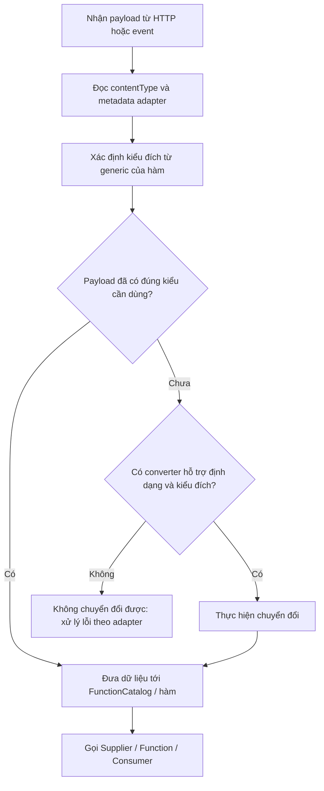

# Quan hệ giữa contentType và kiểu đích

Trong **Spring Cloud Function**, logic nghiệp vụ được mô tả bằng `Supplier<T>`, `Function<I, O>` hoặc `Consumer<T>`, đăng ký vào `FunctionCatalog` rồi có thể được gọi qua HTTP, sự kiện hoặc môi trường serverless. Dữ liệu đến từ các giao thức thường không phải đối tượng Java sẵn có: nó có thể là JSON được mã hóa thành byte, một đoạn văn bản hoặc một thông điệp có cả payload và headers.

Để chuyển đúng dữ liệu, cần hiểu quan hệ giữa **`contentType`** và **kiểu đích** (*target type*):

- **`contentType` cho biết payload được biểu diễn theo định dạng nào**, chẳng hạn `application/json`, `text/plain` hoặc `application/octet-stream`.
- **Kiểu đích cho biết giá trị Java cần nhận sau khi chuyển đổi**, chẳng hạn `OrderRequest`, `String`, `byte[]` hay `List<OrderRequest>`.
- **Nội dung payload thực tế** phải đúng với định dạng đã khai báo và có cấu trúc phù hợp với kiểu đích.

Ba thông tin này phối hợp để adapter và converter quyết định có thể chuyển đổi dữ liệu hay không. Chỉ biết `contentType` chưa đủ để suy ra class Java, và chỉ biết class Java cũng chưa đủ để biết một dãy byte phải được giải mã ra sao.

Bài học thuộc chương **Kiểu dữ liệu**, tập trung vào quan hệ giữa hai trục định dạng và kiểu dữ liệu, cách chúng xuất hiện trong Spring Messaging/HTTP, các ví dụ với DTO và collection, cùng cách chẩn đoán lỗi khi giao thức thay đổi nhưng logic hàm vẫn được tái sử dụng.

## 1. Hai trục độc lập: định dạng truyền tải và hợp đồng kiểu Java

Giả sử một hệ thống nhận thông tin đơn hàng:

```json
{"orderId":"ORD-101","quantity":2}
```

Nếu dữ liệu được gửi dưới dạng JSON, `contentType` có thể là `application/json`. Nhưng JSON này có thể được ánh xạ thành nhiều đối tượng Java tùy *kiểu đích* mà người nhận yêu cầu:

| Payload thực tế | `contentType` | Kiểu đích yêu cầu | Ý nghĩa |
| --- | --- | --- | --- |
| `{"orderId":"ORD-101","quantity":2}` | `application/json` | `OrderRequest` | Deserialize JSON object thành DTO |
| Cùng JSON object | `application/json` | `Map<String, Object>` | Chuyển thành cấu trúc key/value, khi converter hỗ trợ generic |
| Cùng JSON object | `application/json` | `String` | Có thể không cần parse object; hành vi phụ thuộc converter/adapter |
| `"ORD-101"` (JSON string) | `application/json` | `String` | Deserialize scalar JSON string theo quy tắc JSON |
| `ORD-101` (plain text) | `text/plain` | `String` | Đọc văn bản, cần xác định charset |
| Byte tùy ý | `application/octet-stream` | `byte[]` | Giữ payload ở dạng nhị phân |
| JSON array | `application/json` | `List<OrderRequest>` | Cần biết cả kiểu collection và kiểu phần tử |

**Một MIME type có thể đi với nhiều kiểu Java**, và **một kiểu Java có thể được biểu diễn bằng nhiều định dạng** nếu converter tương ứng hỗ trợ. Ví dụ `OrderRequest` có thể được mã hóa thành JSON; trong hệ thống khác, cùng DTO có thể được biểu diễn bằng một định dạng nhị phân tự định nghĩa. Khi đó cần converter thích hợp cho định dạng ấy.

Ngược lại, hai thông tin giống nhau trên header không khiến payload tự trở nên hợp lệ. Gửi chuỗi `hello` với `contentType=application/json` không biến nó thành JSON object; gửi `{"quantity":"hai"}` với JSON converter không đảm bảo tạo được DTO có trường `int quantity`.

## 2. `contentType` xuất hiện ở đâu?

Tên gọi gần giống nhau nhưng ngữ cảnh khác nhau:

| Môi trường | Cách biểu diễn thường gặp | Ai thiết lập? |
| --- | --- | --- |
| HTTP request | Header `Content-Type: application/json` | HTTP client hoặc lớp giao tiếp phía trước |
| HTTP response | Header `Content-Type` của response | HTTP adapter hoặc response writer |
| Spring Messaging | `MessageHeaders.CONTENT_TYPE`, tên key là `contentType` | Thành phần tạo message, adapter hoặc binder |
| Event/broker | Header/property hoặc metadata của adapter | Producer, binder và quy tắc ánh xạ của broker |
| Serverless event | Trường/metadata tùy nền tảng | Nền tảng và adapter serverless |

Với Spring Messaging, có thể tạo một thông điệp mang header content type:

```java
import java.nio.charset.StandardCharsets;
import org.springframework.messaging.Message;
import org.springframework.messaging.MessageHeaders;
import org.springframework.messaging.support.MessageBuilder;
import org.springframework.util.MimeTypeUtils;

byte[] body = """
    {"orderId":"ORD-101","quantity":2}
    """.getBytes(StandardCharsets.UTF_8);

Message<byte[]> message = MessageBuilder.withPayload(body)
    .setHeader(
        MessageHeaders.CONTENT_TYPE,
        MimeTypeUtils.APPLICATION_JSON
    )
    .build();
```

Thông điệp này vẫn có payload runtime là `byte[]`: **đặt header không tự deserialize byte thành DTO**. Header chỉ cung cấp metadata cho thành phần chuyển đổi tiếp theo nếu thành phần đó có đọc và hỗ trợ.

### `Content-Type` và `Accept` trong HTTP

Hai HTTP header phục vụ hai mục đích:

- `Content-Type` của **request** mô tả cách biểu diễn body **đang gửi đến**.
- `Accept` mô tả định dạng response mà client **muốn nhận**.

Ví dụ:

```http
POST /calculateOrder HTTP/1.1
Content-Type: application/json
Accept: application/json

{"orderId":"ORD-101","quantity":2}
```

`Accept` không thay thế cho `Content-Type`, và `Accept: application/json` không làm một body `text/plain` trở thành JSON. Việc adapter có hỗ trợ content negotiation cho response hay không còn tùy triển khai. Khi gọi một `Function<OrderRequest, OrderReceipt>`, thông tin kiểu Java từ function vẫn cần cho bước chuyển đổi payload.

## 3. Kiểu đích được xác định từ đâu?

Spring Cloud Function có thể dựa vào metadata kiểu generic của bean đã đăng ký. Ví dụ:

```java
@Bean
public Function<OrderRequest, OrderReceipt> calculateOrder() {
    return request -> new OrderReceipt(
        request.orderId(),
        Math.multiplyExact(request.quantity(), 50_000L)
    );
}
```

Chữ ký `Function<OrderRequest, OrderReceipt>` nói rằng:

1. Đầu vào logic cần là `OrderRequest`.
2. Đầu ra logic là `OrderReceipt`.
3. Nếu một adapter có cơ chế chuyển payload và converter phù hợp, nó có thể dùng `OrderRequest` làm kiểu đích cho đầu vào và `OrderReceipt` để xử lý đầu ra.

Đoạn trên chỉ minh họa chữ ký; các DTO và cấu hình đầy đủ xuất hiện ở mục tiếp theo. Đây là thông tin generic của Java, **không lấy từ chuỗi `application/json`**. Một MIME type chỉ xác định biểu diễn nội dung, không chứa tên class nghiệp vụ `OrderRequest`.

Khi sử dụng lambda đăng ký động, generic có thể bị che bởi `Function.class` hoặc raw type. Trường hợp đó, có thể bổ sung `Type` qua `FunctionRegistration.type(...)` để giữ đúng kiểu đích của hàm. Chi tiết ở mục 9.

## 4. Ví dụ đầy đủ: nhận JSON và xử lý DTO

Sử dụng Java 17 trở lên để định nghĩa record DTO và một bean `Function`:

```java
package demo.function;

import java.util.function.Function;
import org.springframework.context.annotation.Bean;
import org.springframework.context.annotation.Configuration;

@Configuration
public class OrderFunctions {

    public record OrderRequest(String orderId, int quantity) {}

    public record OrderReceipt(String orderId, long totalVnd) {}

    @Bean
    public Function<OrderRequest, OrderReceipt> calculateOrder() {
        return request -> {
            if (request == null ||
                request.orderId() == null ||
                request.orderId().isBlank() ||
                request.quantity() <= 0) {
                throw new IllegalArgumentException(
                    "A valid orderId and positive quantity are required"
                );
            }

            long totalVnd = Math.multiplyExact(
                request.quantity(), 50_000L
            );
            return new OrderReceipt(request.orderId(), totalVnd);
        };
    }

    @Bean
    public Function<String, String> normalizeCode() {
        return code -> code.strip().toUpperCase(
            java.util.Locale.ROOT
        );
    }
}
```

Lưu ý: ứng dụng cần có Spring Cloud Function dependency và đăng ký `OrderFunctions` trong Spring context. Việc một hàm được khai báo bằng `@Bean` không tự tạo HTTP endpoint nếu chưa cài đặt và khởi chạy adapter tương ứng.

### Khi gọi qua HTTP

Với Spring Cloud Function Web adapter được cấu hình để expose `calculateOrder` và có bộ chuyển JSON hỗ trợ record:

```bash
curl -X POST http://localhost:8080/calculateOrder \
  -H 'Content-Type: application/json' \
  -H 'Accept: application/json' \
  -d '{"orderId":"ORD-101","quantity":2}'
```

Kết quả dữ liệu kỳ vọng:

```json
{"orderId":"ORD-101","totalVnd":100000}
```

Ở đây, `Content-Type: application/json` nói cho HTTP adapter biết body gửi đến là JSON; `Function<OrderRequest, OrderReceipt>` cho biết target Java cần `OrderRequest`. Nếu converter có thể deserialize JSON vào record, hàm được gọi với đối tượng đó. Phần body/response header thực tế vẫn do adapter và cấu hình môi trường quyết định.

Cũng trong ứng dụng, hàm `normalizeCode` nhận `String`:

```bash
curl -X POST http://localhost:8080/normalizeCode \
  -H 'Content-Type: text/plain; charset=UTF-8' \
  --data-binary '  ord-101  '
```

Giá trị mà logic trả về là `ORD-101`. Trường hợp này phù hợp với payload văn bản; không cần giả rằng HTTP body đó là JSON object rồi cố deserialize thành DTO.

### Nếu gửi sai Content-Type?

Thử body JSON ở ví dụ đầu nhưng đổi header thành `text/plain`. Adapter có thể xem body như văn bản, bỏ qua bộ parse JSON đang cần thiết hoặc báo lỗi không phù hợp. **Không nên dự đoán duy nhất một HTTP status code** cho mọi adapter hay phiên bản; điều quan trọng là phát hiện cả hai trường thông tin không còn khớp.

## 5. Luồng quyết định chuyển đổi: cần cả ba dữ kiện

Có thể hình dung quá trình lựa chọn converter như sau:



Sơ đồ chỉ trình bày **điều kiện cần quan sát**, không phải thứ tự method call cố định trong mã nguồn Spring Cloud Function. Với các adapter khác nhau, bước parse/codec có thể nằm trước hoặc sau wrapper của catalog và có thể không dùng đúng cùng một implementation.

Khi chuyển đổi không diễn ra, hãy đặt ba câu hỏi:

1. **Định dạng thật là gì?** Byte JSON hợp lệ, JSON array, plain text, hay nhị phân tùy ý?
2. **`contentType` đang mô tả định dạng gì?** Header có tồn tại, có bị ghi đè, có đúng MIME/charset?
3. **Hàm cần kiểu Java nào?** DTO, chuỗi, byte, message wrapper hay collection có generic phần tử?

Một request đúng cả ba trục vẫn còn cần converter hiện diện, cấu hình phù hợp và dữ liệu thỏa validation nghiệp vụ.

## 6. Thực hành với `MessageConverter` của Spring Messaging

Spring Messaging cung cấp interface `MessageConverter` để chuyển giữa payload của `Message<?>` và đối tượng Java. Đoạn sau **gọi converter trực tiếp** để quan sát quan hệ giữa header content type và kiểu đích, không yêu cầu chạy Web adapter.

```java
import java.nio.charset.StandardCharsets;

import org.springframework.messaging.Message;
import org.springframework.messaging.MessageHeaders;
import org.springframework.messaging.converter.MappingJackson2MessageConverter;
import org.springframework.messaging.support.MessageBuilder;
import org.springframework.util.MimeTypeUtils;

MappingJackson2MessageConverter converter =
    new MappingJackson2MessageConverter();

String json = """
    {"orderId":"ORD-101","quantity":2}
    """;

Message<byte[]> input = MessageBuilder
    .withPayload(json.getBytes(StandardCharsets.UTF_8))
    .setHeader(
        MessageHeaders.CONTENT_TYPE,
        MimeTypeUtils.APPLICATION_JSON
    )
    .build();

Object result = converter.fromMessage(
    input,
    OrderFunctions.OrderRequest.class
);

if (!(result instanceof OrderFunctions.OrderRequest request)) {
    throw new IllegalStateException("Cannot convert payload to OrderRequest");
}

System.out.println(request.orderId()); // ORD-101
```

Ví dụ giả định Spring Messaging, Jackson JSON converter tương ứng được cài đặt và hỗ trợ record Java; snippet cần đặt trong một phương thức hoặc test có import/lớp `OrderFunctions` phù hợp. Nó minh họa:

- Header `contentType=application/json` giúp converter nhận diện định dạng JSON.
- Đối số `OrderRequest.class` là **kiểu đích** để deserialize.
- Payload vẫn là byte khi tạo message, rồi có thể thành DTO nếu converter chuyển thành công.

Phương thức `fromMessage(...)` có thể không chuyển được với kiểu đích/header không hỗ trợ; tùy trường hợp nó có thể trả `null` hoặc ném exception. **Đừng đồng nhất chuyện converter trả `null` với việc ứng dụng chắc chắn phải trả một HTTP status cụ thể.**

### Giữ nguyên payload và không cần converter

Giả sử target thực sự là `Function<byte[], byte[]>` và input là `byte[]` đã hợp lệ. Một adapter có thể truyền nguyên payload đến hàm mà không cần chuyển JSON, ngay cả khi một header có tồn tại. Điều này tùy đường xử lý thực tế; trong code Java trực tiếp, `byte[]` không tự biến thành POJO bởi header:

```java
byte[] original = input.getPayload();
System.out.println(original.getClass().getName()); // [B
```

Nếu logic nhận byte, việc parse nội dung là trách nhiệm của logic hoặc converter được cấu hình chủ ý. **`contentType` không ép buộc mọi byte phải được deserialize trước khi đến target.**

## 7. Bảng đối chiếu những tình huống khớp và lệch

| Payload | `contentType` | Kiểu đích | Kỳ vọng hoặc nguy cơ |
| --- | --- | --- | --- |
| `{"orderId":"ORD-101","quantity":2}` | `application/json` | `OrderRequest` | Có thể tạo DTO nếu JSON converter và mapping hỗ trợ |
| Cùng JSON object | `text/plain` | `OrderRequest` | Converter văn bản có thể không tạo DTO; cần sửa định dạng/header |
| `hello` | `application/json` | `OrderRequest` | Không phải JSON object hợp lệ; chuyển đổi có thể thất bại |
| `"hello"` | `application/json` | `String` | Là JSON string hợp lệ, phụ thuộc converter xử lý scalar |
| `hello` | `text/plain; charset=UTF-8` | `String` | Phù hợp để nhận văn bản |
| Bytes tùy ý | `application/octet-stream` | `byte[]` | Phù hợp với hàm xử lý nhị phân |
| JSON array gồm nhiều đơn hàng | `application/json` | `List<OrderRequest>` | Cần generic phần tử và converter hỗ trợ |
| JSON array gồm nhiều đơn hàng | `application/json` | `OrderRequest` | Hình dạng array khác object, có thể lỗi mapping |
| JSON object có `"quantity":"hai"` | `application/json` | `OrderRequest` | Dữ liệu sai loại; converter hoặc validation có thể báo lỗi |
| POJO `OrderRequest` đã tạo trong Java | Không cần header ở lời gọi trực tiếp | `OrderRequest` | `apply(...)` có thể chạy trực tiếp, không có bước JSON |

Các ví dụ trên là cách suy luận **khả năng tương thích**. Chi tiết converter nào được chọn, exception ra sao và adapter có cơ chế xử lý đặc biệt gì phải được kiểm tra bằng integration test tương ứng.

## 8. Kiểu generic lồng nhau: contentType không nói được kiểu phần tử

Xét một function muốn nhận danh sách:

```java
@Bean
public Function<
    java.util.List<OrderFunctions.OrderRequest>,
    java.util.List<OrderFunctions.OrderReceipt>
> calculateOrders() {
    return orders -> orders.stream()
        .map(order -> new OrderFunctions.OrderReceipt(
            order.orderId(),
            Math.multiplyExact(order.quantity(), 50_000L)
        ))
        .toList();
}
```

Đây là bean ví dụ độc lập, đặt trong một lớp `@Configuration` với DTO `OrderFunctions` truy cập được. Chữ ký cho biết **một lần gọi nhận cả danh sách**, không phải mặc nhiên nhiều lần gọi `Function<OrderRequest, OrderReceipt>`.

Payload HTTP có thể là:

```json
[
  {"orderId":"ORD-101","quantity":2},
  {"orderId":"ORD-102","quantity":1}
]
```

Trong trường hợp này, `Content-Type: application/json` chỉ nói payload có cú pháp JSON. Nó **không nói** danh sách chứa `OrderRequest` thay vì `Map<String, Object>` hoặc một DTO khác. Thông tin `List<OrderRequest>` nằm ở chữ ký generic của function hoặc metadata đăng ký tường minh.

Nếu chỉ công bố raw `List.class`, converter có thể không biết kiểu phần tử. Ví dụ với Jackson 2, khi code chủ động deserialize JSON array, hãy dùng type token:

```java
import java.util.List;
import com.fasterxml.jackson.core.type.TypeReference;
import com.fasterxml.jackson.databind.ObjectMapper;

ObjectMapper mapper = new ObjectMapper();
String jsonArray = """
    [{"orderId":"ORD-101","quantity":2}]
    """;

List<OrderFunctions.OrderRequest> orders = mapper.readValue(
    jsonArray,
    new TypeReference<List<OrderFunctions.OrderRequest>>() {}
);
```

Đoạn Jackson trên được đặt trong ngữ cảnh có xử lý checked exception. `TypeReference<List<OrderRequest>>` giúp JSON mapper biết kiểu phần tử, tương tự lý do cần giữ metadata generic trên bean. **Không nên hiểu rằng mọi `MessageConverter.fromMessage(message, List.class)` sẽ tự khám phá kiểu của phần tử.** Những converter có hỗ trợ type hint hoặc adapter cung cấp thông tin generic có thể thực hiện chuyển đổi sâu hơn, cần kiểm chứng trong ngữ cảnh cụ thể.

### Khi hàm nhận `Message<OrderRequest>`

`Message<T>` là wrapper chứa payload và headers. Nếu target công bố `Consumer<Message<OrderRequest>>`, kiểu Java ở tầng ngoài là `Message`, còn `OrderRequest` là kiểu payload bên trong:

```java
import java.util.function.Consumer;
import org.springframework.context.annotation.Bean;
import org.springframework.messaging.Message;

@Bean
public Consumer<Message<OrderFunctions.OrderRequest>> auditOrders() {
    return message -> {
        OrderFunctions.OrderRequest order = message.getPayload();
        Object correlationId =
            message.getHeaders().get("correlationId");

        System.out.printf(
            "Order %s, correlationId=%s%n",
            order.orderId(), correlationId
        );
    };
}
```

Đây là bean minh họa trong một lớp cấu hình Spring; adapter chỉ có thể cung cấp `Message<OrderRequest>` với payload DTO nếu đường chuyển đổi phù hợp. Header `contentType` không làm header `correlationId` biến mất hoặc tự tạo ra; việc giữ/ánh xạ các header khác do adapter và thao tác xây dựng message quyết định.

## 9. Đăng ký động: phải giữ kiểu đích ngoài contentType

Trong một ứng dụng functional, lambda có thể được đăng ký động vào context. Nếu đăng ký chỉ bằng raw class `Function.class`, metadata input/output có thể không còn đủ cụ thể để converter tìm kiểu đích.

Spring Cloud Function cung cấp `FunctionRegistration` và `FunctionTypeUtils` để gắn type tường minh với target:

```java
import java.util.function.Function;

import org.springframework.cloud.function.context.FunctionRegistration;
import org.springframework.cloud.function.context.catalog.FunctionTypeUtils;

// Đặt trong ApplicationContextInitializer<GenericApplicationContext>.
Function<OrderFunctions.OrderRequest, OrderFunctions.OrderReceipt> fn =
    request -> new OrderFunctions.OrderReceipt(
        request.orderId(),
        Math.multiplyExact(request.quantity(), 50_000L)
    );

context.registerBean(
    "calculateOrder",
    FunctionRegistration.class,
    () -> new FunctionRegistration<>(fn)
        .type(FunctionTypeUtils.functionType(
            OrderFunctions.OrderRequest.class,
            OrderFunctions.OrderReceipt.class
        ))
);
```

Ở đây `context` là `GenericApplicationContext` được truyền vào `initialize(...)` khi initializer đã được đăng ký và thực thi. Nếu chọn cách đăng ký này, không đồng thời khai báo một bean khác cùng tên `calculateOrder` như ở mục 4 trong chính ứng dụng.

**Mối quan hệ đúng:** `.type(...)` khai báo kiểu Java của function; `contentType` khai báo định dạng payload của một request/message cụ thể. Cả hai có thể cần được sử dụng tại biên nhưng không thay thế cho nhau.

Một `Function<OrderRequest, OrderReceipt>` có metadata đúng vẫn không thể parse byte tùy ý khi header khai `application/json`; ngược lại, JSON hợp lệ không đủ để converter chắc chắn tạo `OrderRequest` nếu registration chỉ công bố `Function<Object, Object>`.

## 10. contentType ảnh hưởng gì khi dùng Supplier, Function và Consumer?

| Loại | Hợp đồng Java | Cách contentType có thể tham gia |
| --- | --- | --- |
| `Supplier<OrderReceipt>` | Không có input, cung cấp `OrderReceipt` | Adapter xuất dữ liệu có thể serialize output theo định dạng đích |
| `Function<OrderRequest, OrderReceipt>` | Nhận DTO, trả DTO | Adapter đầu vào cần đọc payload theo content type; đầu ra cần biểu diễn kết quả |
| `Consumer<OrderRequest>` | Nhận DTO, không trả về giá trị Java | Adapter đầu vào có thể deserialize event; ack/retry do hệ thống gọi quyết định |
| `Function<Message<OrderRequest>, Message<OrderReceipt>>` | Nhận/trả cả message wrapper | Content type và header của message có thể tác động đến chuyển payload và bước tiếp theo |

Với `Supplier`, không có input để convert từ HTTP body trước khi chạy `get()`. Với `Consumer`, không có output nghiệp vụ cần serialize từ kết quả `accept()`. Một HTTP response hay acknowledgment của binder có thể vẫn tồn tại, nhưng không phải output generic của `Consumer`.

Khi một `Function` trả đối tượng Java, cần phân biệt **kiểu output** từ signature và **content type output** do adapter/binder quyết định. Không nên tự thêm một header `contentType` cũ vào message chứa payload mới khác định dạng; điều đó có thể khiến consumer phía sau chọn converter không phù hợp.

## 11. Content type khi kết hợp nhiều hàm

Giả sử ứng dụng có:

```java
@Bean
public Function<OrderFunctions.OrderReceipt, String> renderReceipt() {
    return receipt ->
        receipt.orderId() + ": " + receipt.totalVnd() + " VND";
}
```

Khi `calculateOrder` và `renderReceipt` đã được đăng ký, có thể chọn chuỗi:

```yaml
spring:
  cloud:
    function:
      definition: calculateOrder|renderReceipt
```

Hợp đồng của chuỗi là:

```text
JSON HTTP/event
  └─ [adapter đọc contentType; deserialize theo OrderRequest]
          ↓
      OrderRequest
          │
          ▼
      calculateOrder : Function<OrderRequest, OrderReceipt>
          │ OrderReceipt
          ▼
      renderReceipt : Function<OrderReceipt, String>
          │
          ▼
         String
  └─ [adapter biểu diễn output theo quy tắc của nó]
```

Ở **điểm nối giữa hai hàm Java**, dữ liệu là `OrderReceipt` đã có sẵn, thường không cần serialize thành JSON rồi deserialize lại. `contentType` chủ yếu có ý nghĩa khi giao tiếp với adapter hoặc khi chính composition làm việc với wrapper/metadata cần chuyển đổi. Đừng giả định chỉ cần khai `contentType=application/json` là hai hàm bất kỳ có kiểu không tương thích sẽ tự nối được.

Ví dụ, `Function<OrderRequest, OrderReceipt>` không tự động tương thích với `Function<Integer, String>` vì hàm sau cần `Integer`, không phải `OrderReceipt`. Hãy sửa hợp đồng hoặc thêm bước chuyển đổi Java tường minh.

## 12. Chẩn đoán lỗi và chiến lược kiểm thử

### Lỗi thường gặp

| Triệu chứng | Điều cần kiểm tra | Cách xử lý |
| --- | --- | --- |
| Body JSON bị xử lý như plain text | Header `Content-Type` hoặc `contentType` sai/mất | Sửa header và kiểm tra adapter nhận metadata |
| HTTP báo media type không hỗ trợ | Định dạng được adapter/converter chấp nhận | Dùng MIME phù hợp hoặc cài converter cần thiết |
| Payload đến hàm là `Map` thay vì DTO | Generic của bean, raw `Function`, `Object` hoặc registration động | Khai báo `Function<OrderRequest, ...>` / metadata cụ thể |
| JSON syntax đúng nhưng không tạo DTO | Field/shape không khớp class, converter hỗ trợ record hay không | Chỉnh payload, DTO hoặc JSON mapping |
| JSON array thành `List<Map>` | Chỉ có `List.class`, thiếu generic phần tử | Cung cấp `List<OrderRequest>` và converter có khả năng phân giải |
| Binary bị đổi sai thành chuỗi | Byte không phải văn bản hoặc charset không khớp | Giữ `byte[]` hoặc dùng codec/charset đúng |
| Header đầu ra không còn phù hợp | Payload đã được đổi định dạng nhưng header cũ được giữ | Thiết lập metadata đầu ra phù hợp với payload mới |
| Gọi qua Java thành công nhưng HTTP/broker thất bại | Lời gọi Java đã bỏ qua bước chuyển đổi | Kiểm thử tích hợp qua giao thức thực |
| Composition nhận dữ liệu sai kiểu | Output của hàm trước không khớp input của hàm sau | Kiểm tra từng chữ ký generic và bước chuyển đổi |

### Quy trình kiểm chứng

1. **Xác nhận chữ ký bean hoặc `FunctionRegistration.type(...)`:** hàm có thực sự nhận `OrderRequest` hay đang công bố `Object`?
2. **Lấy payload thực tế trong môi trường test:** là JSON object, JSON array, text hay byte thô? Ghi nhận charset khi liên quan.
3. **Đọc metadata từ adapter:** HTTP `Content-Type` hoặc Spring Message `contentType` có đúng với payload? Có bị thay đổi trong pipeline không?
4. **Xác nhận converter được cấu hình:** có hỗ trợ MIME type và target class/generic hay không? Với collection, có truyền đủ kiểu phần tử?
5. **Tách hai cấp test:** kiểm logic bằng đối tượng Java tạo sẵn; kiểm chuyển đổi bằng request HTTP/event thực qua adapter tương ứng.
6. **Kiểm tra output:** kiểu Java trả về, định dạng biểu diễn và content type response/message có nhất quán không?

Ví dụ kiểm tra logic qua catalog khi ứng dụng có bean `calculateOrder`:

```java
import java.util.function.Function;
import org.springframework.cloud.function.context.FunctionCatalog;

// Đặt trong test/method có FunctionCatalog catalog từ Spring context.
Function<OrderFunctions.OrderRequest, OrderFunctions.OrderReceipt> fn =
    catalog.lookup("calculateOrder");

OrderFunctions.OrderReceipt receipt = fn.apply(
    new OrderFunctions.OrderRequest("ORD-101", 2)
);

System.out.println(receipt.totalVnd()); // 100000
```

Khi chạy trực tiếp như trên, không có HTTP body hoặc message JSON phải parse. Đây là kiểm thử catalog và nghiệp vụ, **không phải bằng chứng bước `contentType` → DTO đã đúng**. Cần test bổ sung với đúng adapter trong hệ thống thực tế.

### Những ca kiểm thử biên nên có

| Ca kiểm thử | Payload và metadata | Điều cần xác nhận |
| --- | --- | --- |
| JSON hợp lệ | Object JSON + `application/json` | DTO và kết quả nghiệp vụ đúng |
| Sai định dạng | Body text + `application/json` | Xử lý lỗi rõ ràng, không tự đoán thành object |
| Sai hình dạng | JSON array + target một DTO | Converter báo lỗi hoặc adapter phản hồi phù hợp |
| Sai dữ liệu | `quantity` là chuỗi không thể chuyển số | Conversion/validation báo lỗi |
| Chuỗi thường | Plain text + `text/plain`, target `String` | Nội dung và charset đúng |
| Generic lồng nhau | JSON array + `List<OrderRequest>` | Phần tử là DTO, không phải raw map |
| Message có headers | `contentType` và `correlationId` | Payload cùng header cần thiết được xử lý đúng |
| Thiếu content type | Không có header định dạng | Quan sát chính sách mặc định của adapter, không suy đoán |

## 13. Bài tập tự kiểm tra

**Bài 1 — Nhận diện hai trục.** Một sự kiện chứa bytes JSON `{"orderId":"ORD-101","quantity":2}` và header `contentType=application/json`. `Function<OrderRequest, OrderReceipt>` cần thêm thông tin gì để chuyển bytes thành DTO?

*Đáp án:* Phải biết kiểu Java đích là `OrderRequest` từ generic/registration và có converter JSON hỗ trợ loại DTO đó. `contentType` chỉ mô tả định dạng JSON.

**Bài 2 — Cùng kiểu, khác định dạng.** `Function<String, String>` có thể nhận HTTP plain text và JSON string như nhau không?

*Đáp án:* Cả hai có thể dẫn đến giá trị `String` khi adapter và converter hỗ trợ, nhưng `hello` (plain text) khác `"hello"` (JSON string). Cần khai đúng `Content-Type` và kiểm thử diễn giải scalar JSON của adapter.

**Bài 3 — Vì sao header không sửa được raw type?** Một lambda thật nhận `OrderRequest` nhưng được đăng ký bằng `Function.class`. Chỉ thêm `contentType=application/json` vào message có đủ không?

*Đáp án:* Không. Header không giữ generic của lambda; cần công bố `Function<OrderRequest, OrderReceipt>` hoặc dùng `FunctionRegistration.type(...)` với cặp kiểu tương ứng.

**Bài 4 — JSON array.** Một message có `contentType=application/json` chứa mảng đơn hàng. Có thể mặc định nó trở thành `List<OrderRequest>` khi converter chỉ được cung cấp `List.class` không?

*Đáp án:* Không. Cần biết kiểu phần tử `OrderRequest` qua metadata generic hoặc type hint mà converter hỗ trợ.

**Bài 5 — HTTP headers.** Client POST JSON body với `Content-Type: text/plain` và `Accept: application/json`. Header nào cần sửa để mô tả input đúng?

*Đáp án:* `Content-Type` của request cần là `application/json`. `Accept` chỉ nói về response mong muốn.

**Bài 6 — Kiểm thử.** Unit test gọi `calculateOrder.apply(new OrderRequest(...))` thành công nhưng sự kiện từ broker làm hàm nhận sai kiểu. Nêu các bước cần điều tra.

*Đáp án:* Kiểm tra bytes/payload thực tế, header `contentType`, kiểu generic được đăng ký, converter/binder đang dùng, lớp runtime của payload sau chuyển đổi và test tích hợp qua adapter.

## Ghi nhớ

- **`contentType` mô tả định dạng truyền tải, kiểu đích mô tả kết quả Java cần nhận.** Cả hai phải phù hợp với nội dung payload thực tế.
- **Kiểu Java thường đến từ chữ ký generic** của `Supplier`, `Function`, `Consumer` hoặc metadata của `FunctionRegistration`; MIME type không chứa tên DTO.
- **Converter/adapter là mắt xích thực hiện chuyển đổi.** Header đúng và kiểu đúng chỉ là điều kiện để chuyển đổi có thể thực hiện; chúng không thay thế converter, mapping và validation.
- **Đừng đánh đồng `Content-Type` với `Accept`**, JSON object với JSON string, `List<T>` với `List.class`, hay `Message<T>` với payload `T`.
- **Tái sử dụng logic độc lập giao thức** không loại bỏ nhu cầu kiểm thử từng đường vào HTTP, sự kiện hoặc serverless: cùng một function có thể nhận payload được biểu diễn rất khác nhau tại biên.

**Tham khảo:** [Spring Cloud Function Reference](https://docs.spring.io/spring-cloud-function/reference/), [Spring Framework — Message Conversion](https://docs.spring.io/spring-framework/reference/integration.html) và [Spring Framework — Type Conversion](https://docs.spring.io/spring-framework/reference/core/validation/convert.html). Với các lựa chọn mặc định của converter hay adapter, cần đối chiếu tài liệu đúng phiên bản đang triển khai.
