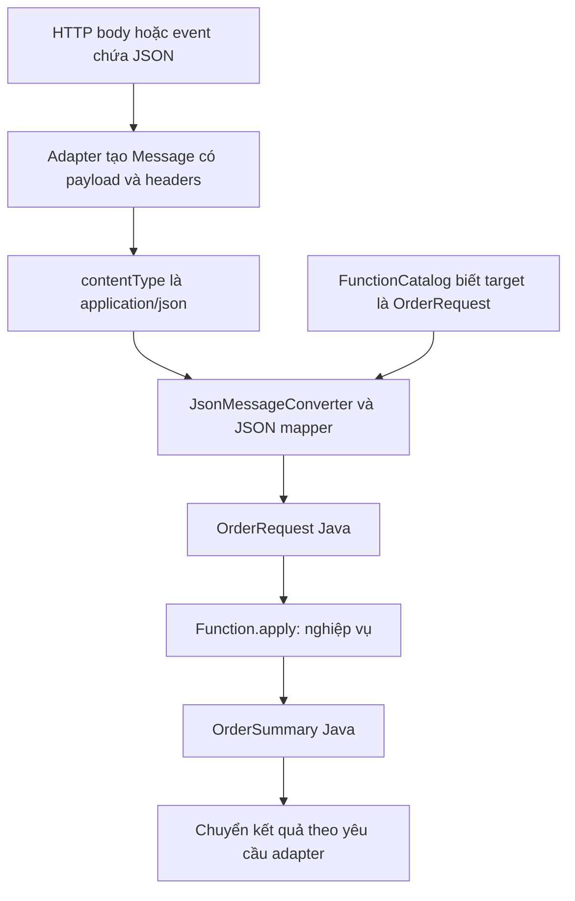

# Chuyển đổi JSON với JsonMessageConverter

Khi viết logic nghiệp vụ bằng **Spring Cloud Function**, chúng ta thường khai báo hàm với `Supplier<T>`, `Function<I, O>` hoặc `Consumer<T>`. Cùng một hàm có thể được gọi từ HTTP, sự kiện hoặc môi trường serverless thông qua `FunctionCatalog` và các adapter phù hợp. Tuy nhiên, dữ liệu đến từ hệ thống ngoài thường là **JSON dạng văn bản hoặc byte**, còn hàm Java lại muốn nhận **DTO/POJO** cụ thể. `JsonMessageConverter` giúp giải quyết khoảng cách đó trong luồng chuyển đổi thông điệp của Spring Cloud Function.

Bài thuộc chương **Kiểu dữ liệu** và tập trung vào cách `JsonMessageConverter` dùng `contentType` cùng kiểu đích để đọc/ghi JSON, cách giữ generic của hàm, xử lý JSON object và array, phân biệt chuyển đổi do framework thực hiện với deserialize thủ công, cấu hình JSON mapper và chẩn đoán các lỗi thường gặp.

Sau bài này, bạn có thể:

1. Giải thích vai trò của `JsonMessageConverter` trong stack converter của Spring Cloud Function.
2. Xác định ba yếu tố cần có để chuyển JSON thành DTO: **payload thực tế**, **`contentType`** và **kiểu Java đích**.
3. Định nghĩa `Function<OrderRequest, OrderSummary>` và gọi hàm qua HTTP hoặc một `Message<byte[]>` có chứa JSON.
4. Nhận biết các giới hạn với JSON array, `List<T>`, wrapper `Message<T>` và bean đăng ký động.
5. Hiểu cấu hình Jackson/Gson, cơ chế MIME `type=...` có danh sách cho phép, và cách kiểm thử JSON conversion ở biên adapter.

## 1. Vì sao cần JsonMessageConverter?

Giả sử hệ thống nhận JSON:

```json
{
  "orderId": "ORD-101",
  "lines": [
    {"sku": "BOOK", "quantity": 2, "unitPriceVnd": 50000},
    {"sku": "PEN", "quantity": 1, "unitPriceVnd": 30000}
  ]
}
```

Logic nghiệp vụ có hợp đồng:

```java
Function<OrderRequest, OrderSummary> calculateOrder;
```

Để gọi `calculateOrder.apply(...)`, Java cần một đối tượng `OrderRequest`, không phải chuỗi JSON hoặc mảng byte. Khi adapter tiếp nhận thông điệp, framework có thể thực hiện:



Sơ đồ diễn tả **vai trò**, không khẳng định mọi adapter luôn tạo đối tượng `Message` hoặc gọi cùng một converter theo đúng thứ tự đó. Spring Cloud Function có thể chuẩn hóa lời gọi qua catalog; HTTP, messaging và serverless có cơ chế tích hợp riêng. Đặc biệt, **chỉ đặt `contentType=application/json` không tự biến payload thành `OrderRequest`** nếu thiếu kiểu đích hoặc bộ chuyển đổi thích hợp.

### Ba yếu tố luôn phải khớp

| Thành phần | Ví dụ | Câu hỏi kiểm tra |
| --- | --- | --- |
| Payload thực tế | Byte UTF-8 chứa một JSON object | Nội dung có đúng cú pháp và cấu trúc JSON không? |
| `contentType` | `application/json` | Message/HTTP adapter có biết đây là JSON không? |
| Kiểu đích | `OrderRequest` | Generic của bean/registration có xác định được DTO cần tạo không? |

Nếu nội dung là `{"quantity":"hai"}` nhưng DTO có trường `int quantity`, một converter JSON vẫn có thể gặp lỗi kiểu dữ liệu. Nếu nội dung là một JSON array nhưng kiểu đích là một DTO đơn, hình dạng dữ liệu cũng có thể không khớp.

## 2. JsonMessageConverter trong Spring Cloud Function khác gì những converter gần tên?

Spring Cloud Function cung cấp một stack các `MessageConverter` dùng khi chuẩn hóa thông điệp. Các converter thường được mô tả trong tài liệu của framework:

| Converter | Kiểu định dạng thường phục vụ | Vai trò |
| --- | --- | --- |
| **`JsonMessageConverter`** | `application/json` | Chuyển payload JSON ↔ POJO thông qua JSON mapper |
| `ByteArrayMessageConverter` | `application/octet-stream` | Xử lý hoặc chuyển tiếp mảng byte |
| `StringMessageConverter` | `text/plain` | Chuyển nội dung sang văn bản |

Trong Spring Cloud Function, `JsonMessageConverter` là converter JSON do **framework cung cấp**. Ứng dụng thông thường không phải tự `new` converter này để hàm `Function<I, O>` hoạt động. Framework có cơ chế chọn converter khi cần chuyển giữa message payload và kiểu hàm.

Cần phân biệt với hai API khác:

- **`org.springframework.messaging.converter.MappingJackson2MessageConverter`** là một implementation của Spring Messaging dùng Jackson. Có thể gọi hoặc đăng ký trực tiếp trong chương trình Spring Messaging, nhưng nó **không phải tên đồng nghĩa** của `JsonMessageConverter` trong Spring Cloud Function.
- **`org.springframework.http.converter.HttpMessageConverter`** là họ converter HTTP của Spring MVC. Nó hoạt động trong xử lý body của HTTP; không nên kết luận rằng mọi đường HTTP của Spring Cloud Function phải đi qua một instance `MappingJackson2MessageConverter`.

Theo mô hình Spring Cloud Function, khi đầu vào là `Message<?>` framework có thể dùng stack `MessageConverter`; khi đầu vào là giá trị không bọc message có thể có đường `ConversionService` hoặc xử lý riêng. Đường chuyển đổi cụ thể nên được xác nhận qua catalog/adapter đang chạy.

### API chuyển đổi message ở mức hợp đồng

Spring Messaging mô tả các phương thức cơ bản của interface `MessageConverter`:

```java
Object fromMessage(Message<?> message, Class<?> targetClass);
Message<?> toMessage(Object payload, MessageHeaders headers);
```

Đây là các **chữ ký minh họa**, không phải một lớp Java độc lập để biên dịch. `fromMessage` dùng thông điệp nguồn và kiểu đích để tạo đối tượng Java; `toMessage` đưa giá trị Java sang thông điệp đầu ra. Các implementation/adapter có thể hỗ trợ thêm overload hoặc type hint dành cho generic lồng nhau.

## 3. Ví dụ hoàn chỉnh: một Function nhận và trả POJO

Dưới đây là cấu hình bean với **Java 17 trở lên** vì sử dụng `record`. Ví dụ dùng giá VND kiểu `long` để tránh sai số của `float`/`double` trong phép tính số nguyên. Với nghiệp vụ tiền tệ có phần thập phân, có thể dùng `BigDecimal` và quy tắc làm tròn rõ ràng.

```java
package demo.function;

import java.util.List;
import java.util.Objects;
import java.util.function.Function;

import org.springframework.context.annotation.Bean;
import org.springframework.context.annotation.Configuration;

@Configuration
public class OrderFunctions {

    public record OrderLine(
        String sku,
        int quantity,
        long unitPriceVnd
    ) {}

    public record OrderRequest(
        String orderId,
        List<OrderLine> lines
    ) {}

    public record OrderSummary(
        String orderId,
        int lineCount,
        long totalVnd
    ) {}

    @Bean
    public Function<OrderRequest, OrderSummary> calculateOrder() {
        return request -> {
            Objects.requireNonNull(request, "request");
            if (request.orderId() == null ||
                request.orderId().isBlank()) {
                throw new IllegalArgumentException("orderId is required");
            }

            List<OrderLine> lines =
                Objects.requireNonNull(request.lines(), "lines");
            if (lines.isEmpty()) {
                throw new IllegalArgumentException("lines cannot be empty");
            }

            long total = 0L;
            for (OrderLine line : lines) {
                Objects.requireNonNull(line, "line");
                if (line.sku() == null || line.sku().isBlank() ||
                    line.quantity() <= 0 || line.unitPriceVnd() < 0L) {
                    throw new IllegalArgumentException("invalid order line");
                }
                long subtotal = Math.multiplyExact(
                    line.quantity(),
                    line.unitPriceVnd()
                );
                total = Math.addExact(total, subtotal);
            }

            return new OrderSummary(
                request.orderId(),
                lines.size(),
                total
            );
        };
    }
}
```

Chữ ký được công bố là:

```text
Function<
    OrderRequest,   // input Java: OrderRequest
    OrderSummary    // output Java: OrderSummary
>
```

`JsonMessageConverter` **không thay thế logic nghiệp vụ**. Nó có thể tạo `OrderRequest` từ JSON ở bước đầu, còn `calculateOrder` mới chịu trách nhiệm kiểm tra mã đơn, số lượng, đơn giá và tính tổng. Chỉ cần converter deserialize thành công chưa có nghĩa đơn hàng đã hợp lệ.

Trong ví dụ JSON ở mục 1, kết quả nghiệp vụ mong đợi là:

```json
{
  "orderId": "ORD-101",
  "lineCount": 2,
  "totalVnd": 130000
}
```

## 4. Chuyển JSON qua HTTP: adapter đưa nội dung đến đúng hàm

Giả sử ứng dụng đã cài Spring Cloud Function Web adapter, khởi chạy với các cấu hình cần thiết và expose bean `calculateOrder`. Client có thể gửi:

```bash
curl -X POST http://localhost:8080/calculateOrder \
  -H 'Content-Type: application/json' \
  -H 'Accept: application/json' \
  -d '{"orderId":"ORD-101","lines":[{"sku":"BOOK","quantity":2,"unitPriceVnd":50000},{"sku":"PEN","quantity":1,"unitPriceVnd":30000}]}'
```

Response body minh họa trong cấu hình hỗ trợ JSON:

```json
{"orderId":"ORD-101","lineCount":2,"totalVnd":130000}
```

Các yếu tố phối hợp:

1. HTTP header `Content-Type: application/json` mô tả cách mã hóa body request.
2. Adapter truyền body và metadata vào cơ chế lời gọi thích hợp.
3. `FunctionCatalog` có thông tin generic `Function<OrderRequest, OrderSummary>` từ bean.
4. Converter/codec JSON thích hợp có thể deserialize JSON object thành `OrderRequest`.
5. Hàm tính tổng và adapter biểu diễn kết quả ra response.

Header HTTP `Accept: application/json` biểu đạt loại response client mong muốn; **nó không thay cho `Content-Type` của request**. Một số adapter có content negotiation khác nhau, nên cần kiểm thử với dependency và phiên bản cụ thể.

Nếu ứng dụng chỉ có bean `Function` mà không có Web adapter, đoạn curl không tự tạo được endpoint. Tương tự, khi chạy qua event broker hoặc serverless, dữ liệu có thể nằm trong envelope riêng; không thể coi mọi lời gọi đều giống HTTP POST.

## 5. Quan sát JSON conversion qua FunctionCatalog

Một cách thực hành là đối chiếu **gọi Java đã có DTO** với **gọi catalog bằng `Message` mang JSON**. Lời gọi trực tiếp:

```java
import java.util.List;
import java.util.function.Function;

Function<OrderFunctions.OrderRequest, OrderFunctions.OrderSummary> fn =
    applicationContext.getBean("calculateOrder", Function.class);

OrderFunctions.OrderRequest request =
    new OrderFunctions.OrderRequest(
        "ORD-101",
        List.of(
            new OrderFunctions.OrderLine("BOOK", 2, 50000),
            new OrderFunctions.OrderLine("PEN", 1, 30000)
        )
    );

OrderFunctions.OrderSummary result = fn.apply(request);
System.out.println(result.totalVnd()); // 130000
```

Ví dụ được đặt trong một method có biến `applicationContext` lấy từ Spring. Việc gọi trực tiếp bean bằng `OrderRequest` **không kiểm tra JSON conversion**, vì DTO đã được tạo trước.

Để đi qua wrapper của `FunctionCatalog` với `Message<byte[]>` JSON:

```java
import java.nio.charset.StandardCharsets;
import java.util.function.Function;

import org.springframework.cloud.function.context.FunctionCatalog;
import org.springframework.messaging.Message;
import org.springframework.messaging.MessageHeaders;
import org.springframework.messaging.support.MessageBuilder;
import org.springframework.util.MimeTypeUtils;

// Đặt trong test/method đã inject FunctionCatalog catalog.
String json = """
    {"orderId":"ORD-101","lines":[
      {"sku":"BOOK","quantity":2,"unitPriceVnd":50000},
      {"sku":"PEN","quantity":1,"unitPriceVnd":30000}
    ]}
    """;

Message<byte[]> incoming = MessageBuilder
    .withPayload(json.getBytes(StandardCharsets.UTF_8))
    .setHeader(
        MessageHeaders.CONTENT_TYPE,
        MimeTypeUtils.APPLICATION_JSON
    )
    .build();

Function<Message<byte[]>, ?> function = catalog.lookup("calculateOrder");
Object returned = function.apply(incoming);

if (returned == null) {
    throw new AssertionError("Function returned no result");
}
System.out.println("Catalog result type: " + returned.getClass());
```

Đoạn này kiểm tra **đường chuyển đổi của wrapper/catalog trong Spring Cloud Function**, khi context và converter đã được khởi tạo đúng. Đây là snippet minh họa; kết quả có thể được bọc thành `Message` và payload có thể ở dạng giá trị Java hoặc dữ liệu đã serialize tùy cách lookup/adapter/phiên bản. Vì thế, bước tiếp theo là kiểm tra body hoặc message output theo hợp đồng của môi trường đang dùng, không ép kiểu kết quả một cách mù quáng.

**Điểm khác biệt:** nếu logic `calculateOrder` nhận thành công `OrderRequest` từ `Message<byte[]>` JSON, ta đã kiểm tra thêm cơ chế chuyển kiểu ở catalog; vẫn cần một integration test riêng để xác nhận endpoint HTTP hay binder thật.

## 6. contentType, payload và kiểu đích phối hợp như thế nào?

Trong Spring Messaging, tên header thường là `MessageHeaders.CONTENT_TYPE` (giá trị chuỗi `contentType`). Một adapter HTTP có thể ánh xạ HTTP `Content-Type` sang header này. Với thông điệp không có header content type, tài liệu Spring Cloud Function mô tả **giá trị mặc định `application/json` trong đường chuyển đổi của framework**; các adapter hoặc binder riêng có thể đặt mặc định/metadata khác.

| Payload đầu vào | Header `contentType` | Kiểu Java đích | Nhận xét |
| --- | --- | --- | --- |
| Byte UTF-8 chứa JSON object | `application/json` | `OrderRequest` | Trường hợp điển hình cho JSON converter |
| Chuỗi chứa JSON object | `application/json` | `OrderRequest` | Có thể chuyển nếu converter hỗ trợ nguồn `String` |
| Byte thô không phải JSON | `application/json` | `OrderRequest` | Header không làm bytes trở thành JSON hợp lệ |
| Byte chứa JSON object | `text/plain` | `OrderRequest` | Có thể chọn hướng text sai mục đích |
| Plain text `hello` | `text/plain` | `String` | Phù hợp xử lý văn bản |
| JSON string `"hello"` | `application/json` | `String` | Là JSON scalar; cần kiểm tra converter/adapter hỗ trợ |
| JSON array chứa order | `application/json` | `List<OrderRequest>` | Cần giữ generic của phần tử |
| JSON object chứa order | `application/json` | `List<OrderRequest>` | Khác hình dạng dữ liệu, có thể lỗi |
| `OrderRequest` đã có sẵn | Có thể không cần chuyển đổi | `OrderRequest` | Không cần deserialize JSON khi type đã đúng |

Không nên chỉ nhìn `contentType` rồi khẳng định chắc chắn converter nào sẽ chạy; Spring Cloud Function cân nhắc cả kiểu payload thực và kiểu mà hàm cần, trong khi adapter có thể có cơ chế codec riêng.

### JSON string khác plain text

```text
text/plain
hello

application/json
"hello"

application/json
{"message":"hello"}
```

Đó là ba cấu trúc khác nhau. Một hàm `Function<String, String>` không mặc nhiên tương thích với một JSON object chỉ vì có trường `message`. Nếu muốn xử lý đối tượng chứa trường, hãy khai báo DTO hoặc parse rõ ràng.

## 7. JsonMapper và việc chọn Jackson hoặc Gson

Tài liệu Spring Cloud Function mô tả tầng trừu tượng `org.springframework.cloud.function.json.JsonMapper` giúp framework sử dụng các cơ chế JSON như **Jackson** hoặc **Gson**. `JsonMessageConverter` sử dụng tầng JSON mapper này để chuyển đổi dữ liệu theo cấu hình/classpath.

| Thành phần | Vai trò |
| --- | --- |
| `JsonMessageConverter` | Chuyển payload message JSON thành kiểu đích hoặc ngược lại |
| `JsonMapper` | Trừu tượng hóa thao tác đọc/ghi JSON bên dưới |
| Jackson / Gson | Thư viện hiện thực serialization/deserialization |
| `contentType=application/json` | Gợi ý định dạng JSON cho converter |
| Chữ ký `Function<I, O>` | Cho biết các lớp Java mục tiêu |

Nếu cả Jackson và Gson cùng nằm trên classpath, **quy tắc ưu tiên có thể phụ thuộc phiên bản và cấu hình**. Spring Cloud Function cung cấp thuộc tính:

```yaml
spring:
  cloud:
    function:
      preferred-json-mapper: jackson
```

Giá trị lựa chọn thông dụng là `jackson` hoặc `gson` theo phiên bản tài liệu Spring Cloud Function. Ví dụ cấu hình trên nhằm chỉ định mapper muốn dùng, không phải bắt buộc cho mọi ứng dụng. Kiểm tra tài liệu đúng phiên bản và dependency thực tế trước khi cấu hình.

Khi schema chứa enum, ngày/giờ, tên trường khác Java, polymorphic DTO hoặc cấu trúc đặc biệt, mapper có thể cần module/adapter hoặc quy tắc tùy biến. Chuyển đổi thành công phụ thuộc cả cấu hình mapper và shape dữ liệu, không chỉ có header JSON.

**Không cần deserialize thủ công lần nữa** nếu hàm đã nhận một DTO do framework tạo. Chỉ dùng `ObjectMapper`, `JsonMapper` hoặc thư viện JSON trực tiếp khi logic của bạn thực sự cần đọc/ghi JSON bên trong hàm.

## 8. JSON array và generic: cần biết kiểu phần tử

Xét JSON array:

```json
[
  {"orderId":"ORD-101","lines":[{"sku":"BOOK","quantity":2,"unitPriceVnd":50000}]},
  {"orderId":"ORD-102","lines":[{"sku":"PEN","quantity":1,"unitPriceVnd":30000}]}
]
```

Một hàm xử lý cả danh sách có thể định nghĩa:

```java
import java.util.List;
import java.util.function.Function;
import org.springframework.context.annotation.Bean;

@Bean
public Function<
    List<OrderFunctions.OrderRequest>,
    List<OrderFunctions.OrderSummary>
> calculateOrders(
        Function<OrderFunctions.OrderRequest,
                 OrderFunctions.OrderSummary> calculateOrder) {
    return orders -> orders.stream()
        .map(calculateOrder)
        .toList();
}
```

Đây là **bean minh họa bổ sung** đặt trong một lớp cấu hình riêng và cần inject đúng bean `calculateOrder`. Nếu ứng dụng có nhiều bean `Function`, dùng `@Qualifier("calculateOrder")` để chọn rõ implementation. Một lần gọi `calculateOrders` nhận cả danh sách, khác với hai lời gọi tự động của `Function<OrderRequest, OrderSummary>`.

Đối với payload JSON array, `List.class` **không nói được phần tử là `OrderRequest`**. Với parser tổng quát, các phần tử có thể được tạo thành `Map` rồi gây lỗi khi lambda gọi `order.lines()`. Hợp đồng `List<OrderRequest>` trên method `@Bean` hoặc metadata đăng ký động có thể cung cấp phần thông tin bị thiếu. Tuy nhiên, converter/adapter cũng phải hỗ trợ kiểu tham số hóa để thực hiện deserialize sâu.

### Nếu code chủ động dùng Jackson để parse danh sách

```java
import java.util.List;
import com.fasterxml.jackson.core.type.TypeReference;
import com.fasterxml.jackson.databind.ObjectMapper;

ObjectMapper mapper = new ObjectMapper();
String json = """
    [{"orderId":"ORD-101","lines":[
      {"sku":"BOOK","quantity":2,"unitPriceVnd":50000}
    ]}]
    """;

List<OrderFunctions.OrderRequest> orders = mapper.readValue(
    json,
    new TypeReference<List<OrderFunctions.OrderRequest>>() {}
);
```

Đoạn trên dùng API Jackson 2 trong ngữ cảnh có xử lý checked exception. `TypeReference<List<OrderRequest>>` giữ kiểu phần tử. Nó minh họa nguyên tắc generic, **không có nghĩa Spring Cloud Function luôn gọi đúng đoạn mã Jackson này bên trong `JsonMessageConverter`**: JSON mapper và cách cung cấp type hint có thể khác nhau.

Nếu sử dụng `Function<Flux<OrderRequest>, Flux<OrderSummary>>`, đó là pipeline reactive của Project Reactor, **khác với `Function<List<...>, List<...>>`**. Việc gửi một JSON array cũng không tự kích hoạt batch consumption của message broker.

## 9. Khi hàm nhận Message<T> thay vì DTO trực tiếp

Với signature `Function<OrderRequest, OrderSummary>`, hàm nghiệp vụ không cần quan tâm header. Với signature `Function<Message<OrderRequest>, Message<OrderSummary>>`, hàm có thể truy cập cả payload và headers:

```java
import java.util.function.Function;
import org.springframework.context.annotation.Bean;
import org.springframework.beans.factory.annotation.Qualifier;
import org.springframework.messaging.Message;
import org.springframework.messaging.support.MessageBuilder;

@Bean
public Function<
    Message<OrderFunctions.OrderRequest>,
    Message<OrderFunctions.OrderSummary>
> calculateOrderMessage(
    @Qualifier("calculateOrder")
    Function<OrderFunctions.OrderRequest,
             OrderFunctions.OrderSummary> calculateOrder
) {
    return incoming -> {
        OrderFunctions.OrderSummary summary =
            calculateOrder.apply(incoming.getPayload());

        MessageBuilder<OrderFunctions.OrderSummary> builder =
            MessageBuilder.withPayload(summary);

        Object correlationId = incoming.getHeaders().get("correlationId");
        if (correlationId != null) {
            builder.setHeader("correlationId", correlationId);
        }
        return builder.build();
    };
}
```

Đặt bean này trong một lớp `@Configuration` có thể truy cập `OrderFunctions` và bean `calculateOrder`. Logic nhận `Message<OrderRequest>` nên cần payload đã thành `OrderRequest` khi gọi `getPayload()`. Adapter có thể chuyển JSON byte sang DTO dựa vào generic lồng nhau, nếu nó và converter hỗ trợ.

Khi đổi payload từ byte JSON thành POJO hoặc từ POJO sang message JSON, hãy chọn header cần giữ. **Không sao chép mọi header một cách máy móc**, nhất là `contentType` hoặc metadata định dạng cũ có thể không phù hợp với output mới. Correlation ID thường là một metadata nghiệp vụ cần giữ theo yêu cầu riêng.

## 10. Kiểu động qua MIME type parameter và danh sách cho phép

Thông thường nên công bố `Function<OrderRequest, OrderSummary>` để framework biết rõ kiểu đích. Tuy nhiên, Spring Cloud Function còn mô tả khả năng của `JsonMessageConverter` nhận tên kiểu qua tham số `type` trong MIME type, ví dụ:

```text
Content-Type: application/json;type=demo.function.OrderFunctions$OrderRequest
```

Tính năng này hữu ích cho một số trường hợp ký hiệu kiểu không cụ thể như `Function<Object, Object>` hoặc kiểu được quyết định động ở biên. Nhưng nó mở ra nguy cơ: nếu chấp nhận tên class bất kỳ từ header không đáng tin cậy, phía gửi có thể yêu cầu framework nạp/deserialze những lớp không mong muốn.

**Spring Cloud Function yêu cầu khai báo các lớp được phép chỉ định qua MIME `type` trong tài nguyên classpath**:

```text
META-INF/deserializable.types
```

Ví dụ **nội dung minh họa** cho file này (được đặt vào `src/main/resources/META-INF/deserializable.types` trong một ứng dụng thực tế):

```text
demo.function.OrderFunctions$OrderRequest
```

Trong ví dụ, `OrderRequest` là `record` lồng bên trong `OrderFunctions` nên tên binary của lớp dùng dấu `$`. Nếu DTO của bạn là top-level class, tên đầy đủ sẽ theo dạng `demo.function.OrderRequest`. Không thêm đường dẫn file ví dụ này vào module bài học hiện tại; đây chỉ là mô tả cấu hình cho một dự án Spring Cloud Function.

Các nguyên tắc cần giữ:

1. Chỉ liệt kê lớp DTO được phép nhận từ nguồn bên ngoài; không whitelist tùy tiện toàn bộ gói Java.
2. Ưu tiên **chữ ký generic cụ thể** thay vì để client quyết định kiểu Java nếu nghiệp vụ luôn nhận một DTO.
3. Dữ liệu vẫn phải tuân theo JSON schema/validation của lớp đích.
4. Cấu hình và tên class cần được kiểm tra theo đúng phiên bản Spring Cloud Function, đặc biệt khi nâng cấp thư viện.

Header `Content-Type: application/json;type=...` chỉ có ý nghĩa theo cơ chế hỗ trợ và danh sách cho phép của framework; không nên coi đó là cách chung của mọi HTTP JSON parser hoặc hệ thống broker.

## 11. Đăng ký lambda động với metadata kiểu tường minh

Một lambda có thể mất thông tin generic ở điểm đăng ký nếu chỉ công bố `Function.class`:

```java
Function<OrderFunctions.OrderRequest, OrderFunctions.OrderSummary> fn =
    request -> new OrderFunctions.OrderSummary(
        request.orderId(),
        request.lines().size(),
        0L
    );

// Chữ ký bean chỉ công bố raw Function.class:
context.registerBean("summaryRaw", Function.class, () -> fn);
```

Đoạn này cố tình minh họa vấn đề metadata; giá trị `0L` chỉ là placeholder không dùng cho tính tiền thực tế. Khi dùng lambda động, nên gắn `Type` với `FunctionRegistration`:

```java
import org.springframework.cloud.function.context.FunctionRegistration;
import org.springframework.cloud.function.context.catalog.FunctionTypeUtils;

context.registerBean(
    "summary",
    FunctionRegistration.class,
    () -> new FunctionRegistration<>(fn)
        .type(FunctionTypeUtils.functionType(
            OrderFunctions.OrderRequest.class,
            OrderFunctions.OrderSummary.class
        ))
);
```

Hai đoạn code được đặt trong một `ApplicationContextInitializer<GenericApplicationContext>` hoặc ngữ cảnh đăng ký động phù hợp. `.type(...)` nói rõ **kiểu của hàm**, còn `contentType=application/json` nói rõ **định dạng của một payload**. Hai thông tin bổ trợ, không thay thế nhau.

Nếu có thể khai báo `@Bean Function<OrderRequest, OrderSummary>` như ở mục 3, thông thường không cần thêm `FunctionRegistration` chỉ để lặp lại generic đã rõ.

## 12. JSON output, Supplier, Consumer và composition

`JsonMessageConverter` hỗ trợ ý tưởng chuyển dữ liệu ở **cả chiều vào và chiều ra** khi một adapter cần biểu diễn kết quả thành JSON. Ba loại hàm có đặc tính khác nhau:

| Hợp đồng Java | Cần JSON conversion ở đâu? | Lưu ý |
| --- | --- | --- |
| `Supplier<OrderSummary>` | Phía output khi phát kết quả cho adapter | Supplier không nhận payload đầu vào |
| `Function<OrderRequest, OrderSummary>` | Input JSON → DTO và có thể output DTO → JSON | Phù hợp API nhận/trả dữ liệu |
| `Consumer<OrderRequest>` | Input JSON → DTO | Consumer không có output nghiệp vụ kiểu Java |
| `Function<Message<OrderRequest>, Message<OrderSummary>>` | Payload trong wrapper message ở cả hai phía | Cần xem header và payload phù hợp |

Ví dụ:

```java
import java.util.function.Consumer;
import java.util.function.Supplier;
import org.springframework.context.annotation.Bean;

@Bean
public Supplier<OrderFunctions.OrderSummary> sampleSummary() {
    return () -> new OrderFunctions.OrderSummary("ORD-101", 2, 130000L);
}

@Bean
public Consumer<OrderFunctions.OrderRequest> auditRequest() {
    return request -> System.out.println(
        "Audit order " + request.orderId()
    );
}
```

Các bean này là ví dụ độc lập trong một lớp cấu hình; thời điểm phát `Supplier`, cơ chế acknowledgment/retry của `Consumer` và định dạng phản hồi do adapter quyết định.

### Composition qua FunctionCatalog

Bạn có thể thêm một hàm hiển thị kết quả:

```java
@Bean
public Function<OrderFunctions.OrderSummary, String> formatSummary() {
    return summary -> summary.orderId() + ": " +
        summary.totalVnd() + " VND";
}
```

Chọn chuỗi:

```yaml
spring:
  cloud:
    function:
      definition: calculateOrder|formatSummary
```

```text
JSON tại biên adapter
  ↓ deserialize thành OrderRequest
OrderRequest
  ↓ calculateOrder
OrderSummary
  ↓ formatSummary
String
  ↓ adapter biểu diễn output thích hợp
HTTP response / event / serverless result
```

Ở điểm nối giữa hai hàm Java, dữ liệu đã là `OrderSummary`. Không cần cố serialize thành JSON rồi parse lại chỉ để truyền sang `formatSummary`. Khi hai hàm không khớp kiểu đầu ra/đầu vào, cần kiểm chứng cơ chế chuyển đổi của composition hoặc thêm hàm chuyển đổi tường minh, không nên mặc định JSON converter sẽ giải quyết mọi sự không tương thích.

## 13. Lỗi thường gặp và cách chẩn đoán

| Dấu hiệu | Giả thuyết cần kiểm tra | Hướng xử lý |
| --- | --- | --- |
| JSON body được coi là văn bản | `Content-Type`/`contentType` thiếu hoặc sai | Khai báo `application/json`, xác minh adapter ánh xạ header |
| `ClassCastException` ở hàm nghiệp vụ | Bean khai báo raw `Function`, `Object` hoặc JSON chưa thành DTO | Giữ generic cụ thể, kiểm tra converter và kiểu runtime |
| Parse JSON lỗi | Body sai cú pháp hoặc sai kiểu trường | Kiểm tra JSON thực tế và DTO |
| JSON array tạo `List<Map>` | Thiếu metadata kiểu phần tử | Giữ `List<OrderRequest>` hoặc type token thích hợp |
| JSON vào record không thành công | Mapper/phiên bản và cấu trúc constructor/field | Kiểm tra JSON mapper, hỗ trợ record và mapping |
| Chỉ có test Java pass, HTTP fail | Test Java đã bỏ qua bước JSON conversion | Test qua Web adapter/binder thực |
| Có `Content-Type: application/json;type=...` nhưng không dùng được | Lớp chưa trong `META-INF/deserializable.types` | Whitelist rõ đúng class hoặc dùng generic tĩnh |
| JSON output không như mong đợi | Adapter chọn mapper/định dạng khác, property cấu hình sai | Kiểm tra `preferred-json-mapper` và output content type |
| Message header không được giữ | Target trả `Message<?>` mới hoặc adapter thay đổi metadata | Kiểm tra chính sách copy/đặt header |
| Composition hỏng ở bước tiếp theo | Kiểu output không tương thích với input kế tiếp | Kiểm tra chữ ký từng hàm và converter ở điểm nối |

### Phân lớp kiểm tra

**Lớp 1 — Logic Java:** tạo `OrderRequest` rồi gọi `calculateOrder.apply(...)`. Kiểm tra tổng, validation và xử lý overflow.

**Lớp 2 — Catalog/message conversion:** gửi `Message<byte[]>` chứa JSON, khai báo `MessageHeaders.CONTENT_TYPE` và gọi hàm từ `FunctionCatalog`. Kiểm tra wrapper thực sự chuyển input thành DTO; đồng thời quan sát kiểu output.

**Lớp 3 — Adapter:** gửi request HTTP, event broker hoặc serverless envelope thực. Kiểm tra header, codec, HTTP status/ack/retry theo từng adapter. Chỉ bước này mới xác nhận trọn vẹn giao thức đang triển khai.

Ngoài kiểm tra đầu vào hợp lệ, cần thử JSON thiếu `lines`, số lượng âm, kiểu trường sai, array thay cho object và payload không phải JSON. Nếu response lỗi khác nhau giữa adapter, hãy ghi rõ hành vi thực tế thay vì gán một exception/status chung cho mọi môi trường.

## 14. Bài tập thực hành

**Bài 1 — Đọc hợp đồng chuyển đổi.** Một message có payload byte UTF-8 là JSON object, `contentType=application/json`, target là `Function<OrderRequest, OrderSummary>`. Converter cần biết điều gì ngoài header?

*Đáp án:* Kiểu Java `OrderRequest` được xác định từ generic của hàm hoặc metadata đăng ký, có JSON mapper phù hợp và payload đúng cấu trúc của DTO.

**Bài 2 — Phân biệt các converter.** `MappingJackson2MessageConverter` trong Spring Messaging và `JsonMessageConverter` của Spring Cloud Function có phải cùng một class?

*Đáp án:* Không. Cả hai có thể phục vụ JSON conversion nhưng thuộc những cách tích hợp khác nhau; `JsonMessageConverter` là thành phần trong stack của Spring Cloud Function, còn `MappingJackson2MessageConverter` là implementation của Spring Messaging.

**Bài 3 — Generic của danh sách.** Vì sao `List.class` chưa đủ để chắc chắn JSON array trở thành `List<OrderRequest>`?

*Đáp án:* `List.class` không giữ kiểu phần tử; cần `List<OrderRequest>` hoặc type hint tương đương được converter/adapter hỗ trợ, sau đó mới tạo đúng từng DTO.

**Bài 4 — Hai loại nội dung.** Payload `hello` với `Content-Type: text/plain` khác payload `"hello"` với `Content-Type: application/json` thế nào?

*Đáp án:* Dữ liệu thứ nhất là text thuần; dữ liệu thứ hai là JSON string có dấu ngoặc và quy tắc escaping. Tùy converter, cả hai có thể dẫn tới `String` nhưng không cùng biểu diễn tại biên.

**Bài 5 — Dynamic type.** Nếu một hệ thống chọn kiểu DTO qua tham số MIME `type=...`, tại sao phải dùng `META-INF/deserializable.types`?

*Đáp án:* Để giới hạn những lớp mà input không đáng tin cậy có thể yêu cầu deserialize. Nên whitelist tối thiểu các DTO cần thiết; nếu biết trước hợp đồng thì ưu tiên chữ ký generic cụ thể.

**Bài 6 — Chọn mức kiểm thử.** Test gọi trực tiếp `calculateOrder.apply(new OrderRequest(...))` pass. Có thể kết luận POST JSON hoạt động không?

*Đáp án:* Chưa. Test này kiểm logic Java; cần test qua wrapper catalog và một integration test POST JSON qua Web adapter để xác nhận `contentType`, converter và response serialization.

**Bài 7 — Composition.** Khi nối `Function<OrderRequest, OrderSummary>` với `Function<OrderSummary, String>`, có cần JSON serialize/deserialize ở điểm nối không?

*Đáp án:* Khi framework nối các hàm trên đối tượng Java đúng kiểu, không cần bước JSON trung gian. JSON conversion thường cần ở biên HTTP/message/serverless hoặc tại điểm chuyển đổi kiểu đã được cấu hình.

## Ghi nhớ

- **`JsonMessageConverter` là một converter JSON trong Spring Cloud Function**: nó hỗ trợ chuyển payload `Message<?>` dạng JSON sang POJO và ngược lại khi thông tin định dạng/kiểu phù hợp.
- **Ba yếu tố phải khớp**: payload thật, `contentType` và kiểu Java đích từ generic/registration; header đơn lẻ không quyết định được DTO.
- **`FunctionCatalog` có thể bọc hàm để hỗ trợ conversion**; gọi bean Java trực tiếp bằng DTO không kiểm chứng việc parse JSON.
- **`JsonMapper` trừu tượng hóa Jackson/Gson**, còn cấu hình `spring.cloud.function.preferred-json-mapper` cần phù hợp với phiên bản và dependency.
- **Kiểu lồng nhau như `List<OrderRequest>` hoặc `Message<OrderRequest>` cần metadata đầy đủ** và converter hỗ trợ; `List.class` không mô tả kiểu phần tử.
- **MIME `type=...` chỉ dùng khi cần và phải giới hạn class được phép** qua `META-INF/deserializable.types`, đặc biệt nếu header đến từ bên ngoài.
- **Kiểm thử cả logic và biên giao thức** để một function thực sự dùng lại được qua HTTP, sự kiện và serverless.

**Tài liệu tham khảo:** [Spring Cloud Function — Programming Model / Provided MessageConverters](https://docs.spring.io/spring-cloud-function/reference/spring-cloud-function/programming-model.html) và [Spring Cloud Function Reference](https://docs.spring.io/spring-cloud-function/reference/). Khi tích hợp Jackson/Gson và Web/messaging/serverless adapters, hãy đối chiếu bản tài liệu với phiên bản framework đang dùng.
