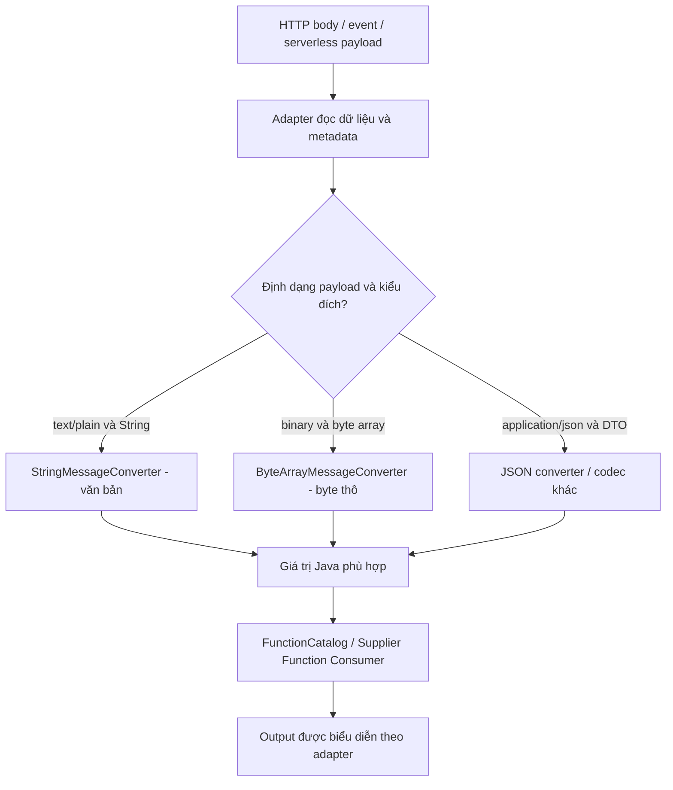

# StringMessageConverter và ByteArrayMessageConverter

Spring Cloud Function khuyến khích tách logic nghiệp vụ ra thành các hàm Java `Supplier<T>`, `Function<I, O>` và `Consumer<T>`. Cùng một hàm có thể được đưa vào `FunctionCatalog`, kết hợp với hàm khác (*composition*), rồi gọi qua HTTP, sự kiện từ message broker hoặc môi trường serverless. Nhưng ở biên giao thức, dữ liệu thường đi qua mạng dưới dạng chuỗi hoặc dãy byte, không phải lúc nào cũng là đối tượng Java mà hàm mong đợi.

Trong chương **Kiểu dữ liệu**, hai converter quan trọng cần phân biệt là **`StringMessageConverter`** và **`ByteArrayMessageConverter`**. Một converter thiên về văn bản, một converter thiên về dữ liệu nhị phân. Hiểu đúng phạm vi của chúng giúp tránh lỗi charset, xử lý nhầm JSON thành text, làm hỏng file nhị phân và khai báo sai generic của hàm.

Sau bài học, bạn có thể:

1. Giải thích cách converter dựa trên **kiểu dữ liệu đích**, **kiểu payload hiện có** và **`contentType`**.
2. Sử dụng `StringMessageConverter` cho nội dung văn bản và `ByteArrayMessageConverter` cho `byte[]`.
3. Phân biệt việc converter xử lý message với phép `String` ↔ `byte[]` được thực hiện tường minh trong Java.
4. Viết các bean Spring Cloud Function nhận/trả text và binary, sau đó tra cứu bằng `FunctionCatalog`.
5. Xây dựng test đối với UTF-8, byte không hợp lệ, MIME type, message headers và function composition.

## 1. Bối cảnh: payload không phải lúc nào cũng là DTO

Một request HTTP hoặc event có thể mang các loại nội dung khác nhau:

| Payload ở biên | MIME type thường gặp | Kiểu Java hàm có thể cần | Hướng xử lý phù hợp |
| --- | --- | --- | --- |
| Văn bản `Xin chào` | `text/plain; charset=UTF-8` | `String` | Converter văn bản hoặc giải mã byte theo charset |
| Dãy byte của một file | `application/octet-stream` | `byte[]` | Giữ nguyên dữ liệu byte |
| JSON object `{"id":"A1"}` | `application/json` | DTO/POJO | JSON converter, không phải chỉ text/binary converter |
| JSON array `[{"id":"A1"}]` | `application/json` | `List<DTO>` | JSON converter có metadata generic của phần tử |
| Byte chứa văn bản UTF-8 | `text/plain` | `String` | Chuyển byte → chuỗi theo charset |
| Byte không phải UTF-8 | `application/octet-stream` | `byte[]` | Không tự chuyển thành chuỗi |

`contentType` **mô tả định dạng của payload**. Chữ ký generic của hàm **mô tả kiểu Java đích**. Hai thông tin này cần phù hợp với dữ liệu thực tế. Riêng tên converter không đủ để đoán cách xử lý mọi trường hợp: kết quả còn phụ thuộc adapter, converter được đăng ký và cấu hình MIME/charset.

### Luồng chuyển đổi khái niệm



Đây là **sơ đồ vai trò**, không phải luồng gọi nội bộ cố định của mọi adapter. Một adapter có thể chuyển dữ liệu ở vị trí khác hoặc dùng codec riêng. Đường đi thực tế phải được xác nhận qua integration test.

## 2. Spring Messaging và Spring Cloud Function: phân biệt phạm vi API

Spring Framework có hai lớp tại package `org.springframework.messaging.converter`:

- `org.springframework.messaging.converter.StringMessageConverter`.
- `org.springframework.messaging.converter.ByteArrayMessageConverter`.

Chúng triển khai hợp đồng `MessageConverter` của **Spring Messaging**, làm việc với `Message<?>` và `MessageHeaders`. Spring Cloud Function cũng có cơ chế message conversion và các converter phục vụ kiểu văn bản/byte trong stack của framework. **Không đồng nhất** một instance converter tự tạo trong Spring Messaging với instance mặc định mà một Spring Cloud Function adapter cụ thể dùng.

Ngoài ra, Spring MVC còn có họ `org.springframework.http.converter.HttpMessageConverter` để đọc/ghi **HTTP body**, trong đó có `StringHttpMessageConverter` và `ByteArrayHttpMessageConverter`. Tên gần giống không có nghĩa chúng cùng interface hoặc chạy cùng đường xử lý.

| Thành phần | Chịu trách nhiệm chính | Nơi thường gặp |
| --- | --- | --- |
| Spring Messaging `StringMessageConverter` | Chuyển payload message có định dạng văn bản sang/từ `String` | `Message<?>`, message converter, một số tích hợp messaging |
| Spring Messaging `ByteArrayMessageConverter` | Xử lý payload message dạng `byte[]` | Thông điệp có nội dung binary |
| Spring MVC `StringHttpMessageConverter` | Đọc/ghi text trên HTTP | Web MVC |
| Spring MVC `ByteArrayHttpMessageConverter` | Đọc/ghi byte trên HTTP | Web MVC |
| JSON message converter / codec | Parse JSON thành DTO và serialize ngược lại | Khi payload là `application/json` |
| Spring Cloud Function `FunctionCatalog` | Tra cứu, chuẩn hóa và kết hợp hàm | Tầng gọi logic Spring Cloud Function |

Do đó, bài này dùng **Spring Messaging converter** để minh họa API `MessageConverter` một cách trực tiếp, rồi liên hệ sang Spring Cloud Function mà không giả định các adapter dùng cùng lớp/instance cụ thể.

## 3. Hợp đồng chung của MessageConverter

Spring Messaging định nghĩa hai hướng chuyển đổi:

```java
// Chữ ký mang tính minh họa từ MessageConverter:
Object fromMessage(Message<?> message, Class<?> targetClass);
Message<?> toMessage(Object payload, MessageHeaders headers);
```

`fromMessage(...)` nhận một message đã có payload, cùng **kiểu đích** mà caller cần. `toMessage(...)` biểu diễn một giá trị Java thành message có headers phù hợp.

Trong Spring Messaging:

```java
MessageHeaders.CONTENT_TYPE   // Tên header: "contentType"
```

Các giá trị MIME thường được biểu diễn bằng `org.springframework.util.MimeType`, ví dụ `MimeTypeUtils.TEXT_PLAIN` và `MimeTypeUtils.APPLICATION_OCTET_STREAM`.

Một converter có thể không hỗ trợ cặp định dạng/kiểu, khi đó `fromMessage(...)` hoặc `toMessage(...)` có thể trả `null`; một số lỗi dữ liệu hoặc cấu hình có thể phát sinh exception. Đừng coi việc có header như `text/plain` là bằng chứng tất cả byte đều được đổi sang chuỗi thành công.

### Ba yếu tố để quyết định

```text
Payload thực tế         Header contentType          Kiểu Java đích
    byte[]        +         text/plain         +        String
     │                          │                         │
     └──────────────────────────┴─────────────────────────┘
                                ↓
                Converter văn bản nếu được hỗ trợ
                                ↓
                              String
```

Ngược lại, nếu kiểu đích là `byte[]` và nội dung là file binary, việc chọn một converter văn bản để cố giải mã có thể làm mất dữ liệu.

## 4. StringMessageConverter: chuyển nội dung văn bản

`StringMessageConverter` của Spring Messaging phục vụ payload kiểu `String`. Nó có thể chuyển payload message từ byte sang chuỗi bằng charset phù hợp khi cấu hình/định dạng hỗ trợ; ở chiều xuất, implementation có thể biểu diễn `String` thành byte hoặc giữ ở dạng text tùy cấu hình.

### Đọc Message<byte[]> thành String

Ví dụ dưới đây dùng Java 17+ và Spring Messaging:

```java
import java.nio.charset.StandardCharsets;

import org.springframework.messaging.Message;
import org.springframework.messaging.MessageHeaders;
import org.springframework.messaging.converter.StringMessageConverter;
import org.springframework.messaging.support.MessageBuilder;
import org.springframework.util.MimeTypeUtils;

StringMessageConverter converter = new StringMessageConverter();

byte[] raw = "Xin chào".getBytes(StandardCharsets.UTF_8);

Message<byte[]> incoming = MessageBuilder.withPayload(raw)
    .setHeader(
        MessageHeaders.CONTENT_TYPE,
        MimeTypeUtils.parseMimeType("text/plain;charset=UTF-8")
    )
    .build();

Object converted = converter.fromMessage(incoming, String.class);

if (!(converted instanceof String text)) {
    throw new IllegalStateException("Cannot convert message to text");
}

System.out.println(text); // Xin chào
```

Trong ví dụ:

1. Payload thực là `byte[]` chứa UTF-8 của chuỗi `Xin chào`.
2. `contentType` mô tả đây là `text/plain` và khai báo charset.
3. Tham số `String.class` chỉ ra kiểu Java mà code muốn nhận.
4. Converter thực hiện chuyển đổi phù hợp; logic phía sau nhận `String`.

Thao tác này khác hẳn với việc đọc JSON object thành POJO. `StringMessageConverter` không được xem như một JSON parser.

### Chuyển String thành message

```java
import java.util.Map;
import org.springframework.messaging.Message;
import org.springframework.messaging.MessageHeaders;

MessageHeaders headers = new MessageHeaders(Map.of(
    MessageHeaders.CONTENT_TYPE,
    MimeTypeUtils.parseMimeType("text/plain;charset=UTF-8")
));

Message<?> outgoing = converter.toMessage("Xin chào", headers);

if (outgoing == null) {
    throw new IllegalStateException("Cannot create text message");
}

Object payload = outgoing.getPayload();
System.out.println(payload.getClass().getName());
```

Đoạn code tiếp nối ví dụ trước, với biến `converter` đã được tạo. Tùy cấu hình serialized payload class và cách adapter xử lý, payload đầu ra có thể là byte hoặc giá trị khác được converter hỗ trợ. **Đừng ép ngay `outgoing.getPayload()` thành `String` hoặc `byte[]` khi chưa kiểm tra hợp đồng của implementation.**

### Charset là hợp đồng dữ liệu, không phải chi tiết trang trí

Hai chuỗi Java có thể chứa cùng ký tự nhưng khi encode theo các charset khác nhau sẽ cho dãy byte khác nhau. Ví dụ:

```java
import java.nio.charset.StandardCharsets;
import java.util.Arrays;

String text = "Cà phê";
byte[] utf8 = text.getBytes(StandardCharsets.UTF_8);
String restored = new String(utf8, StandardCharsets.UTF_8);

System.out.println(text.equals(restored)); // true
System.out.println(Arrays.toString(utf8));
```

Nếu producer dùng UTF-8 mà consumer giải mã theo charset khác, dữ liệu có thể bị sai ký tự. Khi không có charset trong MIME type, hãy kiểm tra chính sách mặc định của converter và phiên bản thư viện; với giao tiếp giữa các hệ thống, **khai báo charset hoặc thống nhất rõ UTF-8** sẽ dễ kiểm soát hơn.

Với byte không phải UTF-8 hợp lệ, các API giải mã có thể thay ký tự lỗi theo chính sách mặc định. Nếu bắt buộc dữ liệu văn bản phải hợp lệ, cần decoder cấu hình báo lỗi (xem mục 10).

## 5. ByteArrayMessageConverter: giữ dữ liệu byte

`ByteArrayMessageConverter` của Spring Messaging dành cho payload `byte[]`, thường đi với MIME `application/octet-stream`. Mục tiêu của nó là chuyển/giữ đúng **dãy byte**, không phải suy đoán nội dung đó là ảnh, JSON, PDF hay text.

### Đọc một binary message

```java
import java.util.Arrays;

import org.springframework.messaging.Message;
import org.springframework.messaging.MessageHeaders;
import org.springframework.messaging.converter.ByteArrayMessageConverter;
import org.springframework.messaging.support.MessageBuilder;
import org.springframework.util.MimeTypeUtils;

ByteArrayMessageConverter converter = new ByteArrayMessageConverter();

byte[] data = new byte[] {0, 1, 2, 3, (byte) 255};

Message<byte[]> incoming = MessageBuilder.withPayload(data)
    .setHeader(
        MessageHeaders.CONTENT_TYPE,
        MimeTypeUtils.APPLICATION_OCTET_STREAM
    )
    .build();

Object converted = converter.fromMessage(incoming, byte[].class);

if (!(converted instanceof byte[] bytes)) {
    throw new IllegalStateException("Cannot read binary payload");
}

System.out.println(Arrays.equals(data, bytes)); // true
```

Converter này **không tự parse** dãy byte thành một POJO và **không tự biến** binary thành văn bản UTF-8. Nếu hàm nghiệp vụ cần hiểu định dạng file, bạn phải dùng parser/decoder đúng định dạng. Ví dụ, ảnh cần thư viện xử lý ảnh; ZIP cần bộ đọc ZIP; JSON cần JSON converter/mapper.

### Chiều xuất

```java
import java.util.Map;
import org.springframework.messaging.Message;
import org.springframework.messaging.MessageHeaders;

MessageHeaders headers = new MessageHeaders(Map.of(
    MessageHeaders.CONTENT_TYPE,
    MimeTypeUtils.APPLICATION_OCTET_STREAM
));

Message<?> output = converter.toMessage(data, headers);
if (output == null || !(output.getPayload() instanceof byte[] sent)) {
    throw new IllegalStateException("Expected byte payload");
}

System.out.println(Arrays.equals(data, sent)); // true
```

Đây là đoạn chạy tiếp trong ngữ cảnh đã có `converter` và `data` ở trên. Kết quả xác nhận **nội dung** giữ nguyên. Không nên dựa vào việc mảng byte được sao chép hay giữ cùng tham chiếu: nếu cần chống thay đổi ngoài ý muốn, hãy sao chép chủ động ở biên nghiệp vụ bằng `Arrays.copyOf(...)`.

### So sánh trực tiếp hai converter

| Khía cạnh | StringMessageConverter | ByteArrayMessageConverter |
| --- | --- | --- |
| Kiểu Java đích thường gặp | `String` | `byte[]` |
| MIME thường dùng | `text/plain` | `application/octet-stream` |
| Có diễn giải charset không? | Có thể, khi chuyển byte ↔ text | Không phải nhiệm vụ chính |
| Có parse JSON object không? | Không coi là JSON parser | Không |
| Có giữ byte nhị phân nguyên vẹn không? | Không phù hợp để xử lý byte tùy ý | Phù hợp |
| Có cần biết DTO nghiệp vụ không? | Không, nếu mục tiêu là text | Không, nếu mục tiêu là byte thô |
| Khi nào cần converter khác? | Khi mục tiêu là DTO/JSON hoặc định dạng có cấu trúc | Khi phải parse file/JSON thành đối tượng |

## 6. Viết Spring Cloud Function cho văn bản và nhị phân

Thay vì để bean nghiệp vụ phụ thuộc trực tiếp vào Spring Messaging converter, ta có thể khai báo kiểu rõ ràng và để adapter thực hiện công việc chuyển payload tại biên.

Ví dụ một cấu hình Spring Boot/Spring Cloud Function dùng Java 17:

```java
package demo.function;

import java.nio.charset.StandardCharsets;
import java.util.Arrays;
import java.util.Locale;
import java.util.function.Consumer;
import java.util.function.Function;
import java.util.function.Supplier;

import org.springframework.context.annotation.Bean;
import org.springframework.context.annotation.Configuration;

@Configuration
public class PayloadFunctions {

    @Bean
    public Function<String, String> normalizeText() {
        return text -> text.strip().toUpperCase(Locale.ROOT);
    }

    @Bean
    public Function<byte[], byte[]> copyBinary() {
        return input -> Arrays.copyOf(input, input.length);
    }

    @Bean
    public Function<String, byte[]> encodeUtf8() {
        return text -> text.getBytes(StandardCharsets.UTF_8);
    }

    @Bean
    public Function<byte[], String> decodeUtf8() {
        return bytes -> new String(bytes, StandardCharsets.UTF_8);
    }

    @Bean
    public Supplier<String> readiness() {
        return () -> "READY";
    }

    @Bean
    public Consumer<byte[]> auditBytes() {
        return bytes -> System.out.println(
            "Received binary payload of length " + bytes.length
        );
    }
}
```

Các bean này chỉ chứa logic Java thuần theo các kiểu hợp đồng:

| Bean | Hợp đồng | Mục đích |
| --- | --- | --- |
| `normalizeText` | `Function<String, String>` | Chuẩn hóa text |
| `copyBinary` | `Function<byte[], byte[]>` | Tạo bản sao byte |
| `encodeUtf8` | `Function<String, byte[]>` | Mã hóa text thành UTF-8 |
| `decodeUtf8` | `Function<byte[], String>` | Giải mã byte UTF-8 thành chuỗi |
| `readiness` | `Supplier<String>` | Cung cấp văn bản mà không có input |
| `auditBytes` | `Consumer<byte[]>` | Tiếp nhận byte mà không trả kết quả nghiệp vụ |

Hai hàm `encodeUtf8`/`decodeUtf8` **chủ động chuyển kiểu trong code**, không phải nhờ `ByteArrayMessageConverter` tự quyết định charset. `normalizeText` cũng không cần biết dữ liệu đến từ HTTP hay broker; nếu adapter chuyển text thành `String` phù hợp thì có thể tái dùng logic.

Lưu ý `decodeUtf8` minh họa cách giải mã thường dùng nhưng không kiểm tra UTF-8 nghiêm ngặt. Với dữ liệu không đáng tin cậy, xem mục 10 để chọn chính sách lỗi phù hợp.

## 7. Ví dụ qua HTTP: MIME type ảnh hưởng cách đọc body

Khi ứng dụng đã có Spring Cloud Function Web adapter và expose các bean tương ứng, có thể thử:

**Gửi text:**

```bash
curl -X POST http://localhost:8080/normalizeText \
  -H 'Content-Type: text/plain; charset=UTF-8' \
  --data-binary '  hello function  '
```

Giá trị logic trả về là `HELLO FUNCTION`. Body/response headers phụ thuộc Web adapter và cách serialize kết quả. HTTP `Content-Type` ở đây mô tả **request body**, còn `Accept` nếu có mô tả định dạng response client mong muốn.

**Gửi byte:**

```bash
printf 'binary bytes' | curl -X POST \
  http://localhost:8080/copyBinary \
  -H 'Content-Type: application/octet-stream' \
  --data-binary @-
```

Payload được gửi là byte của text mẫu nhưng hàm `copyBinary` vẫn xử lý chúng như **dãy byte**, không thực hiện giải mã. Ví dụ này dùng `printf` trong một shell có lệnh này; trên Windows PowerShell, cách truyền byte chính xác cần được thực hiện theo công cụ tương ứng.

Hai lệnh curl chỉ có ý nghĩa nếu adapter HTTP đã được cài và khởi chạy với các endpoint phù hợp. **Không khẳng định rằng Spring Cloud Function Web adapter bắt buộc dùng chính instance `StringMessageConverter` hoặc `ByteArrayMessageConverter` của Spring Messaging trong hai ví dụ HTTP.** Nó có thể dùng cơ chế conversion/codec riêng.

### Cùng byte nhưng khai MIME khác

Nếu gửi byte ZIP với `Content-Type: text/plain`, converter văn bản có thể được chọn và cố diễn giải byte thành ký tự. Điều đó không biến file ZIP thành text hợp lệ. Ngược lại, gửi một chuỗi JSON với `application/octet-stream` đến `Function<SomeDto, ...>` có thể không đủ điều kiện để converter JSON được chọn.

Luôn thống nhất:

```text
Nội dung thực tế ⇄ contentType ⇄ kiểu Java của hàm
```

Một trong ba phần sai có thể khiến bước chuyển đổi bị bỏ qua, không hỗ trợ hoặc phát sinh lỗi.

## 8. Spring Messaging Message<T>: payload và headers

Hàm có thể nhận/giữ metadata của message khi cần xử lý sự kiện:

```java
import java.util.Arrays;
import java.util.function.Function;

import org.springframework.context.annotation.Bean;
import org.springframework.messaging.Message;
import org.springframework.messaging.support.MessageBuilder;

@Bean
public Function<Message<byte[]>, Message<byte[]>> preserveBinary() {
    return incoming -> {
        byte[] copy = Arrays.copyOf(
            incoming.getPayload(),
            incoming.getPayload().length
        );

        MessageBuilder<byte[]> builder =
            MessageBuilder.withPayload(copy);

        Object correlationId =
            incoming.getHeaders().get("correlationId");
        if (correlationId != null) {
            builder.setHeader("correlationId", correlationId);
        }

        return builder.build();
    };
}
```

Đặt bean này trong một lớp cấu hình Spring; đây là đoạn minh họa độc lập với `PayloadFunctions` ở mục 6. Hợp đồng `Function<Message<byte[]>, Message<byte[]>>` khác `Function<byte[], byte[]>`: ở trường hợp đầu, logic nhận cả wrapper `Message`, nhờ vậy truy xuất được header.

Không tự động copy mọi header nếu output thay đổi định dạng. Ví dụ, một hàm đổi `byte[]` thành JSON object mà vẫn giữ `contentType=application/octet-stream` có thể khiến consumer kế tiếp chọn nhầm converter. Với hàm `preserveBinary`, payload vẫn là byte nên có thể để adapter xác định hoặc duy trì MIME phù hợp, nhưng cần kiểm tra chính sách header trên đường broker thực tế.

### Header tương quan không phải content type

`correlationId` có thể dùng để ghép request và response hoặc theo dõi event; `contentType` mô tả định dạng payload. Chúng có mục tiêu khác nhau. Spring Cloud Function có thể tái sử dụng cùng hàm ở HTTP và messaging, nhưng mỗi adapter có thể chuẩn hóa hoặc đổi tên headers. Không nên cho rằng mọi header từ broker sẽ xuất hiện nguyên vẹn tại endpoint HTTP.

## 9. FunctionCatalog, kiểu generic và composition

Spring Cloud Function tìm hàm theo tên qua `FunctionCatalog`. Với các bean ở mục 6, có thể gọi Java trực tiếp:

```java
import java.util.function.Function;
import org.springframework.cloud.function.context.FunctionCatalog;

// Trong test/method đã inject FunctionCatalog catalog.
Function<String, String> function = catalog.lookup("normalizeText");

String result = function.apply("  hello  ");
System.out.println(result); // HELLO
```

Ở lời gọi này đầu vào đã là `String`; do đó nó xác minh lookup và logic, **không kiểm tra** liệu một payload message `byte[]` có được chuyển đúng qua converter hay không.

### Composition không đồng nghĩa với conversion tự động tại mọi điểm nối

Có thể chọn chuỗi:

```yaml
spring:
  cloud:
    function:
      definition: decodeUtf8|normalizeText|encodeUtf8
```

Về kiểu Java:

```text
byte[]
  │
  ▼
decodeUtf8 : Function<byte[], String>
  │ String
  ▼
normalizeText : Function<String, String>
  │ String
  ▼
encodeUtf8 : Function<String, byte[]>
  │
  ▼
byte[]
```

Ở đây **chính các hàm `decodeUtf8` và `encodeUtf8` thực hiện thay đổi kiểu Java**. `ByteArrayMessageConverter` không tự biến byte thành text chỉ vì composition có hàm kế tiếp nhận `String`. Hợp đồng đầu ra/đầu vào của mỗi mắt xích phải khớp, hoặc cần bổ sung bước chuyển đổi tường minh đã được hỗ trợ.

Ngoài ra, kết quả composition có thể được adapter biểu diễn theo định dạng riêng. Không kết luận rằng output `byte[]` mặc định mang `application/octet-stream` trong mọi môi trường; kiểm tra header và converter thực tế.

## 10. Kiểm soát lỗi encoding và dữ liệu binary

`byte[]` không mang metadata về charset. Việc ép dãy byte thành chuỗi có thể gây mất dữ liệu nếu byte không biểu diễn text hợp lệ. Trong Java, `new String(bytes, UTF_8)` có thể thay thế byte sequence sai bằng ký tự thay thế thay vì luôn ném lỗi.

### Giải mã UTF-8 nghiêm ngặt khi cần

```java
import java.nio.ByteBuffer;
import java.nio.charset.CharacterCodingException;
import java.nio.charset.CodingErrorAction;
import java.nio.charset.StandardCharsets;

String decodeStrictUtf8(byte[] bytes)
        throws CharacterCodingException {
    return StandardCharsets.UTF_8.newDecoder()
        .onMalformedInput(CodingErrorAction.REPORT)
        .onUnmappableCharacter(CodingErrorAction.REPORT)
        .decode(ByteBuffer.wrap(bytes))
        .toString();
}
```

Đây là phương thức tiện ích đặt trong class Java hoặc test. Nó ném `CharacterCodingException` nếu đầu vào không phải UTF-8 hợp lệ, giúp hệ thống tránh âm thầm sửa dữ liệu. Chiến lược báo lỗi/loại bỏ thông điệp/retry phụ thuộc nghiệp vụ và adapter.

### Base64 không phải chuyển charset

Nếu một giao thức bắt buộc biểu diễn binary trong trường JSON string, hai bên có thể thỏa thuận dùng Base64:

```java
import java.util.Base64;
import java.util.Arrays;

byte[] binary = new byte[] {0, 1, 2, (byte) 255};
String base64 = Base64.getEncoder().encodeToString(binary);
byte[] decoded = Base64.getDecoder().decode(base64);

System.out.println(base64); // AAEC/w==
System.out.println(Arrays.equals(binary, decoded)); // true
```

Base64 chỉ mã hóa byte thành ký tự theo một quy tắc; nó không làm byte trở thành văn bản UTF-8 có ý nghĩa hoặc POJO. Nếu muốn truyền file thô, `application/octet-stream` với `byte[]` thường phù hợp hơn việc tự dùng `new String(binary, UTF_8)`.

### Dữ liệu lớn và chi phí bộ nhớ

Hàm `Function<byte[], byte[]>` thường cần giữ toàn bộ payload trong bộ nhớ. Nếu sao chép mảng, bộ nhớ tạm thời tăng thêm tương ứng kích thước dữ liệu. Với tệp lớn hoặc stream dài, nên xem xét adapter streaming/reactive phù hợp; **`byte[]` không đồng nghĩa với streaming**. Việc dùng `Flux<byte[]>` hay `InputStream` là một hợp đồng khác và không tự được kích hoạt chỉ vì MIME type là octet-stream.

## 11. Khi nào cần JSON converter thay vì hai converter này?

Ví dụ HTTP gửi:

```json
{"sku":"BOOK","quantity":2}
```

Một hàm khai báo `Function<OrderRequest, OrderReceipt>` cần converter có khả năng parse JSON thành đối tượng đích. `StringMessageConverter` có thể đọc payload thành một `String` nếu điều kiện phù hợp, còn `ByteArrayMessageConverter` có thể giữ nguyên byte; **cả hai không tự tạo DTO từ cú pháp JSON**.

| Mục đích nghiệp vụ | Hợp đồng hàm gợi ý | Thành phần chuyển đổi cần nghĩ đến |
| --- | --- | --- |
| Chuẩn hóa văn bản | `Function<String, String>` | Text converter khi payload từ mạng |
| Lưu/chuyển file binary | `Function<byte[], byte[]>` | Byte converter hoặc đường binary của adapter |
| Phân tích JSON để tính đơn hàng | `Function<OrderRequest, OrderReceipt>` | JSON converter + metadata DTO |
| Xử lý một mảng JSON đối tượng | `Function<List<OrderRequest>, List<OrderReceipt>>` | JSON converter hỗ trợ generic phần tử |
| Chuyển byte text thành chuỗi theo quy tắc cụ thể | `Function<byte[], String>` | Code decode/charset tường minh, có thể thêm converter ở biên |

Với `List<T>`, phải giữ kiểu phần tử. Nếu chỉ công bố `List.class`, JSON mapper có thể tạo các phần tử kiểu `Map` thay vì DTO cần dùng. Thông tin generic từ phương thức `@Bean` hoặc `FunctionRegistration.type(...)` giúp framework biết kiểu Java mong đợi, còn adapter/converter vẫn phải hỗ trợ cấu trúc này.

## 12. Chẩn đoán lỗi theo triệu chứng

| Triệu chứng | Điều cần kiểm tra | Cách khắc phục |
| --- | --- | --- |
| Ký tự tiếng Việt bị lỗi | Charset producer/consumer, `contentType` | Thống nhất UTF-8, test byte thực tế |
| `byte[].toString()` cho kết quả lạ | Đang in định danh mảng, không giải mã | Dùng `new String(bytes, charset)` chỉ với byte text |
| Binary payload bị hỏng sau khi qua text | Byte không phải văn bản hoặc bị thay ký tự lỗi | Giữ `byte[]`, không ép text |
| Converter trả `null` | MIME type hoặc kiểu đích không được hỗ trợ | Kiểm tra header, đăng ký converter và target class |
| HTTP text chạy nhưng event thất bại | Hai adapter khác cách truyền body/header | Kiểm tra content type và binder ở môi trường event |
| JSON object không thành POJO | Dùng converter text/byte thay vì JSON, thiếu generic | Chọn JSON converter và công bố DTO cụ thể |
| `ClassCastException` khi đọc event | Payload vẫn là `byte[]`/`String` nhưng hàm ép sang DTO | Kiểm tra chuyển đổi ở biên và type metadata |
| File lớn gây áp lực bộ nhớ | Toàn bộ byte được load/copy | Cân nhắc streaming và giới hạn kích thước |
| Composition lỗi tại điểm nối | Hàm trước trả kiểu không khớp đầu vào hàm sau | Sửa generic hoặc thêm bước chuyển tường minh |
| `Consumer` nhận dữ liệu nhưng không gửi output | `Consumer<T>` không có giá trị trả về | Sử dụng `Function<I,O>` nếu cần output nghiệp vụ |

### Trình tự điều tra thực tế

1. **Xem hợp đồng của hàm:** `String`, `byte[]`, `Message<T>` hay DTO? Có giữ generic đầy đủ không?
2. **Xác định byte thật:** nguồn gửi text UTF-8, JSON hay binary? Đừng đoán dựa vào tên biến.
3. **Xem MIME type và charset:** `text/plain`, `application/octet-stream`, `application/json` có khớp nội dung không?
4. **Xác nhận converter/adapter:** converter nào đang được gọi, nó có hỗ trợ source và target không?
5. **Test input/output ở cấp Java và ở biên:** unit test với đối tượng đã tạo sẵn và integration test với payload thật.
6. **Kiểm tra composition và headers:** kiểu tại điểm nối có đúng và metadata đầu ra có còn phù hợp không?

## 13. Ví dụ kiểm thử độc lập của hai converter

Đây là hai test JUnit 5 dùng trực tiếp Spring Messaging, nhằm chứng minh cách converter xử lý thông điệp cụ thể. Chúng không yêu cầu khởi tạo HTTP adapter.

```java
import static org.junit.jupiter.api.Assertions.assertArrayEquals;
import static org.junit.jupiter.api.Assertions.assertEquals;

import java.nio.charset.StandardCharsets;

import org.junit.jupiter.api.Test;
import org.springframework.messaging.Message;
import org.springframework.messaging.MessageHeaders;
import org.springframework.messaging.converter.ByteArrayMessageConverter;
import org.springframework.messaging.converter.StringMessageConverter;
import org.springframework.messaging.support.MessageBuilder;
import org.springframework.util.MimeTypeUtils;

class MessageConversionTest {

    @Test
    void readsUtf8TextMessage() {
        Message<byte[]> msg = MessageBuilder
            .withPayload("Xin chào".getBytes(StandardCharsets.UTF_8))
            .setHeader(
                MessageHeaders.CONTENT_TYPE,
                MimeTypeUtils.parseMimeType("text/plain;charset=UTF-8")
            )
            .build();

        Object output = new StringMessageConverter()
            .fromMessage(msg, String.class);

        assertEquals("Xin chào", output);
    }

    @Test
    void preservesBinaryPayload() {
        byte[] bytes = {0, 1, 2, (byte) 255};
        Message<byte[]> msg = MessageBuilder.withPayload(bytes)
            .setHeader(
                MessageHeaders.CONTENT_TYPE,
                MimeTypeUtils.APPLICATION_OCTET_STREAM
            )
            .build();

        Object output = new ByteArrayMessageConverter()
            .fromMessage(msg, byte[].class);

        assertArrayEquals(bytes, (byte[]) output);
    }
}
```

Hai test cần dependency JUnit 5 và Spring Messaging phù hợp. Kiểm thử qua `FunctionCatalog` có thể làm thêm để bảo đảm bean được tìm đúng tên:

```java
// Trong test đã có FunctionCatalog catalog:
Function<String, String> normalize = catalog.lookup("normalizeText");
assertEquals("HELLO", normalize.apply("  hello  "));
```

Test catalog này sử dụng `java.util.function.Function` và JUnit assertion, cùng context có bean `normalizeText`. Nó **chỉ xác nhận logic Java và catalog**, không chứng minh Web adapter hay binder đã chuyển bytes thành text. Vì vậy, hãy bổ sung một test HTTP text/plain hoặc test message với binder tương ứng khi triển khai thực tế.

## 14. Bài tập thực hành

**Bài 1 — Chọn converter.** Một message có payload `byte[]`, chứa văn bản UTF-8 `"Xin chào"` và `contentType=text/plain;charset=UTF-8`. Target là `String`. Converter nào phù hợp?

*Đáp án:* `StringMessageConverter` hoặc đường text tương đương được adapter hỗ trợ; cần khai charset đúng. `ByteArrayMessageConverter` không phải công cụ để giải nghĩa văn bản.

**Bài 2 — Tại sao không phải JSON?** Client gửi `{"sku":"BOOK"}` với `Content-Type: application/json`, target là DTO. Có thể chỉ dùng `StringMessageConverter` để tạo DTO không?

*Đáp án:* Không. Converter văn bản có thể cung cấp `String` nhưng không tự parse JSON object thành DTO. Cần JSON converter/mapper và metadata kiểu Java đích.

**Bài 3 — Byte có nghĩa gì?** Hàm `Function<byte[], byte[]>` nhận file ZIP với `contentType=application/octet-stream`. Có nên tự động gọi `new String(bytes, UTF_8)` trước khi xử lý không?

*Đáp án:* Không. Byte ZIP là dữ liệu nhị phân; giải mã thành text có thể thay đổi và làm hỏng nội dung. Giữ `byte[]` hoặc dùng ZIP parser.

**Bài 4 — Chọn kiểu hàm.** Muốn nhận văn bản, chuẩn hóa chữ hoa rồi trả byte UTF-8, hãy viết hai function và tên composition.

*Gợi ý đáp án:* `Function<String, String> normalizeText` và `Function<String, byte[]> encodeUtf8`; composition `normalizeText|encodeUtf8` với input `String` và output `byte[]`.

**Bài 5 — Khắc phục lỗi tiếng Việt.** Producer gửi UTF-8 nhưng consumer đọc theo charset khác. Cần kiểm tra đâu?

*Đáp án:* Byte thực tế producer tạo, MIME `charset` trong `contentType`, cấu hình mặc định của converter và cách adapter xử lý header. Thống nhất UTF-8, kiểm thử với văn bản có dấu.

**Bài 6 — Khi nào cần Message<T>?** Một consumer cần đọc `correlationId` và payload `byte[]` từ event. Kiểu nào phù hợp?

*Đáp án:* `Consumer<Message<byte[]>>` nếu adapter hỗ trợ wrapper message. Hàm đọc `message.getHeaders()` và `message.getPayload()`; dùng `Consumer<byte[]>` khi không cần header.

**Bài 7 — Kiểm thử mức nào?** Test `catalog.lookup("copyBinary").apply(byte[])` thành công. Điều này có chứng minh HTTP endpoint đọc body octet-stream đúng không?

*Đáp án:* Không. Test Java đã cung cấp đúng kiểu byte. Cần test qua Web adapter hoặc binder với request/event thật và MIME `application/octet-stream`.

## Ghi nhớ

- **`StringMessageConverter` phục vụ giá trị văn bản `String`**, thường gắn với `text/plain` và charset; không tự parse JSON object hay file binary.
- **`ByteArrayMessageConverter` phục vụ `byte[]`**, thường gắn với `application/octet-stream`; giữ byte không đồng nghĩa giải mã hoặc hiểu nội dung.
- **`contentType`, payload thực và kiểu đích phải khớp.** Tên MIME không tự tạo DTO hoặc sửa byte sai định dạng.
- **Spring Messaging `MessageConverter` khác Spring MVC `HttpMessageConverter`.** Tùy adapter Spring Cloud Function, điểm tích hợp thực tế có thể khác.
- **Kiểu generic của `Supplier`/`Function`/`Consumer` cung cấp hợp đồng Java**, còn adapter/converter quyết định cách đưa payload qua giao thức.
- **Composition cần kiểu Java khớp ở mỗi điểm nối.** Phép `String` ↔ `byte[]` có thể được viết rõ thành các hàm `encodeUtf8` và `decodeUtf8`.
- **Kiểm thử cả converter trực tiếp và adapter** để xác nhận một hàm dùng lại đúng trên HTTP, sự kiện hoặc serverless.

**Tài liệu tham khảo:** [Spring Cloud Function Reference](https://docs.spring.io/spring-cloud-function/reference/) và [Spring Framework — Messaging](https://docs.spring.io/spring-framework/reference/integration.html). Hành vi, converter mặc định và cách xử lý MIME ở từng adapter phải được đối chiếu với phiên bản đang sử dụng.
