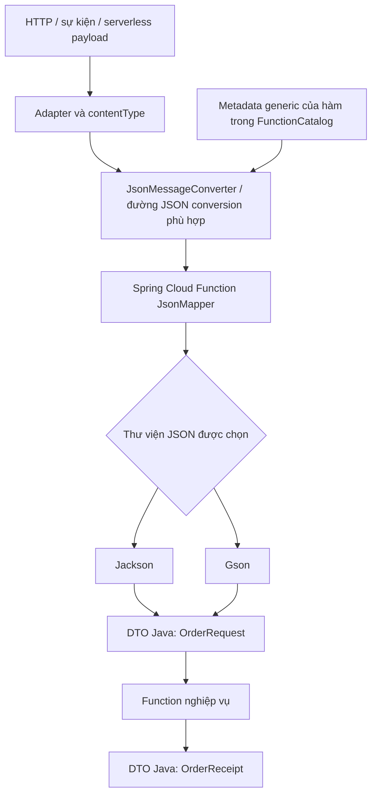

# Tùy chọn JsonMapper, Jackson và Gson theo phiên bản

**Spring Cloud Function** cho phép xây dựng logic nghiệp vụ thành các hàm `Supplier<T>`, `Function<I, O>` và `Consumer<T>` độc lập với giao thức. Cùng một hàm có thể được đăng ký trong `FunctionCatalog`, nối với các hàm khác rồi được gọi qua HTTP, sự kiện hoặc môi trường serverless. Để biến JSON của những giao thức này thành đối tượng Java, framework cần một cơ chế đọc/ghi JSON. Hai thư viện thường gặp là **Jackson** và **Gson**; Spring Cloud Function cung cấp một lớp trừu tượng có tên **`JsonMapper`** để sử dụng các cơ chế đó.

Bài học thuộc chương **Kiểu dữ liệu**. Khó khăn không chỉ nằm ở việc chọn thư viện JSON: **tên class, package, dependency, cấu hình mặc định và API tùy biến có thể thay đổi khi nâng cấp Spring Boot, Spring Cloud Function hoặc Jackson**. Đặc biệt, Spring Boot 4 chuyển mặc định sang Jackson 3, trong khi nhiều ví dụ của Spring Boot 3/Jackson 2 vẫn xuất hiện trên Internet. Nếu chỉ sao chép một đoạn import hay cấu hình từ tài liệu phiên bản khác, ứng dụng có thể không biên dịch, chọn mapper ngoài ý muốn hoặc serialize khác với hợp đồng API.

Sau khi học, bạn có thể:

- Phân biệt `JsonMapper` của Spring Cloud Function với `JsonMapper` của Jackson 3.
- Giải thích quy tắc lựa chọn Jackson/Gson và tùy chọn `spring.cloud.function.preferred-json-mapper`.
- Viết một bean `Function<Request, Response>` giữ generic rõ ràng, chuyển JSON qua adapter thích hợp.
- So sánh mã Jackson 2, Jackson 3 và Gson mà không trộn lẫn package.
- Đọc đúng các khác biệt về auto-configuration giữa Spring Boot 3 và Spring Boot 4.
- Kiểm tra mapper thực tế trong ứng dụng và lập checklist khi nâng cấp phiên bản.

## 1. Ba tầng phải phân biệt

Để tránh nhầm khái niệm, hãy tách ba tầng:

| Tầng | Thành phần | Trách nhiệm |
| --- | --- | --- |
| Nghiệp vụ | `Function<OrderRequest, OrderReceipt>` | Chỉ xử lý đối tượng Java và trả kết quả |
| Spring Cloud Function | `FunctionCatalog`, `JsonMessageConverter`, `org.springframework.cloud.function.json.JsonMapper` | Chuẩn hóa lời gọi và hỗ trợ chuyển đổi JSON ↔ kiểu Java khi cần |
| Thư viện JSON | Jackson 2, Jackson 3 hoặc Gson | Cung cấp parser, serializer và quy tắc mapping thực tế |

Luồng khái niệm:



Đây là sơ đồ vai trò, **không phải trình tự gọi nội bộ cố định**. Một số HTTP adapter hay serverless adapter có codec/converter riêng, và không phải mọi lời gọi catalog đều cần chuyển đổi. Nếu bạn đã gọi `function.apply(new OrderRequest(...))` thì DTO đã tồn tại, không cần JSON parser ở bước đó.

### Hai thông tin không thể thay thế nhau

- `contentType=application/json` nói **payload được biểu diễn bằng JSON**.
- `Function<OrderRequest, OrderReceipt>` nói **Java cần DTO nào**.

Header JSON không tự xác định class `OrderRequest`; ngược lại, kiểu đích `OrderRequest` không khiến mọi chuỗi/byte trở thành JSON hợp lệ. Converter/mapper phải hỗ trợ định dạng và mapping tương ứng.

## 2. Hai lớp cùng tên JsonMapper: nguy cơ nhầm import

Tên **`JsonMapper`** có thể chỉ hai API khác nhau:

| Tên đầy đủ | Hệ sinh thái | Chức năng |
| --- | --- | --- |
| `org.springframework.cloud.function.json.JsonMapper` | Spring Cloud Function | Trừu tượng đọc/ghi JSON được framework dùng, có thể inject như bean trong cấu hình phù hợp |
| `tools.jackson.databind.json.JsonMapper` | Jackson 3 (phổ biến trong Spring Boot 4) | JSON mapper của thư viện Jackson 3, có builder và các API Jackson |
| `com.fasterxml.jackson.databind.ObjectMapper` | Jackson 2 (phổ biến trong Spring Boot 3) | Mapper tổng quát đọc/ghi dữ liệu, bao gồm JSON |
| `com.google.gson.Gson` | Gson | Đọc/ghi JSON bằng API Gson |

**Hai lớp JsonMapper đầu tiên không phải cùng một class và không hoán đổi được.** Khi xem đoạn mã:

```java
import org.springframework.cloud.function.json.JsonMapper;
```

đó là API của Spring Cloud Function. Nhưng:

```java
import tools.jackson.databind.json.JsonMapper;
```

là API Jackson 3. Nếu một source file cần cả hai, tránh import gây xung đột tên ngắn; có thể sử dụng **tên class đầy đủ** ở vị trí cần thiết.

Đây là lý do phải kiểm tra **phiên bản dependency thực tế** trước khi sao chép ví dụ JSON mapper.

## 3. Quy tắc chọn Jackson hoặc Gson trong Spring Cloud Function

Tài liệu Spring Cloud Function nhánh 4.3 và 5.0, ở mục **“Note on JSON options”**, mô tả:

1. Nếu chỉ có Jackson phù hợp trên classpath, framework dùng cơ chế Jackson.
2. Nếu chỉ có Gson phù hợp, framework dùng Gson.
3. Khi **cả Jackson và Gson** đều có mặt, mục này mô tả **Gson là lựa chọn mặc định**, trừ khi bạn chỉ định `spring.cloud.function.preferred-json-mapper` là `jackson` hoặc `gson`.

Lưu ý quan trọng: một số phần mô tả khác về `JsonMessageConverter` dùng từ “Jackson (DEFAULT)”. Vì vậy **không nên suy ra lựa chọn runtime chỉ từ một câu giới thiệu hoặc chỉ từ việc dự án dùng Spring Boot**. Hãy cấu hình tường minh khi cả hai thư viện đều có trên classpath và xác minh bean thực tế sau khi ứng dụng khởi động.

### Chọn Jackson một cách rõ ràng

```yaml
spring:
  cloud:
    function:
      preferred-json-mapper: jackson
```

### Chọn Gson một cách rõ ràng

```yaml
spring:
  cloud:
    function:
      preferred-json-mapper: gson
```

Đây là **thuộc tính của Spring Cloud Function**, không đồng nghĩa với các thuộc tính của Spring Boot bắt đầu bằng `spring.jackson.*`. Giá trị `jackson` không tự thêm dependency Jackson vào project; cần thư viện và tích hợp tương thích với phiên bản Spring Cloud Function đang sử dụng.

| Classpath và cấu hình | Ý định | Điều cần xác nhận |
| --- | --- | --- |
| Chỉ có Jackson tương thích | JSON qua Jackson | Bean `JsonMapper` và module Jackson hiện diện |
| Chỉ có Gson tương thích | JSON qua Gson | Gson có mặt và mapper được đăng ký |
| Cả hai, không chỉ định | Theo quy tắc mặc định của phiên bản | Không đoán; kiểm tra tài liệu/runtime |
| Cả hai, `preferred-json-mapper: jackson` | Ưu tiên Jackson | Application thực sự chọn Jackson mapper |
| Cả hai, `preferred-json-mapper: gson` | Ưu tiên Gson | Application thực sự chọn Gson mapper |
| Cấu hình muốn Jackson nhưng dependency thiếu | Không đủ điều kiện | Kiểm tra dependency và thông báo khởi động |

Chọn thư viện có thể ảnh hưởng đến việc xử lý record, ngày/giờ, enum, giá trị null, tên thuộc tính, kiểu số và JSON polymorphism. Một hệ thống có schema ổn định phải kiểm tra tương thích cả **input** lẫn **output** khi đổi mapper.

## 4. Bảng định hướng theo phiên bản: Spring Cloud Function, Spring Boot và Jackson

Đây là bảng về **khác biệt API/mặc định thường gặp**, không phải bảng cam kết mọi bản vá có thể ghép tùy ý. Muốn triển khai cần xem ma trận tương thích chính thức của Spring Boot/Spring Cloud release train mà dự án sử dụng.

| Môi trường | JSON API thường thấy | Những gì cần lưu ý |
| --- | --- | --- |
| Spring Cloud Function 4.x với Spring Boot 3.x tương thích | Spring Cloud Function `JsonMapper`; Jackson 2 `com.fasterxml.jackson.*` hoặc Gson | Ưu tiên mapper theo thuộc tính SCF; customizer Jackson 2 của Boot 3 không mặc nhiên điều khiển mọi instance của SCF |
| Spring Cloud Function 5.x với Spring Boot 4.x tương thích | Spring Cloud Function `JsonMapper`; Spring Boot 4 ưu tiên Jackson 3 `tools.jackson.*`, vẫn có đường tương thích Jackson 2 | Kiểm tra chính xác minor/patch, dependency và mapper được SCF chọn, không trộn Jackson 2/3 |
| Dùng trực tiếp Gson ở bất kỳ cấu hình tương thích nào | `com.google.gson.Gson` | API Gson khác Jackson; chú ý version hỗ trợ Java record, các type adapter và serialize null |
| Ứng dụng có cả Jackson và Gson | Nhiều thư viện hiện diện cùng lúc | Khai báo rõ `preferred-json-mapper` và test conversion end-to-end |

**Spring Boot 3:** thông thường dùng Jackson 2, class `com.fasterxml.jackson.databind.ObjectMapper`. **Spring Boot 4:** mặc định ưu tiên Jackson 3, chuyển nhiều package và artifact sang `tools.jackson.*`. Spring Boot 4 có cơ chế **Jackson 2 compatibility** phục vụ quá trình nâng cấp, nhưng tài liệu đánh dấu hướng này là tạm thời/deprecated.

Hai điểm cần tránh:

- **Không suy luận “Spring Boot 4 dùng Jackson 3” thành “mọi adapter Spring Cloud Function của phiên bản nào cũng tự hỗ trợ tất cả API Jackson 3”.** Phải dùng một cặp phiên bản tương thích.
- **Không suy luận “Spring Cloud Function 5.x” thành “được dùng tùy ý cùng Spring Boot 3.x”.** Hãy theo dependency management/release train chính thức.

### Vì sao cần phân biệt “ưu tiên Boot” và “ưu tiên Cloud Function”?

Ở Spring Boot 4, auto-configuration có thể tạo bean Jackson 3 `tools.jackson.databind.json.JsonMapper` và coi Jackson 3 là mặc định của Boot. Trong khi đó, thuộc tính `spring.cloud.function.preferred-json-mapper` thuộc cơ chế lựa chọn JSON mapper của Spring Cloud Function.

Do đó, **“Boot mặc định Jackson 3” không tự bảo đảm “SCF đã chọn cùng đối tượng Jackson 3 đó”**. Khi ứng dụng có cả Gson, Jackson 2 và Jackson 3, điều quan trọng là kiểm tra bean/class tại runtime và kiểm thử đường chuyển JSON qua adapter thực tế.

## 5. Ví dụ nghiệp vụ xuyên suốt: giữ Function độc lập JSON mapper

Ta bắt đầu bằng một hàm đơn giản, dùng Java 17 trở lên:

```java
package demo.function;

import java.util.function.Function;

import org.springframework.context.annotation.Bean;
import org.springframework.context.annotation.Configuration;

@Configuration
public class ReceiptFunctions {

    public record ReceiptRequest(String orderId, int quantity) {}

    public record ReceiptResult(
        String orderId,
        long amountVnd,
        String status
    ) {}

    @Bean
    public Function<ReceiptRequest, ReceiptResult> createReceipt() {
        return request -> {
            if (request == null ||
                request.orderId() == null ||
                request.orderId().isBlank() ||
                request.quantity() <= 0) {
                throw new IllegalArgumentException(
                    "A valid orderId and positive quantity are required"
                );
            }

            long amount = Math.multiplyExact(
                request.quantity(),
                50_000L
            );

            return new ReceiptResult(
                request.orderId(),
                amount,
                "ACCEPTED"
            );
        };
    }
}
```

Hàm này không import Jackson, Gson hoặc `JsonMapper`. Nó chỉ nhận `ReceiptRequest` và trả `ReceiptResult`, đúng tinh thần dùng lại logic nghiệp vụ độc lập giao thức trong Spring Cloud Function.

JSON đầu vào minh họa:

```json
{"orderId":"ORD-101","quantity":2}
```

JSON đầu ra mong đợi khi adapter và mapper hỗ trợ record:

```json
{"orderId":"ORD-101","amountVnd":100000,"status":"ACCEPTED"}
```

Chữ ký `Function<ReceiptRequest, ReceiptResult>` cung cấp kiểu Java đích. `contentType=application/json` cung cấp thông tin định dạng payload. Mapper sẽ làm nhiệm vụ chuyển JSON thành DTO khi được adapter/converter gọi; **validation và phép tính** vẫn thuộc hàm nghiệp vụ.

### Gọi qua HTTP

Khi ứng dụng có Spring Cloud Function Web adapter và endpoint `createReceipt` được expose:

```bash
curl -X POST http://localhost:8080/createReceipt \
  -H 'Content-Type: application/json' \
  -H 'Accept: application/json' \
  -d '{"orderId":"ORD-101","quantity":2}'
```

Kết quả có thể là JSON `ReceiptResult` như trên, tùy adapter/codec và cấu hình đúng. **Không phải chỉ có bean `@Bean Function` là tự có HTTP endpoint**; cần cài và khởi tạo adapter tương ứng.

Thay đổi mapper Jackson ↔ Gson **không nên yêu cầu sửa logic `createReceipt`**, nhưng có thể cần sửa cấu hình mapping hoặc DTO nếu hai mapper xử lý các tính năng khác nhau.

## 6. Inject JsonMapper của Spring Cloud Function khi cần xử lý JSON thủ công

Tài liệu Spring Cloud Function mô tả `org.springframework.cloud.function.json.JsonMapper` như một bean có thể inject. Một số nhánh cung cấp API `fromJson(Object, Type)` và `toJson(Object)` để đọc/ghi JSON; mã dưới đây dùng các API đó. Hãy đối chiếu Javadoc của artifact `spring-cloud-function-context` chính xác đang dùng nếu nâng cấp major version.

```java
package demo.function;

import java.nio.charset.StandardCharsets;
import java.util.Objects;

import org.springframework.cloud.function.json.JsonMapper;
import org.springframework.stereotype.Component;

@Component
public class ReceiptJsonCodec {

    private final JsonMapper jsonMapper;

    public ReceiptJsonCodec(JsonMapper jsonMapper) {
        this.jsonMapper = Objects.requireNonNull(jsonMapper);
    }

    public ReceiptFunctions.ReceiptRequest parse(String json) {
        return jsonMapper.fromJson(
            json,
            ReceiptFunctions.ReceiptRequest.class
        );
    }

    public String serialize(ReceiptFunctions.ReceiptResult result) {
        byte[] jsonBytes = jsonMapper.toJson(result);
        return new String(jsonBytes, StandardCharsets.UTF_8);
    }
}
```

Đây là **một service xử lý JSON chủ động**, không phải bước bắt buộc của mọi Spring Cloud Function. Nếu adapter đã deserialize thành `ReceiptRequest` rồi gọi `createReceipt` thì không nên parse JSON lại bên trong function.

Hàm `toJson(...)` trả byte trong API SCF được minh họa; `new String(..., UTF_8)` phù hợp khi kết quả thực sự là JSON UTF-8. Khi làm việc với byte do thư viện khác sinh ra, hãy kiểm tra encoding thực tế thay vì giả định.

Để không nhầm class:

```java
// Spring Cloud Function:
org.springframework.cloud.function.json.JsonMapper scfMapper;

// Jackson 3:
tools.jackson.databind.json.JsonMapper jackson3Mapper;

// Jackson 2:
com.fasterxml.jackson.databind.ObjectMapper jackson2Mapper;

// Gson:
com.google.gson.Gson gson;
```

Đoạn trên chỉ đối chiếu tên kiểu trong **môi trường có các dependency tương ứng**; không có nghĩa nên thêm cả ba thư viện vào một ứng dụng thực.

## 7. Ví dụ trực tiếp với Jackson 2: Spring Boot 3.x

Trong các dự án dùng **Jackson 2**, namespace phổ biến là `com.fasterxml.jackson.*`. Ví dụ dưới đây dùng API Jackson 2, đặt trong một method/test có xử lý checked exception của Jackson:

```java
import com.fasterxml.jackson.databind.ObjectMapper;

ObjectMapper mapper = new ObjectMapper();

String json = """
    {"orderId":"ORD-101","quantity":2}
    """;

ReceiptFunctions.ReceiptRequest request = mapper.readValue(
    json,
    ReceiptFunctions.ReceiptRequest.class
);

ReceiptFunctions.ReceiptResult result =
    new ReceiptFunctions.ReceiptResult(
        request.orderId(), 100_000L, "ACCEPTED"
    );

String output = mapper.writeValueAsString(result);
System.out.println(output);
```

Trong một ứng dụng Spring Boot 3, có thể inject `ObjectMapper` được Boot cấu hình sẵn thay vì tự `new ObjectMapper()`, nhất là khi cần các module ngày/giờ, naming strategy hoặc serializers tùy biến.

`ObjectMapper` mới tạo thủ công **không mặc nhiên có cấu hình giống mapper đã được Spring Boot hoặc Spring Cloud Function sử dụng**. Test chỉ gọi một instance tự tạo chưa chứng minh đường HTTP/message đang dùng cùng instance.

### Cấu hình Jackson 2 thường gặp trong Boot 3

Ví dụ chọn cách đặt tên property khi áp dụng auto-configuration thích hợp:

```yaml
spring:
  jackson:
    property-naming-strategy: SNAKE_CASE
```

Khi áp dụng vào mapper liên quan, trường Java `orderId` có thể được biểu diễn trong JSON là `order_id`. Tuy nhiên, đừng suy luận một thuộc tính `spring.jackson.*` **bắt buộc** sẽ tác động đến mọi `JsonMapper` mà Spring Cloud Function có thể tạo riêng. Hãy kiểm tra mapper thực sự được inject/được converter dùng.

## 8. Ví dụ trực tiếp với Jackson 3: Spring Boot 4.x

**Jackson 3** chuyển phần lớn package từ `com.fasterxml.jackson.*` sang `tools.jackson.*`. Đối với JSON, API tiêu biểu là:

```java
import tools.jackson.databind.json.JsonMapper;

JsonMapper mapper = JsonMapper.builder().build();

String json = """
    {"orderId":"ORD-101","quantity":2}
    """;

ReceiptFunctions.ReceiptRequest request = mapper.readValue(
    json,
    ReceiptFunctions.ReceiptRequest.class
);

String output = mapper.writeValueAsString(
    new ReceiptFunctions.ReceiptResult(
        request.orderId(), 100_000L, "ACCEPTED"
    )
);
```

Đây là **mẫu API Jackson 3**; chỉ biên dịch khi dependency Jackson 3 tương ứng hiện diện. Trong Spring Boot 4, nên ưu tiên mapper đã được auto-configure và các customizer của Boot 4 khi có nhu cầu chung.

Theo hướng dẫn nâng cấp Spring Boot 4:

- Boot 4 ưu tiên **Jackson 3** trong auto-configuration mặc định.
- Một số tên class và package đã đổi; không thể chỉ đổi artifact rồi giữ nguyên toàn bộ import Jackson 2.
- Spring Boot 4 có tùy chọn tương thích **Jackson 2** nhằm hỗ trợ chuyển đổi, nhưng đây là đường deprecated/tạm thời.
- Các thuộc tính JSON liên quan parser/read/write cũng thay đổi ở một số nhóm; cần đối chiếu hướng dẫn nâng cấp trước khi sao chép file cấu hình của Boot 3.

### Khi bắt buộc giữ Jackson 2 tạm thời trong Boot 4

Spring Boot 4 cung cấp module hỗ trợ tương thích:

```gradle
implementation("org.springframework.boot:spring-boot-jackson2")
```

Và một số cấu hình Jackson 2 tương ứng chuyển sang không gian:

```yaml
spring:
  jackson2:
    # Các thuộc tính Jackson 2 tương ứng cần chọn theo docs Boot 4.
```

Đây là **ví dụ nhận diện module/property**, không phải hướng dẫn trộn Jackson 2 vào mọi ứng dụng Boot 4. Nên ưu tiên nâng mã sang Jackson 3 nếu có thể và chỉ dùng module cũ như một bước chuyển tiếp. Tránh tùy tiện thêm Jackson 2 lẫn Jackson 3 nếu không kiểm soát được mapper nào đang dùng.

## 9. Ví dụ với Gson và những khác biệt cần thử nghiệm

Gson có API riêng, không kế thừa từ Jackson:

```java
import com.google.gson.Gson;

Gson gson = new Gson();

String json = """
    {"orderId":"ORD-101","quantity":2}
    """;

ReceiptFunctions.ReceiptRequest request = gson.fromJson(
    json,
    ReceiptFunctions.ReceiptRequest.class
);

String output = gson.toJson(
    new ReceiptFunctions.ReceiptResult(
        request.orderId(), 100_000L, "ACCEPTED"
    )
);
```

Mã này giả định **phiên bản Gson có hỗ trợ Java record**. Với các phiên bản Gson cũ hơn, record hoặc các kiểu Java mới có thể cần xử lý riêng; đừng cho rằng code dùng record chạy được trên mọi Gson đã từng phát hành.

Khác biệt quan trọng:

| Khía cạnh | Jackson 2/3 | Gson |
| --- | --- | --- |
| API đọc JSON | `readValue(...)` | `fromJson(...)` |
| API ghi JSON | `writeValueAsString(...)`, `writeValueAsBytes(...)` | `toJson(...)` |
| Cấu hình custom | Module, serializer/deserializer và builder tương ứng phiên bản | `GsonBuilder`, `TypeAdapter` |
| Xử lý generic `List<T>` | Type token / JavaType theo phiên bản | `TypeToken<T>` |
| Hành vi null, record, ngày/giờ | Phụ thuộc module/config | Phụ thuộc phiên bản và adapter |
| Tham gia Spring Cloud Function | Qua `JsonMapper` của SCF khi được chọn | Qua `JsonMapper` của SCF khi được chọn |

### Generic với Gson

Khi parse JSON array thành `List<ReceiptRequest>`, không dùng `List.class` vì mất kiểu phần tử:

```java
import java.lang.reflect.Type;
import java.util.List;
import com.google.gson.reflect.TypeToken;

Type targetType =
    new TypeToken<List<ReceiptFunctions.ReceiptRequest>>() {}.getType();

List<ReceiptFunctions.ReceiptRequest> requests =
    gson.fromJson(
        """
        [{"orderId":"ORD-101","quantity":2}]
        """,
        targetType
    );
```

Đây là snippet nối tiếp biến `gson` ở trên. Với các thư viện JSON, giữ generic đúng là điều kiện để mapper biết kiểu phần tử; **không phải mọi adapter sẽ tự lấy type hint từ cùng một API**.

## 10. Kiểu List<T>, Message<T> và metadata của hàm

Ví dụ cùng một JSON array có thể tương ứng các hợp đồng Java khác nhau:

| Chữ ký | Đơn vị logic xử lý | Điều converter cần biết |
| --- | --- | --- |
| `Function<ReceiptRequest, ReceiptResult>` | Một DTO | `ReceiptRequest` |
| `Function<List<ReceiptRequest>, List<ReceiptResult>>` | Một danh sách | Cả `List` và kiểu phần tử |
| `Consumer<Message<ReceiptRequest>>` | Một thông điệp với DTO | Wrapper `Message` và payload type |
| `Function<Flux<ReceiptRequest>, Flux<ReceiptResult>>` | Một dòng reactive | Publisher cùng kiểu phần tử |

`List<T>` khác `Flux<T>`: `List` là một collection trong bộ nhớ, còn `Flux` là publisher reactive. Gửi một JSON array không tự bật batch mode của message broker, cũng không có nghĩa adapter sẽ tự chia thành nhiều lần gọi hàm.

### Khai báo generic rõ ở @Bean

```java
@Bean
public Function<
    java.util.List<ReceiptFunctions.ReceiptRequest>,
    java.util.List<ReceiptFunctions.ReceiptResult>
> createReceipts(
    @org.springframework.beans.factory.annotation.Qualifier("createReceipt")
    Function<ReceiptFunctions.ReceiptRequest,
             ReceiptFunctions.ReceiptResult> single
) {
    return requests -> requests.stream()
        .map(single)
        .toList();
}
```

Đây là bean minh họa bổ sung trong một lớp `@Configuration` có thể truy cập `ReceiptFunctions`. Cần Java 16+ cho `Stream.toList()`; ví dụ chung sử dụng Java 17. Hợp đồng `List<ReceiptRequest>` giữ kiểu phần tử, trong khi `List.class` không biểu diễn thông tin này.

Nếu đăng ký lambda động mà factory chỉ công bố raw `Function.class`, Spring có thể không phân giải được generic; khi đó có thể dùng `FunctionRegistration.type(...)` và `FunctionTypeUtils` với `Type` tham số hóa. **Chọn Jackson/Gson không sửa được generic bị mất tại điểm đăng ký.**

## 11. Spring Cloud Function và Spring Boot không nhất thiết cùng một mapper instance

Một ứng dụng có thể đồng thời có:

1. Bean `org.springframework.cloud.function.json.JsonMapper` do Spring Cloud Function đăng ký.
2. Bean `com.fasterxml.jackson.databind.ObjectMapper` của Jackson 2 hoặc bean `tools.jackson.databind.json.JsonMapper` của Jackson 3 do Spring Boot cấu hình.
3. Bean `com.google.gson.Gson` hoặc một `GsonBuilder` tùy biến.

Các bean này không nhất thiết có cùng lifecycle, cấu hình hay serializers. **Không nên chỉ thấy một bean ObjectMapper đã được tùy chỉnh rồi mặc định toàn bộ HTTP, messaging và serverless đều sử dụng đúng cấu hình đó.**

Bạn có thể tạo một bean khởi động chỉ để quan sát loại mapper mà Spring Cloud Function inject, trong môi trường phát triển/test:

```java
package demo.function;

import org.springframework.boot.ApplicationRunner;
import org.springframework.cloud.function.json.JsonMapper;
import org.springframework.context.annotation.Bean;
import org.springframework.context.annotation.Configuration;

@Configuration
class JsonMapperDiagnostics {

    @Bean
    ApplicationRunner inspectCloudFunctionMapper(JsonMapper mapper) {
        return args -> System.out.println(
            "Spring Cloud Function JsonMapper implementation: " +
            mapper.getClass().getName()
        );
    }
}
```

Đoạn này yêu cầu bean `JsonMapper` của SCF được đăng ký trong context; nếu không có thì việc inject sẽ thất bại và cần điều tra dependency/auto-configuration. Tên class trong log là dữ kiện hữu ích, nhưng chưa thay thế được test dữ liệu thực tế.

**Không log payload JSON chứa thông tin cá nhân, token hoặc bí mật** chỉ để chẩn đoán converter. Trong production, ưu tiên log class mapper, MIME type, tên function và mã lỗi không nhạy cảm.

### Kiểm chứng lựa chọn mapper bằng hành vi

Hãy dùng hai trường hợp thử nghiệm:

- **Round-trip đơn giản:** chuyển một `ReceiptRequest` hợp lệ thành JSON, rồi đọc lại; xác nhận `orderId` và `quantity` giữ nguyên.
- **Hợp đồng biên:** POST JSON qua Web adapter hoặc gửi `Message<byte[]>` có `contentType=application/json` qua test binder; xác nhận target nhận DTO đúng kiểu và output tuân theo JSON schema mong đợi.

Chỉ test một `new Gson()` hoặc `new ObjectMapper()` tự tạo không xác nhận Spring Cloud Function đang sử dụng instance đó.

## 12. Kiểm thử khi đổi mapper theo phiên bản

Một test Java trực tiếp:

```java
import static org.junit.jupiter.api.Assertions.assertEquals;

import java.util.function.Function;
import org.junit.jupiter.api.Test;

class ReceiptFunctionTest {

    @Test
    void calculatesReceiptWithoutJsonMapper() {
        Function<ReceiptFunctions.ReceiptRequest,
                 ReceiptFunctions.ReceiptResult> function =
            new ReceiptFunctions().createReceipt();

        ReceiptFunctions.ReceiptResult result = function.apply(
            new ReceiptFunctions.ReceiptRequest("ORD-101", 2)
        );

        assertEquals(100_000L, result.amountVnd());
        assertEquals("ACCEPTED", result.status());
    }
}
```

Test này chứng minh **logic nghiệp vụ không phụ thuộc mapper**, nhưng không chứng minh conversion ở HTTP hoặc message adapter. Vì vậy, khi đổi Jackson ↔ Gson hoặc Boot 3 ↔ Boot 4, cần kiểm thử bổ sung tại biên.

| Ca kiểm thử | Vì sao quan trọng? |
| --- | --- |
| JSON object bình thường | Xác nhận chuyển DTO với cấu hình hiện tại |
| Trường thiếu, null, chuỗi rỗng | Kiểm tra khác biệt null/default và validation |
| Thuộc tính lạ | Kiểm tra chính sách unknown fields của mapper |
| Tên field snake_case/camelCase | Kiểm tra naming strategy hoặc annotation |
| Enum, ngày/giờ, timezone | Mapper/module có thể cho kết quả khác |
| `List<ReceiptRequest>` | Xác nhận giữ kiểu generic của phần tử |
| Số lớn, overflow, số thập phân | Kiểm tra kiểu số, precision và validation |
| JSON sai cú pháp hoặc sai shape | Kiểm tra lỗi conversion và phản hồi adapter |
| Kết quả JSON output | Xác nhận naming, null, format và media type |
| Composition `createReceipt|formatReceipt` | Xác nhận các kiểu Java khớp ở điểm nối |

Đối với HTTP, `Content-Type: application/json` là thông tin định dạng **request**; `Accept` mô tả loại response mong muốn. Với Spring Messaging, header thường là `MessageHeaders.CONTENT_TYPE` (tên `contentType`). Adapter serverless có thể đóng gói payload trong event envelope riêng, vì vậy cần test đúng nền tảng, không suy luận mọi sự kiện đều là body HTTP thuần.

## 13. Chiến lược nâng cấp có kiểm soát

Khi chuẩn bị chuyển từ Spring Boot 3/Jackson 2 sang Spring Boot 4/Jackson 3 hoặc nâng Spring Cloud Function:

1. **Chốt cặp phiên bản tương thích:** đối chiếu Spring Cloud release train, Spring Boot, Spring Framework và Java được hỗ trợ.
2. **Lập danh sách dependency thực:** Jackson 2, Jackson 3, Gson và các module. Không chỉ dựa vào dependency trực tiếp; thư viện khác có thể kéo vào transitive dependencies.
3. **Phân biệt API trong code:** kiểm tra import `com.fasterxml.jackson.*`, `tools.jackson.*`, `com.google.gson.*` và `org.springframework.cloud.function.json.*`.
4. **Cấu hình rõ lựa chọn SCF:** dùng `spring.cloud.function.preferred-json-mapper` khi cả Jackson và Gson có thể cùng hiện diện, kiểm tra thuộc tính còn được hỗ trợ trong bản đang chạy.
5. **Chuyển các customizations:** serializer, deserializer, module, kiểu ngày/giờ, chính sách null và naming strategy theo API/version mới.
6. **Test logic và converter riêng:** unit test Java độc lập JSON; integration test JSON thật qua HTTP/message/serverless.
7. **Kiểm tra bảo mật và bản vá:** ưu tiên các release được hỗ trợ, đọc security advisories của Spring Cloud Function trước khi deploy.
8. **Theo dõi output contract:** dùng schema/golden JSON test để phát hiện thay đổi vô ý, nhất là ở event producer/consumer.

### Không đổi mọi thứ cùng lúc

Nếu có thể, nên tách thay đổi **runtime/framework**, **thư viện JSON**, **serializer**, **DTO** và **event schema** thành những bước kiểm thử riêng. Khi cả package Jackson, mapper mặc định, định dạng field và cách mapping của adapter cùng thay đổi, việc tìm nguyên nhân lỗi sẽ khó hơn nhiều.

### Lưu ý bảo mật theo bản phát hành

Tại thời điểm **24/11/2026**, các Spring advisories mới công bố liên quan tới Spring Cloud Function gồm:

- **CVE-2026-59439:** xử lý JSON collection không giới hạn kích thước, có thể gây tiêu thụ bộ nhớ; trang advisory liệt kê bản sửa OSS **5.0.5** và các bản sửa doanh nghiệp tương ứng.
- **CVE-2026-59440:** rủi ro nạp class hệ thống/nền tảng thông qua tham số kiểu động của content type; trang advisory liệt kê bản sửa OSS **5.0.6** cùng các bản doanh nghiệp tương ứng.

Do thông tin bản vá thay đổi theo thời gian và nhánh hỗ trợ, hãy kiểm tra **advisory chính thức** cùng phiên bản ứng dụng trước khi triển khai. Không coi việc đổi mapper sang Jackson hoặc Gson là biện pháp thay thế cho việc cập nhật Spring Cloud Function bị ảnh hưởng.

## 14. Lỗi thường gặp khi dùng JsonMapper, Jackson và Gson

| Triệu chứng | Giả thuyết cần kiểm tra | Hướng xử lý |
| --- | --- | --- |
| Không tìm thấy `JsonMapper` khi import | Nhầm SCF JsonMapper với Jackson 3 JsonMapper | Kiểm tra full package và dependency |
| Code Jackson 2 không biên dịch khi nâng Boot 4 | Package/API Jackson 3 thay đổi | Chuyển import và API hoặc dùng compatibility tạm thời theo docs |
| Spring Cloud Function chọn Gson ngoài dự kiến | Cả hai thư viện trên classpath, không ép lựa chọn | Khai `preferred-json-mapper: jackson` và xác minh runtime |
| Đặt `spring.jackson.*` nhưng event vẫn khác | Mapper của Boot và converter SCF có cấu hình khác | Kiểm tra bean thực tế/đường adapter |
| Gson xử lý Java record lỗi | Phiên bản Gson hoặc type adapter không phù hợp | Nâng bản tương thích hoặc dùng DTO/adapter thích hợp |
| JSON array thành `List<Map>` | Mất generic phần tử | Giữ `List<T>`, type token hoặc metadata đăng ký |
| DTO nhận `null`/trường thiếu | JSON mapping và chính sách null/default | Validation bắt buộc và test schema |
| JSON output đổi tên trường | Naming strategy/annotation khác | Contract test cho JSON output |
| FunctionCatalog gọi được nhưng HTTP fail | Unit test bỏ qua bước parse JSON ở biên | Test qua Web adapter và kiểm tra `contentType` |
| Lỗi chỉ có trong serverless | Event envelope, mapper hoặc runtime khác | Test trên adapter và nền tảng mục tiêu |
| Dùng `Function<Object,Object>` với JSON | Thiếu kiểu đích cụ thể | Công bố generic hoặc `FunctionRegistration.type(...)` |

### Nhận diện nơi chuyển đổi thực sự thất bại

```text
JSON từ client/event
  ├─ Có đúng contentType và cấu trúc?   → nếu không: kiểm tra producer
  ├─ Có converter/mapper phù hợp?       → nếu không: dependency/cấu hình
  ├─ Có metadata kiểu Java đích?        → nếu không: @Bean/generic/registration
  ├─ Deserialize được thành DTO?        → nếu không: JSON field/type/mapper
  ├─ Logic Function chạy đúng?          → nếu không: validation/nghiệp vụ
  └─ Output serialize đúng hợp đồng?    → nếu không: response mapper/adapter
```

Không nên thấy `ClassCastException` trong lambda rồi lập tức đổi Jackson/Gson; lỗi có thể xuất phát từ việc khai báo raw `Function` hoặc thiếu metadata generic. Ngược lại, giữ generic đúng cũng không bảo đảm parser hiểu một JSON có cấu trúc sai.

## 15. Bài tập thực hành

**Bài 1 — Phân biệt hai JsonMapper.** Tại sao hai import sau không tương đương?

```java
import org.springframework.cloud.function.json.JsonMapper;
// so với
import tools.jackson.databind.json.JsonMapper;
```

*Đáp án:* Một class thuộc abstraction của Spring Cloud Function; class kia là JSON mapper của Jackson 3. Chúng thuộc các artifact/package khác nhau và không tự hoán đổi.

**Bài 2 — Chọn mapper tường minh.** Một ứng dụng có cả Jackson và Gson trên classpath, muốn SCF ưu tiên Jackson. Viết cấu hình YAML cần thiết.

*Đáp án:*

```yaml
spring:
  cloud:
    function:
      preferred-json-mapper: jackson
```

Cần bảo đảm phiên bản SCF hỗ trợ thuộc tính và mapper Jackson phù hợp có trên classpath, sau đó kiểm tra bean thực tế.

**Bài 3 — Jackson 2 và Jackson 3.** Trong Spring Boot 3, ví dụ thường import `com.fasterxml.jackson.databind.ObjectMapper`. Với Spring Boot 4 mặc định dùng Jackson 3, package mapper JSON điển hình nào?

*Đáp án:* `tools.jackson.databind.json.JsonMapper`. Không trộn API Jackson 2/3 chỉ vì tên lớp gần giống.

**Bài 4 — Kiểm chứng đúng tầng.** Test `createReceipt.apply(new ReceiptRequest(...))` thành công, nhưng HTTP POST JSON lỗi. Thử nghiệm đầu tiên phải kiểm tra những gì?

*Đáp án:* Header `Content-Type`, body JSON thực, generic của bean, converter/mapper ở adapter, cấu hình mapper được chọn, cùng các lỗi deserialize/validation. Unit test trực tiếp chưa kiểm tra JSON conversion.

**Bài 5 — JSON array.** Hàm nhận `List<ReceiptRequest>` nhưng thư viện parser chỉ nhận `List.class`. Điều gì có thể xảy ra?

*Đáp án:* Mapper không biết kiểu phần tử, có thể tạo `Map` thay vì DTO. Cần type token hoặc generic metadata phù hợp mà converter hiểu.

**Bài 6 — Quy tắc business.** Nếu đổi Jackson sang Gson, có nên sửa hàm `Function<ReceiptRequest, ReceiptResult>` để import Gson ngay bên trong hàm?

*Đáp án:* Thông thường không. Giữ logic chỉ nhận/trả DTO; chuyển JSON tại adapter/mapper. Chỉ thêm thư viện JSON trực tiếp khi chức năng nghiệp vụ thật sự cần xử lý JSON thủ công.

**Bài 7 — Nâng cấp có kiểm soát.** Hãy nêu bốn việc phải kiểm tra khi chuyển từ Boot 3/Jackson 2 sang Boot 4/Jackson 3.

*Đáp án:* Ma trận phiên bản tương thích; package/API và dependency; custom serializers/modules/properties; test DTO/JSON input-output qua adapter. Nên kiểm tra thêm mapper của SCF và advisories bảo mật.

**Bài 8 — Phân biệt auto-configuration.** Spring Boot 4 tự tạo một bean Jackson 3 JsonMapper. Có thể khẳng định mọi request đi qua Spring Cloud Function đều dùng đúng bean đó không?

*Đáp án:* Không. Phải kiểm tra cơ chế `JsonMapper` của SCF và adapter thực tế, nhất là khi có Gson hoặc Jackson 2 cùng xuất hiện.

## Ghi nhớ

- **`org.springframework.cloud.function.json.JsonMapper` là abstraction của Spring Cloud Function**, còn **`tools.jackson.databind.json.JsonMapper` là class của Jackson 3**. Đừng nhầm import.
- **`spring.cloud.function.preferred-json-mapper`** dùng để ưu tiên `jackson` hoặc `gson` trong cấu hình Spring Cloud Function hỗ trợ; không thay thế cho dependency.
- **Spring Boot 3 thường dùng Jackson 2** với `com.fasterxml.jackson.*`; **Spring Boot 4 mặc định ưu tiên Jackson 3** với `tools.jackson.*` và cung cấp đường tương thích Jackson 2 tạm thời.
- **Mapper của Spring Boot và abstraction mapper của Spring Cloud Function không nhất thiết là một instance**. Cần xác minh cấu hình/runtime và test HTTP, messaging hoặc serverless thực.
- **Giữ generic cụ thể trên `Supplier`, `Function`, `Consumer` hoặc `FunctionRegistration`**, đặc biệt với `List<T>` và `Message<T>`. Mapper không tự sửa lỗi raw type.
- **Tái sử dụng logic Java không đồng nghĩa các adapter có cùng định dạng input/output**. JSON conversion cần đúng payload, `contentType`, kiểu đích và thư viện hỗ trợ.
- **Khi nâng cấp, ưu tiên cặp phiên bản tương thích, bản vá bảo mật và contract tests** trước khi thay đổi mapper trên production.

**Tài liệu tham khảo chính thức:**

- [Spring Cloud Function 4.3 — Programming Model, Note on JSON options](https://docs.spring.io/spring-cloud-function/reference/4.3/spring-cloud-function/programming-model.html)
- [Spring Cloud Function 5.0 — Programming Model, Note on JSON options](https://docs.spring.io/spring-cloud-function/reference/5.0/spring-cloud-function/programming-model.html)
- [Spring Boot 4 — JSON](https://docs.spring.io/spring-boot/reference/features/json.html)
- [Spring Boot 4.0 Migration Guide](https://github.com/spring-projects/spring-boot/wiki/Spring-Boot-4.0-Migration-Guide)
- [Spring Cloud Function JSON Collections — CVE-2026-59439](https://spring.io/security/cve-2026-59439/)
- [Spring Cloud Function Dynamic Type — CVE-2026-59440](https://spring.io/security/cve-2026-59440/)

Các ví dụ ở đây minh họa **nguyên tắc và các khác biệt theo nhánh phiên bản**, không áp đặt một phiên bản dependency cụ thể. Khi thực hiện dự án, luôn kiểm tra Javadoc và tài liệu chính xác của bản Spring Cloud Function/Boot đang chạy.
