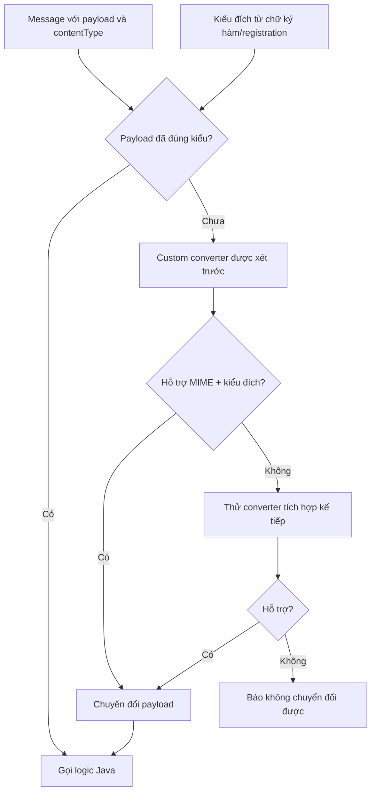

# Đăng ký MessageConverter tùy chỉnh và thứ tự lựa chọn

Trong **Spring Cloud Function**, logic nghiệp vụ được viết bằng `Supplier<T>`, `Function<I, O>` và `Consumer<T>`, rồi đưa vào `FunctionCatalog` để có thể gọi qua HTTP, hệ thống sự kiện hoặc môi trường serverless. Các hàm này nên nhận và trả **kiểu Java rõ ràng**. Tuy nhiên, một ứng dụng thực tế có thể phải đọc payload theo định dạng riêng mà các converter có sẵn không hiểu: mã vạch, bản ghi văn bản có dấu phân cách, giao thức nhị phân hoặc cấu trúc dữ liệu của hệ thống cũ.

Chương **Kiểu dữ liệu** vì vậy cần một kỹ năng quan trọng: **viết và đăng ký `MessageConverter` tùy chỉnh**, đồng thời hiểu **thứ tự lựa chọn converter** để không vô tình chiếm quyền xử lý JSON, văn bản hoặc byte thô.

Bài học này tập trung vào cơ chế Spring Cloud Function, minh họa với `org.springframework.messaging.converter.MessageConverter` và `AbstractMessageConverter` của Spring Messaging. Những ví dụ được chú thích rõ khi chỉ thể hiện API Java, khi kiểm thử trực tiếp converter, và khi cần adapter HTTP/messaging/serverless thật.

Sau khi học, bạn có thể:

- Giải thích tại sao một converter tùy chỉnh được thêm vào danh sách lựa chọn và khi nào nó thực sự được gọi.
- Phân biệt **ưu tiên của converter** với **khả năng hỗ trợ kiểu đích, MIME type và payload**.
- Tạo converter cho `application/vnd.demo.order-command`, biến byte UTF-8 thành `OrderCommand` và chuyển lại thành byte.
- Đăng ký converter dưới dạng bean Spring để Spring Cloud Function có thể khám phá.
- Kiểm thử cả chiều `fromMessage(...)` và `toMessage(...)`, ca MIME không khớp và dữ liệu sai.
- Tránh những xung đột khi có nhiều custom converter hoặc khi muốn thay đổi cách xử lý `application/json`.

## 1. Khi nào cần MessageConverter tùy chỉnh?

Giả sử hệ thống bán hàng cũ gửi một dòng lệnh:

```text
PEN-1|2
```

Trong đó `PEN-1` là mã hàng và `2` là số lượng. Phía gửi công bố định dạng này bằng:

```http
Content-Type: application/vnd.demo.order-command
```

Logic nghiệp vụ muốn nhận:

```java
public record OrderCommand(String sku, int quantity) {}
```

Nếu gửi bytes của `PEN-1|2` đến một hàm `Function<OrderCommand, OrderReceipt>`, Spring Cloud Function cần một cơ chế biến payload nguồn thành `OrderCommand`. Các converter JSON, text và byte có thể không biết cú pháp dấu `|` đó.

**Một `MessageConverter` tùy chỉnh phù hợp khi:**

1. Payload có định dạng xác định, nhưng chưa có converter tích hợp đáp ứng hợp đồng của ứng dụng.
2. Bạn muốn tách trách nhiệm parse/serialize ở **biên** khỏi logic `Function.apply(...)`.
3. Bạn cần tái sử dụng định dạng đó ở nhiều hàm hoặc nhiều adapter hỗ trợ converter.
4. Bạn muốn kiểm soát MIME type, giới hạn kích thước và chính sách báo lỗi cho định dạng riêng.

**Không cần converter riêng nếu** việc chuyển đổi đã được framework hỗ trợ đầy đủ (JSON → DTO, `text/plain` → `String`, `application/octet-stream` → `byte[]`) hoặc nếu chỉ một hàm Java nội bộ cần đổi kiểu đơn giản. Với kiểu giá trị Java như `String` → `OrderId`, `ConversionService` và `Converter<S, T>` đôi khi phù hợp hơn.

| Nhu cầu | Cơ chế nên xét trước | Vì sao |
| --- | --- | --- |
| JSON object thành DTO | JSON converter có sẵn | Không cần viết lại JSON parser |
| Văn bản thành `String` | Text message converter | Đã có chức năng đọc chuỗi/charset |
| Binary giữ nguyên `byte[]` | Byte-array converter | Không nên giải mã bừa sang text |
| `String` thành một domain value trong Java | `ConversionService` | Không phụ thuộc message headers |
| Định dạng `PEN-1\|2` thành `OrderCommand` | Custom `MessageConverter` | Cần parse quy tắc định dạng ở biên |
| Dữ liệu đặc thù chứa nhiều header hoặc metadata | Adapter phù hợp và custom converter | Phải kiểm tra khả năng truyền/giữ header |

## 2. Spring Cloud Function chọn converter theo thứ tự nào?

Khi một lời gọi cần chuyển payload của `Message<?>` thành kiểu Java khai báo bởi hàm, Spring Cloud Function có thể xét một **stack các `MessageConverter`**. Theo tài liệu Programming Model, framework sử dụng **converter đầu tiên có thể thực hiện chuyển đổi phù hợp**.

Các converter tích hợp thường được tài liệu liệt kê theo thứ tự ưu tiên:

| Vị trí trong stack tích hợp | Converter | Trường hợp hỗ trợ tiêu biểu |
| --- | --- | --- |
| 1 | `JsonMessageConverter` | `application/json` ↔ DTO/POJO qua JSON mapper |
| 2 | `ByteArrayMessageConverter` | `application/octet-stream` và `byte[]` |
| 3 | `StringMessageConverter` | `text/plain` và `String` |

**Điểm quan trọng:** tài liệu chính thức nói rằng **custom converter được đặt ở đầu stack và có ưu tiên cao hơn các converter tích hợp**. Một đoạn mô tả ngắn trong cùng phần tài liệu dùng từ “appended”, nhưng phần lưu ý được nhấn mạnh giải thích rõ rằng custom implementation nằm ở **head of the stack**. Khi giải thích thứ tự, hãy theo quy tắc ưu tiên được ghi rõ và **kiểm chứng trên phiên bản thực tế**.

Ví dụ thứ tự về mặt ý tưởng:

```text
Converter tùy chỉnh A
Converter tùy chỉnh B            ← thứ tự giữa A/B cần xác minh
JsonMessageConverter
ByteArrayMessageConverter
StringMessageConverter
```

Không nên mặc định thứ tự A/B chỉ dựa vào thứ tự khai báo method `@Bean`. Nếu nhiều custom converter cùng chấp nhận một MIME type/kiểu đích, kết quả có thể phụ thuộc cách Spring Cloud Function thu thập và sắp xếp bean trong phiên bản dùng. Hãy **tránh phạm vi hỗ trợ chồng lấn** hoặc kiểm thử, cấu hình thứ tự theo cơ chế được phiên bản đó hỗ trợ.

### Converter ưu tiên cao không có nghĩa luôn thắng

Một custom converter chỉ nên nhận trách nhiệm khi cả **MIME type**, **kiểu đích** và **kiểu payload thực tế** phù hợp với nó. Ví dụ converter hỗ trợ `application/vnd.demo.order-command` và target `OrderCommand` thì **không nên** nhận:

- `application/json` chứa DTO khác.
- `text/plain` mà hàm cần `String`.
- Payload file ZIP với target `byte[]`.
- Một DTO nghiệp vụ mà converter không biết cách serialize.

Nếu converter trả `null` để biểu thị **không hỗ trợ**, stack có thể thử converter khác. Nếu converter **đã nhận đúng định dạng nhưng payload sai cấu trúc**, nên báo lỗi chuyển đổi rõ ràng thay vì trả dữ liệu sai hoặc để converter sau suy đoán nội dung theo một format khác.



Đây là **sơ đồ khái niệm**, không phải trình tự gọi chính xác của mọi adapter hoặc source code Spring Cloud Function. Một số adapter đã parse body trước khi gọi catalog hoặc dùng codec riêng. Mục đích là hiểu điều kiện lựa chọn, không dự đoán tên method nội bộ.

## 3. Quan hệ giữa contentType và kiểu đích

Đối với Spring Messaging, MIME type thường nằm trong header `MessageHeaders.CONTENT_TYPE`, có tên key `contentType`. Đối với HTTP, header là `Content-Type` và adapter có thể ánh xạ nó thành metadata thông điệp.

| Dữ liệu ở biên | `contentType` | Kiểu Java đích | Converter có thể phù hợp |
| --- | --- | --- | --- |
| `PEN-1\|2` (UTF-8 bytes) | `application/vnd.demo.order-command` | `OrderCommand` | Custom converter của bài |
| `{"sku":"PEN-1","quantity":2}` | `application/json` | `OrderCommand` | JSON converter |
| `hello` | `text/plain` | `String` | String converter |
| Dữ liệu binary | `application/octet-stream` | `byte[]` | Byte-array converter |
| `PEN-1\|2` | `application/json` | `OrderCommand` | Không đúng JSON; không nên parse như định dạng custom |
| `PEN-1\|2` | MIME custom | `String` | Target không phải `OrderCommand`; converter bài này nên từ chối |

MIME type **không chứa kiểu Java đích**. Thông tin `OrderCommand` có thể đến từ chữ ký:

```java
@Bean
public Function<OrderCommand, OrderReceipt> processOrder() {
    // ...
}
```

Hoặc từ metadata tường minh khi đăng ký lambda bằng `FunctionRegistration.type(...)`. Nếu chỉ công bố raw `Function.class` hoặc `Function<Object,Object>`, converter có thể không có đủ thông tin để chọn đúng `OrderCommand`. Thêm header MIME custom không tự sửa việc mất generic.

## 4. Thiết kế định dạng custom trước khi viết converter

Ví dụ dùng một MIME type có tính minh họa:

```text
application/vnd.demo.order-command
```

Định dạng payload: `<sku>|<quantity>`, mã hàng chỉ gồm chữ cái in hoa, số và dấu gạch nối, tối đa 24 ký tự. Số lượng là số nguyên từ 1 đến 10.000.

```text
Hợp lệ:
PEN-1|2
BOOK-42|10

Không hợp lệ:
PEN-1|0
PEN-1|abc
PEN-1|2|unexpected
pen-1|2
```

Ta chọn:

- Payload nhị phân mã hóa **UTF-8** và giới hạn kích thước 256 byte.
- Chỉ chuyển đổi khi **kiểu đích là `OrderCommand`**.
- Chỉ xử lý MIME type custom đã khai báo.
- Nếu MIME/kiểu đích không phù hợp, converter **không nhận**.
- Nếu định dạng đã được chọn nhưng payload sai, ném lỗi chuyển đổi.
- Khi serialize `OrderCommand`, xuất byte UTF-8 theo đúng định dạng này.

**Giới hạn kích thước và validation là một phần của hợp đồng định dạng**, không phải chỉ để trình bày. Một converter custom xử lý payload từ broker hoặc HTTP có thể nhận đầu vào không đáng tin cậy.

## 5. Tạo DTO và MessageConverter tùy chỉnh

Các snippet sau được trình bày dưới dạng **hai lớp Java độc lập** trong cùng package `demo.function`. Không cần tạo file ngoài phạm vi bài học ở bước này; đây là mẫu để người học áp dụng trong dự án của họ.

### 5.1. DTO của nghiệp vụ

```java
package demo.function;

public record OrderCommand(String sku, int quantity) {}
```

Record yêu cầu Java 16 trở lên; ví dụ trong bài giả định **Java 17+**.

### 5.2. Converter hỗ trợ application/vnd.demo.order-command

```java
package demo.function;

import java.nio.ByteBuffer;
import java.nio.charset.CharacterCodingException;
import java.nio.charset.CodingErrorAction;
import java.nio.charset.StandardCharsets;

import org.springframework.messaging.Message;
import org.springframework.messaging.MessageHeaders;
import org.springframework.messaging.converter.AbstractMessageConverter;
import org.springframework.messaging.converter.MessageConversionException;
import org.springframework.util.MimeType;

public final class OrderCommandMessageConverter
        extends AbstractMessageConverter {

    public static final MimeType MIME_TYPE =
        new MimeType("application", "vnd.demo.order-command");

    private static final int MAX_PAYLOAD_BYTES = 256;
    private static final int MAX_QUANTITY = 10_000;

    public OrderCommandMessageConverter() {
        super(MIME_TYPE);
        setStrictContentTypeMatch(true);
        setSerializedPayloadClass(byte[].class);
    }

    @Override
    protected boolean supports(Class<?> clazz) {
        return OrderCommand.class.equals(clazz);
    }

    @Override
    protected Object convertFromInternal(
            Message<?> message,
            Class<?> targetClass,
            Object conversionHint) {

        // Converter này chỉ nhận bytes, không đoán định dạng
        // từ mọi loại đối tượng Java tùy ý.
        if (!(message.getPayload() instanceof byte[] raw)) {
            return null;
        }
        if (raw.length > MAX_PAYLOAD_BYTES) {
            throw new MessageConversionException(
                message, "Order command payload is too large"
            );
        }

        final String line;
        try {
            line = StandardCharsets.UTF_8.newDecoder()
                .onMalformedInput(CodingErrorAction.REPORT)
                .onUnmappableCharacter(CodingErrorAction.REPORT)
                .decode(ByteBuffer.wrap(raw))
                .toString();
        } catch (CharacterCodingException ex) {
            throw new MessageConversionException(
                message, "Order command is not valid UTF-8", ex
            );
        }

        String[] fields = line.split("\\|", -1);
        if (fields.length != 2 ||
                !fields[0].matches("[A-Z0-9-]{1,24}")) {
            throw new MessageConversionException(
                message, "Expected SKU|quantity"
            );
        }

        final int quantity;
        try {
            quantity = Integer.parseInt(fields[1]);
        } catch (NumberFormatException ex) {
            throw new MessageConversionException(
                message, "Quantity must be an integer", ex
            );
        }

        if (quantity < 1 || quantity > MAX_QUANTITY) {
            throw new MessageConversionException(
                message, "Quantity is out of range"
            );
        }
        return new OrderCommand(fields[0], quantity);
    }

    @Override
    protected Object convertToInternal(
            Object payload,
            MessageHeaders headers,
            Object conversionHint) {

        if (!(payload instanceof OrderCommand order)) {
            return null;
        }
        if (order.sku() == null ||
                !order.sku().matches("[A-Z0-9-]{1,24}") ||
                order.quantity() < 1 ||
                order.quantity() > MAX_QUANTITY) {
            throw new MessageConversionException(
                "Invalid OrderCommand for serialization"
            );
        }

        return (order.sku() + "|" + order.quantity())
            .getBytes(StandardCharsets.UTF_8);
    }
}
```

**Những chỗ cần hiểu trong implementation:**

1. `super(MIME_TYPE)` công bố định dạng được hỗ trợ. `AbstractMessageConverter` kiểm tra MIME type và class trước khi quyết định gọi phần chuyển đổi.
2. `setStrictContentTypeMatch(true)` giúp converter không nhận message thiếu content type phù hợp; đây là lựa chọn chủ ý cho định dạng riêng, không có nghĩa mọi converter mặc định phải dùng strict mode.
3. `supports(Class<?>)` **chỉ chấp nhận `OrderCommand`**, tránh chiếm các target như `String`, `byte[]` hoặc DTO khác.
4. `convertFromInternal(...)` chỉ xử lý payload `byte[]`. Nó giải mã UTF-8 nghiêm ngặt, kiểm tra cú pháp và số lượng.
5. `convertToInternal(...)` serialize DTO theo cùng quy ước bytes. `setSerializedPayloadClass(byte[].class)` làm rõ ý định xuất byte ở chiều serialization.
6. `conversionHint` có thể mang thông tin bổ sung do caller cung cấp; converter này không cần sử dụng.

**Không dùng `new String(raw)` theo charset mặc định** khi format xác định rõ UTF-8; cũng không để `byte[].toString()` thay cho decode thực. Khi đổi định dạng sang nhị phân có cấu trúc, cần parser phù hợp thay cho cách `split(...)` đơn giản.

### 5.3. Trả null hay ném exception?

| Điều kiện | Hành vi dự định | Lý do |
| --- | --- | --- |
| MIME khác `application/vnd.demo.order-command` | Không nhận converter | Để converter khác có cơ hội |
| Kiểu đích khác `OrderCommand` | Không nhận converter | Tránh bắt nhầm |
| Kiểu payload không phải `byte[]` | Trả `null` trong converter mẫu | Không tự ép các kiểu không được thiết kế |
| Đúng định dạng nhưng UTF-8 sai | Ném `MessageConversionException` | Payload vi phạm hợp đồng |
| Đúng MIME nhưng thiếu trường hoặc quantity sai | Ném `MessageConversionException` | Không im lặng trả DTO sai |
| DTO hợp lệ khi serialize | Trả `byte[]` UTF-8 | Giữ định dạng ở chiều output |

Lưu ý: `AbstractMessageConverter` có thể bỏ qua bước chuyển đổi khi payload hiện đã là đối tượng Java phù hợp. Điều này hợp lý: không phải mọi lời gọi cần deserialize. Để kiểm tra parser, test phải cung cấp `Message<byte[]>` chứ không đưa sẵn `OrderCommand` rồi kết luận converter đã chạy.

## 6. Đăng ký converter thành bean để Spring Cloud Function khám phá

Spring Cloud Function hướng dẫn: implement `MessageConverter` của Spring Messaging và **công bố dưới dạng Spring bean**. Ví dụ cấu hình riêng:

```java
package demo.function;

import java.util.function.Function;

import org.springframework.context.annotation.Bean;
import org.springframework.context.annotation.Configuration;
import org.springframework.messaging.converter.MessageConverter;

@Configuration
public class OrderCommandConfiguration {

    @Bean
    public MessageConverter orderCommandMessageConverter() {
        return new OrderCommandMessageConverter();
    }

    public record OrderReceipt(
        String sku, int quantity, long totalVnd
    ) {}

    @Bean
    public Function<OrderCommand, OrderReceipt> priceOrder() {
        return command -> {
            long total = Math.multiplyExact(
                command.quantity(), 25_000L
            );
            return new OrderReceipt(
                command.sku(),
                command.quantity(),
                total
            );
        };
    }
}
```

Khi context chứa bean này, cơ chế Spring Cloud Function tương thích có thể thu thập custom converter và đưa nó vào stack có sẵn với **ưu tiên cao hơn converter tích hợp**. Không cần thay tên bean thành `jsonMessageConverter` hay ghi đè converter mặc định.

Hàm `priceOrder` giữ đúng generic:

```text
Function<OrderCommand, OrderReceipt>
         │                │
         ▼                ▼
    Kiểu input       Kiểu output
```

Converter custom chỉ biết `OrderCommand`. **Nó không tự biết serialize `OrderReceipt` sang JSON**. Khi trả `OrderReceipt`, adapter đầu ra cần định dạng/converter phù hợp (chẳng hạn JSON) hoặc phải có converter/contract riêng cho output.

### Vì sao không đăng ký chỉ bằng new?

```java
// Đủ để test trực tiếp converter trong Java,
// nhưng không tự thêm converter vào Spring Cloud Function:
MessageConverter local = new OrderCommandMessageConverter();
```

Để Spring Cloud Function khám phá, converter phải nằm trong context theo cơ chế extension được hỗ trợ. Việc tự `new` converter trong một test hoặc method thông thường **không thay đổi stack converter của ứng dụng**.

Nếu dùng khởi động **functional** với `GenericApplicationContext` thay vì `@Configuration`, phải bảo đảm converter được đăng ký thành bean trong context khởi tạo và initializer thực sự chạy. Không nhầm đăng ký một `FunctionRegistration` với đăng ký `MessageConverter`: chúng có vai trò khác nhau.

## 7. Unit test converter theo hai chiều

Kiểm thử converter trực tiếp cho phép cô lập parser khỏi HTTP, binder và `FunctionCatalog`. Test dùng JUnit 5 và Spring Messaging:

```java
package demo.function;

import static org.junit.jupiter.api.Assertions.*;

import java.nio.charset.StandardCharsets;
import java.util.Map;

import org.junit.jupiter.api.Test;
import org.springframework.messaging.Message;
import org.springframework.messaging.MessageHeaders;
import org.springframework.messaging.support.MessageBuilder;
import org.springframework.util.MimeTypeUtils;

class OrderCommandMessageConverterTest {

    private final OrderCommandMessageConverter converter =
        new OrderCommandMessageConverter();

    @Test
    void readsCustomFormat() {
        Message<byte[]> message = MessageBuilder
            .withPayload("PEN-1|2".getBytes(StandardCharsets.UTF_8))
            .setHeader(
                MessageHeaders.CONTENT_TYPE,
                OrderCommandMessageConverter.MIME_TYPE
            )
            .build();

        Object result = converter.fromMessage(
            message, OrderCommand.class
        );

        assertEquals(new OrderCommand("PEN-1", 2), result);
    }

    @Test
    void writesCustomFormat() {
        MessageHeaders headers = new MessageHeaders(Map.of(
            MessageHeaders.CONTENT_TYPE,
            OrderCommandMessageConverter.MIME_TYPE
        ));

        Message<?> result = converter.toMessage(
            new OrderCommand("PEN-1", 2), headers
        );

        assertNotNull(result);
        assertArrayEquals(
            "PEN-1|2".getBytes(StandardCharsets.UTF_8),
            (byte[]) result.getPayload()
        );
    }

    @Test
    void doesNotClaimJsonMessages() {
        Message<byte[]> jsonMessage = MessageBuilder
            .withPayload("PEN-1|2".getBytes(StandardCharsets.UTF_8))
            .setHeader(
                MessageHeaders.CONTENT_TYPE,
                MimeTypeUtils.APPLICATION_JSON
            )
            .build();

        assertNull(converter.fromMessage(
            jsonMessage, OrderCommand.class
        ));
    }
}
```

Chú ý: Test thứ ba **không xác minh JSON converter chuyển đổi thành công**. Nó xác minh converter tùy chỉnh **không nhận một MIME type ngoài phạm vi**, để converter phù hợp khác có cơ hội được thử.

### Kiểm thử dữ liệu bất hợp lệ

```java
@Test
void rejectsInvalidQuantity() {
    Message<byte[]> message = MessageBuilder
        .withPayload("PEN-1|abc".getBytes(StandardCharsets.UTF_8))
        .setHeader(
            MessageHeaders.CONTENT_TYPE,
            OrderCommandMessageConverter.MIME_TYPE
        )
        .build();

    assertThrows(
        org.springframework.messaging.converter.MessageConversionException.class,
        () -> converter.fromMessage(message, OrderCommand.class)
    );
}
```

Đây là method bổ sung trong class test ở trên, dùng lại `converter`, `MessageBuilder`, `MessageHeaders`, `StandardCharsets` và assertion của JUnit 5. Nên có thêm test độ dài vượt 256 byte, UTF-8 không hợp lệ, quantity bằng 0, quantity vượt giới hạn và mã SKU sai quy tắc.

## 8. Kiểm tra thứ tự bằng CompositeMessageConverter chủ động

Một cách minh họa **thuật toán thử lần lượt** mà không cần mở server là tạo `CompositeMessageConverter` tường minh:

```java
import java.util.List;

import org.springframework.messaging.converter.CompositeMessageConverter;
import org.springframework.messaging.converter.MessageConverter;
import org.springframework.messaging.converter.StringMessageConverter;
import org.springframework.messaging.converter.ByteArrayMessageConverter;

MessageConverter custom = new OrderCommandMessageConverter();

CompositeMessageConverter composite =
    new CompositeMessageConverter(List.of(
        custom,
        new ByteArrayMessageConverter(),
        new StringMessageConverter()
    ));
```

Trong đoạn này, **thứ tự do chính code tạo composite quy định**, và composite thử các converter theo thứ tự cho đến khi có kết quả phù hợp. Đây **không phải bằng chứng** rằng catalog của một ứng dụng sẽ dùng chính danh sách ba instance này hoặc đúng thứ tự do ta ghi trong test.

Thứ tự của converter do Spring Cloud Function tự thu thập phải được kiểm chứng trong context thực, đặc biệt nếu đăng ký **nhiều bean custom** có vùng xử lý giao nhau.

### Tránh hai converter cùng nhận một định dạng

Giả sử có hai custom converter đều khai `application/json` và đều `supports(OrderCommand.class)`. Converter được thử trước có thể nhận payload và khiến JSON converter tích hợp hoặc converter custom kia không được dùng.

**Khuyến nghị thiết kế:**

- Với định dạng mới, dùng MIME type riêng và target class cụ thể.
- Nếu thay đổi JSON mặc định, xác định rõ contract cần override, giới hạn class áp dụng và kiểm thử mọi luồng JSON liên quan.
- Với nhiều custom converter, phân chia MIME hoặc target để tránh tranh chấp; không phụ thuộc vào thứ tự khai báo `@Bean`.
- Nếu dự án dựa vào `@Order`/`Ordered`, hãy **xác minh** cơ chế thu thập custom converters của đúng phiên bản thay vì coi annotation đó là bảo đảm chung.
- Khi có yêu cầu thứ tự tuyệt đối, cân nhắc quản lý một composite ở phạm vi do bạn kiểm soát hoặc dùng extension point công bố của adapter, rồi kiểm thử integration.

## 9. FunctionCatalog và việc kiểm tra chuyển đổi thực tế

Trong Spring Cloud Function, có thể tra cứu bean `priceOrder` qua `FunctionCatalog`:

```java
import java.util.function.Function;
import org.springframework.cloud.function.context.FunctionCatalog;

// Trong một method/test có FunctionCatalog catalog được inject.
Function<OrderCommand, OrderCommandConfiguration.OrderReceipt> fn =
    catalog.lookup("priceOrder");

OrderCommandConfiguration.OrderReceipt result =
    fn.apply(new OrderCommand("PEN-1", 2));

System.out.println(result.totalVnd()); // 50000
```

Test này xác minh catalog và logic trên **đối tượng Java đã có sẵn**, không chứng minh `OrderCommandMessageConverter` đã được gọi.

Muốn kiểm tra conversion qua wrapper/catalog, cần gửi `Message<byte[]>` có MIME custom:

```java
import java.nio.charset.StandardCharsets;
import java.util.function.Function;

import org.springframework.messaging.Message;
import org.springframework.messaging.MessageHeaders;
import org.springframework.messaging.support.MessageBuilder;

Message<byte[]> incoming = MessageBuilder
    .withPayload("PEN-1|2".getBytes(StandardCharsets.UTF_8))
    .setHeader(
        MessageHeaders.CONTENT_TYPE,
        OrderCommandMessageConverter.MIME_TYPE
    )
    .build();

Function<Message<byte[]>, ?> wrapped = catalog.lookup("priceOrder");
Object output = wrapped.apply(incoming);

System.out.println(output == null
    ? "No output"
    : output.getClass().getName());
```

Đoạn này là **mẫu kiểm tra trong context đã tích hợp Spring Cloud Function converter**, không khẳng định kiểu output wrapper luôn là `OrderReceipt` hay luôn là `Message<OrderReceipt>`. Cách lookup, cách bọc kết quả, conversion chiều ra và behavior của adapter tùy phiên bản/cấu hình. Nên kiểm tra output thực tế và test được khai báo trong project.

Một cách khác để chẩn đoán là đặt điểm quan sát vào `convertFromInternal(...)` của converter trong integration test hoặc log có chọn lọc (không log dữ liệu nhạy cảm). Từ đó phân biệt:

1. Bean converter đã được Spring khởi tạo.
2. Converter thực sự được framework xem xét.
3. Converter được chọn hay đã trả `null`.
4. Payload sau chuyển đổi có đúng kiểu `OrderCommand` hay không.

## 10. Gọi qua HTTP, event và serverless

### HTTP: gửi định dạng custom

Với Spring Cloud Function Web adapter đã hoạt động và expose `priceOrder`, request minh họa:

```bash
curl -X POST http://localhost:8080/priceOrder \
  -H 'Content-Type: application/vnd.demo.order-command' \
  --data-binary 'PEN-1|2'
```

Khi adapter chuyển request thành message và dùng custom converter đã đăng ký, input sẽ có thể trở thành:

```java
new OrderCommand("PEN-1", 2)
```

Logic trả:

```java
new OrderCommandConfiguration.OrderReceipt(
    "PEN-1", 2, 50_000L
)
```

**Không suy đoán** HTTP response nhất thiết là JSON trong ví dụ này: chiều ra cần adapter, MIME/response configuration và converter thích hợp. Nếu cần một response JSON ổn định, hãy cấu hình/kiểm chứng đầu ra tương ứng; custom converter mẫu chỉ hỗ trợ `OrderCommand`, không serialize `OrderReceipt`.

### Sự kiện / Spring Cloud Stream

Một event có payload byte và header:

```text
payload:     PEN-1|2  (UTF-8 bytes)
contentType: application/vnd.demo.order-command
```

Khi dùng Spring Cloud Stream binder, cần xác nhận binder truyền/ánh xạ content type vào lời gọi function đúng cách và cơ chế converter có sử dụng bean custom. Không mặc định header của broker có tên/cấu trúc giống hệt Spring `MessageHeaders` trong mọi adapter.

Nếu function đích là `Consumer<OrderCommand>`, thành công nghĩa là logic được gọi với DTO đúng kiểu. Ack, retry, dead-letter và ordering là **trách nhiệm của binder/hạ tầng**, không phải chức năng được thêm tự động bởi custom converter.

### Serverless

Serverless adapter có thể nhận một **event envelope** chứa các trường payload/base64/content type riêng của nền tảng. Trước khi custom converter có cơ hội chạy, adapter phải ánh xạ đúng thông tin đó thành message hoặc giá trị Java mà Spring Cloud Function hiểu.

Không coi `application/vnd.demo.order-command` là một định dạng được mọi nền tảng serverless chấp nhận mặc định. Kiểm tra adapter cụ thể và thêm integration test chạy theo đúng định dạng event đích.

## 11. Tương tác với Supplier, Consumer và composition

Ba loại hàm có hợp đồng khác nhau:

| Hàm | Vai trò converter có thể tham gia | Điều không được nhầm |
| --- | --- | --- |
| `Supplier<OrderCommand>` | Serialize `OrderCommand` khi adapter phát payload dạng custom | `Supplier` không có input |
| `Function<OrderCommand, OrderReceipt>` | Deserialize input custom; output cần converter/format khác | Custom converter input không tự serialize output DTO khác |
| `Consumer<OrderCommand>` | Deserialize event custom trước `accept(...)` | `Consumer` không trả output nghiệp vụ |
| `Function<Message<OrderCommand>, Message<OrderCommand>>` | Converter có thể áp dụng cho payload của wrapper | Header và payload không tự bảo toàn qua mọi adapter |

Ví dụ thêm một hàm chuẩn hóa số lượng:

```java
@Bean
public Function<OrderCommand, OrderCommand> atLeastTwo() {
    return order -> new OrderCommand(
        order.sku(), Math.max(2, order.quantity())
    );
}
```

Đây là bean bổ sung đặt trong một lớp `@Configuration`; cần import `java.util.function.Function`. Có thể kết hợp:

```yaml
spring:
  cloud:
    function:
      definition: atLeastTwo|priceOrder
```

```text
Payload custom bytes
    ↓ [convert thành OrderCommand ở biên]
OrderCommand
    ↓ atLeastTwo: Function<OrderCommand, OrderCommand>
OrderCommand
    ↓ priceOrder: Function<OrderCommand, OrderReceipt>
OrderReceipt
    ↓ [định dạng output theo adapter]
Response / event
```

Ở điểm nối hai hàm, target và output đều là `OrderCommand` nên **không cần serialize sang custom bytes rồi parse lại**. Nếu dùng `Function<OrderCommand, String>` rồi nối sang `Function<OrderReceipt, ...>`, hai hợp đồng không khớp; custom converter không tự khiến mọi composition hợp lệ.

## 12. Phân biệt converter không hỗ trợ với payload lỗi

Một custom converter nên tuân thủ hai nhóm kết quả:

### Không thuộc phạm vi converter

Ví dụ message `contentType=application/json`, target `OrderCommand`. Converter custom của bài được đặt strict MIME type nên **không nhận**; cơ chế chuyển đổi có thể thử JSON converter tích hợp. Đây là **fallback hợp lệ**.

### Thuộc phạm vi nhưng dữ liệu sai

Ví dụ `contentType=application/vnd.demo.order-command`, target `OrderCommand`, payload `PEN-1|abc`. Converter đã nhận đúng MIME/target nhưng dữ liệu vi phạm schema. **Nên báo lỗi cụ thể**, không âm thầm đoán hoặc trả `OrderCommand` lỗi.

Với nguồn không đáng tin cậy, cân nhắc:

- Giới hạn byte trước khi tạo `String` để tránh tiêu thụ bộ nhớ không cần thiết.
- Không dùng `Class.forName(...)` theo tên type do header tự ý cung cấp.
- Không tự deserialize mọi class mà người gửi lựa chọn.
- Kiểm tra UTF-8 nghiêm ngặt khi định dạng quy định UTF-8.
- Dùng allowlist cho mã, trường và độ dài; kiểm soát khoảng số lượng.
- Không log toàn bộ event nếu có dữ liệu cá nhân hoặc bí mật.
- Xác định chiến lược lỗi/ack/retry ở adapter, tránh một message lỗi làm consumer retry vô hạn.

## 13. Troubleshooting: vì sao custom converter không được gọi?

| Triệu chứng | Khả năng | Cách xác minh |
| --- | --- | --- |
| Converter không xuất hiện trong ứng dụng | Không có bean `MessageConverter`, cấu hình class chưa được scan | Kiểm tra Spring context và loại bean |
| Bean được tạo nhưng parser không chạy | Input đã là `OrderCommand` hoặc adapter dùng cơ chế khác | Kiểm tra kiểu payload thực và luồng catalog/adapter |
| Converter bị bỏ qua khi gửi custom MIME | Header `contentType` thiếu hoặc không được ánh xạ | In MIME type không nhạy cảm ở biên test |
| MIME đúng nhưng vẫn không chạy | `supports(Class<?>)` không khớp kiểu đích | Kiểm tra generic của `@Bean`/`FunctionRegistration` |
| Dữ liệu là `String` nhưng converter chỉ nhận `byte[]` | Payload runtime không đúng dạng | Sửa adapter hoặc mở rộng converter có kiểm soát |
| JSON không được xử lý như trước | Custom converter claim `application/json` hoặc quá rộng | Giới hạn MIME/target; test regression JSON |
| Kết quả thay đổi khi thêm custom converter thứ hai | Hai converter có phạm vi chồng lấn | Tránh overlap hoặc xác minh ordering |
| HTTP lỗi nhưng test converter pass | Web adapter không đi qua cùng converter/format | Test HTTP end-to-end và cấu hình response |
| Event converter pass nhưng broker fail | Binder/header mapping khác hoặc lỗi delivery | Test binder và message thực tế |
| Input custom nhận được nhưng response lỗi | Output type khác `OrderCommand`, không có converter đầu ra | Kiểm tra định dạng output và serializer |
| Dữ liệu Unicode bị thay ký tự | Charset producer/consumer không khớp | Thống nhất UTF-8 và test byte thực |
| Hàm `Function<Object,Object>` nhận nhầm kiểu | Thiếu generic của target | Công bố `Function<OrderCommand, ...>` hoặc type tường minh |

### Quy trình kiểm tra thực tế

1. **Kiểm tra bean:** converter có được Spring tạo và đăng ký trong đúng context?
2. **Kiểm tra input:** payload thực là `byte[]`, `String` hay DTO đã chuyển sẵn?
3. **Kiểm tra MIME:** `MessageHeaders.CONTENT_TYPE` là giá trị nào; adapter có ghi đè không?
4. **Kiểm tra generic:** hàm thực sự công bố input `OrderCommand` hay raw type?
5. **Kiểm tra precedence:** custom nào được xét trước và liệu có converter khác claim cùng loại?
6. **Kiểm tra output:** payload chuyển đổi đúng, header output đúng, và adapter có serializer cho kết quả?
7. **Kiểm tra cả đường thực:** unit test converter → test catalog → integration test HTTP/broker/serverless.

## 14. Bài tập thực hành

**Bài 1 — Đăng ký converter.** Một implementation tên `OrderCommandMessageConverter` đã hoàn thiện. Cần khai báo gì để Spring Cloud Function có thể khám phá nó?

*Đáp án:* Công bố một Spring bean kiểu `org.springframework.messaging.converter.MessageConverter`, chẳng hạn:

```java
@Bean
public MessageConverter orderCommandMessageConverter() {
    return new OrderCommandMessageConverter();
}
```

### Bài 2 — Thứ tự converter

Custom converter hỗ trợ `application/vnd.demo.order-command`, còn converter JSON tích hợp hỗ trợ `application/json`. Nếu request mang `application/json` và target là `OrderCommand`, converter nào nên xử lý?

*Đáp án:* Custom converter phải **từ chối** MIME không phù hợp; JSON converter có cơ hội xử lý. Ưu tiên cao không có nghĩa custom converter nhận mọi payload.

### Bài 3 — MIME đúng nhưng quantity sai

Payload `PEN-1|abc` mang custom content type và target `OrderCommand`. Nên trả `null` hay báo lỗi?

*Đáp án:* Khi converter đã nhận rõ định dạng và kiểu đích nhưng payload sai schema, nên ném lỗi chuyển đổi cụ thể. `null` nên dùng cho tình huống không thể/không định nhận phạm vi chuyển đổi.

### Bài 4 — Nhiều custom converters

Hai bean converter cùng hỗ trợ `application/json` và `OrderCommand`. Có thể dựa vào thứ tự tên method `@Bean` để đảm bảo converter A được chọn trước B không?

*Đáp án:* Không nên. Cần tránh phạm vi chồng lấn, hoặc xác minh cách sắp xếp bean trong phiên bản và viết test integration cho thứ tự thật. Chỉ đọc tài liệu về thứ tự default converters chưa đủ để quyết định thứ tự hai custom beans.

### Bài 5 — Phân biệt mức kiểm thử

Test `catalog.lookup("priceOrder").apply(new OrderCommand("PEN-1",2))` thành công. Điều này xác nhận converter đã được đăng ký và gọi chưa?

*Đáp án:* Chưa. Input đã là `OrderCommand`. Cần test converter trực tiếp bằng `Message<byte[]>` và integration test qua wrapper/adapter có MIME custom.

### Bài 6 — Output khác input

Custom converter chỉ hỗ trợ `OrderCommand` nhưng `Function<OrderCommand, OrderReceipt>` trả `OrderReceipt`. Có thể mặc định response là JSON không?

*Đáp án:* Không. Cần xem output content type và serializer/converter phù hợp của adapter. Converter input custom không tự hiểu cách serialize `OrderReceipt`.

### Bài 7 — Chọn cơ chế thay thế

Logic nội bộ muốn đổi `String` thành `OrderId` mà không có message header hay định dạng truyền tải mới. Có nhất thiết phải viết custom `MessageConverter` không?

*Đáp án:* Không. Một `Converter<String, OrderId>` đăng ký vào `ConversionService` hoặc chuyển kiểu tường minh trong code thường phù hợp hơn.

### Bài 8 — Kiểm tra lỗi encoding

Payload custom được producer khai là UTF-8 nhưng có byte sequence không hợp lệ. Converter nên giải mã bằng `new String(raw)` và tiếp tục không?

*Đáp án:* Không. Dùng charset UTF-8 tường minh; nếu schema yêu cầu UTF-8 hợp lệ, sử dụng `CharsetDecoder` với `CodingErrorAction.REPORT` rồi báo lỗi rõ.

## 15. Ghi nhớ

- Spring Cloud Function hỗ trợ mở rộng stack chuyển đổi thông điệp bằng **bean `MessageConverter` tùy chỉnh**.
- Theo tài liệu Spring Cloud Function, **custom converters được ưu tiên trước các converter tích hợp**; mặc định thường là JSON, byte-array, text theo thứ tự tài liệu nêu.
- **Converter đầu tiên có thể chuyển đổi mới được sử dụng.** `contentType`, kiểu đích và kiểu payload runtime quyết định converter có phù hợp hay không.
- Với `AbstractMessageConverter`, hãy **giới hạn MIME type và `supports(Class<?>)`**, tránh chiếm nhầm JSON/byte/text.
- Phân biệt **không hỗ trợ** (cho fallback) với **payload sai** (báo lỗi). Áp dụng giới hạn kích thước, kiểm tra charset và validation.
- Giữ generic của `Supplier`, `Function`, `Consumer` hoặc `FunctionRegistration` rõ ràng; converter không tự sửa kiểu bị mất.
- **Kiểm thử ba lớp:** converter Java trực tiếp, `FunctionCatalog` và adapter HTTP/messaging/serverless. Một test Java pass không chứng minh mọi giao thức hoạt động.

**Tham khảo chính thức:**

- [Spring Cloud Function — Programming Model, User-defined Message Converters](https://docs.spring.io/spring-cloud-function/reference/spring-cloud-function/programming-model.html)
- [Spring Cloud Function 4.3 — Programming Model](https://docs.spring.io/spring-cloud-function/reference/4.3/spring-cloud-function/programming-model.html)
- [Spring Cloud Function 5.0 — Programming Model](https://docs.spring.io/spring-cloud-function/reference/5.0/spring-cloud-function/programming-model.html)
- [Spring Framework — AbstractMessageConverter Javadoc](https://docs.spring.io/spring-framework/docs/current/javadoc-api/org/springframework/messaging/converter/AbstractMessageConverter.html)

Các API và thứ tự được giải thích theo tài liệu framework; khi triển khai, cần xác nhận **phiên bản Spring Cloud Function/Spring Framework và adapter** đang dùng trước khi coi hành vi mặc định là một hợp đồng ổn định.
