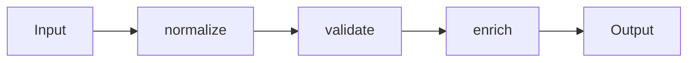
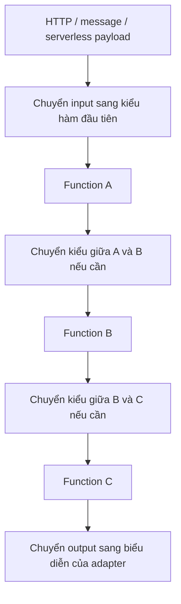

# Chuyển đổi kiểu giữa các hàm trong một chuỗi

**Spring Cloud Function** cho phép mô tả logic nghiệp vụ bằng `Supplier<T>`, `Function<I, O>` và `Consumer<T>`, sau đó đăng ký vào `FunctionCatalog` và kết hợp nhiều hàm thành một chuỗi (*function composition*). Chuỗi này có thể được tái sử dụng từ HTTP, sự kiện hoặc môi trường serverless, miễn là adapter và cấu hình phù hợp.

Vấn đề xuất hiện khi **kiểu đầu ra của hàm trước khác kiểu đầu vào của hàm sau**. Ví dụ, bước đầu trả `String "3"` nhưng bước kế tiếp lại nhận `Integer 3`; hoặc bước trước trả một `Message<byte[]>` chứa JSON còn bước sau cần POJO. Spring Cloud Function có cơ chế chuyển đổi kiểu trong quá trình composition, nhưng khả năng đó **không có nghĩa mọi cặp kiểu đều tự chuyển được**.

Trong chương **Kiểu dữ liệu**, bài học này giải thích cách chọn giữa ba phương án:

1. **Nối các hàm đã tương thích kiểu**: đơn giản và dễ kiểm chứng nhất.
2. **Thêm bước chuyển đổi tường minh**: kiểm soát chính xác dữ liệu, lỗi và giới hạn.
3. **Dựa vào chuyển đổi do `FunctionCatalog` hỗ trợ**: hữu ích khi `ConversionService` hoặc `MessageConverter` có thể đổi kiểu tại ranh giới giữa hai hàm.

Mục tiêu là hiểu **khi nào framework có thể nối các hàm khác kiểu**, khi nào cần thêm một converter hoặc một hàm trung gian, và cách kiểm thử đúng đường thực thi của catalog thay vì nhầm với `Function.andThen(...)` của Java thuần.

## 1. Nhìn composition như một chuỗi hợp đồng kiểu

Với ba hàm:

```text
A: Function<X, Y>
B: Function<Y, Z>
C: Function<Z, R>

Chuỗi A|B|C:
X -> Y -> Z -> R
```

Các điểm nối là ranh giới giữa **output type** của hàm bên trái và **input type** của hàm bên phải. Nếu cùng kiểu Java, dữ liệu thường có thể được truyền trực tiếp. Nếu khác kiểu, cần một cơ chế chuyển đổi phù hợp.

| Đầu ra bên trái | Đầu vào bên phải | Đánh giá ban đầu |
| --- | --- | --- |
| `OrderTotal` | `OrderTotal` | Tương thích trực tiếp |
| `String` chứa chữ số `"3"` | `Integer` | Có thể chuyển bằng `ConversionService` được cấu hình |
| `String` không phải số | `Integer` | Có thể lỗi chuyển đổi |
| `Message<byte[]>` chứa JSON | `OrderRequest` | Cần `contentType`, kiểu đích và JSON converter phù hợp |
| `byte[]` chứa ảnh | `OrderRequest` | Không có phép chuyển có nghĩa nếu thiếu codec/quy ước |
| `List<Map<String,Object>>` | `List<OrderRequest>` | Cần giữ kiểu phần tử và converter hỗ trợ generic |
| `Flux<OrderRequest>` | `List<OrderRequest>` | Khác mô hình dữ liệu; không coi là ép kiểu tự động |

Một chuỗi có thể hợp lệ về cú pháp tên hàm nhưng vẫn lỗi khi chạy do **giá trị dữ liệu không phù hợp**, metadata kiểu bị mất hoặc không có converter cho cặp kiểu mong đợi.

### Hai cách nói “composition” không hoàn toàn giống nhau

**Java thuần** cung cấp `Function.andThen(...)`:

```java
Function<String, Integer> parse = Integer::parseInt;
Function<Integer, Long> price = n -> n.longValue() * 50_000L;

Function<String, Long> pipeline = parse.andThen(price);
System.out.println(pipeline.apply("3")); // 150000
```

Các chữ ký trên đã tương thích: `parse` trả `Integer` và `price` nhận `Integer`. Nhưng nếu hàm đầu trả `String` còn hàm tiếp nhận `Integer` mà **không có bước trung gian**, trình biên dịch Java không chấp nhận phép `andThen(...)` trực tiếp với các kiểu generic đó.

**Spring Cloud Function composition** thực hiện qua các hàm đã được chuẩn hóa/đóng gói trong `FunctionCatalog`. Framework hỗ trợ thêm **type conversion (content-type negotiation)**, có thể làm một số cặp hàm vốn không tương thích về generic Java ban đầu trở nên kết hợp được. Khả năng đó phụ thuộc converter được cung cấp và thông tin kiểu ở runtime.

## 2. Cú pháp khai báo chuỗi trong Spring Cloud Function

Một chuỗi có thể được mô tả bằng dấu `|` trong cấu hình:

```yaml
spring:
  cloud:
    function:
      definition: normalize|validate|enrich
```

Thứ tự thực hiện là **từ trái sang phải**:



Tài liệu Spring Cloud Function cũng nêu dấu phẩy `,` như một delimiter có thể dùng để định nghĩa composition trong những ngữ cảnh được hỗ trợ, nhưng để minh họa một đường nối có thứ tự, bài này thống nhất dùng `|`.

Ngoài cấu hình, có thể yêu cầu catalog tra cứu một composition theo tên:

```java
import java.util.function.Function;
import org.springframework.cloud.function.context.FunctionCatalog;

// Biến catalog được inject từ Spring context.
Function<?, ?> composition = catalog.lookup("normalize|validate|enrich");
```

Đoạn trên là **snippet về API**, chưa định nghĩa ba bean mẫu đó. Khi code thực tế sử dụng `lookup(...)`, cần biết kiểu đầu vào/đầu ra của chuỗi và kết quả có thể được wrapper biểu diễn khác nhau nếu gọi với `Message<?>`.

**Chỉ có dấu `|` không tạo ra converter mới.** Catalog vẫn cần biết các function bean và cách chuyển dữ liệu phù hợp giữa từng cặp.

## 3. Ví dụ Java đầy đủ dùng xuyên suốt bài

Giả sử hệ thống tính tiền theo số lượng. Bước đầu có một yêu cầu đơn hàng, bước cuối cần tổng tiền hoặc văn bản hiển thị. Ví dụ Java 17+ sử dụng `record`:

```java
package demo.function;

import java.util.Locale;
import java.util.function.Function;
import java.util.function.Supplier;
import java.util.function.Consumer;

import org.springframework.context.annotation.Bean;
import org.springframework.context.annotation.Configuration;

@Configuration
public class OrderPipelineFunctions {

    public record OrderRequest(String orderId, int quantity) {}

    public record OrderTotal(String orderId, long totalVnd) {}

    @Bean
    public Function<OrderRequest, OrderTotal> calculateOrder() {
        return request -> {
            requireValid(request);
            long total = Math.multiplyExact(
                (long) request.quantity(), 50_000L
            );
            return new OrderTotal(request.orderId(), total);
        };
    }

    @Bean
    public Function<OrderTotal, String> renderOrder() {
        return total -> total.orderId() + ": " +
            total.totalVnd() + " VND";
    }

    @Bean
    public Function<OrderRequest, String> quantityText() {
        return request -> {
            requireValid(request);
            return Integer.toString(request.quantity());
        };
    }

    @Bean
    public Function<String, Integer> parseQuantity() {
        return value -> {
            int quantity = Integer.parseInt(value.strip());
            if (quantity <= 0) {
                throw new IllegalArgumentException(
                    "quantity must be positive"
                );
            }
            return quantity;
        };
    }

    @Bean
    public Function<Integer, Long> priceQuantity() {
        return quantity -> {
            if (quantity == null || quantity <= 0) {
                throw new IllegalArgumentException(
                    "quantity must be positive"
                );
            }
            return Math.multiplyExact(quantity.longValue(), 50_000L);
        };
    }

    @Bean
    public Function<Long, String> formatPrice() {
        return amount -> String.format(
            Locale.ROOT, "%d VND", amount
        );
    }

    @Bean
    public Supplier<OrderRequest> sampleOrder() {
        return () -> new OrderRequest("ORD-101", 3);
    }

    @Bean
    public Consumer<Long> auditTotal() {
        return amount -> System.out.println(
            "Total in VND: " + amount
        );
    }

    private static void requireValid(OrderRequest request) {
        if (request == null ||
            request.orderId() == null ||
            request.orderId().isBlank() ||
            request.quantity() <= 0) {
            throw new IllegalArgumentException(
                "orderId and positive quantity are required"
            );
        }
    }
}
```

Các `@Bean` công bố đầy đủ kiểu input/output. Điều này giúp framework đọc được metadata generic cần cho conversion:

| Bean | Input | Output |
| --- | --- | --- |
| `calculateOrder` | `OrderRequest` | `OrderTotal` |
| `renderOrder` | `OrderTotal` | `String` |
| `quantityText` | `OrderRequest` | `String` |
| `parseQuantity` | `String` | `Integer` |
| `priceQuantity` | `Integer` | `Long` |
| `formatPrice` | `Long` | `String` |
| `sampleOrder` | Không có input | `OrderRequest` |
| `auditTotal` | `Long` | Không có output |

Đây là cấu hình bean nghiệp vụ. Để gọi tên hàm qua HTTP hoặc message broker, ứng dụng cần adapter và dependency tương ứng; chỉ thêm `@Configuration` không tự tạo endpoint.

## 4. Trường hợp 1: các kiểu khớp nhau sẵn

Chuỗi đầu tiên:

```yaml
spring:
  cloud:
    function:
      definition: calculateOrder|renderOrder
```

Ranh giới:

```text
OrderRequest
  ↓ calculateOrder
OrderTotal
  ↓ renderOrder
String
```

Ở điểm nối, `calculateOrder` trả đúng `OrderTotal` mà `renderOrder` nhận. Không cần serialize đối tượng trung gian thành JSON rồi deserialize lại.

Ví dụ gọi qua catalog trong một test/method đã inject `FunctionCatalog`:

```java
Function<OrderPipelineFunctions.OrderRequest, String> pipeline =
    catalog.lookup("calculateOrder|renderOrder");

String output = pipeline.apply(
    new OrderPipelineFunctions.OrderRequest("ORD-101", 3)
);

System.out.println(output); // ORD-101: 150000 VND
```

Kết quả logic kỳ vọng là `ORD-101: 150000 VND`. Vì đầu vào test là DTO đã có sẵn, đoạn code **chưa kiểm thử JSON conversion ở biên**.

**Ưu tiên thiết kế:** nếu có thể công bố các hàm với kiểu đầu ra/đầu vào khớp trực tiếp, composition sẽ dễ đọc, dễ kiểm thử và ít phụ thuộc cấu hình converter hơn.

## 5. Trường hợp 2: thêm một hàm chuyển đổi tường minh

Giả sử `quantityText` trả chuỗi `"3"`, còn `priceQuantity` muốn nhận `Integer 3`. Để tránh phụ thuộc cơ chế ép kiểu tự động, ta thêm `parseQuantity`:

```yaml
spring:
  cloud:
    function:
      definition: quantityText|parseQuantity|priceQuantity|formatPrice
```


Lời gọi thử:

```java
Function<OrderPipelineFunctions.OrderRequest, String> pipeline =
    catalog.lookup(
        "quantityText|parseQuantity|priceQuantity|formatPrice"
    );

String output = pipeline.apply(
    new OrderPipelineFunctions.OrderRequest("ORD-101", 3)
);

System.out.println(output); // 150000 VND
```

**Ưu điểm của bước chuyển đổi tường minh:**

- Quy tắc parse `String` → `Integer` nằm ngay trong hàm `parseQuantity`.
- Kiểm soát được việc loại bỏ khoảng trắng, từ chối số âm/0 và báo lỗi.
- Có thể viết unit test cho riêng bước parse mà không cần adapter hoặc `ConversionService`.
- Các function được nối qua kiểu Java đã khớp, giảm phụ thuộc vào conversion ở runtime.

**Hạn chế:** thêm một bean và một bước composition. Nếu ứng dụng có rất nhiều kiểu scalar đơn giản, `ConversionService` có thể giúp tránh viết lại các hàm chuyển đổi tương tự.

## 6. Trường hợp 3: FunctionCatalog chuyển kiểu ở điểm nối

Tài liệu chính thức của Spring Cloud Function gọi khả năng này là **“Type conversion (Content-Type negotiation)”**. Framework có thể chuyển đổi dữ liệu đầu vào của function **và trong function composition**, nhờ đó một số hàm không tương thích kiểu theo cách gọi Java thuần vẫn có thể được nối thông qua wrapper của catalog.

Thử bỏ `parseQuantity` khỏi chuỗi:

```yaml
spring:
  cloud:
    function:
      definition: quantityText|priceQuantity|formatPrice
```

Ranh giới cần chuyển:

```text
OrderRequest
  ↓ quantityText
String "3"
  ┆ [ConversionService: String → Integer nếu được hỗ trợ]
Integer 3
  ↓ priceQuantity
Long 150000
  ↓ formatPrice
String "150000 VND"
```

Trong Spring Cloud Function, khi đầu vào ở một bước là **giá trị không bọc `Message`**, framework có thể sử dụng `ConversionService` để đưa nó về kiểu khai báo của hàm kế tiếp. Nếu context có chuyển đổi `String` → `Integer` (chẳng hạn các converter scalar thông dụng) và wrapper thực sự áp dụng nó ở điểm nối, chuỗi này có thể chạy mà không cần `parseQuantity`.

Ví dụ kiểm tra **trên đúng phiên bản và context**:

```java
Function<OrderPipelineFunctions.OrderRequest, String> pipeline =
    catalog.lookup("quantityText|priceQuantity|formatPrice");

String output = pipeline.apply(
    new OrderPipelineFunctions.OrderRequest("ORD-101", 3)
);

System.out.println(output); // kỳ vọng khi conversion có hiệu lực: 150000 VND
```

Đây là **ca cần test runtime**, không nên suy diễn từ chữ ký Java. Nếu không có converter, conversion không áp dụng trên đường gọi đó hoặc dữ liệu không hợp lệ, wrapper có thể báo lỗi. Hãy dùng chuỗi có `parseQuantity` ở mục 5 nếu muốn bảo đảm quy tắc parse rõ ràng và độc lập với cấu hình.

### Khác với Function.andThen(...) của Java

Đoạn sau không hợp lệ về generic nếu gọi `andThen` trực tiếp:

```java
Function<OrderPipelineFunctions.OrderRequest, String> first =
    new OrderPipelineFunctions().quantityText();
Function<Integer, Long> second =
    new OrderPipelineFunctions().priceQuantity();

// KHÔNG biên dịch: first trả String, second cần Integer.
// Function<OrderRequest, Long> bad = first.andThen(second);
```

Java kiểm tra generic khi biên dịch; `FunctionCatalog` bọc các function và có thể chuyển kiểu **tại runtime**. Đây là khác biệt thiết yếu của chủ đề. Không dùng lời giải thích “Java `andThen` sẽ tự ép kiểu” vì điều đó không đúng.

## 7. Hai cơ chế: ConversionService và MessageConverter

Spring Cloud Function dùng hai cơ chế vốn thuộc Spring Framework:

| Đầu vào tại thời điểm chuyển đổi | Cơ chế thường được framework dùng | Ví dụ |
| --- | --- | --- |
| Giá trị Java không bọc `Message<?>` | `ConversionService` | `String "3"` → `Integer 3` |
| `Message<?>` mang payload + headers | `MessageConverter` | JSON `byte[]` → `OrderRequest` |
| Giá trị đã đúng kiểu | Có thể không cần chuyển đổi | `OrderTotal` → `OrderTotal` |
| Payload định dạng riêng | Custom converter hoặc bước chuyển rõ ràng | Dòng text đặc thù → DTO |

`ConversionService` xử lý **kiểu giá trị Java**, không tự biết một chuỗi có phải JSON hay không. `MessageConverter` xử lý **message** cùng metadata như `contentType`. Cả hai đều cần thông tin kiểu đích; thiếu generic ở bean có thể khiến framework không biết chuyển về class nào.

### Minh họa ConversionService

```java
import org.springframework.core.convert.support.DefaultConversionService;

DefaultConversionService conversions =
    new DefaultConversionService();

System.out.println(
    conversions.canConvert(String.class, Integer.class)
); // true với DefaultConversionService

Integer value = conversions.convert("3", Integer.class);
System.out.println(value); // 3
```

Đoạn trên chỉ xác nhận **một instance `DefaultConversionService` riêng** có thể đổi `String` thành `Integer`. Nó **chưa chứng minh** instance đó là service mà một wrapper Spring Cloud Function trong ứng dụng đang dùng.

Nếu cần converter giá trị miền riêng như `String` → `OrderId`, có thể viết `Converter<String, OrderId>` và đăng ký vào `ConversionService` được đường thực thi sử dụng. Nếu adapter không sử dụng bean conversion service tự tạo của bạn, chỉ thêm `@Bean` chưa chắc thay đổi kết quả composition; phải xác nhận điểm mở rộng phù hợp phiên bản.

### Minh họa MessageConverter

Một message chứa JSON cần đồng thời:

1. **Payload** thực sự là JSON hợp lệ.
2. **`contentType`** phù hợp, thường là `application/json`.
3. **Kiểu đích** từ chữ ký hàm hoặc `FunctionRegistration.type(...)`.
4. **Converter/mapper** được adapter/catalog hỗ trợ.

```text
Message<byte[]>
  headers: contentType=application/json
  payload: {"orderId":"ORD-101","quantity":3}
               |
               | JsonMessageConverter + kiểu đích
               v
          OrderRequest
               |
               v
          calculateOrder
```

Đừng kỳ vọng header `contentType` một mình khiến message thành bất kỳ DTO nào. Tương tự, raw `Function<Object,Object>` không cung cấp đầy đủ target type dù JSON hợp lệ.

## 8. Message trung gian trong composition

Giả sử một bước tạo ra một `Message<byte[]>` chứa JSON còn bước tiếp muốn nhận POJO. Đây là trường hợp **chuyển đổi qua message** thay vì chuyển scalar thuần:

```text
Function<Integer, Message<byte[]>> quantityToJson
    output:
       payload = {"quantity":3}
       contentType = application/json
                     |
                     | Chuyển payload khi wrapper/adapter hỗ trợ
                     v
Function<QuantityRequest, Long> calculateQuantity
    input: QuantityRequest(quantity=3)
```

Với các ví dụ đơn giản không phụ thuộc thư viện JSON, ta có thể tạo bean minh họa:

```java
package demo.function;

import java.nio.charset.StandardCharsets;
import java.util.function.Function;

import org.springframework.context.annotation.Bean;
import org.springframework.context.annotation.Configuration;
import org.springframework.messaging.Message;
import org.springframework.messaging.MessageHeaders;
import org.springframework.messaging.support.MessageBuilder;
import org.springframework.util.MimeTypeUtils;

@Configuration
public class JsonBridgeFunctions {

    public record QuantityRequest(int quantity) {}

    @Bean
    public Function<Integer, Message<byte[]>> quantityToJson() {
        return quantity -> {
            if (quantity == null || quantity <= 0) {
                throw new IllegalArgumentException(
                    "quantity must be positive"
                );
            }
            byte[] bytes = (
                "{\"quantity\":" + quantity + "}"
            ).getBytes(StandardCharsets.UTF_8);

            return MessageBuilder.withPayload(bytes)
                .setHeader(
                    MessageHeaders.CONTENT_TYPE,
                    MimeTypeUtils.APPLICATION_JSON
                )
                .build();
        };
    }

    @Bean
    public Function<QuantityRequest, Long> calculateQuantity() {
        return request -> Math.multiplyExact(
            (long) request.quantity(), 50_000L
        );
    }
}
```

Mẫu này chỉ xây JSON từ **một giá trị số nguyên đã kiểm tra**, không phải giải pháp serialize DTO tổng quát. Trong ứng dụng thực nên dùng JSON mapper khi dữ liệu phức tạp hoặc có trường text cần escape.

Ý tưởng composition:

```yaml
spring:
  cloud:
    function:
      definition: quantityToJson|calculateQuantity
```

**Không mặc định chuỗi trên luôn chạy được trên mọi phiên bản.** Đây là ca integration test dành cho cơ chế chuyển message tại ranh giới composition. Muốn thành công, wrapper phải xử lý `Message<byte[]>` do hàm trước sinh, nhận ra `contentType=application/json`, xác định kiểu đích `QuantityRequest` và có JSON converter thích hợp. Nếu đường gọi không hỗ trợ dạng kết hợp này, hãy dùng một bước parse JSON tường minh hoặc điều chỉnh signature.

Tương tự, một output `Message<T>` có thể có headers quan trọng cho bước sau. **Không sao chép nguyên mọi header khi đổi định dạng payload**: giữ `contentType` cũ của binary khi payload mới là JSON, hoặc ngược lại, có thể khiến converter chọn sai.

## 9. Chuyển đổi ở đầu và cuối chuỗi khác chuyển đổi giữa các hàm

Một lần gọi composition có thể có ba vị trí chuyển đổi:



- **Đầu vào:** HTTP body `application/json` cần thành `OrderRequest` của hàm đầu tiên.
- **Giữa chuỗi:** `String` do hàm A tạo ra có thể cần thành `Integer` cho hàm B; đây mới là trọng tâm bài học.
- **Đầu ra:** đối tượng Java cuối cùng có thể phải serialize thành JSON/text/bytes để adapter gửi lại.

Ba vị trí này có thể dùng cơ chế hoặc metadata khác nhau. Ví dụ, `Accept: application/json` ở HTTP nói về response client mong muốn; nó không tự chuyển `String` thành `Integer` tại điểm nối giữa hai hàm Java.

Một lỗi thường gặp là thấy POST JSON qua HTTP hoạt động rồi kết luận **tất cả những cặp kiểu bên trong composition cũng tự chuyển được**. Điều đó không đúng: mỗi điểm nối có **kiểu nguồn, kiểu đích và dữ liệu thực tế riêng**.

## 10. Lấy composition qua FunctionCatalog và kiểm thử đúng lớp

`FunctionCatalog` đóng gói các functional beans. Khi lấy bean trực tiếp từ `ApplicationContext`, ta nhận code Java thuần. Khi lookup qua catalog, framework có thể bổ sung composition, conversion và một số tính năng khác.

### Test A: xác minh logic và composition có kiểu khớp

```java
import static org.junit.jupiter.api.Assertions.assertEquals;

import java.util.function.Function;
import org.junit.jupiter.api.Test;
import org.springframework.beans.factory.annotation.Autowired;
import org.springframework.cloud.function.context.FunctionCatalog;

// Đặt trong lớp test đã được cấu hình Spring context có
// OrderPipelineFunctions và FunctionCatalog.
@Autowired
FunctionCatalog catalog;

@Test
void composesTypedFunctions() {
    Function<OrderPipelineFunctions.OrderRequest, String> chain =
        catalog.lookup("calculateOrder|renderOrder");

    assertEquals(
        "ORD-101: 150000 VND",
        chain.apply(
            new OrderPipelineFunctions.OrderRequest("ORD-101", 3)
        )
    );
}
```

Snippet là **thân của một class test JUnit 5** có cấu hình Spring Test phù hợp; cần dependencies Spring Cloud Function và JUnit/Boot Test tương ứng. Test này chứng minh composition với kiểu khớp, không kiểm JSON conversion.

### Test B: xác minh bước chuyển tường minh

```java
@Test
void composesWithExplicitParsing() {
    Function<OrderPipelineFunctions.OrderRequest, String> chain =
        catalog.lookup(
            "quantityText|parseQuantity|priceQuantity|formatPrice"
        );

    assertEquals(
        "150000 VND",
        chain.apply(
            new OrderPipelineFunctions.OrderRequest("ORD-101", 3)
        )
    );
}
```

Phần `parseQuantity` là bước chuyển đã được lập trình cụ thể. Nếu test này lỗi, kiểm tra thứ tự tên bean, validation và kiểu generic trước khi nghi ngờ mapper JSON.

### Test C: xác minh conversion tự động nếu hệ thống dùng nó

```java
@Test
void checksCatalogConversionBetweenStages() {
    Function<OrderPipelineFunctions.OrderRequest, Long> chain =
        catalog.lookup("quantityText|priceQuantity");

    Long result = chain.apply(
        new OrderPipelineFunctions.OrderRequest("ORD-101", 3)
    );

    assertEquals(150_000L, result);
}
```

Đây là **kiểm thử tính năng conversion của catalog**, cần chạy trong đúng context và phiên bản sử dụng. Nếu converter không áp dụng hoặc không hỗ trợ, test sẽ báo lỗi; khi đó có thể thêm bước `parseQuantity` hoặc đăng ký conversion service phù hợp. Không đánh dấu “test đã pass” chỉ vì mã ví dụ được viết trong bài.

### Test D: xác minh JSON ở biên

Đối với HTTP Web adapter được khởi chạy đúng, gửi:

```bash
curl -X POST http://localhost:8080/calculateOrder \
  -H 'Content-Type: application/json' \
  -H 'Accept: application/json' \
  -d '{"orderId":"ORD-101","quantity":3}'
```

Đây là kiểm thử **chuyển HTTP JSON sang `OrderRequest`** và output của một function cụ thể; nếu muốn test endpoint composition, cần cấu hình expose chuỗi thích hợp theo Web adapter. Kết quả body và HTTP status/headers phụ thuộc adapter/converter; không giả định mọi môi trường có cùng định dạng phản hồi.

## 11. Kiểu generic bị mất làm conversion ở điểm nối khó đoán

Spring Cloud Function dựa vào metadata của hàm để biết **đầu ra thực tế** của bước trước và **kiểu đích** của bước sau. Nếu chỉ đăng ký lambda bằng raw type, metadata đó có thể mất:

```java
// Không nên dùng nếu muốn framework đọc generic chính xác:
@Bean
@SuppressWarnings({"rawtypes", "unchecked"})
public Function rawQuantity() {
    return value -> "3";
}
```

Java generic bị xóa ở runtime đối với nhiều dạng đăng ký; thông tin còn có thể được đọc từ chữ ký method `@Bean` hoặc metadata tường minh. Vì vậy **công bố đủ kiểu trên method trả về**:

```java
@Bean
public Function<OrderPipelineFunctions.OrderRequest, String>
        quantityTextTyped() {
    return request -> Integer.toString(request.quantity());
}
```

Đoạn này là **bean minh họa riêng**; không thêm cùng tên với một bean đã có trong lớp mẫu nếu không chủ ý tạo function mới.

Khi cần đăng ký động trong một `GenericApplicationContext`, dùng `FunctionRegistration` để giữ thông tin:

```java
import java.util.function.Function;

import org.springframework.cloud.function.context.FunctionRegistration;
import org.springframework.cloud.function.context.catalog.FunctionTypeUtils;

// Trong ApplicationContextInitializer<GenericApplicationContext>:
Function<OrderPipelineFunctions.OrderRequest, String> function =
    request -> Integer.toString(request.quantity());

context.registerBean(
    "quantityFromRegistration",
    FunctionRegistration.class,
    () -> new FunctionRegistration<>(function)
        .type(FunctionTypeUtils.functionType(
            OrderPipelineFunctions.OrderRequest.class,
            String.class
        ))
);
```

Biến `context` là `GenericApplicationContext` đã được truyền vào initializer thực thi. Metadata của `FunctionRegistration` nói rõ cả đầu vào và đầu ra của hàm; nó **không phải converter** và không tự bổ sung chuyển đổi giữa bất kỳ hai kiểu nào.

### Generic collection và Message<T> phức tạp hơn

| Kiểu ở bước trước | Kiểu ở bước sau | Vấn đề thường gặp |
| --- | --- | --- |
| `List<OrderRequest>` | `List<OrderRequest>` | Khớp kiểu nếu dữ liệu thật đúng phần tử |
| Raw `List` | `List<OrderRequest>` | Không biết generic phần tử, có thể chứa `Map` |
| `Message<OrderRequest>` | `OrderRequest` | Cần xử lý payload/wrapper theo cơ chế SCF |
| `Message<byte[]>` chứa JSON | `OrderRequest` | Cần `contentType` và JSON converter |
| `Flux<OrderRequest>` | `List<OrderRequest>` | Khác loại publisher/collection, không phải conversion scalar đơn giản |

Khi đăng ký `List<T>` động, cần một `Type` tham số hóa biểu diễn cả kiểu collection lẫn kiểu phần tử, không chỉ `List.class`. Nếu không, JSON parser có thể tạo `List<Map>` và lỗi chỉ xuất hiện khi bước sau gọi method của DTO.

## 12. Supplier, Consumer và giới hạn của composition

Spring Cloud Function hỗ trợ nhiều dạng composition hơn Java `Function.andThen` thông thường:

| Chuỗi | Hợp đồng tổng thể | Ghi chú |
| --- | --- | --- |
| `Function<A,B>\|Function<B,C>` | `Function<A,C>` | Một input và một output |
| `Supplier<A>\|Function<A,B>` | `Supplier<B>` | Không có input bên ngoài |
| `Function<A,B>\|Consumer<B>` | `Consumer<A>` | Không có output nghiệp vụ |
| `Supplier<A>\|Consumer<A>` | Về ngữ nghĩa là `Runnable` | Kích hoạt lấy dữ liệu và tiêu thụ |
| `Consumer<A>\|Function<...>` | Không hợp lệ | Consumer kết thúc luồng, không sinh dữ liệu cho bước sau |

Điểm chuyển kiểu vẫn có thể cần ở `Supplier<A>` → `Function<B,C>` hoặc `Function<A,B>` → `Consumer<C>` nếu `A/B/C` không tương thích, nhưng **chỉ khi có converter phù hợp**.

Ví dụ với các bean ở mục 3:

```yaml
spring:
  cloud:
    function:
      definition: sampleOrder|calculateOrder|renderOrder
```

Định nghĩa này là một supplier tổng hợp: `sampleOrder` phát `OrderRequest`, `calculateOrder` tạo `OrderTotal`, `renderOrder` tạo `String`. Không cần body HTTP đầu vào để gọi `get()`; khi chạy qua event adapter, thời điểm lấy dữ liệu phụ thuộc trigger/binder.

Chuỗi có consumer cuối:

```yaml
spring:
  cloud:
    function:
      definition: quantityText|parseQuantity|priceQuantity|auditTotal
```

Kết quả là một consumer theo ngữ nghĩa: nhận `OrderRequest`, tính `Long` và gọi `auditTotal.accept(...)`, không tạo output Java để đưa tiếp vào một function khác. Lưu ý tên function definition của ví dụ này chỉ dành cho một đường gọi được chọn; không đặt hai thuộc tính `spring.cloud.function.definition` trong cùng một cấu hình mà kỳ vọng chúng đồng thời có hiệu lực.

## 13. Imperative, reactive và conversion khác kiểu publisher

Một hàm imperative thường xử lý một giá trị cho mỗi lần `apply(...)`:

```java
Function<Integer, String> formatOne =
    number -> "value=" + number;
```

Một hàm reactive có thể xử lý publisher `Flux<T>`:

```java
import reactor.core.publisher.Flux;

Function<Flux<Integer>, Flux<String>> formatStream =
    numbers -> numbers.map(number -> "value=" + number);
```

**Không coi `Flux<Integer>` là `List<Integer>` hoặc `Integer`** chỉ vì cùng chứa số. Reactive publisher có cơ chế subscription, lỗi, backpressure và vòng đời khác collection trong bộ nhớ.

Spring Cloud Function có hỗ trợ composition/adaptation giữa một số kiểu hàm imperative/reactive, nhưng điều đó không có nghĩa mọi `Flux<T>` → `List<T>` hoặc chuyển generic của phần tử đều tự động. Trong nhiều trường hợp, nên viết rõ `map(...)`/`flatMap(...)` trong pipeline reactive:

```java
Function<Flux<String>, Flux<Long>> reactivePrice =
    texts -> texts
        .map(Integer::parseInt)
        .map(number -> Math.multiplyExact(
            number.longValue(), 50_000L
        ));
```

Ở đây mã chủ động chuyển từng chuỗi thành số rồi tính tiền. Không cần mặc định rằng message converter của HTTP sẽ tự chạy cho từng phần tử của `Flux` trong mọi adapter.

## 14. Headers, contentType và dữ liệu trung gian

Khi chain làm việc với `Message<?>`, headers có thể ảnh hưởng đến conversion. Một header định dạng sai hoặc bị giữ từ bước trước có thể khiến converter kế tiếp hiểu nhầm payload.

Ví dụ một hàm thay payload nhưng phải đặt content type phù hợp:

```java
import java.nio.charset.StandardCharsets;
import java.util.function.Function;

import org.springframework.messaging.Message;
import org.springframework.messaging.MessageHeaders;
import org.springframework.messaging.support.MessageBuilder;
import org.springframework.util.MimeTypeUtils;

Function<Message<String>, Message<byte[]>> encodePlainText =
    incoming -> {
        byte[] bytes = incoming.getPayload()
            .getBytes(StandardCharsets.UTF_8);

        MessageBuilder<byte[]> builder =
            MessageBuilder.withPayload(bytes);

        Object correlationId =
            incoming.getHeaders().get("correlationId");
        if (correlationId != null) {
            builder.setHeader("correlationId", correlationId);
        }

        return builder
            .setHeader(
                MessageHeaders.CONTENT_TYPE,
                MimeTypeUtils.parseMimeType(
                    "text/plain;charset=UTF-8"
                )
            )
            .build();
    };
```

Đây là một hàm Java độc lập minh họa thao tác headers, không nhất thiết phải đăng ký thành bean để hiểu nguyên tắc. Nó chỉ copy `correlationId` khi cần, **không copy toàn bộ headers** rồi giữ lại `contentType` không phù hợp.

Nếu output là byte của văn bản UTF-8, `text/plain;charset=UTF-8` phù hợp hơn `application/json`. Nhưng nếu output là một file PDF/ZIP, phải dùng MIME binary đúng và **không** giải mã tùy ý thành `String`.

Spring Cloud Function có cơ chế riêng để tùy chỉnh/copy headers trong một số tình huống; quy tắc của message binder và serverless adapter có thể khác. Hãy kiểm thử đường thực tế để biết headers nào được giữ, được thay hoặc bị loại bỏ.

## 15. Những lỗi điển hình tại điểm nối

| Triệu chứng | Nguyên nhân có thể | Hướng xử lý |
| --- | --- | --- |
| Java `andThen(...)` không biên dịch | Generic output/input không khớp | Thêm `Function<Y,Z>` trung gian hoặc dùng catalog conversion có kiểm chứng |
| Catalog lookup có chuỗi nhưng `apply(...)` lỗi | Runtime không đổi được giữa hai kiểu | Kiểm tra source/target, `ConversionService`, custom converter |
| `NumberFormatException` khi nối String → Integer | Giá trị thực không phải số hợp lệ | Validation và parse tường minh |
| `ClassCastException` ở hàm sau | Object đến không đúng kiểu hoặc generic bị mất | Kiểm tra `@Bean` return type và registration |
| `MessageConversionException` | Message payload/MIME/target không tương thích | Sửa `contentType` hoặc converter thích hợp |
| `List<Map>` thay cho `List<DTO>` | Metadata generic phần tử thiếu | Giữ `List<T>` hoặc type token đúng |
| Bước đầu chạy đúng, bước sau không gọi | Lỗi conversion tại ranh giới | Test từng bước và log kiểu thực tế |
| Composition trả output khác mong đợi | Wrapper/adapter serialize hoặc bọc `Message` | Kiểm tra runtime type và body output |
| Header contentType không còn đúng | Payload đã đổi dạng nhưng header cũ còn | Đặt header phù hợp với payload mới |
| Supplier/Consumer chain không có output | Consumer là bước cuối | Không tiếp tục nối function sau Consumer |
| Flux/List không tự tương thích | Khác mô hình publisher/collection | Viết chuyển đổi reactive/collection có kiểm soát |

### Sáu câu hỏi khi gỡ lỗi

1. **Hàm nào đứng trước, hàm nào đứng sau?** In cấu hình composition và kiểm tra đúng thứ tự.
2. **Output thực tế của bước trước có class gì?** Ví dụ `String`, `Integer`, `Message`, `byte[]`, `List`.
3. **Kiểu đích mà catalog biết là gì?** Đọc generic của bean hoặc `FunctionRegistration.type(...)`.
4. **Có converter phù hợp không?** Với giá trị thuần xem `ConversionService`; với `Message` xem `MessageConverter`, `contentType` và headers.
5. **Dữ liệu có hợp lệ theo converter không?** `"3"` có thể parse số, `"ba"` thì không.
6. **Đang test ở tầng nào?** Bean Java, catalog wrapper, HTTP adapter hay binder sự kiện?

Để quan sát pipeline, có thể tạo một bước `peek` trong **môi trường phát triển** chỉ ghi tên class của payload, nhưng đừng log toàn bộ đơn hàng hoặc dữ liệu nhạy cảm. Với hệ thống production, nên dùng test và tracing/metrics phù hợp thay cho log tùy tiện.

## 16. Bài tập thực hành

**Bài 1 — Kiểu khớp.** Cho `Function<OrderRequest,OrderTotal>` và `Function<OrderTotal,String>`. Có cần JSON converter ở điểm nối không?

*Đáp án:* Không, nếu bước trước đã trả một đối tượng `OrderTotal` đúng kiểu; output của nó có thể truyền trực tiếp tới hàm sau. JSON converter có thể cần ở biên giao thức, không phải mặc định ở mọi ranh giới Java.

**Bài 2 — Chuỗi chuyển đổi rõ ràng.** `quantityText` trả `String`, `priceQuantity` nhận `Integer`, `formatPrice` nhận `Long`. Hãy đưa ra một chuỗi không phụ thuộc conversion tự động.

*Đáp án:* `quantityText|parseQuantity|priceQuantity|formatPrice`, trong đó `parseQuantity` là `Function<String,Integer>`.

**Bài 3 — Java andThen và catalog.** Vì sao `Function<OrderRequest,String>.andThen(Function<Integer,Long>)` không biên dịch, trong khi Spring Cloud Function nói có thể chuyển kiểu trong composition?

*Đáp án:* Java `andThen` kiểm tra generic lúc biên dịch và đòi kiểu trung gian tương thích. `FunctionCatalog` dùng wrapper và có thể chuyển kiểu tại runtime qua cơ chế Spring nếu có converter và metadata phù hợp.

**Bài 4 — ConversionService hay MessageConverter?** Bước trước trả `String "3"`, bước sau cần `Integer`. Nếu đầu vào ranh giới là giá trị Java thuần, cơ chế nào thường được xét?

*Đáp án:* `ConversionService`. `MessageConverter` thường được dùng khi đầu vào là `Message<?>` mang payload và headers.

**Bài 5 — Message JSON.** Bước trước trả `Message<byte[]>` mang `contentType=application/json`; bước sau nhận `OrderRequest`. Chỉ có header JSON đã đủ chưa?

*Đáp án:* Chưa. Cần JSON hợp lệ, generic/metadata đích `OrderRequest` và đường catalog/adapter hỗ trợ converter. Phải kiểm thử riêng ranh giới này.

**Bài 6 — List và generic.** Một bước trả `List<Map<String,Object>>`, bước sau nhận `List<OrderRequest>`. Tại sao không nên ép kiểu bằng cast?

*Đáp án:* Cast không biến từng phần tử `Map` thành DTO, và generic bị xóa ở runtime. Cần mapping từng phần tử hoặc converter có type token/metadata phần tử.

**Bài 7 — Supplier + Consumer.** Nếu composition kết thúc ở `Consumer<T>`, liệu có thể nối tiếp một function yêu cầu output của consumer không?

*Đáp án:* Không. Consumer có `void` output; nó kết thúc chuỗi. Một `Supplier<T>\|Consumer<T>` có ngữ nghĩa `Runnable`.

**Bài 8 — Kiểm thử.** Một test gọi `new OrderPipelineFunctions().calculateOrder().apply(...)` thành công. Điều này chứng minh conversion tự động giữa `quantityText` và `priceQuantity` không?

*Đáp án:* Không. Test gọi trực tiếp một bean và không sử dụng catalog wrapper. Cần gọi chính composition `quantityText|priceQuantity` qua `FunctionCatalog` trong context có converter thật.

**Bài 9 — Header lỗi thời.** Một bước trước tạo byte JSON mới nhưng giữ `contentType=text/plain`. Bước sau cần DTO. Điều gì có thể xảy ra?

*Đáp án:* Converter có thể chọn đường text hoặc không hỗ trợ chuyển byte thành DTO. Phải khai metadata phù hợp với payload mới và kiểm tra adapter.

## 17. Ghi nhớ

- **Function composition là chuỗi hợp đồng kiểu.** Mỗi điểm nối có output type của hàm trước và input type của hàm sau.
- **Java `andThen(...)` đòi generic tương thích**, trong khi **Spring Cloud Function `FunctionCatalog` có thể chuyển kiểu trong composition** khi được hỗ trợ.
- **`ConversionService`** thường phục vụ chuyển **giá trị Java không bọc Message**; **`MessageConverter`** phục vụ payload của `Message<?>` với metadata như `contentType`.
- **Không có converter nào bảo đảm biến mọi kiểu sang mọi kiểu.** Dữ liệu phải hợp lệ, kiểu đích phải biết được và adapter cần sử dụng đúng cơ chế.
- **Thêm một hàm chuyển đổi tường minh là lựa chọn rõ ràng**, nhất là khi cần validation, quy tắc nghiệp vụ hoặc kiểm soát lỗi.
- **Giữ metadata generic** trên `@Bean` hoặc `FunctionRegistration`, đặc biệt với các wrapper `Message<T>` và collection `List<T>`.
- **Không coi Flux, List, Message và DTO là cùng một loại.** Phân biệt publisher/collection/wrapper và cả định dạng payload.
- **Test theo từng lớp:** logic Java, composition qua catalog, rồi adapter HTTP/messaging/serverless để xác nhận hành vi thật.

**Tài liệu tham khảo:**

- [Spring Cloud Function — Programming Model: Function Composition](https://docs.spring.io/spring-cloud-function/reference/spring-cloud-function/programming-model.html)
- [Spring Cloud Function — Type conversion (Content-Type negotiation)](https://docs.spring.io/spring-cloud-function/reference/5.0/spring-cloud-function/programming-model.html)
- [Spring Framework — Type Conversion](https://docs.spring.io/spring-framework/reference/core/validation/convert.html)

Hành vi chuyển đổi cụ thể có thể thay đổi theo **phiên bản Spring Cloud Function/Spring Framework và adapter**, vì vậy khi áp dụng vào dự án cần kiểm tra thư viện thực tế, type metadata và integration tests tương ứng.
