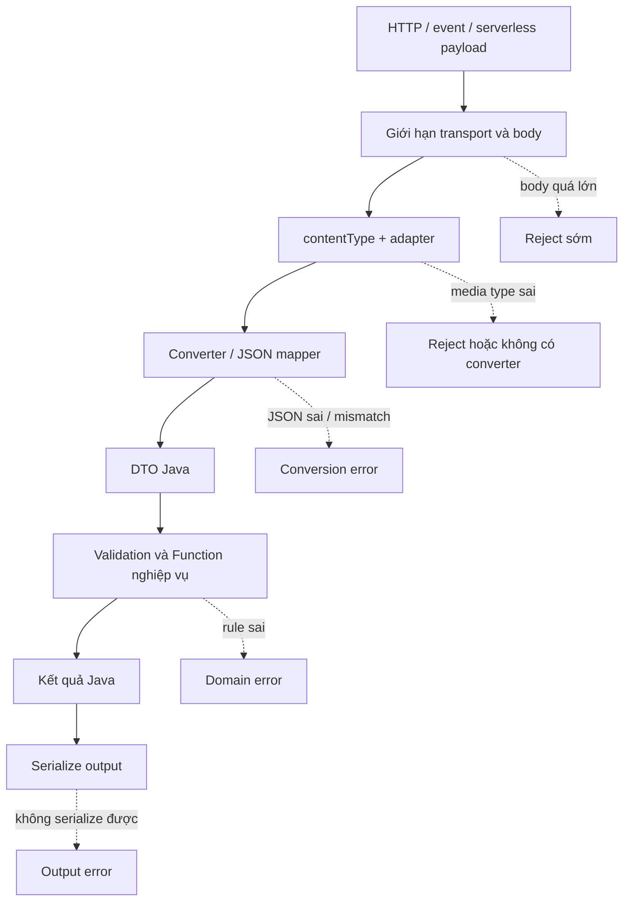
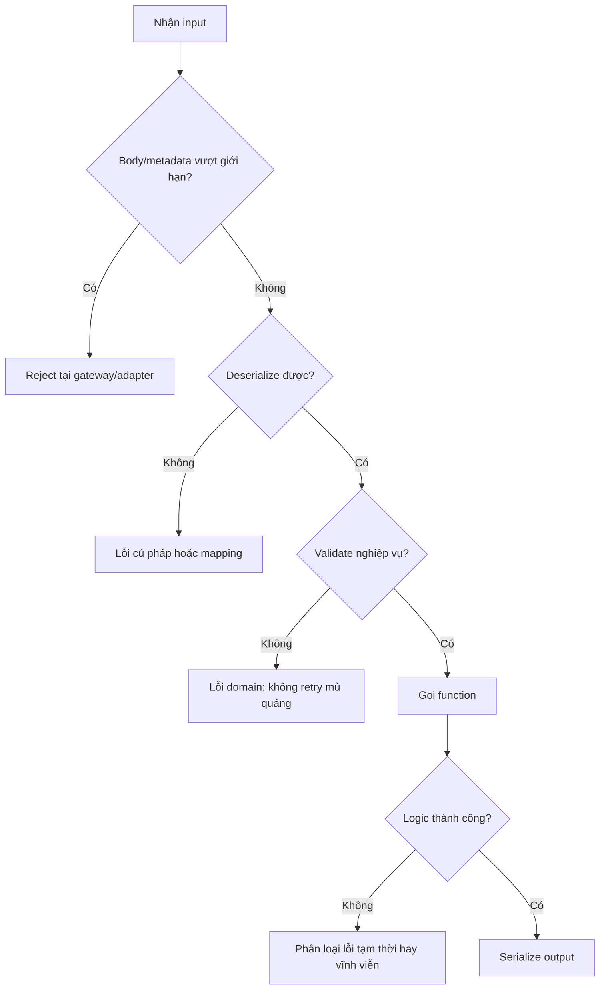

# Lỗi JSON, kiểu không tương thích và giới hạn giải tuần tự hóa

Spring Cloud Function giúp viết logic nghiệp vụ thành các bean `Supplier<T>`, `Function<I, O>` và `Consumer<T>`, sau đó tra cứu qua `FunctionCatalog`, composition và đưa cùng một hàm đến HTTP, hệ thống sự kiện hoặc nền tảng serverless. Để làm được điều đó, adapter thường phải chuyển dữ liệu bên ngoài — JSON, chuỗi hoặc byte — thành kiểu Java mà hàm công bố.

Sự chuyển đổi này không phải lúc nào cũng thành công. Có những lỗi **sai cú pháp JSON**, lỗi **không khớp hình dạng hoặc kiểu trường**, lỗi **mất metadata generic**, lỗi **giá trị không thỏa quy tắc nghiệp vụ**, và cả rủi ro **tiêu thụ quá nhiều tài nguyên hoặc nạp class không mong muốn khi giải tuần tự hóa**. Trong chương **Kiểu dữ liệu**, bài này hướng dẫn phân loại và xử lý các vấn đề đó thay vì chỉ bắt mọi exception rồi trả một thông báo chung.

Mục tiêu sau bài học:

1. Phân biệt lỗi xảy ra **trước khi vào hàm**, **trong logic hàm** và **sau khi hàm trả kết quả**.
2. Chẩn đoán payload JSON không hợp lệ, MIME type sai, trường/kiểu không tương thích, generic của `List<T>` và `Message<T>` bị mất.
3. Thiết kế DTO và validation để tránh mặc định rằng “deserialize thành công” đồng nghĩa “dữ liệu hợp lệ”.
4. Giới hạn kích thước payload, độ sâu JSON, số phần tử collection và lượng tài nguyên trước/trong quá trình parse.
5. Hiểu rủi ro của việc chọn kiểu động qua `Content-Type;type=...` và nguyên tắc allowlist.
6. Kiểm thử ba tầng: hàm Java, catalog/converter và adapter HTTP/event/serverless.

> **Phạm vi ví dụ:** Java 17 trở lên. Các đoạn sử dụng Jackson 2 được đánh dấu rõ, không áp dụng nguyên trạng cho Jackson 3 dùng package `tools.jackson.*`. Hành vi chuyển đổi và exception ở HTTP, binder hoặc serverless phụ thuộc vào phiên bản và cách tích hợp; không mặc định một HTTP status code hay cơ chế retry chung cho mọi adapter.

## 1. Phân biệt bốn nhóm lỗi trước khi sửa code

| Nhóm | Ví dụ | Tầng chịu trách nhiệm chính |
| --- | --- | --- |
| **Cú pháp/định dạng** | JSON thiếu dấu ngoặc, body text nhưng `contentType=application/json` | Adapter, JSON parser, message converter |
| **Ánh xạ kiểu** | JSON array nhưng target là DTO; `quantity="hai"` cần `int`; `List<Map>` thay cho `List<OrderRequest>` | JSON mapper, metadata generic, conversion service |
| **Nghiệp vụ** | `quantity=-2`, `orderId` rỗng, số tiền tràn `long` | Validation trong hàm/domain |
| **Tài nguyên và bảo mật** | JSON quá lớn, quá sâu, array hàng triệu phần tử, chọn class qua header không an toàn | Giới hạn ở gateway/adapter/parser, kiểm soát type và cập nhật bản vá |

Phân loại này giúp tránh hai lỗi suy luận phổ biến:

- **Không phải mọi lỗi parse đều do Spring Cloud Function.** Bộ giải mã của Spring MVC, Spring Messaging, JSON mapper hoặc platform adapter có thể báo lỗi trước khi logic được gọi.
- **Không phải mọi DTO tạo được đều hợp lệ.** JSON parser có thể tạo `OrderRequest(quantity=-2)` rất bình thường, nhưng nghiệp vụ phải từ chối.

### Sơ đồ vị trí lỗi



Sơ đồ mô tả trách nhiệm ở mức kiến trúc, không phải call stack cố định của mọi adapter Spring Cloud Function. Một số adapter dùng codec riêng, nên hãy xác minh exception thực tế trong ứng dụng.

## 2. Một ví dụ nghiệp vụ xuyên suốt

Giả sử hệ thống nhận đơn hàng chứa nhiều dòng sản phẩm. Bean `Function<OrderRequest, OrderReceipt>` dùng đúng kiểu generic để catalog biết đầu vào và đầu ra.

```java
package demo.function;

import java.util.List;
import java.util.Objects;
import java.util.function.Function;

import org.springframework.context.annotation.Bean;
import org.springframework.context.annotation.Configuration;

@Configuration
public class OrderFunctions {

    public record OrderLine(
        String sku,
        int quantity,
        long unitPriceVnd
    ) {}

    public record OrderRequest(
        String orderId,
        List<OrderLine> lines
    ) {}

    public record OrderReceipt(
        String orderId,
        int lineCount,
        long totalVnd
    ) {}

    private static final int MAX_LINES = 100;
    private static final int MAX_QUANTITY = 10_000;

    @Bean
    public Function<OrderRequest, OrderReceipt> calculateOrder() {
        return request -> {
            Objects.requireNonNull(request, "request");

            if (request.orderId() == null ||
                !request.orderId().matches("[A-Z0-9-]{1,32}")) {
                throw new IllegalArgumentException(
                    "Invalid orderId"
                );
            }

            List<OrderLine> lines =
                Objects.requireNonNull(request.lines(), "lines");
            if (lines.isEmpty() || lines.size() > MAX_LINES) {
                throw new IllegalArgumentException(
                    "Invalid line count"
                );
            }

            long total = 0L;
            for (OrderLine line : lines) {
                if (line == null || line.sku() == null ||
                    !line.sku().matches("[A-Z0-9-]{1,24}") ||
                    line.quantity() < 1 ||
                    line.quantity() > MAX_QUANTITY ||
                    line.unitPriceVnd() < 0) {
                    throw new IllegalArgumentException(
                        "Invalid order line"
                    );
                }

                long amount = Math.multiplyExact(
                    (long) line.quantity(),
                    line.unitPriceVnd()
                );
                total = Math.addExact(total, amount);
            }

            return new OrderReceipt(
                request.orderId(),
                lines.size(),
                total
            );
        };
    }
}
```

Ví dụ JSON hợp lệ:

```json
{
  "orderId": "ORD-101",
  "lines": [
    {"sku": "BOOK-1", "quantity": 2, "unitPriceVnd": 50000},
    {"sku": "PEN-1", "quantity": 1, "unitPriceVnd": 30000}
  ]
}
```

Kết quả nghiệp vụ:

```json
{"orderId":"ORD-101","lineCount":2,"totalVnd":130000}
```

Hàm chỉ làm việc với DTO Java, không phải raw HTTP body. Điều này giữ logic có thể tái sử dụng qua nhiều giao thức. Nhưng code validation ở trên chạy **sau khi** dữ liệu được giải tuần tự hóa; nó không bảo vệ parser khỏi một body khổng lồ ngay từ đầu. Phần giới hạn tài nguyên sẽ xử lý riêng vấn đề đó.

## 3. Lỗi cú pháp JSON: chưa có DTO để gọi hàm

JSON có quy tắc cú pháp chặt chẽ. Các payload sau không hợp lệ:

```text
{"orderId":"ORD-101","lines":[]    // thiếu dấu }
{orderId:"ORD-101"}                  // tên property chưa có dấu nháy kép
{"quantity": 01}                     // số với số 0 đứng đầu không hợp lệ
{"quantity": }                       // thiếu giá trị
```

Một parser JSON tiêu chuẩn sẽ không thể đọc những cấu trúc đó theo cấu hình strict. Với Jackson 2, lỗi cú pháp có thể được phản ánh bởi `JsonParseException` hoặc một `JsonProcessingException` phù hợp. Adapter có thể bọc exception thành loại khác.

Ví dụ test parse độc lập với Jackson 2:

```java
import com.fasterxml.jackson.core.JsonProcessingException;
import com.fasterxml.jackson.databind.ObjectMapper;

ObjectMapper mapper = new ObjectMapper();

String badJson = """
    {"orderId":"ORD-101","lines":[}
    """;

try {
    mapper.readValue(
        badJson,
        OrderFunctions.OrderRequest.class
    );
    throw new AssertionError("Expected invalid JSON");
} catch (JsonProcessingException expected) {
    System.out.println("Invalid JSON syntax or mapping");
}
```

Snippet này dùng API Jackson 2, đặt trong một phương thức/test có quyền truy cập `OrderFunctions`. Khi debug, cần xem **root cause** trong exception chain để phân biệt cú pháp với mapping. Không dùng một catch quá rộng rồi gắn nhãn “lỗi cú pháp” cho mọi sự cố.

**Cách phòng tránh:** producer cần gửi JSON hợp lệ, có integration test cho hợp đồng input, kiểm tra metadata Content-Type và từ chối body sai cú pháp. Không nên âm thầm “sửa” JSON không đáng tin cậy bằng regex rồi đưa vào parser.

## 4. JSON hợp lệ nhưng không tương thích kiểu Java

Một payload có thể đúng chuẩn JSON nhưng không chuyển được về target class.

| Payload | Target | Vấn đề |
| --- | --- | --- |
| `[{"orderId":"ORD-101"}]` | `OrderRequest` | Array thay cho object |
| `{"orderId":"ORD-101"}` | `List<OrderRequest>` | Object thay cho array |
| `{"quantity":"hai"}` | DTO có `int quantity` | Chuỗi không đổi được thành số |
| `{"lines":{}}` | DTO có `List<OrderLine> lines` | Object thay cho array |
| `{"unitPriceVnd":999999999999999999999}` | `long` | Giá trị vượt phạm vi `long` |
| `{"lines":[null]}` | `List<OrderLine>` | Parser có thể chấp nhận null; nghiệp vụ phải từ chối |
| `{"quantity":null}` | DTO có primitive `int` | Mapper có thể dùng giá trị mặc định hoặc báo lỗi tùy cấu hình |

Với Jackson 2, những lỗi ánh xạ cấu trúc thường liên quan đến `JsonMappingException` hoặc subclass như `MismatchedInputException`, nhưng **tên exception chính xác phụ thuộc tình huống và phiên bản**. Gson và Jackson 3 dùng API/exception khác, nên không xây xử lý đa thư viện chỉ dựa vào một loại exception Jackson 2.

### Null của primitive là bẫy

Nếu DTO khai `int quantity`, nó không thể biểu diễn `null` trong Java. Một số cấu hình deserialize JSON null thành giá trị primitive mặc định, chẳng hạn `0`; một số cấu hình strict lại từ chối. Vì thế:

- Đừng suy luận `quantity == 0` chắc chắn nghĩa là client gửi số 0.
- Nếu cần phân biệt “không gửi” và “gửi giá trị 0”, cân nhắc `Integer` hoặc DTO biên có validation rõ ràng.
- Cấu hình mapper strict nếu hợp đồng yêu cầu từ chối null hoặc coercion.
- Luôn kiểm tra điều kiện nghiệp vụ sau conversion.

### Unknown fields không phải lúc nào cũng báo lỗi

JSON thêm `"isAdmin":true` vào DTO không có trường đó có thể bị bỏ qua hoặc gây lỗi tùy thư viện/cấu hình. Không được dùng hành vi mặc định chưa kiểm tra làm cơ chế bảo mật. Bảo mật phân quyền cần được thực thi trong domain/service, không được phụ thuộc vào việc mapper “có bỏ qua field lạ hay không”.

## 5. contentType, adapter và lỗi chọn sai converter

Trong Spring Cloud Function, chuyển đổi payload thường cần phối hợp:

1. **Payload thực tế**: byte, text, JSON object, JSON array.
2. **`contentType`**: mô tả định dạng payload, chẳng hạn `application/json`.
3. **Kiểu đích**: từ chữ ký generic `Function<I,O>` hoặc `FunctionRegistration.type(...)`.
4. **Converter/codec hiện diện**: phải hỗ trợ định dạng và target.

Ví dụ request HTTP:

```bash
curl -X POST http://localhost:8080/calculateOrder \
  -H 'Content-Type: application/json' \
  -H 'Accept: application/json' \
  -d '{"orderId":"ORD-101","lines":[{"sku":"BOOK-1","quantity":2,"unitPriceVnd":50000}]}'
```

Lệnh trên chỉ chạy khi Web adapter được cài và endpoint `calculateOrder` được expose. `Content-Type` của request không giống `Accept`: header đầu mô tả body đã gửi, header sau mô tả response mong muốn.

Nếu gửi JSON nhưng khai `text/plain`, adapter có thể chọn đường xử lý văn bản, không tìm được converter phù hợp với `OrderRequest` hoặc trả lỗi. Ngược lại, gửi binary tùy ý với `application/json` có thể khiến parser cố đọc JSON và thất bại.

### MessageHeaders trong hệ thống sự kiện

```java
import java.nio.charset.StandardCharsets;
import org.springframework.messaging.Message;
import org.springframework.messaging.MessageHeaders;
import org.springframework.messaging.support.MessageBuilder;
import org.springframework.util.MimeTypeUtils;

Message<byte[]> incoming = MessageBuilder
    .withPayload(
        "{\"orderId\":\"ORD-101\",\"lines\":[]}"
            .getBytes(StandardCharsets.UTF_8)
    )
    .setHeader(
        MessageHeaders.CONTENT_TYPE,
        MimeTypeUtils.APPLICATION_JSON
    )
    .build();
```

Message trên có payload runtime là `byte[]`; **đặt header không tự tạo DTO**. Khi một `Consumer<OrderRequest>` được gọi qua adapter hỗ trợ conversion, framework/binder có thể dùng content type và target type để deserialize. Payload `lines=[]` vẫn cần bị nghiệp vụ từ chối nếu hàm được gọi.

Không giả định HTTP parser, Spring Messaging converter và serverless adapter dùng cùng implementation hay quy tắc báo lỗi.

## 6. Raw type, Object và generic của collection

Một hàm khai báo rõ:

```java
@Bean
public Function<
    OrderFunctions.OrderRequest,
    OrderFunctions.OrderReceipt
> calculateOrder() {
    // Code như ví dụ đầy đủ ở mục 2
}
```

cung cấp target `OrderRequest` và output `OrderReceipt` cho framework. Nhưng một lambda được đăng ký bằng `Function.class` hoặc `Function<Object,Object>` có thể khiến thông tin kiểu đích không đủ cụ thể. JSON converter lúc đó có thể trả `Map`, `List<Map>` hoặc không biết kiểu domain cần khởi tạo.

**Không dùng cast để chữa mất generic:**

```java
// Không an toàn: cast không biến Map thành OrderRequest.
Object payload = java.util.Map.of("orderId", "ORD-101");
OrderFunctions.OrderRequest request =
    (OrderFunctions.OrderRequest) payload; // ClassCastException
```

Nếu cần đăng ký lambda động, có thể dùng `FunctionRegistration.type(...)` và `FunctionTypeUtils` để công bố kiểu input/output tường minh trong context phù hợp. Metadata type chỉ nói **kiểu cần nhận**, không thay cho một JSON parser có khả năng tạo DTO.

### Vì sao List.class chưa đủ?

JSON array:

```json
[
  {"orderId":"ORD-101","lines":[]},
  {"orderId":"ORD-102","lines":[]}
]
```

Nếu chỉ đưa `List.class` cho Jackson, phần tử có thể được tạo thành `Map`. Trong Java, `List<OrderRequest>` còn thông tin generic ở chữ ký method hoặc type token, nhưng `List.class` không chứa kiểu phần tử.

Với **Jackson 2** khi chủ động parse:

```java
import java.util.List;
import com.fasterxml.jackson.core.type.TypeReference;
import com.fasterxml.jackson.databind.ObjectMapper;

ObjectMapper mapper = new ObjectMapper();
String json = """
    [{"orderId":"ORD-101","lines":[]}]
    """;

List<OrderFunctions.OrderRequest> orders = mapper.readValue(
    json,
    new TypeReference<List<OrderFunctions.OrderRequest>>() {}
);
```

Đoạn này thuộc method/test có xử lý `JsonProcessingException`. Nó minh họa cách giữ kiểu phần tử trong Jackson 2, **không khẳng định mọi adapter đều gọi đúng API `TypeReference` này**. Trường `lines=[]` có thể deserialize thành công nhưng vẫn vi phạm quy tắc nghiệp vụ “ít nhất một dòng hàng”.

### Message<T> và Flux<T> cũng cần metadata

| Chữ ký | Ý nghĩa | Rủi ro khi metadata thiếu |
| --- | --- | --- |
| `Function<OrderRequest, OrderReceipt>` | Một yêu cầu → một kết quả | POJO bị nhận thành Map/Object |
| `Function<List<OrderRequest>, List<OrderReceipt>>` | Một lần gọi xử lý danh sách | Phần tử danh sách thành Map |
| `Consumer<Message<OrderRequest>>` | Xử lý payload và headers | Nhầm wrapper Message với payload |
| `Function<Flux<OrderRequest>, Flux<OrderReceipt>>` | Dòng publisher reactive | Nhầm Flux với List hoặc từng item |

`Flux<T>` khác `List<T>`: đó là một publisher reactive, có subscription và backpressure. JSON array không mặc nhiên trở thành một stream reactive hoặc một loạt event broker riêng biệt. Hãy kiểm tra contract của adapter.

## 7. Giới hạn giải tuần tự hóa là gì?

**Deserialization** là quá trình đọc representation bên ngoài rồi tạo cấu trúc Java. Dù JSON hợp lệ, dữ liệu vẫn có thể quá lớn hoặc quá phức tạp:

- **Body lớn:** truyền hàng chục MB byte làm tăng bộ nhớ I/O và parser.
- **Chuỗi/property name quá dài:** gây áp lực cấp phát bộ nhớ.
- **Nesting sâu:** nhiều object/array lồng nhau, tốn stack và CPU.
- **Số cực dài:** parse số hàng nghìn chữ số có thể tiêu thụ tài nguyên.
- **Array nhiều phần tử:** một JSON array có thể sinh hàng triệu DTO, nguy cơ `OutOfMemoryError`.
- **Dữ liệu nén:** request nhỏ sau giải nén có thể tạo payload rất lớn.
- **Event retry lặp lại:** cùng một payload độc hại có thể bị parse lại nhiều lần.

Một **giới hạn sau khi deserialize xong** như `if (list.size() > 100)` vẫn hữu ích cho logic, nhưng **không ngăn được parser đã cấp phát cả danh sách quá lớn trước đó**. Muốn bảo vệ tài nguyên, cần nhiều lớp giới hạn.

### Bốn lớp phòng vệ bổ sung nhau

| Lớp | Giới hạn nên cân nhắc | Thời điểm |
| --- | --- | --- |
| Gateway/HTTP server/binder | Kích thước request, kích thước message, timeout, decompression | **Trước khi** toàn bộ payload được load |
| Bộ đọc payload | Số byte/char và charset hợp lệ | Trước parse hoặc trong khi streaming |
| JSON parser | Nesting, string/number length, document length, token count nếu phiên bản hỗ trợ | **Trong khi** parse |
| Domain/application | Số phần tử collection, độ dài mã, range số, tổng tiền | Khi xử lý item hoặc sau khi tạo DTO nhỏ, có giới hạn trước đó |

Một ngưỡng như 256 KiB hay 100 dòng hàng trong các ví dụ sau là **giá trị minh họa của hợp đồng**, không phải cấu hình mặc định của Spring Cloud Function.

## 8. Giới hạn độ sâu và độ dài với Jackson 2

Jackson 2.15+ có `StreamReadConstraints` trong package `com.fasterxml.jackson.core`. Các bản Jackson 2 mới hơn còn mở rộng loại giới hạn; tên method và default có thể khác theo phiên bản. Ví dụ này dùng **Jackson 2.17+**:

```java
import com.fasterxml.jackson.core.JsonFactory;
import com.fasterxml.jackson.core.StreamReadConstraints;
import com.fasterxml.jackson.databind.ObjectMapper;

StreamReadConstraints constraints = StreamReadConstraints.builder()
    .maxNestingDepth(64)
    .maxStringLength(100_000)
    .maxNumberLength(100)
    .maxDocumentLength(256L * 1024)
    .build();

JsonFactory factory = JsonFactory.builder()
    .streamReadConstraints(constraints)
    .build();

ObjectMapper mapper = new ObjectMapper(factory);
```

Các ràng buộc này áp dụng cho **mapper dùng đúng `JsonFactory` vừa tạo**. Một số kiểm tra (như document length) có thể hoạt động theo chunk và phụ thuộc đầu vào byte/char; không coi chúng là thay thế hoàn toàn cho giới hạn body ở HTTP server/binder.

Đặc biệt:

1. **Giới hạn parser không mặc định giới hạn số phần tử của một array.** Cần kiểm soát collection riêng.
2. **Mapper tự tạo không mặc nhiên là mapper của Spring Cloud Function.** Nếu SCF dùng `JsonMapper` abstraction hoặc adapter dùng codec khác, cần cấu hình tại đúng điểm tích hợp rồi kiểm chứng.
3. **Jackson 3 dùng package `tools.jackson.*`**, không sao chép nguyên import Jackson 2 sang dự án Spring Boot 4/Jackson 3.
4. Tránh gọi phương thức override global defaults một cách tùy tiện trong thư viện; nên cấu hình factory/mapper thuộc phạm vi ứng dụng mà bạn kiểm soát.

### Kiểm thử JSON quá sâu

```java
import com.fasterxml.jackson.core.JsonProcessingException;

String tooDeep = "[".repeat(70) + "0" + "]".repeat(70);

try {
    mapper.readTree(tooDeep);
    throw new AssertionError("Expected nesting limit");
} catch (JsonProcessingException expected) {
    System.out.println("JSON exceeds parser limits");
}
```

Đoạn test dùng biến `mapper` đã cấu hình ở trên. Với giới hạn nesting 64, 70 tầng array cần bị từ chối bởi bộ parser tương ứng. Ở runtime cần phân loại nguyên nhân cụ thể từ exception; việc catch `JsonProcessingException` trong ví dụ chỉ để minh họa phép thử.

## 9. Giới hạn số phần tử JSON array trước khi tạo toàn bộ List

Đây là một điểm rất quan trọng: gọi `mapper.readValue(bytes, new TypeReference<List<T>>() {})` trực tiếp trên dữ liệu không đáng tin cậy có thể tạo ra danh sách cực lớn trước khi code kiểm tra `size()`. Để giới hạn **trong quá trình đọc**, có thể dùng streaming parser với bộ đếm.

Ví dụ dưới đây chỉ minh họa một parser Jackson 2 cho **array `OrderRequest`**:

```java
package demo.function;

import java.io.IOException;
import java.util.ArrayList;
import java.util.List;

import com.fasterxml.jackson.core.JsonParser;
import com.fasterxml.jackson.core.JsonToken;
import com.fasterxml.jackson.databind.ObjectMapper;

public final class BoundedOrderArrayReader {

    private static final int MAX_BYTES = 256 * 1024;
    private static final int MAX_ORDERS = 100;

    private final ObjectMapper mapper;

    public BoundedOrderArrayReader(ObjectMapper mapper) {
        this.mapper = mapper;
    }

    public List<OrderFunctions.OrderRequest> read(byte[] raw)
            throws IOException {
        if (raw == null || raw.length > MAX_BYTES) {
            throw new IllegalArgumentException("JSON payload too large");
        }

        try (JsonParser parser =
                 mapper.getFactory().createParser(raw)) {

            if (parser.nextToken() != JsonToken.START_ARRAY) {
                throw new IllegalArgumentException("Expected JSON array");
            }

            List<OrderFunctions.OrderRequest> result =
                new ArrayList<>();

            while (true) {
                JsonToken token = parser.nextToken();
                if (token == JsonToken.END_ARRAY) {
                    break;
                }
                if (token == null) {
                    throw new IllegalArgumentException(
                        "Unterminated JSON array"
                    );
                }
                if (result.size() >= MAX_ORDERS) {
                    throw new IllegalArgumentException(
                        "Too many orders"
                    );
                }
                if (token != JsonToken.START_OBJECT) {
                    throw new IllegalArgumentException(
                        "Expected JSON object element"
                    );
                }

                result.add(mapper.readValue(
                    parser, OrderFunctions.OrderRequest.class
                ));
            }

            if (parser.nextToken() != null) {
                throw new IllegalArgumentException(
                    "Trailing JSON content"
                );
            }
            return List.copyOf(result);
        }
    }
}
```

Giải thích:

- Mảng được đọc **từng phần tử**; trước phần tử thứ 101, code đã phát hiện vượt `MAX_ORDERS`.
- Giới hạn byte được kiểm tra **trước khi gọi parser trong method này**, nhưng byte đã được load vào `raw` từ trước. Transport cần giới hạn trước khi cấp phát mảng đó.
- Mỗi phần tử vẫn cần JSON mapper và validation nghiệp vụ; giới hạn số phần tử không thay thế giới hạn nesting/string/number.
- `List.copyOf(result)` trả danh sách không thể sửa cấu trúc; nếu phần tử `null`, method sẽ báo lỗi (ở đây parser yêu cầu object).
- Ví dụ cho thấy **cách triển khai chủ động** khi bạn kiểm soát bước parse. Nó **không có nghĩa JSON converter mặc định của mọi Spring Cloud Function adapter sẽ tự dùng class `BoundedOrderArrayReader` này**.

Đối với JSON array quá lớn, đôi khi tốt hơn là thay hợp đồng thành **streaming event** với giới hạn per-message hoặc pagination/batching rõ ràng, thay vì gom toàn bộ dữ liệu vào một lần gọi.

## 10. Không chọn Java class tùy ý từ JSON hoặc header

Một số cơ chế chuyển đổi cho phép chỉ định kiểu đích theo metadata. Spring Cloud Function có hỗ trợ tham số MIME `type`, chẳng hạn:

```text
Content-Type: application/json;type=demo.function.OrderFunctions$OrderRequest
```

Tính năng này dành cho trường hợp chữ ký hàm chưa công bố đủ kiểu đích, ví dụ `Function<Object,Object>`. Tuy nhiên, cho phép nguồn bên ngoài tùy ý chọn **tên class** để nạp/deserialize có rủi ro an toàn.

Tài liệu Spring Cloud Function quy định khi sử dụng tham số `type` phải khai báo danh sách lớp cho phép tại:

```text
src/main/resources/META-INF/deserializable.types
```

Nội dung file minh họa:

```text
demo.function.OrderFunctions$OrderRequest
```

Vì `OrderRequest` ở ví dụ là record lồng trong `OrderFunctions` nên tên binary sử dụng dấu `$`. DTO top-level dùng tên đầy đủ dạng `demo.function.OrderRequest`. Danh sách cho phép nên chứa **ít nhất các class cần thiết**, không mở rộng tùy ý toàn bộ namespace.

**Thiết kế an toàn hơn:** nếu function luôn xử lý đơn hàng, khai báo `Function<OrderRequest, OrderReceipt>` và **không để client quyết định tên class Java**. MIME `type=...` là một khả năng riêng của framework, không phải thuộc tính bắt buộc của mọi JSON message.

### Những điều cần tránh

- Không lấy tên class từ `Content-Type`/JSON rồi gọi `Class.forName(...)` không kiểm soát.
- Không kích hoạt deserialization đa hình theo default typing cho mọi class từ input bên ngoài mà không có bộ giới hạn type rõ ràng.
- Không đặt dữ liệu bí mật, token, đường dẫn nội bộ vào thông báo lỗi gửi cho client.
- Không coi allowlist là thay thế cho việc **nâng cấp bản Spring Cloud Function bị ảnh hưởng** hoặc kiểm tra payload.

## 11. Cảnh báo bảo mật Spring Cloud Function công bố tháng 11/2026

Tại ngày **24/11/2026**, Spring đã công bố hai advisory ngày **19/11/2026** liên quan trực tiếp tới chủ đề bài học:

| Mã | Vấn đề được công bố | Phiên bản OSS đã sửa được công bố |
| --- | --- | --- |
| **CVE-2026-59439** | JSON array inbound không bị giới hạn kích thước, có thể gây tiêu thụ bộ nhớ quá mức | **Spring Cloud Function 5.0.5** |
| **CVE-2026-59440** | Cho phép chỉ định `type` qua content type nhưng thiếu bảo vệ với class hệ thống/nền tảng | **Spring Cloud Function 5.0.5** |

Theo hai advisory, các dải OSS bị ảnh hưởng được liệt kê gồm **5.0.0–5.0.4**, **4.3.0–4.3.4** và **4.0.0–4.2.4**. Spring còn liệt kê các bản vá dành riêng cho **Enterprise Support** như `4.3.5` và `4.2.5`, không nên nhầm chúng với bản phát hành OSS sẵn có cho mọi người.

**Hành động phù hợp:** xác định bản Spring Cloud Function thực tế của ứng dụng, đọc advisory chính thức, cập nhật sang nhánh/bản vá được hỗ trợ và kiểm thử lại. Giới hạn payload/collection và allowlist vẫn là defense-in-depth hữu ích, nhưng không dùng chúng làm lý do để giữ mã nguồn framework đã biết có vấn đề bảo mật.

**Nguồn:**

- [Spring — CVE-2026-59439: Unbounded JSON Collection](https://spring.io/security/cve-2026-59439/)
- [Spring — CVE-2026-59440: Arbitrary Class Loading](https://spring.io/security/cve-2026-59440/)

Advisory có thể được cập nhật khi xuất hiện bản vá hoặc thay đổi lịch hỗ trợ; khi triển khai thật, hãy xem nội dung mới nhất thay vì hard-code một dải phiên bản trong policy của dự án.

## 12. Validation nghiệp vụ không phải JSON deserialization

Chuyển JSON thành `OrderRequest` thành công chỉ có nghĩa một đối tượng được tạo, **không chứng minh số lượng sản phẩm hợp lệ**, mã hàng được phép, hoặc đơn giá phù hợp.

Hàm ở mục 2 kiểm tra:

- `orderId` không rỗng, tối đa 32 ký tự và chỉ gồm ký tự hợp lệ.
- `lines` có từ 1 đến 100 phần tử.
- Mỗi dòng có `sku` hợp lệ, `quantity` từ 1 đến 10.000 và đơn giá không âm.
- `Math.multiplyExact` và `Math.addExact` từ chối phép tính tràn `long`.

Các phép kiểm tra này chạy **sau deserialize** để bảo vệ nghiệp vụ. Với API public, có thể dùng Jakarta Bean Validation, ví dụ `@NotBlank`, `@Size`, `@Min`, `@Max`, `@Valid`, nếu dependency và adapter cung cấp cơ chế gọi validation. **Chỉ thêm annotation lên record không bảo đảm Spring Cloud Function tự gọi validator cho mọi function bean.** Nếu tự gọi validator, phải xử lý `ConstraintViolation` theo contract ứng dụng.

### Phân biệt hai nguồn lỗi khi tiếp nhận

```text
Input: {"quantity":"ba"}
    └─ Có thể thất bại khi map String sang int, hàm chưa chạy.

Input: {"quantity":-3}
    └─ JSON hoàn toàn hợp lệ, DTO có thể được tạo,
       nhưng hàm phải từ chối vì vi phạm quy tắc nghiệp vụ.
```

Không nên cố phân loại cả hai là “JSON invalid” vì cách sửa nguyên nhân hoàn toàn khác nhau.

## 13. HTTP, sự kiện và serverless xử lý lỗi khác nhau

| Môi trường | Điều cần xác nhận | Không nên mặc định |
| --- | --- | --- |
| HTTP | Media type, body size, lỗi parse, response/status mapping | Mọi lỗi JSON luôn là HTTP 400; mọi payload quá lớn luôn là cùng mã trong mọi adapter |
| Spring Cloud Stream/broker | Header `contentType`, ack/retry, DLQ, batch, giới hạn message | Converter ném exception là broker tự đưa vào DLQ |
| Serverless | Event envelope, base64, timeout, memory limit, retry policy | Event luôn là body HTTP thuần hoặc lỗi luôn trả HTTP status |
| Gọi `FunctionCatalog` trong Java | Wrapper conversion, generic, exception chain | Lookup thành công chứng minh binder/HTTP đang hoạt động |

Với HTTP, một số stack có thể trả **400** cho body không đọc được, **415** cho media type không hỗ trợ, hoặc **413** cho payload vượt giới hạn. Đây là các **khả năng HTTP thông dụng**, không phải cam kết của một bản Spring Cloud Function Web adapter cụ thể. Cần cấu hình exception handling và kiểm thử với deployment thực.

Với broker, một payload lỗi có thể dẫn đến retry liên tục nếu không có retry limit/dead-letter policy. Cần quy định rõ **poison message**: khi nào retry (lỗi tạm thời), khi nào bỏ qua, khi nào gửi DLQ hoặc yêu cầu sửa producer. Không log toàn bộ JSON độc hại để debug.

## 14. Khi lỗi chỉ xuất hiện ở composition

Một pipeline có thể trông hợp lý:

```text
parseOrder : Function<String, OrderRequest>
    |
calculateOrder : Function<OrderRequest, OrderReceipt>
    |
renderReceipt : Function<OrderReceipt, String>
```

Nếu `parseOrder` nhận JSON string, nó cần một parser do code hoặc converter có thể thực hiện. Nhưng khi `calculateOrder` đã nhận một `OrderRequest`, ranh giới sang hàm này không cần parse JSON lần nữa.

**Lỗi tại điểm nối** thường do:

1. Hàm trước trả `Map` nhưng hàm sau nhận `OrderRequest`.
2. Hàm trước trả `String` còn hàm sau nhận `Integer` nhưng không có conversion service hoặc dữ liệu không parse được.
3. Hàm trước trả `Message<byte[]>` mà thông tin `contentType` không còn đúng hoặc wrapper sau không hỗ trợ chuyển kiểu cần thiết.
4. Lambda đăng ký động chỉ công bố raw `Function.class` nên catalog mất target type.
5. Một `Consumer<T>` được đặt trước hàm cần output, trong khi consumer không trả giá trị nghiệp vụ.

Đừng “sửa” bằng cách ép `(OrderRequest) rawObject` nếu runtime đang là `Map`. Giải pháp là **khôi phục metadata generic**, dùng JSON mapper đúng chỗ hoặc bổ sung hàm chuyển đổi Java tường minh.

## 15. Log và quan sát lỗi mà không làm lộ dữ liệu

Khi gỡ lỗi, những trường thông tin thường đủ hữu ích:

| Nên ghi nhận | Nên hạn chế/tránh |
| --- | --- |
| Tên function/composition | Toàn bộ body JSON chứa thông tin cá nhân |
| Kiểu payload runtime | Mật khẩu, token, access key trong JSON/header |
| `contentType` đã chuẩn hóa | Toàn bộ request headers không được lọc |
| Loại lỗi: syntax/mapping/validation/limit | Stack trace chi tiết đưa thẳng cho client |
| Kích thước body theo byte, giới hạn áp dụng | Chuỗi dữ liệu độc hại dài hàng MB |
| Correlation ID đã kiểm soát định dạng | Tin tưởng giá trị header do client tự tạo không giới hạn |

Nếu cần log lỗi parse, ưu tiên **loại exception, vị trí tương đối và mã lỗi nội bộ** thay vì chép đoạn input gây lỗi. Với payload không đáng tin cậy, việc log raw body còn có thể gây **log injection** hoặc làm đầy ổ đĩa.

### Định tuyến lỗi theo trách nhiệm



Phân loại đúng giúp HTTP trả lỗi có kiểm soát, còn messaging áp dụng retry/DLQ có ý nghĩa. Không coi mọi exception do dữ liệu sai là một lỗi tạm thời cần retry vô hạn.

## 16. Kiểm thử theo từng mức

### Mức 1 — Unit test logic không liên quan JSON

```java
import static org.junit.jupiter.api.Assertions.*;

import java.util.List;
import java.util.function.Function;

import org.junit.jupiter.api.Test;

class OrderFunctionUnitTest {

    private final Function<
        OrderFunctions.OrderRequest,
        OrderFunctions.OrderReceipt
    > function = new OrderFunctions().calculateOrder();

    @Test
    void calculatesValidOrder() {
        var request = new OrderFunctions.OrderRequest(
            "ORD-101",
            List.of(new OrderFunctions.OrderLine(
                "BOOK-1", 2, 50_000L
            ))
        );

        assertEquals(
            100_000L,
            function.apply(request).totalVnd()
        );
    }

    @Test
    void rejectsEmptyOrder() {
        var request = new OrderFunctions.OrderRequest(
            "ORD-101", List.of()
        );

        assertThrows(
            IllegalArgumentException.class,
            () -> function.apply(request)
        );
    }
}
```

Hai test này xác nhận nghiệp vụ sau khi DTO đã có sẵn. Chúng **không** kiểm tra JSON parser, generic hay adapter.

### Mức 2 — Kiểm converter/parser và giới hạn

Kiểm tra:

- JSON sai cú pháp bị từ chối.
- JSON array/object sai hình dạng bị từ chối.
- Trường số vượt range hoặc không parse được.
- Body vượt giới hạn và JSON quá sâu bị từ chối.
- Array 101 phần tử bị chặn trước khi tạo toàn bộ collection theo hợp đồng `MAX_ORDERS=100` của parser chủ động.
- JSON hợp lệ tạo đúng DTO, không phải `Map`.

Ví dụ với parser giới hạn ở mục 9:

```java
import static org.junit.jupiter.api.Assertions.*;
import org.junit.jupiter.api.Test;

@Test
void rejectsOversizedRawPayload() {
    BoundedOrderArrayReader reader =
        new BoundedOrderArrayReader(new ObjectMapper());

    byte[] raw = new byte[256 * 1024 + 1];
    assertThrows(
        IllegalArgumentException.class,
        () -> reader.read(raw)
    );
}
```

Method này được đặt trong test class có import `com.fasterxml.jackson.databind.ObjectMapper`, JUnit 5 và class `BoundedOrderArrayReader`. Nó xác minh giới hạn byte **ở reader**, không phải giới hạn transport trước khi cấp phát raw bytes.

### Mức 3 — FunctionCatalog và adapter thật

Khi ứng dụng đã có bean trong Spring context:

```java
import java.util.function.Function;
import org.springframework.cloud.function.context.FunctionCatalog;

// Trong test/method đã inject FunctionCatalog catalog:
Function<OrderFunctions.OrderRequest,
         OrderFunctions.OrderReceipt> fn =
    catalog.lookup("calculateOrder");

OrderFunctions.OrderReceipt receipt = fn.apply(
    new OrderFunctions.OrderRequest(
        "ORD-101",
        java.util.List.of(
            new OrderFunctions.OrderLine("BOOK-1", 2, 50_000L)
        )
    )
);
```

Đây vẫn là lời gọi Java có DTO sẵn. Muốn kiểm chuyển đổi JSON thật, hãy gửi HTTP POST hoặc `Message<byte[]>` với `contentType=application/json` qua **adapter/converter được ứng dụng sử dụng**, rồi kiểm tra:

- Kiểu thực mà function nhận.
- Error mapping và HTTP status hoặc binder retry policy.
- Giới hạn body và số phần tử ở đúng nơi đã cấu hình.
- Response serialization và thông điệp lỗi không làm lộ dữ liệu.

### Ma trận ca kiểm thử khuyến nghị

| Dữ liệu test | Mong đợi |
| --- | --- |
| JSON object hợp lệ, đúng DTO | Hàm tính đúng |
| JSON thiếu dấu ngoặc | Parse/conversion lỗi, logic không chạy |
| JSON array thay cho object | Mapping lỗi hoặc adapter báo không phù hợp |
| `quantity="hai"` | Không tạo đúng số; lỗi conversion |
| `quantity=-3` | Deserialize có thể thành công nhưng logic từ chối |
| `lines=[]` | Logic từ chối theo hợp đồng |
| `lines` vượt 100 phần tử | Bị giới hạn trước/trong parse hoặc trước logic theo cơ chế đã cấu hình |
| JSON nesting vượt ngưỡng | Parser báo lỗi giới hạn |
| Body vượt ngưỡng vận chuyển | Adapter/gateway từ chối trước khi phân tích toàn bộ |
| `contentType=text/plain` nhưng body JSON | Không giả định tự parse DTO |
| `Function<Object,Object>` hoặc raw type | Xác minh converter không nhận sai kiểu |
| MIME `type=...` không trong allowlist | Không cho chọn class ngoài danh sách |
| Event lỗi lặp lại | Retry/DLQ theo chính sách đã định |

## 17. Hỏi đáp tình huống

**Bài 1 — Hai lỗi có giống nhau?** JSON `{"quantity":"ba"}` và JSON `{"quantity":-3}` đều gây thất bại. Vì sao không nên xử lý chúng như cùng một lỗi?

*Đáp án:* Trường hợp đầu có thể không deserialize được sang `int`; trường hợp sau có thể tạo DTO nhưng vi phạm quy tắc nghiệp vụ. Chúng xuất hiện ở hai tầng khác nhau.

**Bài 2 — Cần gì để chuyển JSON thành DTO?** Một `Message<byte[]>` mang `contentType=application/json`. Chỉ như vậy đã đủ để hàm nhận `OrderRequest` chưa?

*Đáp án:* Chưa. Payload phải là JSON hợp lệ, kiểu đích `OrderRequest` cần được cung cấp qua generic/registration và converter/adapter phải hỗ trợ chuyển đổi.

**Bài 3 — Raw generic.** Tại sao `Function.class` hoặc `List.class` có thể dẫn tới lỗi khi giải tuần tự hóa?

*Đáp án:* Chúng có thể không cho framework biết kiểu DTO hoặc kiểu phần tử, khiến parser tạo `Map`, `List<Map>` hoặc không biết đích chuyển đổi.

**Bài 4 — Giới hạn quá muộn.** Tại sao `if (orders.size() > 100)` sau khi gọi `mapper.readValue(..., List.class)` chưa đủ để chống JSON array cực lớn?

*Đáp án:* Mapper có thể đã tạo một danh sách rất lớn trước khi kiểm tra `size()`. Cần giới hạn body trước khi buffer và giới hạn số phần tử **trong quá trình streaming parse** hoặc dùng giải pháp đã được framework vá/hỗ trợ.

**Bài 5 — Parser constraints.** `maxNestingDepth(64)` có tự giới hạn số phần tử array là 64 không?

*Đáp án:* Không. Nesting depth đo số tầng object/array mở lồng nhau; một array phẳng có thể chứa rất nhiều phần tử. Cần ngưỡng element count riêng.

**Bài 6 — Dynamic type.** Vì sao không cho client gửi tên class Java bất kỳ trong `application/json;type=...`?

*Đáp án:* Đây là đường lựa chọn kiểu động từ input không đáng tin cậy, có thể dẫn tới nạp hoặc deserialize class không mong muốn. Ưu tiên generic cố định, dùng `META-INF/deserializable.types` và cập nhật framework đã vá.

**Bài 7 — HTTP so với broker.** Parse JSON lỗi có bắt buộc trả HTTP 400 và broker luôn đưa vào DLQ không?

*Đáp án:* Không. HTTP status do adapter/error handler quyết định; retry/DLQ do binder/hạ tầng và cấu hình quyết định. Cần kiểm thử đúng môi trường.

**Bài 8 — Thay Jackson bằng Gson có sửa được lỗi generic không?**

*Đáp án:* Không. Đổi JSON mapper không làm raw `Function<Object,Object>` tự có target type hoặc `List.class` tự biết element type.

**Bài 9 — Chọn thứ tự khắc phục.** Ứng dụng dễ OOM khi nhận một JSON array rất lớn. Bạn sẽ làm gì trước khi chỉ tăng heap?

*Đáp án:* Kiểm tra phiên bản và bản vá Spring Cloud Function, giới hạn message/body ở biên, kiểm tra parser constraints và giới hạn số phần tử trong quá trình đọc. Tăng heap một mình không khắc phục được đầu vào không bị giới hạn.

## 18. Ghi nhớ

- **Phân loại đúng lỗi:** cú pháp JSON, không tương thích kiểu Java, validation nghiệp vụ, hay cạn tài nguyên/bảo mật.
- **`contentType` không tự quyết định DTO**, và generic `Function<I,O>` không tự khiến JSON sai cấu trúc thành hợp lệ. Converter cần cả format, target type và payload thích hợp.
- **Deserialize thành công không đồng nghĩa dữ liệu hợp lệ.** Kiểm tra null, range, count, kiểu số và overflow trong nghiệp vụ hoặc validation được kích hoạt tường minh.
- **Đừng ép `Map` thành DTO bằng cast** hoặc kỳ vọng `List.class` giữ kiểu phần tử. Giữ generic trong bean/registration hoặc type token phù hợp.
- **Giới hạn nhiều lớp:** vận chuyển, byte payload, parser depth/string/number và số phần tử collection trong khi đọc. Kiểm tra sau khi tạo danh sách lớn là quá muộn để ngăn OOM.
- **Chọn kiểu động phải có allowlist**, không cho input tự do chỉ định class Java.
- **Kiểm tra advisory và cập nhật Spring Cloud Function**, nhất là các lỗi JSON collection và class loading công bố tháng 11/2026.
- **Kiểm thử ba mức:** hàm Java, converter/catalog và adapter HTTP/messaging/serverless; log đủ chẩn đoán nhưng tránh rò rỉ payload bí mật.

**Tài liệu đọc thêm:**

- [Spring Cloud Function — Programming Model: Type Conversion, Message Converters](https://docs.spring.io/spring-cloud-function/reference/spring-cloud-function/programming-model.html)
- [Spring Security Advisory — CVE-2026-59439](https://spring.io/security/cve-2026-59439/)
- [Spring Security Advisory — CVE-2026-59440](https://spring.io/security/cve-2026-59440/)
- [Jackson 2.17 — StreamReadConstraints Javadoc](https://javadoc.io/static/com.fasterxml.jackson.core/jackson-core/2.17.3/com/fasterxml/jackson/core/StreamReadConstraints.html)
- [Jackson 3 — StreamReadConstraints Javadoc](https://javadoc.io/static/tools.jackson.core/jackson-core/3.1.6/tools.jackson.core/tools/jackson/core/StreamReadConstraints.html)

Các ví dụ giải thích cách thiết kế và kiểm chứng; **chưa thay thế** vòng Content QA, kiểm thử project hoặc đối chiếu version chính xác của Spring Cloud Function, Spring Boot, Jackson/Gson và adapter đang triển khai.
