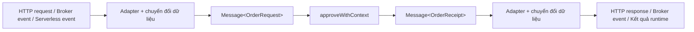

# Nhận hoặc trả `Message` thay cho POJO thuần

## 1. Tại sao cần chọn giữa POJO và `Message`?

Trong **Spring Cloud Function** (`SPRING_CLOUD_FUNCTION`), một nghiệp vụ có thể được viết bằng `Supplier`, `Function` hoặc `Consumer`, đăng ký qua `FunctionCatalog`, ghép thành chuỗi (*composition*) rồi được gọi thông qua HTTP, sự kiện hoặc một adapter serverless. Khi thiết kế chữ ký hàm, có một quyết định quan trọng: **chỉ nhận/trả đối tượng dữ liệu (POJO), hay nhận/trả `Message<T>`?**

Ví dụ, nghiệp vụ duyệt đơn hàng chỉ cần mã đơn và số tiền:

```java
Function<OrderRequest, OrderReceipt> approveOrder;
```

Nhưng nếu nghiệp vụ còn cần nhận mã liên kết lần gọi (`correlationId`), hoặc muốn gắn mã kết quả lên thông điệp đầu ra, kiểu dữ liệu thuần không thể hiện được yêu cầu này trong chữ ký hàm. Khi đó có thể dùng:

```java
Function<Message<OrderRequest>, Message<OrderReceipt>> approveOrder;
```

`Message<T>` là giao diện của **Spring Messaging** (`org.springframework.messaging.Message`), gồm `getPayload()` trả về dữ liệu kiểu `T` và `getHeaders()` trả về tập metadata `MessageHeaders`. Spring Cloud Function sử dụng mô hình đó để kết hợp logic nghiệp vụ với cơ chế chuyển đổi thông điệp, nhưng `Message` **không phải** đối tượng riêng của HTTP, Kafka hay một nhà cung cấp serverless.

Sau bài này, bạn có thể chọn chữ ký hàm phù hợp, nâng cấp hàm từ POJO sang `Message` khi có yêu cầu metadata, bảo toàn đúng các header cần thiết và kiểm thử cả payload lẫn header mà không cần chạy broker.

## 2. Bốn kiểu chữ ký của `Function`: chọn theo nhu cầu thực tế

Với dữ liệu đầu vào `I` và kết quả `O`, Spring Cloud Function hỗ trợ các dạng chữ ký Java sau:

| Chữ ký | Dữ liệu hàm nhận được | Kết quả hàm tạo ra | Tình huống phù hợp |
|---|---|---|---|
| `Function<I, O>` | Payload `I` | Payload `O` | Phép biến đổi thuần, không cần metadata |
| `Function<Message<I>, O>` | Payload và headers đầu vào | Payload `O` | Cần đọc metadata đầu vào, không chủ động tạo metadata đầu ra |
| `Function<I, Message<O>>` | Payload `I` | Payload và headers đầu ra | Cần bổ sung metadata cho kết quả, không dùng headers đầu vào |
| `Function<Message<I>, Message<O>>` | Payload và headers đầu vào | Payload và headers đầu ra | Cần đọc, lọc, tạo hoặc chuyển tiếp metadata |

Ví dụ về yêu cầu cụ thể:

- **Chỉ POJO:** `calculateTax(OrderRequest)` tính thuế từ dữ liệu đơn hàng.
- **`Message` ở đầu vào:** `auditRequest(...)` đọc `correlationId` để ghi nhận ngữ cảnh kiểm toán rồi trả DTO.
- **`Message` ở đầu ra:** `enrichResult(...)` trả DTO cùng header `resultCode` cho bước tiếp theo.
- **`Message` cả hai phía:** `approveOrder(...)` đọc `correlationId` và phát kết quả với cùng mã liên kết.

Tương tự, có thể định nghĩa `Supplier<T>` hoặc `Supplier<Message<T>>` để phát dữ liệu; `Consumer<T>` hoặc `Consumer<Message<T>>` để tiếp nhận dữ liệu. Với `Consumer`, giá trị trả về của hàm vẫn là `void`; việc xác nhận hay gửi phản hồi qua giao thức là nhiệm vụ của adapter được sử dụng.

**Nguyên tắc lựa chọn:** nếu nghiệp vụ chỉ quan tâm nội dung của payload, bắt đầu với POJO để giữ API gọn và dễ kiểm thử. Chỉ đưa `Message<T>` vào chữ ký ở nơi ứng dụng cần truy cập hoặc quyết định metadata; không nên thêm `Message` vào mọi hàm theo thói quen.

## 3. Ví dụ chạy được: từ `Function<POJO, POJO>` sang `Function<Message<POJO>, Message<POJO>>`

Xét ứng dụng duyệt đơn hàng. Đầu vào có `orderId` và `amount`; đầu ra có `orderId` và trạng thái. Để tập trung vào sự khác biệt của chữ ký, ví dụ dùng Java 17+ với `record` và một cấu hình Spring thông thường.

```java
package com.example.order;

import java.util.function.Function;

import org.springframework.context.annotation.Bean;
import org.springframework.context.annotation.Configuration;
import org.springframework.messaging.Message;
import org.springframework.messaging.support.MessageBuilder;

@Configuration
public class OrderFunctions {

    public record OrderRequest(String orderId, long amount) {}
    public record OrderReceipt(String orderId, String status) {}

    private static OrderReceipt approve(OrderRequest request) {
        if (request.orderId() == null || request.orderId().isBlank()
                || request.amount() <= 0) {
            throw new IllegalArgumentException("Đơn hàng không hợp lệ");
        }
        return new OrderReceipt(request.orderId(), "ACCEPTED");
    }

    // Phiên bản chỉ làm việc với dữ liệu nghiệp vụ.
    @Bean
    public Function<OrderRequest, OrderReceipt> approvePlain() {
        return OrderFunctions::approve;
    }

    // Phiên bản dùng thông điệp để đọc và tạo metadata.
    @Bean
    public Function<Message<OrderRequest>, Message<OrderReceipt>> approveWithContext() {
        return incoming -> {
            OrderReceipt receipt = approve(incoming.getPayload());

            String correlationId = incoming.getHeaders()
                    .get("correlationId", String.class);

            MessageBuilder<OrderReceipt> builder = MessageBuilder
                    .withPayload(receipt)
                    .setHeader("processedBy", "approveWithContext");

            if (correlationId != null) {
                builder.setHeader("correlationId", correlationId);
            }

            return builder.build();
        };
    }
}
```

Ở `approvePlain()`, hàm làm việc trực tiếp với `OrderRequest` và `OrderReceipt`. Ở `approveWithContext()`, **cùng logic nghiệp vụ `approve(...)` được tái sử dụng**, chỉ phần vỏ ngoài thay đổi:

1. `incoming.getPayload()` lấy DTO để duyệt đơn.
2. `incoming.getHeaders().get("correlationId", String.class)` đọc header theo hợp đồng kiểu `String`.
3. `MessageBuilder.withPayload(receipt)` tạo thông điệp đầu ra chứa kết quả.
4. `setHeader("processedBy", ...)` thêm metadata mới; `correlationId` được giữ **có chủ đích** khi tồn tại.

Hàm không chuyển tiếp header `source` nếu đầu vào có header này, vì ví dụ chỉ yêu cầu giữ `correlationId`. Đầu ra còn có thể chứa các header hệ thống do `MessageBuilder` tạo. Cách xử lý đó giúp ranh giới giữa dữ liệu nghiệp vụ và metadata được xác định rõ trong code.

> Nếu `correlationId` tồn tại nhưng không phải `String`, lời gọi `get("correlationId", String.class)` có thể báo lỗi kiểu. Cần chuẩn hóa giá trị ở adapter, hoặc quy định rõ kiểu dữ liệu trong hợp đồng giữa bên gửi và bên nhận; không nên mặc định mọi header đều là chuỗi.

### Gọi hàm trực tiếp để thấy sự khác biệt

```java
import java.util.function.Function;

import org.springframework.messaging.Message;
import org.springframework.messaging.support.MessageBuilder;

import com.example.order.OrderFunctions;
import com.example.order.OrderFunctions.OrderRequest;
import com.example.order.OrderFunctions.OrderReceipt;

OrderFunctions config = new OrderFunctions();

Function<OrderRequest, OrderReceipt> plain = config.approvePlain();
OrderReceipt plainResult = plain.apply(new OrderRequest("DH-17", 180_000));
// plainResult.status() -> "ACCEPTED"

Function<Message<OrderRequest>, Message<OrderReceipt>> withContext =
        config.approveWithContext();

Message<OrderRequest> input = MessageBuilder
        .withPayload(new OrderRequest("DH-17", 180_000))
        .setHeader("correlationId", "trace-73")
        .setHeader("source", "checkout")
        .build();

Message<OrderReceipt> output = withContext.apply(input);
// output.getPayload().status() -> "ACCEPTED"
// output.getHeaders().get("correlationId") -> "trace-73"
// output.getHeaders().get("processedBy") -> "approveWithContext"
// output.getHeaders().get("source") -> null
```

Đoạn trên gọi trực tiếp đối tượng `Function`, vì vậy kết quả phản ánh chính xác những gì bean trả về. Khi đưa qua `FunctionCatalog`, HTTP adapter hoặc message broker, Spring Cloud Function có thể bổ sung bước chuyển đổi và xử lý headers tùy ngữ cảnh; những hành vi đó cần được kiểm chứng bằng bài kiểm thử tích hợp riêng.

## 4. Chỉ nhận `Message` hoặc chỉ trả `Message`

Không phải mọi bước đều cần cả hai chiều có kiểu `Message`. Có thể chọn chữ ký bất đối xứng để làm rõ ý định.

### Chỉ đọc header ở đầu vào

Giả sử cần đọc mã tương quan để ghi nhận ngữ cảnh xử lý, nhưng đầu ra chỉ là DTO:

```java
@Bean
public Function<Message<OrderRequest>, OrderReceipt> approveAndObserve() {
    return incoming -> {
        String correlationId = incoming.getHeaders()
                .get("correlationId", String.class);
        // Truyền correlationId vào dịch vụ quan sát/log nếu cần.
        return approve(incoming.getPayload());
    };
}
```

Ở đây `correlationId` được đọc nhưng **không nằm trong đối tượng `OrderReceipt`**. Nếu bước tiếp theo cần metadata này, nên cân nhắc trả `Message<OrderReceipt>` và quy định việc chuyển tiếp header, thay vì giả định metadata sẽ luôn được giữ trong mọi đường gọi hay kiểu composition.

### Chỉ tạo header ở đầu ra

Một hàm không cần headers đầu vào vẫn có thể công bố metadata về kết quả:

```java
@Bean
public Function<OrderRequest, Message<OrderReceipt>> approveAndLabel() {
    return request -> MessageBuilder
            .withPayload(approve(request))
            .setHeader("resultCode", "ORDER_ACCEPTED")
            .build();
}
```

Ví dụ này hữu ích khi `resultCode` là một phần của hợp đồng thông điệp ở đầu ra. Tuy nhiên, khi giao tiếp qua HTTP hoặc broker, header này có được chuyển thành HTTP response header hay broker header với đúng tên hay không phụ thuộc vào adapter và cấu hình ánh xạ header.

## 5. `Message` giúp tái sử dụng hàm qua nhiều cách gọi như thế nào?

Một bean `Function<Message<OrderRequest>, Message<OrderReceipt>>` không gọi trực tiếp API của HTTP request, Kafka record hoặc runtime serverless. Hàm nhận thông điệp theo mô hình Spring Messaging và trả về thông điệp cùng mô hình đó. Adapter ở biên hệ thống đảm nhận việc gắn đầu vào bên ngoài với chữ ký hàm, và chuyển đầu ra về dạng mà giao thức đích hiểu được.



Một số tình huống thường gặp:

| Môi trường | Dữ liệu đến từ đâu? | Điều cần xác minh trước khi vận hành |
|---|---|---|
| **Spring Cloud Function Web** | HTTP body, header và các thông tin request do web adapter xử lý | Cách map HTTP header, định dạng body và chuyển đổi JSON ↔ DTO |
| **Spring Cloud Stream** | Bản tin sự kiện qua binder (Kafka, RabbitMQ, v.v.) | Các broker header được phép chuyển tiếp, serialization, content type và retry |
| **Serverless adapter** | Event theo hợp đồng của nền tảng cloud | Event envelope, ánh xạ metadata, loại payload và cơ chế trả kết quả |

Vì vậy, **độc lập giao thức** nghĩa là logic nghiệp vụ không nhúng trực tiếp API của từng giao thức. Điều đó không bảo đảm tất cả headers từ HTTP, broker và serverless luôn giống nhau. Hai nguồn có thể đặt cùng ý nghĩa trong những tên hoặc kiểu header khác nhau; hãy chuẩn hóa ở ranh giới tích hợp khi cần.

### Sử dụng qua `FunctionCatalog`

Spring Cloud Function đăng ký các bean hàm và cho phép tra cứu theo tên bằng `FunctionCatalog`. Trong Spring context có bean `approveWithContext`, bạn có thể gọi:

```java
import java.util.function.Function;

import org.springframework.cloud.function.context.FunctionCatalog;
import org.springframework.messaging.Message;
import org.springframework.messaging.support.MessageBuilder;

import com.example.order.OrderFunctions.OrderRequest;
import com.example.order.OrderFunctions.OrderReceipt;

// catalog là bean FunctionCatalog được Spring inject.
Function<Message<OrderRequest>, Message<OrderReceipt>> fn =
        catalog.lookup("approveWithContext");

Message<OrderRequest> input = MessageBuilder
        .withPayload(new OrderRequest("DH-18", 90_000))
        .setHeader("correlationId", "trace-74")
        .build();

Message<OrderReceipt> result = fn.apply(input);
```

Trong ứng dụng có nhiều `Function` bean, cấu hình tên hàm được công bố/định tuyến, chẳng hạn `spring.cloud.function.definition=approveWithContext`, giúp adapter xác định entry point mong muốn. Cú pháp cấu hình và hành vi thực tế của điểm vào cần được đối chiếu với adapter Spring Cloud Function được cài đặt trong ứng dụng.

## 6. Chuyển đổi payload và `contentType` khi trả `Message`

Khi đầu vào là HTTP JSON hoặc thông điệp broker, dữ liệu bên ngoài có thể ở dạng bytes hoặc chuỗi. Converter do framework/adapter cấu hình mới chịu trách nhiệm đưa dữ liệu đó về `OrderRequest`, nếu chữ ký, codec và định dạng tương thích. `Message<OrderRequest>` **không tự phân tích JSON** chỉ vì tham số generic là `OrderRequest`.

`contentType` là một metadata thường ảnh hưởng đến quá trình chuyển đổi. Nhưng phải phân biệt ba khái niệm:

| Khái niệm | Vai trò |
|---|---|
| `OrderRequest` / `OrderReceipt` | Kiểu payload mà code Java kỳ vọng hoặc trả về |
| Header `contentType` | Gợi ý định dạng của payload ở ranh giới chuyển đổi (ví dụ `application/json`) |
| Adapter/converter | Bộ phận ánh xạ dữ liệu bên ngoài và `Message<T>`, bao gồm xử lý content type |

Giả sử một hàm nhận DTO JSON và trả `String`. Nếu sao chép nguyên header `contentType=application/json` của thông điệp vào cho payload chuỗi mới, bạn có thể tạo ra một hợp đồng đầu ra không khớp định dạng mong đợi. Trong những trường hợp đổi kiểu payload, hãy xác định lại định dạng đầu ra tại ranh giới giao thức và chỉ sao chép các header còn phù hợp.

```java
Function<Message<OrderRequest>, Message<String>> describeOrder = incoming -> {
    String text = "Order " + incoming.getPayload().orderId();
    String correlationId = incoming.getHeaders()
            .get("correlationId", String.class);

    MessageBuilder<String> builder = MessageBuilder.withPayload(text);
    if (correlationId != null) {
        builder.setHeader("correlationId", correlationId);
    }
    return builder.build();
};
```

Đoạn code trên có payload đầu ra kiểu `String`; việc mã hóa `String` thành HTTP body hoặc broker message vẫn là công việc của adapter/converter. Nếu hệ thống yêu cầu một media type cụ thể, hãy cấu hình và kiểm thử quy tắc chuyển đổi tương ứng; đừng xem header được đặt thủ công là bằng chứng rằng dữ liệu đã được mã hóa đúng định dạng.

## 7. Giữ header nào khi biến đổi thông điệp?

`MessageHeaders` cung cấp một `Map<String, Object>` chỉ đọc sau khi thông điệp được xây dựng. Muốn thay đổi payload hoặc headers, tạo `Message` mới. Hai cách cơ bản:

```java
// Cách A: chủ động chọn header nghiệp vụ cần mang đi tiếp.
Message<OrderReceipt> selected = MessageBuilder
        .withPayload(new OrderReceipt("DH-19", "ACCEPTED"))
        .setHeader("correlationId", "trace-75")
        .build();

// Cách B: bắt đầu từ tập headers của thông điệp đầu vào.
Message<OrderReceipt> copied = MessageBuilder
        .withPayload(new OrderReceipt("DH-19", "ACCEPTED"))
        .copyHeaders(incoming.getHeaders())
        .setHeader("processedBy", "approveWithContext")
        .build();
```

Ở cách B, biến `incoming` giả định là một `Message<OrderRequest>` đã có từ trước. Sao chép headers có ích khi nhiều metadata thực sự cần giữ, nhưng có thể đưa theo thông tin không phù hợp với thông điệp mới. Hãy kiểm tra:

- **`correlationId` hoặc `traceId`:** có cần duy trì xuyên các bước của luồng hay không? Có thống nhất tên và kiểu giá trị không?
- **`contentType`:** còn mô tả đúng kiểu payload và định dạng đầu ra hay không?
- **Header vận chuyển:** metadata như đích phản hồi, kênh lỗi, khóa phân vùng hoặc thuộc tính binder có cần đi tiếp không?
- **Header nhạy cảm hoặc do client tự khai:** có được phép sử dụng/chuyển tiếp qua ranh giới tin cậy không? Một header `tenantId` do bên gửi tự điền không thay thế xác thực và ủy quyền.
- **`id` và `timestamp`:** là metadata của thông điệp, không phải mã đơn hàng; tránh phụ thuộc vào hành vi sao chép hoặc tái tạo chúng để nhận diện nghiệp vụ.

Khi muốn cập nhật header trên cùng payload, có thể sử dụng `MessageBuilder.fromMessage(existing).setHeader(...).build()`. Điều đó tạo ra một thông điệp mới; không sửa trực tiếp `existing.getHeaders()`. Bản thân giá trị bên trong một header có thể là đối tượng mutable, nên tính chỉ đọc của `MessageHeaders` không có nghĩa mọi đối tượng được tham chiếu đều bất biến sâu.

## 8. Composition: metadata đi qua các hàm như thế nào?

Giả sử hệ thống có hai bước: `approveWithContext` duyệt đơn và `notifyCustomer` chuẩn bị thông báo. Spring Cloud Function hỗ trợ ghép nhiều bean bằng definition dạng `approveWithContext|notifyCustomer` nếu kiểu đầu ra của bước trước phù hợp với kiểu đầu vào bước sau.

```text
Message<OrderRequest>
        |
        v
approveWithContext
        |
        v
Message<OrderReceipt>   (cần giữ correlationId)
        |
        v
notifyCustomer
        |
        v
Message<Notification>
```

Nếu bước sau cần header `correlationId`, hãy đưa yêu cầu đó vào **hợp đồng giữa các hàm** và bảo đảm mỗi bước có thể đọc được header cần thiết. Chữ ký `Function<OrderReceipt, Notification>` không cung cấp tham số headers cho code nghiệp vụ. Ngược lại, chữ ký `Function<Message<OrderReceipt>, Message<Notification>>` cho phép hàm chủ động đọc và tạo metadata. Cơ chế wrapping/unwrapping hoặc lan truyền header của `FunctionCatalog` có thể phụ thuộc kiểu hàm và cách gọi; không nên dựa vào một giả định chung mà thiếu kiểm thử.

Một hướng thiết kế dễ kiểm soát là tách **logic thuần** (ví dụ `approve(OrderRequest)`) khỏi **hàm ranh giới** (ví dụ `approveWithContext(Message<OrderRequest>)`). Khi đó việc thêm header mới, thay đổi adapter hoặc kiểm thử composition không buộc logic duyệt đơn phải phụ thuộc broker hay HTTP.

## 9. Kiểm thử hợp đồng `Message` mà không cần chạy hạ tầng

Kiểm thử trực tiếp bean `Function` cho phép xác nhận hành vi nghiệp vụ và metadata. Ví dụ JUnit 5 dưới đây kiểm tra cả trường hợp có header và không có header:

```java
package com.example.order;

import static org.junit.jupiter.api.Assertions.assertEquals;
import static org.junit.jupiter.api.Assertions.assertNull;
import static org.junit.jupiter.api.Assertions.assertThrows;

import java.util.function.Function;

import org.junit.jupiter.api.Test;
import org.springframework.messaging.Message;
import org.springframework.messaging.support.MessageBuilder;

import com.example.order.OrderFunctions.OrderRequest;
import com.example.order.OrderFunctions.OrderReceipt;

class OrderFunctionsTest {

    private final Function<Message<OrderRequest>, Message<OrderReceipt>> fn =
            new OrderFunctions().approveWithContext();

    @Test
    void copiesOnlyRequiredBusinessHeader() {
        Message<OrderRequest> input = MessageBuilder
                .withPayload(new OrderRequest("DH-17", 180_000))
                .setHeader("correlationId", "trace-73")
                .setHeader("source", "checkout")
                .build();

        Message<OrderReceipt> output = fn.apply(input);

        assertEquals("DH-17", output.getPayload().orderId());
        assertEquals("ACCEPTED", output.getPayload().status());
        assertEquals("trace-73", output.getHeaders().get("correlationId"));
        assertEquals("approveWithContext", output.getHeaders().get("processedBy"));
        assertNull(output.getHeaders().get("source"));
        assertEquals("checkout", input.getHeaders().get("source"));
    }

    @Test
    void worksWithoutOptionalCorrelationId() {
        Message<OrderRequest> input = MessageBuilder
                .withPayload(new OrderRequest("DH-18", 20_000))
                .build();

        Message<OrderReceipt> output = fn.apply(input);
        assertEquals("ACCEPTED", output.getPayload().status());
        assertNull(output.getHeaders().get("correlationId"));
    }

    @Test
    void rejectsInvalidBusinessPayload() {
        Message<OrderRequest> input = MessageBuilder
                .withPayload(new OrderRequest("DH-19", -5))
                .build();

        assertThrows(IllegalArgumentException.class, () -> fn.apply(input));
    }
}
```

Bài test trên kiểm tra **hành vi của chính hàm**. Khi đi qua Spring Cloud Function Web, Spring Cloud Stream hoặc adapter serverless, cần thêm test tích hợp cho đường đi thực tế: nguồn nào tạo header, tên/kiểu của header sau mapping, chuyển đổi `contentType`, cách xử lý lỗi và hình thức đầu ra. Đây là những phần mà unit test không nhìn thấy.

## 10. Sai lầm thường gặp và cách xử lý

| Sai lầm | Hệ quả | Cách làm phù hợp |
|---|---|---|
| Dùng `Function<POJO, POJO>` nhưng cố đọc request headers bên trong hàm | Logic bắt đầu phụ thuộc API giao thức, không còn tái sử dụng gọn | Dùng `Message<POJO>` ở đầu vào hoặc chuẩn hóa metadata tại lớp adapter |
| Đổi mọi hàm thành `Message<T>` dù không dùng header | Chữ ký khó đọc, logic thuần bị trộn với metadata | Giữ POJO cho các bước thuần; dùng `Message` ở nơi có yêu cầu |
| Tạo `Message` mới và cho rằng mọi header đầu vào tự đi tiếp | Có thể mất `correlationId` hoặc thông tin cần thiết | Sao chép **có chủ đích** các header đã xác định trong hợp đồng |
| Sao chép toàn bộ headers mà không xem xét | Giữ `contentType` sai, rò rỉ metadata hoặc mang theo header của adapter khác | Chọn lọc hoặc loại bỏ/thay header không còn hợp lệ |
| Cho rằng `Message<OrderRequest>` tự giải mã JSON | Có thể gặp lỗi chuyển đổi tại runtime | Cấu hình và kiểm tra converter, content type, chữ ký hàm và adapter |
| Mặc định header HTTP/broker luôn có cùng tên và kiểu | Hàm chạy được ở adapter này nhưng sai ở adapter khác | Chuẩn hóa metadata ở biên và có integration test cho từng adapter |
| Ghi mã đơn hàng vào `MessageHeaders.ID` | Nhầm định danh kỹ thuật với định danh nghiệp vụ | Giữ `orderId` trong payload, dùng `correlationId` theo hợp đồng truy vết |

## 11. Bài tập vận dụng

Một hệ thống nhận sự kiện thanh toán với payload `PaymentRequest(paymentId, amount)` và header tùy chọn `correlationId`. Bạn cần tạo hàm `Function<Message<PaymentRequest>, Message<PaymentResult>>` để xử lý mà không phụ thuộc HTTP hay broker.

1. Khai báo `PaymentRequest`, `PaymentResult` và hàm nghiệp vụ thuần `validatePayment(PaymentRequest)`; từ chối `amount <= 0`.
2. Viết bean `validatePaymentMessage` gọi logic thuần, trả `Message<PaymentResult>`, thêm `processedBy=paymentValidator` và chỉ giữ `correlationId` nếu đúng kiểu.
3. Viết biến thể `Function<PaymentRequest, PaymentResult>` để so sánh điểm khác biệt của API, dữ liệu và metadata.
4. Thử đầu vào có thêm `source`, `contentType` và `tenantId`. Quyết định header nào nên chuyển tiếp và giải thích lý do.
5. Viết unit test cho payload hợp lệ, không hợp lệ, có và không có `correlationId`. Nếu triển khai qua HTTP hoặc broker, bổ sung integration test kiểm tra mapping header và chuyển đổi định dạng.

**Điểm cần nhớ:** chọn `Function<I, O>` khi bài toán chỉ cần dữ liệu nghiệp vụ. Chọn `Function<Message<I>, O>`, `Function<I, Message<O>>` hoặc `Function<Message<I>, Message<O>>` khi cần đọc hay phát metadata. `Message` cho phép thể hiện hợp đồng thông điệp ngay trong chữ ký hàm, còn tính độc lập với HTTP, sự kiện và serverless đến từ việc giữ logic nghiệp vụ thuần và để adapter xử lý giao thức ở biên.
