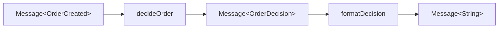

# Tạo phản hồi bằng `MessageBuilder`

## 1. Bài toán: trả dữ liệu nghiệp vụ kèm metadata

Trong **Spring Cloud Function** (`SPRING_CLOUD_FUNCTION`), logic nghiệp vụ có thể được đóng gói thành `Supplier`, `Function` và `Consumer`, đăng ký qua `FunctionCatalog`, ghép bằng *composition* và chạy thông qua HTTP, sự kiện hoặc môi trường serverless. Một hàm `Function<OrderRequest, OrderResult>` đủ dùng khi bên nhận chỉ cần kết quả nghiệp vụ. Nhưng trong những luồng cần mã truy vết (`correlationId`), mã kết quả (`resultCode`) hoặc đơn vị xử lý (`processedBy`), ta có thể trả `Message<OrderResult>`.

`Message<T>` thuộc Spring Messaging, gồm **payload** kiểu `T` và **headers** kiểu `MessageHeaders`. `MessageBuilder` là cách thuận tiện để tạo thông điệp đó:

```java
Message<String> reply = MessageBuilder.withPayload("ACCEPTED")
        .setHeader("correlationId", "req-42")
        .setHeader("resultCode", "ORDER_ACCEPTED")
        .build();
```

Đoạn code tạo **một đối tượng thông điệp trong bộ nhớ**. Nó chưa tự gửi HTTP response, xuất bản sự kiện lên broker hay gọi API serverless: việc vận chuyển và chuyển đổi dữ liệu vẫn thuộc adapter tích hợp.

Sau bài này, bạn sẽ biết tạo phản hồi bằng `MessageBuilder`, chọn và chuyển tiếp các header cần thiết, phân biệt kết quả nghiệp vụ với lỗi giao thức, đồng thời kiểm thử phản hồi mà không cần HTTP server hoặc message broker.

## 2. Vai trò của `MessageBuilder` và những phương thức chính

`MessageBuilder` có tên đầy đủ `org.springframework.messaging.support.MessageBuilder`. Nó tạo đối tượng thực thi `org.springframework.messaging.Message<T>` và cung cấp thao tác bổ sung metadata trước khi gọi `build()`.

```text
          withPayload(data)       fromMessage(existing)
                  \                 /
                   \               /
                       Builder
                         |
                setHeader / copyHeaders
                         |
                       build()
                         |
                     Message<T>
                    /          \
             payload: T     MessageHeaders
```

| Phương thức | Mục đích | Ví dụ sử dụng |
|---|---|---|
| `withPayload(value)` | Tạo builder với payload mới | Kết quả nghiệp vụ vừa được tính |
| `fromMessage(message)` | Khởi tạo builder từ thông điệp đang có | Giữ payload, bổ sung hoặc đổi metadata |
| `setHeader(key, value)` | Ghi hoặc thay header theo khóa | `correlationId`, `processedBy` |
| `setHeaderIfAbsent(key, value)` | Đặt mặc định khi chưa có khóa | Nguồn phát mặc định |
| `copyHeaders(map)` | Sao chép các header từ map | Cần chuyển tiếp nhiều metadata |
| `copyHeadersIfAbsent(map)` | Chỉ chép những khóa builder chưa chứa | Giữ ưu tiên cho giá trị đã đặt |
| `removeHeader(key)` | Bỏ một header | Loại metadata không còn phù hợp |
| `build()` | Hoàn tất thông điệp | Trả về `Message<T>` |

Hai lưu ý quan trọng: với `MessageBuilder.withPayload(...)`, payload phải **khác `null`**; và `MessageHeaders` của thông điệp đã tạo là **map chỉ đọc**. Không dùng `message.getHeaders().put(...)` để cập nhật. Nếu cần phản hồi mới hoặc header khác, hãy tạo thông điệp mới.

## 3. Ví dụ tối thiểu: tạo phản hồi có payload và headers

```java
import org.springframework.messaging.Message;
import org.springframework.messaging.MessageHeaders;
import org.springframework.messaging.support.MessageBuilder;
import org.springframework.util.MimeTypeUtils;

Message<String> reply = MessageBuilder.withPayload("Đã tiếp nhận đơn hàng")
        .setHeader("resultCode", "ORDER_RECEIVED")
        .setHeader("correlationId", "req-42")
        .setHeader(MessageHeaders.CONTENT_TYPE, MimeTypeUtils.TEXT_PLAIN)
        .build();

System.out.println(reply.getPayload());
// Đã tiếp nhận đơn hàng
System.out.println(reply.getHeaders().get("resultCode"));
// ORDER_RECEIVED
System.out.println(reply.getHeaders().get("correlationId"));
// req-42
```

`withPayload("...")` xác định dữ liệu kết quả kiểu `String`. Các lệnh `setHeader(...)` đặt metadata. `MessageHeaders.CONTENT_TYPE` biểu diễn header nội bộ `contentType`; `MimeTypeUtils.TEXT_PLAIN` thể hiện media type `text/plain`, nhưng **không tự thực hiện mã hóa hoặc gửi dữ liệu qua mạng**. `build()` hoàn tất đối tượng `Message<String>`.

Spring Messaging còn có header hệ thống như `id` và `timestamp`. Định danh thông điệp không đồng nghĩa với mã đơn hàng hoặc mã giao dịch; hãy lưu các mã nghiệp vụ trong payload hoặc header được quy ước rõ.

## 4. Ví dụ Spring Cloud Function: trả `Message<OrderDecision>`

Giả sử một hàm nhận sự kiện đơn hàng và trả kết quả duyệt, kèm mã liên kết yêu cầu. Vì cần đọc header đầu vào và tạo header đầu ra, chữ ký thích hợp là `Function<Message<OrderCreated>, Message<OrderDecision>>`. Ví dụ dùng Java 17+:

```java
package com.example.functions;

import java.util.function.Function;

import org.springframework.context.annotation.Bean;
import org.springframework.context.annotation.Configuration;
import org.springframework.messaging.Message;
import org.springframework.messaging.support.MessageBuilder;

@Configuration
public class OrderFunctions {

    public record OrderCreated(String orderId, long amount) {}

    public record OrderDecision(
            String orderId,
            String status,
            String reason
    ) {}

    // Phần xử lý nghiệp vụ thuần, có thể dùng lại.
    private static OrderDecision evaluate(OrderCreated order) {
        boolean accepted = order.orderId() != null
                && !order.orderId().isBlank()
                && order.amount() > 0;

        return new OrderDecision(
                order.orderId(),
                accepted ? "ACCEPTED" : "REJECTED",
                accepted ? "Valid order" : "Invalid id or amount"
        );
    }

    @Bean
    public Function<Message<OrderCreated>, Message<OrderDecision>> decideOrder() {
        return incoming -> {
            OrderDecision decision = evaluate(incoming.getPayload());

            MessageBuilder<OrderDecision> builder = MessageBuilder
                    .withPayload(decision)
                    .setHeader("processedBy", "decideOrder")
                    .setHeader(
                            "resultCode",
                            "ACCEPTED".equals(decision.status())
                                    ? "ORDER_ACCEPTED"
                                    : "ORDER_REJECTED"
                    );

            String correlationId = incoming.getHeaders()
                    .get("correlationId", String.class);

            if (correlationId != null) {
                builder.setHeader("correlationId", correlationId);
            }

            return builder.build();
        };
    }
}
```

Ở đây `evaluate(...)` **không phụ thuộc HTTP, broker hoặc MessageBuilder**. Nó trả một `OrderDecision` từ `OrderCreated` và có thể tái sử dụng trong hàm POJO thuần. `decideOrder()` xử lý vỏ thông điệp: lấy payload, gọi nghiệp vụ, xây response và gắn headers.

Hàm chủ động đặt `processedBy` và `resultCode` từ logic nội bộ. `correlationId` được truyền tiếp nếu có; không sao chép bừa các header khác. Bên gửi có thể chứa header `source`, nhưng hàm này không đưa nó vào đầu ra. Khi dùng `get("correlationId", String.class)`, nếu header tồn tại với kiểu khác `String`, API có thể báo lỗi kiểu; hợp đồng giữa các hệ thống cần quy định và chuẩn hóa kiểu giá trị.

### Gọi hàm trực tiếp

```java
import java.util.function.Function;

import org.springframework.messaging.Message;
import org.springframework.messaging.support.MessageBuilder;

import com.example.functions.OrderFunctions;
import com.example.functions.OrderFunctions.OrderCreated;
import com.example.functions.OrderFunctions.OrderDecision;

Function<Message<OrderCreated>, Message<OrderDecision>> fn =
        new OrderFunctions().decideOrder();

Message<OrderCreated> request = MessageBuilder
        .withPayload(new OrderCreated("ORD-101", 120_000))
        .setHeader("correlationId", "checkout-8")
        .setHeader("source", "checkout-service")
        .build();

Message<OrderDecision> reply = fn.apply(request);

System.out.println(reply.getPayload().status());
// ACCEPTED
System.out.println(reply.getHeaders().get("correlationId"));
// checkout-8
System.out.println(reply.getHeaders().get("resultCode"));
// ORDER_ACCEPTED
System.out.println(reply.getHeaders().get("source"));
// null: không sao chép source từ đầu vào
```

Việc gọi trực tiếp bean `Function` cho phép kiểm tra **chính xác thông điệp do logic của hàm tạo ra**. Khi gọi qua `FunctionCatalog`, HTTP adapter hoặc binder, framework có thể thực hiện thêm chuyển đổi/ánh xạ tùy cách tích hợp.

## 5. `withPayload(...)` khác gì `fromMessage(...)`?

### Tạo payload mới

Khi kết quả là đối tượng khác đầu vào, hãy dùng `withPayload(result)`:

```java
Message<OrderDecision> output = MessageBuilder
        .withPayload(new OrderDecision("ORD-101", "ACCEPTED", "Valid order"))
        .setHeader("correlationId", "checkout-8")
        .build();
```

Đây là lựa chọn thường gặp trong `Function<Message<I>, Message<O>>`: `I` và `O` có thể khác nhau hoàn toàn.

### Giữ payload và bổ sung metadata

Nếu payload giữ nguyên, dùng `fromMessage(existing)` thuận tiện hơn:

```java
Message<String> incoming = MessageBuilder
        .withPayload("order.received")
        .setHeader("correlationId", "req-55")
        .build();

Message<String> annotated = MessageBuilder.fromMessage(incoming)
        .setHeader("processedBy", "eventValidator")
        .build();

// annotated vẫn có payload "order.received".
// annotated có correlationId và processedBy.
```

`fromMessage(...)` sử dụng thông điệp có sẵn để khởi tạo builder; nó không phải công cụ đổi payload từ kiểu `I` sang kiểu `O`. Đừng phụ thuộc vào việc `id` hoặc `timestamp` sẽ luôn giữ nguyên/tạo mới khi sao chép thông điệp: chúng là metadata kỹ thuật có quy tắc riêng, không phải định danh nghiệp vụ xuyên nhiều chặng.

## 6. Ba chiến lược xử lý headers khi trả phản hồi

### A. Chọn lọc các header thực sự cần

```java
Message<String> output = MessageBuilder.withPayload("ACCEPTED")
        .setHeader("correlationId", "req-42")
        .setHeader("processedBy", "orderProcessor")
        .build();
```

Đây là chiến lược dễ kiểm soát vì chỉ đưa vào phản hồi những metadata đã được định nghĩa trong hợp đồng.

### B. Sao chép rồi thay thế hoặc loại bỏ

Nếu hợp đồng yêu cầu giữ nhiều header, bạn có thể dùng:

```java
// incoming là một Message<?> đã được tạo ở bước trước.
Message<String> output = MessageBuilder.withPayload("ACCEPTED")
        .copyHeaders(incoming.getHeaders())
        .removeHeader("source")
        .setHeader("processedBy", "orderProcessor")
        .build();
```

`copyHeaders(...)` đưa headers vào builder, sau đó `setHeader(...)` có thể thay giá trị của khóa trùng tên và `removeHeader(...)` loại khóa không cần thiết. Chỉ nên dùng khi bạn đã xem xét metadata từ nguồn gửi: header có thể chứa `contentType` không còn đúng, thuộc tính của broker hoặc giá trị nhạy cảm.

### C. Giữ header đã đặt, chỉ bổ sung khi thiếu

```java
import java.util.Map;

Message<String> output = MessageBuilder.withPayload("ACCEPTED")
        .setHeader("processedBy", "orderProcessor")
        .copyHeadersIfAbsent(Map.of(
                "processedBy", "upstream",
                "correlationId", "req-42"
        ))
        .build();

// processedBy = "orderProcessor" vì builder đã có giá trị này.
// correlationId = "req-42" vì builder trước đó chưa có.
```

`setHeaderIfAbsent(key, value)` là biến thể hữu ích cho một header. Hãy xác định rõ ưu tiên: metadata do **bước xử lý hiện tại** tạo ra thường cần ghi đè giá trị cùng tên do client khai báo, trong khi một giá trị mặc định chỉ nên bổ sung nếu còn thiếu.

| Header | Chiến lược thường hợp lý | Vì sao? |
|---|---|---|
| `correlationId` | Chuyển tiếp nếu đã kiểm tra đúng kiểu | Liên hệ nhiều chặng của cùng một giao dịch |
| `processedBy`, `resultCode` | Tạo lại tại hàm hiện tại | Thể hiện đúng tác nhân và kết quả vừa xử lý |
| `contentType` | Đánh giá lại theo payload đầu ra | Kiểu/định dạng có thể đã thay đổi |
| `replyChannel`, `errorChannel` | Chỉ giữ khi tích hợp thực sự sử dụng | Metadata riêng của kênh vận chuyển |
| Header broker hoặc retry | Ánh xạ theo hợp đồng adapter | Không có ý nghĩa giống nhau ở mọi giao thức |
| Token, thông tin quyền, `tenantId` | Xác thực và lọc tại biên tin cậy | Header do client tự khai không chứng minh quyền truy cập |

**Lưu ý tính bất biến:** `MessageHeaders` là map chỉ đọc, nhưng nếu một giá trị header tham chiếu đối tượng có thể thay đổi, bản thân đối tượng đó vẫn có thể bị sửa. Với thông điệp cần đi qua broker, ưu tiên các kiểu giá trị nhỏ, rõ ràng và có thể tuần tự hóa.

## 7. Phản hồi có `contentType`: đặt header không phải mã hóa dữ liệu

Mô hình thông điệp, kiểu dữ liệu Java và định dạng truyền trên mạng có vai trò khác nhau:

| Khái niệm | Vai trò |
|---|---|
| `Message<OrderDecision>` | Payload trong code Java là một `OrderDecision` |
| `contentType` | Metadata gợi ý định dạng nội dung tại biên chuyển đổi, ví dụ `application/json` |
| Converter/adapter | Chuyển đổi giữa JSON, bytes, DTO và giao thức vận chuyển |

Ví dụ sau gắn media type JSON cho một phản hồi DTO:

```java
import org.springframework.messaging.Message;
import org.springframework.messaging.MessageHeaders;
import org.springframework.messaging.support.MessageBuilder;
import org.springframework.util.MimeTypeUtils;

import com.example.functions.OrderFunctions.OrderDecision;

OrderDecision decision = new OrderDecision(
        "ORD-101", "ACCEPTED", "Valid order");

Message<OrderDecision> response = MessageBuilder.withPayload(decision)
        .setHeader(MessageHeaders.CONTENT_TYPE, MimeTypeUtils.APPLICATION_JSON)
        .build();
```

Khi đọc `response.getPayload()` trong Java, dữ liệu **vẫn là đối tượng `OrderDecision`**. Header `contentType` không tự chạy bộ chuyển đổi JSON. Nếu adapter có converter phù hợp, nó có thể dùng metadata và chữ ký hàm để xác định cách mã hóa đầu ra.

Nếu kết quả là văn bản thuần, bạn có thể tạo:

```java
Message<String> response = MessageBuilder
        .withPayload("Đơn đã được duyệt")
        .setHeader(MessageHeaders.CONTENT_TYPE, MimeTypeUtils.TEXT_PLAIN)
        .build();
```

Khi hàm đổi payload từ DTO sang `String` hoặc `byte[]`, **không nên sao chép nguyên `contentType` của đầu vào một cách máy móc**. Ngoài ra, header Spring Messaging `contentType` và HTTP `Content-Type` không tự động có cùng quy tắc ánh xạ ở mọi adapter; phải kiểm thử cấu hình đường ra thực tế.

## 8. Phản hồi nghiệp vụ, HTTP status và lỗi hệ thống

`MessageBuilder` biểu diễn dữ liệu kết quả và metadata. Nó không phải API điều khiển trực tiếp HTTP status, acknowledgment của broker hay retry serverless.

| Tình huống | Kết quả hợp lý ở tầng nghiệp vụ | Điều cần lưu ý |
|---|---|---|
| Đơn hợp lệ | `OrderDecision(status="ACCEPTED")` | Bên nhận biết kết quả từ payload |
| Đơn bị từ chối theo quy tắc | `OrderDecision(status="REJECTED")` | Đây có thể là phản hồi nghiệp vụ bình thường |
| Lỗi hệ thống ngoài dự kiến | Ngoại lệ/luồng lỗi được định nghĩa | Adapter quyết định retry, error response, dead-letter... |

Đặt `resultCode=ORDER_REJECTED` **không đồng nghĩa HTTP response sẽ có status 400**. Tương tự, phản hồi có status `REJECTED` cũng không tự khiến binder retry. Nếu API web bắt buộc trả mã HTTP cụ thể, hãy sử dụng cơ chế điều khiển response của lớp tích hợp và xác nhận bằng integration test. Nếu thông điệp cần xuất bản sang broker, phải cấu hình output binding hoặc adapter thích hợp.

## 9. `MessageBuilder` trong `FunctionCatalog` và composition

Hàm `decideOrder` phía trên là một bean Spring Cloud Function. Có thể tra cứu qua `FunctionCatalog` khi Spring context đã đăng ký bean:

```java
import java.util.function.Function;

import org.springframework.cloud.function.context.FunctionCatalog;
import org.springframework.messaging.Message;
import org.springframework.messaging.support.MessageBuilder;

import com.example.functions.OrderFunctions.OrderCreated;
import com.example.functions.OrderFunctions.OrderDecision;

// catalog là bean FunctionCatalog được inject từ Spring context.
Function<Message<OrderCreated>, Message<OrderDecision>> fn =
        catalog.lookup("decideOrder");

Message<OrderCreated> input = MessageBuilder
        .withPayload(new OrderCreated("ORD-102", 80_000))
        .setHeader("correlationId", "checkout-9")
        .build();

Message<OrderDecision> output = fn.apply(input);
```

Giả sử có bean thứ hai `formatDecision` với chữ ký `Function<Message<OrderDecision>, Message<String>>`. Khi các kiểu tương thích, Spring Cloud Function có thể ghép:

```properties
spring.cloud.function.definition=decideOrder|formatDecision
```



Nếu `formatDecision` cần `correlationId`, metadata phải có mặt trong thông điệp sau bước `decideOrder`. Hãy xác định hợp đồng chuyển tiếp headers và kiểm thử trên **chính chuỗi hàm qua `FunctionCatalog`**, bởi wrapping/unwrapping, composition và cơ chế chuyển đổi có thể ảnh hưởng đến thông điệp mà mỗi bước quan sát được.

Với **Spring Cloud Function Web**, adapter nhận HTTP body/headers và thực hiện chuyển đổi phù hợp; với **Spring Cloud Stream**, binder kết nối với broker; trong **serverless**, adapter ánh xạ event của runtime. Logic xây phản hồi bằng `MessageBuilder` có thể dùng lại, nhưng header nào được chuyển thành response header, broker metadata hoặc event field còn phụ thuộc adapter và cấu hình.

## 10. Kiểm thử phản hồi bằng JUnit 5

Đoạn test sau kiểm tra bean `decideOrder` của mục 4 ở mức logic Java, không cần khởi động HTTP server hay broker:

```java
package com.example.functions;

import static org.junit.jupiter.api.Assertions.assertEquals;
import static org.junit.jupiter.api.Assertions.assertNull;

import java.util.function.Function;

import org.junit.jupiter.api.Test;
import org.springframework.messaging.Message;
import org.springframework.messaging.support.MessageBuilder;

import com.example.functions.OrderFunctions.OrderCreated;
import com.example.functions.OrderFunctions.OrderDecision;

class OrderFunctionsTest {

    private final Function<Message<OrderCreated>, Message<OrderDecision>> fn =
            new OrderFunctions().decideOrder();

    @Test
    void acceptedOrderReturnsPayloadAndSelectedHeaders() {
        Message<OrderCreated> input = MessageBuilder
                .withPayload(new OrderCreated("ORD-101", 120_000))
                .setHeader("correlationId", "checkout-8")
                .setHeader("source", "checkout-service")
                .build();

        Message<OrderDecision> result = fn.apply(input);

        assertEquals("ORD-101", result.getPayload().orderId());
        assertEquals("ACCEPTED", result.getPayload().status());
        assertEquals("ORDER_ACCEPTED", result.getHeaders().get("resultCode"));
        assertEquals("decideOrder", result.getHeaders().get("processedBy"));
        assertEquals("checkout-8", result.getHeaders().get("correlationId"));
        assertNull(result.getHeaders().get("source"));

        // Đầu vào vẫn có header ban đầu.
        assertEquals("checkout-service", input.getHeaders().get("source"));
    }

    @Test
    void rejectedOrderIsAnExplicitBusinessResponse() {
        Message<OrderCreated> input = MessageBuilder
                .withPayload(new OrderCreated("ORD-103", -100))
                .build();

        Message<OrderDecision> result = fn.apply(input);

        assertEquals("REJECTED", result.getPayload().status());
        assertEquals("ORDER_REJECTED", result.getHeaders().get("resultCode"));
        assertNull(result.getHeaders().get("correlationId"));
    }

    @Test
    void optionalCorrelationIdCanBeAbsent() {
        Message<OrderCreated> input = MessageBuilder
                .withPayload(new OrderCreated("ORD-104", 10_000))
                .build();

        Message<OrderDecision> result = fn.apply(input);

        assertEquals("ACCEPTED", result.getPayload().status());
        assertNull(result.getHeaders().get("correlationId"));
    }
}
```

Các test xác nhận **payload đầu ra**, **headers của phản hồi** và **đầu vào không bị thay đổi trực tiếp**. Chúng chưa chứng minh HTTP status, JSON serialization hay broker header mapping. Với từng adapter thực tế, cần bổ sung integration test cho đường vào/ra, content type, chuyển đổi DTO và lỗi.

## 11. Những lỗi thường gặp khi xây phản hồi

| Hiện tượng | Nguyên nhân có thể gặp | Hướng xử lý |
|---|---|---|
| Không tạo được phản hồi có payload `null` | Các builder thông dụng yêu cầu payload hợp lệ | Quy ước kiểu kết quả biểu diễn trạng thái không có dữ liệu |
| Mất `correlationId` qua nhiều bước | Thông điệp đầu ra không chuyển header cần thiết | Chọn header theo hợp đồng và kiểm thử từng bước |
| `processedBy` bị giá trị cũ ghi đè | Thứ tự sao chép/đặt header không phù hợp | Ghi header ưu tiên sau `copyHeaders` hoặc dùng `copyHeadersIfAbsent` |
| Header từ HTTP không xuất hiện ở đầu ra | Adapter không tự ánh xạ mọi header nghiệp vụ | Kiểm tra mapping trong adapter |
| Client nhận sai định dạng | `contentType` cũ được giữ sau khi payload đổi kiểu | Định nghĩa lại định dạng đầu ra và cấu hình converter |
| Không thể sửa `message.getHeaders()` | Headers là map chỉ đọc | Dùng `MessageBuilder` tạo thông điệp mới |
| Gắn `resultCode=ERROR` nhưng HTTP vẫn có status thành công | Header nghiệp vụ không điều khiển HTTP status | Xử lý HTTP response qua adapter/lớp tích hợp |

## 12. Bài thực hành: phản hồi kết quả thanh toán

Hãy viết `Function<Message<PaymentRequest>, Message<PaymentResult>>` theo các bước:

1. Tạo DTO `PaymentRequest(paymentId, amount)` và `PaymentResult(paymentId, status, message)`. Nếu `amount > 0` thì `status=APPROVED`, ngược lại `status=DECLINED`.
2. Dùng `MessageBuilder.withPayload(result)` để tạo phản hồi; thêm `processedBy=paymentValidator` và `resultCode` tương ứng.
3. Chuyển tiếp header `correlationId` kiểu `String` nếu có, không sao chép `source` hay metadata nhạy cảm khác.
4. Thử dùng `copyHeaders(...)` thay thế, phân tích rủi ro từ `contentType` và header riêng của broker.
5. Viết unit test cho thanh toán được duyệt, bị từ chối và không có `correlationId`; kiểm tra cả payload và headers.
6. Đăng ký hàm trong `FunctionCatalog`, thử composition với hàm tạo thông báo. Nếu triển khai qua HTTP, sự kiện hoặc serverless, viết thêm integration test xác nhận ánh xạ response.

**Ghi nhớ:** `MessageBuilder` dùng để tạo **phản hồi mang cả payload lẫn metadata**. Chọn `withPayload(...)` khi sinh kết quả mới, `fromMessage(...)` khi giữ payload và bổ sung header, và chỉ truyền tiếp những metadata có ý nghĩa đối với bên nhận. Logic nghiệp vụ vẫn có thể độc lập giao thức; adapter mới quyết định cách thông điệp được chuyển đổi và truyền qua HTTP, broker hoặc serverless.
