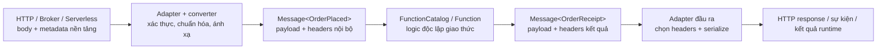

# Ánh xạ HTTP header và metadata nền tảng vào `Message`

## 1. Vì sao cần một lớp ánh xạ metadata?

Trong **SPRING_CLOUD_FUNCTION (Spring Cloud Function)**, logic nghiệp vụ được xây dựng dưới dạng `Supplier`, `Function` và `Consumer`, được đăng ký qua `FunctionCatalog`, có thể ghép bằng *composition* và triển khai qua HTTP, luồng sự kiện hoặc môi trường serverless. Để cùng một hàm tái sử dụng được giữa các cách gọi đó, hàm cần nhìn thấy **dữ liệu và metadata theo một hợp đồng nhất quán**, thay vì phụ thuộc trực tiếp vào `HttpServletRequest`, một bản ghi Kafka hay kiểu event của một nền tảng cloud.

Ví dụ, cùng một sự kiện tạo đơn hàng có thể đi vào hệ thống dưới các dạng:

- HTTP: JSON trong request body và header `X-Correlation-ID: req-42`.
- Broker: payload sự kiện cùng một thuộc tính tương quan trong message headers; có thể kèm topic, partition hoặc delivery metadata.
- Serverless: event envelope chứa dữ liệu nghiệp vụ và các trường ngữ cảnh do nền tảng cung cấp.

Trong hàm nghiệp vụ, ta muốn sử dụng một hợp đồng đơn giản:

```java
Function<Message<OrderPlaced>, Message<OrderReceipt>>
```

Ở đây `Message<T>` là giao diện của **Spring Messaging**, gồm `getPayload()` và `getHeaders()`. Hàm chỉ cần biết header nội bộ tên `correlationId`, không phải nơi nhận ban đầu dùng `X-Correlation-ID`, một message attribute hay một trường của event envelope.

**Ánh xạ metadata** là quá trình lựa chọn, kiểm tra kiểu, chuẩn hóa tên và chuyển những thông tin từ giao thức/nền tảng sang `MessageHeaders`; quá trình ngược lại có thể đưa một số header của kết quả sang giao thức đầu ra. Nó **không** đồng nghĩa sao chép toàn bộ header bên ngoài vào thông điệp.

Mục tiêu của bài học là phân biệt metadata ở từng lớp, hiểu hành vi của adapter, thực hiện ánh xạ HTTP minh bạch, xử lý dữ liệu CloudEvents và broker/serverless, đồng thời kiểm thử cả chiều vào lẫn chiều ra.

## 2. Ba lớp thông tin trên đường đi của một yêu cầu



| Lớp | Ví dụ | Trách nhiệm |
|---|---|---|
| Giao thức hoặc nền tảng | HTTP `Content-Type`, `X-Correlation-ID`, Kafka offset, CloudEvents `ce-id` | Mang thông tin gắn với phương thức truyền |
| `Message<T>` trong ứng dụng | Payload `OrderPlaced`; headers `correlationId`, `eventId` | Tạo hợp đồng ổn định cho xử lý nghiệp vụ |
| Logic nghiệp vụ | `Function<Message<OrderPlaced>, Message<OrderReceipt>>` | Đọc những metadata cần thiết, xử lý và sinh kết quả |

Spring Cloud Function cung cấp cơ chế thích ứng cho các kiểu hàm và chuyển đổi thông điệp. **Việc một header cụ thể có tự xuất hiện trong `MessageHeaders`, mang tên nào và có kiểu dữ liệu nào phụ thuộc vào adapter, phiên bản, cấu hình và cách gọi thực tế.** Vì vậy, với header quan trọng cho nghiệp vụ, hãy xác định hợp đồng và viết kiểm thử tích hợp.

## 3. Phân loại HTTP header trước khi ánh xạ

HTTP headers có nhiều mục đích khác nhau. Không phải mọi header đều cần trở thành metadata cho hàm:

| HTTP header | Ý nghĩa ở ranh giới HTTP | Cách xử lý khi tạo `Message` |
|---|---|---|
| `Content-Type` | Định dạng request body, ví dụ `application/json` | Để converter xử lý; ánh xạ sang `contentType` nội bộ khi phù hợp |
| `Accept` | Định dạng response mà client có thể chấp nhận | Thường thuộc HTTP content negotiation, không cần đưa vào nghiệp vụ |
| `X-Correlation-ID` | Mã tương quan theo quy ước hệ thống, không phải header chuẩn bắt buộc | Kiểm tra rồi chuẩn hóa thành `correlationId` |
| `traceparent`, `tracestate` | Ngữ cảnh distributed tracing theo W3C | Ưu tiên thư viện tracing/observability quản lý |
| `Authorization`, `Cookie` | Thông tin xác thực hoặc phiên | Xử lý ở lớp bảo mật; không chuyển nguyên giá trị qua các hàm |
| `X-Tenant-ID`, `X-User-ID` | Giá trị có thể do client tự khai báo | Chỉ dùng khi được xác thực và ràng buộc với danh tính đáng tin cậy |
| `Host`, `Connection`, `Content-Length` | Metadata truyền tải HTTP | Không đưa nguyên xi vào hợp đồng nghiệp vụ |

Chẳng hạn, hai HTTP requests sau có cùng ý nghĩa vì tên header HTTP **không phân biệt chữ hoa/thường**:

```http
POST /orders HTTP/1.1
Content-Type: application/json
X-Correlation-ID: checkout-42

{"orderId":"ORD-42","amount":150000}
```

```http
POST /orders HTTP/1.1
content-type: application/json
x-correlation-id: checkout-42

{"orderId":"ORD-42","amount":150000}
```

Tuy nhiên, `MessageHeaders` là map khóa chuỗi trong Java: `"correlationId"`, `"CorrelationId"` và `"X-Correlation-ID"` **không phải một khóa duy nhất**. Lớp tích hợp nên đưa tất cả về một tên nội bộ đã thống nhất.

Một HTTP header cũng có thể có nhiều giá trị. Với header dùng làm một định danh duy nhất, nên định nghĩa rõ quy tắc khi client gửi nhiều giá trị hoặc chuỗi không hợp lệ, thay vì âm thầm lấy bất kỳ giá trị nào.

## 4. Hai cách xử lý HTTP trong ứng dụng Spring Cloud Function

### Cách 1: Dùng Spring Cloud Function Web adapter

Spring Cloud Function Web có thể công bố các bean hàm như endpoint HTTP. Web adapter tiếp nhận request, chọn hàm, xử lý body và thực hiện chuyển đổi phù hợp với chữ ký của hàm và cấu hình converter. Khi sử dụng `Message<T>` ở đầu vào, framework có thể cung cấp metadata từ request theo cơ chế của adapter.

Ví dụ chữ ký một bean:

```java
@Bean
public Function<Message<OrderPlaced>, Message<OrderReceipt>> handleOrder() {
    return incoming -> MessageBuilder
            .withPayload(new OrderReceipt(
                    incoming.getPayload().orderId(), "ACCEPTED"))
            .build();
}
```

Đây là minh họa tối giản với DTO `OrderPlaced` và `OrderReceipt` sẽ được khai báo đầy đủ ở mục 5. Khi chỉ sử dụng Web adapter, bạn không phải tự viết `@RestController` cho mỗi hàm. Tuy nhiên, **đừng giả định** rằng header HTTP `X-Correlation-ID` luôn được đổi tên thành `correlationId`, hay một `Message` đầu ra có header `resultCode` thì HTTP response chắc chắn có header đó. Hãy dùng integration test để kiểm tra mapping cụ thể ở stack web đang chạy.

### Cách 2: Viết lớp HTTP mỏng để chủ động ánh xạ

Nếu hệ thống cần tên header nội bộ cố định, chính sách kiểm tra dữ liệu hoặc ánh xạ response riêng, có thể đặt một `@RestController` làm lớp biên. Controller nhận `HttpHeaders` và body, xây `Message` đầu vào, gọi bean `Function` rồi tạo response HTTP từ **những thông tin được phép xuất ra**. Phần nghiệp vụ vẫn độc lập với HTTP.

Các mục tiếp theo minh họa cách thứ hai bằng Spring MVC và Java 17+.

## 5. Ví dụ hoàn chỉnh: chuẩn hóa HTTP header thành `MessageHeaders`

### 5.1. Logic nghiệp vụ không biết HTTP header là gì

Tạo bean hàm xử lý đơn hàng. Bean chỉ nhận tên header chuẩn hóa là `correlationId` và tự tạo thông tin `processedBy` ở đầu ra:

```java
package com.example.orders;

import java.util.function.Function;

import org.springframework.context.annotation.Bean;
import org.springframework.context.annotation.Configuration;
import org.springframework.messaging.Message;
import org.springframework.messaging.support.MessageBuilder;

@Configuration
public class OrderFunctions {

    public record OrderPlaced(String orderId, long amount) {}
    public record OrderReceipt(String orderId, String status) {}

    @Bean
    public Function<Message<OrderPlaced>, Message<OrderReceipt>> handleOrder() {
        return incoming -> {
            OrderPlaced order = incoming.getPayload();
            boolean valid = order.orderId() != null
                    && !order.orderId().isBlank()
                    && order.amount() > 0;

            OrderReceipt receipt = new OrderReceipt(
                    order.orderId(),
                    valid ? "ACCEPTED" : "REJECTED"
            );

            MessageBuilder<OrderReceipt> builder = MessageBuilder
                    .withPayload(receipt)
                    .setHeader("processedBy", "handleOrder");

            String correlationId = incoming.getHeaders()
                    .get("correlationId", String.class);
            if (correlationId != null) {
                builder.setHeader("correlationId", correlationId);
            }
            return builder.build();
        };
    }
}
```

Nếu gọi hàm trực tiếp bằng một `Message<OrderPlaced>`, nó xử lý được mà không cần servlet, broker hay event cloud. Trường `status=REJECTED` minh họa kết quả nghiệp vụ; mã HTTP tương ứng là quyết định của lớp HTTP.

### 5.2. Controller ánh xạ ở chiều HTTP → `Message`

Ví dụ này dùng Spring MVC. Giả định ứng dụng có Spring Web và Spring Cloud Function, đã đăng ký bean `handleOrder` ở trên.

```java
package com.example.orders;

import java.util.List;
import java.util.UUID;
import java.util.function.Function;

import org.springframework.beans.factory.annotation.Qualifier;
import org.springframework.http.HttpHeaders;
import org.springframework.http.HttpStatus;
import org.springframework.http.MediaType;
import org.springframework.http.ResponseEntity;
import org.springframework.messaging.Message;
import org.springframework.messaging.support.MessageBuilder;
import org.springframework.web.bind.annotation.PostMapping;
import org.springframework.web.bind.annotation.RequestBody;
import org.springframework.web.bind.annotation.RequestHeader;
import org.springframework.web.bind.annotation.RestController;
import org.springframework.web.server.ResponseStatusException;

import com.example.orders.OrderFunctions.OrderPlaced;
import com.example.orders.OrderFunctions.OrderReceipt;

@RestController
public class OrderHttpController {

    private final Function<Message<OrderPlaced>, Message<OrderReceipt>> handler;

    public OrderHttpController(
            @Qualifier("handleOrder")
            Function<Message<OrderPlaced>, Message<OrderReceipt>> handler) {
        this.handler = handler;
    }

    @PostMapping(
            path = "/orders",
            consumes = MediaType.APPLICATION_JSON_VALUE,
            produces = MediaType.APPLICATION_JSON_VALUE
    )
    public ResponseEntity<OrderReceipt> accept(
            @RequestBody OrderPlaced body,
            @RequestHeader HttpHeaders httpHeaders) {

        String correlationId = readCorrelationId(httpHeaders);

        // Ánh xạ HTTP body và header đã chuẩn hóa vào Message nội bộ.
        Message<OrderPlaced> incoming = MessageBuilder.withPayload(body)
                .setHeader("correlationId", correlationId)
                .setHeader("source", "http-api")
                .build();

        Message<OrderReceipt> outgoing = handler.apply(incoming);

        // Chỉ xuất các metadata được công bố trong hợp đồng HTTP.
        HttpHeaders responseHeaders = new HttpHeaders();
        responseHeaders.set(
                "X-Correlation-ID",
                outgoing.getHeaders().get("correlationId", String.class));
        responseHeaders.set(
                "X-Processed-By",
                outgoing.getHeaders().get("processedBy", String.class));

        return new ResponseEntity<>(
                outgoing.getPayload(), responseHeaders, HttpStatus.OK);
    }

    private static String readCorrelationId(HttpHeaders headers) {
        // HttpHeaders hỗ trợ tra cứu HTTP header không phân biệt hoa/thường.
        List<String> values = headers.get("X-Correlation-ID");

        if (values == null || values.isEmpty()) {
            return UUID.randomUUID().toString();
        }

        // Với hợp đồng định danh đơn, không chấp nhận nhiều giá trị.
        if (values.size() != 1
                || !values.get(0).matches("[A-Za-z0-9._-]{1,64}")) {
            throw new ResponseStatusException(
                    HttpStatus.BAD_REQUEST, "Invalid X-Correlation-ID");
        }
        return values.get(0);
    }
}
```

Hãy chú ý những quyết định diễn ra tại ranh giới:

1. Spring MVC giải mã JSON request body thành `OrderPlaced` bằng converter phù hợp với `Content-Type`. `MessageBuilder` không tự phân tích JSON.
2. `HttpHeaders` được đọc bằng tên HTTP `X-Correlation-ID`, kiểm tra giới hạn độ dài, bộ ký tự và số giá trị; khi không có, controller tạo một mã mới.
3. Controller dùng tên nội bộ **`correlationId`** và bổ sung `source=http-api`. Hàm `handleOrder` không phải biết header HTTP ban đầu mang tên gì.
4. Hàm trả `Message<OrderReceipt>`. Controller chỉ ánh xạ `correlationId` và `processedBy` thành response headers; không sao chép toàn bộ `MessageHeaders`.
5. `ResponseEntity` quyết định HTTP status, response body và headers. Ví dụ cố ý trả `200 OK` cho cả `ACCEPTED` và `REJECTED`, vì `REJECTED` được xem là kết quả nghiệp vụ; một API khác có thể quy định mã HTTP khác.

**Ví dụ gọi endpoint riêng của controller:**

```bash
curl -i -X POST http://localhost:8080/orders \
  -H "Content-Type: application/json" \
  -H "X-Correlation-ID: checkout-42" \
  -d '{"orderId":"ORD-42","amount":150000}'
```

Phản hồi minh họa (các HTTP headers khác do server thêm vào có thể khác):

```http
HTTP/1.1 200 OK
Content-Type: application/json
X-Correlation-ID: checkout-42
X-Processed-By: handleOrder

{"orderId":"ORD-42","status":"ACCEPTED"}
```

Đường dẫn `/orders` và cách ánh xạ response này thuộc **controller minh họa**, không phải cam kết về endpoint hoặc tên header mặc định do Spring Cloud Function Web adapter tự sinh.

## 6. Phân biệt `Content-Type`, `Accept` và `contentType` nội bộ

Một nhầm lẫn thường gặp là coi tất cả “content type” là một đối tượng duy nhất.

| Thông tin | Ở đâu? | Câu hỏi nó trả lời |
|---|---|---|
| HTTP request `Content-Type` | HTTP headers ở phía gửi | Client gửi body dưới định dạng nào? |
| HTTP request `Accept` | HTTP headers ở phía gửi | Client có thể nhận định dạng phản hồi nào? |
| `MessageHeaders.CONTENT_TYPE`, tức `contentType` | Spring Messaging `MessageHeaders` | Payload của thông điệp được kỳ vọng chuyển đổi theo định dạng nào? |
| HTTP response `Content-Type` | HTTP headers ở phía trả kết quả | Server đang trả response body dưới định dạng nào? |

Ví dụ, hàm có thể nhận `Message<OrderPlaced>` dù HTTP request body ban đầu là JSON text. Spring MVC hoặc adapter/converter đã thực hiện bước chuyển từ JSON thành Java DTO. Ngược lại, `Message<OrderReceipt>` có payload là DTO, chứ không tự chứa bytes JSON chỉ vì header `contentType` mang `application/json`.

```java
import org.springframework.messaging.Message;
import org.springframework.messaging.MessageHeaders;
import org.springframework.messaging.support.MessageBuilder;
import org.springframework.util.MimeTypeUtils;

import com.example.orders.OrderFunctions.OrderReceipt;

Message<OrderReceipt> outgoing = MessageBuilder
        .withPayload(new OrderReceipt("ORD-42", "ACCEPTED"))
        .setHeader(MessageHeaders.CONTENT_TYPE, MimeTypeUtils.APPLICATION_JSON)
        .build();
```

Trong đoạn này, `getPayload()` vẫn trả đối tượng `OrderReceipt`. Header chỉ biểu thị metadata có thể được converter/adapter sử dụng. Khi công bố HTTP API bằng controller ở mục 5, Spring MVC thực hiện mã hóa response body dựa vào converter và cấu hình media type.

Nếu một `Function` biến đổi payload từ DTO thành `String` hoặc `byte[]`, việc sao chép `contentType` cũ có thể gây hiểu sai định dạng đầu ra. Hãy xác định lại hợp đồng media type và kiểm thử nội dung truyền thực tế.

## 7. Ánh xạ CloudEvents: metadata sự kiện không phải body nghiệp vụ

**CloudEvents** là một đặc tả phổ biến để mô tả sự kiện trên nhiều giao thức. Một CloudEvent có các thuộc tính ngữ cảnh như `specversion`, `id`, `source` và `type`, kèm `data` chứa dữ liệu sự kiện. Khi vận chuyển qua HTTP, có hai hình thức thường gặp:

**Binary content mode:** body chứa dữ liệu sự kiện; các thuộc tính context được biểu diễn bằng HTTP headers `ce-*` (còn content type của dữ liệu có thể đi qua HTTP `Content-Type`).

```http
POST /events HTTP/1.1
Content-Type: application/json
ce-specversion: 1.0
ce-id: evt-1001
ce-source: /checkout
ce-type: com.example.order.placed

{"orderId":"ORD-42","amount":150000}
```

**Structured content mode:** toàn bộ event envelope nằm trong body, thường là JSON với media type `application/cloudevents+json`:

```json
{
  "specversion": "1.0",
  "id": "evt-1001",
  "source": "/checkout",
  "type": "com.example.order.placed",
  "data": {
    "orderId": "ORD-42",
    "amount": 150000
  }
}
```

Nếu chuẩn hóa hai hình thức này thành hợp đồng nội bộ, ta có thể chọn:

| CloudEvents | Header nội bộ đề xuất | Lưu ý |
|---|---|---|
| `id` / HTTP `ce-id` | `eventId` | Định danh sự kiện trong ngữ cảnh nguồn phát, khác `MessageHeaders.ID` |
| `source` / `ce-source` | `eventSource` | Nguồn phát sự kiện, không đồng nghĩa danh tính đã xác thực |
| `type` / `ce-type` | `eventType` | Phân loại sự kiện, ví dụ `com.example.order.placed` |
| `specversion` / `ce-specversion` | Có thể lưu `eventSpecVersion` nếu thật sự cần | Phần xác nhận envelope thuộc adapter |
| `data` | `Message<OrderPlaced>.getPayload()` | Chỉ giải mã thành DTO sau khi kiểm tra định dạng |

Ví dụ xây thông điệp **sau khi adapter đã giải mã và xác thực context sự kiện**:

```java
OrderPlaced order = new OrderPlaced("ORD-42", 150000);

Message<OrderPlaced> incoming = MessageBuilder.withPayload(order)
        .setHeader("eventId", "evt-1001")
        .setHeader("eventSource", "/checkout")
        .setHeader("eventType", "com.example.order.placed")
        .build();
```

CloudEvents `id` là định danh của **sự kiện**; `correlationId` là quy ước của ứng dụng để liên hệ nhiều bước xử lý. Không nên tự đồng nhất hai giá trị. Tương tự, `traceparent` thuộc ngữ cảnh distributed tracing và không tự trở thành `correlationId`.

Đặc biệt, **không phải mọi HTTP request JSON đều là CloudEvent**, và không phải cứ có `ce-id` thì mọi adapter Spring Cloud Function sẽ tự tạo header nội bộ `eventId`. Ứng dụng cần xác định hình thức CloudEvents đang sử dụng và kiểm tra cơ chế chuyển đổi của adapter/thư viện được cấu hình.

## 8. Metadata từ broker và môi trường serverless

Khi dùng **Spring Cloud Stream** với binder, hoặc một serverless adapter, metadata xuất phát từ hệ thống vận chuyển và event envelope. Chúng không nhất thiết có tên giống HTTP headers.

| Nguồn | Metadata có thể gặp | Nên đưa vào `MessageHeaders` theo cách nào? |
|---|---|---|
| Kafka qua binder | Record key, topic, partition, offset, timestamp, record headers | Để binder/adapter trích xuất; chỉ chuẩn hóa trường nghiệp vụ thật sự cần |
| RabbitMQ qua binder | Routing key, message properties, delivery metadata | Đọc qua adapter/binder; không gắn chặt logic nghiệp vụ với tên header riêng của RabbitMQ |
| AWS API Gateway / Lambda | HTTP headers, request context, request ID, event metadata | Adapter giải mã envelope; xác định metadata nào đáng tin và được chuyển tiếp |
| AWS SQS / Lambda | `messageId`, message attributes, receipt handle, thời gian nhận | Phân biệt định danh sự kiện, tương quan nghiệp vụ và cơ chế xác nhận/xóa message |
| CloudEvents qua HTTP/broker | `id`, `source`, `type`, `subject`, `time`, extension attributes | Chuẩn hóa khi ứng dụng thực sự dùng CloudEvents, không suy đoán rằng chúng luôn có sẵn |

Ví dụ, ứng dụng có thể chọn một hợp đồng:

```text
HTTP:       X-Correlation-ID = "checkout-42"
Broker:     message attribute "correlation_id" = "checkout-42"
Serverless: event.detail.correlationId = "checkout-42"
                       |
            [adapter chuẩn hóa]
                       v
MessageHeaders["correlationId"] = "checkout-42"
                       |
                handleOrder()
```

Các dòng trên minh họa **quy ước thiết kế**. `correlation_id` và `event.detail.correlationId` không phải trường được tất cả binder hay nền tảng cloud cung cấp sẵn. Chính hợp đồng của phía gửi/adapter quyết định nơi lấy giá trị.

Không nên đưa thông tin như Kafka offset, SQS receipt handle, thông tin nhận lại message hoặc object request context của runtime vào payload nghiệp vụ để “giữ cho tiện”. Chúng mang ý nghĩa vận chuyển hoặc điều khiển vòng đời bản tin; các bước độc lập giao thức thường không cần và không nên phụ thuộc vào chúng.

### Loại dữ liệu của header cũng quan trọng

`MessageHeaders` là `Map<String, Object>`. Giá trị có thể là `String`, số, timestamp, `byte[]` hoặc kiểu đối tượng do adapter đặt vào; chúng không nhất thiết là chuỗi giống JSON. Ví dụ:

```java
static String readOptionalCorrelationId(Message<?> incoming) {
    Object raw = incoming.getHeaders().get("correlationId");
    if (raw == null) {
        return null;
    }
    if (raw instanceof String correlationId) {
        return correlationId;
    }
    throw new IllegalArgumentException("correlationId must be a String");
}
```

Đừng ép kiểu trực tiếp mọi header thành `String`, và đừng giả định mọi giá trị có thể tuần tự hóa qua mọi broker. Với thông điệp cần chuyển qua nhiều hệ thống, ưu tiên kiểu đơn giản và quy ước định dạng nhất quán.

## 9. Ranh giới tin cậy: header nào được phép trở thành dữ liệu nghiệp vụ?

HTTP headers và metadata sự kiện có thể đến từ bên ngoài, bị giả mạo hoặc bị gửi sai định dạng. Vì vậy, lớp ánh xạ phải là nơi **kiểm tra nguồn và kiểm tra giá trị** trước khi metadata ảnh hưởng tới quyết định nghiệp vụ.

Một số nguyên tắc thực tế:

1. **Không tin metadata phân quyền do client tự khai báo.** `X-User-ID` hoặc `X-Tenant-ID` không chứng minh danh tính. Nếu cần tenant trong `Message`, lấy từ principal/claims đã xác thực và đã được ủy quyền tại ranh giới tin cậy.
2. **Giới hạn kích thước và tập ký tự của định danh.** Với `X-Correlation-ID` trong ví dụ, bộ ký tự và độ dài được kiểm tra trước khi ánh xạ; giá trị không hợp lệ nhận HTTP 400. Điều này hạn chế dữ liệu khó quản lý trong log và tracing.
3. **Quy định chính sách cho header trùng lặp.** Một định danh nghiệp vụ đơn nên được cung cấp theo quy tắc đơn giá trị. Không gộp bừa nhiều giá trị rồi sử dụng như một ID.
4. **Không sao chép `Authorization`, cookies, token hoặc toàn bộ request context.** Chỉ chuyển tiếp metadata phục vụ chức năng được phép, tránh lộ thông tin qua broker, log và các dịch vụ kế tiếp.
5. **Dùng thư viện quan sát cho trace context.** `traceparent` và `tracestate` cần tuân thủ chuẩn và cơ chế propagation; tự xây lại dễ làm đứt luồng tracing hoặc tạo ngữ cảnh sai.
6. **Phân biệt nguồn tin cậy của `X-Forwarded-*`.** Chỉ sử dụng các giá trị do reverse proxy/gateway đáng tin cậy thiết lập theo cấu hình hệ thống.

Nếu cần chuyển ngữ cảnh người dùng qua một chuỗi hàm, hãy truyền **thông tin đã được xác minh và tối thiểu cần thiết**, không chuyển thẳng tất cả HTTP headers. Cùng một bài toán phân quyền cần được kiểm tra lại ở điểm xử lý phù hợp, thay vì chỉ dựa vào việc một header đã đi qua adapter.

## 10. Ánh xạ ngược từ `Message` ra HTTP hoặc sự kiện

Đầu ra của một hàm có thể chứa dữ liệu và metadata:

```java
Message<OrderReceipt> result = MessageBuilder
        .withPayload(new OrderReceipt("ORD-42", "ACCEPTED"))
        .setHeader("correlationId", "checkout-42")
        .setHeader("processedBy", "handleOrder")
        .setHeader("resultCode", "ORDER_ACCEPTED")
        .build();
```

Ánh xạ ra HTTP nên được định nghĩa tường minh. Ví dụ, `correlationId` có thể thành `X-Correlation-ID`; `resultCode` có thể nằm trong response body hoặc header nếu hợp đồng API yêu cầu. Nhưng `MessageHeaders.ID`, `timestamp`, metadata broker hay dữ liệu bảo mật không mặc nhiên cần thành HTTP response header.

Nếu một adapter khác dùng `Message<OrderReceipt>` để công bố sự kiện, nó có thể cần serialization, output binding, event type và lựa chọn message headers riêng. **Không có bảo đảm “trả `Message` là tự động phát sự kiện”** nếu chưa có adapter và cấu hình đường ra tương ứng.

Việc đặt `resultCode=ORDER_REJECTED` trong header cũng **không tự làm HTTP status trở thành 400** hoặc làm binder retry. HTTP status, acknowledgment, retry, dead-letter và mã lỗi runtime là hành vi của tầng tích hợp. Hãy phân biệt **kết quả nghiệp vụ** với **lỗi kỹ thuật**.

## 11. `FunctionCatalog`, composition và hợp đồng metadata

Khi đăng ký bean `handleOrder`, có thể tra cứu và gọi qua `FunctionCatalog`:

```java
import java.util.function.Function;

import org.springframework.cloud.function.context.FunctionCatalog;
import org.springframework.messaging.Message;
import org.springframework.messaging.support.MessageBuilder;

import com.example.orders.OrderFunctions.OrderPlaced;
import com.example.orders.OrderFunctions.OrderReceipt;

// catalog được inject từ Spring context.
Function<Message<OrderPlaced>, Message<OrderReceipt>> fn =
        catalog.lookup("handleOrder");

Message<OrderPlaced> incoming = MessageBuilder
        .withPayload(new OrderPlaced("ORD-50", 210_000))
        .setHeader("correlationId", "req-50")
        .build();

Message<OrderReceipt> result = fn.apply(incoming);
```

Giả sử hàm thứ hai có chữ ký `Function<Message<OrderReceipt>, Message<String>>` và cần `correlationId`. Khi kiểu đầu ra/đầu vào tương thích, có thể dùng composition:

```properties
spring.cloud.function.definition=handleOrder|formatReceipt
```

Điều kiện quan trọng là **header mà hàm sau cần phải có mặt và đúng kiểu ở ranh giới giữa hai bước**. Một hàm trung gian có thể tạo `Message` mới và làm mất metadata nếu không chuyển tiếp. Việc wrapping/unwrapping hoặc lan truyền header của Spring Cloud Function cũng có thể phụ thuộc chữ ký và phiên bản; hãy kiểm thử đúng tổ hợp được gọi qua `FunctionCatalog`.

Một cách tổ chức ổn định là để **mỗi adapter** chuyển metadata từ giao thức bên ngoài thành hợp đồng nội bộ (`correlationId`, `eventId`, v.v.), rồi để các hàm logic xử lý các tên chuẩn hóa đó. Những yêu cầu riêng của HTTP hoặc binder được giữ ở lớp biên, không len vào xử lý nghiệp vụ.

## 12. Kiểm thử hai cấp: logic hàm và ánh xạ HTTP

### 12.1. Unit test cho bean `Function`

Không cần khởi động HTTP server để xác minh hàm dùng đúng payload/header:

```java
package com.example.orders;

import static org.junit.jupiter.api.Assertions.assertEquals;
import static org.junit.jupiter.api.Assertions.assertNull;

import java.util.function.Function;

import org.junit.jupiter.api.Test;
import org.springframework.messaging.Message;
import org.springframework.messaging.support.MessageBuilder;

import com.example.orders.OrderFunctions.OrderPlaced;
import com.example.orders.OrderFunctions.OrderReceipt;

class OrderFunctionsTest {

    @Test
    void usesNormalizedCorrelationHeader() {
        Function<Message<OrderPlaced>, Message<OrderReceipt>> fn =
                new OrderFunctions().handleOrder();

        Message<OrderPlaced> request = MessageBuilder
                .withPayload(new OrderPlaced("ORD-42", 150000))
                .setHeader("correlationId", "checkout-42")
                .setHeader("source", "http-api")
                .build();

        Message<OrderReceipt> result = fn.apply(request);

        assertEquals("ACCEPTED", result.getPayload().status());
        assertEquals("checkout-42",
                result.getHeaders().get("correlationId"));
        assertEquals("handleOrder",
                result.getHeaders().get("processedBy"));
        assertNull(result.getHeaders().get("source"));
    }
}
```

Test này chứng minh logic chỉ phụ thuộc tên nội bộ `correlationId`, không cần biết request đến từ HTTP hay một broker.

### 12.2. Test ánh xạ tại controller bằng Spring MVC

Với controller `OrderHttpController` ở mục 5, có thể kiểm tra việc đọc HTTP header, trả response header và giải mã JSON. Ví dụ với Spring Boot Test, Spring MVC Test và JUnit 5:

```java
package com.example.orders;

import static org.springframework.test.web.servlet.request.MockMvcRequestBuilders.post;
import static org.springframework.test.web.servlet.result.MockMvcResultMatchers.*;

import org.junit.jupiter.api.Test;
import org.springframework.beans.factory.annotation.Autowired;
import org.springframework.boot.test.autoconfigure.web.servlet.WebMvcTest;
import org.springframework.context.annotation.Import;
import org.springframework.http.MediaType;
import org.springframework.test.web.servlet.MockMvc;

@WebMvcTest(OrderHttpController.class)
@Import(OrderFunctions.class)
class OrderHttpControllerTest {

    @Autowired
    private MockMvc mvc;

    @Test
    void mapsHttpHeaderToMessageAndBack() throws Exception {
        mvc.perform(post("/orders")
                .contentType(MediaType.APPLICATION_JSON)
                .header("x-correlation-id", "checkout-42")
                .content("{\"orderId\":\"ORD-42\",\"amount\":150000}"))
            .andExpect(status().isOk())
            .andExpect(header().string("X-Correlation-ID", "checkout-42"))
            .andExpect(header().string("X-Processed-By", "handleOrder"))
            .andExpect(jsonPath("$.status").value("ACCEPTED"));
    }

    @Test
    void rejectsInvalidCorrelationId() throws Exception {
        mvc.perform(post("/orders")
                .contentType(MediaType.APPLICATION_JSON)
                .header("X-Correlation-ID", "bad value!")
                .content("{\"orderId\":\"ORD-43\",\"amount\":5000}"))
            .andExpect(status().isBadRequest());
    }
}
```

Trong ứng dụng có Spring Security hoặc cấu hình filter riêng, test web cần bổ sung thiết lập xác thực/CSRF thích hợp. Các test trên nhắm vào quy tắc của controller minh họa, chưa thay thế việc kiểm thử đường gọi thực tế của **Spring Cloud Function Web adapter**, Spring Cloud Stream binder hoặc serverless adapter.

Nên bổ sung các ca kiểm tra sau cho môi trường triển khai:

| Ca kiểm tra | Kết quả cần xác minh |
|---|---|
| Header HTTP viết hoa/thường khác nhau | Được chuẩn hóa về một header nội bộ |
| Không có `X-Correlation-ID` | Tạo mã mới hoặc xử lý theo chính sách đã công bố |
| Header trùng lặp, quá dài, sai định dạng | Không âm thầm chấp nhận định danh mơ hồ |
| Payload JSON không hợp lệ hoặc content type sai | Converter/adapter trả lỗi phù hợp |
| Chuỗi hai `Function` | `correlationId` còn tồn tại và đúng kiểu ở bước kế tiếp |
| Broker/serverless event | Metadata thực tế được trích xuất và ánh xạ đúng, không phụ thuộc giả định của HTTP |
| Response HTTP hoặc sự kiện | Chỉ các metadata đã định nghĩa được truyền ra ngoài |

## 13. Lỗi thường gặp và hướng khắc phục

| Hiện tượng | Nguyên nhân có thể xảy ra | Cách xử lý |
|---|---|---|
| `incoming.getHeaders().get("correlationId")` trả `null` khi client gửi `X-Correlation-ID` | Không có bước đổi tên header, hoặc adapter giữ tên khác | Chuẩn hóa ở biên và kiểm thử mapping |
| HTTP dùng `x-correlation-id` nhưng code chỉ tra cứu một biến thể | Nhầm quy tắc tên header HTTP với map nội bộ | Dùng `HttpHeaders` ở biên; chỉ lưu tên chuẩn nội bộ |
| Hàm nhận `String`/`byte[]` thay vì DTO | Converter, content type hoặc chữ ký không phù hợp | Kiểm tra cấu hình chuyển đổi và dữ liệu thực tế |
| Sai kiểu khi đọc header | Adapter cung cấp số/list/bytes nhưng code ép `String` | Xác minh kiểu, chuyển đổi rõ ràng ở biên |
| Header broker tự xuất hiện trong HTTP response | Sao chép toàn bộ `MessageHeaders` không chọn lọc | Chỉ xuất các header nằm trong hợp đồng response |
| Dùng `ce-id` làm mã theo dõi mọi yêu cầu | Nhầm event ID với correlation ID | Phân biệt định danh sự kiện, thông điệp và luồng nghiệp vụ |
| Tin vào `X-Tenant-ID` hoặc quyền do client gửi | Bỏ qua xác thực/ủy quyền | Lấy ngữ cảnh danh tính từ nguồn đã được xác minh |
| Có `resultCode=ERROR` nhưng HTTP status vẫn 200 | Header nghiệp vụ không quyết định HTTP status | Ánh xạ status ở lớp HTTP theo hợp đồng API |
| Hàm chạy đúng qua HTTP nhưng sai khi chuyển sang broker | Tên/kiểu metadata và conversion khác adapter | Chuẩn hóa theo hợp đồng nội bộ và có test tích hợp cho mỗi adapter |

## 14. Bài thực hành: thống nhất metadata cho ba nguồn sự kiện

Hãy xây một hàm `Function<Message<PaymentRequested>, Message<PaymentDecision>>` độc lập với giao thức, nhận payload gồm `paymentId` và `amount`. Hàm trả `APPROVED` khi số tiền dương, `DECLINED` khi không hợp lệ; kết quả kèm `processedBy=paymentValidator` và giữ `correlationId` nếu có.

1. Thiết kế một hợp đồng header nội bộ với `correlationId`, `eventId` và `eventSource`; giải thích header nào bắt buộc, header nào tùy chọn.
2. Với HTTP, nhận `X-Correlation-ID` và JSON body, kiểm tra đầu vào rồi tạo `Message<PaymentRequested>`.
3. Với CloudEvents, hỗ trợ dữ liệu `id/source/type` theo một hình thức transport đã chọn; ánh xạ `id` thành `eventId`, không nhầm với `correlationId`.
4. Với broker hoặc serverless, xác định trường metadata cụ thể của adapter đang dùng và viết lớp chuẩn hóa tương ứng. Không giả định metadata luôn có cùng tên với HTTP header.
5. Trả `Message<PaymentDecision>` từ hàm; ở HTTP chỉ xuất những response header đã công bố, ở sự kiện xác định thông tin cần ánh xạ sang event mới.
6. Kiểm thử logic hàm, tên header HTTP không phân biệt hoa/thường, định dạng sai, thiếu header, metadata không đáng tin và một chuỗi composition. Bổ sung integration test cho từng adapter thực tế.

**Ghi nhớ:** HTTP headers, CloudEvents attributes và metadata của broker/serverless thuộc **lớp vận chuyển**. `MessageHeaders` là **hợp đồng nội bộ** mà một `Function` có thể sử dụng. Muốn cùng một logic hoạt động ổn định qua HTTP, sự kiện và serverless, cần chuẩn hóa tên/kiểu/nguồn tin cậy của metadata tại biên, lựa chọn những header thực sự cần và kiểm chứng ánh xạ ở cả hai chiều bằng test.
