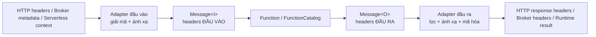

# Phân biệt header đầu vào, header đầu ra và header truyền tải

## 1. Bài toán: một thông tin, nhiều ranh giới

Trong **SPRING_CLOUD_FUNCTION (Spring Cloud Function)**, chúng ta viết nghiệp vụ bằng `Supplier`, `Function` hoặc `Consumer`, đăng ký và gọi qua `FunctionCatalog`, ghép nhiều hàm bằng *composition*, sau đó triển khai qua HTTP, sự kiện hoặc môi trường serverless. Việc tái sử dụng này trở nên khó hiểu nếu ứng dụng xem mọi thông tin có tên *header* là một loại dữ liệu giống nhau.

Hãy xét một yêu cầu duyệt hóa đơn:

1. Client gọi HTTP với `X-Correlation-ID: req-42`.
2. Lớp HTTP chuyển yêu cầu thành `Message<InvoiceSubmitted>`, đặt header nội bộ `correlationId=req-42`.
3. Hàm `decideInvoice` đọc header đó để truy vết, tạo `Message<InvoiceDecision>` có `correlationId=req-42` và `resultCode=INVOICE_ACCEPTED`.
4. Lớp HTTP quyết định có trả `X-Correlation-ID`, `X-Invoice-Result` trong response hay không.
5. Nếu cùng hàm xử lý sự kiện từ broker, adapter có thể lấy `correlationId` từ message attribute khác, còn offset, partition hoặc delivery tag vẫn thuộc hạ tầng truyền tải.

Những thông tin trên có liên hệ nhưng **không có cùng trách nhiệm**. Ta cần phân biệt rõ ba vai trò:

- **Header đầu vào (input header):** metadata đi cùng `Message<T>` **khi hàm được gọi**, để hàm đọc, kiểm tra hoặc sử dụng.
- **Header đầu ra (output header):** metadata nằm trong `Message<R>` **do hàm trả về**, để bước xử lý sau hoặc adapter đầu ra sử dụng.
- **Header truyền tải (transport header/metadata):** metadata của HTTP, message broker hoặc runtime serverless; được đọc, ánh xạ hoặc tạo bởi tầng vận chuyển và adapter.

Ba cụm từ trên mô tả **vai trò tại một ranh giới**, không phải ba kiểu Java tách biệt. Trong Spring Messaging, header đầu vào và đầu ra đều được biểu diễn bằng `MessageHeaders`; một header có thể xuất hiện ở cả hai chiều nhưng không vì thế tự động có mặt trên mạng.

### Mục tiêu học tập

Sau bài này, bạn có thể xác định nơi một header được sinh ra và ai sở hữu nó; thiết kế quy tắc truyền tiếp metadata có kiểm soát; xây một `Function` độc lập giao thức; và kiểm tra đường đi của header qua HTTP, broker, serverless và composition.

## 2. Mô hình luồng thông điệp và các điểm chuyển giao



Ví dụ về `correlationId` qua từng chặng:

| Chặng | Tên và giá trị minh họa | Vai trò | Thành phần chịu trách nhiệm |
|---|---|---|---|
| HTTP request | `X-Correlation-ID: req-42` | Header truyền tải đi **vào** | Client/gateway, được kiểm tra tại lớp HTTP |
| `Message<InvoiceSubmitted>` | `correlationId = "req-42"` | Header **đầu vào** của hàm | Adapter đầu vào chuẩn hóa |
| `Message<InvoiceDecision>` | `correlationId = "req-42"` | Header **đầu ra** của hàm | Hàm chủ động giữ theo hợp đồng |
| HTTP response | `X-Correlation-ID: req-42` | Header truyền tải đi **ra** | Adapter đầu ra quyết định công bố |
| Thông điệp broker ở chặng khác | Attribute hoặc header theo quy ước của broker/binder | Metadata truyền tải của chặng mới | Binder/adapter ánh xạ |

Điểm quan trọng: một tên giống nhau, ví dụ `correlationId`, có thể được dùng ở nhiều chặng. Nhưng **sự tồn tại của nó ở chặng trước không đảm bảo nó xuất hiện ở chặng sau**. Mỗi lần đi qua adapter hoặc một hàm sinh thông điệp mới đều cần có quy tắc rõ ràng.

## 3. Header đầu vào: những gì hàm thực sự nhận được

Trong Spring Cloud Function, khi cần truy cập metadata cùng payload, chữ ký hàm có thể nhận `Message<I>`:

```java
Function<Message<InvoiceSubmitted>, InvoiceDecision>
```

`Message<I>` thuộc `org.springframework.messaging.Message`. Hai phương thức cốt lõi là `getPayload()` và `getHeaders()`. `MessageHeaders` thực thi giao diện `Map<String, Object>`, vì vậy **giá trị header không bắt buộc là `String`**.

Ví dụ đọc header đầu vào:

```java
import org.springframework.messaging.Message;

static String readCorrelationId(Message<?> input) {
    Object raw = input.getHeaders().get("correlationId");
    if (raw == null) {
        return null;
    }
    if (!(raw instanceof String id)) {
        throw new IllegalArgumentException("correlationId must be a String");
    }
    return id;
}
```

Hàm đọc tên **nội bộ** `correlationId`, không đọc trực tiếp `X-Correlation-ID`. Lớp HTTP có thể đặt lại tên header, còn binder hoặc serverless adapter có thể lấy giá trị từ nguồn khác rồi chuẩn hóa về cùng tên.

Những điểm cần kiểm tra với header đầu vào:

- **Nguồn:** metadata đến từ client, gateway, binder hay runtime? Có đáng tin không?
- **Tên khóa:** `correlationId` khác `CorrelationId` và `X-Correlation-ID` trong một `Map<String, Object>` thông thường; khác với cách tra cứu tên header HTTP không phân biệt hoa/thường.
- **Kiểu:** giá trị có thể là `String`, số, `byte[]` hoặc kiểu riêng của adapter.
- **Tính bắt buộc:** nếu thiếu header, xử lý thế nào? Sinh giá trị tại biên, cho phép `null` hoặc từ chối yêu cầu?
- **Phạm vi sử dụng:** hàm chỉ cần truy vết, hay quyết định nghiệp vụ phụ thuộc header này?

Không sử dụng một header do client tự khai báo như `X-User-ID` hay `X-Tenant-ID` làm bằng chứng xác thực hoặc phân quyền. Nếu cần thông tin tenant, lấy từ ngữ cảnh danh tính đã được xác minh ở ranh giới phù hợp.

## 4. Header đầu ra: những gì hàm chủ động công bố

Khi cần trả metadata, dùng chữ ký `Function<Message<I>, Message<O>>` hoặc `Function<I, Message<O>>`. Có thể tạo phản hồi bằng `MessageBuilder`:

```java
import org.springframework.messaging.Message;
import org.springframework.messaging.support.MessageBuilder;

Message<String> result = MessageBuilder.withPayload("APPROVED")
        .setHeader("resultCode", "INVOICE_ACCEPTED")
        .setHeader("processedBy", "invoiceValidator")
        .setHeader("correlationId", "req-42")
        .build();
```

Ở đây `resultCode` và `processedBy` mô tả **kết quả vừa tạo**, còn `correlationId` duy trì liên hệ với đầu vào. Không có quy tắc chung rằng mọi header đầu vào phải được chuyển tiếp.

### Vì sao không sao chép toàn bộ headers mặc định?

```java
// Giả định incoming là Message<InvoiceSubmitted>.
Message<String> output = MessageBuilder
        .withPayload("APPROVED")
        .copyHeaders(incoming.getHeaders())
        .setHeader("processedBy", "invoiceValidator")
        .build();
```

`copyHeaders(...)` có thể phù hợp khi hợp đồng thực sự yêu cầu giữ nhiều metadata. Tuy nhiên, đầu vào có thể mang `contentType` của payload cũ, header lỗi/định tuyến, `replyChannel`, metadata riêng của binder, hoặc thông tin không nên xuất qua ranh giới tin cậy. Nếu payload đổi từ DTO sang `String`, một `contentType=application/json` sao chép từ đầu vào có thể không còn mô tả đúng định dạng đầu ra mong muốn.

Thông thường, hãy bắt đầu từ `MessageBuilder.withPayload(result)`, sau đó **chọn từng header cần thiết**. Dùng `MessageBuilder.fromMessage(input)` nếu muốn giữ nguyên payload và thay đổi metadata; nó không phải công cụ chuyển payload sang kiểu `O` mới.

> `MessageHeaders` là map chỉ đọc sau khi thông điệp được tạo. Để cập nhật header, cần tạo một `Message` mới; tránh gọi `message.getHeaders().put(...)`. Chế độ chỉ đọc của map không đồng nghĩa mọi đối tượng được lưu làm giá trị header đều bất biến sâu.

## 5. Header truyền tải: metadata thuộc HTTP, broker và serverless

**Header truyền tải** mô tả giao thức hoặc môi trường phân phối dữ liệu. Một phần có thể hữu ích cho nghiệp vụ, nhưng phần lớn được tầng tích hợp quản lý.

| Môi trường | Ví dụ metadata truyền tải | Thường được xử lý ở đâu? |
|---|---|---|
| HTTP | `Content-Type`, `Accept`, `Authorization`, `Cookie`, `X-Correlation-ID`, `traceparent` | Web adapter, controller, filter, security, tracing |
| Kafka | Topic, partition, offset, record key, record headers, timestamp | Kafka client, binder/adapter, listener/container |
| RabbitMQ | Exchange, routing key, delivery tag, message properties | Client, binder/adapter, message listener |
| SQS/Lambda | `messageId`, receipt handle, message attributes, request context | Runtime/adapter và cơ chế xác nhận thông điệp |
| CloudEvents | `id`, `source`, `type`, `specversion`, `subject`, `time` | CloudEvents SDK/adapter hoặc lớp chuẩn hóa sự kiện |

Ví dụ `Kafka offset` dùng để định vị record trong một partition, không phải mã đơn hàng hoặc định danh yêu cầu. `SQS receipt handle` gắn với cơ chế xử lý/xóa thông điệp, không thích hợp để chuyển thành header nghiệp vụ ở HTTP response.

Các binder/adapter có thể đưa một số metadata vận chuyển vào `MessageHeaders` với tên và kiểu riêng. **Đừng suy ra một tên header Spring Messaging cố định cho mọi binder**; hãy kiểm tra hợp đồng và cấu hình của adapter đang dùng.

### Một header có thể đổi vai trò qua các chặng

```text
HTTP request X-Correlation-ID       [truyền tải đầu vào]
            |
      HTTP adapter kiểm tra và đổi tên
            v
MessageHeaders["correlationId"]      [đầu vào Function A]
            |
      Function A giữ correlationId
            v
MessageHeaders["correlationId"]      [đầu ra Function A]
            |
      Function B nhận kết quả A
            v
MessageHeaders["correlationId"]      [đầu vào Function B]
            |
      adapter ghi header của broker
            v
Broker message attribute            [truyền tải đầu ra]
```

Thực tế này giải thích vì sao các thuật ngữ *đầu vào* và *đầu ra* phải gắn với **một hàm hoặc một bước cụ thể**. Header đầu ra của Function A có thể trở thành header đầu vào của Function B, nhưng không phải là một “header truyền tải” cho đến khi nó vượt qua ranh giới adapter.

## 6. Ví dụ nghiệp vụ hoàn chỉnh: tạo đầu ra có chọn lọc

Ví dụ Java 17+ sau sử dụng một bean Spring Cloud Function xử lý hóa đơn. Logic kết quả dựa vào payload; metadata chỉ phục vụ truy vết và mô tả kết quả.

```java
package com.example.invoice;

import java.util.function.Function;

import org.springframework.context.annotation.Bean;
import org.springframework.context.annotation.Configuration;
import org.springframework.messaging.Message;
import org.springframework.messaging.support.MessageBuilder;

@Configuration
public class InvoiceFunctions {

    public record InvoiceSubmitted(String invoiceId, long amount) {}
    public record InvoiceDecision(String invoiceId, String status) {}

    private static InvoiceDecision decide(InvoiceSubmitted invoice) {
        boolean accepted = invoice.invoiceId() != null
                && !invoice.invoiceId().isBlank()
                && invoice.amount() > 0;

        return new InvoiceDecision(
                invoice.invoiceId(),
                accepted ? "ACCEPTED" : "REJECTED"
        );
    }

    @Bean
    public Function<Message<InvoiceSubmitted>, Message<InvoiceDecision>>
            decideInvoice() {
        return incoming -> {
            InvoiceDecision decision = decide(incoming.getPayload());

            String correlationId = incoming.getHeaders()
                    .get("correlationId", String.class);

            MessageBuilder<InvoiceDecision> builder = MessageBuilder
                    .withPayload(decision)
                    .setHeader("resultCode",
                            "ACCEPTED".equals(decision.status())
                                    ? "INVOICE_ACCEPTED"
                                    : "INVOICE_REJECTED")
                    .setHeader("processedBy", "decideInvoice");

            if (correlationId != null) {
                builder.setHeader("correlationId", correlationId);
            }
            return builder.build();
        };
    }
}
```

Trong ví dụ:

1. **Header đầu vào:** `correlationId` đọc từ `incoming.getHeaders()`.
2. **Header đầu ra:** `correlationId` được giữ có điều kiện; `resultCode` và `processedBy` được tạo mới từ bước xử lý này.
3. **Header truyền tải:** hàm không hề tham chiếu `X-Correlation-ID`, Kafka topic, HTTP status hoặc receipt handle. Chúng thuộc lớp bên ngoài.
4. **Payload:** `InvoiceSubmitted` biến đổi thành `InvoiceDecision`, còn header không bị nhét vào DTO như dữ liệu kinh doanh.

`InvoiceDecision.status=REJECTED` là **kết quả nghiệp vụ** trong ví dụ. Nó không tự đồng nghĩa với HTTP 400, ném ngoại lệ hay broker retry. Quy tắc status/acknowledgment thuộc từng adapter.

## 7. Ví dụ lớp HTTP: ánh xạ hai chiều, không lộ header nội bộ

Trong Spring Cloud Function Web, adapter có thể nhận HTTP request, tạo input thích hợp cho bean rồi xử lý phản hồi. Nếu cần quy tắc ánh xạ cụ thể, ta có thể dùng một Spring MVC controller mỏng: controller chỉ thực hiện xử lý giao thức, còn bean `decideInvoice` giữ nguyên.

Ví dụ này dùng lớp ở mục 6, với Spring Web và Spring Messaging có sẵn trong ứng dụng:

```java
package com.example.invoice;

import java.util.List;
import java.util.UUID;
import java.util.function.Function;

import org.springframework.beans.factory.annotation.Qualifier;
import org.springframework.http.HttpHeaders;
import org.springframework.http.MediaType;
import org.springframework.http.ResponseEntity;
import org.springframework.http.HttpStatus;
import org.springframework.messaging.Message;
import org.springframework.messaging.support.MessageBuilder;
import org.springframework.web.bind.annotation.PostMapping;
import org.springframework.web.bind.annotation.RequestBody;
import org.springframework.web.bind.annotation.RequestHeader;
import org.springframework.web.bind.annotation.RestController;
import org.springframework.web.server.ResponseStatusException;

import com.example.invoice.InvoiceFunctions.InvoiceSubmitted;
import com.example.invoice.InvoiceFunctions.InvoiceDecision;

@RestController
public class InvoiceHttpController {

    private final Function<Message<InvoiceSubmitted>,
                           Message<InvoiceDecision>> decide;

    public InvoiceHttpController(
            @Qualifier("decideInvoice")
            Function<Message<InvoiceSubmitted>, Message<InvoiceDecision>>
                    decide) {
        this.decide = decide;
    }

    @PostMapping(
            path = "/invoices",
            consumes = MediaType.APPLICATION_JSON_VALUE,
            produces = MediaType.APPLICATION_JSON_VALUE
    )
    public ResponseEntity<InvoiceDecision> submit(
            @RequestBody InvoiceSubmitted body,
            @RequestHeader HttpHeaders requestHeaders) {

        String correlationId = normalizeCorrelationId(requestHeaders);

        // HTTP input -> input header chuẩn hóa cho Function.
        Message<InvoiceSubmitted> input = MessageBuilder
                .withPayload(body)
                .setHeader("correlationId", correlationId)
                .setHeader("source", "http")
                .build();

        Message<InvoiceDecision> output = decide.apply(input);

        // Output header -> HTTP response headers được phép công bố.
        HttpHeaders responseHeaders = new HttpHeaders();
        responseHeaders.set("X-Correlation-ID",
                output.getHeaders().get("correlationId", String.class));
        responseHeaders.set("X-Invoice-Result",
                output.getHeaders().get("resultCode", String.class));

        // processedBy và source không được gửi ra HTTP.
        return ResponseEntity.ok()
                .headers(responseHeaders)
                .body(output.getPayload());
    }

    private static String normalizeCorrelationId(HttpHeaders headers) {
        List<String> values = headers.get("X-Correlation-ID");
        if (values == null || values.isEmpty()) {
            return UUID.randomUUID().toString();
        }
        if (values.size() != 1
                || !values.get(0).matches("[A-Za-z0-9._-]{1,64}")) {
            throw new ResponseStatusException(
                    HttpStatus.BAD_REQUEST, "Invalid X-Correlation-ID");
        }
        return values.get(0);
    }
}
```

Lớp này có hai điểm ánh xạ cụ thể:

- **Đầu vào HTTP:** `X-Correlation-ID` được kiểm tra, chuẩn hóa thành `correlationId`. Nếu thiếu, lớp biên sinh một UUID. HTTP headers không phân biệt hoa/thường nên `x-correlation-id` cũng được tra cứu qua `HttpHeaders`.
- **Đầu ra HTTP:** chỉ `correlationId` và `resultCode` được biến thành `X-Correlation-ID` và `X-Invoice-Result`. `processedBy` giữ trong `Message` để phục vụ logic phía trong nhưng không tự động công bố qua HTTP.

Payload do Spring MVC chuyển đổi từ JSON vào `InvoiceSubmitted` rồi mã hóa `InvoiceDecision` thành JSON. `MessageBuilder` không trực tiếp serialize DTO. Đoạn code trả HTTP 200 cho cả hóa đơn `ACCEPTED` và `REJECTED` vì đó là hợp đồng minh họa; nếu API cần HTTP 422 cho hóa đơn không hợp lệ, phải quy định và thực hiện riêng ở controller.

Ví dụ yêu cầu:

```bash
curl -i -X POST http://localhost:8080/invoices \
  -H "Content-Type: application/json" \
  -H "X-Correlation-ID: req-42" \
  -d '{"invoiceId":"INV-42","amount":90000}'
```

Phản hồi minh họa:

```http
HTTP/1.1 200 OK
Content-Type: application/json
X-Correlation-ID: req-42
X-Invoice-Result: INVOICE_ACCEPTED

{"invoiceId":"INV-42","status":"ACCEPTED"}
```

**Đây là hành vi của controller minh họa**, không phải cam kết rằng Spring Cloud Function Web sẽ tự tạo chính những HTTP response headers này cho mọi hàm. Đường gọi qua Web adapter, binder hay serverless adapter phải được kiểm thử theo phiên bản và cấu hình thực tế.

## 8. `Content-Type` và `contentType`: cùng chủ đề, khác tầng

Một nguồn nhầm lẫn lớn là **header liên quan định dạng nội dung**:

| Tên | Xuất hiện ở đâu? | Vai trò chính |
|---|---|---|
| HTTP request `Content-Type` | Header truyền tải của HTTP request | Mô tả định dạng request body, ví dụ JSON |
| HTTP request `Accept` | Header truyền tải của HTTP request | Nêu định dạng response client có thể chấp nhận |
| `MessageHeaders.CONTENT_TYPE` / `contentType` | Header đầu vào hoặc đầu ra của Spring Messaging | Metadata để hỗ trợ chuyển đổi payload |
| HTTP response `Content-Type` | Header truyền tải của HTTP response | Cho biết định dạng body thực sự được gửi |

Ví dụ Java:

```java
import org.springframework.messaging.Message;
import org.springframework.messaging.MessageHeaders;
import org.springframework.messaging.support.MessageBuilder;
import org.springframework.util.MimeTypeUtils;

import com.example.invoice.InvoiceFunctions.InvoiceDecision;

Message<InvoiceDecision> output = MessageBuilder
        .withPayload(new InvoiceDecision("INV-42", "ACCEPTED"))
        .setHeader(MessageHeaders.CONTENT_TYPE, MimeTypeUtils.APPLICATION_JSON)
        .build();
```

Ở đây `output.getPayload()` vẫn là một **`InvoiceDecision` trong Java**, không phải chuỗi JSON. Converter/adapter quyết định cách gửi bytes và header giao thức ra ngoài. Đừng mặc định `contentType` ở đầu ra được giữ nguyên từ đầu vào khi `Function` đổi payload từ DTO thành `String` hoặc một loại dữ liệu khác.

Khi một adapter chuyển `Message` thành HTTP response, việc ánh xạ `contentType` thành HTTP `Content-Type` phụ thuộc cơ chế thích ứng. Cấu hình HTTP response nên phản ánh đúng định dạng thực tế và phải được xác nhận bằng integration test.

## 9. Trường hợp broker: transport metadata có thể bị lạm dụng

Với Spring Cloud Stream và binder, sự kiện có thể mang payload cùng các thuộc tính của môi trường vận chuyển. Sơ đồ ý tưởng:

```text
Kafka record
  key            -> key của record (transport)
  topic          -> nơi nhận bản tin (transport)
  partition      -> phân vùng (transport)
  offset         -> vị trí trong log (transport)
  record headers -> có thể chứa correlation-id theo hợp đồng
                     |
                 binder/adapter
                     |
Message<InvoiceSubmitted>
  headers["correlationId"] = "req-42"   (đầu vào)
                     |
                decideInvoice
                     |
Message<InvoiceDecision>
  headers["correlationId"] = "req-42"   (đầu ra)
  headers["resultCode"] = "INVOICE_ACCEPTED"
                     |
                 binder/adapter
                     |
Kafka record mới (nếu output binding được cấu hình)
```

`correlation-id` ở record headers là **tên do ví dụ quy ước**, không phải bảo đảm rằng Kafka/Spring Cloud Stream tự tạo header đó. Binder có thể đưa metadata vận chuyển vào `MessageHeaders` theo các tên riêng và lọc một số header lúc gửi đi; chi tiết phụ thuộc binder, serializer, cấu hình và version.

**Không sao chép `offset`, `partition`, reply channel, delivery tag hay receipt handle** chỉ với mục đích “giữ nguyên mọi header”. Chúng thuộc ngữ cảnh của chặng nhận, có thể không còn ý nghĩa khi phát ra một sự kiện mới. Cũng không dùng offset làm định danh nghiệp vụ; nếu cần liên kết các bước, định nghĩa `correlationId` riêng.

Khi một `Function<Message<I>, Message<O>>` chạy qua Stream, `Message<O>` là kết quả logic của hàm. **Việc thực sự phát bản tin đầu ra** còn yêu cầu cấu hình function definition, output binding và broker phù hợp; kết quả có header không đồng nghĩa nó đã được xuất bản thành công.

## 10. Trường hợp serverless và CloudEvents

Trong môi trường serverless, event envelope có thể gồm phần dữ liệu và metadata do runtime cung cấp. Ví dụ, một sự kiện SQS được Lambda nhận có `messageId`, message attributes và các thuộc tính giao nhận. Chúng không đồng nghĩa với header nghiệp vụ và không nên được chuyển toàn bộ vào output.

Một định dạng sự kiện độc lập nền tảng phổ biến là **CloudEvents**. Context của CloudEvent có `id`, `source`, `type` và `specversion`; `data` chứa dữ liệu sự kiện. Với CloudEvents HTTP binary content mode, các context attributes được biểu diễn bằng header `ce-*`:

```http
POST /events HTTP/1.1
Content-Type: application/json
ce-specversion: 1.0
ce-id: event-101
ce-source: /billing
ce-type: com.example.invoice.submitted

{"invoiceId":"INV-42","amount":90000}
```

Một lớp adapter có thể chuẩn hóa:

| Metadata CloudEvents | Header nội bộ đề xuất | Vai trò |
|---|---|---|
| `ce-id` hoặc context `id` | `eventId` | Nhận diện sự kiện theo ngữ cảnh CloudEvents |
| `ce-source` hoặc `source` | `eventSource` | Nguồn phát khai báo trong event |
| `ce-type` hoặc `type` | `eventType` | Phân loại sự kiện |
| `data` | Payload `InvoiceSubmitted` | Dữ liệu nghiệp vụ của sự kiện |

**`eventId` khác `MessageHeaders.ID` và khác `correlationId`.** Một event có thể được phát lại thành thông điệp mới, hoặc nhiều event cùng thuộc một quy trình dùng chung `correlationId`. Không mặc định `ce-id` là header tương quan của ứng dụng.

Các tên `eventId`, `eventSource`, `eventType` trong bảng là **quy ước thiết kế minh họa**. Adapter CloudEvents của ứng dụng phải chủ động tạo chúng nếu muốn hàm sử dụng; việc có header `ce-id` trên HTTP không bảo đảm mọi runtime Spring Cloud Function tự đổi thành `eventId`.

## 11. Header truyền qua composition và `FunctionCatalog`

Giả sử ta nối hai bước:

```text
Message<InvoiceSubmitted>
     |
     v
 decideInvoice
     |
     v
Message<InvoiceDecision>   [correlationId, resultCode]
     |
     v
 formatInvoiceNotice
     |
     v
Message<String>            [headers do formatInvoiceNotice tạo/giữ]
```

Nếu bean thứ hai có chữ ký `Function<Message<InvoiceDecision>, Message<String>>`, nó có thể đọc `correlationId` của kết quả `decideInvoice`. Nhưng khi hàm này tạo `Message<String>` mới, nó phải quyết định header nào nên có trên kết quả của **chính nó**.

Với các bean đã đăng ký và chữ ký tương thích, một definition ví dụ:

```properties
spring.cloud.function.definition=decideInvoice|formatInvoiceNotice
```

Khi tra cứu bằng `FunctionCatalog`, các bước wrapping/unwrapping, conversion và lan truyền header có thể phụ thuộc cách hàm được đăng ký, kiểu đầu vào/đầu ra và adapter. **Không nên coi việc header đã đi qua một bước là bằng chứng nó sẽ tồn tại sau mọi composition.** Hãy kiểm tra cả hành vi của từng bean lẫn kết quả của chuỗi hàm thực tế.

Một thiết kế rõ ràng là:

- Payload thể hiện nghiệp vụ, ví dụ `InvoiceSubmitted` và `InvoiceDecision`.
- Header nội bộ được quy ước theo tên và kiểu, ví dụ `correlationId: String`.
- Mỗi bước chỉ giữ hoặc tạo metadata mà bước sau cần.
- Biên HTTP, broker và serverless chịu trách nhiệm đổi tên, xác thực và mã hóa metadata cho giao thức của mình.

## 12. Ai được quyền tạo, thay thế và công bố một header?

Việc phân biệt ba vai trò cũng là cách thiết lập **ranh giới tin cậy**:

| Header hoặc metadata | Nguồn sở hữu hợp lý | Quy tắc sử dụng |
|---|---|---|
| `correlationId` | Gateway hoặc adapter đã kiểm tra | Chuẩn hóa và giới hạn độ dài/định dạng |
| `processedBy` | Bước xử lý hiện tại | Ghi lại từ server, không tin giá trị client gửi |
| `resultCode` | Logic nghiệp vụ | Sinh từ kết quả xử lý hiện tại |
| HTTP `Authorization` | Lớp xác thực bảo mật | Không sao chép nguyên token sang sự kiện đầu ra |
| `traceparent` | Hệ thống tracing và adapter chuyên trách | Duy trì bằng cơ chế propagation chuẩn |
| `tenantId` | Ngữ cảnh danh tính đã được xác minh | Không coi header tự khai báo là quyền truy cập |
| Kafka offset, SQS receipt handle | Broker/runtime | Để tầng vận chuyển quản lý |
| `Content-Type` / `contentType` | Converter/adapter và hợp đồng media type | Cập nhật theo định dạng dữ liệu thực tế |

Trước khi copy một header từ đầu vào sang đầu ra, hãy hỏi: **Ai tạo? Có kiểm tra chưa? Bên nhận cần nó để làm gì? Nó có còn đúng tại chặng mới không? Có được phép công bố ra giao thức đích không?**

Ví dụ, một HTTP request có thể gửi `X-Invoice-Result: INVOICE_ACCEPTED` để giả mạo kết quả. Hàm `decideInvoice` phải tính `resultCode` từ payload và ghi đè giá trị này, không sao chép từ client.

## 13. Kiểm thử ở hai lớp để phát hiện header bị mất hoặc lộ

### 13.1. Kiểm thử logic thuần của hàm

JUnit 5 có thể gọi bean `Function` trực tiếp mà không cần HTTP/broker:

```java
package com.example.invoice;

import static org.junit.jupiter.api.Assertions.assertEquals;
import static org.junit.jupiter.api.Assertions.assertNull;

import java.util.function.Function;

import org.junit.jupiter.api.Test;
import org.springframework.messaging.Message;
import org.springframework.messaging.support.MessageBuilder;

import com.example.invoice.InvoiceFunctions.InvoiceSubmitted;
import com.example.invoice.InvoiceFunctions.InvoiceDecision;

class InvoiceFunctionsTest {

    @Test
    void returnsOnlyApprovedOutputHeaders() {
        Function<Message<InvoiceSubmitted>, Message<InvoiceDecision>> fn =
                new InvoiceFunctions().decideInvoice();

        Message<InvoiceSubmitted> input = MessageBuilder
                .withPayload(new InvoiceSubmitted("INV-42", 90000))
                .setHeader("correlationId", "req-42")
                .setHeader("source", "http")
                .setHeader("resultCode", "CLIENT_FORGED_RESULT")
                .build();

        Message<InvoiceDecision> output = fn.apply(input);

        assertEquals("ACCEPTED", output.getPayload().status());
        assertEquals("req-42", output.getHeaders().get("correlationId"));
        assertEquals("INVOICE_ACCEPTED", output.getHeaders().get("resultCode"));
        assertEquals("decideInvoice", output.getHeaders().get("processedBy"));
        assertNull(output.getHeaders().get("source"));

        // Header đầu vào không bị thay đổi.
        assertEquals("CLIENT_FORGED_RESULT",
                input.getHeaders().get("resultCode"));
    }

    @Test
    void handlesMissingOptionalInputHeader() {
        Function<Message<InvoiceSubmitted>, Message<InvoiceDecision>> fn =
                new InvoiceFunctions().decideInvoice();

        Message<InvoiceSubmitted> input = MessageBuilder
                .withPayload(new InvoiceSubmitted("INV-43", -10))
                .build();

        Message<InvoiceDecision> output = fn.apply(input);

        assertEquals("REJECTED", output.getPayload().status());
        assertEquals("INVOICE_REJECTED",
                output.getHeaders().get("resultCode"));
        assertNull(output.getHeaders().get("correlationId"));
    }
}
```

Test đầu tiên chứng minh `resultCode` giả mạo ở đầu vào **không xuất hiện ở đầu ra**, còn `correlationId` được giữ đúng hợp đồng. Test thứ hai cho thấy header đầu vào tùy chọn có thể vắng mặt khi gọi trực tiếp hàm, trong khi adapter HTTP của ví dụ sẽ sinh mã nếu request không có.

### 13.2. Kiểm thử biên HTTP

Với controller ở mục 7, có thể dùng Spring MVC Test/MockMvc để kiểm tra cả header truyền tải đầu vào lẫn đầu ra:

```java
package com.example.invoice;

import static org.springframework.test.web.servlet.request.MockMvcRequestBuilders.post;
import static org.springframework.test.web.servlet.result.MockMvcResultMatchers.*;

import org.junit.jupiter.api.Test;
import org.springframework.beans.factory.annotation.Autowired;
import org.springframework.boot.test.autoconfigure.web.servlet.WebMvcTest;
import org.springframework.context.annotation.Import;
import org.springframework.http.MediaType;
import org.springframework.test.web.servlet.MockMvc;

@WebMvcTest(InvoiceHttpController.class)
@Import(InvoiceFunctions.class)
class InvoiceHttpControllerTest {

    @Autowired
    MockMvc mvc;

    @Test
    void mapsTransportHeadersInBothDirections() throws Exception {
        mvc.perform(post("/invoices")
                .contentType(MediaType.APPLICATION_JSON)
                .header("x-correlation-id", "req-42")
                .content("{\"invoiceId\":\"INV-42\",\"amount\":90000}"))
            .andExpect(status().isOk())
            .andExpect(header().string("X-Correlation-ID", "req-42"))
            .andExpect(header().string(
                    "X-Invoice-Result", "INVOICE_ACCEPTED"))
            .andExpect(header().doesNotExist("processedBy"))
            .andExpect(jsonPath("$.status").value("ACCEPTED"));
    }

    @Test
    void rejectsInvalidTransportHeader() throws Exception {
        mvc.perform(post("/invoices")
                .contentType(MediaType.APPLICATION_JSON)
                .header("X-Correlation-ID", "bad value!")
                .content("{\"invoiceId\":\"INV-43\",\"amount\":10}"))
            .andExpect(status().isBadRequest());
    }
}
```

Với ứng dụng bật Spring Security, test HTTP cần cấu hình xác thực/CSRF phù hợp. Hai bài test kiểm tra **controller minh họa** chứ không chứng minh mapping mặc định của Spring Cloud Function Web. Trên binder/serverless, hãy kiểm thử tích hợp tương ứng với hạ tầng thực tế.

Những tình huống nên đưa vào bộ kiểm thử đường truyền:

| Tình huống | Kỳ vọng cần xác nhận |
|---|---|
| HTTP header khác chữ hoa/thường | Đọc chính xác nhờ `HttpHeaders`, chuẩn hóa về `correlationId` |
| Header đầu vào thiếu, sai kiểu hoặc nhiều giá trị | Áp dụng chính sách mặc định/từ chối rõ ràng |
| Bước hàm tạo `Message` mới | Chỉ những header cần thiết được giữ |
| Hai hàm composition | Header mà hàm thứ hai cần xuất hiện đúng kiểu |
| Đầu ra HTTP | Không lộ `Authorization`, `processedBy` hoặc metadata broker ngoài hợp đồng |
| Phát sự kiện broker | Header được serialize/ánh xạ đúng tên, đúng kiểu và thực sự đến nơi |
| Sự kiện serverless/CloudEvents | Phân biệt `eventId`, `correlationId` và context của runtime |
| Thay đổi kiểu payload | `contentType` và dữ liệu truyền thực tế tương thích |

## 14. Những lỗi thường gặp

| Triệu chứng | Nguyên nhân điển hình | Cách khắc phục |
|---|---|---|
| HTTP có `X-Correlation-ID` nhưng hàm đọc `correlationId` được `null` | Adapter chưa đổi tên hoặc đã lọc header | Kiểm tra ánh xạ ở biên, không đoán tên mặc định |
| `Message` đầu ra có `resultCode` nhưng HTTP không có `X-Invoice-Result` | Không có quy tắc xuất header ra HTTP | Cấu hình adapter hoặc thực hiện ở controller |
| Header sau composition biến mất | Bước trung gian không truyền tiếp, hoặc wrapping/conversion khác dự kiến | Kiểm thử `FunctionCatalog` với chuỗi hàm thực |
| HTTP response mang header lạ của Kafka | Sao chép toàn bộ headers từ thông điệp đầu vào | Lọc theo whitelist ở chiều ra |
| Serialization hoặc converter sai | Giữ `contentType` cũ sau khi đổi kiểu payload | Cập nhật hợp đồng media type và test bytes thực tế |
| Dùng Kafka offset làm mã giao dịch | Nhầm metadata vận chuyển với định danh nghiệp vụ | Dùng `invoiceId` trong payload và `correlationId` theo hợp đồng |
| Lỗi bảo mật từ `X-Tenant-ID` | Tin giá trị do client tự khai báo | Dùng danh tính đã được xác minh |
| Trả `resultCode=INVOICE_REJECTED` nhưng HTTP vẫn 200 | Header nghiệp vụ không điều khiển HTTP status | Quy định rõ mapping mã HTTP ở lớp web |

## 15. Bài thực hành: vẽ và hiện thực đường đi của một header

Thiết kế một hàm `Function<Message<PaymentRequested>, Message<PaymentDecision>>`. Payload `PaymentRequested(paymentId, amount)` và kết quả `PaymentDecision(paymentId, status)` chỉ chứa dữ liệu nghiệp vụ. Một yêu cầu có thể đến từ HTTP hoặc broker.

1. Quy định một header nội bộ `correlationId: String`, tùy chọn khi gọi hàm trực tiếp. Tại HTTP adapter, lấy từ `X-Correlation-ID`, kiểm tra định dạng và tạo ID mới nếu thiếu.
2. Viết logic xử lý thuần: `amount > 0` thì `status=APPROVED`, ngược lại `status=DECLINED`. Trả `Message<PaymentDecision>` có `resultCode` và chỉ giữ `correlationId` hợp lệ.
3. Quy định header transport của HTTP response: chỉ xuất `X-Correlation-ID` và `X-Payment-Result`; không gửi `processedBy` hay HTTP request `Authorization` ra ngoài.
4. Với broker, xác định record/message attribute nào mang correlation ID, adapter nào đọc nó, và quy tắc ánh xạ sang `MessageHeaders`. Phân biệt nó với topic, partition, offset và key.
5. Thử ghép thêm một hàm tạo thông báo qua `FunctionCatalog`, kiểm tra `correlationId` ở đầu vào của hàm thứ hai.
6. Viết unit test cho header đầu vào vắng mặt, header giả mạo `resultCode` và kết quả payload. Viết integration test cho HTTP/broker để kiểm tra metadata thực sự được truyền đi.

**Ghi nhớ:** header **đầu vào** thuộc `Message` khi hàm nhận dữ liệu; header **đầu ra** thuộc `Message` khi hàm tạo kết quả; header **truyền tải** thuộc HTTP, binder hoặc runtime ở ranh giới giao thức. Spring Cloud Function giúp tái sử dụng logic giữa `Supplier`, `Function`, `Consumer` và các adapter, nhưng việc đổi tên, kiểm tra, chọn lọc và truyền tiếp metadata cần một hợp đồng rõ ràng cùng kiểm thử tại mỗi ranh giới.
