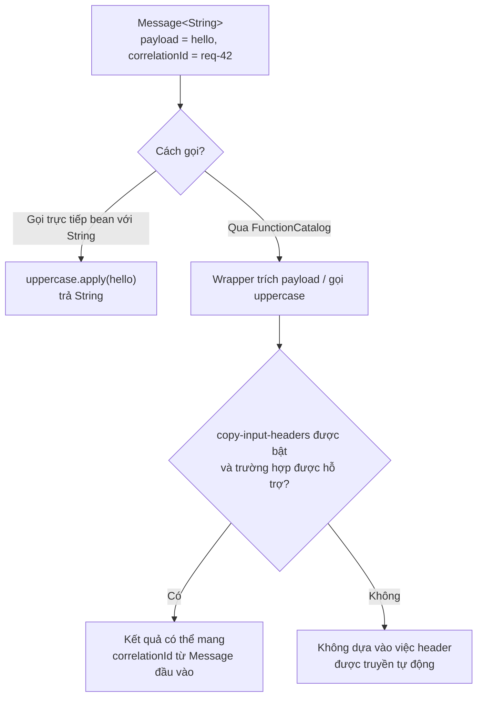

# Sao chép có chọn lọc header và cấu hình `copy-input-headers`

## 1. Bài toán: giữ đúng metadata khi hàm tạo kết quả mới

Trong **SPRING_CLOUD_FUNCTION (Spring Cloud Function)**, logic nghiệp vụ được viết bằng `Supplier`, `Function` và `Consumer`, đăng ký qua `FunctionCatalog`, ghép thành chuỗi (*composition*) và gọi qua HTTP, sự kiện hoặc môi trường serverless. Dù cùng một hàm có thể được triển khai theo nhiều giao thức, **metadata ở đầu vào không mặc nhiên là metadata hợp lệ ở đầu ra**.

Giả sử hàm xử lý đơn hàng nhận:

```text
Message<OrderSubmitted>
├── payload: OrderSubmitted("ORD-17", 120000)
└── headers:
    correlationId = "checkout-42"      [cần truy vết]
    contentType   = "application/json" [định dạng đầu vào]
    source        = "mobile-app"       [nguồn gửi tự khai]
    replyChannel  = ...                [ngữ cảnh tích hợp]
    id            = ...                [định danh thông điệp]
    timestamp     = ...                [thời gian tạo thông điệp]
```

Hàm tạo `OrderDecision("ORD-17", "ACCEPTED")` và cần chuyển tiếp `correlationId`. Nếu chép tất cả headers, có thể mang theo `contentType` đã lỗi thời, thông tin hạ tầng hoặc dữ liệu không được phép phát tán. Nếu không chép gì, bước tiếp theo có thể mất `correlationId` và không liên kết được kết quả với yêu cầu ban đầu.

Spring Cloud Function cho phép giải quyết theo hai hướng chính:

1. **Tự chọn headers trong mã hàm**, thường dùng `MessageBuilder` để tạo `Message<O>` từ payload mới.
2. **Bật cấu hình `copy-input-headers` theo tên hàm** để `FunctionCatalog` hỗ trợ truyền các headers đầu vào trong những trường hợp áp dụng được.

Bài này giải thích chính xác **khi nào dùng cách nào**, vì sao cấu hình tự động không thay thế quy tắc bảo mật hoặc ánh xạ giao thức, và cách kiểm chứng kết quả bằng kiểm thử.

## 2. Hiểu đúng khái niệm sao chép header

`Message<T>` thuộc `org.springframework.messaging.Message`, có hai thành phần:

- `getPayload()`: dữ liệu nghiệp vụ kiểu `T`.
- `getHeaders()`: `MessageHeaders`, về mặt sử dụng là một map khóa `String`, giá trị `Object`.

Khi nói **sao chép header đầu vào**, ta nói về hành động lấy một số hoặc tất cả cặp khóa–giá trị từ `incoming.getHeaders()` và đưa vào thông điệp kết quả. Đó **không** nhất thiết là việc giữ nguyên header HTTP trên đường truyền, giữ mọi message attribute của broker, hoặc bảo toàn định danh của từng thông điệp qua nhiều lần xử lý.

| Cơ chế | Ai thực hiện? | Hợp đồng đầu ra | Mức kiểm soát |
|---|---|---|---|
| Chọn từng khóa bằng `MessageBuilder.setHeader(...)` | Mã nghiệp vụ hoặc lớp bao hàm | `Message<O>` do mã tạo | Cao: định nghĩa được danh sách cho phép, đổi tên và xác thực |
| `MessageBuilder.copyHeaders(...)` | Mã tạo thông điệp | `Message<O>` do mã tạo | Sao chép rộng, cần chủ động lọc |
| `copy-input-headers=true` | Wrapper qua `FunctionCatalog` trong các trường hợp hỗ trợ | Kết quả đã được framework thích ứng | Tiện, nhưng không phải cấu hình whitelist từng khóa |
| Header mapping của HTTP/binder/serverless | Adapter | Headers hoặc metadata của giao thức | Phụ thuộc adapter, cấu hình và phiên bản |

**Điều quan trọng nhất:** `copy-input-headers` là **thuộc tính của cơ chế gọi hàm qua `FunctionCatalog`**. Nó không phải lệnh của `MessageBuilder` và không tự biến mọi HTTP request header thành HTTP response header.

## 3. Sao chép có chọn lọc bằng `MessageBuilder`

### 3.1. Ví dụ hoàn chỉnh với `Function<Message<I>, Message<O>>`

Ta cần một hàm nhận đơn hàng, kiểm tra số tiền và trả quyết định. Hợp đồng metadata là:

- `correlationId`: header tùy chọn kiểu `String`, được chuyển tiếp sau khi kiểm tra.
- `resultCode`: tạo mới từ kết quả của hàm.
- `processedBy`: tạo mới, không tin giá trị cùng tên của client.
- Các header còn lại: không được sao chép mặc định.

Ví dụ Java 17+:

```java
package com.example.orders;

import java.util.function.Function;

import org.springframework.context.annotation.Bean;
import org.springframework.context.annotation.Configuration;
import org.springframework.messaging.Message;
import org.springframework.messaging.support.MessageBuilder;

@Configuration
public class OrderFunctions {

    public record OrderSubmitted(String orderId, long amount) {}
    public record OrderDecision(String orderId, String status) {}

    private static OrderDecision decide(OrderSubmitted order) {
        boolean accepted = order.orderId() != null
                && !order.orderId().isBlank()
                && order.amount() > 0;
        return new OrderDecision(
                order.orderId(),
                accepted ? "ACCEPTED" : "REJECTED"
        );
    }

    @Bean
    public Function<Message<OrderSubmitted>, Message<OrderDecision>>
            decideOrder() {
        return incoming -> {
            OrderDecision result = decide(incoming.getPayload());

            MessageBuilder<OrderDecision> builder =
                    MessageBuilder.withPayload(result)
                            .setHeader("processedBy", "decideOrder")
                            .setHeader(
                                    "resultCode",
                                    "ACCEPTED".equals(result.status())
                                            ? "ORDER_ACCEPTED"
                                            : "ORDER_REJECTED"
                            );

            Object rawId = incoming.getHeaders().get("correlationId");
            if (rawId != null) {
                if (!(rawId instanceof String)) {
                    throw new IllegalArgumentException(
                            "correlationId must be a String");
                }

                String correlationId = (String) rawId;
                if (!correlationId.matches("[A-Za-z0-9._-]{1,64}")) {
                    throw new IllegalArgumentException(
                            "Invalid correlationId");
                }
                builder.setHeader("correlationId", correlationId);
            }

            return builder.build();
        };
    }
}
```

Hàm trả một `Message<OrderDecision>` hoàn toàn mới. `MessageBuilder.withPayload(result)` chọn payload đầu ra; ba lệnh `setHeader(...)` chỉ đặt metadata cần thiết. Nếu đầu vào có `source`, `Authorization`, `replyChannel` hoặc `contentType`, code trên không chuyển chúng sang thông điệp kết quả.

Việc kiểm tra định dạng `correlationId` ở đây minh họa tính phòng vệ; trong ứng dụng thực tế nên chuẩn hóa header không đáng tin ngay tại adapter HTTP/broker/serverless. Hàm vẫn có thể tự bảo vệ hợp đồng đầu vào để được gọi an toàn từ những nguồn khác nhau.

### 3.2. Gọi trực tiếp để thấy kết quả

```java
import java.util.function.Function;

import org.springframework.messaging.Message;
import org.springframework.messaging.support.MessageBuilder;

import com.example.orders.OrderFunctions;
import com.example.orders.OrderFunctions.OrderSubmitted;
import com.example.orders.OrderFunctions.OrderDecision;

Function<Message<OrderSubmitted>, Message<OrderDecision>> fn =
        new OrderFunctions().decideOrder();

Message<OrderSubmitted> input = MessageBuilder
        .withPayload(new OrderSubmitted("ORD-17", 120_000))
        .setHeader("correlationId", "checkout-42")
        .setHeader("source", "mobile-app")
        .setHeader("processedBy", "client-forged")
        .build();

Message<OrderDecision> output = fn.apply(input);

System.out.println(output.getPayload().status());
// ACCEPTED
System.out.println(output.getHeaders().get("correlationId"));
// checkout-42
System.out.println(output.getHeaders().get("processedBy"));
// decideOrder
System.out.println(output.getHeaders().get("source"));
// null
```

Vì ví dụ gọi trực tiếp đối tượng `Function`, các giá trị trên là kết quả của **chính hàm `decideOrder`**. Không có cơ chế header propagation nào được thêm bởi `FunctionCatalog` trong lời gọi trực tiếp này.

## 4. Các thao tác sao chép và loại bỏ header của `MessageBuilder`

Spring Messaging cung cấp một số thao tác cần phân biệt:

| API | Tác động | Ví dụ |
|---|---|---|
| `setHeader("k", v)` | Đặt/thay `k` trong builder | Ghi đè `processedBy` |
| `setHeaderIfAbsent("k", v)` | Chỉ đặt khi chưa có giá trị | Cung cấp giá trị mặc định |
| `copyHeaders(map)` | Sao chép các header trong `map` vào builder | Truyền tiếp nhiều header |
| `copyHeadersIfAbsent(map)` | Chỉ sao chép những header chưa hiện diện | Giữ giá trị được đặt trước |
| `removeHeader("k")` | Bỏ header khỏi builder | Loại `contentType` cũ |
| `MessageBuilder.fromMessage(existing)` | Bắt đầu từ một thông điệp có sẵn | Bổ sung metadata mà giữ payload |

**Trường hợp 1 — Giữ vài header đã được chấp thuận**

```java
Message<String> output = MessageBuilder.withPayload("DONE")
        .setHeader("correlationId", "checkout-42")
        .setHeader("processedBy", "shipping")
        .build();
```

Đây là cách dễ kiểm soát nhất vì không cần sao chép toàn bộ dữ liệu từ nguồn chưa tin cậy.

**Trường hợp 2 — Copy nhiều header rồi bỏ hoặc ghi đè**

```java
// incoming là Message<String> đã được tạo trước đó.
Message<String> output = MessageBuilder.withPayload("DONE")
        .copyHeaders(incoming.getHeaders())
        .removeHeader("source")
        .removeHeader("contentType")
        .setHeader("processedBy", "shipping")
        .build();
```

`setHeader(...)` sau khi `copyHeaders(...)` thay thế giá trị nếu trùng khóa. `removeHeader(...)` bỏ khóa khỏi builder. Cách này hữu ích khi có nhiều metadata cần giữ, nhưng vẫn **phải kiểm tra tất cả những header được đưa vào trước khi sao chép rộng**. Việc chỉ bỏ hai khóa trong ví dụ không đủ để xây chính sách bảo mật cho một hệ thống thật.

**Trường hợp 3 — Giá trị do hàm tạo có mức ưu tiên cao hơn**

```java
import java.util.Map;

Message<String> output = MessageBuilder.withPayload("DONE")
        .setHeader("processedBy", "shipping")
        .copyHeadersIfAbsent(Map.of(
                "processedBy", "upstream",
                "correlationId", "checkout-42"
        ))
        .build();

// processedBy vẫn là "shipping".
// correlationId được bổ sung vì trước đó chưa có.
```

`copyHeadersIfAbsent(...)` phù hợp khi muốn bổ sung metadata mặc định nhưng không ghi đè các giá trị đã được hàm xác định.

**Trường hợp 4 — Chỉ đổi metadata, giữ nguyên payload**

```java
Message<String> original = MessageBuilder.withPayload("order.created")
        .setHeader("correlationId", "checkout-42")
        .build();

Message<String> annotated = MessageBuilder.fromMessage(original)
        .setHeader("processedBy", "audit")
        .build();
```

`fromMessage(original)` thuận tiện cho trường hợp giữ payload. Khi tạo **kiểu payload mới**, ví dụ `OrderSubmitted` → `OrderDecision`, dùng `withPayload(newResult)` và quyết định header nào cần giữ.

`MessageHeaders` của thông điệp đã xây là map chỉ đọc, vì vậy không thực hiện `original.getHeaders().put(...)`. Khái niệm chỉ đọc áp dụng với map headers; nếu giá trị header là một đối tượng mutable, bản thân đối tượng đó vẫn có thể thay đổi.

## 5. Cấu hình `copy-input-headers`: cú pháp và ý nghĩa

Khi một hàm **chỉ xử lý payload** (ví dụ `Function<String, String>`), Spring Cloud Function có thể nhận một `Message` ở lớp gọi hàm thông qua `FunctionCatalog`, trích payload cho bean và sau đó tạo kết quả tương thích. Để hỗ trợ truyền headers đầu vào sang kết quả thông qua wrapper, framework cung cấp cấu hình boolean `copy-input-headers` theo **tên hàm**.

Giả sử có bean tên `uppercase`:

```java
package com.example.functions;

import java.util.Locale;
import java.util.function.Function;

import org.springframework.context.annotation.Bean;
import org.springframework.context.annotation.Configuration;

@Configuration
public class TextFunctions {

    @Bean
    public Function<String, String> uppercase() {
        return input -> input.toUpperCase(Locale.ROOT);
    }
}
```

Trong `application.yml`:

```yaml
spring:
  cloud:
    function:
      configuration:
        uppercase:
          copy-input-headers: true
```

Hoặc `application.properties`:

```properties
spring.cloud.function.configuration.uppercase.copy-input-headers=true
```

Cú pháp tổng quát:

```text
spring.cloud.function.configuration.<function-name>.copy-input-headers=true
```

Trong đó `uppercase` là **tên bean hàm được đăng ký/lookup**, không phải tên class Java hay tên HTTP endpoint. Nếu ứng dụng dùng hàm khác, thay `uppercase` bằng tên phù hợp với định nghĩa của ứng dụng.

Theo tài liệu Spring Cloud Function, thuộc tính này dùng để yêu cầu **truyền headers đầu vào** cho hàm khi đi qua cơ chế bọc lời gọi có hỗ trợ. Nó tiện khi muốn giữ nhiều header trong một bước biến đổi POJO thuần. Tuy nhiên:

- Đây là **cơ chế sao chép rộng**, không cung cấp cú pháp chọn riêng `correlationId` nhưng bỏ `Authorization`, `replyChannel` hoặc `contentType`.
- Nó **không thay đổi code của bean `uppercase`**; bean vẫn có chữ ký `Function<String, String>` và không trực tiếp biết đến headers.
- Nó **không áp dụng cho lời gọi trực tiếp** `uppercase.apply("...")` ngoài `FunctionCatalog`, bởi lời gọi đó hoàn toàn không có đầu vào kiểu `Message`.
- Nếu hàm **đã tự trả `Message<O>`**, hãy quản lý các header muốn giữ ngay trong hàm. Tài liệu Spring Cloud Function nêu rõ framework không tự sao chép toàn bộ headers vào một `Message` do chính hàm trả về, ngoài các bước chuyển đổi payload cần thiết.
- Kết quả và các header thực sự quan sát được còn có thể chịu ảnh hưởng từ kiểu đầu vào/đầu ra, converter và adapter. Hãy kiểm thử trên phiên bản Spring Cloud Function của ứng dụng.

> Tên thuộc tính đầy đủ ở trên được trình bày trong tài liệu chính thức, mục **Input Header propagation**: [Spring Cloud Function – Programming model](https://docs.spring.io/spring-cloud-function/reference/spring-cloud-function/programming-model.html).

## 6. Cấu hình và mã hàm: hai lời gọi cho kết quả khác nhau

Điểm cần nắm là **hàm gốc** và **hàm tra cứu qua `FunctionCatalog`** có vai trò khác nhau.



Ví dụ trực tiếp:

```java
TextFunctions config = new TextFunctions();
String output = config.uppercase().apply("hello");
// "HELLO" — không có Message đầu vào hay headers để sao chép.
```

Ví dụ thông qua catalog trong Spring context đã cấu hình:

```java
import java.util.function.Function;

import org.springframework.cloud.function.context.FunctionCatalog;
import org.springframework.messaging.Message;
import org.springframework.messaging.support.MessageBuilder;

// catalog được inject từ Spring context có bean uppercase.
// Yêu cầu chuyển đổi output sang application/json như ví dụ tài liệu SCF.
Function<Message<String>, Message<byte[]>> wrapped =
        catalog.lookup("uppercase", "application/json");

Message<String> incoming = MessageBuilder.withPayload("hello")
        .setHeader("correlationId", "req-42")
        .build();

Message<byte[]> result = wrapped.apply(incoming);

System.out.println(result.getHeaders().get("correlationId"));
// req-42 khi cấu hình copy-input-headers được áp dụng.
```

Khi tra cứu qua catalog, kiểu `Function<Message<String>, Message<byte[]>>` thể hiện **cách gọi được adapter/wrapper hỗ trợ**, trong khi bean gốc vẫn khai báo `Function<String, String>`. Ví dụ yêu cầu định dạng đầu ra `application/json` để wrapper xử lý chuyển đổi payload sang dạng bytes. Điều bài học cần kiểm tra là header `correlationId` xuất hiện sau lời gọi đã cấu hình. Đây cũng là mẫu tra cứu được sử dụng trong phần **Input Header propagation** của tài liệu Spring Cloud Function.

Không nên viết `new TextFunctions().uppercase().apply(message)`: bean gốc chỉ nhận `String`, vì vậy đây là lời gọi **không đúng chữ ký Java**. Cơ chế bọc và thích ứng kiểu thuộc `FunctionCatalog`.

## 7. Bảng quyết định: dùng `copy-input-headers` hay chọn lọc trong code?

| Chữ ký bean | Yêu cầu thực tế | Cách xử lý phù hợp |
|---|---|---|
| `Function<I, O>` | Không cần bất kỳ header nào ở kết quả | Giữ POJO thuần, không bật copy |
| `Function<I, O>` | Muốn wrapper truyền rộng headers đầu vào trong trường hợp hỗ trợ | Cấu hình `copy-input-headers=true`, gọi qua `FunctionCatalog` và kiểm thử |
| `Function<Message<I>, O>` | Đọc metadata ở đầu vào, đầu ra không có metadata nghiệp vụ riêng | Xác định kỳ vọng của wrapper/adapter bằng kiểm thử; nếu cần hợp đồng output header rõ ràng thì trả `Message<O>` |
| `Function<I, Message<O>>` | Tạo header mới không dựa vào input header | Tạo `Message<O>` bằng `MessageBuilder` |
| `Function<Message<I>, Message<O>>` | Chỉ giữ vài header và thêm header mới | Chọn lọc bằng `MessageBuilder` trong code |
| `Function<Message<I>, Message<O>>` | Giữ phần lớn header đầu vào theo hợp đồng cụ thể | `copyHeaders(...)` rồi loại/thay headers không hợp lệ; vẫn cần kiểm thử |

**Quy tắc thực hành:** nếu một header đầu ra có ý nghĩa nghiệp vụ hoặc bảo mật, hãy thể hiện việc tạo, xác thực và chuyển tiếp trong hợp đồng rõ ràng. Cấu hình `copy-input-headers` thuận tiện cho việc sao chép rộng qua wrapper nhưng không thay thế được logic chọn lọc.

## 8. Những header không nên chuyển tiếp máy móc

Một số headers cần được kiểm tra kỹ khi truyền giữa các hàm:

| Header/nhóm header | Rủi ro nếu sao chép nguyên | Hướng xử lý |
|---|---|---|
| `correlationId` | Mất truy vết nếu bỏ; giả mạo/định dạng sai nếu tin mọi giá trị | Kiểm tra ở biên, dùng kiểu ổn định, giữ có chủ đích |
| `contentType` | Payload đã đổi DTO → `String` nhưng media type vẫn là JSON cũ | Xác định định dạng đầu ra và converter tương ứng |
| `Authorization`, token, cookie | Lộ thông tin xác thực tới broker, log hoặc dịch vụ khác | Xử lý tại security boundary, không sao chép nguyên |
| `tenantId`, `userId` do client tự gửi | Có thể dẫn đến sử dụng sai danh tính/quyền truy cập | Lấy từ principal hoặc thông tin đã được xác minh |
| `replyChannel`, `errorChannel` | Mang theo kênh hạ tầng không phù hợp với chặng mới | Chỉ giữ khi tích hợp yêu cầu |
| Kafka partition/offset, Rabbit delivery tag, SQS receipt handle | Metadata thuộc lần nhận bản tin, không áp dụng cho bản tin mới | Để binder/runtime quản lý |
| `id`, `timestamp` của `MessageHeaders` | Nhầm ID kỹ thuật với ID đơn hàng hoặc yêu cầu | Dùng `orderId` trong payload, `correlationId` theo hợp đồng |
| `traceparent`/`tracestate` | Sai ngữ cảnh tracing nếu tự ý nối hoặc sao chép bừa | Ưu tiên instrumentation/tracing chuẩn |
| Header routing điều khiển framework | Kích hoạt nhầm hàm hoặc đường ra nếu đưa từ nguồn không đáng tin | Lọc và kiểm soát tại adapter |

Chẳng hạn, hàm nhận `Message<OrderSubmitted>` với `contentType=application/json` rồi trả `Message<String>` chứa chuỗi tóm tắt. Nếu sao chép toàn bộ header, `contentType` đầu ra có thể không phù hợp. Việc đổi header `contentType` cũng **không tự chuyển đổi payload thành JSON hoặc bytes**; Spring Cloud Function chọn converter dựa vào chữ ký, metadata và cách gọi/adapter.

Chú ý: các header HTTP có tên không phân biệt hoa/thường, trong khi các khóa trong `MessageHeaders` là chuỗi Java; `X-Correlation-ID` và `correlationId` không tự được coi là cùng một khóa. Việc chuẩn hóa tên là trách nhiệm của lớp HTTP/binder/serverless.

## 9. `copy-input-headers` và composition

Spring Cloud Function cho phép nối các hàm thành chuỗi, ví dụ:

```properties
spring.cloud.function.definition=uppercase|addPrefix
```

Trong đó `uppercase` có chữ ký `Function<String, String>`, còn `addPrefix` cũng nhận và trả `String`. Nếu nguồn đầu vào là `Message<String>`, header đi qua những **ranh giới thích ứng** giữa các hàm.

```text
Message<String> (correlationId=req-42)
             |
             v
       FunctionCatalog
             |
             v
       uppercase (POJO)
             |
       header propagation?
             |
             v
       addPrefix (POJO)
             |
             v
       Message/output của chuỗi
```

Để chắc chắn `correlationId` xuất hiện sau toàn bộ chuỗi:

1. Xác định **tên hàm/definition** được tra cứu hoặc công bố thực tế.
2. Xác định chặng nào cần đọc hoặc chuyển tiếp metadata.
3. Nếu dùng cấu hình `copy-input-headers`, đặt theo đúng tên hàm mà wrapper áp dụng cấu hình; không suy đoán rằng property của `uppercase` sẽ tự điều khiển mọi composition.
4. Gọi **chính definition của chuỗi qua `FunctionCatalog`** trong bài kiểm thử và quan sát output headers.
5. Khi bước sau yêu cầu duy nhất một vài header, ưu tiên để bước nhận/trả `Message` và copy chọn lọc theo hợp đồng.

Wrapper của `FunctionCatalog` thực hiện chuẩn hóa kiểu, composition và có thể có logic chuyển đổi hoặc enrichment khác. Vì thế, câu hỏi “có truyền `correlationId` qua composition hay không?” phải được xác nhận trên **cách gọi thực tế**, không suy từ việc một bean đã đúng khi gọi trực tiếp.

## 10. Liên hệ với HTTP, Spring Cloud Stream và serverless

Một bean function có thể được công bố qua HTTP hoặc xử lý event mà không nhúng API giao thức trong logic. Nhưng **hai lần sao chép khác nhau** cần được phân biệt:

1. **Bên trong framework:** từ `Message` đầu vào của hàm/wrapper đến kết quả `Message`, thông qua mã hàm hoặc `copy-input-headers`.
2. **Tại ranh giới giao thức:** từ HTTP request/broker/serverless event sang Spring `Message`, và từ Spring `Message` sang HTTP response/bản tin broker/kết quả serverless.

| Môi trường | Header đầu vào có thể bắt nguồn từ | Ai quyết định header truyền tải đầu ra? |
|---|---|---|
| Spring Cloud Function Web | HTTP body/headers qua web adapter | Web adapter hoặc controller/config response |
| Spring Cloud Stream | Message headers/attributes qua binder | Binder, output binding, serializer và cấu hình ánh xạ |
| Serverless adapter | Runtime event envelope, request/context metadata | Adapter và hợp đồng kết quả của nền tảng |

**Bật `copy-input-headers=true` không bảo đảm HTTP response mang header `X-Correlation-ID`, không cấu hình Kafka output binding và không điều khiển retry/ack của broker.** Nó chỉ liên quan tới việc truyền headers trong lời gọi hàm mà `FunctionCatalog` hỗ trợ.

Ví dụ, HTTP request có header `X-Correlation-ID: req-42`. Lớp HTTP trước hết phải xác định có map thành `MessageHeaders["correlationId"]` hay không. Sau đó hàm hoặc wrapper mới quyết định giữ `correlationId` ở đầu ra. Cuối cùng HTTP adapter phải có quy tắc xuất `correlationId` trở lại thành một response header nếu API yêu cầu.

Tương tự, bản tin Kafka có thể mang một record header `correlation-id` theo quy ước. Binder phải chuyển nó thành metadata nội bộ phù hợp; việc hàm giữ header nội bộ chưa chứng minh bản tin đầu ra đã có record header đúng tên/kiểu. Cần kiểm thử qua chính binder.

## 11. Kiểm thử chọn lọc header bằng JUnit 5

Ví dụ kiểm thử trực tiếp `decideOrder()` ở mục 3. Test này **không** phụ thuộc vào `copy-input-headers`:

```java
package com.example.orders;

import static org.junit.jupiter.api.Assertions.assertEquals;
import static org.junit.jupiter.api.Assertions.assertNull;
import static org.junit.jupiter.api.Assertions.assertThrows;

import java.util.function.Function;

import org.junit.jupiter.api.Test;
import org.springframework.messaging.Message;
import org.springframework.messaging.support.MessageBuilder;

import com.example.orders.OrderFunctions.OrderSubmitted;
import com.example.orders.OrderFunctions.OrderDecision;

class OrderFunctionsTest {

    private final Function<Message<OrderSubmitted>, Message<OrderDecision>> fn =
            new OrderFunctions().decideOrder();

    @Test
    void keepsOnlyApprovedBusinessHeaders() {
        Message<OrderSubmitted> input = MessageBuilder
                .withPayload(new OrderSubmitted("ORD-17", 120_000))
                .setHeader("correlationId", "checkout-42")
                .setHeader("source", "mobile-app")
                .setHeader("processedBy", "client-forged")
                .build();

        Message<OrderDecision> output = fn.apply(input);

        assertEquals("ACCEPTED", output.getPayload().status());
        assertEquals("checkout-42",
                output.getHeaders().get("correlationId"));
        assertEquals("ORDER_ACCEPTED",
                output.getHeaders().get("resultCode"));
        assertEquals("decideOrder",
                output.getHeaders().get("processedBy"));
        assertNull(output.getHeaders().get("source"));
        assertEquals("client-forged",
                input.getHeaders().get("processedBy"));
    }

    @Test
    void worksWhenOptionalCorrelationIdIsMissing() {
        Message<OrderSubmitted> input = MessageBuilder
                .withPayload(new OrderSubmitted("ORD-18", 100))
                .build();

        Message<OrderDecision> output = fn.apply(input);

        assertEquals("ACCEPTED", output.getPayload().status());
        assertNull(output.getHeaders().get("correlationId"));
    }

    @Test
    void rejectsHeaderWithUnexpectedType() {
        Message<OrderSubmitted> input = MessageBuilder
                .withPayload(new OrderSubmitted("ORD-19", 100))
                .setHeader("correlationId", 12345)
                .build();

        assertThrows(IllegalArgumentException.class, () -> fn.apply(input));
    }
}
```

Unit test kiểm chứng phần nghiệp vụ và chính sách header do bean tạo. Nó không chứng minh HTTP response, Kafka message hay serverless event đã được ánh xạ như mong đợi.

## 12. Kiểm thử `copy-input-headers` qua `FunctionCatalog`

Vì property vận hành ở **wrapper**, cần một bài kiểm thử có Spring context và `FunctionCatalog`. Ví dụ sau sử dụng Spring Boot Test với Spring Cloud Function auto-configuration trong classpath:

```java
package com.example.functions;

import static org.junit.jupiter.api.Assertions.assertEquals;

import java.util.Locale;
import java.util.function.Function;

import org.junit.jupiter.api.Test;
import org.springframework.beans.factory.annotation.Autowired;
import org.springframework.boot.SpringBootConfiguration;
import org.springframework.boot.autoconfigure.EnableAutoConfiguration;
import org.springframework.boot.test.context.SpringBootTest;
import org.springframework.cloud.function.context.FunctionCatalog;
import org.springframework.context.annotation.Bean;
import org.springframework.messaging.Message;
import org.springframework.messaging.support.MessageBuilder;

@SpringBootTest(
        classes = CopyInputHeadersTest.TestApplication.class,
        properties = {
                "spring.cloud.function.configuration.uppercase.copy-input-headers=true"
        }
)
class CopyInputHeadersTest {

    @SpringBootConfiguration
    @EnableAutoConfiguration
    static class TestApplication {
        @Bean
        Function<String, String> uppercase() {
            return s -> s.toUpperCase(Locale.ROOT);
        }
    }

    @Autowired
    private FunctionCatalog catalog;

    @Test
    void configuredWrapperPropagatesInputHeader() {
        Function<Message<String>, Message<byte[]>> wrapped =
                catalog.lookup("uppercase", "application/json");

        Message<String> input = MessageBuilder.withPayload("hello")
                .setHeader("correlationId", "req-42")
                .build();

        Message<byte[]> result = wrapped.apply(input);

        assertEquals("req-42",
                result.getHeaders().get("correlationId"));
    }
}
```

Với bean `Function<String, String>`, test **phải gọi qua catalog và truyền `Message` vào wrapper** để kiểm tra property. Nếu chỉ gọi `new TestApplication().uppercase().apply("hello")`, không có `MessageHeaders` và test không kiểm tra cơ chế sao chép.

Trong một ứng dụng thật, nên thêm kiểm thử **không bật property** để so sánh hành vi, và kiểm thử **hàm thực tế đã công bố qua adapter**. Các khác biệt do converter, phiên bản, composite definition hoặc binder phải được phát hiện ở lớp tích hợp. Không giả định kết quả `Message` sẽ có đúng mọi khóa hệ thống `id`/`timestamp` theo một chiến lược đồng nhất giữa các lần tạo thông điệp.

## 13. Các lỗi thường gặp

| Triệu chứng | Nguyên nhân có thể xảy ra | Cách xử lý |
|---|---|---|
| Đặt `copy-input-headers=true` nhưng gọi bean trực tiếp không có header | Property thuộc wrapper qua `FunctionCatalog` | Gọi đúng catalog/adapter và truyền `Message` cho trường hợp kiểm thử |
| Property không tác động như mong đợi khi hàm trả sẵn `Message` | Hàm đã tự tạo hợp đồng output headers | Dùng `MessageBuilder` chọn lọc trong hàm |
| Property gắn với sai tên | Dùng tên class/endpoint thay vì tên function/definition | Kiểm tra tên bean và tên lookup qua catalog |
| Sao chép `contentType` cũ sau khi đổi payload | Metadata mô tả định dạng đầu vào bị chuyển sang đầu ra | Xác định lại media type và converter |
| Không có `correlationId` sau composition | Một bước không chuyển tiếp hoặc mapping khác kỳ vọng | Kiểm thử từng bước và definition cả chuỗi |
| Header `processedBy` bị ghi đè bằng giá trị bên gửi | Dùng `copyHeaders(...)` sau khi đặt header ưu tiên | Đặt lại ở cuối hoặc dùng `copyHeadersIfAbsent(...)` |
| Header nhạy cảm xuất hiện ở sự kiện đầu ra | Copy toàn bộ headers mà không lọc | Dùng danh sách cho phép và kiểm tra ở adapter |
| Sao chép metadata của Kafka sang HTTP response | Nhầm header nội bộ với metadata truyền tải | Chọn header HTTP đầu ra riêng theo hợp đồng |
| Dùng `MessageHeaders.ID` làm mã đơn hàng | Nhầm định danh kỹ thuật với ID nghiệp vụ | Lưu `orderId` trong payload và `correlationId` theo hợp đồng |
| Tưởng output header `resultCode=REJECTED` sẽ tự tạo HTTP 400 | Metadata nghiệp vụ không điều khiển HTTP status | Xử lý mã HTTP ở adapter/controller |

## 14. Bài thực hành: áp dụng hai phương án và đánh giá

Xây một ứng dụng Spring Cloud Function có hai hàm:

1. `normalizeEmail`: `Function<String, String>`, dùng `strip()` và `toLowerCase(Locale.ROOT)` để chuẩn hóa email. Cấu hình `spring.cloud.function.configuration.normalizeEmail.copy-input-headers=true`. Gọi qua `FunctionCatalog` với một `Message<String>` chứa `correlationId` và `source`; kiểm tra metadata đầu ra.
2. `validateRegistration`: `Function<Message<RegistrationRequest>, Message<RegistrationDecision>>`. Hàm đọc DTO, tạo kết quả `ACCEPTED` hoặc `REJECTED`, thêm `processedBy` và `resultCode`, chỉ giữ `correlationId` có kiểu và định dạng hợp lệ.
3. Đặt `contentType=application/json` ở đầu vào rồi đổi payload thành `String`. Phân tích vì sao phải xem lại `contentType` khi sử dụng `copyHeaders(...)`.
4. Thử đưa thêm `Authorization` hoặc `tenantId` do client tự khai báo. Thiết kế quy tắc **không chuyển tiếp thông tin chưa được xác thực**.
5. Viết một test gọi trực tiếp bean thứ hai, một test gọi bean thứ nhất qua `FunctionCatalog`, và một integration test khi công bố hàm qua HTTP hoặc Spring Cloud Stream.
6. Ghép hai hàm tương thích kiểu với một bước thứ ba bằng composition. Kiểm tra headers ở từng ranh giới; xác định nơi cần cấu hình wrapper và nơi nên giữ header bằng code.

**Ghi nhớ:** `copy-input-headers` giúp Spring Cloud Function truyền headers đầu vào qua **wrapper** trong những trường hợp được hỗ trợ, với cú pháp `spring.cloud.function.configuration.<function-name>.copy-input-headers=true`. Nó hữu ích khi cần sao chép rộng nhưng **không thay thế chính sách chọn lọc header**. Khi chỉ một số metadata như `correlationId` được phép đi tiếp, hãy tạo `Message` đầu ra bằng `MessageBuilder`, kiểm tra nguồn/kiểu và chỉ giữ những khóa cần thiết. Để cùng một `Function` hoạt động qua HTTP, sự kiện hoặc serverless, còn cần xác minh ánh xạ header tại adapter thực tế.
