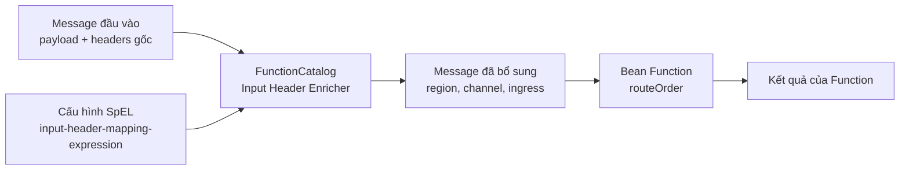

# Bổ sung header bằng `input-header-mapping-expression`

## 1. Động cơ: chuẩn hóa metadata trước khi xử lý nghiệp vụ

Trong **SPRING_CLOUD_FUNCTION (Spring Cloud Function)**, các nghiệp vụ được viết bằng `Supplier`, `Function` và `Consumer`, đăng ký thông qua `FunctionCatalog`, ghép bằng *composition* và có thể sử dụng lại qua HTTP, sự kiện hoặc môi trường serverless. Dù các đầu vào đến từ những giao thức khác nhau, hàm vẫn nên nhìn thấy metadata dưới các tên và kiểu đã được quy ước.

Giả sử hệ thống nhận một thông điệp có:

```text
payload = "ORD-42"
headers = {
    "path": "north/express",
    "correlationId": "req-42"
}
```

Hàm định tuyến đơn hàng cần đọc riêng `region=north` và `channel=express`. Ta có thể tách chuỗi `path` trong code nghiệp vụ, nhưng đó là công việc chuẩn hóa metadata trước khi quyết định nghiệp vụ. Spring Cloud Function cung cấp **`input-header-mapping-expression`**: cấu hình các biểu thức Spring Expression Language (**SpEL**) để bổ sung hoặc tính toán header đầu vào ngay tại lớp bao hàm trước khi bean `Function` nhận dữ liệu.

Ví dụ cấu hình:

```properties
spring.cloud.function.configuration.routeOrder.input-header-mapping-expression.region=headers.path.split('/')[0]
spring.cloud.function.configuration.routeOrder.input-header-mapping-expression.channel=headers.path.split('/')[1]
spring.cloud.function.configuration.routeOrder.input-header-mapping-expression.ingress='edge'
```

Khi `routeOrder` được gọi qua `FunctionCatalog` với một `Message` chứa `path=north/express`, cấu hình trên bổ sung các header `region`, `channel` và `ingress` để bean sử dụng. Hàm không cần biết `region` và `channel` được tách từ chuỗi đầu vào.

Sau bài này, bạn có thể:

- Khai báo đúng cú pháp cấu hình `input-header-mapping-expression` và viết các biểu thức SpEL cơ bản.
- Hiểu thời điểm thực thi, sự khác nhau giữa bean gọi trực tiếp với hàm tra cứu qua `FunctionCatalog`.
- Phân biệt enrichment đầu vào, enrichment đầu ra và việc sao chép toàn bộ header.
- Kiểm thử tình huống ánh xạ thành công, thiếu header hoặc biểu thức lỗi; thiết kế cơ chế kiểm tra bắt buộc ở nơi phù hợp.
- Áp dụng cùng hợp đồng metadata khi hàm chạy qua HTTP, broker hoặc serverless.

## 2. `input-header-mapping-expression` hoạt động ở bước nào?

`Message<T>` thuộc `org.springframework.messaging.Message` và có `getPayload()` cùng `getHeaders()`. Các header được lưu trong `MessageHeaders`, có thể đọc như một map từ `String` đến `Object`. Header đã được xây thành `Message` là cấu trúc chỉ đọc; framework hoặc code muốn bổ sung header sẽ tạo thông điệp thích hợp mới.

`input-header-mapping-expression` nằm ở **tầng enrichment của `FunctionCatalog`**. Khái niệm luồng như sau:



Các bước quan trọng:

1. Adapter hoặc mã gọi tạo `Message<T>` từ payload và metadata ban đầu.
2. `FunctionCatalog` tra cứu hàm và áp dụng cấu hình enrichment phù hợp với tên hàm/definition.
3. Các SpEL được đánh giá theo dữ liệu đầu vào, ví dụ đọc `headers.path` rồi tách thành nhiều giá trị.
4. Framework bổ sung header được cấu hình trước khi bean `Function` thực sự xử lý.
5. Bean đọc các header đã bổ sung nếu phép đánh giá thành công, sau đó tạo kết quả theo hợp đồng của mình.

Spring Cloud Function hỗ trợ **Input/Output Enrichment từ phiên bản 3.1.3**. Các API và cú pháp property dùng trong bài dựa vào tài liệu Spring Cloud Function, mục [Input/Output Enrichment](https://docs.spring.io/spring-cloud-function/reference/spring-cloud-function/programming-model.html).

> Gọi trực tiếp bean qua `new MyFunctions().routeOrder().apply(message)` **không kích hoạt** enrichment của `FunctionCatalog`. Cấu hình là một tính năng của lớp bao hàm khi hàm được tra cứu/thực thi qua catalog hoặc một adapter sử dụng catalog.

## 3. Cú pháp cấu hình: tên hàm, tên header đích và biểu thức

Cấu trúc chung:

```text
spring.cloud.function.configuration.<function-name>.input-header-mapping-expression.<target-header>=<SpEL>
```

| Thành phần | Ví dụ | Ý nghĩa |
|---|---|---|
| `spring.cloud.function.configuration` | Tiền tố cấu hình | Nhóm thiết lập theo hàm Spring Cloud Function |
| `<function-name>` | `routeOrder` | Tên hàm/definition được `FunctionCatalog` sử dụng |
| `input-header-mapping-expression` | Cố định | Yêu cầu đánh giá SpEL để bổ sung header **đầu vào** |
| `<target-header>` | `region`, `channel` | Khóa sẽ được đặt vào `MessageHeaders` của đầu vào |
| `<SpEL>` | `headers.path.split('/')[0]` | Cách tính giá trị header đích từ thông điệp |

Ví dụ dưới dạng `application.properties`:

```properties
spring.cloud.function.configuration.routeOrder.input-header-mapping-expression.region=headers.path.split('/')[0]
spring.cloud.function.configuration.routeOrder.input-header-mapping-expression.channel=headers.path.split('/')[1]
spring.cloud.function.configuration.routeOrder.input-header-mapping-expression.ingress='edge'
```

Định dạng tương đương trong `application.yml`:

```yaml
spring:
  cloud:
    function:
      configuration:
        routeOrder:
          input-header-mapping-expression:
            region: "headers.path.split('/')[0]"
            channel: "headers.path.split('/')[1]"
            ingress: "'edge'"
```

Trong YAML, cặp dấu nháy đôi ngoài cùng biểu thị **chuỗi YAML**. Với `ingress`, cặp nháy đơn **bên trong chuỗi** là cú pháp literal của SpEL. Nếu viết `ingress: edge` thay vì `ingress: "'edge'"`, SpEL có thể cố tìm thuộc tính hoặc biến tên `edge` thay vì tạo chuỗi hằng `"edge"`.

`routeOrder` phải khớp với tên bean hàm được đăng ký hoặc tên definition đang được cấu hình theo cơ chế lookup. Đừng tự thay bằng tên class `OrderFunctions`, URL endpoint hoặc tên Kafka topic.

## 4. Ngữ cảnh SpEL: `payload`, `headers` và giá trị literal

Đối tượng gốc mà SpEL dùng cho enrichment là thông điệp đầu vào. Với một `Message<?>`, có thể truy cập **`payload`** và **`headers`** trong biểu thức.

Ví dụ thông điệp được tạo từ Java:

```java
import org.springframework.messaging.Message;
import org.springframework.messaging.support.MessageBuilder;

Message<String> input = MessageBuilder.withPayload("ORD-42")
        .setHeader("path", "north/express")
        .setHeader("correlationId", "req-42")
        .build();
```

Các biểu thức minh họa:

| Biểu thức SpEL | Giá trị với thông điệp trên | Cách dùng |
|---|---|---|
| `headers.path` | `"north/express"` | Đọc toàn bộ header `path` |
| `headers.path.split('/')[0]` | `"north"` | Lấy phần thứ nhất của đường dẫn |
| `headers.path.split('/')[1]` | `"express"` | Lấy phần thứ hai |
| `headers['correlationId']` | `"req-42"` | Truy cập khóa header bằng chỉ số map |
| `payload` | `"ORD-42"` | Đọc payload hiện tại |
| `'edge'` | `"edge"` | Literal chuỗi SpEL |

Ví dụ cấu hình bổ sung một header từ payload:

```properties
spring.cloud.function.configuration.routeOrder.input-header-mapping-expression.requestId=payload
```

Cấu hình này chỉ hợp lý nếu payload thực sự là một mã định danh dạng chuỗi. Nếu payload là một DTO, `payload` trả lại **đối tượng DTO**, không tự chuyển đổi thành mã hoặc chuỗi JSON. Phải chọn biểu thức phù hợp với kiểu dữ liệu và kiểm tra được trong test.

### Những lưu ý về tên và kiểu header

- `MessageHeaders` dùng khóa `String` và giá trị `Object`. `headers.path.split('/')` giả định `path` tồn tại và là một `String` có phương thức `split` phù hợp.
- Header HTTP không phân biệt chữ hoa/chữ thường, nhưng các khóa Java `"path"`, `"Path"` hoặc `"X-Path"` không mặc nhiên trùng nhau trong `MessageHeaders`.
- `headers.path` là lối truy cập tiện cho khóa đơn giản. Với tên có dấu gạch ngang hoặc dấu chấm, cú pháp map như `headers['X-Correlation-ID']` có thể dễ diễn đạt hơn; tuy nhiên cần kiểm tra tên header thực sự được adapter đưa vào.
- Biểu thức `split('/')[1]` yêu cầu thành phần thứ hai có mặt; nếu dữ liệu thiếu dấu phân cách, có thể phát sinh lỗi đánh giá.
- Giá trị được tạo có thể không phải `String`. Nếu bean sử dụng `get("region", String.class)`, hãy đảm bảo SpEL trả đúng kiểu.

**SpEL không thay thế hợp đồng đầu vào.** Nó thuận tiện để lấy hoặc bổ sung metadata có cấu trúc đơn giản. Những quy tắc phức tạp về xác thực, phân quyền, chuẩn hóa dữ liệu từ nguồn không tin cậy nên được thực hiện ở adapter hoặc một bước xử lý rõ ràng.

## 5. Ví dụ hoàn chỉnh: định tuyến đơn hàng theo `region` và `channel`

Ta tạo một bean nhận `Message<String>`, trong đó payload là mã đơn hàng. Phần nghiệp vụ chỉ quan tâm hai header đã được chuẩn hóa là `region` và `channel`. Header `ingress` dùng để quan sát nguồn xử lý.

### 5.1. Định nghĩa bean `Function`

```java
package com.example.routing;

import java.util.function.Function;

import org.springframework.context.annotation.Bean;
import org.springframework.context.annotation.Configuration;
import org.springframework.messaging.Message;
import org.springframework.messaging.support.MessageBuilder;

@Configuration
public class RouteFunctions {

    @Bean
    public Function<Message<String>, Message<String>> routeOrder() {
        return incoming -> {
            String region = incoming.getHeaders().get("region", String.class);
            String channel = incoming.getHeaders().get("channel", String.class);
            String ingress = incoming.getHeaders().get("ingress", String.class);

            // Không giả định rằng biểu thức SpEL luôn đánh giá thành công.
            if (region == null || region.isBlank()
                    || channel == null || channel.isBlank()) {
                throw new IllegalArgumentException(
                        "Missing or invalid routing headers");
            }

            String summary = region + ":" + channel
                    + ":" + incoming.getPayload();

            MessageBuilder<String> response = MessageBuilder
                    .withPayload(summary)
                    .setHeader("processedBy", "routeOrder");

            if (ingress != null) {
                response.setHeader("observedIngress", ingress);
            }

            // Chỉ giữ metadata thực sự cần ở đầu ra.
            String correlationId = incoming.getHeaders()
                    .get("correlationId", String.class);
            if (correlationId != null) {
                response.setHeader("correlationId", correlationId);
            }

            return response.build();
        };
    }
}
```

**Hợp đồng đầu vào của bean:** `region` và `channel` bắt buộc, `ingress` và `correlationId` tùy chọn. `region` và `channel` được tính từ `path` khi có enrichment. Code nghiệp vụ được phép từ chối thông điệp nếu thiếu metadata bắt buộc.

**Hợp đồng đầu ra của bean:** payload `"north:express:ORD-42"`, các header `processedBy=routeOrder`, `observedIngress=edge` và `correlationId=req-42` nếu có. Bean **không chuyển tiếp `path`, `region` hoặc `channel`** trừ khi được yêu cầu. Việc bổ sung header đầu vào không đồng nghĩa các header đó sẽ được tự động mang sang thông điệp đầu ra.

### 5.2. Cấu hình enrichment cho đúng tên bean

```properties
spring.cloud.function.configuration.routeOrder.input-header-mapping-expression.region=headers.path.split('/')[0]
spring.cloud.function.configuration.routeOrder.input-header-mapping-expression.channel=headers.path.split('/')[1]
spring.cloud.function.configuration.routeOrder.input-header-mapping-expression.ingress='edge'
```

Nếu ứng dụng có nhiều function bean, khi công bố qua adapter có thể dùng:

```properties
spring.cloud.function.definition=routeOrder
```

Thuộc tính `spring.cloud.function.definition` xác định hàm được chọn cho adapter. Thuộc tính `input-header-mapping-expression` xác định cách thêm metadata trước lời gọi hàm đó. Hai cấu hình này phục vụ các mục đích khác nhau.

### 5.3. Tra cứu và gọi bằng `FunctionCatalog`

```java
import java.util.function.Function;

import org.springframework.cloud.function.context.FunctionCatalog;
import org.springframework.messaging.Message;
import org.springframework.messaging.support.MessageBuilder;

// catalog là bean FunctionCatalog được Spring inject.
Function<Message<String>, Message<String>> function =
        catalog.lookup("routeOrder");

Message<String> input = MessageBuilder
        .withPayload("ORD-42")
        .setHeader("path", "north/express")
        .setHeader("correlationId", "req-42")
        .build();

Message<String> output = function.apply(input);

System.out.println(output.getPayload());
// north:express:ORD-42

System.out.println(output.getHeaders().get("observedIngress"));
// edge

System.out.println(output.getHeaders().get("correlationId"));
// req-42

System.out.println(output.getHeaders().get("region"));
// null: ví dụ này không tự sao chép region ra kết quả.
```

Biểu thức mapping được áp dụng trong **wrapper của catalog** trước khi bean đọc `region` và `channel`. Lời gọi trực tiếp bean, chẳng hạn `new RouteFunctions().routeOrder().apply(input)`, **không tự bổ sung** hai header. Với cùng `input` chỉ có `path`, lời gọi trực tiếp sẽ gặp kiểm tra “Missing or invalid routing headers”; đó là hành vi mong muốn của ví dụ.

## 6. Khi biểu thức lỗi: framework ghi WARN nhưng vẫn gọi hàm

Đây là đặc điểm đặc biệt quan trọng của `input-header-mapping-expression`. Tài liệu Spring Cloud Function nêu rằng khi đánh giá một biểu thức enrichment thất bại, framework **ghi cảnh báo WARN và tiếp tục thực thi hàm** như bình thường. Cơ chế enrichment không mặc nhiên biến lỗi biểu thức thành việc từ chối toàn bộ thông điệp.

Ví dụ:

```properties
spring.cloud.function.configuration.routeOrder.input-header-mapping-expression.channel=headers.path.split('/')[1]
```

Nếu `headers.path` bằng `"north"`, kết quả `split('/')` không có phần tử `[1]`; phép đánh giá `channel` có thể thất bại. Tương tự, nếu `path` không tồn tại, thao tác gọi `split` trên giá trị thiếu cũng có thể lỗi. Framework có thể ghi log dạng:

```text
WARN ... InputEnricher : Failed while evaluating expression ...
```

**Hệ quả:** đừng coi enrichment là validation “fail closed”. Nếu bean cần `channel` để định tuyến hoặc phân quyền, bean/adapter phải tự kiểm tra điều kiện bắt buộc và có cơ chế từ chối đầu vào không hợp lệ.

Trong ví dụ ở mục 5, bean thực hiện:

```java
if (region == null || region.isBlank()
        || channel == null || channel.isBlank()) {
    throw new IllegalArgumentException(
            "Missing or invalid routing headers");
}
```

Do đó, dù một phép mapping thất bại và framework vẫn chuyển control tới bean, **chính bean** sẽ từ chối đầu vào thiếu metadata bắt buộc. Việc ngoại lệ được ánh xạ thành HTTP status, retry, dead-letter hoặc thông báo lỗi nào phụ thuộc adapter và hợp đồng xử lý lỗi thực tế.

Nếu dữ liệu thiếu `path` là tình huống nghiệp vụ bình thường, có thể áp dụng giá trị mặc định đã thống nhất tại biên HTTP/broker hoặc viết hàm enrichment Java có kiểm tra rõ ràng. Không nên dựa vào lỗi SpEL để đại diện cho một nhánh nghiệp vụ.

## 7. Phân biệt enrichment đầu vào, enrichment đầu ra và copy headers

Ba cơ chế có mục đích khác nhau:

| Cơ chế | Điểm tác động | Ví dụ | Trường hợp sử dụng |
|---|---|---|---|
| `input-header-mapping-expression` | **Trước** khi bean nhận `Message` | Tách `path` thành `region` và `channel` | Chuẩn hóa hoặc bổ sung metadata đầu vào |
| `output-header-mapping-expression` | **Sau** kết quả của hàm trong wrapper | Gắn header mô tả kết quả từ dữ liệu hiện có | Bổ sung metadata của thông điệp đầu ra |
| `copy-input-headers` | Cơ chế truyền headers từ input tới output trong wrapper khi áp dụng được | Giữ các header đầu vào qua một hàm POJO thuần | Muốn sao chép rộng, không lựa chọn từng khóa |
| `MessageBuilder.setHeader(...)` | Trong code tạo `Message` | Chỉ giữ `correlationId` | Cần kiểm tra, chọn lọc, đổi tên hoặc áp dụng quy tắc nghiệp vụ |

Ví dụ property của enrichment đầu ra, để thấy khác biệt về tên:

```properties
spring.cloud.function.configuration.routeOrder.output-header-mapping-expression.stage='completed'
```

Trong khi `input-header-mapping-expression.ingress='edge'` bổ sung metadata **để `routeOrder` đọc trước khi xử lý**, `output-header-mapping-expression.stage='completed'` nhắm tới **thông điệp kết quả sau khi hàm xử lý**. Giá trị `stage` ở đầu ra không phải một input header mà bean có thể đọc ngay trong cùng lần gọi.

Ngược lại, `copy-input-headers=true` không diễn giải một `path` để tự sinh `region` và `channel`. Nó hỗ trợ **truyền các header sẵn có** trong một số trường hợp khi gọi qua `FunctionCatalog`. Nếu hàm trả `Message<O>` do chính nó xây dựng, hãy định nghĩa hợp đồng output headers trong code; không dựa vào việc framework sẽ sao chép toàn bộ header cho mọi kiểu hàm.

### Khi nào nên dùng function enrichment viết bằng Java?

Nếu logic chuẩn hóa phức tạp, cần truy cập một dịch vụ khác, cần schema validation hoặc phải xử lý lỗi rõ ràng, bạn có thể tạo một bean enrichment:

```java
@Bean
public Function<Message<String>, Message<String>> normalizeRoute() {
    return incoming -> {
        String path = incoming.getHeaders().get("path", String.class);
        if (path == null) {
            throw new IllegalArgumentException("path is required");
        }

        String[] parts = path.split("/", -1);
        if (parts.length != 2
                || parts[0].isBlank() || parts[1].isBlank()) {
            throw new IllegalArgumentException("Invalid path");
        }

        return MessageBuilder.fromMessage(incoming)
                .setHeader("region", parts[0])
                .setHeader("channel", parts[1])
                .build();
    };
}
```

Khi đó có thể dùng composition `normalizeRoute|routeOrder` với các chữ ký tương thích, miễn là bạn kiểm thử definition qua catalog. Cách viết bằng Java dài hơn property, nhưng cho phép định nghĩa validation, lỗi và quy tắc kiểm toán rõ ràng hơn.

## 8. Ánh xạ header từ HTTP, broker và serverless vào cùng một hợp đồng

`input-header-mapping-expression` đánh giá trên **`Message` mà framework nhận được**, không trực tiếp lấy dữ liệu từ đối tượng HTTP servlet, bản ghi Kafka hay ngữ cảnh Lambda. Lớp adapter chịu trách nhiệm đưa body và metadata truyền tải vào `Message` trước đó.

| Môi trường | Metadata ở đầu vào có thể là | Trước khi áp dụng SpEL cần xác minh |
|---|---|---|
| Spring Cloud Function Web | HTTP headers, request body | Tên header mà web adapter đưa vào `MessageHeaders`, kiểu dữ liệu và cách giải mã body |
| Spring Cloud Stream | Broker record headers/attributes, metadata binder | Mapping của binder, kiểu headers và cơ chế serialization |
| Serverless adapter | Runtime event envelope, message attributes, request context | Trường nào được adapter trích xuất, tên nội bộ và nguồn tin cậy |

Ví dụ, cùng một ý nghĩa tuyến đường có thể xuất hiện như:

```text
HTTP request:       X-Route: north/express
Kafka event header: route-path = north/express
Serverless event:   detail.route = north/express
                         |
                  adapter chuẩn hóa
                         v
MessageHeaders["path"] = "north/express"
                         |
               input-header-mapping-expression
                         v
MessageHeaders["region"]  = "north"
MessageHeaders["channel"] = "express"
                         |
                     routeOrder
```

Đây là **quy ước minh họa do ứng dụng đặt ra**; Spring Cloud Function không bảo đảm `X-Route`, `route-path` và `detail.route` tự được ánh xạ vào cùng một khóa `path`. Khi cùng hàm cần chạy qua HTTP, broker hoặc serverless, hãy thiết lập và kiểm thử bước chuẩn hóa ở từng biên.

Tương tự, Spring Messaging header `contentType` khác với HTTP `Content-Type` về cấp trừu tượng. Việc đặt thêm header qua SpEL không tự serialize payload thành JSON hay đổi bytes thành DTO; converter/adapter và chữ ký hàm quyết định quá trình chuyển đổi thực tế.

## 9. Bảo mật và giới hạn phạm vi SpEL

SpEL là ngôn ngữ biểu thức mạnh, có thể truy cập thuộc tính và gọi phương thức trong những ngữ cảnh được framework cho phép. **Biểu thức do cấu hình ứng dụng cung cấp phải được coi là cấu hình có đặc quyền**, chỉ do người vận hành hoặc quy trình triển khai đáng tin cậy quản lý.

Các nguyên tắc quan trọng:

1. **Không lấy nguyên biểu thức từ HTTP header hoặc metadata sự kiện do client kiểm soát để nhét vào cấu hình.** Nếu cần lấy giá trị của header, biểu thức phải là **cấu hình cố định**, ví dụ `headers.path`; giá trị `path` được coi là dữ liệu và phải được kiểm tra.
2. **Bảo vệ quyền thay đổi cấu hình và các endpoint quản trị.** Không để một nguồn không đáng tin có thể thay thế property chứa SpEL.
3. **Không dùng SpEL để quyết định phân quyền chỉ dựa vào header tự khai báo.** Các header như `X-Tenant-ID` hoặc `X-User-ID` không phải bằng chứng danh tính; cần xác thực và ủy quyền tại biên tin cậy.
4. **Giới hạn độ dài và định dạng của dữ liệu dùng trong biểu thức.** Một giá trị `path` rất dài, thiếu dấu phân cách hoặc có kiểu khác `String` có thể làm phép đánh giá thất bại hay tạo metadata không mong muốn.
5. **Không chuyển tiếp thông tin nhạy cảm một cách mặc định.** Việc làm giàu header đầu vào không có nghĩa `Authorization`, cookie, token hoặc nội dung tracing được phép đi tới mọi bước tiếp theo.

Nếu enrichment tác động tới điều kiện nghiệp vụ bắt buộc, hãy bổ sung kiểm tra trong code, vì lỗi đánh giá biểu thức **không mặc nhiên dừng lời gọi hàm**.

## 10. Composition: cấu hình thuộc hàm nào?

Giả sử hệ thống có bước làm giàu metadata và bước nghiệp vụ:

```properties
spring.cloud.function.definition=normalizeRoute|routeOrder
```

Trong composition, ranh giới giữa các hàm và wrapper có thể khác lời gọi đơn lẻ. Cần hiểu **tên function definition được tra cứu**, nơi cấu hình `input-header-mapping-expression` gắn vào, và thời điểm `Message` được chuyển đổi hoặc bọc lại.

Một cách kiểm tra đúng:

1. Bắt đầu bằng lời gọi riêng `catalog.lookup("routeOrder")` với một `Message` có `path` đúng định dạng để xác nhận property enrichment hoạt động.
2. Chạy definition composition `catalog.lookup("normalizeRoute|routeOrder")` và xác minh `region`, `channel` xuất hiện đúng tại bước `routeOrder`.
3. Nếu đặt property theo tên hàm hoặc theo tên definition tổng hợp, hãy kiểm tra cơ chế cấu hình thực tế trên phiên bản Spring Cloud Function đang sử dụng; không suy đoán rằng property của một bước tự áp dụng cho mọi chuỗi composition.
4. Với một ranh giới phức tạp, cân nhắc bean enrichment riêng và kiểm thử từng bước thay vì phụ thuộc vào nhiều lớp tự động ánh xạ.

Đừng trộn lẫn `input-header-mapping-expression` với `spring.cloud.function.routing-expression`. Cả hai dùng SpEL trong một số tình huống, nhưng **routing** chọn hàm/đường xử lý, còn **input header enrichment** bổ sung metadata vào thông điệp trước lời gọi. Việc client có thể tác động tới routing còn có những quy tắc an toàn riêng; không vì hiểu cú pháp mapping mà mặc định routing an toàn với mọi nguồn dữ liệu.

## 11. Trường hợp nâng cao: nhiều đầu vào

Tài liệu Spring Cloud Function mô tả cú pháp có chỉ số ngay sau `input-header-mapping-expression` cho các hàm có nhiều đầu vào:

```properties
spring.cloud.function.configuration.echo.input-header-mapping-expression[0].key1='hello1'
spring.cloud.function.configuration.echo.input-header-mapping-expression[1].key2='hello2'
```

Chỉ số `[0]` và `[1]` chỉ **vị trí đầu vào tương ứng** trong mô hình hàm nhiều đầu vào. Đây là trường hợp nâng cao, thường gắn với mô hình reactive và function arity, không phải cấu hình cần thêm cho một `Function<Message<String>, Message<String>>` thông thường. Nếu một ứng dụng xử lý nhiều input bindings, nên xác minh cú pháp với phiên bản đang dùng và test riêng từng kênh đầu vào.

## 12. Kiểm thử `input-header-mapping-expression` qua `FunctionCatalog`

Vì enrichment thuộc lớp bọc của `FunctionCatalog`, unit test gọi bean trực tiếp **không đủ** để xác nhận property. Ví dụ JUnit 5 với Spring Boot Test sau khởi tạo một Spring context nhỏ, khai báo bean `routeOrder` của mục 5 và cấu hình ba biểu thức:

```java
package com.example.routing;

import static org.junit.jupiter.api.Assertions.assertEquals;
import static org.junit.jupiter.api.Assertions.assertNull;

import java.util.function.Function;

import org.junit.jupiter.api.Test;
import org.springframework.beans.factory.annotation.Autowired;
import org.springframework.boot.SpringBootConfiguration;
import org.springframework.boot.autoconfigure.EnableAutoConfiguration;
import org.springframework.boot.test.context.SpringBootTest;
import org.springframework.cloud.function.context.FunctionCatalog;
import org.springframework.context.annotation.Import;
import org.springframework.messaging.Message;
import org.springframework.messaging.support.MessageBuilder;

@SpringBootTest(
        classes = RouteFunctionMappingTest.TestApp.class,
        properties = {
                "spring.cloud.function.configuration.routeOrder."
                        + "input-header-mapping-expression.region="
                        + "headers.path.split('/')[0]",
                "spring.cloud.function.configuration.routeOrder."
                        + "input-header-mapping-expression.channel="
                        + "headers.path.split('/')[1]",
                "spring.cloud.function.configuration.routeOrder."
                        + "input-header-mapping-expression.ingress='edge'"
        }
)
class RouteFunctionMappingTest {

    @SpringBootConfiguration
    @EnableAutoConfiguration
    @Import(RouteFunctions.class)
    static class TestApp {}

    @Autowired
    private FunctionCatalog catalog;

    @Test
    void enrichesHeadersBeforeCallingBusinessFunction() {
        Function<Message<String>, Message<String>> function =
                catalog.lookup("routeOrder");

        Message<String> input = MessageBuilder
                .withPayload("ORD-42")
                .setHeader("path", "north/express")
                .setHeader("correlationId", "req-42")
                .build();

        Message<String> result = function.apply(input);

        assertEquals("north:express:ORD-42", result.getPayload());
        assertEquals("edge",
                result.getHeaders().get("observedIngress"));
        assertEquals("req-42",
                result.getHeaders().get("correlationId"));
        assertEquals("routeOrder",
                result.getHeaders().get("processedBy"));

        // region/channel là enrichment đầu vào;
        // code hàm không công bố chúng ở output.
        assertNull(result.getHeaders().get("region"));
        assertNull(result.getHeaders().get("channel"));
    }
}
```

Ví dụ giả định test classpath đã có các dependency phù hợp cho Spring Boot Test và Spring Cloud Function. Lớp `TestApp` bật auto-configuration và import `RouteFunctions` để Spring context có thể đăng ký bean hàm và `FunctionCatalog`. Một dự án có cấu hình ứng dụng phức tạp có thể cần điều chỉnh thêm theo phiên bản đang sử dụng. Đây là mẫu minh họa kiểm thử hành vi theo tên bean, không phải lệnh đã chạy trong bài học.

### Những bài kiểm thử bổ sung nên có

| Trường hợp | Điều cần kiểm tra |
|---|---|
| `path=north/express` | Bean nhìn thấy `region=north` và `channel=express` |
| Thiếu header `path` | Enrichment có thể ghi WARN, nhưng bean vẫn xác minh thiếu giá trị bắt buộc và từ chối đầu vào |
| `path=north` thiếu phần thứ hai | Biểu thức `[1]` không sinh `channel` hợp lệ; xử lý lỗi theo hợp đồng |
| `path` có kiểu khác `String` | Không tự mặc định có phương thức `split` và kiểu kết quả đúng |
| Gọi bean trực tiếp không qua catalog | Không có enrichment tự động |
| Đổi `Function` thành một definition composition | Kiểm tra cấu hình áp dụng đúng điểm và header còn tồn tại ở bước sau |
| Gọi qua HTTP/broker/serverless | Đảm bảo adapter thực sự tạo ra `headers.path` trước khi enrichment chạy |
| Chuyển đổi payload hoặc content type | Xác minh converter và định dạng đầu ra thực tế, không suy từ metadata |

Nếu bắt buộc xử lý thiếu `path` thành một HTTP 400, quy tắc trả HTTP status thuộc tầng HTTP adapter/controller. Nếu thông điệp đến từ broker, một ngoại lệ của bean có thể dẫn đến retry hoặc dead-letter tùy binder. `input-header-mapping-expression` tự nó không định nghĩa các chính sách vận chuyển đó.

## 13. Những lỗi phổ biến và cách khắc phục

| Hiện tượng | Nguyên nhân có thể gặp | Cách giải quyết |
|---|---|---|
| Không thấy header mới trong bean | Gọi bean trực tiếp; property sai tên hàm; adapter không dùng lookup dự kiến | Gọi qua `FunctionCatalog`, kiểm tra tên definition và cấu hình |
| `ingress=edge` không được tạo | SpEL `edge` không có nháy đơn, bị hiểu là thuộc tính/biến | Dùng literal `'edge'` trong giá trị property |
| Biểu thức `headers.path` trả `null` | Header thực tế tên khác hoặc adapter chưa chuyển tới `Message` | Kiểm tra headers sau adapter, thống nhất tên khóa |
| `split('/')[1]` bị lỗi | `path` thiếu dấu phân cách, thiếu giá trị hoặc không phải chuỗi | Kiểm tra đầu vào, dùng logic chuẩn hóa có validation |
| Thấy log WARN nhưng hàm vẫn chạy | Framework bỏ qua lỗi enrichment theo thiết kế | Không coi enrichment là cơ chế từ chối; validate trong bean/adapter |
| Header chỉ có trong input, không có ở output | Enrichment chỉ thêm header trước bean, output do hàm quyết định | Tạo header output bằng `MessageBuilder` hoặc cấu hình output enrichment có kiểm soát |
| Bật `copy-input-headers` nhưng không tách được `path` | Copy khác với đánh giá biểu thức SpEL | Dùng đúng `input-header-mapping-expression` |
| Header HTTP `X-Route` không thể đọc qua `headers.path` | Không có quy tắc ánh xạ tên header HTTP sang nội bộ | Chuẩn hóa tại web adapter/controller |
| Kết quả khác khi ghép hàm | Cấu hình gắn sai definition hoặc wrapping/conversion thay đổi | Test chính composition qua catalog |
| Lộ dữ liệu nhạy cảm hoặc sai ngữ cảnh bảo mật | Biểu thức lấy header không đáng tin và chuyển tiếp không lọc | Kiểm soát cấu hình, xác thực tại biên và giới hạn output metadata |

## 14. Bài thực hành: làm giàu metadata trước hàm xử lý thanh toán

Hãy tạo `Function<Message<String>, Message<String>> validatePayment` nhận payload là mã thanh toán, còn header `route` chứa chuỗi `"vn/priority"` theo quy ước ứng dụng.

1. Cấu hình `input-header-mapping-expression.country=headers.route.split('/')[0]` và `input-header-mapping-expression.serviceLevel=headers.route.split('/')[1]` cho bean `validatePayment`.
2. Thêm header mặc định `ingress='payment-gateway'` bằng một literal SpEL hợp lệ trong `application.properties` hoặc `application.yml`.
3. Trong bean, đọc `country` và `serviceLevel`, kiểm tra chúng tồn tại và thuộc tập giá trị được phép; trả `Message<String>` với payload mô tả kết quả, thêm `processedBy=validatePayment`.
4. Đặt `correlationId` trong thông điệp đầu vào và chỉ chuyển tiếp header đó nếu đã kiểm tra đúng kiểu. Chứng minh `country` không tự được sao chép sang output nếu code không đặt nó.
5. Dùng `FunctionCatalog.lookup("validatePayment")` để kiểm thử trường hợp `route=vn/priority`; so sánh với lời gọi bean trực tiếp.
6. Thử `route=vn`, thiếu `route` và header `route` không phải chuỗi. Quan sát cảnh báo của enrichment, sau đó chứng minh validation trong bean xử lý trường hợp thiếu metadata bắt buộc.
7. Thêm một bước thứ hai bằng composition và kiểm tra các header mà bước sau nhận. Cuối cùng, thử công bố hàm qua HTTP hoặc một binder sự kiện và xác minh cách adapter ánh xạ tên header.

**Ghi nhớ:** `input-header-mapping-expression` là cách cấu hình **SpEL để bổ sung hoặc tính toán header đầu vào trước khi bean `Function` chạy qua `FunctionCatalog`**, theo mẫu `spring.cloud.function.configuration.<function-name>.input-header-mapping-expression.<target-header>=<SpEL>`. Nó hữu ích cho biến đổi metadata gọn như tách chuỗi, đọc header và đặt giá trị mặc định. Lỗi đánh giá biểu thức có thể chỉ ghi WARN rồi tiếp tục gọi hàm, vì vậy validation bắt buộc phải nằm ở bean hoặc adapter; header đầu ra và header truyền tải vẫn cần hợp đồng và kiểm thử riêng.
