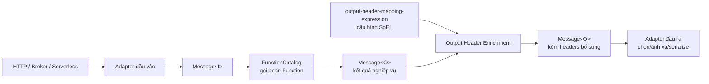

# Bổ sung header bằng `output-header-mapping-expression`

## 1. Bài toán: thêm metadata sau khi hàm tạo kết quả

Trong **SPRING_CLOUD_FUNCTION (Spring Cloud Function)**, logic nghiệp vụ được tổ chức thành `Supplier`, `Function` và `Consumer`, đăng ký qua `FunctionCatalog`, ghép bằng *composition* và có thể triển khai qua HTTP, luồng sự kiện hoặc môi trường serverless. Khi một hàm trả kết quả, các bước tiếp theo đôi khi cần metadata như trạng thái xử lý, mã phân loại phản hồi hoặc thông tin giúp quan sát kết quả.

Giả sử một hàm chuẩn hóa chuỗi nhận `"  hello  "` và trả `"HELLO"`. Logic nghiệp vụ chỉ chịu trách nhiệm chuẩn hóa nội dung. Tuy nhiên, adapter hoặc bước kế tiếp còn cần biết độ dài chuỗi kết quả và tên giai đoạn đã hoàn thành:

```text
Message<String> sau khi hàm chạy:
  payload = "HELLO"
  headers = {
    processedBy = "normalizeReceipt",
    resultCode = "NORMALIZED"
  }

Message<String> sau khi làm giàu header đầu ra:
  payload = "HELLO"
  headers = {
    processedBy = "normalizeReceipt",
    resultCode = "NORMALIZED",
    stage = "done",
    outputLength = 5,
    outputCode = "NORMALIZED"
  }
```

Spring Cloud Function có cấu hình **`output-header-mapping-expression`** cho phép tính và thêm từng header vào **thông điệp đầu ra** bằng Spring Expression Language (**SpEL**). Việc làm giàu được thực hiện qua cơ chế bọc lời gọi của `FunctionCatalog`, giúp tách những phép gắn metadata đơn giản khỏi mã nghiệp vụ.

Ví dụ `application.properties`:

```properties
spring.cloud.function.configuration.normalizeReceipt.output-header-mapping-expression.stage='done'
spring.cloud.function.configuration.normalizeReceipt.output-header-mapping-expression.outputLength=payload.length()
spring.cloud.function.configuration.normalizeReceipt.output-header-mapping-expression.outputCode=headers['resultCode']
```

Ở ví dụ này, `stage` được đặt bằng chuỗi hằng, `outputLength` tính từ **payload đã được xử lý**, còn `outputCode` đọc một **header có trên thông điệp kết quả**. Cấu hình **không** tạo HTTP response header, không cấu hình broker output binding và không tự công bố sự kiện: những việc đó thuộc adapter đầu ra.

Mục tiêu của bài học là hiểu thời điểm đánh giá SpEL, khai báo đúng tên hàm và header, xây ví dụ có thể kiểm tra, xử lý biểu thức lỗi, và phân biệt enrichment đầu ra với sao chép headers hoặc ánh xạ giao thức.

## 2. Vị trí của output enrichment trong chuỗi xử lý

`Message<T>` là giao diện của Spring Messaging (`org.springframework.messaging.Message`). Một thông điệp gồm `getPayload()` và `getHeaders()`, trong đó `MessageHeaders` là map chỉ đọc từ tên header đến giá trị. Khi cần thêm header, framework hoặc code sẽ tạo ra một thông điệp đầu ra tương ứng; không chỉnh sửa trực tiếp `getHeaders().put(...)`.



Có ba mốc cần phân biệt:

1. **Trước hàm:** adapter nhận dữ liệu từ giao thức bên ngoài và cung cấp đầu vào thích hợp; `input-header-mapping-expression` (nếu được cấu hình) nhắm tới metadata mà bean sẽ nhìn thấy.
2. **Trong hàm:** bean tính payload kết quả và có thể chủ động tạo `Message<O>` cùng các headers do nghiệp vụ xác định.
3. **Sau hàm:** `output-header-mapping-expression` được dùng bởi wrapper để bổ sung headers cho kết quả. Bước nghiệp vụ vừa chạy **không thể đọc lại** header mới được tạo sau chính lần gọi đó.

Điểm thứ ba rất quan trọng: nếu bean `normalizeReceipt` cần sử dụng `stage` để quyết định cách xử lý, thì không thể chỉ đặt `stage` bằng output enrichment. Khi đó hãy tính `stage` trong bean hoặc dùng input enrichment phù hợp. Output enrichment phục vụ **bên tiêu thụ kết quả**, chẳng hạn hàm tiếp theo hoặc adapter đầu ra.

> Spring Cloud Function mô tả **Input/Output Enrichment** trong tài liệu chính thức từ phiên bản 3.1.3: [Programming model – Input/Output Enrichment](https://docs.spring.io/spring-cloud-function/reference/spring-cloud-function/programming-model.html). Hành vi thực tế cần được kiểm thử trên phiên bản và adapter ứng dụng đang sử dụng.

## 3. Cú pháp cấu hình chuẩn

Mẫu property tổng quát:

```text
spring.cloud.function.configuration.<function-name>.output-header-mapping-expression.<target-header>=<SpEL>
```

| Thành phần | Ví dụ | Chức năng |
|---|---|---|
| `spring.cloud.function.configuration` | Tiền tố cố định | Nhóm cấu hình theo hàm Spring Cloud Function |
| `<function-name>` | `normalizeReceipt` | Tên bean/definition mà `FunctionCatalog` tra cứu |
| `output-header-mapping-expression` | Tiền tố cố định | Tính headers **sau** kết quả hàm |
| `<target-header>` | `stage`, `outputLength` | Tên header đích cần bổ sung |
| `<SpEL>` | `'done'`, `payload.length()` | Biểu thức tính giá trị của header |

Với `application.properties`:

```properties
spring.cloud.function.configuration.normalizeReceipt.output-header-mapping-expression.stage='done'
spring.cloud.function.configuration.normalizeReceipt.output-header-mapping-expression.outputLength=payload.length()
spring.cloud.function.configuration.normalizeReceipt.output-header-mapping-expression.outputCode=headers['resultCode']
```

Với `application.yml`:

```yaml
spring:
  cloud:
    function:
      configuration:
        normalizeReceipt:
          output-header-mapping-expression:
            stage: "'done'"
            outputLength: "payload.length()"
            outputCode: "headers['resultCode']"
```

Hai cấu hình mang cùng ý nghĩa. Trong YAML, dấu nháy đôi bên ngoài là **cú pháp chuỗi YAML**; ở giá trị `stage`, dấu nháy đơn **bên trong** thuộc cú pháp **chuỗi literal của SpEL**. Nếu viết `stage: done` mà không có nháy đơn của SpEL, engine có thể cố truy cập một thuộc tính tên `done` và đánh giá thất bại.

Lưu ý: `<function-name>` là tên hàm được `FunctionCatalog` sử dụng, **không phải** tên class Java, URL REST hoặc tên topic broker. Trong ứng dụng có nhiều hàm, cấu hình entry point như `spring.cloud.function.definition=normalizeReceipt` xác định hàm được adapter lựa chọn; nó khác chức năng của `output-header-mapping-expression`.

## 4. SpEL đọc gì khi làm giàu header đầu ra?

Biểu thức output enrichment được đánh giá **trên thông điệp kết quả**, vì vậy có thể dùng `payload` và `headers` của **đầu ra**. Đây là mẫu cũng xuất hiện trong tài liệu chính thức:

```properties
spring.cloud.function.configuration.split.output-header-mapping-expression.keyOut1='hello1'
spring.cloud.function.configuration.split.output-header-mapping-expression.keyOut2=headers.contentType
```

`keyOut1` nhận chuỗi hằng `"hello1"`; `keyOut2` đọc `contentType` hiện có của thông điệp kết quả. Đây là **cấu hình minh họa của tài liệu**, không phải lời khẳng định rằng mọi kết quả đều có `contentType` hoặc header đó luôn là chuỗi.

Với ví dụ đầu ra:

```java
Message<String> result = MessageBuilder.withPayload("HELLO")
        .setHeader("processedBy", "normalizeReceipt")
        .setHeader("resultCode", "NORMALIZED")
        .build();
```

Ta có thể dùng:

| Biểu thức | Giá trị kỳ vọng | Giải thích |
|---|---|---|
| `'done'` | `"done"` | Chuỗi literal |
| `payload` | `"HELLO"` | Payload **đầu ra** |
| `payload.length()` | `5` (số nguyên) | Độ dài chuỗi kết quả |
| `headers['resultCode']` | `"NORMALIZED"` | Header đầu ra `resultCode` |
| `headers.processedBy` | `"normalizeReceipt"` | Cách truy cập thuộc tính map cho khóa đơn giản |
| `headers['missingHeader']` | Thường không có giá trị hữu ích | Phụ thuộc phép đánh giá và cách framework xử lý `null` |

**Kiểu dữ liệu của header là quan trọng.** `outputLength=payload.length()` cho giá trị số nguyên, không tự trở thành chuỗi `"5"`. Bên nhận dùng `get("outputLength", Integer.class)` khi hợp đồng quy định số nguyên. Nếu adapter chuyển headers sang HTTP hoặc broker, kiểu dữ liệu trên đường truyền có thể được mã hóa/biến đổi theo cơ chế riêng.

Với payload là DTO, có thể chọn biểu thức dựa trên dữ liệu kết quả, ví dụ `payload.status()` nếu đối tượng là Java record có accessor `status()`. Hãy kiểm tra kiểu payload **sau các bước chuyển đổi của wrapper**, vì nếu converter chuyển đối tượng thành `byte[]` thì những phương thức của DTO không còn áp dụng được.

### Đừng nhầm đầu vào và đầu ra

Nếu đầu vào có `headers.source` nhưng hàm tạo `Message` đầu ra chỉ chứa `resultCode` và `processedBy`, biểu thức output `headers.source` **không được bảo đảm** đọc thấy `source`. Nó hoạt động trên **ngữ cảnh kết quả**, không tự có quyền truy cập toàn bộ input headers của lời gọi trước.

Để output enrichment dùng được một metadata đầu vào cụ thể, cần một quy tắc chuyển tiếp rõ ràng trong hàm hoặc wrapper, ví dụ hàm chủ động giữ `correlationId` trong `Message<O>`. Đừng dựa vào việc mọi header được tự động copy.

## 5. Ví dụ Spring Cloud Function hoàn chỉnh: bean tạo phản hồi, wrapper bổ sung metadata

Ví dụ Java 17+ sau giữ logic nghiệp vụ độc lập với HTTP, Kafka, RabbitMQ hoặc serverless. Bean dùng `Message<String>` để đọc `correlationId` tùy chọn, xử lý chuỗi và tạo kết quả; **ba output headers `stage`, `outputLength`, `outputCode` không được tạo trong code**, mà được cấu hình ở phần tiếp theo.

```java
package com.example.functions;

import java.util.Locale;
import java.util.function.Function;

import org.springframework.context.annotation.Bean;
import org.springframework.context.annotation.Configuration;
import org.springframework.messaging.Message;
import org.springframework.messaging.support.MessageBuilder;

@Configuration
public class ReceiptFunctions {

    @Bean
    public Function<Message<String>, Message<String>> normalizeReceipt() {
        return incoming -> {
            String normalized = incoming.getPayload()
                    .strip()
                    .toUpperCase(Locale.ROOT);

            String resultCode = normalized.isBlank()
                    ? "EMPTY"
                    : "NORMALIZED";

            MessageBuilder<String> builder = MessageBuilder
                    .withPayload(normalized)
                    .setHeader("processedBy", "normalizeReceipt")
                    .setHeader("resultCode", resultCode);

            // Chỉ mang tiếp metadata nghiệp vụ cần thiết.
            Object correlation = incoming.getHeaders().get("correlationId");
            if (correlation != null) {
                if (!(correlation instanceof String id)
                        || !id.matches("[A-Za-z0-9._-]{1,64}")) {
                    throw new IllegalArgumentException(
                            "Invalid correlationId");
                }
                builder.setHeader("correlationId", correlation);
            }

            return builder.build();
        };
    }
}
```

Hàm giải quyết đúng hai nhiệm vụ: tạo payload đã chuẩn hóa và đặt những header thuộc **hợp đồng nghiệp vụ** (`processedBy`, `resultCode`, `correlationId` nếu hợp lệ). Nó không biết header truyền tải của HTTP/broker, và không tự sinh `stage` hay `outputLength`.

### 5.1. Cấu hình output enrichment

```properties
spring.cloud.function.definition=normalizeReceipt
spring.cloud.function.configuration.normalizeReceipt.output-header-mapping-expression.stage='done'
spring.cloud.function.configuration.normalizeReceipt.output-header-mapping-expression.outputLength=payload.length()
spring.cloud.function.configuration.normalizeReceipt.output-header-mapping-expression.outputCode=headers['resultCode']
```

Đầu ra của bean với đầu vào `"  hello  "` là `Message<String>` chứa payload `"HELLO"`, `processedBy=normalizeReceipt` và `resultCode=NORMALIZED`. Khi gọi qua catalog với cấu hình trên, wrapper còn bổ sung `stage=done`, `outputLength=5` và `outputCode=NORMALIZED`.

Tên `outputCode` trong ví dụ thể hiện một phép ánh xạ từ header `resultCode` đã có sang một tên mới. Nếu ứng dụng thực tế không cần tên thứ hai, có thể bỏ cấu hình này. Enrichment nên tạo **metadata có ích**, không nên nhân bản tùy tiện mọi trường.

### 5.2. Gọi qua `FunctionCatalog`

```java
import java.util.function.Function;

import org.springframework.cloud.function.context.FunctionCatalog;
import org.springframework.messaging.Message;
import org.springframework.messaging.support.MessageBuilder;

// catalog được inject từ Spring context chứa bean normalizeReceipt.
Function<Message<String>, Message<String>> fn =
        catalog.lookup("normalizeReceipt");

Message<String> input = MessageBuilder.withPayload("  hello  ")
        .setHeader("correlationId", "req-42")
        .setHeader("source", "web-client")
        .build();

Message<String> output = fn.apply(input);

System.out.println(output.getPayload());
// HELLO
System.out.println(output.getHeaders().get("stage"));
// done
System.out.println(output.getHeaders().get("outputLength"));
// 5 (Integer)
System.out.println(output.getHeaders().get("outputCode"));
// NORMALIZED
System.out.println(output.getHeaders().get("correlationId"));
// req-42
```

Ví dụ `source` không được sao chép chủ động bởi bean. Khi cấu hình đang sử dụng không có chính sách copy-input-headers, không nên giả định `source` sẽ xuất hiện ở đầu ra. Đặc biệt, output enrichment **không có chức năng tự sao chép mọi header đầu vào**.

### 5.3. Khi gọi bean trực tiếp

```java
import com.example.functions.ReceiptFunctions;

Message<String> direct = new ReceiptFunctions()
        .normalizeReceipt()
        .apply(input);

System.out.println(direct.getPayload());               // HELLO
System.out.println(direct.getHeaders().get("resultCode")); // NORMALIZED
System.out.println(direct.getHeaders().get("stage"));      // null
```

Ở đây `direct.getHeaders().get("stage")` là `null` vì mã bean không tạo header này và lời gọi **không đi qua wrapper của `FunctionCatalog`**. Cùng một bean có thể sinh kết quả khác về *metadata do framework bổ sung* tùy đường gọi. Vì vậy, kiểm thử chức năng cấu hình này phải thực hiện qua catalog hoặc adapter thực tế dùng catalog.

## 6. Khác biệt giữa input enrichment, output enrichment và copy headers

| Cơ chế | Thời điểm | Nguồn dữ liệu chính | Tác dụng |
|---|---|---|---|
| `input-header-mapping-expression` | Trước khi gọi bean | Payload/headers **đầu vào** | Thêm header mà bean có thể đọc |
| `output-header-mapping-expression` | Sau khi bean tạo kết quả | Payload/headers **đầu ra** | Thêm header để bước sau/adapter dùng |
| `copy-input-headers` | Khi wrapper hỗ trợ truyền headers | Các input headers đã có | Sao chép rộng; không tự tính header mới từ SpEL |
| `MessageBuilder.setHeader(...)` | Bên trong mã tạo `Message` | Dữ liệu và quy tắc của ứng dụng | Chủ động chọn, kiểm tra hoặc ghi đè từng header |
| Header mapping của adapter | Ranh giới HTTP/broker/serverless | Metadata giao thức | Chuyển giữa tên/kiểu header nội bộ và transport |

Hai cấu hình sau minh họa **hai thời điểm khác nhau**:

```properties
# Trước bean: bean có thể đọc header ingress.
spring.cloud.function.configuration.normalizeReceipt.input-header-mapping-expression.ingress='api'

# Sau bean: bên nhận kết quả có thể thấy header stage.
spring.cloud.function.configuration.normalizeReceipt.output-header-mapping-expression.stage='done'
```

Nếu bean không sao chép `ingress` sang kết quả, **output không mặc nhiên chứa `ingress`** chỉ vì nó từng tồn tại ở đầu vào. Trong khi đó, output `stage` chỉ xuất hiện sau khi bean chạy xong.

Cấu hình `copy-input-headers` theo tên hàm, ví dụ `spring.cloud.function.configuration.someFunction.copy-input-headers=true`, là một cơ chế khác để truyền rộng metadata đầu vào khi kiểu hàm/wrapper cho phép. Nó không thay thế việc tính `outputLength=payload.length()`.

Với hàm trả `Message<O>` do chính hàm xây dựng, tài liệu Spring Cloud Function nêu rằng framework không tự sửa toàn bộ tập headers của `Message` đó ngoài việc chuyển đổi payload phù hợp. Khi cần chuyển tiếp metadata bắt buộc như `correlationId`, hãy đặt rõ ràng bằng `MessageBuilder`, đồng thời kiểm tra kết quả cụ thể của output enrichment qua catalog.

## 7. Đặt tên và chọn kiểu cho header đầu ra

Một output header tốt cần có **ngữ nghĩa rõ ràng**, **kiểu ổn định** và **người tiêu thụ xác định**:

| Header | Giá trị minh họa | Kiểu nội bộ | Ý nghĩa |
|---|---|---|---|
| `stage` | `"done"` | `String` | Nhãn giai đoạn xử lý |
| `outputLength` | `5` | `Integer` | Số ký tự payload kết quả trong ví dụ |
| `outputCode` | `"NORMALIZED"` | `String` | Bản sao có tên mới của mã kết quả |
| `correlationId` | `"req-42"` | `String` | Liên kết yêu cầu xuyên các bước |
| `contentType` | `application/json` hoặc `text/plain` | Tùy converter/adapter | Gợi ý media type của payload |
| `processedBy` | `"normalizeReceipt"` | `String` | Bước nghiệp vụ tạo kết quả |

**Đừng dùng header kết quả để thay thế dữ liệu nghiệp vụ quan trọng.** Nếu bên nhận cần quyết định trạng thái đơn hàng, hãy cân nhắc giữ trạng thái trong payload DTO (`OrderDecision.status`). Một header `outputCode` phù hợp với quan sát hoặc tích hợp, nhưng có thể bị mất/đổi tên tại các adapter.

Với SpEL `payload.length()`, kết quả trong ví dụ là số ký tự Java `String.length()`, không phải dung lượng bytes UTF-8 của response HTTP. Khi cần đo kích thước gói tin trên mạng, tính tại lớp serialization/transport phù hợp.

### Có thể thay header hiện có không?

Trong cùng một cấu hình, nếu tên `<target-header>` trùng một header đã có trong `Message<O>`, có thể phát sinh tình huống cạnh tranh giá trị giữa code và enrichment. **Không dựa vào một thứ tự ưu tiên chưa được kiểm thử**; nên đặt tên header rõ ràng, tách metadata do nghiệp vụ sở hữu khỏi metadata phục vụ adapter. Nếu bắt buộc ghi đè theo quy tắc đặc thù, hãy thể hiện trong code hoặc integration test ở đúng framework version.

## 8. Khi SpEL không đánh giá thành công

Tài liệu Spring Cloud Function nêu rằng nếu một biểu thức enrichment bị lỗi, framework **ghi cảnh báo WARN và vẫn tiếp tục thực thi luồng hàm**, thay vì mặc định biến lỗi biểu thức thành ngoại lệ bắt buộc. Với output enrichment, hậu quả đặc biệt dễ bỏ qua: kết quả nghiệp vụ có thể đã được tạo nhưng metadata kỳ vọng không xuất hiện.

Ví dụ cấu hình sai:

```properties
spring.cloud.function.configuration.normalizeReceipt.output-header-mapping-expression.invalid=payload.unknownMethod()
```

Với payload `"HELLO"`, phương thức `unknownMethod()` không tồn tại trên `String`, nên biểu thức không đánh giá được. Framework có thể ghi WARN về việc đánh giá biểu thức; **không nên mặc định rằng payload hoặc header khác sẽ bị hủy**. Nội dung và tên logger cụ thể có thể khác theo phiên bản.

Một ví dụ tinh vi hơn:

```properties
spring.cloud.function.configuration.normalizeReceipt.output-header-mapping-expression.outputCode=headers['missingResultCode'].toString()
```

Nếu `missingResultCode` không tồn tại, lời gọi `toString()` trên giá trị thiếu có thể lỗi. Nếu output code chỉ phục vụ logging, hệ thống có thể tiếp tục vận hành thiếu metadata này; nhưng nếu bên nhận dùng nó để định tuyến hoặc quyết định quyền truy cập, cần **kiểm tra hợp đồng trước khi thực hiện hành động**.

Giải pháp phù hợp:

1. Với header **bắt buộc cho nghiệp vụ**, tạo và kiểm tra trong chính `Function` hoặc một bước Java có validation rõ ràng.
2. Với header **thuộc giao thức**, thực hiện ánh xạ và kiểm tra ở adapter tại ranh giới tin cậy.
3. Với metadata **tùy chọn**, dùng output enrichment và ghi log/monitoring nếu biểu thức không sinh được giá trị kỳ vọng.
4. Viết test các tình huống payload sai kiểu, thiếu header nguồn và cấu hình SpEL lỗi; đừng chỉ kiểm tra một lần happy path.

**Lưu ý:** Lỗi SpEL khác lỗi từ bean. Nếu `normalizeReceipt` ném ngoại lệ nghiệp vụ/kỹ thuật, framework và adapter có thể xử lý theo cơ chế lỗi, retry hoặc HTTP status riêng; output enrichment không phải một lớp tự động bắt hoặc sửa lỗi nghiệp vụ.

## 9. Khi nào nên viết một hàm enrichment riêng?

Cấu hình SpEL hữu ích cho phép biến đổi ngắn, độc lập và dễ đọc. Khi cần nhiều điều kiện, xử lý thiếu dữ liệu, kiểm tra kiểu phức tạp hoặc danh sách header cho phép, một `Function` chuyên trách có thể dễ kiểm soát hơn.

Ví dụ hàm làm giàu **sau** một hàm nghiệp vụ:

```java
package com.example.functions;

import java.util.function.Function;

import org.springframework.context.annotation.Bean;
import org.springframework.context.annotation.Configuration;
import org.springframework.messaging.Message;
import org.springframework.messaging.support.MessageBuilder;

@Configuration
public class OutputMetadataFunctions {

    @Bean
    public Function<Message<String>, Message<String>> addOutputMetadata() {
        return result -> {
            String payload = result.getPayload();
            if (payload == null || payload.isBlank()) {
                throw new IllegalArgumentException(
                        "Cannot publish blank result");
            }

            return MessageBuilder.fromMessage(result)
                    .setHeader("stage", "done")
                    .setHeader("outputLength", payload.length())
                    .build();
        };
    }
}
```

Với hai bean `normalizeReceipt` và `addOutputMetadata` có chữ ký tương thích, có thể sử dụng composition:

```properties
spring.cloud.function.definition=normalizeReceipt|addOutputMetadata
```

```text
Message<String> đầu vào
        |
        v
 normalizeReceipt
        |
        v
Message<String> kết quả nghiệp vụ
        |
        v
 addOutputMetadata
        |
        v
Message<String> có stage và outputLength
```

Cách dùng Java cho phép kiểm tra bắt buộc và ném ngoại lệ khi payload không hợp lệ. Nếu chọn cách này, không cần giữ cấu hình `output-header-mapping-expression` tạo cùng các khóa nữa, trừ khi hệ thống có quy tắc phối hợp và test thứ tự rõ ràng.

**Composition có thêm lớp wrapping/conversion.** Khi triển khai thực tế, hãy tra cứu và kiểm thử đúng definition `normalizeReceipt|addOutputMetadata` qua catalog; không giả định property gắn với tên bean đơn lẻ tự động hoạt động giống hệt trong mọi chuỗi.

## 10. Ảnh hưởng tới HTTP, broker và serverless

`output-header-mapping-expression` tạo **metadata bên trong `Message` đầu ra**. Việc metadata đó xuất hiện bên ngoài ứng dụng lại là một bước khác.

| Môi trường | Sau output enrichment | Điều cần kiểm tra tại adapter |
|---|---|---|
| Spring Cloud Function Web | `Message<?>` có `stage`, `outputLength`... | Header nào được chuyển thành HTTP response headers, tên/kiểu, content negotiation |
| Spring Cloud Stream | `Message<?>` có metadata đầu ra | Header nào binder serialize thành broker headers; output binding có được cấu hình và sự kiện có được gửi không |
| Serverless adapter | Hàm tạo kết quả đã bổ sung metadata | Runtime kỳ vọng body/envelope gì, có hỗ trợ ánh xạ metadata ra response/event không |
| Lời gọi `FunctionCatalog` trong Java | Caller nhận đối tượng kết quả qua wrapper | Kiểu payload sau converter và headers thực tế trong kết quả |

Ví dụ về mối quan hệ:

```text
Message<String> output của FunctionCatalog
  payload       = "HELLO"
  headers.stage = "done"
  headers.outputLength = 5
                       |
                  HTTP adapter
                       |
HTTP response:
  body = "HELLO"          [sau serialization]
  headers = ...            [phụ thuộc quy tắc adapter]
```

Không nên viết yêu cầu nghiệp vụ kiểu “đặt `outputLength` là HTTP header” nếu chưa có hợp đồng ánh xạ của web adapter hoặc controller. Với Spring Cloud Function Web, một số chữ ký `Message<?>` có cơ chế chuyển output message headers thành HTTP headers; với broker và serverless, mapping có thể khác. **Integration test phải đo hành vi trên đúng adapter đang dùng.**

Đặc biệt, `resultCode=REJECTED` hoặc `stage=done` **không tự thay đổi HTTP status thành 400/500**, cũng không tự quyết định acknowledgment/retry của broker. Những chính sách này thuộc lớp giao thức.

### `contentType` và chuyển đổi dữ liệu

Output enrichment có thể đọc `headers.contentType` như ví dụ trong tài liệu chính thức, nhưng **header `contentType` không tự mã hóa payload**. Converter dựa vào chữ ký Java, metadata và cấu hình để chuyển đối tượng sang JSON, văn bản hoặc bytes. Nếu hàm đổi payload từ DTO sang `String` mà sao chép `contentType=application/json` từ đầu vào, media type có thể không còn phù hợp.

Khi cần kiểm tra định dạng phản hồi thực tế, hãy đo bằng test của adapter thay vì suy ra từ `headers.contentType`. Nếu một biểu thức đọc `headers.contentType` mà header chưa được thiết lập, giá trị bổ sung có thể thiếu hoặc không hợp lệ theo quy tắc converter và SpEL đang dùng.

## 11. An toàn khi dùng SpEL trong cấu hình

SpEL là ngôn ngữ biểu thức mạnh, có thể truy cập thuộc tính và gọi phương thức. Vì vậy, file property chứa `output-header-mapping-expression` là **cấu hình có đặc quyền**, chỉ nên được thay đổi bởi nguồn đáng tin cậy và qua quy trình triển khai được kiểm soát.

Một số nguyên tắc:

- **Không lấy biểu thức SpEL trực tiếp từ client, HTTP header hoặc message attribute** để đưa vào cấu hình. Biểu thức cần được quản lý như mã/cấu hình ứng dụng; payload/header bên ngoài chỉ là dữ liệu cho biểu thức cố định.
- **Không đưa thông tin nhạy cảm vào output headers** bằng biểu thức dễ gây lộ như copy token, cookie hoặc dữ liệu định danh nội bộ. Bên nhận/adapter có thể chuyển chúng qua HTTP hoặc broker.
- **Không dùng header đầu ra tự khai báo để quyết định quyền truy cập.** Nếu cần `tenantId` hoặc `userId` đáng tin, thông tin phải được lấy từ ngữ cảnh xác thực/ủy quyền phù hợp trước khi dùng.
- **Giữ tên và kiểu ổn định.** Ví dụ `outputLength` là số nguyên trong Spring Messaging; bên nhận nên xử lý theo hợp đồng kiểu thay vì ép mọi thứ về `String`.
- **Theo dõi cảnh báo enrichment.** Lỗi biểu thức có thể không làm dừng pipeline nên cần test hoặc monitoring để phát hiện metadata quan trọng bị thiếu.

Nếu một output header dùng cho routing hoặc bảo mật, hãy kiểm tra/thiết lập nó bằng cơ chế rõ ràng trong mã hoặc adapter thay vì hoàn toàn phụ thuộc vào biểu thức tùy chọn có thể thất bại.

## 12. Kiểm thử output enrichment bằng Spring Boot Test và `FunctionCatalog`

Vì cấu hình nằm trong wrapper, unit test gọi bean trực tiếp **không đủ** để kiểm chứng property. Ví dụ sau tạo Spring context nhỏ với bean `normalizeReceipt` ở mục 5 và kiểm tra kết quả khi tra cứu qua catalog.

```java
package com.example.functions;

import static org.junit.jupiter.api.Assertions.assertEquals;
import static org.junit.jupiter.api.Assertions.assertNull;

import java.util.function.Function;

import org.junit.jupiter.api.Test;
import org.springframework.beans.factory.annotation.Autowired;
import org.springframework.boot.SpringBootConfiguration;
import org.springframework.boot.autoconfigure.EnableAutoConfiguration;
import org.springframework.boot.test.context.SpringBootTest;
import org.springframework.cloud.function.context.FunctionCatalog;
import org.springframework.context.annotation.Import;
import org.springframework.messaging.Message;
import org.springframework.messaging.support.MessageBuilder;

@SpringBootTest(
        classes = OutputHeaderMappingTest.TestApp.class,
        properties = {
                "spring.cloud.function.configuration.normalizeReceipt."
                        + "output-header-mapping-expression.stage='done'",
                "spring.cloud.function.configuration.normalizeReceipt."
                        + "output-header-mapping-expression.outputLength="
                        + "payload.length()",
                "spring.cloud.function.configuration.normalizeReceipt."
                        + "output-header-mapping-expression.outputCode="
                        + "headers['resultCode']"
        }
)
class OutputHeaderMappingTest {

    @SpringBootConfiguration
    @EnableAutoConfiguration
    @Import(ReceiptFunctions.class)
    static class TestApp {}

    @Autowired
    FunctionCatalog catalog;

    @Test
    void enrichesTheOutputMessageAfterBusinessLogic() {
        Function<Message<String>, Message<String>> fn =
                catalog.lookup("normalizeReceipt");

        Message<String> request = MessageBuilder.withPayload("  hello  ")
                .setHeader("correlationId", "req-42")
                .build();

        Message<String> result = fn.apply(request);

        assertEquals("HELLO", result.getPayload());
        assertEquals("NORMALIZED", result.getHeaders().get("resultCode"));
        assertEquals("normalizeReceipt",
                result.getHeaders().get("processedBy"));
        assertEquals("req-42", result.getHeaders().get("correlationId"));

        assertEquals("done", result.getHeaders().get("stage"));
        assertEquals(5, result.getHeaders().get("outputLength"));
        assertEquals("NORMALIZED",
                result.getHeaders().get("outputCode"));
    }

    @Test
    void directBeanCallDoesNotApplyCatalogEnrichment() {
        Message<String> request = MessageBuilder.withPayload("  hello  ")
                .build();

        Message<String> result = new ReceiptFunctions()
                .normalizeReceipt()
                .apply(request);

        assertEquals("HELLO", result.getPayload());
        assertEquals("NORMALIZED",
                result.getHeaders().get("resultCode"));
        assertNull(result.getHeaders().get("stage"));
        assertNull(result.getHeaders().get("outputLength"));
    }
}
```

Test đầu chứng minh cùng một hàm có thể được làm giàu output headers thông qua `FunctionCatalog`. Test sau làm rõ sự khác biệt khi **gọi trực tiếp bean Java**.

Các đoạn mã là ví dụ hướng dẫn, cần có dependency Spring Boot Test và Spring Cloud Function phù hợp với phiên bản của ứng dụng; chưa có lệnh build hoặc test nào được thực thi trong bài học này.

### Những ca kiểm thử cần bổ sung

| Ca kiểm tra | Kết quả cần xác nhận |
|---|---|
| Payload `"  hello  "` | Output `HELLO`, `outputLength=5` |
| Payload chuỗi rỗng/khoảng trắng | Bean tạo `resultCode=EMPTY`, output length phù hợp |
| Output header `resultCode` tồn tại | Biểu thức `headers['resultCode']` tạo `outputCode` |
| Biểu thức gọi phương thức không tồn tại | Framework ghi WARN; chính sách xử lý metadata thiếu được kiểm soát |
| Gọi bean trực tiếp | Không tự xuất hiện `stage` và `outputLength` từ property |
| Gọi definition composition | Header tồn tại ở ranh giới cần thiết sau các bước |
| Qua HTTP/broker/serverless | Headers thực tế ở giao thức đích phù hợp hợp đồng adapter |
| Output converter đổi kiểu payload | Biểu thức SpEL vẫn hợp lệ với kiểu output thực tế hoặc có phương án Java thay thế |

## 13. Những nhầm lẫn và lỗi phổ biến

| Hiện tượng | Nguyên nhân có thể gặp | Cách khắc phục |
|---|---|---|
| Không có `stage` sau khi gọi bean | Gọi bean trực tiếp, không qua wrapper catalog | Kiểm thử và sử dụng `FunctionCatalog` hoặc adapter thực tế |
| Property không có hiệu lực | Tên `<function-name>` không trùng tên function/definition | Xác minh tên bean và lookup trong catalog |
| Giá trị `stage` không phải `"done"` | Quên dấu nháy đơn SpEL, `done` bị hiểu là thuộc tính | Dùng `stage='done'` hoặc YAML `stage: "'done'"` |
| Biểu thức `payload.length()` lỗi | Payload sau conversion không phải `String` | Chọn biểu thức phù hợp kiểu output hoặc tính bằng Java |
| `headers['resultCode']` không có giá trị | Bean không đặt header hoặc wrapper làm thay đổi message | Xác minh output message và đúng thời điểm enrichment |
| Output SpEL lỗi nhưng kết quả nghiệp vụ vẫn được gửi | Lỗi enrichment có thể chỉ gây WARN | Kiểm tra header bắt buộc và đặt policy ở bean/adapter |
| Header xuất hiện trong `Message` nhưng không có trong HTTP/broker | Adapter lọc/đổi tên/không ánh xạ header | Kiểm tra serializer, binding và response mapping |
| `copy-input-headers` không tạo `outputLength` | Copy headers khác với tính giá trị qua output SpEL | Dùng đúng `output-header-mapping-expression` |
| Metadata từ đầu vào bị mất sau hàm | Hàm tạo output `Message` mới mà không giữ input header | Chọn lọc `MessageBuilder.setHeader(...)` khi hợp đồng yêu cầu |
| `stage` hoặc `resultCode` bị dùng như HTTP status | Header nội bộ không mặc nhiên điều khiển status | Điều khiển HTTP status tại adapter/controller |
| Header bị lộ thông tin nội bộ | Enrichment hoặc adapter công bố dữ liệu không được phép | Lọc danh sách cho phép và kiểm tra ở ranh giới tin cậy |

## 14. Thực hành: xuất metadata cho kết quả xử lý thanh toán

Xây một bean `Function<Message<String>, Message<String>> validatePayment` nhận payload là mã thanh toán, trả về chuỗi đã chuẩn hóa. Đặt các yêu cầu:

1. Trong code, dùng `MessageBuilder` để sinh `Message<String>` với header `resultCode` (`PAYMENT_ACCEPTED` hoặc `PAYMENT_REJECTED`) từ kết quả nghiệp vụ; chỉ giữ `correlationId` khi có đúng kiểu và định dạng.
2. Khai báo `output-header-mapping-expression.stage='validated'` và `output-header-mapping-expression.outputCode=headers['resultCode']` để thêm metadata **sau** bean.
3. Thêm `output-header-mapping-expression.outputLength=payload.length()`. Xác định kiểu Java của `outputLength` và giải thích tại sao đây là số ký tự, không phải số bytes HTTP.
4. Tạo input có `source`, `contentType` và `correlationId`. Xác định header nào được phép chuyển từ đầu vào sang output; giải thích vì sao output enrichment không phải giải pháp copy input headers tự động.
5. Viết test qua `FunctionCatalog.lookup("validatePayment")` để xác nhận `stage`, `outputCode`, `outputLength`, sau đó gọi bean trực tiếp để thấy những header do wrapper thêm không xuất hiện.
6. Thử một output expression sai, kiểm tra log WARN và hành vi của hệ thống khi metadata thiếu. Thiết kế validation bắt buộc nếu downstream dựa vào giá trị đó để hoạt động.
7. Ghép thêm một hàm `publishReceipt` với kiểu tương thích. Kiểm thử header ở ranh giới composition; sau đó chạy thử HTTP hoặc broker adapter để xác minh header được ánh xạ ra giao thức đích như thế nào.

**Ghi nhớ:** `output-header-mapping-expression` là cấu hình **SpEL bổ sung header vào thông điệp kết quả sau khi bean xử lý qua `FunctionCatalog`**. Cú pháp là `spring.cloud.function.configuration.<function-name>.output-header-mapping-expression.<target-header>=<SpEL>`. Biểu thức dùng **payload và headers của kết quả**, không mặc định đọc toàn bộ metadata của đầu vào. Với header bắt buộc hoặc ảnh hưởng tới bảo mật/nghiệp vụ, cần quy tắc kiểm tra trong code/adapter; với HTTP, sự kiện và serverless, phải kiểm thử riêng bước ánh xạ từ `Message` ra giao thức vận chuyển.
