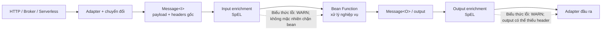

# Xử lý biểu thức bổ sung header thất bại

## 1. Tình huống: hàm vẫn chạy dù header không được bổ sung

Trong **SPRING_CLOUD_FUNCTION (Spring Cloud Function)**, ta có thể viết logic nghiệp vụ bằng `Supplier`, `Function` và `Consumer`, đăng ký qua `FunctionCatalog`, ghép các hàm bằng *composition* và sử dụng cùng một logic qua HTTP, sự kiện hoặc serverless. Để tránh đưa những thao tác metadata đơn giản vào code nghiệp vụ, Spring Cloud Function hỗ trợ **Input/Output Enrichment** bằng Spring Expression Language (**SpEL**):

```properties
spring.cloud.function.configuration.decidePayment.input-header-mapping-expression.region=headers.route.split('/')[0]
spring.cloud.function.configuration.decidePayment.input-header-mapping-expression.channel=headers.route.split('/')[1]
spring.cloud.function.configuration.decidePayment.output-header-mapping-expression.resultLabel=headers['resultCode']
```

Giả sử một thông điệp có `route=vn/priority`. Hai biểu thức đầu lấy được `region=vn` và `channel=priority` trước khi hàm `decidePayment` xử lý. Nhưng nếu dữ liệu đầu vào chỉ là `route=vn`, biểu thức lấy `split('/')[1]` không có phần tử thứ hai và **có thể thất bại trong lúc đánh giá**.

Đây là điểm dễ bị hiểu nhầm: theo cơ chế Input/Output Enrichment được mô tả trong tài liệu Spring Cloud Function, khi biểu thức không đánh giá được, framework **ghi cảnh báo (`WARN`) và tiếp tục thực hiện hàm**, thay vì mặc định ngừng xử lý toàn bộ yêu cầu. Tính năng enrichment được thiết kế để bổ sung metadata, **không thay thế bộ kiểm tra hợp lệ bắt buộc**.

Nếu `channel` quyết định phương thức thanh toán, quyền truy cập hay tuyến xử lý, việc tiếp tục mà không kiểm tra có thể gây sai nghiệp vụ. Ngược lại, nếu biểu thức chỉ tạo một header phụ cho quan sát, tiếp tục trả kết quả có thể là hành vi mong muốn.

Sau bài học, bạn sẽ:

- Phân biệt lỗi SpEL **trước** hàm và **sau** hàm, lỗi enrichment với lỗi của bean hoặc adapter.
- Xác định các nguyên nhân thường gặp: thiếu header, sai kiểu, chỉ số vượt giới hạn, biểu thức không hợp lệ và khác biệt về kiểu payload.
- Viết hàm **fail-closed** đối với metadata bắt buộc dù enrichment có hành vi tiếp tục.
- Quyết định khi nào dùng SpEL, khi nào chuyển sang Java enrichment có validation tường minh.
- Kiểm thử qua `FunctionCatalog`, kiểm tra log WARN và xác minh hành vi qua HTTP, broker hoặc serverless.

## 2. Biểu thức được đánh giá ở đâu?

`Message<T>` của Spring Messaging có `getPayload()` và `getHeaders()`. `MessageHeaders` là map chỉ đọc với khóa `String` và giá trị `Object`. Input/output enrichment được áp dụng ở **lớp wrapper của `FunctionCatalog`**, không phải một phương thức chạy ngầm trong mã Java của bean.



Hai họ cấu hình có vị trí khác nhau:

| Cấu hình | Thời điểm đánh giá | Ngữ cảnh mà SpEL đọc | Tác động nếu không tạo được header |
|---|---|---|---|
| `input-header-mapping-expression` | Trước khi gọi bean `Function` | `payload` và `headers` của **đầu vào** | Bean có thể chạy mà thiếu header được dự kiến |
| `output-header-mapping-expression` | Sau khi bean tạo kết quả | `payload` và `headers` của **đầu ra** | Kết quả nghiệp vụ có thể đã được tạo, nhưng metadata cho bước sau có thể thiếu |

Cú pháp:

```text
spring.cloud.function.configuration.<function-name>.input-header-mapping-expression.<header-name>=<SpEL>
spring.cloud.function.configuration.<function-name>.output-header-mapping-expression.<header-name>=<SpEL>
```

`<function-name>` là tên bean hàm/definition mà `FunctionCatalog` sử dụng, không phải tên class Java hay URL HTTP. `<header-name>` là khóa được thêm vào `MessageHeaders`. `<SpEL>` là biểu thức đánh giá trên thông điệp tại thời điểm thích hợp.

Ví dụ `application.yml`:

```yaml
spring:
  cloud:
    function:
      configuration:
        decidePayment:
          input-header-mapping-expression:
            region: "headers.route.split('/')[0]"
            channel: "headers.route.split('/')[1]"
            ingress: "'gateway'"
          output-header-mapping-expression:
            resultLabel: "headers['resultCode']"
```

Trong YAML, dấu nháy đôi ngoài cùng để bảo vệ chuỗi cấu hình. Với `ingress`, dấu nháy đơn **bên trong** là cách SpEL tạo chuỗi hằng `"gateway"`. Viết `ingress: gateway` mà thiếu literal SpEL có thể khiến engine cố truy cập một thuộc tính tên `gateway`.

> Phạm vi của phát biểu **“ghi WARN rồi tiếp tục”** ở bài này là **lỗi trong lúc đánh giá biểu thức enrichment**. Một cú pháp property sai, bean không được đăng ký, ứng dụng thiếu dependency hoặc lỗi khởi tạo Spring context là **những loại sự cố khác**; không thể mặc định rằng mọi lỗi cấu hình đều được bỏ qua để ứng dụng khởi động.

## 3. Vì sao một biểu thức enrichment thất bại?

Một SpEL chạy thành công trên dữ liệu mẫu vẫn có thể thất bại trên thông điệp khác. Các nguyên nhân phổ biến:

| Nhóm lỗi | Ví dụ cấu hình/đầu vào | Vấn đề thực tế | Cách phòng ngừa |
|---|---|---|---|
| Thiếu header nguồn | `headers.route.split('/')` khi không có `route` | Không có giá trị để gọi phương thức | Xác định header bắt buộc và kiểm tra tại adapter/bean |
| Sai kiểu dữ liệu | `route=123`, biểu thức gọi `split('/')` | Giá trị số không có phương thức chuỗi tương ứng | Quy định kiểu header, chuẩn hóa tại biên |
| Chỉ số vượt giới hạn | `route=vn`, biểu thức `split('/')[1]` | Không tồn tại thành phần thứ hai | Kiểm tra schema của `route` trước khi tách |
| Sai tên hoặc chữ hoa/thường | `headers.route` nhưng thực tế là `X-Route` | Không đọc đúng khóa `MessageHeaders` | Chuẩn hóa tên ở adapter, kiểm tra message thực |
| Sai literal SpEL | `ingress=gateway` thay vì `ingress='gateway'` | Engine hiểu như biểu thức thuộc tính | Dùng nháy đơn cho chuỗi cố định |
| Gọi phương thức không tồn tại | `payload.unknownMethod()` | Kiểu đối tượng không có phương thức đó | Kiểm thử với kiểu Java thực của payload |
| Đổi kiểu khi chuyển đổi | `payload.status()` nhưng output là `byte[]` | Sau conversion, payload không còn là DTO | Kiểm tra thứ tự converter và dùng biểu thức tương thích |
| Thiếu output header | `headers['resultCode'].toString()` mà hàm không đặt `resultCode` | Truy cập thành viên của `null` | Tạo header bắt buộc trong code hoặc kiểm tra trước |
| Tên property không đúng | Gắn cấu hình cho `PaymentFunctions` thay vì `decidePayment` | Enrichment không được áp dụng như mong đợi | Dùng đúng tên lookup/definition |
| Lỗi khi composition | Property gắn với một bước, nhưng chạy definition nhiều bước | Wrapper/kiểu trung gian khác dự kiến | Kiểm thử chính composition qua catalog |

**Phân biệt ba kết quả:** biểu thức có thể tính ra giá trị hợp lệ, có thể đánh giá lỗi, hoặc có thể cho `null`/giá trị không hữu ích. Đừng coi “không có exception” là bằng chứng metadata đã đúng và đủ kiểu. Kiểm tra hợp đồng cụ thể ở nơi nhận.

Ngoài ra, một giá trị header có thể được **gửi từ bên ngoài với tên trùng header đích**. Ví dụ client tự khai `region=admin`. Nếu bước bổ sung `region` từ `route` thất bại, hàm không được mặc nhiên coi `region` cũ là đáng tin. Điều này quan trọng hơn lỗi kỹ thuật thông thường: **thất bại enrichment không được vô tình biến metadata client tự khai thành quyết định phân quyền**.

## 4. Từ lỗi kỹ thuật đến chính sách nghiệp vụ

Không phải mọi metadata thiếu đều phải làm hỏng cả yêu cầu. Cần phân loại theo tác động:

| Vai trò header | Ví dụ | Khi enrichment thất bại | Chiến lược |
|---|---|---|---|
| Tùy chọn để quan sát | `diagnosticTag`, `processingNote` | Có thể bỏ qua; vẫn xuất kết quả | **Fail-open có kiểm soát**, ghi log/metrics |
| Tương quan và truy vết | `correlationId` | Có thể mất liên hệ log, audit hoặc phản hồi | Sinh ID tại nguồn tin cậy nếu hợp đồng cho phép; không nhận tùy tiện ID lỗi |
| Bắt buộc để định tuyến nghiệp vụ | `region`, `channel` | Có thể gửi sai khu vực/kênh thanh toán | **Fail-closed**: kiểm tra và từ chối nếu thiếu/sai |
| Ảnh hưởng quyền truy cập | `tenantId`, `scope` | Nguy cơ nhầm danh tính và quyền | **Fail-closed**, lấy từ ngữ cảnh xác thực |
| Bắt buộc cho adapter đầu ra | `eventType`, routing metadata | Kết quả có thể không xuất bản được đúng đích | Kiểm tra ở biên phát sự kiện, báo lỗi theo hợp đồng |
| Tùy chọn để thống kê | `outputLength` | Thiếu số liệu nhưng payload đúng | Có thể tiếp tục; giám sát số lần lỗi |

**Fail-open** ở đây là chấp nhận tiếp tục xử lý khi một metadata **không bắt buộc** bị thiếu. **Fail-closed** nghĩa là một điều kiện bắt buộc chưa được chứng minh hợp lệ thì không thực hiện hành động cần điều kiện đó. Hai chính sách này thuộc **quy tắc ứng dụng**, không được tự động quyết định chỉ bởi việc SpEL có ghi WARN hay không.

Không sử dụng `input-header-mapping-expression` như lớp xác thực. Những trường như `X-User-ID`, `X-Tenant-ID` hoặc quyền hạn do client tự đưa lên chỉ là dữ liệu chưa đáng tin. Đối với phân quyền, thông tin phải xuất phát từ principal/claims và chính sách được xác thực, ủy quyền tại ranh giới phù hợp.

## 5. Ví dụ đầy đủ: enrichment có thể lỗi nhưng bean vẫn kiểm tra bắt buộc

Một ứng dụng thanh toán nhận header nội bộ `route` dạng `vn/priority` hoặc `sg/standard`. Enrichment tách thành hai header mới: `region` và `channel`. Nếu chuỗi không hợp lệ hoặc mapping thất bại, **hàm phải từ chối** thay vì chọn tuyến mặc định không an toàn.

### 5.1. Bean Spring Cloud Function dùng Java 17+

```java
package com.example.payment;

import java.util.function.Function;

import org.springframework.context.annotation.Bean;
import org.springframework.context.annotation.Configuration;
import org.springframework.messaging.Message;
import org.springframework.messaging.support.MessageBuilder;

@Configuration
public class PaymentFunctions {

    public record PaymentRequested(String paymentId, long amount) {}
    public record PaymentDecision(String paymentId, String status) {}

    @Bean
    public Function<Message<PaymentRequested>, Message<PaymentDecision>>
            decidePayment() {
        return input -> {
            String route = input.getHeaders().get("route", String.class);
            String region = input.getHeaders().get("region", String.class);
            String channel = input.getHeaders().get("channel", String.class);

            // Kiểm tra cả nguồn route lẫn các header được làm giàu.
            if (route == null || !route.matches("(vn|sg)/(standard|priority)")) {
                throw new IllegalArgumentException("Invalid route");
            }
            String[] parts = route.split("/", -1);
            if (!parts[0].equals(region) || !parts[1].equals(channel)) {
                throw new IllegalArgumentException(
                        "Missing or inconsistent routing headers");
            }

            PaymentRequested request = input.getPayload();
            if (request.paymentId() == null
                    || request.paymentId().isBlank()) {
                throw new IllegalArgumentException("Invalid paymentId");
            }

            boolean approved = request.amount() > 0;
            PaymentDecision decision = new PaymentDecision(
                    request.paymentId(),
                    approved ? "APPROVED" : "DECLINED"
            );

            MessageBuilder<PaymentDecision> output = MessageBuilder
                    .withPayload(decision)
                    .setHeader(
                            "resultCode",
                            approved ? "PAYMENT_APPROVED" : "PAYMENT_DECLINED"
                    )
                    .setHeader("processedBy", "decidePayment");

            String correlationId = input.getHeaders()
                    .get("correlationId", String.class);
            if (correlationId != null) {
                if (!correlationId.matches("[A-Za-z0-9._-]{1,64}")) {
                    throw new IllegalArgumentException(
                            "Invalid correlationId");
                }
                output.setHeader("correlationId", correlationId);
            }

            return output.build();
        };
    }
}
```

Điểm cốt lõi không nằm ở điều kiện `amount > 0`, mà ở **kiểm tra metadata**:

1. `route` phải có định dạng và tập giá trị được phép.
2. `region` và `channel` phải trùng với thành phần được phân tích từ `route`. Nếu SpEL thất bại, thiếu dữ liệu hoặc một client cố điền `region` khác `route`, hàm từ chối.
3. `correlationId` là tùy chọn nhưng nếu có phải đúng quy tắc định dạng đã công bố.
4. Output có `resultCode` do logic sinh ra, không sao chép `region`, `route` hay `channel` chỉ để “giữ mọi thứ”.

Trong hệ thống thực tế, nếu `route` quyết định quyền truy cập hoặc khu vực xử lý nhạy cảm, nó phải được **thiết lập/kiểm chứng ở adapter đáng tin**, không chỉ dựa vào việc chuỗi do client tự gửi có định dạng hợp lệ. Việc so sánh `region` với `route` chỉ bảo đảm tính nhất quán nội bộ, **không xác thực nguồn `route`**.

### 5.2. Cấu hình đầu vào và đầu ra

```properties
spring.cloud.function.definition=decidePayment
spring.cloud.function.configuration.decidePayment.input-header-mapping-expression.region=headers.route.split('/')[0]
spring.cloud.function.configuration.decidePayment.input-header-mapping-expression.channel=headers.route.split('/')[1]
spring.cloud.function.configuration.decidePayment.output-header-mapping-expression.resultLabel=headers['resultCode']
```

Với `route=vn/priority`, hai input expressions tạo `region=vn` và `channel=priority` trước khi bean xử lý. Output expression đọc header `resultCode` **do bean đã tạo**, sau đó thêm `resultLabel` vào kết quả.

Với `route=vn`, biểu thức lấy `channel` có thể đánh giá lỗi. Framework có thể ghi WARN và tiếp tục gọi bean; khi đó phép kiểm tra `route.matches(...)` trong `decidePayment` ném `IllegalArgumentException`. Do vậy hệ thống **không duyệt thanh toán** với route thiếu thành phần.

### 5.3. Gọi hàm qua `FunctionCatalog`

```java
import java.util.function.Function;

import org.springframework.cloud.function.context.FunctionCatalog;
import org.springframework.messaging.Message;
import org.springframework.messaging.support.MessageBuilder;

import com.example.payment.PaymentFunctions.PaymentRequested;
import com.example.payment.PaymentFunctions.PaymentDecision;

// catalog là bean FunctionCatalog được inject từ Spring context.
Function<Message<PaymentRequested>, Message<PaymentDecision>> fn =
        catalog.lookup("decidePayment");

Message<PaymentRequested> input = MessageBuilder
        .withPayload(new PaymentRequested("PAY-42", 150_000))
        .setHeader("route", "vn/priority")
        .setHeader("correlationId", "req-42")
        .build();

Message<PaymentDecision> output = fn.apply(input);

System.out.println(output.getPayload().status()); // APPROVED
System.out.println(output.getHeaders().get("resultCode"));
// PAYMENT_APPROVED
System.out.println(output.getHeaders().get("resultLabel"));
// PAYMENT_APPROVED (được output enrichment thêm)
```

Nếu gọi trực tiếp `new PaymentFunctions().decidePayment().apply(input)` với input **chưa có** `region` và `channel`, cấu hình SpEL **không được áp dụng**. Bean sẽ từ chối do thiếu hai header; đây là cách xác nhận rằng enrichment là hành vi của wrapper/catalog, không phải mã trong bean.

## 6. Lỗi expression đầu vào: xử lý an toàn theo từng trường hợp

### Trường hợp A: thiếu header nguồn

```text
Message<PaymentRequested>
headers = { correlationId = "req-42" }

Expression: headers.route.split('/')[0]
```

Giá trị `route` không tồn tại, vì vậy không thể gọi `split`. Framework có thể ghi WARN và chuyển thông điệp tới bean. Trong ví dụ, bean đọc `route == null` và từ chối. Không có chính sách mặc định tùy tiện kiểu “nếu không thấy route thì chọn vn/standard”.

### Trường hợp B: thiếu phần tử trong chuỗi

```text
headers.route = "vn"
Expression: headers.route.split('/')[1]
```

`split` tạo một phần tử; chỉ số `[1]` không hợp lệ. Dù `region=vn` có thể tính thành công, `channel` không được xác minh. Bean phải kiểm tra **toàn bộ hợp đồng** trước khi thực hiện quyết định thanh toán.

### Trường hợp C: header có kiểu không tương thích

```text
headers.route = 12345
Expression: headers.route.split('/')[0]
```

Giá trị là số, không phải chuỗi đã chuẩn hóa. Trong code Java, lệnh `get("route", String.class)` hoặc bước validation tương đương có thể báo lỗi kiểu. Ứng dụng nên nhận biết và xử lý lỗi hợp đồng, không dùng `toString()` vô điều kiện rồi coi mọi dữ liệu là đường định tuyến hợp lệ.

### Trường hợp D: tên khóa khác nhau giữa transport và Message

```text
HTTP request header: X-Route: vn/priority
MessageHeaders key:   X-Route
SpEL expression:      headers.route.split('/')[0]
```

HTTP headers không phân biệt chữ hoa/thường, nhưng các khóa của `MessageHeaders` là chuỗi Java. `route` không tự đồng nghĩa `X-Route`. Nếu adapter chưa chuẩn hóa, input enrichment đọc sai khóa và có thể không sinh được `region`. Cần xác minh cấu hình mapping ở biên HTTP/broker/serverless.

### Trường hợp E: có giá trị giả mạo trùng tên header đích

```text
headers = {
  route   = "vn",
  region  = "admin",
  channel = "priority"
}
```

Nếu biểu thức `region` hoặc `channel` thất bại, downstream có thể vẫn nhìn thấy giá trị do phía gửi đặt từ trước. **Không dùng sự hiện diện của một header enrichment đích làm bằng chứng rằng expression đã chạy thành công.** Giải pháp an toàn hơn là lọc các khóa nội bộ do hệ thống quản lý tại biên, hoặc xác minh chúng tương ứng với dữ liệu nguồn đã được chấp thuận, như bean `decidePayment` đang làm.

## 7. Lỗi expression đầu ra: đừng để kết quả nghiệp vụ mất hợp đồng

Output enrichment chạy sau khi bean tạo kết quả. Giả sử bean đã trả:

```java
Message<String> result = MessageBuilder.withPayload("APPROVED")
        .setHeader("resultCode", "PAYMENT_APPROVED")
        .build();
```

Một expression phụ cho quan sát:

```properties
spring.cloud.function.configuration.someFunction.output-header-mapping-expression.payloadLength=payload.length()
```

Nếu payload là `String`, biểu thức có thể trả số nguyên. Nhưng nếu `FunctionCatalog`/converter hoặc adapter đang dùng cung cấp payload đầu ra kiểu khác, hoặc biểu thức nhầm kiểu và gọi một phương thức không tồn tại, output enrichment có thể thất bại và thông điệp **thiếu `payloadLength`**.

Ví dụ lỗi hiển nhiên:

```properties
spring.cloud.function.configuration.someFunction.output-header-mapping-expression.broken=payload.unknownMethod()
```

Đối với một header phụ như `payloadLength`, có thể chấp nhận mất metadata, đồng thời giám sát cảnh báo. Đối với `resultCode` được bên nhận sử dụng để xác định trạng thái thanh toán, **không nên chỉ dựa vào output expression**. Trong ví dụ `decidePayment`, `resultCode` được tạo trực tiếp bởi bean; `resultLabel` do output expression tính chỉ là một bản sao có tên khác, không phải nguồn sự thật duy nhất.

Khi biểu thức output không tạo được một header bắt buộc cho broker hoặc HTTP, trách nhiệm thuộc **lớp trước khi phát đi**: kiểm tra hợp đồng và từ chối/sửa lỗi theo cơ chế adapter. Một output expression lỗi không mặc nhiên tạo HTTP 500, không tự kích hoạt retry của Kafka hoặc dead-letter của SQS.

## 8. Khi nào nên chuyển từ SpEL sang một bước Java?

SpEL phù hợp với các phép biến đổi ngắn như:

```properties
spring.cloud.function.configuration.decidePayment.input-header-mapping-expression.ingress='payment-gateway'
spring.cloud.function.configuration.decidePayment.output-header-mapping-expression.resultLabel=headers['resultCode']
```

Với schema phức tạp, nhiều điều kiện, yêu cầu xử lý lỗi rõ ràng hoặc metadata ảnh hưởng đến an toàn, nên viết **bước chuẩn hóa bằng Java**. Có thể triển khai thành `Function<Message<I>, Message<I>>` riêng rồi ghép bằng composition:

```java
package com.example.payment;

import java.util.function.Function;

import org.springframework.context.annotation.Bean;
import org.springframework.context.annotation.Configuration;
import org.springframework.messaging.Message;
import org.springframework.messaging.support.MessageBuilder;

import com.example.payment.PaymentFunctions.PaymentRequested;

@Configuration
public class PaymentHeaderFunctions {

    @Bean
    public Function<Message<PaymentRequested>, Message<PaymentRequested>>
            normalizeRoute() {
        return incoming -> {
            String route = incoming.getHeaders().get("route", String.class);
            if (route == null
                    || !route.matches("(vn|sg)/(standard|priority)")) {
                throw new IllegalArgumentException("Invalid route");
            }

            String[] parts = route.split("/", -1);
            return MessageBuilder.fromMessage(incoming)
                    // Luôn ghi đè các khóa do hệ thống tính.
                    .setHeader("region", parts[0])
                    .setHeader("channel", parts[1])
                    .build();
        };
    }
}
```

Với hai bean có chữ ký tương thích:

```properties
spring.cloud.function.definition=normalizeRoute|decidePayment
```

Ta được chuỗi logic:

```text
Message<PaymentRequested> (route = "vn/priority")
                  |
                  v
             normalizeRoute
         [validate hoặc ném lỗi]
                  |
                  v
Message<PaymentRequested> (region = vn, channel = priority)
                  |
                  v
             decidePayment
                  |
                  v
Message<PaymentDecision> (resultCode, correlationId)
```

**Quan trọng:** nếu dùng bước Java làm nguồn chuẩn cho `region`/`channel` thì nên **bỏ cấu hình input SpEL trùng mục đích** đối với cùng một luồng, trừ khi đã thiết kế và kiểm thử quy tắc thứ tự. Trộn hai nơi ghi cùng một header dễ gây khó chẩn đoán và rủi ro ghi đè.

Một bước Java không tự giải quyết vấn đề **nguồn tin cậy**: nếu `route` đến từ client và quyết định quyền, adapter vẫn phải kiểm tra xác thực/ủy quyền trước khi đưa thông tin này vào pipeline.

## 9. Ghi log, theo dõi cảnh báo và tránh rò rỉ dữ liệu

Spring Cloud Function có thể ghi `WARN` khi biểu thức enrichment không đánh giá được. Cảnh báo có ích nhưng **không đủ để bảo đảm hệ thống vẫn đúng**. Nên kết hợp logging, kiểm thử và giám sát:

| Điều cần quan sát | Gợi ý thực hành |
|---|---|
| Tên hàm và chiều enrichment | Phân biệt lỗi input của `decidePayment` với lỗi output của cùng hàm |
| Tên header đích | Biết `channel`, `region` hay `resultLabel` bị thiếu |
| Số lượng lỗi theo thời gian | Giám sát tỷ lệ/cường độ WARN hoặc validation failure, tránh chỉ tìm lỗi thủ công |
| Mã tương quan đáng tin | Ghi `correlationId` đã chuẩn hóa nếu có, giúp nối log giữa các bước |
| Tác động nghiệp vụ | Theo dõi số yêu cầu bị từ chối, trả kết quả thiếu metadata hoặc phải retry |
| Phiên bản và cấu hình | Ghi nhận bản phát hành khiến biểu thức ngừng phù hợp với payload/adapter |

Không đưa toàn bộ request body, token `Authorization`, cookie, số thẻ, dữ liệu cá nhân hoặc tất cả headers vào log chỉ để điều tra lỗi SpEL. Nếu cần lưu dữ liệu thử nghiệm, sử dụng mẫu giả lập không nhạy cảm.

**Thông báo log cụ thể có thể thay đổi theo phiên bản**, nên đừng viết parser hoặc kiểm thử phụ thuộc nguyên văn một thông báo. Để phát hiện sự cố lâu dài, ưu tiên quan sát **hành vi hợp đồng** (header có/không, giá trị, số request bị từ chối) kết hợp cảnh báo. Nếu điều kiện bắt buộc bị thiếu, hãy phát sinh lỗi có cấu trúc ở bean/adapter thay vì trông chờ một dòng WARN được người vận hành đọc kịp.

## 10. Test độc lập bean và test cơ chế `FunctionCatalog`

Có ít nhất **hai lớp kiểm thử** khác nhau:

1. **Unit test bean:** truyền `Message` đã có `region`/`channel` để xác nhận logic nghiệp vụ, validation và quy tắc đầu ra.
2. **Test catalog:** khởi động Spring context với property mapping, gửi `Message` chỉ có `route` và kiểm tra wrapper thêm metadata trước khi bean chạy.

Nếu chỉ test bean bằng cách gọi `new PaymentFunctions().decidePayment().apply(input)`, bạn **không test `input-header-mapping-expression`**. Ngược lại, nếu chỉ kiểm tra một trường hợp catalog hoạt động tốt, bạn chưa chứng minh hệ thống xử lý thiếu metadata hoặc expression lỗi an toàn.

### 10.1. Unit test Java cho hợp đồng bắt buộc

```java
package com.example.payment;

import static org.junit.jupiter.api.Assertions.assertEquals;
import static org.junit.jupiter.api.Assertions.assertThrows;

import java.util.function.Function;

import org.junit.jupiter.api.Test;
import org.springframework.messaging.Message;
import org.springframework.messaging.support.MessageBuilder;

import com.example.payment.PaymentFunctions.PaymentRequested;
import com.example.payment.PaymentFunctions.PaymentDecision;

class PaymentFunctionsTest {

    private final Function<Message<PaymentRequested>, Message<PaymentDecision>>
            fn = new PaymentFunctions().decidePayment();

    @Test
    void acceptsValidatedRoutingMetadata() {
        Message<PaymentRequested> input = MessageBuilder
                .withPayload(new PaymentRequested("PAY-42", 150_000))
                .setHeader("route", "vn/priority")
                .setHeader("region", "vn")
                .setHeader("channel", "priority")
                .setHeader("correlationId", "req-42")
                .build();

        Message<PaymentDecision> output = fn.apply(input);

        assertEquals("APPROVED", output.getPayload().status());
        assertEquals("PAYMENT_APPROVED",
                output.getHeaders().get("resultCode"));
        assertEquals("req-42",
                output.getHeaders().get("correlationId"));
    }

    @Test
    void rejectsWhenDerivedHeaderIsMissing() {
        Message<PaymentRequested> input = MessageBuilder
                .withPayload(new PaymentRequested("PAY-43", 100))
                .setHeader("route", "vn/priority")
                .setHeader("region", "vn")
                // Không có channel.
                .build();

        assertThrows(IllegalArgumentException.class, () -> fn.apply(input));
    }

    @Test
    void rejectsForgedRoutingHeader() {
        Message<PaymentRequested> input = MessageBuilder
                .withPayload(new PaymentRequested("PAY-44", 100))
                .setHeader("route", "vn/priority")
                .setHeader("region", "sg")
                .setHeader("channel", "priority")
                .build();

        assertThrows(IllegalArgumentException.class, () -> fn.apply(input));
    }
}
```

Những test này không kiểm tra SpEL; chúng chứng minh **bean không xử lý yêu cầu khi metadata bắt buộc thiếu hoặc bất nhất**. Đây là lớp phòng vệ ngay cả khi framework enrichment ghi WARN nhưng tiếp tục.

## 11. Kiểm thử lỗi enrichment thực sự qua `FunctionCatalog`

Ví dụ Spring Boot Test sau tạo context với bean `decidePayment` và các expression được cấu hình. Nó chứng minh tình huống hợp lệ xử lý thành công và tình huống thiếu thành phần `channel` được bean từ chối.

```java
package com.example.payment;

import static org.junit.jupiter.api.Assertions.assertEquals;
import static org.junit.jupiter.api.Assertions.assertThrows;

import java.util.function.Function;

import org.junit.jupiter.api.Test;
import org.springframework.beans.factory.annotation.Autowired;
import org.springframework.boot.SpringBootConfiguration;
import org.springframework.boot.autoconfigure.EnableAutoConfiguration;
import org.springframework.boot.test.context.SpringBootTest;
import org.springframework.cloud.function.context.FunctionCatalog;
import org.springframework.context.annotation.Import;
import org.springframework.messaging.Message;
import org.springframework.messaging.support.MessageBuilder;

import com.example.payment.PaymentFunctions.PaymentRequested;
import com.example.payment.PaymentFunctions.PaymentDecision;

@SpringBootTest(
        classes = EnrichmentFailureTest.TestApp.class,
        properties = {
                "spring.cloud.function.configuration.decidePayment."
                        + "input-header-mapping-expression.region="
                        + "headers.route.split('/')[0]",
                "spring.cloud.function.configuration.decidePayment."
                        + "input-header-mapping-expression.channel="
                        + "headers.route.split('/')[1]",
                "spring.cloud.function.configuration.decidePayment."
                        + "output-header-mapping-expression.resultLabel="
                        + "headers['resultCode']"
        }
)
class EnrichmentFailureTest {

    @SpringBootConfiguration
    @EnableAutoConfiguration
    @Import(PaymentFunctions.class)
    static class TestApp {}

    @Autowired
    FunctionCatalog catalog;

    @Test
    void validExpressionAddsHeadersAndAllowsBusinessLogic() {
        Function<Message<PaymentRequested>, Message<PaymentDecision>> fn =
                catalog.lookup("decidePayment");

        Message<PaymentRequested> input = MessageBuilder
                .withPayload(new PaymentRequested("PAY-42", 150_000))
                .setHeader("route", "vn/priority")
                .build();

        Message<PaymentDecision> output = fn.apply(input);

        assertEquals("APPROVED", output.getPayload().status());
        assertEquals("PAYMENT_APPROVED",
                output.getHeaders().get("resultCode"));
        assertEquals("PAYMENT_APPROVED",
                output.getHeaders().get("resultLabel"));
    }

    @Test
    void badRouteCannotPassBusinessValidation() {
        Function<Message<PaymentRequested>, Message<PaymentDecision>> fn =
                catalog.lookup("decidePayment");

        Message<PaymentRequested> input = MessageBuilder
                .withPayload(new PaymentRequested("PAY-43", 100))
                .setHeader("route", "vn")
                .build();

        // Nếu mapping channel lỗi, hàm vẫn phải tự từ chối route sai.
        assertThrows(IllegalArgumentException.class, () -> fn.apply(input));
    }
}
```

Ví dụ giả định classpath có Spring Cloud Function, Spring Boot Test và cấu hình phù hợp. `@SpringBootConfiguration` cùng `@EnableAutoConfiguration` cho phép khởi tạo Spring context nhỏ và import bean hàm; dự án thật có thể cần điều chỉnh theo version/dependency của mình. Đây là **mẫu test minh họa**, không phải kết quả build đã chạy trong phạm vi bài học.

### Test riêng trường hợp biểu thức lỗi nhưng hàm vẫn chạy

Để quan sát đặc điểm “WARN rồi tiếp tục” **không bị che bởi validation của `decidePayment`**, hãy dùng một bean chỉ trả metadata tùy chọn hoặc một function thử nghiệm:

```java
@Bean
public Function<Message<String>, Message<String>> echo() {
    return input -> MessageBuilder
            .withPayload("OK:" + input.getPayload())
            .setHeader("processedBy", "echo")
            .build();
}
```

Đặt một output expression chắc chắn gọi phương thức không tồn tại:

```properties
spring.cloud.function.configuration.echo.output-header-mapping-expression.optional=payload.noSuchMethod()
```

Ý tưởng test qua `FunctionCatalog`:

```java
Function<Message<String>, Message<String>> echo = catalog.lookup("echo");

Message<String> result = echo.apply(
        MessageBuilder.withPayload("test").build());

assertEquals("OK:test", result.getPayload());
assertEquals("echo", result.getHeaders().get("processedBy"));
// Header optional không được sinh do output expression đánh giá lỗi.
assertNull(result.getHeaders().get("optional"));
```

Ví dụ này **chỉ là phần bổ sung cần đặt trong một Spring context có bean `echo` và property tương ứng**; không trộn hai đoạn rời thành một class tự chạy nếu chưa đăng ký bean. Test có thể bổ sung công cụ capture log của Spring Boot để xác minh có WARN, nhưng không nên ràng buộc vào nguyên văn một dòng log hoặc tên logger nội bộ.

**Giới hạn quan trọng:** các test nói trên kiểm tra hành vi ứng dụng và wrapper. Chúng không thay thế integration test về HTTP response mapping, binder retry, dead-letter hoặc event envelope của serverless.

## 12. Lỗi SpEL khác gì lỗi ứng dụng và lỗi transport?

Hãy tách các tình huống mà hệ thống hay nhầm thành “header mapping failure”:

| Loại sự cố | Ví dụ | Nơi phát sinh | Điều nên kỳ vọng |
|---|---|---|---|
| Input SpEL đánh giá lỗi | `headers.route.split('/')[1]` với `route=vn` | Wrapper trước bean | WARN; bean có thể vẫn được gọi |
| Output SpEL đánh giá lỗi | `payload.unknownMethod()` | Wrapper sau bean | WARN; kết quả có thể thiếu header tùy chọn |
| Validation trong bean thất bại | `route` không đúng schema | Bean `Function` | Ngoại lệ hoặc kết quả lỗi do code định nghĩa |
| Converter thất bại | HTTP JSON không chuyển được thành DTO | Adapter/converter | Lỗi chuyển đổi theo hợp đồng adapter |
| Spring context không khởi tạo | Sai cấu hình bean/dependency nghiêm trọng | Khởi động ứng dụng | Không thể suy ra cơ chế WARN-and-continue của enrichment |
| Broker không gửi được kết quả | Output binding không hợp lệ hoặc broker unavailable | Binder/transport | Lỗi xuất bản/retry tùy nền tảng |

Một expression lỗi không tự tạo HTTP `400` hay `500`. Nếu bean ném `IllegalArgumentException` vì dữ liệu bắt buộc không hợp lệ, web adapter có thể cần một cơ chế exception handler để trả `400 Bad Request`; nếu không, mã thực tế phụ thuộc cấu hình web. Với Spring Cloud Stream, một ngoại lệ có thể ảnh hưởng retry, DLQ hoặc acknowledgment theo binder. Với serverless, cách trả lỗi tuân theo runtime và adapter được triển khai.

Đừng dùng `MessageHeaders` hoặc `resultCode` để giả định mã trạng thái mạng: metadata nội bộ và chính sách giao thức là hai cấp trách nhiệm khác nhau.

## 13. Composition: một expression lỗi ảnh hưởng bước tiếp theo

Spring Cloud Function hỗ trợ ghép các bean có chữ ký tương thích:

```properties
spring.cloud.function.definition=normalizeRoute|decidePayment
```

Nếu `normalizeRoute` tạo `Message<PaymentRequested>` gồm `region` và `channel` còn `decidePayment` đọc hai header đó, cần kiểm tra chính **đầu vào của bước thứ hai**. Một output enrichment lỗi ở `normalizeRoute` có thể làm bước sau không có header nó cần; input enrichment lỗi ở `decidePayment` có thể tạo ra cùng triệu chứng.

Quy trình chẩn đoán:

1. Kiểm tra payload và headers **trước bước đầu tiên** (trong test với dữ liệu không nhạy cảm).
2. Xác định các property của **đúng tên bean/definition**, không nhầm sang class hoặc endpoint.
3. Gọi từng bean trực tiếp với thông điệp đầy đủ để kiểm tra validation riêng.
4. Gọi chính definition composition bằng `FunctionCatalog.lookup(...)`, xác minh đầu ra và các invariant mà bước sau yêu cầu.
5. Chạy integration test qua HTTP/broker/serverless để kiểm chứng header mapping ở biên.

Việc wrapping/unwrapping, conversion và lan truyền header giữa các bước phụ thuộc loại hàm cùng cấu hình Spring Cloud Function. Không suy ra rằng property gắn với một hàm đơn sẽ tự có cùng phạm vi/độ ưu tiên khi chạy trong mọi composition. Khi sự chính xác của header rất quan trọng, một bean Java enrichment có validation thường minh bạch hơn nhiều biểu thức SpEL rải rác.

## 14. Quan hệ với `copy-input-headers` và việc giữ metadata

Một cấu hình có tên gần giống nhưng **khác mục đích** là:

```properties
spring.cloud.function.configuration.decidePayment.copy-input-headers=true
```

`copy-input-headers` hỗ trợ sao chép headers đầu vào sang kết quả trong những trường hợp wrapper hỗ trợ; nó **không** thực thi SpEL để tách `route` thành `region` và `channel`. Hơn nữa, sao chép rộng có thể mang theo header không phù hợp hoặc không đáng tin, như `Authorization`, metadata binder, `replyChannel` hay `contentType` của payload cũ.

Trong một bean `Function<Message<I>, Message<O>>` như `decidePayment`, nếu phải giữ `correlationId`, ví dụ đã đặt rõ trong code bằng `MessageBuilder.setHeader(...)`. Không dựa vào việc copy tự động từ header đầu vào mà bean không sở hữu. Đồng thời, khi payload chuyển từ DTO sang `String` hoặc `byte[]`, cần xác định lại `contentType`: chỉ mang theo header cũ có thể khiến converter/adapter hiểu sai định dạng.

### Những cách tự bảo vệ thông điệp đầu ra

- **Chọn lọc:** chỉ thêm header kết quả thực sự cần bằng `MessageBuilder.setHeader(...)`.
- **Kiểm tra nguồn:** không chuyển tiếp token, thông tin xác thực hoặc quyền do client tự khai.
- **Kiểm tra kiểu:** `MessageHeaders` chứa `Object`, nên không ép mọi giá trị về `String` khi chưa có hợp đồng.
- **Bất biến:** không gọi `message.getHeaders().put(...)`; dùng `MessageBuilder.fromMessage(...)` hoặc `withPayload(...)` để tạo thông điệp mới.
- **Không nhầm ID:** `MessageHeaders.ID` và `timestamp` là metadata kỹ thuật, không thay cho `paymentId`, `eventId` hoặc `correlationId`.

## 15. Bài tập thực hành

Hãy xây một quy trình xử lý đơn hàng với `Function<Message<OrderRequested>, Message<OrderResult>>`, chạy được qua `FunctionCatalog` và có thể triển khai qua HTTP hoặc broker:

1. Định nghĩa payload `OrderRequested(orderId, amount)` và kết quả `OrderResult(orderId, status)`. Input header `route` có dạng `"vn/express"`. Cấu hình input expressions để tạo `region` và `serviceLevel`.
2. Cho hàm từ chối input có `route` sai schema, thiếu `region`/`serviceLevel` hoặc hai header enrichment mâu thuẫn với `route`.
3. Thử các trường hợp `route=vn/express`, `route=vn`, thiếu `route`, `route` kiểu số và `region` do client tự gửi giá trị giả mạo. Phân biệt lỗi SpEL và lỗi validation do bean tạo.
4. Thêm output expression `resultLabel=headers['resultCode']` và một expression cố tình sai `broken=payload.noSuchMethod()`. Kiểm chứng output còn payload hợp lệ khi header tùy chọn bị lỗi và xác định cách giám sát WARN.
5. Chuyển một quy tắc bắt buộc từ SpEL sang bean Java `normalizeRoute` có validation. So sánh điểm mạnh/yếu của hai phương án và kiểm thử composition `normalizeRoute|handleOrder`.
6. Viết unit test gọi bean trực tiếp, test catalog với property và integration test qua adapter. Giải thích vì sao kết quả unit test không đủ để xác nhận HTTP header mapping, broker retry hoặc serverless error envelope.

### Câu hỏi tự kiểm tra

1. Một input expression gọi `headers.route.split('/')[1]` trên `route=vn`. Vì sao chỉ nhìn log WARN không đủ để đảm bảo an toàn?
2. Nếu expression lỗi nhưng header đích `channel` đã tồn tại từ input, có thể tin giá trị đó không? Cần kiểm tra thêm điều gì?
3. Một output expression chỉ tạo `diagnosticTag` bị lỗi, trong khi payload kết quả hợp lệ. Khi nào nên tiếp tục, khi nào nên từ chối xuất bản?
4. Vì sao `new PaymentFunctions().decidePayment().apply(...)` không thể thay thế test property enrichment qua `FunctionCatalog`?
5. Lỗi SpEL, lỗi validation của bean và lỗi HTTP/binder có cơ chế xử lý giống nhau không?

## 16. Tổng kết và tài liệu tham khảo

**Điểm cần nhớ:** `input-header-mapping-expression` và `output-header-mapping-expression` giúp Spring Cloud Function bổ sung header bằng SpEL trước hoặc sau lời gọi hàm qua `FunctionCatalog`. Theo cơ chế Input/Output Enrichment, khi **đánh giá biểu thức thất bại**, framework có thể ghi `WARN` và **tiếp tục gọi hàm hoặc tiếp tục trả kết quả**. Đây là lựa chọn hợp lý cho metadata phụ, nhưng **không được xem là validation fail-closed** đối với metadata quyết định nghiệp vụ, bảo mật hoặc định tuyến.

Để xử lý đáng tin cậy, hãy phân loại header bắt buộc/tùy chọn, kiểm tra tên–kiểu–nguồn tin cậy, thực hiện validation trong bean hoặc adapter, dùng Java enrichment khi quy tắc phức tạp, đồng thời kiểm thử cả đường gọi qua catalog và đường truyền HTTP, sự kiện hoặc serverless. Truyền header nào qua output là một hợp đồng riêng, không tự được bảo đảm chỉ vì input enrichment đã chạy.

Tham khảo chính thức: [Spring Cloud Function — Programming model, Input/Output Enrichment](https://docs.spring.io/spring-cloud-function/reference/spring-cloud-function/programming-model.html). Khi ứng dụng dùng một phiên bản cụ thể, nên đối chiếu tài liệu và kiểm thử hành vi trên đúng phiên bản đó.
