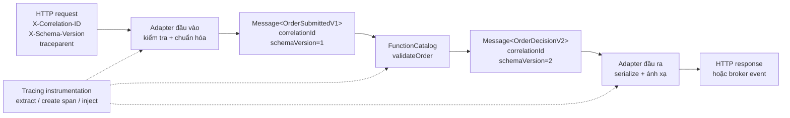
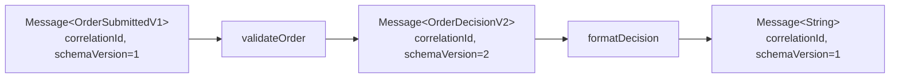

# Truyền mã liên kết, phiên bản dữ liệu và thông tin truy vết

## 1. Vì sao ba nhóm metadata này phải đi cùng dữ liệu?

Trong **SPRING_CLOUD_FUNCTION (Spring Cloud Function)**, nghiệp vụ được biểu diễn bằng `Supplier`, `Function` và `Consumer`. Các bean được đăng ký qua `FunctionCatalog`, có thể ghép bằng *composition* và công bố qua HTTP, sự kiện hoặc môi trường serverless mà không phải viết lại logic cốt lõi. Nhưng để xử lý một yêu cầu qua nhiều bước, chỉ truyền payload thường là chưa đủ.

Hãy tưởng tượng quy trình xác nhận đơn hàng:

1. Gateway nhận yêu cầu tạo đơn từ ứng dụng khách.
2. Một `Function` kiểm tra đơn và tạo quyết định.
3. Kết quả được gửi tới bước thông báo qua message broker.
4. Một hàm khác chạy trong môi trường serverless để gửi thông báo.

Ở các chặng, ba câu hỏi thường xuất hiện:

- **Đây là kết quả của yêu cầu nào?** Cần mã liên kết, ví dụ `correlationId=checkout-42`.
- **Payload đang dùng hợp đồng dữ liệu nào?** Cần xác định loại và phiên bản schema, ví dụ `schemaName=order-submitted`, `schemaVersion=1`.
- **Bước xử lý này thuộc luồng gọi phân tán nào?** Cần thông tin *distributed tracing*, ví dụ trace ID, span ID và ngữ cảnh được chuyển tiếp theo W3C Trace Context.

Các thông tin trên có thể đi qua `MessageHeaders` của Spring Messaging, header HTTP, thuộc tính sự kiện hoặc broker metadata. **Chúng không hoàn toàn tương đương, và không nên được sao chép mù quáng qua mọi ranh giới.**

Kết thúc bài, bạn sẽ biết thiết kế hợp đồng metadata ổn định, truyền `correlationId`, quản lý `schemaVersion` cho đầu vào và đầu ra, phân biệt trace context với ID nghiệp vụ, triển khai một `Function<Message<I>, Message<O>>` và kiểm thử cách metadata đi qua HTTP, broker, serverless.

## 2. Phân biệt các loại định danh và phiên bản

Tên gọi gần nhau dễ dẫn đến lỗi thiết kế. Bảng sau là điểm xuất phát:

| Thông tin | Vai trò | Phạm vi và thời gian sống | Ví dụ |
|---|---|---|---|
| `orderId` | Định danh thực thể nghiệp vụ | Một đơn hàng; có thể tồn tại lâu dài | `ORD-42` |
| `correlationId` | Liên kết nhiều yêu cầu/thông điệp trong cùng một quy trình nghiệp vụ | Có thể đi qua HTTP, broker, nhiều dịch vụ, nhiều lần retry | `checkout-42` |
| `MessageHeaders.ID` | ID kỹ thuật của một Spring `Message` | Thuộc một đối tượng thông điệp, không phải business ID | UUID do Spring Messaging quản lý |
| `eventId` | Định danh một sự kiện được phát hành | Gắn với một sự kiện logic; hỗ trợ phát hiện bản tin trùng | `evt-1001` |
| Broker offset/delivery tag | Vị trí hoặc trạng thái giao nhận trên hệ thống truyền tải | Gắn với topic/partition/lần giao nhận | Offset `518` |
| `schemaVersion` | Phiên bản cấu trúc/hợp đồng dữ liệu | Theo **loại payload** và đường vào/ra | `1`, `2` |
| `traceId` | Nhận diện một distributed trace | Nối các span trong cùng một trace | Chuỗi hex 32 ký tự ở W3C Trace Context |
| `spanId` | Nhận diện một span cụ thể | Thay đổi theo thao tác/span | Chuỗi hex 16 ký tự ở W3C Trace Context |
| `traceparent` | Mang ngữ cảnh trace giữa các bên | Được truyền và cập nhật tại mỗi ranh giới instrumentation | `00-…-…-01` |

**Không đồng nhất các giá trị này:**

- Một `orderId` có thể xuất hiện trong nhiều yêu cầu, mỗi yêu cầu có `correlationId` khác nhau.
- Một `correlationId` có thể bao phủ nhiều sự kiện có các `eventId` khác nhau.
- Một yêu cầu nghiệp vụ có thể trải qua nhiều trace, hoặc một trace có nhiều thao tác. `correlationId` do ứng dụng định nghĩa; `traceId` thuộc hệ thống tracing.
- `MessageHeaders.ID` không phải định danh ổn định để theo dõi retry, replay hoặc luồng nghiệp vụ qua adapter.
- `schemaVersion` mô tả hợp đồng **payload**; nó không phải `specversion` của CloudEvents hay version của HTTP API.

## 3. Đường đi của metadata qua Spring Cloud Function



Luồng gồm **hai lớp liên quan nhưng khác trách nhiệm**:

1. **Hợp đồng thông điệp của nghiệp vụ:** `Function` đọc `correlationId` và phiên bản schema đã chuẩn hóa, xử lý payload, trả `Message` mới với metadata đầu ra hợp lệ.
2. **Ngữ cảnh tracing và transport:** HTTP adapter, binder, runtime và thư viện observability tiếp nhận/tiêm ngữ cảnh trace, quản lý span và mã hóa metadata theo giao thức.

Không nên bắt bean nghiệp vụ tự xử lý tất cả HTTP headers, Kafka offsets hay chi tiết event của Lambda. Một `Function` độc lập giao thức chỉ cần biết **những thông tin phù hợp với hợp đồng của nó**.

## 4. Thiết kế hợp đồng cho `correlationId`

### 4.1. Ai phát sinh và ai giữ mã liên kết?

Một chính sách phổ biến:

- **Tại điểm vào đáng tin cậy:** gateway hoặc adapter lấy `X-Correlation-ID` nếu hợp lệ và theo hợp đồng; nếu thiếu, tạo một mã mới.
- **Trong các hàm xử lý:** giữ cùng `correlationId` khi tạo thông điệp kết quả thuộc cùng quy trình.
- **Tại bước phát sự kiện:** adapter ánh xạ mã nội bộ thành tên header/attribute do hai bên thỏa thuận.
- **Ở phía nhận:** đọc mã theo hợp đồng, dùng để nối audit/log hoặc liên hệ phản hồi với yêu cầu trước đó.

Ví dụ hợp đồng ứng dụng:

| Thuộc tính | Quy ước minh họa |
|---|---|
| Tên nội bộ | `correlationId` |
| Kiểu Java | `String` |
| Bắt buộc ở tầng nghiệp vụ? | Có, sau khi đã qua adapter của ví dụ |
| Định dạng | 1–64 ký tự thuộc `A–Z`, `a–z`, `0–9`, dấu chấm, gạch dưới, gạch ngang |
| Khi HTTP request thiếu | Gateway/controller tạo UUID |
| Khi có nhiều giá trị hoặc giá trị sai | Từ chối hoặc xử lý theo một chính sách được công bố |
| Khi tạo kết quả thuộc cùng workflow | Chuyển tiếp có chủ đích |

Quy ước trên là **lựa chọn cho ví dụ**, không phải giới hạn bắt buộc của Spring Cloud Function. Ứng dụng thật có thể dùng định dạng khác, nhưng nên có một hợp đồng thống nhất.

### 4.2. Vì sao phải kiểm tra mã do bên ngoài gửi?

Một header có thể bị giả mạo, quá dài hoặc chứa ký tự gây khó khăn cho log/observability. Không dùng `correlationId` như token xác thực, không cho phép nó thay thế quyền truy cập và không mặc định rằng một giá trị do client tự chọn đã đáng tin.

Nếu gateway luôn sinh mã mới, có thể giữ mã client ở một trường khác để hỗ trợ liên hệ, nhưng phải quy định rõ ai chịu trách nhiệm và không làm nhiễu tracking. Trong môi trường có retry, mã liên kết có thể **giữ nguyên giữa các lần thử**, còn `eventId` hoặc ID của bản tin tái phát có thể thay đổi theo chiến lược phát hành.

## 5. Phiên bản dữ liệu: đầu vào không đồng nghĩa đầu ra

Schema version nói về **hình dạng và ý nghĩa payload**. Ví dụ:

```json
{
  "orderId": "ORD-42",
  "amount": 150000
}
```

Đây là dạng dữ liệu `OrderSubmittedV1`. Sau khi xử lý, đầu ra có thể mang cấu trúc khác:

```json
{
  "orderId": "ORD-42",
  "status": "ACCEPTED",
  "reason": "Valid order"
}
```

Ta gọi hợp đồng kết quả này là `OrderDecisionV2`. Trong bài học, hai loại schema được quy ước:

| Payload | `schemaName` | `schemaVersion` |
|---|---|---|
| `OrderSubmittedV1` | `order-submitted` | `1` |
| `OrderDecisionV2` | `order-decision` | `2` |

**Không copy nguyên `schemaVersion=1` từ đầu vào sang đầu ra** khi đầu ra đã chuyển thành loại và phiên bản schema khác. Phiên bản đầu ra phải mô tả **payload được gửi**, không phải bản tin tạo ra nó.

### Đặt phiên bản ở đâu?

Có nhiều cách hợp lệ, tùy hệ thống:

| Cách biểu diễn | Ưu điểm | Lưu ý |
|---|---|---|
| Header nội bộ `schemaName` / `schemaVersion` | Tiện cho routing, converter và kiểm thử `Message` | Adapter cần bảo toàn/ánh xạ header qua transport |
| Trường `schemaVersion` trong event envelope | Cùng đi với dữ liệu khi serialize | Cần quy định và kiểm tra envelope |
| `dataschema` URI của CloudEvents | Có thể trỏ tới mô tả schema | URI có thể mang version nhưng không tự tương đương header `schemaVersion` |
| Schema Registry ID hoặc schema fingerprint | Hỗ trợ hệ sinh thái Avro/Protobuf/Kafka | Định dạng và cách lấy schema phụ thuộc serializer/registry |
| Version trong media type hoặc API contract | Có thể phù hợp với HTTP API | Không giải quyết tự động version của sự kiện qua broker |

**Chọn một nguồn sự thật chính** cho phiên bản của mỗi loại dữ liệu và xác định rõ nếu cần ánh xạ sang nơi khác. Tránh để body ghi v2 nhưng header ghi v1.

### Khi gặp phiên bản không hỗ trợ

Lớp chuyển đổi hoặc bean phải xử lý có chủ đích:

- Nếu hỗ trợ v1 và v2, chuẩn hóa chúng thành một mô hình nội bộ phù hợp rồi xử lý.
- Nếu chỉ hỗ trợ v1, từ chối v2 bằng lỗi rõ ràng thay vì âm thầm giải mã như v1.
- Với bản tin cũ trong broker, cần kế hoạch tương thích ngược hoặc migration; việc thêm header version không tự biến một payload v1 thành v2.
- Khi publish output, phát hành schema version của **đầu ra thực tế**, không suy ra từ phiên bản input.

## 6. Ví dụ Java 17+: một `Function` giữ correlation nhưng đổi schema

Ví dụ sau chỉ sử dụng Spring Cloud Function và Spring Messaging để tạo bean xử lý đơn hàng. Nó giả định adapter đã chuyển input thành `OrderSubmittedV1` và chuẩn hóa metadata.

```java
package com.example.orders;

import java.util.function.Function;

import org.springframework.context.annotation.Bean;
import org.springframework.context.annotation.Configuration;
import org.springframework.messaging.Message;
import org.springframework.messaging.support.MessageBuilder;

@Configuration
public class OrderFunctions {

    public record OrderSubmittedV1(String orderId, long amount) {}

    public record OrderDecisionV2(
            String orderId,
            String status,
            String reason
    ) {}

    @Bean
    public Function<Message<OrderSubmittedV1>, Message<OrderDecisionV2>>
            validateOrder() {
        return input -> {
            String correlationId = requiredHeader(input, "correlationId");
            String schemaName = requiredHeader(input, "schemaName");
            String schemaVersion = requiredHeader(input, "schemaVersion");

            if (!"order-submitted".equals(schemaName)
                    || !"1".equals(schemaVersion)) {
                throw new IllegalArgumentException(
                        "Unsupported input schema");
            }

            OrderSubmittedV1 order = input.getPayload();
            if (order.orderId() == null || order.orderId().isBlank()) {
                throw new IllegalArgumentException("orderId is required");
            }

            boolean accepted = order.amount() > 0;
            OrderDecisionV2 decision = new OrderDecisionV2(
                    order.orderId(),
                    accepted ? "ACCEPTED" : "REJECTED",
                    accepted ? "Valid order" : "Amount must be positive"
            );

            return MessageBuilder.withPayload(decision)
                    .setHeader("correlationId", correlationId)
                    .setHeader("schemaName", "order-decision")
                    .setHeader("schemaVersion", "2")
                    .setHeader("processedBy", "validateOrder")
                    .build();
        };
    }

    private static String requiredHeader(Message<?> input, String name) {
        Object raw = input.getHeaders().get(name);
        if (!(raw instanceof String value) || value.isBlank()) {
            throw new IllegalArgumentException(
                    "Missing or invalid header: " + name);
        }

        if ("correlationId".equals(name)
                && !value.matches("[A-Za-z0-9._-]{1,64}")) {
            throw new IllegalArgumentException(
                    "Invalid correlationId");
        }
        return value;
    }
}
```

Những quyết định thiết kế quan trọng:

1. Hàm nhận `Message<OrderSubmittedV1>` để **đọc metadata đầu vào**.
2. `correlationId` phải có và hợp lệ. Hàm giữ giá trị đó sang kết quả vì đây vẫn là cùng quy trình xử lý.
3. `schemaName=order-submitted` và `schemaVersion=1` được kiểm tra **trước khi xử lý nghiệp vụ**; chỉ hợp đồng input v1 được hỗ trợ trong ví dụ. Adapter/converter vẫn cần kiểm tra cấu trúc JSON trước khi tạo DTO.
4. Kết quả là một loại DTO khác: `OrderDecisionV2`. Hàm tạo **`schemaName=order-decision` và `schemaVersion=2`**, không sao chép version từ input.
5. `processedBy` do bước hiện tại tạo, không tin một header cùng tên do caller tự gửi.
6. Hàm không tự copy `traceparent`, `Authorization`, `contentType` hay metadata broker. Những phần đó được xử lý theo hợp đồng adapter và tracing instrumentation.

Nếu một hệ thống thực sự cần hỗ trợ nhiều phiên bản input, nên có bộ chuyển đổi/schema validation rõ ràng trước khi gán DTO cho `Function`; ví dụ này cố ý tập trung vào **một phiên bản input** để tránh trường hợp parse nhầm cấu trúc.

### Gọi hàm trực tiếp

```java
import java.util.function.Function;

import org.springframework.messaging.Message;
import org.springframework.messaging.support.MessageBuilder;

import com.example.orders.OrderFunctions;
import com.example.orders.OrderFunctions.OrderSubmittedV1;
import com.example.orders.OrderFunctions.OrderDecisionV2;

Function<Message<OrderSubmittedV1>, Message<OrderDecisionV2>> fn =
        new OrderFunctions().validateOrder();

Message<OrderSubmittedV1> input = MessageBuilder
        .withPayload(new OrderSubmittedV1("ORD-42", 150_000))
        .setHeader("correlationId", "checkout-42")
        .setHeader("schemaName", "order-submitted")
        .setHeader("schemaVersion", "1")
        .setHeader("source", "web-client")
        .build();

Message<OrderDecisionV2> result = fn.apply(input);

System.out.println(result.getPayload().status()); // ACCEPTED
System.out.println(result.getHeaders().get("correlationId")); // checkout-42
System.out.println(result.getHeaders().get("schemaName"));    // order-decision
System.out.println(result.getHeaders().get("schemaVersion")); // 2
System.out.println(result.getHeaders().get("source"));        // null
```

Đây là kiểm tra **hành vi của bean trực tiếp**. Khi tra cứu qua `FunctionCatalog` hoặc công bố qua một adapter, framework có thể bọc `Message`, chuyển đổi payload hoặc áp dụng cấu hình enrichment; hãy kiểm thử đường gọi thực tế của ứng dụng.

## 7. Distributed tracing: `traceId`, `spanId` và `traceparent`

Mã liên kết nghiệp vụ không thay thế distributed tracing. Tracing mô hình hóa các thao tác bằng **span**, và nhóm nhiều span liên quan trong một **trace**. Trong hệ thống có instrumentation phù hợp, một request HTTP có thể tạo span tại gateway, span xử lý hàm và span gửi/nhận sự kiện.

```text
Trace ID: 4bf92f3577b34da6a3ce929d0e0e4736
  |
  +-- Span gateway nhận HTTP
  |       spanId = 00f067aa0ba902b7
  |
  +-- Span ứng dụng xử lý đơn hàng
  |       spanId = 8a4cf7d9c0be12ab
  |
  +-- Span publish sự kiện
  |       spanId = f4e11a320b90c7d5
  |
  +-- Span consumer nhận sự kiện
          spanId = 12d4e8f109b6c3aa
```

Các span trong ví dụ có thể chia sẻ **trace ID**, nhưng mỗi span có **span ID riêng**. Một request nghiệp vụ mang `correlationId=checkout-42` có thể liên hệ với trace này mà không cần biến `correlationId` thành `traceId`.

### 7.1. Định dạng W3C Trace Context

W3C Trace Context quy định những header phổ biến:

| Header | Công dụng | Ví dụ |
|---|---|---|
| `traceparent` | Mang trace ID, parent span ID, trace flags và version của format | `00-4bf92f3577b34da6a3ce929d0e0e4736-00f067aa0ba902b7-01` |
| `tracestate` | Trạng thái tracing do các hệ thống/vendor phối hợp | Giá trị tùy vendor và giới hạn theo chuẩn |

Một `traceparent` phiên bản `00` có dạng:

```text
version-trace-id-parent-id-trace-flags

00-4bf92f3577b34da6a3ce929d0e0e4736-00f067aa0ba902b7-01
|  |                                |                |
|  |                                |                +-- flags
|  |                                +------------------- parent-id
|  +---------------------------------------------------- trace-id
+------------------------------------------------------- version
```

Trong phiên bản này, trace ID dài 16 bytes (32 ký tự hex), parent ID dài 8 bytes (16 ký tự hex); giá trị toàn số 0 không phải định danh hợp lệ. `01` trong ví dụ biểu thị bit sampling. Các quy tắc parse và kiểm tra còn nhiều chi tiết hơn, do đó **hãy để thư viện tracing xử lý** thay vì tự tách chuỗi này bằng `split("-")` trong hàm nghiệp vụ.

### 7.2. Vì sao không nên copy nguyên `traceparent` theo kiểu thủ công?

Ở mỗi chặng, instrumentation cần **trích xuất ngữ cảnh cha**, có thể tạo span mới và **tiêm ngữ cảnh thích hợp** vào lời gọi tiếp theo. Nếu hàm chỉ lấy `traceparent` đầu vào rồi đặt y nguyên vào mọi output `Message`, nó có thể làm thông tin parent span không phản ánh đúng span đang thực thi.

Do đó:

- Dùng hệ thống observability như **Micrometer Observation/Tracing** với exporter và propagator phù hợp trong môi trường Spring đang dùng.
- Đảm bảo HTTP server/client, binder/message client và serverless adapter được cấu hình hỗ trợ tracing ở những ranh giới cần thiết.
- Khi tạo bước gửi sự kiện tùy chỉnh, dùng APIs propagation/extraction của thư viện đã chọn, không tự chế lại định dạng `traceparent`.
- Khi dùng ứng dụng reactive, phải xem xét propagation qua Reactor context; không giả định `ThreadLocal` luôn giữ ngữ cảnh qua mọi lịch thực thi.
- `tracestate`, sampling flags và baggage là ngữ cảnh của tracing, không phải chỗ lưu tùy ý dữ liệu nghiệp vụ nhạy cảm.

**Spring Cloud Function không bảo đảm mọi trace context sẽ tự được nối xuyên HTTP, broker và serverless chỉ nhờ chữ ký `Message<T>`.** Điều đó phụ thuộc instrumentation, adapter, giao thức và cấu hình của ứng dụng.

## 8. Quan sát trace hiện tại mà không tự xử lý propagation

Khi ứng dụng có Micrometer Tracing và tracing context đang hoạt động, code có thể đọc trace ID hiện tại **cho mục đích quan sát**:

```java
import io.micrometer.tracing.Span;
import io.micrometer.tracing.Tracer;

static String currentTraceId(Tracer tracer) {
    Span current = tracer.currentSpan();
    return current == null ? null : current.context().traceId();
}
```

Đoạn code giả định ứng dụng đã cấu hình một bean `Tracer` và có instrumentation tạo span tại ranh giới gọi. Nếu không có active span, `currentSpan()` có thể trả `null`; **không dùng trace ID làm dữ liệu bắt buộc để duyệt đơn hàng**.

Một cách tổ chức phù hợp là thêm trace ID vào log qua instrumentation/MDC do framework cung cấp. Khi cần phân tích sự cố, log có thể ghi `correlationId` nghiệp vụ cùng `traceId` do tracing quản lý, nhưng **không bắt buộc hai giá trị giống nhau**.

Ví dụ ghi log ở mức khái niệm:

```text
correlationId=checkout-42 traceId=4bf92f3577b34da6a3ce929d0e0e4736
operation=validateOrder status=ACCEPTED
```

Không ghi toàn bộ token xác thực, thông tin khách hàng, payload nhạy cảm hoặc toàn bộ HTTP headers chỉ để nối truy vết. Trace context không phải một hệ thống cấp quyền; nếu có `baggage`, hãy giới hạn các trường theo chính sách bảo mật và khả năng truyền tải.

## 9. Ranh giới HTTP: chuẩn hóa correlation và schema version

Khi công bố hàm qua Spring Cloud Function Web, adapter có thể giải mã request và tạo input phù hợp với chữ ký hàm. **Không giả định** rằng một HTTP header tên `X-Correlation-ID` được tự động đổi thành `MessageHeaders["correlationId"]` hoặc mọi output header đều được gửi lại đúng tên HTTP mong muốn.

Nếu API yêu cầu hợp đồng ánh xạ chính xác, có thể đặt một **Spring MVC controller mỏng** ở biên. Bean nghiệp vụ `validateOrder` giữ nguyên và không biết HTTP:

```java
package com.example.orders;

import java.util.List;
import java.util.UUID;
import java.util.function.Function;

import org.springframework.beans.factory.annotation.Qualifier;
import org.springframework.http.HttpHeaders;
import org.springframework.http.HttpStatus;
import org.springframework.http.MediaType;
import org.springframework.http.ResponseEntity;
import org.springframework.messaging.Message;
import org.springframework.messaging.support.MessageBuilder;
import org.springframework.web.bind.annotation.PostMapping;
import org.springframework.web.bind.annotation.RequestBody;
import org.springframework.web.bind.annotation.RequestHeader;
import org.springframework.web.bind.annotation.RestController;
import org.springframework.web.server.ResponseStatusException;

import com.example.orders.OrderFunctions.OrderSubmittedV1;
import com.example.orders.OrderFunctions.OrderDecisionV2;

@RestController
public class OrderHttpController {

    private final Function<Message<OrderSubmittedV1>,
                           Message<OrderDecisionV2>> validateOrder;

    public OrderHttpController(
            @Qualifier("validateOrder")
            Function<Message<OrderSubmittedV1>, Message<OrderDecisionV2>>
                    validateOrder) {
        this.validateOrder = validateOrder;
    }

    @PostMapping(
            path = "/api/orders/validate",
            consumes = MediaType.APPLICATION_JSON_VALUE,
            produces = MediaType.APPLICATION_JSON_VALUE
    )
    public ResponseEntity<OrderDecisionV2> validate(
            @RequestBody OrderSubmittedV1 body,
            @RequestHeader HttpHeaders requestHeaders) {

        String correlationId = correlationIdFrom(requestHeaders);
        String version = oneRequiredHeader(
                requestHeaders, "X-Schema-Version");
        if (!"1".equals(version)) {
            throw new ResponseStatusException(
                    HttpStatus.BAD_REQUEST, "Unsupported input schema");
        }

        Message<OrderSubmittedV1> input = MessageBuilder
                .withPayload(body)
                .setHeader("correlationId", correlationId)
                .setHeader("schemaName", "order-submitted")
                .setHeader("schemaVersion", version)
                .build();

        Message<OrderDecisionV2> output = validateOrder.apply(input);

        HttpHeaders responseHeaders = new HttpHeaders();
        responseHeaders.set("X-Correlation-ID",
                output.getHeaders().get("correlationId", String.class));
        responseHeaders.set("X-Schema-Version",
                output.getHeaders().get("schemaVersion", String.class));

        return new ResponseEntity<>(
                output.getPayload(), responseHeaders, HttpStatus.OK);
    }

    private static String oneRequiredHeader(HttpHeaders headers, String key) {
        List<String> values = headers.get(key);
        if (values == null || values.size() != 1
                || values.get(0).isBlank()) {
            throw new ResponseStatusException(
                    HttpStatus.BAD_REQUEST, "Missing or ambiguous " + key);
        }
        return values.get(0);
    }

    private static String correlationIdFrom(HttpHeaders headers) {
        List<String> values = headers.get("X-Correlation-ID");
        if (values == null || values.isEmpty()) {
            return UUID.randomUUID().toString();
        }
        if (values.size() != 1
                || !values.get(0).matches("[A-Za-z0-9._-]{1,64}")) {
            throw new ResponseStatusException(
                    HttpStatus.BAD_REQUEST, "Invalid X-Correlation-ID");
        }
        return values.get(0);
    }
}
```

Trong controller minh họa:

1. HTTP `Content-Type` giúp Spring MVC chọn converter để đọc JSON body thành `OrderSubmittedV1`.
2. `X-Schema-Version` là một HTTP header **do API này quy ước**, không phải header chuẩn bắt buộc. API yêu cầu đúng một giá trị `1`.
3. `X-Correlation-ID` được kiểm tra; khi thiếu, controller tạo UUID. HTTP header được tra cứu qua `HttpHeaders` vốn hỗ trợ tên không phân biệt chữ hoa/thường.
4. Controller tạo `Message` với **tên header nội bộ** `correlationId` và `schemaVersion`.
5. Bean nghiệp vụ trả schema version `2` của `OrderDecisionV2`; controller ánh xạ nó thành response header `X-Schema-Version`.
6. Tracing HTTP nên do instrumentation quản lý. Controller **không tự copy nguyên `traceparent`** vào output `Message` hoặc HTTP response.

Lưu ý: `X-Schema-Version` ở đây phản ánh **phiên bản payload nghiệp vụ** theo hợp đồng của ví dụ. Một API thực tế có thể công bố version trong media type hoặc URL; cần nhất quán với đặc tả API đã chọn. Đoạn code cố ý trả HTTP `200 OK` cho cả `ACCEPTED` và `REJECTED` như hai kết quả nghiệp vụ; muốn đổi HTTP status cần quy tắc rõ ở controller.

Yêu cầu HTTP minh họa:

```bash
curl -i -X POST http://localhost:8080/api/orders/validate \
  -H "Content-Type: application/json" \
  -H "X-Schema-Version: 1" \
  -H "X-Correlation-ID: checkout-42" \
  -d '{"orderId":"ORD-42","amount":150000}'
```

Phản hồi kỳ vọng từ **controller này**:

```http
HTTP/1.1 200 OK
Content-Type: application/json
X-Correlation-ID: checkout-42
X-Schema-Version: 2

{"orderId":"ORD-42","status":"ACCEPTED","reason":"Valid order"}
```

Đây không phải cam kết về các HTTP headers tự động của Spring Cloud Function Web adapter; khi bỏ controller và dùng Web adapter trực tiếp, phải kiểm thử cơ chế ánh xạ riêng của adapter.

## 10. Qua message broker: metadata nào nên theo bản tin mới?

Khi dùng **Spring Cloud Stream** cùng Kafka, RabbitMQ hoặc binder khác, cùng bean `validateOrder` có thể xử lý một input `Message<OrderSubmittedV1>`. Tuy nhiên, các tên/kiểu metadata trên broker phụ thuộc binder và serializer.

```text
Record đầu vào
  payload: OrderSubmittedV1
  app headers:
    correlation-id = "checkout-42"
    schema-version = "1"
  broker metadata:
    topic, partition, offset, delivery info
                      |
                 binder/adapter
                      v
Message<OrderSubmittedV1>
  correlationId = "checkout-42"
  schemaVersion = "1"
                      |
                 validateOrder
                      v
Message<OrderDecisionV2>
  correlationId = "checkout-42"
  schemaName    = "order-decision"
  schemaVersion = "2"
                      |
             output binder + serializer
                      v
Record đầu ra (nếu được cấu hình gửi)
  payload: OrderDecisionV2 theo serializer/schema v2
  app metadata được ánh xạ theo hợp đồng đầu ra
```

Các khóa `correlation-id` và `schema-version` trên record là **quy ước minh họa**, không phải tên được mọi binder tự sinh. Lớp tiếp nhận phải ánh xạ chúng về `correlationId` và `schemaVersion` khi hợp đồng nội bộ yêu cầu.

Đặc biệt:

- **Không sao chép Kafka offset, partition, RabbitMQ delivery tag hay SQS receipt handle** như thể đó là header nghiệp vụ cần giữ ở bản tin mới.
- Nếu dùng schema registry, serializer có thể đặt schema ID hoặc metadata riêng; `schemaVersion` kiểu chuỗi của ví dụ không thay thế cơ chế schema registry.
- Output binding, serialization và cấu hình gửi thông điệp phải tồn tại; việc một hàm trả `Message<O>` không tự bảo đảm sự kiện đã được phát thành công.
- Khi retry/replay, cần phân biệt `eventId` để chống trùng với `correlationId` để truy vết workflow. ID thông điệp do binder tạo có thể khác nhau giữa các lần giao nhận.
- Tracing qua broker cần instrumentation và propagator tương thích; không tự giả định rằng `traceparent` đã được chuyển đúng chỉ vì `correlationId` còn tồn tại.

## 11. Serverless và CloudEvents: phân biệt `specversion`, `dataschema` và correlation

Với các runtime serverless, dữ liệu thường đến dưới dạng **event envelope**. Một adapter có thể trích payload, request ID, message attributes hoặc trace context từ envelope. Các tên trường phụ thuộc nền tảng; chúng không tự biến thành `MessageHeaders` có tên như mong muốn.

Một chuẩn phổ biến để mô tả sự kiện là **CloudEvents**. Ví dụ CloudEvent JSON dạng structured content:

```json
{
  "specversion": "1.0",
  "id": "evt-1001",
  "source": "/checkout",
  "type": "com.example.order.submitted",
  "datacontenttype": "application/json",
  "dataschema": "https://schemas.example.test/order-submitted/v1",
  "correlationid": "checkout-42",
  "data": {
    "orderId": "ORD-42",
    "amount": 150000
  }
}
```

Đối chiếu các trường:

| Thuộc tính | Ý nghĩa | Gợi ý ánh xạ |
|---|---|---|
| `specversion=1.0` | Phiên bản **đặc tả CloudEvents envelope** | Không coi là `schemaVersion=1` của `OrderSubmittedV1` |
| `id=evt-1001` | Định danh sự kiện | Có thể ánh xạ `eventId` cho kiểm soát trùng |
| `source=/checkout` | Nguồn phát khai báo | Có thể ánh xạ `eventSource`, không tự chứng minh nguồn đã xác thực |
| `type` | Loại sự kiện | Dùng cho định tuyến nếu hợp đồng cho phép |
| `dataschema` | URI nhận diện schema dữ liệu | Có thể ánh xạ sang bộ nhận diện schema/version theo quy ước |
| `correlationid` | Extension attribute minh họa của ứng dụng | Có thể chuẩn hóa thành `correlationId` |
| `data` | Payload nghiệp vụ | Giải mã thành `OrderSubmittedV1` khi schema tương thích |

**`correlationid` là extension attribute do ví dụ định nghĩa**, không phải một thuộc tính context bắt buộc của CloudEvents. `dataschema` URI có thể bao gồm `v1`, nhưng code không nên tự trích số `1` từ mọi URI nếu chưa có hợp đồng/schema registry cụ thể.

Trong CloudEvents HTTP binary content mode, các thuộc tính context xuất hiện dưới dạng HTTP headers `ce-*`; ở structured content mode chúng nằm trong body sự kiện. Adapter phải chọn đúng hình thức, kiểm tra schema và ánh xạ metadata theo từng nguồn.

Trace context trong một CloudEvent cũng cần cơ chế propagation riêng phù hợp với HTTP/broker/runtime. Không tự thêm `traceparent` vào payload `data` nếu hệ thống đang dùng instrumentation chuẩn mà không có hợp đồng yêu cầu.

## 12. `FunctionCatalog`, composition và các điểm dễ mất metadata

Giả sử đã có bean `validateOrder` và một bean khác:

```java
@Bean
public Function<Message<OrderDecisionV2>, Message<String>>
        formatDecision() {
    return incoming -> {
        String label = incoming.getPayload().status()
                + ":" + incoming.getPayload().orderId();

        Object rawCorrelation = incoming.getHeaders()
                .get("correlationId");
        if (!(rawCorrelation instanceof String correlationId)) {
            throw new IllegalArgumentException("Missing correlationId");
        }

        return MessageBuilder.withPayload(label)
                .setHeader("correlationId", correlationId)
                .setHeader("schemaName", "order-decision-text")
                .setHeader("schemaVersion", "1")
                .build();
    };
}
```

Ở đây `formatDecision` chuyển DTO v2 thành một **kết quả chuỗi theo hợp đồng đầu ra riêng**, nên đặt `schemaName=order-decision-text` và `schemaVersion=1` thay vì giữ `schemaVersion=2` của DTO input.

Khi hai bean được đăng ký và các chữ ký tương thích, có thể định nghĩa chuỗi:

```properties
spring.cloud.function.definition=validateOrder|formatDecision
```



**Header đầu ra của một bước trở thành đầu vào của bước sau** trong những luồng truyền `Message`. Tuy nhiên, quy tắc wrapping/unwrapping và chuyển đổi của `FunctionCatalog` còn phụ thuộc kiểu hàm, converter và definition. Đừng giả định rằng `schemaVersion` hoặc `correlationId` được bảo toàn vô điều kiện qua một bước trả POJO thuần.

Nếu chuỗi chuyển kiểu payload, mỗi bước phải công bố schema version của **đầu ra do chính bước đó tạo**. Tracing nên được truyền theo ngữ cảnh do instrumentation quản lý, không phải một SpEL copy mọi giá trị của `MessageHeaders`.

## 13. `MessageBuilder`, `copy-input-headers` và enrichment: dùng thế nào?

Cùng một metadata có thể được thao tác bởi nhiều cơ chế:

| Cơ chế | Công dụng | Phù hợp với correlation/schema/tracing đến mức nào? |
|---|---|---|
| `MessageBuilder.setHeader(...)` | Chủ động đặt header khi tạo output `Message` | Phù hợp cho `correlationId` và **schema của output** với validation rõ ràng |
| `MessageBuilder.copyHeaders(...)` | Sao chép nhiều headers | Cần lọc kỹ; không nên copy mù `schemaVersion`, `contentType`, token, trace context |
| `copy-input-headers=true` | Wrapper qua `FunctionCatalog` hỗ trợ truyền rộng headers ở trường hợp áp dụng | Không đảm bảo output schema phù hợp và không là whitelist bảo mật |
| `input-header-mapping-expression` | SpEL bổ sung metadata trước bean | Hữu ích cho chuẩn hóa đơn giản; không thay thế schema/auth validation |
| `output-header-mapping-expression` | SpEL bổ sung metadata sau bean | Có thể gắn nhãn kết quả; không thay thế tracing propagator hoặc output schema validation |
| Tracing instrumentation | Trích, tạo, liên kết span và tiêm trace context | Lựa chọn ưu tiên cho `traceparent`, `tracestate` |

Ví dụ cách tạo output hợp lý:

```java
Message<OrderDecisionV2> output = MessageBuilder
        .withPayload(new OrderDecisionV2(
                "ORD-42", "ACCEPTED", "Valid order"))
        .setHeader("correlationId", "checkout-42")
        .setHeader("schemaName", "order-decision")
        .setHeader("schemaVersion", "2")
        .build();
```

Đừng dùng `copyHeaders(input.getHeaders())` như mặc định: nó có thể mang theo schema của input, `contentType` không còn phù hợp, metadata riêng của broker và cả giá trị mà một bên không đáng tin đã tự khai báo.

Nếu dùng SpEL enrichment để tính một header bắt buộc mà biểu thức đánh giá lỗi, framework có thể ghi WARN rồi tiếp tục gọi hàm. Với `correlationId` hoặc `schemaVersion` bắt buộc, hãy **kiểm tra hợp đồng ở bean/adapter** để tránh dữ liệu không hợp lệ tiếp tục đi sâu vào hệ thống.

## 14. Kiểm thử hợp đồng tại bean bằng JUnit 5

Một unit test có thể gọi `validateOrder` trực tiếp mà không cần HTTP server, binder hay tracer:

```java
package com.example.orders;

import static org.junit.jupiter.api.Assertions.assertEquals;
import static org.junit.jupiter.api.Assertions.assertNull;
import static org.junit.jupiter.api.Assertions.assertThrows;

import java.util.function.Function;

import org.junit.jupiter.api.Test;
import org.springframework.messaging.Message;
import org.springframework.messaging.support.MessageBuilder;

import com.example.orders.OrderFunctions.OrderSubmittedV1;
import com.example.orders.OrderFunctions.OrderDecisionV2;

class OrderFunctionsTest {

    private final Function<Message<OrderSubmittedV1>, Message<OrderDecisionV2>>
            fn = new OrderFunctions().validateOrder();

    @Test
    void keepsCorrelationAndPublishesOutputSchemaVersion() {
        Message<OrderSubmittedV1> input = MessageBuilder
                .withPayload(new OrderSubmittedV1("ORD-42", 150_000))
                .setHeader("correlationId", "checkout-42")
                .setHeader("schemaName", "order-submitted")
                .setHeader("schemaVersion", "1")
                .setHeader("source", "http-api")
                .build();

        Message<OrderDecisionV2> output = fn.apply(input);

        assertEquals("ACCEPTED", output.getPayload().status());
        assertEquals("checkout-42",
                output.getHeaders().get("correlationId"));
        assertEquals("order-decision",
                output.getHeaders().get("schemaName"));
        assertEquals("2", output.getHeaders().get("schemaVersion"));
        assertNull(output.getHeaders().get("source"));

        // Metadata input không bị sửa bởi kết quả mới.
        assertEquals("1", input.getHeaders().get("schemaVersion"));
    }

    @Test
    void rejectsUnsupportedSchema() {
        Message<OrderSubmittedV1> input = MessageBuilder
                .withPayload(new OrderSubmittedV1("ORD-43", 100))
                .setHeader("correlationId", "checkout-43")
                .setHeader("schemaName", "order-submitted")
                .setHeader("schemaVersion", "99")
                .build();

        assertThrows(IllegalArgumentException.class, () -> fn.apply(input));
    }

    @Test
    void rejectsMissingCorrelationId() {
        Message<OrderSubmittedV1> input = MessageBuilder
                .withPayload(new OrderSubmittedV1("ORD-44", 100))
                .setHeader("schemaName", "order-submitted")
                .setHeader("schemaVersion", "1")
                .build();

        assertThrows(IllegalArgumentException.class, () -> fn.apply(input));
    }
}
```

Những test này xác nhận hành vi do **chính bean** tạo ra: giữ correlation, chuyển input schema v1 sang output schema v2, và từ chối metadata bắt buộc không hợp lệ.

Chúng **không** chứng minh HTTP response đã mang `X-Correlation-ID` hay `X-Schema-Version`, broker đã truyền message attributes đúng định dạng, hoặc trace context được nối xuyên các span. Những điều đó cần integration test trên adapter và instrumentation thực tế.

## 15. Integration test cho HTTP và tracing: kiểm tra đúng ranh giới

Với controller ở mục 9, một bộ kiểm thử Spring MVC có thể xác minh header được ánh xạ hai chiều:

```java
package com.example.orders;

import static org.springframework.test.web.servlet.request.MockMvcRequestBuilders.post;
import static org.springframework.test.web.servlet.result.MockMvcResultMatchers.*;

import org.junit.jupiter.api.Test;
import org.springframework.beans.factory.annotation.Autowired;
import org.springframework.boot.test.autoconfigure.web.servlet.WebMvcTest;
import org.springframework.context.annotation.Import;
import org.springframework.http.MediaType;
import org.springframework.test.web.servlet.MockMvc;

@WebMvcTest(OrderHttpController.class)
@Import(OrderFunctions.class)
class OrderHttpControllerTest {

    @Autowired
    private MockMvc mvc;

    @Test
    void mapsCorrelationAndSchemaInBothDirections() throws Exception {
        mvc.perform(post("/api/orders/validate")
                .contentType(MediaType.APPLICATION_JSON)
                .header("X-Correlation-ID", "checkout-42")
                .header("X-Schema-Version", "1")
                .content("{\"orderId\":\"ORD-42\",\"amount\":150000}"))
            .andExpect(status().isOk())
            .andExpect(header().string("X-Correlation-ID", "checkout-42"))
            .andExpect(header().string("X-Schema-Version", "2"))
            .andExpect(jsonPath("$.status").value("ACCEPTED"));
    }

    @Test
    void rejectsWrongInputSchemaVersion() throws Exception {
        mvc.perform(post("/api/orders/validate")
                .contentType(MediaType.APPLICATION_JSON)
                .header("X-Correlation-ID", "checkout-42")
                .header("X-Schema-Version", "99")
                .content("{\"orderId\":\"ORD-42\",\"amount\":150000}"))
            .andExpect(status().isBadRequest());
    }
}
```

Trong ứng dụng bật Spring Security, test có thể cần cấu hình xác thực và CSRF phù hợp. Đây là test cho **controller minh họa**, không phải cam kết header mapping mặc định của Spring Cloud Function Web adapter.

### Kiểm thử tracing phải khác kiểm thử correlation

Không thể chứng minh distributed tracing chỉ bằng:

```java
assertEquals("checkout-42",
        output.getHeaders().get("correlationId"));
```

Thay vào đó, trong môi trường có tracing instrumentation và exporter/test span handler:

1. Gửi HTTP request có `traceparent` hợp lệ hoặc để server tạo trace mới.
2. Xác minh phía nhận đã **extract** trace context, tạo/ghi span theo cấu hình.
3. Kích hoạt thao tác publish/consume broker và kiểm tra span phía nhận có quan hệ trace phù hợp.
4. Xác minh trace ID liên kết đúng các span; parent/span ID có quan hệ phù hợp, không chỉ cùng một header được copy.
5. Kiểm tra trường hợp không có traceparent, traceparent sai và sampling thay đổi; đừng giả định mọi request đều được export span.

Nếu dùng `baggage`, kiểm tra giới hạn dữ liệu và không truyền thông tin nhạy cảm. Nếu hệ thống không có tracing dependency/instrumentation, test Java thuần sẽ không tự sinh trace hoặc báo có trace context.

## 16. Lỗi thường gặp và cách xử lý

| Hiện tượng | Nguyên nhân có thể gặp | Cách xử lý |
|---|---|---|
| Kết quả không có `correlationId` | Hàm tạo `Message` mới nhưng không chuyển tiếp | Đặt lại header sau khi kiểm tra, hoặc chuẩn hóa ở adapter |
| `schemaVersion` output vẫn là `1` dù payload đã đổi | Copy tất cả input headers | Xác định và đặt **schema version của output** |
| `traceId` thay đổi sau khi gọi broker | Không cấu hình propagator/instrumentation tại ranh giới gửi/nhận | Kiểm tra tracing SDK và binder/client instrumentation |
| `traceparent` được copy nguyên qua mọi chặng | Tự xử lý thủ công mà không tạo span hợp lệ | Dùng APIs extract/inject của tracer |
| Nhầm `eventId` với `correlationId` | Không phân biệt sự kiện riêng lẻ và workflow | Định nghĩa hai trường và quy tắc retry/replay |
| `specversion=1.0` bị dùng làm `schemaVersion=1` | Nhầm CloudEvents envelope với payload | Ánh xạ `dataschema`/schema registry theo hợp đồng |
| Bean đọc sai kiểu header version | Broker đưa bytes/số thay vì `String` | Chuẩn hóa kiểu tại adapter; validation trước bean |
| HTTP client gửi `X-Schema-Version` nhưng bean không thấy | Adapter chưa đổi tên thành `schemaVersion` | Kiểm tra mapping và viết HTTP integration test |
| Không tìm thấy span đang hoạt động | Không có instrumentation hoặc context chưa được propagate | Kiểm tra dependency, cấu hình observation và asynchronous context |
| Log lộ token hoặc dữ liệu người dùng | Sao chép/ghi toàn bộ headers hoặc baggage | Chỉ ghi các mã được phép; lọc dữ liệu nhạy cảm |
| Binder phát sự kiện với schema không đúng | Serializer/schema registry chưa đồng bộ với header version | Đồng bộ hợp đồng schema, kiểm thử bytes/bản tin thực |
| Cấu hình `copy-input-headers` vẫn không giữ trace | Nhầm header-copy với propagation tracing | Dùng tracing instrumentation và integration test |

## 17. Bài thực hành: truyền metadata qua ba kênh

Thiết kế `Function<Message<PaymentRequestedV1>, Message<PaymentDecisionV2>>` để quyết định thanh toán. Payload input gồm `paymentId` và `amount`; output gồm `paymentId`, `status` và `reason`.

1. Quy ước `correlationId` là chuỗi bắt buộc sau adapter. Tại HTTP gateway, đọc `X-Correlation-ID`, kiểm tra hoặc tạo mã mới nếu thiếu.
2. Quy ước input `schemaName=payment-requested`, `schemaVersion=1`; output `schemaName=payment-decision`, `schemaVersion=2`. Không sao chép input version sang output.
3. Viết `MessageBuilder.withPayload(result)` để tạo kết quả, giữ correlation và đặt schema của output. Không copy token, `contentType` cũ, offset của broker hoặc `traceparent` thủ công.
4. Viết unit test cho thiếu correlation, sai version, result được duyệt và result bị từ chối. Kiểm tra input `Message` vẫn không thay đổi.
5. Viết Spring MVC controller hoặc cấu hình adapter HTTP để chuyển `X-Schema-Version`, `X-Correlation-ID` thành headers nội bộ và ánh xạ ngược response.
6. Tạo một sự kiện CloudEvents có `id`, `dataschema` và extension `correlationid`; phân biệt ba trường này với `specversion`.
7. Đưa sự kiện qua Spring Cloud Stream hoặc serverless adapter; xác định bộ phận nào serialize payload, đưa metadata vào broker/event và inject trace context.
8. Nếu có Micrometer Tracing, kiểm thử trace spans qua ít nhất hai chặng thay vì chỉ so sánh `correlationId`.

### Câu hỏi tự kiểm tra

1. Vì sao việc giữ nguyên `schemaVersion` từ đầu vào có thể sai ngay cả khi `correlationId` nên được giữ?
2. `MessageHeaders.ID`, `eventId`, `correlationId` và `traceId` khác nhau thế nào khi một sự kiện được phát lại?
3. HTTP request có `traceparent` hợp lệ: có nên copy nguyên giá trị đó sang mọi output `Message` không? Vì sao?
4. Một CloudEvent có `specversion=1.0` và `dataschema=.../v3`. Phiên bản payload là bao nhiêu, và ứng dụng cần kiểm tra điều gì?
5. Vì sao unit test của bean không chứng minh được tracing propagation qua Kafka hoặc Lambda?

## 18. Tổng kết

**Ba loại thông tin phục vụ ba mục đích khác nhau:**

- **`correlationId`** nối các thông điệp của cùng một quy trình nghiệp vụ; được kiểm tra và chuyển tiếp có chủ đích qua những ranh giới cần thiết.
- **`schemaName` / `schemaVersion`** cho biết hợp đồng dữ liệu của **payload hiện tại**; khi hàm tạo payload khác, phải công bố schema **đầu ra** thay vì sao chép mù version đầu vào.
- **Distributed trace context** giúp quan sát các span qua hệ thống phân tán; `traceparent` và `tracestate` nên được quản lý bằng instrumentation/propagator, không bằng một phép copy header thủ công trong logic nghiệp vụ.

Trong Spring Cloud Function, `Message<T>` và `MessageBuilder` là phương tiện để giữ hợp đồng metadata nghiệp vụ độc lập giao thức. `FunctionCatalog` hỗ trợ gọi và composition; còn HTTP, broker và serverless adapter quyết định cách headers được nhận, chuẩn hóa, mã hóa và xuất ra ngoài. Một giải pháp đáng tin cậy cần kết hợp **validation, schema compatibility, observability và integration tests** tại mỗi ranh giới.

**Tài liệu tham khảo:** [Spring Cloud Function – Programming model](https://docs.spring.io/spring-cloud-function/reference/spring-cloud-function/programming-model.html), [W3C Trace Context](https://www.w3.org/TR/trace-context/), [CloudEvents specification](https://github.com/cloudevents/spec).
