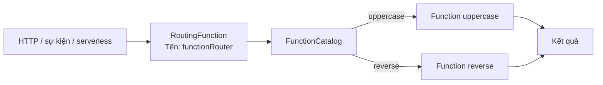

# RoutingFunction và tên `functionRouter`

## Mục tiêu học tập

Sau bài này, bạn có thể:

1. Giải thích vai trò của `RoutingFunction` trong mô hình lập trình của Spring Cloud Function.
2. Phân biệt **lớp `RoutingFunction`**, **tên đăng ký `functionRouter`** và **hàm nghiệp vụ đích**.
3. Gọi router thông qua `FunctionCatalog` hoặc HTTP, rồi chọn đích bằng header hay cấu hình.
4. Sử dụng `spring.cloud.function.definition`, `spring.cloud.function.routing-expression` và `MessageRoutingCallback` đúng tình huống.
5. Nhận biết thứ tự ưu tiên, giới hạn với reactive function và các rủi ro khi cho người gọi quyết định đích.

## 1. Vì sao cần định tuyến hàm?

Spring Cloud Function cho phép viết logic nghiệp vụ dưới dạng `Supplier`, `Function` hoặc `Consumer` và tra cứu chúng theo tên qua `FunctionCatalog`. Logic có thể được đưa ra HTTP, nhận sự kiện hoặc triển khai trong môi trường serverless tùy vào adapter; bản thân hàm nghiệp vụ không cần biết giao thức vận chuyển.

Giả sử dịch vụ xử lý văn bản có hai thao tác:

- `uppercase`: đổi chuỗi thành chữ in hoa.
- `reverse`: đảo thứ tự ký tự.

Nếu bên ngoài phải gọi đích trực tiếp, bên gọi cần biết `/uppercase` hoặc `/reverse`. Trong một môi trường chỉ muốn công bố **một điểm vào** (đặc biệt là một số mô hình Function-as-a-Service), ta có thể đưa mọi yêu cầu tới một hàm định tuyến. Hàm này quyết định phải chuyển đầu vào tới hàm nghiệp vụ nào.



Router **không thay thế logic nghiệp vụ**. Nó chỉ giải quyết câu hỏi *“với yêu cầu này, cần chạy định nghĩa hàm nào?”*; các hàm đích vẫn độc lập, có thể tái sử dụng và kiểm thử riêng.

## 2. `RoutingFunction` và `functionRouter` khác nhau thế nào?

Spring Cloud Function cung cấp sẵn lớp `org.springframework.cloud.function.context.config.RoutingFunction` với ý tưởng chữ ký:

```java
public class RoutingFunction implements Function<Object, Object> {
    // Framework quyết định hàm đích rồi ủy quyền thực thi.
}
```

Framework tự đăng ký router vào `FunctionCatalog` dưới tên **`functionRouter`**. Hằng `RoutingFunction.FUNCTION_NAME` biểu diễn tên đó, tránh viết chuỗi trực tiếp khi tra cứu bằng Java.

| Thành phần | Ý nghĩa | Ví dụ |
| --- | --- | --- |
| `RoutingFunction` | Lớp triển khai cơ chế chọn và gọi hàm đích | Router do framework cung cấp |
| `functionRouter` | Tên logic của router trong `FunctionCatalog` | `catalog.lookup("functionRouter")` |
| `RoutingFunction.FUNCTION_NAME` | Hằng chứa tên đăng ký mặc định | `catalog.lookup(RoutingFunction.FUNCTION_NAME)` |
| `uppercase`, `reverse` | Tên của các `@Bean Function` do ứng dụng viết | Giá trị chỉ dẫn định tuyến |
| `FunctionCatalog` | Bộ đăng ký/tra cứu các hàm, bao gồm cả định nghĩa ghép | Tìm `uppercase` hoặc `uppercase|reverse` |

**Không cần tự khai báo `@Bean("functionRouter")`** cho trường hợp thông thường: router mặc định đã có. Nếu muốn cơ chế riêng, có thể đăng ký thêm router mang tên **khác** `functionRouter`; đó là tình huống nâng cao, không phải bước bắt buộc.

Một điểm dễ nhầm: tên `functionRouter` là tên **của hàm được gọi ở điểm vào**; tên `uppercase` hoặc `reverse` là **đích được chọn sau đó**. Nếu chỉ định nghĩa `uppercase` mà không gọi qua router, ta đang gọi trực tiếp hàm nghiệp vụ, chưa sử dụng định tuyến.

## 3. Ví dụ chạy qua HTTP

Ví dụ sau minh họa hai `Function<String, String>` độc lập và một điểm vào router. Tạo ứng dụng Spring Boot sử dụng dependency `spring-cloud-starter-function-web` với phiên bản Spring Cloud Function tương thích phiên bản Spring Boot của dự án (thường quản lý qua BOM):

```xml
<dependency>
    <groupId>org.springframework.cloud</groupId>
    <artifactId>spring-cloud-starter-function-web</artifactId>
</dependency>
```

```java
package com.example.routing;

import java.util.function.Function;

import org.springframework.boot.SpringApplication;
import org.springframework.boot.autoconfigure.SpringBootApplication;
import org.springframework.context.annotation.Bean;

@SpringBootApplication
public class RoutingApplication {

    public static void main(String[] args) {
        SpringApplication.run(RoutingApplication.class, args);
    }

    @Bean
    public Function<String, String> uppercase() {
        return value -> value.toUpperCase();
    }

    @Bean
    public Function<String, String> reverse() {
        return value -> new StringBuilder(value).reverse().toString();
    }
}
```

Với adapter HTTP, tên function có thể trở thành đường dẫn. Sau khi khởi động ứng dụng ở `localhost:8080`, hãy gọi **cùng một endpoint `/functionRouter`** nhưng thay chỉ dẫn định tuyến:

```bash
# Chọn uppercase
curl -X POST http://localhost:8080/functionRouter \
  -H "Content-Type: text/plain" \
  -H "spring.cloud.function.definition: uppercase" \
  --data-raw "hello"
# Kết quả: HELLO

# Chọn reverse
curl -X POST http://localhost:8080/functionRouter \
  -H "Content-Type: text/plain" \
  -H "spring.cloud.function.definition: reverse" \
  --data-raw "hello"
# Kết quả: olleh
```

Tại đây:

1. HTTP adapter nhận request và chuyển thông tin phù hợp thành `Message`.
2. Tên ở URL chọn `functionRouter` từ `FunctionCatalog`.
3. Router đọc header `spring.cloud.function.definition` để biết hàm đích.
4. Router tra cứu hàm đích từ catalog, gọi nó và đưa kết quả trở về adapter.

Để kiểm tra sự khác biệt, `POST /uppercase` sẽ **gọi thẳng** `uppercase`; còn `POST /functionRouter` mới đi qua router. Đường dẫn, cách ánh xạ và kiểu phản hồi có thể chịu ảnh hưởng bởi cấu hình của adapter; ví dụ trên giả định ứng dụng web mặc định, không đặt lại `spring.cloud.function.web.path` hoặc lọc các hàm được xuất ra.

### Tra cứu router bằng Java

Nếu đang ở bên trong ứng dụng Spring, có thể lấy router bằng tên mặc định:

```java
import org.springframework.cloud.function.context.FunctionCatalog;
import org.springframework.cloud.function.context.config.RoutingFunction;

// functionCatalog được inject từ ApplicationContext.
Function<?, ?> router = functionCatalog.lookup(RoutingFunction.FUNCTION_NAME);
```

Đây là thao tác **lookup router**. Việc chọn đích vẫn cần thông tin định tuyến hợp lệ khi router được thực thi. Không nên nhầm với `functionCatalog.lookup("uppercase")`, vì thao tác thứ hai lấy trực tiếp hàm nghiệp vụ.

## 4. Ba cách cung cấp chỉ dẫn định tuyến

### 4.1. Header `spring.cloud.function.definition`: chọn tên trực tiếp

Khi đầu vào là `Message<?>`, header `spring.cloud.function.definition` chứa **tên hàm đích** hoặc **định nghĩa ghép các hàm**:

```text
spring.cloud.function.definition: uppercase
spring.cloud.function.definition: reverse
spring.cloud.function.definition: uppercase|reverse
```

Với payload `hello`, định nghĩa `uppercase|reverse` thực hiện hai bước theo thứ tự: `hello → HELLO → OLLEH`. Cú pháp `|` ở đây mang nghĩa **function composition**: kết quả của hàm trước được truyền sang hàm sau. Các hàm phải có kiểu dữ liệu đầu vào/đầu ra tương thích.

Nên dùng cách này khi đích đã được xác định rõ và không cần viết biểu thức quyết định.

### 4.2. Header hoặc property `spring.cloud.function.routing-expression`: chọn bằng SpEL

`routing-expression` là biểu thức **Spring Expression Language (SpEL)**. Giá trị sau khi đánh giá phải xác định được tên hàm/định nghĩa hàm trong catalog.

Ví dụ, request có header nghiệp vụ `operation: reverse`; router có thể nhận biểu thức:

```text
spring.cloud.function.routing-expression: headers['operation'] == 'reverse' ? 'reverse' : 'uppercase'
```

Root object khi đánh giá SpEL cho `Message<?>` chính là `Message`. Vì vậy biểu thức có thể truy cập `headers` và `payload`. Nếu `operation` bằng `reverse`, kết quả là tên `reverse`; các trường hợp còn lại chọn `uppercase`.

Khi muốn duy trì quy tắc ở phía ứng dụng, thay vì yêu cầu mỗi client gửi biểu thức, ta có thể cấu hình trong `application.yml`:

```yaml
spring:
  cloud:
    function:
      routing-expression: "headers['operation'] == 'reverse' ? 'reverse' : 'uppercase'"
```

Lúc này, các message đến router chỉ cần mang header nghiệp vụ `operation` nếu muốn chọn nhánh `reverse`; biểu thức được quản lý tập trung trong cấu hình. Cần bảo đảm adapter thực sự chuyển header nghiệp vụ thành `Message`, và vẫn gọi qua `functionRouter` ở điểm vào.

Đối với một đích cố định và không cần quyết định theo message, có thể đặt biểu thức trả về một chuỗi hằng như `"'uppercase'"` trong property `spring.cloud.function.routing-expression`. Cặp dấu nháy **bên trong** là một phần của cú pháp SpEL để biểu thức trả về tên hàm dạng chuỗi.

### 4.3. `MessageRoutingCallback`: chọn bằng code Java

Khi có quy tắc nghiệp vụ cần kiểm soát bằng code, hãy đăng ký bean triển khai `MessageRoutingCallback`. Ví dụ, chỉ chấp nhận hai đích cố định:

```java
import org.springframework.cloud.function.context.MessageRoutingCallback;
import org.springframework.context.annotation.Bean;
import org.springframework.messaging.Message;

@Bean
public MessageRoutingCallback operationRouter() {
    return new MessageRoutingCallback() {
        @Override
        public String routingResult(Message<?> message) {
            String operation = (String) message.getHeaders().get("operation");
            return "reverse".equals(operation) ? "reverse" : "uppercase";
        }
    };
}
```

Trong ví dụ này, callback chuyển dữ liệu nghiệp vụ thành một tên hàm hợp lệ, không buộc client phải biết tên `Function` trong catalog. **Lưu ý:** đây là cách mở rộng quy tắc chọn đích của `RoutingFunction`, không phải một `Function` nghiệp vụ mới.

## 5. Thứ tự ưu tiên khi có nhiều nguồn định tuyến

Với **imperative function** (ví dụ `Function<String, String>`), Spring Cloud Function áp dụng thứ tự ưu tiên:

| Ưu tiên | Nguồn chỉ dẫn | Cách dùng |
| --- | --- | --- |
| 1 — cao nhất | Bean `MessageRoutingCallback` | Chọn đích bằng Java theo `Message` |
| 2 | Message header `spring.cloud.function.definition` / `spring.cloud.function.routing-expression` | Quyết định theo từng message |
| 3 | Application/system property tương ứng | Quy tắc cấu hình của ứng dụng |

Ví dụ, nếu `application.yml` đặt biểu thức mặc định cho `uppercase` nhưng request có header định tuyến sang `reverse`, **header được ưu tiên** khi không có callback. Nếu đã đăng ký `MessageRoutingCallback`, callback quyết định đích trước các nguồn còn lại.

**Phân biệt hai vai trò của `spring.cloud.function.definition`:**

- Ở tầng adapter/cấu hình triển khai, property này có thể chỉ định hàm **được xuất ra điểm vào** (chẳng hạn khi chạy một hàm hoặc một composition).
- Khi `functionRouter` đã được gọi, `spring.cloud.function.definition` trong **Message header** có thể chỉ định **hàm đích bên trong router**.

Hai vai trò nằm ở hai giai đoạn khác nhau. Đặt `spring.cloud.function.definition=functionRouter` để chọn router ở tầng triển khai **không đồng nghĩa** với việc đã cung cấp đích nghiệp vụ cho từng yêu cầu; hãy cung cấp route hợp lệ bằng header, property định tuyến phù hợp hoặc callback. Tránh vô tình chọn `functionRouter` làm đích của chính nó.

## 6. Quy tắc định tuyến qua giao thức

`RoutingFunction` thuộc phần lõi Spring Cloud Function; adapter xử lý việc nhận/gửi dữ liệu, còn `FunctionCatalog` quản lý các hàm. Cùng một tập `@Bean Function` có thể được tái sử dụng trong những ngữ cảnh khác nhau:

| Môi trường | Điểm vào điển hình | Nguồn chỉ dẫn |
| --- | --- | --- |
| Spring Cloud Function Web | Endpoint HTTP chọn `functionRouter` | HTTP headers được adapter chuyển thành Message headers; hoặc app properties |
| Spring Cloud Stream | Binding đầu vào tới router | Message headers từ sự kiện, cấu hình ứng dụng hoặc callback |
| Serverless (ví dụ AWS Lambda) | Adapter/handler gọi router | Header/metadata được adapter chuyển tiếp, biến môi trường hoặc cấu hình |
| Gọi từ Java | `FunctionCatalog.lookup(RoutingFunction.FUNCTION_NAME)` | Message có routing headers hoặc cấu hình router |

Trong Spring Cloud Stream, tính năng event routing có cấu hình riêng, thường là `spring.cloud.stream.function.routing.enabled=true`, và tên binding đầu vào mặc định của router theo quy ước là `functionRouter-in-0`. **Tên binding** này không phải tên class, tên bean nghiệp vụ hay URL HTTP. Cách cấu hình binder/destination cụ thể phụ thuộc Kafka, RabbitMQ hoặc binder đang sử dụng.

## 7. Giới hạn và các trường hợp cần chú ý

### Imperative và reactive không định tuyến cùng cấp độ

- Với `Function<String, String>` hoặc `Function<Message<T>, ...>` kiểu imperative, có thể định tuyến **theo từng Message** qua header hoặc callback.
- Với reactive function nhận `Flux<T>`/`Publisher<T>`, hàm thường được gọi **một lần cho cả luồng**. Spring Cloud Function không hỗ trợ áp dụng chỉ dẫn routing header riêng cho từng phần tử để đổi hàm đích trong cùng luồng theo cách trên. Hãy cấu hình route ở **application properties** để định tuyến cả luồng.

Điều này không có nghĩa mọi hệ thống stream đều mất khả năng route từng sự kiện: Spring Cloud Stream có thể chuyển từng sự kiện imperative qua router. Giới hạn nêu trên liên quan đến **một reactive function nhận `Publisher` làm đơn vị xử lý**.

### Không tìm thấy đích và chiến lược dự phòng

Nếu biểu thức trả về một tên không có trong `FunctionCatalog`, router thông thường phát sinh ngoại lệ. Khi quy trình cần cách xử lý riêng cho message không định tuyến được, Spring Cloud Function cung cấp điểm mở rộng `DefaultMessageRoutingHandler` để đăng ký handler dự phòng. Handler mặc định của chiến lược này có thể ghi log và bỏ qua message; chỉ sử dụng hành vi bỏ qua nếu thực sự phù hợp yêu cầu nghiệp vụ, vì dữ liệu có thể bị bỏ sót. Với luồng giao dịch quan trọng, cần cân nhắc xử lý lỗi, logging, retry hoặc kênh lỗi của adapter.

### Kiểu dữ liệu và composition

Router không khiến mọi hàm tự động tương thích. Hàm `Function<String, String>` có thể nhận chuỗi như ví dụ; hàm xử lý JSON/POJO cần dữ liệu và `contentType` thích hợp để adapter/framework chuyển đổi đúng. Khi ghép `uppercase|reverse`, đầu ra của bước trước phải được bước sau chấp nhận. Lỗi chuyển đổi kiểu có thể xảy ra **sau khi** tên đích đã được định tuyến chính xác.

### An toàn khi nhận chỉ dẫn từ bên ngoài

Header `spring.cloud.function.definition` cho phép người gọi yêu cầu một định nghĩa hàm; nếu công khai trực tiếp, cần kiểm soát những hàm nào được phép gọi. Với SpEL, biểu thức lấy từ Message header được Spring Cloud Function đánh giá trong `SimpleEvaluationContext` có giới hạn, trong khi biểu thức lấy từ application/system properties dùng `StandardEvaluationContext` linh hoạt hơn. Đây là hai mức khả năng khác nhau, không nên coi đầu vào bất kỳ là đáng tin.

Trong hệ thống thực tế, nên cố định biểu thức ở cấu hình hoặc sử dụng `MessageRoutingCallback` để ánh xạ **giá trị nghiệp vụ được cho phép** (ví dụ `operation=reverse`) sang **danh sách hàm đích cho phép**. Nếu HTTP endpoint công khai, áp dụng xác thực, phân quyền và kiểm soát truy cập phù hợp. Tránh cho phép client tự do chỉ định tên các hàm nội bộ hoặc cung cấp biểu thức thực thi tùy ý.

## 8. Cách chẩn đoán khi route không chạy

| Dấu hiệu | Khả năng thường gặp | Hướng kiểm tra |
| --- | --- | --- |
| Request vẫn chạy một hàm cố định | Gọi thẳng `/uppercase` hoặc adapter chọn một function khác | Xác nhận điểm vào thực sự gọi `functionRouter` |
| `No function` / không tra cứu được tên đích | Giá trị route sai tên hoặc hàm chưa được đăng ký | So sánh với tên bean trong `FunctionCatalog`, chú ý chữ hoa/thường |
| Cấu hình property bị “bỏ qua” | Header hoặc callback có ưu tiên cao hơn | Kiểm tra đủ ba nguồn chỉ dẫn và thứ tự ưu tiên |
| SpEL trả về sai đích | Biểu thức không trả về chuỗi tên hàm hoặc key header không đúng | Kiểm tra `headers['operation']`, dấu nháy của string literal và giá trị thực của header |
| Đã route đúng nhưng kết quả sai hoặc lỗi chuyển kiểu | Không tương thích input/output, `Content-Type` hoặc composition | Xác nhận chữ ký hàm, payload và thứ tự composition |
| Muốn đổi nhánh theo từng phần tử `Flux` nhưng không được | Nhầm giữa imperative message routing và reactive routing | Đặt route cho cả luồng bằng properties hoặc đổi kiến trúc xử lý sự kiện |

## 9. Tự thực hành

1. Chạy ví dụ web với hai bean `uppercase` và `reverse`. Gửi hai request tới cùng `/functionRouter` với hai giá trị header `spring.cloud.function.definition` khác nhau; giải thích vì sao URL không đổi nhưng kết quả khác.
2. Thử `spring.cloud.function.definition: uppercase|reverse` và xác nhận kết quả `OLLEH` với payload `hello`. Giải thích sự khác biệt giữa *route tới một function* và *route tới một composition*.
3. Thêm header `operation: reverse` và dùng `spring.cloud.function.routing-expression` để chọn đích. Sau đó chuyển biểu thức sang `application.yml`, chỉ gửi `operation` và quan sát sự khác nhau giữa quyết định từ phía client và quyết định từ phía ứng dụng.
4. Đăng ký `MessageRoutingCallback` như ví dụ rồi gửi request có header chỉ sang `reverse` nhưng `operation` không phải `reverse`. Dùng thứ tự ưu tiên để giải thích kết quả.
5. Gửi tên hàm không tồn tại, ghi nhận lỗi và đề xuất cách xử lý phù hợp nếu đầu vào là một sự kiện thanh toán không được phép mất.

## Ghi nhớ

- **`RoutingFunction`** là cơ chế điều phối, còn **`functionRouter`** là tên mặc định để tra cứu và gọi router trong `FunctionCatalog`.
- Router chọn **định nghĩa hàm đích** qua callback, Message headers hoặc properties; một đích có thể là composition như `uppercase|reverse`.
- **Callback → Message headers → application properties** là thứ tự ưu tiên với imperative routing.
- Với reactive `Publisher`, định tuyến ở cấp **luồng** bằng cấu hình, không dựa vào header của từng phần tử.
- Tách logic nghiệp vụ ra các `Function` độc lập giúp tái sử dụng cùng logic qua HTTP, sự kiện và serverless; việc chọn route vẫn phải được kiểm soát và kiểm tra lỗi.

### Tài liệu tham khảo chính thức

- [Spring Cloud Function — Programming model: Function Routing and Filtering](https://docs.spring.io/spring-cloud-function/reference/spring-cloud-function/programming-model.html)
- [Spring Cloud Function — Standalone Web Applications](https://docs.spring.io/spring-cloud-function/reference/spring-cloud-function/standalone-web-applications.html)
- [Spring Cloud Stream — Event Routing](https://docs.spring.io/spring-cloud-stream/reference/spring-cloud-stream/event-routing.html)
