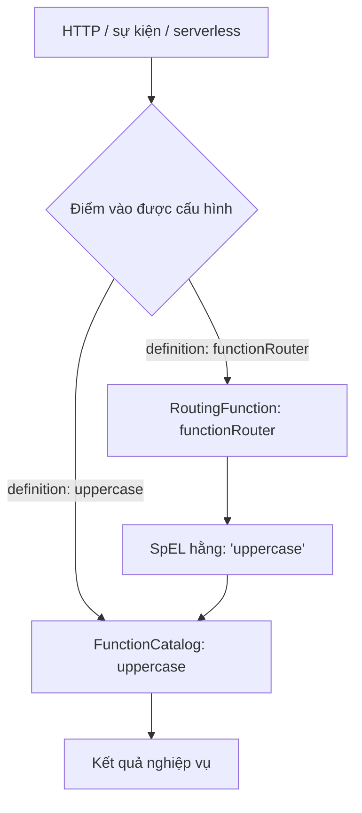

# Chọn hàm cố định bằng thuộc tính cấu hình

## Mục tiêu bài học

Sau bài này, bạn có thể:

1. Giải thích vì sao Spring Cloud Function cho phép chọn `Supplier`, `Function` hoặc `Consumer` bằng cấu hình mà không sửa logic nghiệp vụ.
2. Cấu hình `spring.cloud.function.definition` để chọn **hàm được sử dụng tại điểm vào** của một adapter.
3. Cấu hình `spring.cloud.function.routing-expression` với **biểu thức SpEL trả về chuỗi hằng** để `functionRouter` luôn chọn một hàm đích.
4. Phân biệt hai cách cấu hình, hiểu thứ tự ưu tiên khi có message header và `MessageRoutingCallback`, đồng thời xác minh kết quả qua HTTP.
5. Xử lý những lỗi thường gặp về tên bean, dấu nháy, composition và sự khác biệt giữa các môi trường triển khai.

## 1. Bối cảnh: cố định lựa chọn, giữ nguyên mã nghiệp vụ

Trong Spring Cloud Function, mỗi `Supplier<T>`, `Function<T, R>` và `Consumer<T>` có thể được đăng ký vào `FunctionCatalog` bằng tên. Bộ catalog cho phép adapter như HTTP, Spring Cloud Stream hoặc môi trường serverless tra cứu và gọi hàm theo cấu hình. Điều này giúp cùng một logic chạy dưới nhiều giao thức mà không phụ thuộc trực tiếp vào HTTP controller hay message broker.

Xét một ứng dụng có hai chức năng xử lý văn bản:

- `uppercase`: đổi văn bản thành chữ in hoa.
- `reverse`: đảo thứ tự ký tự.

Ứng dụng được đóng gói một lần nhưng môi trường A chỉ muốn xử lý bằng `uppercase`, còn môi trường B chỉ muốn xử lý bằng `reverse`. Thay vì viết `if/else` để chọn hàm trong nghiệp vụ hoặc tạo hai bản build khác nhau, ta có thể chọn một tên hàm từ lúc cấu hình ứng dụng.

**“Chọn cố định” nghĩa là cùng một lựa chọn được áp dụng cho các lời gọi của một phiên triển khai**, miễn là cấu hình và nguồn ưu tiên không thay đổi. Có hai cơ chế cần phân biệt:

1. **Chọn trực tiếp hàm thực thi:** `spring.cloud.function.definition=uppercase` để adapter biết hàm hoặc chuỗi hàm nào được sử dụng.
2. **Chọn đích cố định qua router:** đưa lời gọi qua `functionRouter` và đặt `spring.cloud.function.routing-expression` là biểu thức hằng trả về `uppercase`.

Hai cơ chế có kết quả nghiệp vụ tương tự trong ví dụ đơn giản, nhưng luồng thực thi khác nhau.

## 2. Phân biệt hai thuộc tính cấu hình

| Thuộc tính | Câu hỏi mà thuộc tính trả lời | Ví dụ |
| --- | --- | --- |
| `spring.cloud.function.definition` | Adapter cần chọn **function definition nào** từ `FunctionCatalog`? | `uppercase`, `reverse`, `uppercase|reverse` hoặc `functionRouter` |
| `spring.cloud.function.routing-expression` | Khi **`RoutingFunction` đã được gọi**, router phải định tuyến đến function definition nào? | `'uppercase'`, `'reverse'` hoặc SpEL phụ thuộc message |

`spring.cloud.function.definition` chấp nhận tên bean hoặc cú pháp composition. Ví dụ, `uppercase|reverse` chỉ định gọi `uppercase` rồi `reverse`. Đặt trực tiếp `definition=uppercase` thường đã đủ khi một adapter chỉ cần sử dụng hàm đó.

`spring.cloud.function.routing-expression` là **SpEL**. Nó được `RoutingFunction` đánh giá để trả về tên hàm đích. Nếu muốn luôn chọn một hàm, ta dùng **chuỗi hằng trong SpEL**:

```yaml
spring:
  cloud:
    function:
      routing-expression: "'uppercase'"
```

Giá trị sau khi YAML được đọc là `'uppercase'` (còn dấu nháy đơn). Đây là biểu thức SpEL có kết quả là chuỗi `uppercase`.

**Không viết** `routing-expression: uppercase` khi mục tiêu là một tên hàm cố định. Trong SpEL, `uppercase` không đặt trong dấu nháy chuỗi sẽ được hiểu như một tham chiếu thuộc tính/biến trong ngữ cảnh đánh giá, không phải chuỗi tên function.

### Luồng thực thi



Với nhánh thứ nhất, không cần gọi `RoutingFunction`. Với nhánh thứ hai, router vẫn tra cứu và ủy quyền cho hàm đích, dù quyết định định tuyến đã cố định trong cấu hình.

## 3. Tạo ứng dụng mẫu

Ví dụ dùng Spring Boot, Java và `spring-cloud-starter-function-web`. Hãy quản lý phiên bản Spring Cloud Function tương thích với Spring Boot bằng BOM/phụ thuộc của dự án; dependency dưới đây chỉ minh họa module cần dùng cho adapter HTTP:

```xml
<dependency>
    <groupId>org.springframework.cloud</groupId>
    <artifactId>spring-cloud-starter-function-web</artifactId>
</dependency>
```

```java
package com.example.fixedroute;

import java.util.function.Function;

import org.springframework.boot.SpringApplication;
import org.springframework.boot.autoconfigure.SpringBootApplication;
import org.springframework.context.annotation.Bean;

@SpringBootApplication
public class FixedRouteApplication {
    public static void main(String[] args) {
        SpringApplication.run(FixedRouteApplication.class, args);
    }

    @Bean
    public Function<String, String> uppercase() {
        return value -> value.toUpperCase(java.util.Locale.ROOT);
    }

    @Bean
    public Function<String, String> reverse() {
        return value -> new StringBuilder(value).reverse().toString();
    }
}
```

Hai bean được đăng ký dưới các tên `uppercase` và `reverse`, tương ứng với tên phương thức `@Bean`. Cả hai dùng `Function<String, String>` nên dễ quan sát kết quả trong request `text/plain`.

Lưu ý: ở cấp mô hình, `FunctionCatalog` có thể chứa các hàm độc lập và các definition được ghép; adapter quyết định cách liên kết hàm với request, event hoặc invocation.

## 4. Cách A — chọn hàm cố định bằng `spring.cloud.function.definition`

Trường hợp phổ biến nhất: chọn `uppercase` làm function mặc định cho adapter. Cấu hình:

```yaml
# application.yml
spring:
  cloud:
    function:
      definition: uppercase
```

Với Spring Cloud Function Web, khi có nhiều function trong catalog, property `spring.cloud.function.definition` cho phép ánh xạ definition được chọn vào đường dẫn gốc `/`. Khởi động ứng dụng và gửi:

```bash
curl -X POST http://localhost:8080/ \
  -H "Content-Type: text/plain" \
  --data-raw "hello"
# HELLO
```

Thay duy nhất giá trị cấu hình bằng:

```yaml
spring:
  cloud:
    function:
      definition: reverse
```

Sau khi khởi động lại ứng dụng với cấu hình mới, gọi cùng request sẽ nhận:

```text
olleh
```

Không cần sửa hai bean `Function`. **Adapter thực thi definition được chọn ở lúc thiết lập ứng dụng**, thay vì phải nhận header cho mỗi request.

### Chọn một composition cố định

Property `definition` có thể định nghĩa một pipeline cố định:

```yaml
spring:
  cloud:
    function:
      definition: uppercase|reverse
```

Khi đó, input `hello` đi qua `uppercase` thành `HELLO`, rồi qua `reverse` thành `OLLEH`. Đây là **composition trực tiếp** trong `FunctionCatalog`, chưa phải định tuyến bằng `RoutingFunction`.

### Không nhầm việc chọn function với kiểm soát endpoint

Trong adapter HTTP, nhiều function có thể được xuất ra theo các URL tên hàm. Property `definition` có tác dụng chọn definition cho binding/đường dẫn mặc định, nhưng **không nên xem một property chọn hàm là cơ chế bảo mật để chặn mọi hàm khác**. Nếu cần giới hạn function HTTP được xuất, hãy xem quy tắc function filtering của adapter và dùng kiểm soát truy cập thích hợp. Ví dụ, tài liệu Spring Cloud Function Web hỗ trợ khai báo các definition xuất ra dưới dạng danh sách phân tách bằng `;`; cách này có hành vi mapping khác với chọn một definition mặc định.

## 5. Cách B — đi qua `functionRouter`, nhưng chọn đích cố định

Khi một môi trường triển khai chỉ cung cấp một điểm vào dạng router, hoặc muốn giữ một endpoint/router ổn định để sau này thay đổi luật định tuyến, ta có thể định tuyến cố định tại cấp `RoutingFunction`.

Router do Spring Cloud Function cung cấp được đăng ký trong `FunctionCatalog` dưới tên **`functionRouter`**, tương ứng hằng `RoutingFunction.FUNCTION_NAME`.

Ví dụ `application.yml`:

```yaml
spring:
  cloud:
    function:
      definition: functionRouter
      routing-expression: "'uppercase'"
```

Hai dòng có **hai nhiệm vụ**:

1. `definition: functionRouter`: ở tầng adapter, chọn router làm function tại điểm vào.
2. `routing-expression: "'uppercase'"`: bên trong router, biểu thức trả về tên đích `uppercase`.

Đối với ứng dụng web mẫu, gửi request tới đường dẫn gốc được ánh xạ cho definition đã chọn:

```bash
curl -X POST http://localhost:8080/ \
  -H "Content-Type: text/plain" \
  --data-raw "hello"
# HELLO
```

Để chuyển đích cố định, thay `routing-expression: "'reverse'"` và khởi động ứng dụng với cấu hình mới; payload `hello` cho ra `olleh`. Điểm vào của adapter vẫn là `functionRouter`, nhưng hàm thực thi được quyết định bởi giá trị SpEL.

Một cách khác để minh họa khi router được xuất dưới tên riêng là gọi HTTP `/functionRouter` (nếu adapter cho phép ánh xạ theo tên). Chỉ dẫn định tuyến ở property không đòi hỏi gửi header `spring.cloud.function.definition` cho từng request.

### Tại sao cần hai dấu nháy?

Hãy so sánh:

| Cấu hình YAML | Giá trị mà router nhận | Đánh giá |
| --- | --- | --- |
| `routing-expression: "'uppercase'"` | `'uppercase'` | **Đúng:** SpEL literal trả về chuỗi `uppercase` |
| `routing-expression: uppercase` | `uppercase` | **Sai mục tiêu:** SpEL tìm thuộc tính/biến `uppercase` |
| `definition: uppercase` | `uppercase` | **Đúng:** đây là tên definition, không phải SpEL |
| `routing-expression: "'uppercase|reverse'"` | `'uppercase|reverse'` | **Đúng nếu cần:** literal trả về tên composition |

YAML dùng cặp nháy kép ngoài cùng để bảo toàn dấu nháy đơn của **chuỗi literal SpEL**. Tương đương trong `application.properties`:

```properties
# Khi gọi router, luôn chuyển tới uppercase:
spring.cloud.function.routing-expression='uppercase'
```

Không đặt thêm cặp nháy kép bao quanh toàn bộ value trong `application.properties`, vì nháy kép có thể bị hiểu như ký tự của chính giá trị.

## 6. Chuyển cấu hình theo môi trường mà không sửa code

Trong thực tế, việc chọn hàm có thể thay đổi theo profile, biến môi trường hoặc cấu hình khi khởi chạy:

| Nguồn cấu hình | Chọn trực tiếp `uppercase` | Gọi router rồi chọn `uppercase` |
| --- | --- | --- |
| `application.yml` | `definition: uppercase` | `definition: functionRouter` và `routing-expression: "'uppercase'"` |
| Tham số JVM/Spring Boot | `--spring.cloud.function.definition=uppercase` | `--spring.cloud.function.definition=functionRouter` cộng `--spring.cloud.function.routing-expression='uppercase'` (giữ dấu nháy đơn trong giá trị) |
| Biến môi trường Spring Boot | `SPRING_CLOUD_FUNCTION_DEFINITION=uppercase` | `SPRING_CLOUD_FUNCTION_DEFINITION=functionRouter` và `SPRING_CLOUD_FUNCTION_ROUTING_EXPRESSION` mang giá trị `'uppercase'` |

Chẳng hạn, trên Bash:

```bash
export SPRING_CLOUD_FUNCTION_DEFINITION=functionRouter
export SPRING_CLOUD_FUNCTION_ROUTING_EXPRESSION="'uppercase'"
```

Chú ý lớp escaping của shell, file cấu hình, Docker/Kubernetes và CI/CD có thể khác nhau: thứ cần kiểm tra cuối cùng là **giá trị property mà ứng dụng nhận được**, ví dụ `'uppercase'` bao gồm dấu nháy đơn. Với một số dịch vụ serverless, tên biến môi trường phải theo quy ước của nhà cung cấp; hãy kiểm tra tài liệu adapter cụ thể.

Một ứng dụng Spring Boot cũng có thể tách profile:

```yaml
# application-dev.yml
spring:
  cloud:
    function:
      definition: uppercase
```

```yaml
# application-prod.yml
spring:
  cloud:
    function:
      definition: reverse
```

Kích hoạt một profile phù hợp sẽ chọn một definition khác cho **cùng các bean nghiệp vụ đã build**. Không nên giả định chỉnh file cấu hình sau khi chương trình đã chạy sẽ tự thay binding/router: cách đơn giản, đáng tin cậy là triển khai hoặc khởi động lại với property mới, trừ khi đã thiết kế cơ chế refresh tương thích.

## 7. Khi nào lựa chọn cấu hình có thể bị ghi đè?

Khái niệm “cố định” trong bài này áp dụng cho **cấu hình mặc định**. Với imperative message routing, `RoutingFunction` còn có thể nhận chỉ dẫn khác theo từng message.

Thứ tự ưu tiên thông thường của router là:

| Ưu tiên | Nguồn quyết định đích | Ví dụ |
| --- | --- | --- |
| 1 | Bean `MessageRoutingCallback` | Logic Java đọc header nghiệp vụ để trả về `reverse` |
| 2 | Header `spring.cloud.function.definition` hoặc `spring.cloud.function.routing-expression` trong `Message` | Request gửi header `spring.cloud.function.definition: reverse` |
| 3 | Application/system property | `spring.cloud.function.routing-expression: "'uppercase'"` |

Ví dụ, đang cấu hình router với `routing-expression: "'uppercase'"`, nhưng adapter web nhận một HTTP request có header:

```text
spring.cloud.function.definition: reverse
```

Nếu request được chuyển thành `Message` có header này và không có callback ưu tiên cao hơn, router có thể chọn `reverse` thay vì property hằng `'uppercase'`. Vì thế **property đặt đích mặc định chưa đảm bảo tất cả request bắt buộc đi vào đích đó**.

Khi yêu cầu là **bất biến về nghiệp vụ hoặc chính sách** (chỉ được gọi một hàm), hãy kiểm soát endpoint, loại bỏ/không tiếp nhận các header định tuyến do client tự chỉ định ở tầng giao thức, hoặc áp dụng một callback có danh sách đích được cho phép. Chỉ xem config định tuyến là luật lựa chọn của framework; quyền truy cập cần được thiết kế riêng.

Một tình huống khác là gọi trực tiếp `/reverse` trên adapter HTTP nếu endpoint đó vẫn được xuất. Đây không phải override router: request đã đi vào hàm khác từ đầu. Cần phân biệt **chọn điểm vào** và **quy tắc bên trong điểm vào** khi chẩn đoán.

## 8. Liên hệ với HTTP, Spring Cloud Stream và serverless

Logic `Function` không biết ai đang gọi nó; adapter và binding mới xác định nguồn dữ liệu và điểm vào:

| Môi trường | Cách chọn hàm cố định | Điểm cần lưu ý |
| --- | --- | --- |
| HTTP qua `spring-cloud-starter-function-web` | `spring.cloud.function.definition=uppercase` để ánh xạ definition mặc định, hoặc chọn `functionRouter` rồi cấu hình route hằng | Đường dẫn phụ thuộc mapping của web adapter và function filtering |
| Spring Cloud Stream | `spring.cloud.function.definition=uppercase` chọn functional binding, hoặc bật event routing và cấu hình route tới một đích | Routing Stream có quy ước binding và property riêng; `functionRouter-in-0` là tên binding input của router |
| AWS Lambda/serverless adapter | Chọn definition bằng property/biến môi trường hoặc cấu hình adapter gọi router | Cơ chế chọn handler và tên biến môi trường phụ thuộc nền tảng |
| Nội bộ Java | Tra cứu `FunctionCatalog.lookup("uppercase")` hoặc `lookup("functionRouter")` | Cần chọn đúng hàm trực tiếp hay router; gọi router thì cung cấp chỉ dẫn routing phù hợp |

Với Spring Cloud Stream, để router trở thành consumer đầu vào, cấu hình event routing có thể là `spring.cloud.stream.function.routing.enabled=true` hoặc property `spring.cloud.function.routing-expression` theo hướng dẫn của phiên bản đang dùng. Binding input theo quy ước là `functionRouter-in-0`. Còn `spring.cloud.function.definition=uppercase` đơn thuần sẽ bind trực tiếp `uppercase`, không tự động tạo một router trong luồng dữ liệu.

### Imperative và reactive

Hàm `Function<String, String>` trong ví dụ là imperative: đơn vị xử lý của nó là từng message/lần gọi. Vì vậy header trên mỗi `Message` có thể ảnh hưởng lựa chọn hàm đích.

Với hàm nhận `Publisher` hoặc `Flux`, đơn vị xử lý là **cả luồng**; không thể dựa vào routing header của từng phần tử để đổi function đích trong cùng một lời gọi reactive. Trường hợp đó nên cung cấp hướng định tuyến qua **application properties** cho luồng. Đây là lý do chọn bằng cấu hình đặc biệt phù hợp khi cả một stream được xử lý bởi một hàm cố định.

### `Supplier` và `Consumer` cũng chọn được theo tên

Quy tắc lựa chọn bằng `spring.cloud.function.definition` áp dụng cho định nghĩa của `Supplier`, `Function` và `Consumer` có trong catalog. Tuy nhiên, cách kích hoạt khác nhau: `Supplier` tạo dữ liệu, `Function` nhận và trả dữ liệu, còn `Consumer` nhận dữ liệu nhưng không trả về giá trị nghiệp vụ. Không nên áp dụng máy móc ví dụ HTTP `POST` nhận chuỗi/trả chuỗi cho `Supplier` hoặc `Consumer`; hãy xét adapter đang sử dụng.

## 9. Lỗi thường gặp và cách kiểm tra

| Hiện tượng | Nguyên nhân có thể xảy ra | Cách kiểm tra |
| --- | --- | --- |
| Router không tìm thấy hàm `uppercase` | Sai tên bean hoặc bean chưa đăng ký | Kiểm tra tên `@Bean` trong `FunctionCatalog`, phân biệt chữ hoa/thường |
| SpEL báo không tìm được property `uppercase` | Dùng `routing-expression: uppercase` thay cho literal `'uppercase'` | Sửa thành `routing-expression: "'uppercase'"` |
| Gọi `/functionRouter` nhưng không có đích | Mới chọn router ở adapter mà chưa đặt route | Cấu hình `routing-expression` hoặc chỉ dẫn routing header/callback |
| Đã cấu hình `definition: uppercase` nhưng đang thử nghiệm header router | Hiểu nhầm direct invocation và routed invocation | Xác định request đang vào `uppercase` hay `functionRouter` |
| Property luôn là `uppercase` nhưng request chạy `reverse` | Header hoặc `MessageRoutingCallback` ưu tiên hơn | Kiểm tra các source của routing instruction và header từ adapter |
| `curl` vào URL không mong đợi trả 404 | Sai mapping endpoint, adapter hoặc filter | Kiểm tra đường dẫn `/`, `/<functionName>`, các cấu hình web |
| Route tìm được đích nhưng chuyển đổi dữ liệu lỗi | Content type hoặc chữ ký input/output không tương thích | Kiểm tra payload, `Content-Type`, cấu trúc type và composition |
| Cập nhật file cấu hình nhưng kết quả không đổi | Ứng dụng chưa nạp cấu hình mới | Kiểm tra active profile, nguồn property ưu tiên và quá trình khởi động |

Để phân tích đúng nguyên nhân, hãy xác định liên tiếp ba giá trị: **tên function được adapter chọn**, **cấu hình hoặc header được router đọc (nếu có)** và **tên function đích tra cứu từ catalog**.

## 10. Bài thực hành

1. Với hai bean `uppercase` và `reverse`, đặt `spring.cloud.function.definition=uppercase`. Gửi `hello` tới endpoint mặc định của Spring Cloud Function Web và ghi lại kết quả. Đổi sang `reverse` và so sánh mà không sửa Java.
2. Đặt `spring.cloud.function.definition=functionRouter` và `spring.cloud.function.routing-expression="'uppercase'"` (theo cú pháp `application.properties`). Chạy lại cùng payload. Giải thích vì sao kết quả vẫn là `HELLO` nhưng điểm vào đã thay đổi.
3. Trong `application.yml`, cố tình viết `routing-expression: uppercase`; quan sát lỗi, sau đó sửa thành `routing-expression: "'uppercase'"`. Mô tả hai lớp dấu nháy YAML và SpEL.
4. Thử `spring.cloud.function.definition=uppercase|reverse` rồi thử `definition: functionRouter` cùng `routing-expression: "'uppercase|reverse'"`. Cả hai có thể cho `OLLEH`; hãy nêu sự khác nhau trong đường thực thi.
5. Với router có route mặc định `'uppercase'`, thử thêm HTTP header `spring.cloud.function.definition: reverse`. Giải thích tình huống ghi đè và đề xuất cách buộc ứng dụng chỉ chấp nhận những hàm được phép.
6. Chọn một môi trường triển khai thực tế (Web, Stream hoặc serverless), mô tả cấu hình nào thuộc **adapter**, cấu hình nào thuộc **router** và cách đổi đích cố định giữa staging với production.

## Tổng kết kiến thức

- `spring.cloud.function.definition=uppercase` chọn trực tiếp một function definition (hoặc composition) mà adapter sử dụng; không nhất thiết phải có router.
- `spring.cloud.function.definition=functionRouter` chọn router làm điểm vào; `spring.cloud.function.routing-expression: "'uppercase'"` giúp router định tuyến mặc định đến `uppercase`.
- `routing-expression` dùng SpEL, vì vậy tên hàm cố định phải là **chuỗi literal trong SpEL**. Viết `'uppercase'` bên trong value; YAML thường cần `"'uppercase'"`.
- Với imperative routing, callback và message headers có thể ưu tiên hơn property. Muốn bảo đảm giới hạn hàm được phép gọi, phải kiểm soát cả adapter và nguồn định tuyến.
- Cấu hình bên ngoài giúp dùng lại một bộ `Supplier`, `Function`, `Consumer` qua HTTP, sự kiện hoặc serverless mà vẫn thay đổi được function được chọn theo môi trường.

### Tài liệu tham khảo

- [Spring Cloud Function — Function Routing and Filtering](https://docs.spring.io/spring-cloud-function/reference/spring-cloud-function/programming-model.html)
- [Spring Cloud Function — Standalone Web Applications](https://docs.spring.io/spring-cloud-function/reference/spring-cloud-function/standalone-web-applications.html)
- [Spring Cloud Function — AWS Lambda Adapter](https://docs.spring.io/spring-cloud-function/reference/adapters/aws-intro.html)
- [Spring Cloud Stream — Event Routing](https://docs.spring.io/spring-cloud-stream/reference/spring-cloud-stream/event-routing.html)
