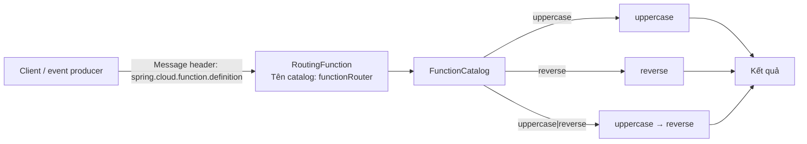

# Định tuyến bằng header `spring.cloud.function.definition`

## Mục tiêu học tập

Sau bài này, bạn có thể:

1. Giải thích ý nghĩa của header `spring.cloud.function.definition` trong cơ chế định tuyến của Spring Cloud Function.
2. Phân biệt **tên điểm vào `functionRouter`** và **tên hàm đích** được gửi trong header.
3. Tạo nhiều `Function` độc lập, rồi định tuyến từng thông điệp đến một hàm hoặc một composition mà không sửa logic nghiệp vụ.
4. Thử định tuyến qua HTTP và tạo `Message` trực tiếp bằng Java; hiểu vai trò của HTTP adapter, `FunctionCatalog` và kiểu payload.
5. Đánh giá thứ tự ưu tiên của header, application properties và `MessageRoutingCallback`; nhận diện giới hạn của reactive function và các lưu ý khi triển khai thực tế.

## 1. Tại sao dùng header để chọn hàm?

**SPRING_CLOUD_FUNCTION** khuyến khích đóng gói logic nghiệp vụ thành các bean `Supplier`, `Function` hoặc `Consumer`, rồi tra cứu qua `FunctionCatalog`. Nhờ đó, cùng một logic có thể phục vụ HTTP, sự kiện từ message broker hoặc môi trường serverless thông qua các adapter phù hợp; mã nghiệp vụ không cần phụ thuộc vào giao thức gọi.

Trong một ứng dụng có nhiều hàm, đôi khi ta muốn **một điểm vào ổn định** nhưng cách xử lý thay đổi theo từng thông điệp. Ví dụ:

- Văn bản A cần đổi thành chữ hoa bằng `uppercase`.
- Văn bản B cần đảo ký tự bằng `reverse`.
- Văn bản C cần chạy lần lượt cả hai hàm: `uppercase|reverse`.

Thay vì triển khai một endpoint cho mỗi lựa chọn hoặc thêm điều kiện vào hàm nghiệp vụ, bên gọi gửi tên hàm đích bằng header `spring.cloud.function.definition`. `RoutingFunction` của framework nhận yêu cầu, tra cứu định nghĩa được chỉ định trong `FunctionCatalog`, rồi chuyển payload tới hàm tương ứng.



Điểm quan trọng: header nói với router **hàm nào sẽ được gọi**, không phải một tham số nghiệp vụ bình thường. Đây là dữ liệu điều khiển luồng thực thi và cần được kiểm soát nếu đến từ bên ngoài hệ thống.

## 2. Cơ chế: `functionRouter` đọc `Message` header

Spring Cloud Function đăng ký `RoutingFunction` mặc định trong `FunctionCatalog` dưới tên **`functionRouter`**. Có thể tham chiếu tên này qua hằng `RoutingFunction.FUNCTION_NAME`.

Đối với một đầu vào kiểu `Message<?>`, router hiểu hai loại chỉ dẫn phổ biến:

| Header trong `Message` | Giá trị | Cách hiểu |
| --- | --- | --- |
| `spring.cloud.function.definition` | `uppercase` | Chọn một hàm có tên `uppercase` |
| `spring.cloud.function.definition` | `uppercase|reverse` | Chọn composition, chạy `uppercase` rồi `reverse` |
| `spring.cloud.function.routing-expression` | `headers['operation'] == 'reverse' ? 'reverse' : 'uppercase'` | Đánh giá SpEL để tính ra tên hàm |

Bài này tập trung vào **header `spring.cloud.function.definition`**. Khi đích đã biết sẵn ở phía bên gọi, gửi tên định nghĩa trực tiếp giúp giảm nhu cầu cấu hình biểu thức SpEL. Nếu cần tính đích từ nhiều trường của message, có thể dùng `routing-expression` hoặc `MessageRoutingCallback`.

Về mặt khái niệm, quá trình diễn ra như sau:

1. **Adapter** (HTTP, Stream, serverless, ...) nhận dữ liệu bên ngoài và tạo lời gọi đi qua `functionRouter`.
2. **Message** có `payload` (dữ liệu) và `headers` (metadata), trong đó có key `spring.cloud.function.definition`.
3. **Router** đọc header để lấy tên định nghĩa hàm đích, chẳng hạn `reverse`.
4. **FunctionCatalog** tra cứu định nghĩa đó và cung cấp function đã được framework thích nghi (bao gồm hỗ trợ chuyển đổi dữ liệu và composition trong ngữ cảnh thích hợp).
5. **Hàm đích** xử lý payload; adapter chịu trách nhiệm chuyển kết quả sang giao thức bên ngoài.

**Điều kiện tiên quyết:** request phải thực sự đi vào `functionRouter`. Nếu đang gọi trực tiếp một hàm cụ thể, chẳng hạn endpoint `/uppercase`, thì header route không có vai trò chuyển yêu cầu sang một hàm khác trong `RoutingFunction`.

### Header định tuyến và property cùng tên nhưng khác vị trí

Chuỗi `spring.cloud.function.definition` có thể xuất hiện ở **hai nơi**:

| Vị trí | Nhiệm vụ thường gặp | Ví dụ |
| --- | --- | --- |
| Application property `spring.cloud.function.definition` | Chọn function/definition được adapter sử dụng làm **điểm vào** | `functionRouter`, hoặc `uppercase` để gọi trực tiếp |
| Header `spring.cloud.function.definition` của `Message` gửi đến router | Chọn **hàm đích của từng message** | `uppercase`, `reverse`, `uppercase|reverse` |

Ví dụ: cấu hình adapter dùng `functionRouter`, còn header của request là `reverse`. Điều đó có nghĩa **đi vào router rồi chuyển đến `reverse`**, không phải hai cấu hình mâu thuẫn cùng một bước. Cần luôn xác định đang nói đến **property lúc triển khai** hay **header của một thông điệp**.

## 3. Ứng dụng mẫu: ba cách xử lý cùng một điểm vào

Ví dụ dưới đây dùng Spring Boot với HTTP adapter `spring-cloud-starter-function-web`. Khi tạo dự án, hãy khai báo dependency tương thích với phiên bản Spring Boot đang dùng, thường quản lý bởi Spring Cloud Function BOM:

```xml
<dependency>
    <groupId>org.springframework.cloud</groupId>
    <artifactId>spring-cloud-starter-function-web</artifactId>
</dependency>
```

Tạo ứng dụng có hai bean `Function<String, String>`:

```java
package com.example.headerroute;

import java.util.Locale;
import java.util.function.Function;

import org.springframework.boot.SpringApplication;
import org.springframework.boot.autoconfigure.SpringBootApplication;
import org.springframework.context.annotation.Bean;

@SpringBootApplication
public class HeaderRoutingApplication {

    public static void main(String[] args) {
        SpringApplication.run(HeaderRoutingApplication.class, args);
    }

    @Bean
    public Function<String, String> uppercase() {
        return text -> text.toUpperCase(Locale.ROOT);
    }

    @Bean
    public Function<String, String> reverse() {
        return text -> new StringBuilder(text).reverse().toString();
    }
}
```

Tên đăng ký trong `FunctionCatalog` theo mặc định là tên phương thức `@Bean`: `uppercase` và `reverse`. Hai bean chỉ nhận chuỗi, trả chuỗi và không biết gì về HTTP header hoặc message broker.

Trong ví dụ này ta gọi thẳng endpoint router theo tên `/functionRouter`. Với cấu hình web mặc định, Spring Cloud Function Web hỗ trợ ánh xạ các function theo tên:

```bash
# Yêu cầu 1: chọn uppercase
curl -X POST http://localhost:8080/functionRouter \
  -H "Content-Type: text/plain" \
  -H "spring.cloud.function.definition: uppercase" \
  --data-raw "hello"
# Kết quả dự kiến: HELLO

# Yêu cầu 2: chọn reverse
curl -X POST http://localhost:8080/functionRouter \
  -H "Content-Type: text/plain" \
  -H "spring.cloud.function.definition: reverse" \
  --data-raw "hello"
# Kết quả dự kiến: olleh
```

**Nhận xét:** cả hai request gọi một URL, dùng một `POST` body và cùng header `Content-Type`. Chỉ thay **giá trị của `spring.cloud.function.definition`**; kết quả đổi theo hàm đích.

Đối với Spring Cloud Function Web, adapter có khả năng chuyển HTTP header này sang `Message` header để `RoutingFunction` sử dụng. Với môi trường khác, khả năng chuyển metadata phụ thuộc adapter và cần được kiểm tra theo cơ chế tương ứng.

### Có thể chọn router làm function mặc định

Trong môi trường chỉ công bố một điểm vào, có thể yêu cầu adapter chọn `functionRouter`:

```yaml
# application.yml
spring:
  cloud:
    function:
      definition: functionRouter
```

Với Spring Cloud Function Web, một định nghĩa mặc định được chọn có thể được ánh xạ tại đường dẫn gốc `/`. Khi đó, gửi request đến điểm vào được cấu hình và vẫn giữ **header đích**:

```bash
curl -X POST http://localhost:8080/ \
  -H "Content-Type: text/plain" \
  -H "spring.cloud.function.definition: reverse" \
  --data-raw "hello"
# Kết quả dự kiến: olleh
```

Đây là hai tầng cấu hình riêng biệt: **`definition=functionRouter` ở application property** chọn điểm vào của adapter, còn **`definition=reverse` ở HTTP/Message header** chọn đích bên trong router. URL thực tế có thể khác nếu ứng dụng đặt lại `spring.cloud.function.web.path`, sử dụng function filtering hoặc có cấu hình web khác.

## 4. Header cũng chọn được function composition

Tên `definition` có nghĩa rộng hơn tên bean đơn lẻ. Spring Cloud Function chấp nhận biểu thức ghép các hàm bằng ký tự `|` hoặc `,`, với điều kiện đầu ra của hàm trước tương thích đầu vào của hàm sau.

```bash
curl -X POST http://localhost:8080/functionRouter \
  -H "Content-Type: text/plain" \
  -H "spring.cloud.function.definition: uppercase|reverse" \
  --data-raw "hello"
# Kết quả dự kiến: OLLEH
```

Pipeline hoạt động theo thứ tự:

```text
Input             "hello"
  │
  ├── uppercase → "HELLO"
  │
  └── reverse   → "OLLEH"
```

Đây **không phải chạy đồng thời hai hàm** hoặc gửi kết quả tới cả hai nhánh. Đây là **một composition tuần tự** mà `FunctionCatalog` hiểu và xây dựng để router gọi. Ví dụ `reverse|uppercase` cũng hợp lệ về kiểu nhưng có thể cho kết quả khác nếu hai phép biến đổi không giao hoán.

Không cần viết `'uppercase'` với dấu nháy đơn bên trong header `spring.cloud.function.definition`. Header này chứa **definition trực tiếp**, không phải SpEL. Ngược lại, nếu dùng `spring.cloud.function.routing-expression` và muốn trả về chuỗi cố định, biểu thức phải là string literal SpEL như `'uppercase'`.

## 5. Tạo `Message` mang routing header trong Java

HTTP header chỉ là một cách vận chuyển metadata. Trong ứng dụng Spring, có thể tạo `Message` trực tiếp bằng `MessageBuilder` và gọi router từ `FunctionCatalog`, miễn là kiểu dữ liệu/adapter tương thích.

```java
import java.util.function.Function;

import org.springframework.cloud.function.context.FunctionCatalog;
import org.springframework.cloud.function.context.config.RoutingFunction;
import org.springframework.messaging.Message;
import org.springframework.messaging.support.MessageBuilder;

// Đoạn mã minh họa trong một bean đã được inject FunctionCatalog.
Function<Message<String>, Object> router =
        functionCatalog.lookup(RoutingFunction.FUNCTION_NAME);

Message<String> request = MessageBuilder.withPayload("hello")
        .setHeader("spring.cloud.function.definition", "reverse")
        .build();

Object result = router.apply(request);
System.out.println(result); // Giá trị nghiệp vụ mong đợi: olleh
```

Chú ý:

- `functionCatalog.lookup("reverse")` trả về hàm nghiệp vụ và **bỏ qua bước chọn route**; `lookup(RoutingFunction.FUNCTION_NAME)` lấy router.
- `setHeader(...)` đặt tên đích vào **metadata của message**, không thêm một trường vào `payload`.
- Việc nhận được kiểu trả về cụ thể (giá trị thuần hay `Message` bao ngoài) phụ thuộc chữ ký hàm và cách framework/adapter thích nghi. Trong ví dụ, ý nghĩa cần kiểm chứng là nhánh `reverse` đã xử lý chuỗi `hello`.
- Nếu tự gọi router mà chỉ truyền một `String` không kèm `Message`, không thể giả định router có routing header để đọc; cần một nguồn định tuyến khác như application property.

### Phân biệt dữ liệu nghiệp vụ và metadata

```text
Message
  payload = "hello"
  headers:
    spring.cloud.function.definition = "reverse"
    contentType = "text/plain"   (có thể do adapter cung cấp)
```

Trong ví dụ này, `reverse` nhận nội dung `hello` để đảo ký tự. Bản thân hàm `reverse` không cần tự đọc header; `RoutingFunction` đã đọc và lựa chọn đích trước khi chuyển đầu vào.

Nếu hàm nghiệp vụ cần metadata (ví dụ `requestId` hoặc `tenant`), có thể khai báo `Function<Message<T>, R>` thay vì `Function<T, R>`. Đó là lựa chọn về **chữ ký hàm nghiệp vụ**, độc lập với vai trò chọn đích của routing header.

## 6. Định tuyến từng thông điệp trong hệ thống sự kiện

Trong kiến trúc sự kiện, nhiều message có thể đến cùng một destination nhưng cần xử lý bằng những hàm khác nhau:

```text
Event A: payload="hello", header definition="uppercase"
Event B: payload="spring", header definition="reverse"
Event C: payload="demo", header definition="uppercase|reverse"
```

Nếu adapter/binder chuyển được những header này thành Spring `Message` và **đầu vào thực sự nối tới router**, một ứng dụng có thể áp dụng các route:

| Event | Header `spring.cloud.function.definition` | Hàm đích | Kết quả |
| --- | --- | --- | --- |
| A | `uppercase` | `uppercase` | `HELLO` |
| B | `reverse` | `reverse` | `gnirps` |
| C | `uppercase|reverse` | Composition | `OMED` |

Trong Spring Cloud Stream, event routing có cấu hình riêng, thường qua `spring.cloud.stream.function.routing.enabled=true`, và sử dụng binding đầu vào router theo quy ước `functionRouter-in-0`. Cần phân biệt tên **binding** `functionRouter-in-0` với tên **function** `functionRouter`. Cách ánh xạ header từ Kafka, RabbitMQ hay nền tảng khác và cách đặt destination phải theo binder tương ứng.

Nhìn rộng hơn, cùng hai bean `uppercase` và `reverse` cũng có thể được dùng khi adapter serverless gọi router. Tuy nhiên, không phải mọi adapter đều tự động truyền header theo cùng cách như HTTP; cần xác nhận format sự kiện và cơ chế chuyển đổi metadata của adapter thực tế.

## 7. Thứ tự ưu tiên và các tình huống xung đột

Khi router có nhiều nguồn chỉ dẫn, thứ tự ưu tiên của Spring Cloud Function đối với imperative function là:

| Mức ưu tiên | Nguồn định tuyến | Minh họa |
| --- | --- | --- |
| **1 (cao nhất)** | `MessageRoutingCallback` được đăng ký thành bean | Code Java tự trả về tên đích |
| **2** | Message header `spring.cloud.function.definition` hoặc `spring.cloud.function.routing-expression` | Request mang header `reverse` |
| **3** | Application/system property dùng cho routing | Property `spring.cloud.function.routing-expression` đặt đích mặc định |

Giả sử router có property mặc định:

```yaml
spring:
  cloud:
    function:
      routing-expression: "'uppercase'"
```

Một message gửi `spring.cloud.function.definition: reverse` sẽ định tuyến tới **`reverse`** nếu không có `MessageRoutingCallback` ưu tiên cao hơn. Header được dùng để thay quyết định mặc định theo từng message.

Nếu ứng dụng đã cung cấp bean `MessageRoutingCallback`, callback có thể quyết định đích bất kể message gửi header gì. Khi cần kiểm soát route theo chính sách ứng dụng, callback là một điểm mở rộng phù hợp để ánh xạ các giá trị nghiệp vụ sang một tập tên hàm đã cho phép.

**Không gửi đồng thời** header `spring.cloud.function.definition` và `spring.cloud.function.routing-expression` trong cùng một request nếu chúng chỉ tới hai đích khác nhau. Cả hai đều là chỉ dẫn routing và điều kiện xung đột khiến việc vận hành khó dự đoán; hãy chọn một cơ chế rõ ràng cho mỗi message.

### Header route khác gì `spring.cloud.function.definition` trong ứng dụng?

Một nhầm lẫn thường gặp là đọc cấu hình:

```properties
spring.cloud.function.definition=functionRouter
```

rồi cho rằng mọi message sẽ tự động route đến `functionRouter` lần nữa. Thực tế, đây là chỉ dẫn của tầng triển khai/adapter để **chọn router làm điểm vào**. Khi message vào router, header `spring.cloud.function.definition: reverse` tiếp tục cung cấp **định nghĩa hàm nghiệp vụ đích**. Không sử dụng `functionRouter` làm giá trị đích của chính router, vì có nguy cơ tự định tuyến lặp và không diễn đạt được logic nghiệp vụ mong muốn.

## 8. Các giới hạn cần hiểu chính xác

### 8.1. Định tuyến bằng header phù hợp với imperative function

Spring Cloud Function hỗ trợ routing **theo từng Message** đối với hàm imperative, chẳng hạn `Function<String, String>` hoặc `Function<Message<Order>, Receipt>`. Mỗi lần gọi là một đơn vị công việc độc lập, nên router có thể đọc header riêng cho lần gọi đó.

Với reactive function nhận `Publisher<T>` (ví dụ `Function<Flux<T>, Flux<R>>`), hàm được gọi ở cấp **toàn bộ luồng**. Router không áp dụng routing header của từng phần tử trong luồng theo cùng cách; cần cung cấp hướng định tuyến qua **application properties** để chọn một đích cho luồng đó.

Đừng đồng nhất “event đến từ Kafka/Stream” với “reactive function”. Một binding xử lý từng sự kiện bằng imperative `Function<T,R>` vẫn có thể route theo header từng event; giới hạn nói trên áp dụng cho một function nhận `Flux`/`Publisher` làm đầu vào.

### 8.2. Kiểu payload và composition vẫn phải khớp

Header giúp router **chọn tên hàm**, chứ không chứng minh dữ liệu hợp lệ. Ví dụ `uppercase` yêu cầu `String`; khi dùng HTTP `text/plain`, việc chuyển đổi payload đơn giản. Nếu route sang `Function<Order, Invoice>`, adapter cần cung cấp JSON đúng cấu trúc và `Content-Type` phù hợp, đồng thời các bước trong composition phải khớp kiểu đầu ra/đầu vào.

Với `Supplier` hoặc `Consumer`, mô hình gọi và trả kết quả khác `Function`. Cơ chế catalog hỗ trợ các loại bean này, nhưng không được suy rằng ví dụ HTTP `POST` chuỗi và nhận chuỗi sẽ áp dụng y nguyên cho tất cả chữ ký.

### 8.3. Không tồn tại function đích

Nếu header chỉ đến tên không được đăng ký hoặc không tra cứu được trong `FunctionCatalog`, router mặc định có thể ném ngoại lệ. Spring Cloud Function có điểm mở rộng `DefaultMessageRoutingHandler` cho chiến lược xử lý message không thể định tuyến; triển khai mặc định có thể ghi log rồi bỏ qua message khi được kích hoạt. Cần cân nhắc rất kỹ vì “bỏ qua” có thể làm mất sự kiện.

Trong hệ thống quan trọng, hãy thiết kế xử lý lỗi, logging, retry hoặc dead-letter channel ở adapter/binder khi cần, và xác định rõ hành vi với tên route sai.

### 8.4. Bảo mật: không tin trực tiếp header bên ngoài

`spring.cloud.function.definition` là **chỉ dẫn thực thi**, nên nếu người gọi công khai có quyền đặt bất kỳ tên hàm nào, họ có thể cố yêu cầu chạy một hàm nội bộ có mặt trong catalog. Đừng coi việc chỉ có một URL `/functionRouter` là đã giới hạn hàm được phép gọi.

Một số biện pháp thực tế:

1. Xác thực và phân quyền trước khi cho phép gọi endpoint hoặc gửi event.
2. Định nghĩa danh sách đích cho phép theo nghiệp vụ; có thể ánh xạ header nghiệp vụ `operation` sang tên function bằng `MessageRoutingCallback` hoặc kiểm tra ở gateway/consumer.
3. Với nguồn bên ngoài không đáng tin, không chuyển tiếp nguyên trạng một header định tuyến tùy ý vào router nếu yêu cầu hệ thống chỉ được chạy những hàm nhất định.
4. Ghi lại tên đích được chọn, correlation ID và kết quả/ngoại lệ, tránh ghi payload nhạy cảm vào log.

Header `spring.cloud.function.routing-expression` còn mang biểu thức SpEL và có các quy tắc đánh giá khác; đó là một cơ chế riêng. Với nhu cầu chỉ chọn theo tên đã biết, header `definition` đơn giản hơn nhưng **vẫn phải được giới hạn quyền**.

## 9. Chẩn đoán lỗi theo từng lớp

| Hiện tượng | Nguyên nhân thường gặp | Cách xác minh |
| --- | --- | --- |
| Thay header nhưng kết quả luôn giống nhau | Request gọi trực tiếp `/uppercase`, không qua router | Kiểm tra tên function tại điểm vào; thử `/functionRouter` |
| Router không chọn được đích | HTTP/message header không truyền đến `Message`, hoặc thiếu header | Kiểm tra adapter mapping và metadata nhận được |
| Lỗi không tìm thấy `Function` | Tên trong header sai hoặc bean chưa đăng ký | Kiểm tra `@Bean`, tên trong `FunctionCatalog` và chữ hoa/thường |
| `spring.cloud.function.definition: 'uppercase'` không hoạt động | Nhầm cú pháp header definition với string literal SpEL | Gửi `uppercase` không có nháy đơn |
| Header `reverse` không thắng property `uppercase` | Có `MessageRoutingCallback` hoặc không gọi router | Kiểm tra thứ tự ưu tiên và lớp gọi |
| Composition báo lỗi kiểu | Bước trước xuất dữ liệu không tương thích bước sau | Kiểm tra chữ ký `Function<T,R>`, `Content-Type` và thứ tự `|` |
| Từng event trong `Flux` không đổi nhánh | Reactive function xử lý theo cả luồng | Cấu hình route qua application properties |
| Có thể gọi hàm nội bộ không mong muốn | Header từ client không được kiểm soát | Giới hạn endpoint và danh sách đích cho phép |

Khi debug, hãy lần lượt xác nhận **(1) adapter đang gọi `functionRouter` hay hàm trực tiếp, (2) header có đến router, (3) tên definition nào được router chọn, (4) catalog có định nghĩa đó và (5) dữ liệu có tương thích**. Cách chia này giúp phân biệt lỗi định tuyến với lỗi nghiệp vụ hoặc chuyển đổi message.

## 10. Bài thực hành

1. Tạo ứng dụng gồm `uppercase` và `reverse`. Gọi hai request giống hệt nhau tới `/functionRouter`, chỉ thay header `spring.cloud.function.definition`. Ghi lại đầu ra và giải thích vì sao không cần sửa endpoint.
2. Gửi header `spring.cloud.function.definition: uppercase|reverse` với payload `hello`. Giải thích các bước tạo `OLLEH`; thử đổi thứ tự hai hàm.
3. Gọi trực tiếp endpoint `/uppercase` kèm header `spring.cloud.function.definition: reverse`. So sánh với `/functionRouter` và giải thích **điểm vào** khác **đích sau routing**.
4. Cấu hình `spring.cloud.function.routing-expression: "'uppercase'"` trong YAML, sau đó gửi message với header `spring.cloud.function.definition: reverse`. Phân tích nguồn nào có ưu tiên cao hơn nếu không khai báo callback.
5. Tạo `MessageBuilder.withPayload(...)` và `setHeader("spring.cloud.function.definition", "reverse")` trong Java. Tra cứu router từ `FunctionCatalog`, gọi `apply` và ghi nhận kết quả.
6. Gửi một tên hàm không tồn tại. Nêu thông tin cần ghi log và đề xuất hướng xử lý nếu message thuộc quy trình thanh toán cần tránh mất dữ liệu.
7. Thiết kế một dịch vụ tiếp nhận `operation=uppercase|reverse` từ nguồn bên ngoài. Đề xuất cách kiểm tra danh sách operation hợp lệ và ánh xạ sang function nội bộ mà không tin trực tiếp vào tên bean do client nhập.

## Ghi nhớ

- `functionRouter` là tên `RoutingFunction` trong `FunctionCatalog`; **header `spring.cloud.function.definition` chọn hàm đích** khi message đã đi vào router.
- Header nhận **tên hàm** như `reverse` hoặc **definition ghép** như `uppercase|reverse`, không yêu cầu cú pháp SpEL.
- Spring Cloud Function Web có thể chuyển HTTP header sang `Message` header; với Stream và serverless, việc chuyển metadata phụ thuộc adapter/binder.
- Với imperative function, **`MessageRoutingCallback` → Message header → application property** là thứ tự ưu tiên định tuyến.
- Routing theo header là **theo từng message**, không phải cơ chế chọn hàm cho từng phần tử của một reactive `Publisher`.
- Kiểm soát nguồn cấp routing header, tên đích được phép gọi và chiến lược xử lý lỗi để giữ khả năng tái sử dụng logic nghiệp vụ mà vẫn an toàn.

### Tài liệu tham khảo chính thức

- [Spring Cloud Function — Programming model: Function Routing and Filtering](https://docs.spring.io/spring-cloud-function/reference/spring-cloud-function/programming-model.html)
- [Spring Cloud Function — Standalone Web Applications](https://docs.spring.io/spring-cloud-function/reference/spring-cloud-function/standalone-web-applications.html)
- [Spring Cloud Stream — Event Routing](https://docs.spring.io/spring-cloud-stream/reference/spring-cloud-stream/event-routing.html)
